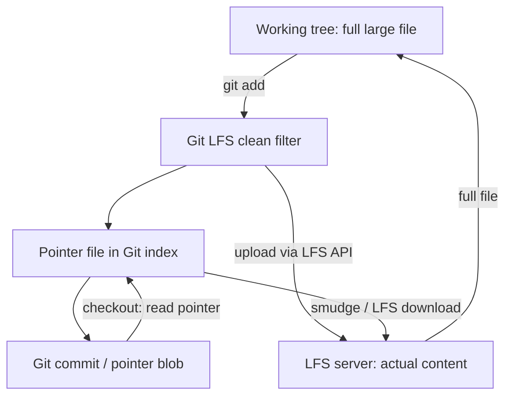

# Handling Missing LFS Objects, Access Permissions, and Storage Quotas

Git LFS (Large File Storage) helps manage large files without placing full binary content into the standard Git object database. Git stores a small **pointer file** in commits; the actual content is stored on an LFS server and identified by its SHA-256 hash and size. During checkout, clone, or branch download, Git LFS must retrieve the matching object from the server to reconstruct the full file in the working tree.

Therefore, a repository can clone and display Git history normally while still missing LFS file content. Possible causes include objects never having been uploaded, the server no longer holding the object, missing account permissions, expired credentials, a wrong endpoint, or the organization hitting storage/transfer quotas.

To resolve issues properly, first identify which object the pointer requests, whether a local copy exists, which endpoint Git LFS is connecting to, and what error the server returns. Only after distinguishing data errors, permission errors, and quota errors should you choose a recovery strategy.

## 1. What Does Git LFS Store in a Repository?

### 1.1. Pointer Files and Actual Content

When a path is managed by Git LFS, Git typically stores a small text file in pointer format, for example:

```text
version https://git-lfs.github.com/spec/v1
oid sha256:4cac196befb3726d6fc6b0a8f8f4f9d5f3a1d9e7b7c8a2f4d6e8a0b1c2d3e4f5
size 104857600
```

This is a structural example; the OID must be the actual SHA-256 hash of the file content and the `size` line must match the exact byte count. A pointer typically carries three pieces of information:

- `version`: pointer specification version.
- `oid sha256:...`: LFS object content identifier.
- `size`: actual content size in bytes.

Full binary content does not reside in Git commits as a regular blob. Git commits only reference the pointer blob. The LFS server stores the object with the matching OID.



When running `git add` and pushing an LFS file, Git LFS generates a pointer and uploads the actual content to the LFS server. On checkout, Git reads the pointer and downloads the object by OID to write the full file into the working tree.

### 1.2. Git Commits and LFS Objects Are Two Distinct Data Layers

A commit can exist completely on the Git remote while the LFS object referenced by its pointer does not exist on the LFS server. In that case:

- `git log` still displays the commit.
- `git show <commit>:path/to/file` may display the pointer.
- Checking out the file may fail to download the object or leave behind a pointer depending on configuration and actions taken.
- Builds or tools opening the file may fail because they receive a pointer instead of real content.

Thus, a successful Git push or a branch appearing on the remote does not by itself prove all LFS objects are ready for others to download. Both layers must be checked: Git refs/commits and the LFS object store.

## 2. Identifying Symptoms of Missing LFS Objects

Common symptoms include:

- Clone or checkout reports `batch response: ...`, `Object does not exist on the server`, or object download errors.
- Git LFS reports HTTP `404`, `403`, `401`, `429`, or connection errors.
- Files in the working tree contain only three pointer lines instead of the expected binary content.
- CI checks out the repository successfully, but build/test steps report an invalid file format.
- One team member can download the file while another teammate or CI cannot.
- `git push` is rejected when Git LFS fails to upload objects before updating the branch.

Do not immediately conclude an object was deleted from an HTTP status code alone. Some platforms intentionally return `404` when a user lacks permission to view a resource; `403` may stem from permissions, policies, or quotas; `401` usually relates to authentication. Read the full message, endpoint, and platform-side logs if available.

### 2.1. Checking Whether a File Is a Pointer

View file contents:

```bash
git show HEAD:path/to/large-file.bin
```

If the output has `version`, `oid sha256`, and `size` lines, that is a pointer stored in Git. To inspect the working tree, use an OS-appropriate command to read the first few lines or open the file in a text viewer. Do not open large binary files with tools that might overwrite or re-save the content.

List LFS files:

```bash
git lfs ls-files
git lfs ls-files --all
```

`git lfs ls-files` shows LFS paths recognized in the default scope; `--all` expands inspection across refs reachable to Git LFS. The output includes abbreviated OIDs and paths, useful for identifying files to investigate.

### 2.2. Checking Git LFS Status and Environment

```bash
git status --short --branch
git lfs version
git lfs env
git remote -v
git lfs logs last
```

- `git status` shows the current branch and local changes.
- `git lfs version` confirms Git LFS is installed and prints its version.
- `git lfs env` displays endpoints, local object storage directory, and LFS environment settings.
- `git remote -v` shows Git remote URLs.
- `git lfs logs last` displays the most recent Git LFS log to locate batch API, upload, or download failures.

Output from `git lfs env`, `git remote -v`, and logs may contain internal URLs or sensitive information. Redact tokens, headers, private hostnames, and credentials before sharing logs.

### 2.3. Inspecting Pointers and Local Objects

To identify the OID and size requested by a pointer, inspect the pointer in the commit:

```bash
git show HEAD:path/to/large-file.bin
```

Git LFS caches local objects inside `.git/lfs/objects` (the exact path can vary depending on configuration). You can inspect the storage directory via:

```bash
git lfs env
```

Do not manually rename or edit files in the cache. OIDs are computed from content, so changing a byte causes the object to stop matching its pointer.

## 3. Diagnosing Missing Objects with `git lfs fsck`

`git lfs fsck` verifies the integrity of local LFS objects and checks them against pointers. This command is useful for finding missing or corrupted objects in the local cache.

```bash
git lfs fsck
```

You can specify a revision or scope supported by your installed Git LFS version. View local command help:

```bash
git lfs fsck --help
```

Some versions provide separate flags for checking pointers or objects; run `--help` to confirm supported syntax.

Key distinctions:

- `git lfs fsck` checks local data and pointers within the scope it inspects.
- It is not a server-side access permission check.
- It does not automatically upload missing objects.
- It does not prove every object across all remote branches and tags is available.

If the local cache holds a valid object, you can use it to re-upload to the LFS server after verifying the endpoint, permissions, and quota.

## 4. Checking Endpoints and Authentication

### 4.1. Git Remotes and LFS Endpoints Can Differ

A Git remote uses a URL to fetch/push commits and refs. The LFS endpoint can be derived from the remote URL, declared via `.lfsconfig`, or configured separately on the machine.

Inspect the environment:

```bash
git lfs env
```

Look for endpoint lines such as `Endpoint=...` and confirm it belongs to the intended repository/server. If your organization runs a dedicated LFS server or proxy, the endpoint may differ from the Git remote URL.

A `.lfsconfig` file may contain settings such as:

```ini
[lfs]
    url = https://lfs.example.com/team/project
```

`.lfsconfig` is typically committed so clones know the project's LFS endpoint. Do not store passwords, tokens, or credentials in this file. Credentials must be supplied through a credential helper, platform login mechanism, or organizational security workflow.

### 4.2. Authentication When Using HTTPS

Over HTTPS, Git LFS typically calls the batch API and requires valid credentials. If fetching the Git remote works while LFS downloads return `401`, Git credentials and LFS credentials may be out of sync or the credential helper is not supplying credentials for the LFS endpoint.

Inspect:

```bash
git config --show-origin --get-regexp '^credential\.'
git lfs env
```

Do not print or send raw credentials. If a token has expired, sign in again or update the token in your credential manager following platform instructions. Avoid embedding tokens directly in URLs, scripts, or command history.

### 4.3. Authentication When the Git Remote Uses SSH

Some platforms allow Git remotes over SSH while transferring LFS data over HTTPS. Git LFS can use SSH to request an endpoint and temporary credentials from the platform, then use HTTPS for the batch API and uploads/downloads.

Therefore, a successful SSH clone does not guarantee LFS transfers will succeed. Check:

- Whether the SSH key has permission to access the repository.
- Whether the account has permission to access the repository's LFS objects.
- Whether endpoint discovery and temporary credential issuance work properly.
- Whether the HTTPS endpoint is reachable from the machine or runner.

If Git LFS reports authentication failures, review logs and endpoint configuration; do not assume switching the Git remote from SSH to HTTPS will resolve the root cause.

## 5. Distinguishing Permission Errors from Quota Errors

### 5.1. Read and Write Permissions for LFS

Being able to read a Git repository does not necessarily mean all LFS operations are permitted. Depending on the platform and organization setup, permissions may be checked separately for:

- Reading the repository and cloning commits.
- Downloading LFS objects.
- Uploading LFS objects.
- Accessing forks or objects belonging to the upstream repository.
- Running pipelines or CI using tokens or service accounts.

A user may fetch commits yet fail to download LFS objects if their token or account lacks appropriate LFS permissions. Conversely, downloads may succeed while LFS pushes fail due to missing upload rights.

### 5.2. Common Meanings of HTTP Status Codes

| Code / Status | Possible Causes | Next Checks |
|---|---|---|
| `401 Unauthorized` | Not signed in, expired token, credential helper not providing credentials. | Sign in again, check credential helper and endpoint. |
| `403 Forbidden` | Insufficient permissions, org policy block, missing token scope, or quota/policy denial. | Check repo/LFS permissions, token scopes, and platform usage page. |
| `404 Not Found` | Object or endpoint does not exist; server may also hide resources the user lacks access to. | Verify OID/size, endpoint, repository, and read permissions. |
| `429 Too Many Requests` | Rate limiting or too many requests within a time window. | Check retry guidance, rate limits, and server logs. |
| Timeout / DNS / TLS | Network, proxy, DNS, certificate, or unreachable endpoint. | Check connectivity, proxy, TLS, and retry once service stabilizes. |
| Quota / storage message | Storage or bandwidth quota threshold reached per platform policy. | Check billing/usage dashboard and organizational policies. |

These are diagnostic pointers, not absolute rules across all providers. Platforms may return different HTTP codes or generic messages. Always check documentation and administration consoles for your service.

### 5.3. Verifying Permissions for the Exact Identity

If a personal workstation can download while CI fails, compare the identities in use:

- Personal user versus service account.
- Whether the token has LFS read permissions or only Git repository read permissions.
- Whether the token is scoped to a specific repository, organization, or project.
- Whether the pipeline runs from the main repository, a fork, or a pull request from a fork.
- Whether credentials provisioned in the job are passed through to the LFS endpoint.

Do not share personal tokens among team members as a quick workaround. Issue dedicated, role-scoped, time-bounded credentials using CI secret stores or credential managers.

## 6. LFS Storage and Bandwidth Quotas

LFS typically enforces several distinct limits depending on provider and plan:

- **Storage quota:** total capacity of stored LFS objects.
- **Bandwidth / data transfer quota:** volume of data downloaded or transferred within a billing cycle.
- **File size limit:** maximum size of a single object or upload.
- **Request / rate limit:** number of API calls or request rate over a time window.
- **Billing / seat policy:** access may depend on plan tier, organization, or payment status.

Do not lump everything together as "out of space." An organization may have remaining storage yet exceed bandwidth; or have remaining bandwidth while a single file exceeds the maximum object size limit.

### 6.1. How to Check Quotas

Inspect the LFS platform's usage/billing dashboard or admin page. Look for:

- Current storage used and quota limit.
- Bandwidth consumed in the current cycle.
- Quota reset date (if applicable).
- Repositories or projects generating the largest usage.
- Largest files and retained historical versions.
- Plan tier, payment status, and overage alerts.

Git CLI generally lacks a universal command to query quotas across all LFS providers. `git lfs env` only shows local environment settings and endpoints, not quota dashboards. Use the provider's admin UI or supported APIs.

### 6.2. What Happens When Quotas Are Reached?

Depending on service policy, new uploads may be rejected, downloads may be throttled or blocked, pipelines may fail to retrieve objects, or admins may receive alerts. Behavior varies across platforms.

If an upload fails due to quota, the Git branch may remain un-updated because the LFS hook needs to upload objects before Git push completes. If downloads are blocked, pointers may still exist in commits while actual content cannot be written to the working tree.

### 6.3. How to Respond When Quotas Are Exhausted

1. Confirm the exact quota hit: storage, bandwidth, file size, or request limit.
2. Check the provider's dashboard and notices for reset cycles or billing requirements.
3. If immediate continuity is needed, ask an administrator to increase quotas or enable an appropriate plan following organizational procedures.
4. Reduce unnecessary repeated downloads; avoid repeatedly cloning/fetching full LFS history when jobs only need a subset of files.
5. Review storage and retention policies for unneeded objects; do not arbitrarily delete shared history or LFS data.
6. After the quota issue is resolved, re-run the required LFS operation and verify objects download or upload successfully.

Deleting a commit or branch in Git does not necessarily reduce billed LFS storage. Many platforms retain objects for a grace period or until a separate garbage collection process runs. Do not assume `git push --delete` deletes LFS objects or frees quota immediately.

## 7. Recovery Workflow for Missing Objects

### 7.1. Step 1: Identify the Exact Repository, Branch, and Pointer

```bash
git status -sb
git branch --show-current
git remote -v
git lfs ls-files --all
git show HEAD:path/to/large-file.bin
```

Record the branch, commit, path, SHA-256 OID, and size from the pointer. Inspect `.gitattributes` to confirm the path is genuinely configured for LFS.

### 7.2. Step 2: Verify Endpoint and LFS State

```bash
git lfs version
git lfs env
git config --show-origin --get-regexp '^lfs\.'
```

Confirm the endpoint points to the expected repository server. Inspect `.lfsconfig` if used by the project, as well as local/global settings that could override it. Redact sensitive information before saving or sharing output.

### 7.3. Step 3: Attempt to Download Required Objects

If the pointer belongs to the current branch, you can run:

```bash
git lfs pull origin
```

`git lfs pull` downloads LFS objects for the current ref/checkout using Git LFS's fetch mechanism and updates working tree content. If you only want to fetch objects without modifying working tree files yet, run:

```bash
git lfs fetch origin
```

You can specify a branch or ref as needed:

```bash
git lfs fetch origin main
```

Check exact syntax with `git lfs fetch --help` if your version differs. `fetch` downloads objects into the local cache; `pull` also materializes content into the working tree.

### 7.4. Step 4: Verify Objects After Downloading

```bash
git lfs fsck
git lfs status
git status --short
```

Open the file with an appropriate tool and verify size and content. If the file remains a pointer, check smudge/filters, `GIT_LFS_SKIP_SMUDGE`, endpoint, and download logs.

### 7.5. Step 5: If the Object Is Still Missing

If the server reports the object does not exist:

- Verify the pointer has a valid OID and size.
- Check which commit/branch created that pointer.
- Ask the commit author or teammates whether any clone still holds the LFS object locally.
- Check backups, artifact storage, or other copies of the original file.
- If a valid object exists on another machine, follow the re-upload workflow after verifying permissions and quotas.

If no copy of the object exists locally, in backups, or on the server, the pointer cannot reconstruct the content. A pointer only stores the OID and size, not binary bytes. In that case, restore from the original data source or project backups.

## 8. Re-Uploading LFS Objects When a Valid Copy Exists Locally

If the server is missing an object but a trusted clone still has it locally, it can be re-uploaded. First, verify the object with `git lfs fsck` and confirm endpoint, write permissions, and quota.

To upload LFS objects referenced by a specific branch:

```bash
git lfs push origin main
```

To upload objects referenced by all local refs:

```bash
git lfs push --all origin
```

`--all` can transfer large volumes of data. Use it only after confirming the required recovery scope, size, and access permissions. In repositories with many branches/tags, pushing everything can consume substantial bandwidth and storage.

After uploading, verify from another clone or CI environment with read access:

```bash
git lfs fetch origin main
git lfs fsck
```

If the server rejects with 403/quota errors, retrying uploads repeatedly will not solve it. Resolve permissions or quotas first.

## 9. Handling Cases Where Only Pointers Appear in the Working Tree

Some environments set:

```bash
GIT_LFS_SKIP_SMUDGE=1
```

to skip automatic LFS object downloads during clone/checkout. This is helpful for fast clones or downloading only needed files later. However, the working tree will contain pointers instead of full files.

Once ready to download objects:

```bash
git lfs pull origin
```

Check environment variables and filters:

```bash
git lfs env
git config --show-origin --get-regexp '^filter\.lfs\.'
```

If `GIT_LFS_SKIP_SMUDGE` remains set, checkouts may continue leaving pointers. Unset it in the appropriate terminal or job and run `git lfs pull`.

PowerShell:

```powershell
Remove-Item Env:GIT_LFS_SKIP_SMUDGE -ErrorAction SilentlyContinue
git lfs pull origin
```

Do not manually delete or edit pointers to simulate real content. Download the object matching the OID from the LFS server.

## 10. Special Scenarios: CI, Forks, and Fresh Clones

### 10.1. CI Fetches Git but Fails to Download LFS

CI may use a token sufficient for cloning the Git repository but lacking LFS download permissions. Check:

- Whether the job token has permission to read LFS objects.
- Whether pull requests from forks are allowed to download LFS objects from the upstream repository.
- Whether secrets are exposed in the current pipeline context; many platforms restrict secrets for forks or untrusted pipelines.
- Whether the runner has Git LFS and required hooks/filters installed.
- Whether the LFS endpoint is reachable through the runner's proxy/firewall.

Do not expose broad write-scoped secrets to untrusted fork pipelines just to make LFS work. Use read-only credentials and platform-approved security practices.

### 10.2. Fork Has Pointers but Missing Objects

A fork may contain commits and pointers copied from the upstream repository without LFS objects automatically copied as users might expect. Behavior depends on the platform. Contributors may be able to read Git history yet fail to download large files.

Check the LFS endpoint and access permissions to the source repository. If project policy allows, maintainers should ensure LFS objects are hosted where legitimate forks/CI can download them, or provide a separate artifact sharing mechanism.

### 10.3. Fresh Clones Fail to Download Objects Present in Older Clones

An older clone may still hold a local LFS cache even after an object was removed from the server or quotas changed. As a result, the old clone can open files while a fresh clone fails. If the old clone holds the only remaining copy of an object, back up and verify the object before pruning caches or decommissioning the machine.

## 11. Maintaining the Local Cache and LFS Server

Git LFS maintains a local object cache to avoid redundant downloads. You can inspect storage directory paths via `git lfs env` and check status using the corresponding LFS commands.

Running:

```bash
git lfs prune
```

cleans up local objects that are no longer needed according to Git LFS retention rules. This operates strictly on the local cache; it does not delete objects on the LFS server and does not free remote storage quotas.

Before pruning, ensure:

- Objects needed by unpushed branches or offline work are uploaded or backed up.
- The cache is no longer needed as the sole recovery source.
- Active worktrees and branches do not depend on local objects about to be pruned.

Do not manually delete `.git/lfs/objects` to work around server quotas. Doing so only wipes local cache, potentially forcing re-downloads and increasing bandwidth usage.

## 12. Preventing LFS Errors

### 12.1. Consistent Git LFS Setup

In a new environment:

```bash
git lfs version
git lfs install
```

`git lfs install` configures required hooks/filters for the current user or repository depending on flags. Include this in onboarding so workstations do not accidentally commit raw binaries or skip uploads.

Verify `.gitattributes` has accurate patterns:

```gitattributes
*.psd filter=lfs diff=lfs merge=lfs -text
*.zip filter=lfs diff=lfs merge=lfs -text
```

Only route suitable file types into LFS. Avoid adding every text file or small file to LFS without reason.

### 12.2. Verify Uploads Before Announcing Completion

After committing LFS files:

```bash
git lfs status
git push origin feature/large-assets
```

Watch both Git and LFS output. Ensure the pre-push hook uploaded objects successfully and the branch was updated. Bypassing hooks with `--no-verify` or disabling them can push pointers without objects on the server; avoid doing so unless a verified alternative upload workflow is in place.

### 12.3. Verify with a Clean Clone or CI

A local clone may rely on stale local cache and mask objects missing from the server. For critical assets, verify from a clean clone or clean runner with permissions equivalent to real users. This confirms objects are downloadable from the LFS server rather than existing only in the author's cache.

### 12.4. Monitor Quotas

Administrators should monitor storage and bandwidth periodically, configure alerts, and define who may upload large files. Before major releases or bulk asset imports, estimate storage and transfer volume to prevent interrupting pipelines or development teams.

## 13. Quick Diagnostic Table

| Symptom | Causes to Check | Appropriate Action |
|---|---|---|
| File displays a pointer | Smudge skipped, Git LFS not installed, or object not downloaded | Check `git lfs env`, skip-smudge variables, and run `git lfs pull`. |
| `401` on download | Missing or expired credentials | Re-authenticate, check credential helper and token read scope. |
| `403` on upload | Missing write permission, policy block, or quota | Check upload permissions, policies, and usage dashboard. |
| `404` object | OID missing or server hiding unauthorized resource | Cross-check pointer, endpoint, repository, and read permissions. |
| Old clone works, new clone fails | Object exists in old cache but missing on server | Back up old cache, verify integrity, and re-upload if valid. |
| CI fails while workstation works | Different service token, fork policy, runner, or endpoint | Compare identity, secret scope, Git LFS version, and network. |
| Upload rejected for storage | Storage quota or file size limit | Check dashboard, raise limits, or adjust storage policy. |
| Downloads throttled despite storage available | Bandwidth or rate quota | Check transfer cycle and reduce repeated downloads. |

## 14. Step-by-Step Incident Response Workflow

Suppose a teammate clones the repository successfully, but `models/model.bin` is only a pointer; CI also reports failing to download the object.

**Step 1: Confirm the Pointer and OID**

```bash
git show HEAD:models/model.bin
git lfs ls-files --all
```

Record the SHA-256 OID and size.

**Step 2: Confirm Git LFS and Endpoint**

```bash
git lfs version
git lfs env
git remote -v
```

Verify the endpoint, `.lfsconfig` settings, and skip-smudge variables.

**Step 3: Attempt to Fetch the Object**

```bash
git lfs fetch origin main
```

If it fails, record the HTTP status and message; do not retry in a tight loop if the error indicates permissions or quota.

**Step 4: Classify the Cause**

- `401`: verify login and credentials.
- `403`: verify LFS permissions, token scopes, policies, and quotas.
- `404`: verify object existence and correct endpoint/repository.
- `429`: check rate limits or bandwidth policies.
- Timeout/TLS: check network, proxy, and certificates.

**Step 5: Locate a Valid Copy of the Object**

If the server genuinely lacks the object, ask the commit author or check older clones. Back up and verify the cache with `git lfs fsck` before re-uploading.

**Step 6: Recover and Verify**

Once permissions/quotas are resolved or the object is re-uploaded:

```bash
git lfs pull origin
git lfs fsck
```

Verify file size/content, run build/tests, and validate from a clean clone or CI to confirm everyone can download the object.

## 15. Key Takeaways

- Git commits store pointers; the LFS server stores actual content keyed by SHA-256 OID and size.
- Git history can be complete while LFS objects are missing.
- `git lfs ls-files`, `git lfs env`, and `git lfs fsck` help identify files, endpoints, and local integrity.
- `git lfs fetch` downloads objects into cache; `git lfs pull` downloads and updates working tree content.
- A Git remote using SSH does not guarantee LFS transfers avoid needing HTTPS or separate credentials.
- `401`, `403`, `404`, and `429` are signals for triage; exact codes depend on the provider and do not prove a single cause on their own.
- Storage, bandwidth, file size, and rate limits are distinct quota types.
- `git lfs push --all` can upload huge amounts of data; use only after verifying scope, permissions, and quotas.
- `git lfs prune` cleans the local cache, does not delete LFS objects on the server, and does not free remote quotas.
- A pointer cannot reconstruct binary content if all copies of the object are lost; locate the original source or backup.
- A clean clone or CI run verifies objects are genuinely downloadable from the server rather than present only in one machine's cache.

When LFS errors occur, start from the pointer and OID, then inspect the endpoint, identity, permissions, quotas, and local cache. Only when you know where the object resides and why the server is rejecting requests can you recover safely without adding risk or wasting quota.
