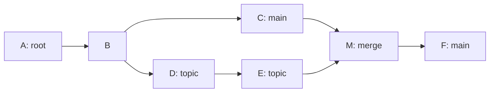
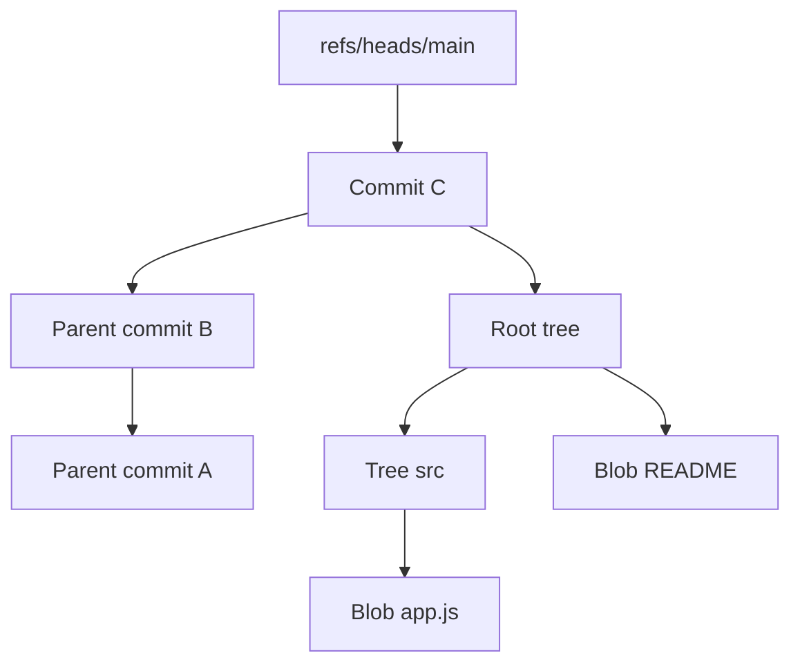

# Commit Graph, Parent Relationships, and Object Reachability

Git stores history as immutable objects connected by references. Each commit points to a snapshot of the directory tree and one or more parent commits. Parent relationships form a **directed acyclic graph (DAG)**. Branches and tags are refs that help Git locate these objects; they are not copies of history.

Understanding the commit graph and object reachability explains why merge commits have multiple parents, why rebasing creates new commits, why a deleted branch can still be recovered, and why an object may still exist in `.git/objects` even when no branch references it anymore.

In the SOURCE_CONTROL_GIT module, this knowledge connects branch, merge, rebase, tag, and recovery operations to the actual data structures managed by Git. We will move from commit structure to tracing ancestry relationships and checking whether an object is still reachable.

## 1. Git stores history using objects

Git does not store history as a sequential series of patches. It stores objects by content, then uses objects referencing each other to describe snapshots and history.

Basic object types:

| Object | Content | Role |
|---|---|---|
| `blob` | Raw bytes of file content | Stores file content; does not store name or path itself. |
| `tree` | List of entries with mode, name, and object ID | Describes a directory; entries can point to blobs or subtrees. |
| `commit` | Tree, list of parents, author, committer, and message | Records a snapshot along with its position in history. |
| `tag` | Target object, target type, tag name, tagger, and message | Creates an annotated tag; may include a signature. |

A file named `src/app.js` is not stored in the blob under that name. The blob contains only the content bytes. The name `app.js` and its relationship to the `src` directory live in tree objects. This allows the same blob to be referenced from multiple trees without storing duplicate content.

### 1.1. Object IDs and immutability

Each object is identified by a content hash (object ID or OID). Git computes the hash from a representation consisting of the object type, size, and content; therefore, changing a commit's content or metadata produces a different object ID.

Historically, repositories have used SHA-1; Git also supports the SHA-256 repository format. Do not assume every OID is always 40 characters long. Use Git commands to retrieve OIDs rather than slicing strings to a fixed length:

```bash
git rev-parse HEAD
git rev-parse --show-object-format
```

Objects are treated as immutable: Git does not modify an existing commit or blob in place. When creating new content, Git writes a new object with a new OID. This is what allows commits to be shared and verified via OID.

### 1.2. Inspecting object contents

Given a known OID:

```bash
git cat-file -t <object-id>
git cat-file -s <object-id>
git cat-file -p <object-id>
```

- `-t` prints the object type.
- `-s` prints the object content size.
- `-p` displays the content formatted appropriately for the object type.

For example, inspect the current commit:

```bash
git cat-file -p HEAD
```

The output typically looks like:

```text
tree 8a4f... 
parent 31bc...
author An Nguyen <an@example.com> 1731500000 +0700
committer An Nguyen <an@example.com> 1731500000 +0700

feat: add invoice search
```

The OIDs in the example are abbreviated. A regular commit has one `parent` line; a root commit has no `parent` line; a merge commit has two or more `parent` lines.

## 2. Structure of a commit object

A commit object describes a snapshot and its relationship to prior history.

Important fields:

- `tree`: OID of the tree at the snapshot's root directory.
- `parent`: OID of a parent commit; there may be multiple lines.
- `author`: the person credited with creating the change and the author timestamp.
- `committer`: the person who created the commit object and the committer timestamp.
- Message: descriptive text of the commit.
- Optional headers: encoding, signature (`gpgsig` or related headers), and other metadata.

### 2.1. Root commit

The first commit in a history has no parent commit. It is called a root commit:

```text
A
```

A root commit still has a `tree`, author, committer, and message; it simply has no parent. A repository can have multiple root commits if independent histories are created separately and then brought together into one repository without being joined by a merge.

### 2.2. Regular commit

A regular commit has exactly one parent:

```text
A---B---C
```

Commit `B` has parent `A`; commit `C` has parent `B`. The parent relationship runs from newer commit back to older commit. In history diagrams, we often draw time arrows from left to right, but the `parent` field inside the object points backward to the preceding commit.

### 2.3. Merge commit

A merge commit has multiple parents, most commonly two:

```text
      D---E
     /     \
A---B-------M---F
```

Here `M` has two parents: the pre-merge commit on the current branch (`B`) and the tip of the merged branch (`E`). The first parent is normally the branch you were on when running the merge; the second parent is the branch being merged in. Parent order is part of the commit and matters for expressions such as `M^1`, `M^2`, and `--first-parent`.

Git also supports octopus merges with three or more parents, commonly used when combining several simple branches at once. Complex conflicts are generally resolved via separate two-way merges rather than an octopus merge.

## 3. The commit graph is a DAG

DAG stands for *directed acyclic graph*: a graph with directed edges and no cycles. In the commit graph:

- Each vertex is a commit.
- Each parent relationship is a directed edge from child commit to parent commit.
- There is no path leading back to the same starting commit, because a new commit can only point to already-existing objects.
- A commit may have one parent, multiple parents, or no parents.

When illustrating history, we usually place older commits on the left and newer commits on the right:



The arrows in this diagram show the direction of development from parent to child for readability. Inside the commit objects, each new commit stores the OID of its parent, meaning the reference points from child to parent.

### 3.1. History is not necessarily a straight line

With only regular commits, history looks like a chain. When branches are created and developed in parallel, the graph forks. When merged, multiple lines of history meet at a commit with multiple parents.

For this reason, `git log --oneline` may not clearly reveal branching structure. To view the graph:

```bash
git log --graph --oneline --decorate --all
```

`--graph` draws branching relationships; `--decorate` displays refs pointing to commits; `--all` instructs Git to consider all refs listed by Git rather than only the history of `HEAD`.

### 3.2. Commit timestamps do not determine parent relationships

The graph is defined by parent OIDs, not by sorting timestamps. Author date and committer date can differ; rebasing can preserve the author date while creating a new committer date. System clocks can also be wrong.

Therefore, never infer that one commit is the parent of another merely because its timestamp is smaller. Rely on ancestry relationships or read the `parent` field.

### 3.3. The commit DAG and the `commit-graph` file are two related concepts

In Git documentation, `commit graph` usually refers to the DAG formed by commits and parent relationships. Git also has an acceleration feature stored in the **commit-graph** file (typically located under `.git/objects/info/commit-graph` or in a commit-graph chain). This file stores precomputed information such as parents and generation numbers to speed up history traversal operations.

The commit-graph file is a performance optimization; it does not replace commit objects, branch refs, or actual parent relationships. If the optimization file is missing, Git can still read commit objects and reconstruct relationships, though some operations may be slower.

You can verify or generate this optimization data with dedicated commands:

```bash
git commit-graph verify
git commit-graph write --reachable
```

`verify` checks the existing commit-graph file; `write --reachable` creates or updates commit-graph data for reachable commits. This is a performance maintenance operation, not a step required to understand or modify commit history.

## 4. Branches, tags, and HEAD are refs to objects

A ref is a name that resolves to an OID. A branch does not contain the entire history; it is normally a movable pointer to a tip commit.

### 4.1. Branch refs

Example:

```text
refs/heads/main       -> commit C
refs/heads/feature    -> commit E
```

Two branches can point to the same commit, or point to two different tips within the same DAG. When creating a commit on the checked-out branch, Git updates that branch's ref to point to the new commit.

Inspect branches and OIDs:

```bash
git branch -avv
git show-ref --heads
```

### 4.2. Remote-tracking refs

A remote-tracking branch such as `origin/main` is a local ref recording the tip observed from the remote on the most recent fetch:

```text
refs/remotes/origin/main -> commit C
```

It does not automatically update in real time with the server. You must run `git fetch` to refresh information from the remote.

### 4.3. Lightweight tags and annotated tags

A lightweight tag is normally a ref pointing directly to an object, usually a commit:

```text
refs/tags/v1.0 -> commit C
```

An annotated tag creates an additional tag object containing the tag name, tagger, message, and optionally a signature; the tag ref points to the tag object, and that object points to the commit or other target object.

Inspect tags:

```bash
git show-ref --tags
git cat-file -t v1.0
git cat-file -p v1.0
```

`git cat-file -t v1.0` returns `tag` for an annotated tag or `commit` for a lightweight tag.

### 4.4. HEAD: the current working position

Normally `HEAD` is a symbolic ref pointing to the current branch:

```text
HEAD -> refs/heads/main -> commit C
```

When checking out a specific commit instead of a branch, `HEAD` points directly to an OID; this state is called detached HEAD:

```text
HEAD -> commit C
```

Verify:

```bash
git symbolic-ref -q HEAD
git rev-parse HEAD
```

`git symbolic-ref -q HEAD` returns the ref name if `HEAD` is symbolic; in detached HEAD state, it returns no symbolic ref. `git rev-parse HEAD` still returns the current commit OID.

## 5. Ancestry relationships and commit reachability

A commit `A` is an ancestor of commit `B` if you can follow one or more parent links from `B` to reach `A`. `B` is a descendant of `A`.

Example:

```text
A---B---C---D
     \
      E---F
```

- `A` is an ancestor of `D` and `F`.
- `B` is an ancestor of `C`, `D`, `E`, and `F`.
- `C` is not an ancestor of `F`.
- `E` is not an ancestor of `D`.
- Neither `D` nor `F` is an ancestor of the other.

Test a relationship:

```bash
git merge-base --is-ancestor A D
echo $?
```

Exit status `0` means `A` is an ancestor of `D`; `1` means it is not; other codes indicate an error or an unresolvable object. In PowerShell, check `$LASTEXITCODE` immediately after the Git command.

### 5.1. Fast-forward is moving a ref along an ancestry relationship

Suppose branch `main` points to `B`, while `feature` points to `D`:

```text
A---B---C---D   feature
    ^
    main
```

Because `B` is an ancestor of `D`, merging `feature` into `main` can fast-forward: Git simply moves the `main` ref from `B` to `D` without creating a merge commit.

If the two branches have diverged:

```text
      C---D   main
     /
A---B
     \
      E---F   feature
```

You cannot fast-forward `main` to `feature` while keeping commit `D` in `main`'s history. Git must create a merge commit, or the user must explicitly rebase or reset according to an appropriate workflow.

### 5.2. The merge base is the best common ancestor

A merge base is one or more best common ancestors of two commits—meaning no other common ancestor lies downstream of them in the graph. In typical histories, the merge base is usually the nearest branching point.

Inspect:

```bash
git merge-base main feature
git merge-base --all main feature
```

Some complex graphs can have multiple best merge bases. Git's merge algorithm may need to handle those cases; do not assume every pair of branches always has exactly one merge base.

## 6. Object reachability

An object is called reachable when it can be reached from a set of starting points (roots) by following object links. In daily work, refs such as branches, tags, and certain other refs serve as the primary starting points.

Starting from a branch tip, Git can traverse to:

1. The commit and its parent commits.
2. The tree referenced by each commit.
3. Subtrees and blobs referenced by those trees.
4. Other objects referenced via tag objects or related structures.

Example:



If branch `main` points to commit `C`, its parent commits and the trees/blobs referenced by those commits are all reachable from this ref.

### 6.1. Refs keep objects findable

A branch or tag is a stable name that helps users find objects again. When a branch moves, the old ref no longer holds the previous commit under that branch name. If no other ref or retention source remains, the old commit can become unreachable.

List refs:

```bash
git show-ref
git for-each-ref --format='%(refname) %(objectname)'
```

Do not confuse a branch name with an object ID. A branch can move to new commits; the old commit object itself remains immutable.

### 6.2. The reflog can retain traces of old refs

The reflog records updates to `HEAD` or refs, such as after commit, reset, rebase, or checkout. It can help locate commits that a branch previously pointed to:

```bash
git reflog --all --date=iso
```

The reflog is local data and is not automatically pushed to remotes like branches are. It has a retention period and can expire. Thus, the reflog is a useful recovery source, not a long-term backup.

Git garbage collection normally keeps referenced objects and may retain some unreachable objects for a grace period to avoid immediately deleting recently dereferenced objects. Exact lifetimes depend on configuration and maintenance commands. Once reflog entries expire and objects are pruned, local repository recovery may no longer be possible.

### 6.3. Reachable, unreachable, and dangling are not synonymous

- **Reachable:** can be traversed from the roots currently under consideration.
- **Unreachable:** cannot be traversed from those roots, though the object may still reside in the object database.
- **Dangling:** a `fsck` term for an object not directly referenced by any other object; many dangling objects are also unreachable and can serve as recovery clues.

The set of roots considered can vary across commands and options. Refs, reflogs, the index, and promisor objects can affect how Git checks reachability. Therefore, when investigating, read `fsck` options carefully rather than treating one output as an absolute list of every object in all contexts.

## 7. Inspecting reachable and unreachable objects

### 7.1. Listing commits reachable from refs

```bash
git rev-list --all
```

This lists commits reachable from the refs considered by `--all`. To visualize the graph:

```bash
git log --graph --oneline --decorate --all
```

### 7.2. Listing reachable objects

```bash
git rev-list --objects --all
```

The output includes the OIDs of reachable objects along with paths for traversed blobs and trees. This shows the objects retained by current history/refs.

To scope to a single commit:

```bash
git rev-list --objects <commit-id>
```

This traverses objects referenced by that commit and its ancestors.

### 7.3. Finding unreachable objects

Once you understand the repository state, you can run:

```bash
git fsck --full --unreachable
```

To also inspect dangling objects:

```bash
git fsck --full --dangling
```

`git fsck` verifies the validity and connectivity of the object database. Unreachable objects are not necessarily corrupted data; they can be commits dropped from a branch after reset/rebase or objects left behind after deleting a ref.

If you need to ignore reflogs to find objects no longer kept by any ref or reflog:

```bash
git fsck --full --no-reflogs --unreachable
```

This is a helpful investigative step after making a backup. Do not run `git gc`, `git prune`, or delete files in the object directory while searching for data to recover.

### 7.4. Inspecting a discovered object

When `fsck` prints an OID, check its type and contents:

```bash
git cat-file -t <object-id>
git cat-file -p <object-id>
```

If it is a commit, inspect its snapshot and parents. If it is a commit you want to preserve, create a rescue ref:

```bash
git branch rescue/recovered <commit-id>
```

Once the rescue branch exists, the commit becomes reachable from that ref. Verify the contents before naming or sharing the branch.

## 8. Reading parent relationships with revision syntax

Git provides shorthand syntax to navigate from a commit to its parents or ancestors.

| Syntax | Meaning |
|---|---|
| `HEAD^` | First parent of `HEAD`, equivalent to `HEAD^1`. |
| `HEAD^2` | Second parent of `HEAD`; commonly used with merge commits. |
| `HEAD~1` | First parent of `HEAD`. |
| `HEAD~2` | Follow the first parent twice. |
| `HEAD~3` | Follow the first parent three times. |
| `main^1` | First parent of the `main` branch tip. |
| `main^2` | Second parent if the `main` tip is a merge commit with at least two parents. |

Example:

```bash
git show --no-patch --pretty=raw HEAD
git show --no-patch HEAD^1
git show --no-patch HEAD^2
```

`~n` always follows the chain of first parents; `^n` selects the nth parent at a single commit. Therefore `HEAD~2` and `HEAD^2` are not the same.

### 8.1. Distinguishing `A..B` and `A...B`

```bash
git log A..B
git log A...B
```

- `A..B`: commits reachable from `B` but not reachable from `A`.
- `A...B`: symmetric difference of commits—commits reachable from either side exclusively, excluding the common portion from the merge base.

These syntaxes are useful for seeing which commits belong exclusively to each branch before merging or rebasing. With `git diff`, the triple-dot syntax has a different meaning: `git diff A...B` normally compares the merge base of `A`/`B` against `B`, rather than showing the symmetric set of commits like `git log A...B`.

## 9. Parent relationships explain merge, rebase, and reset

### 9.1. Merge preserves both lines of history

When two branches diverge, a merge typically creates a commit with two parents. The new commit records both lines of history that were integrated.

```text
      C---D  main
     /     \
A---B       M---E  main
     \     /
      X---Y  feature
```

Merge commit `M` has parents `D` and `Y` (in the actual order recorded in the commit). The older commits remain unmodified.

### 9.2. Rebase creates new commits with new parents

Rebase replays a branch's commits onto a different base. Because the parent changes, the OIDs of the replayed commits change as well:

```text
Before:
A---B---C  main
     \
      D---E  feature

After rebase:
A---B---C---D'---E'  feature
```

`D'` and `E'` carry content/metadata based on the replayed commits, but with different parents, so they are new commit objects. The old commits may still be found via the reflog or backups for some time.

### 9.3. Reset moves a ref and can make commits unreachable

Example:

```bash
git reset --hard HEAD~1
```

This command moves the branch/`HEAD` back to its first parent and updates the index and working tree to match that commit. The old tip commit is no longer referenced by the current branch; if no other ref points to it, it may be kept only by the reflog or become unreachable.

This is why understanding reachability matters before running history-rewriting or object-cleanup operations. A commit is not necessarily deleted immediately when a branch moves, but you should not rely on the object remaining available forever.

## 10. Situations that commonly cause confusion

### 10.1. Deleting a branch does not immediately delete commits

When deleting a branch:

```bash
git branch -d feature/old
```

Git deletes the branch ref. If the branch's commits are still referenced by another branch, tag, or ref, they remain reachable. If no roots retain them, the commits may become unreachable, though they are generally not pruned right away.

### 10.2. A blob can remain reachable even if the file was deleted in a newer snapshot

If an older commit contained `notes.txt` and a newer commit deletes that file, the old blob remains reachable through the older commit as long as that older commit remains in the history of a ref.

```text
A (has notes.txt)---B (deletes notes.txt)---C
```

When `main` points to `C`, `A` is still an ancestor and `A`'s tree still references the `notes.txt` blob. Thus, deleting a file in a new commit does not erase its contents from entire history.

### 10.3. Tags can retain an old commit

If a branch is deleted while a tag still points to an old commit, that commit remains reachable. Before concluding an object is lost, check tags and all other refs:

```bash
git show-ref --tags
git for-each-ref --format='%(refname) %(objectname)'
```

### 10.4. Remotes do not automatically store local reflogs

A clone's reflog is not synchronized the way branches are. Machine A might find an old commit in its reflog while machine B has no such entry. If you need to safeguard a commit from being lost, create a rescue branch or tag and push it according to project policy.

### 10.5. Missing objects differ from unreachable objects

An unreachable object still exists in the object database but is not found from the roots being examined. A missing object is an object that is referenced, yet its data is unavailable where Git looks; possible causes include repository corruption, an incomplete fetch, or a partial clone deferring object downloads.

In a partial clone, some objects are promised by the promisor remote and fetched on demand. Do not conclude a repository is corrupted solely because an object is not present locally; inspect promisor settings and remote connectivity.

## 11. Workflow for investigating a commit lost from a branch

Suppose branch `feature/report` was accidentally reset and the latest commit no longer shows up in the branch's `git log`.

**Step 1: Check refs and current state**

```bash
git status -sb
git branch -avv
git show-ref
git log --graph --oneline --decorate --all
```

**Step 2: Inspect the reflog**

```bash
git reflog show feature/report --date=iso
git reflog --all --date=iso
```

Find the entry prior to the reset and note the OID of the commit to recover.

**Step 3: Inspect the commit**

```bash
git cat-file -t <commit-id>
git show --stat --oneline <commit-id>
git log --graph --oneline -n 20 <commit-id>
```

Confirm it is the right commit and contains the changes you want to keep.

**Step 4: Create a rescue branch**

```bash
git branch rescue/report-before-reset <commit-id>
```

This branch keeps the commit reachable even if the reflog expires later.

**Step 5: Resume work from the rescue branch**

You can check out the rescue branch to inspect, compare, or cherry-pick the needed commits onto the proper branch. Do not move the main branch until you are clear on the desired history.

If the reflog no longer has a matching entry, after backing up the repository, check unreachable objects:

```bash
git fsck --full --no-reflogs --unreachable
```

Look for commit objects, inspect them with `git show`, and create a rescue ref if you find the commit you need to keep.

## 12. Essential commands for reading the commit graph and reachability

| Goal | Command |
|---|---|
| View commit graph | `git log --graph --oneline --decorate --all` |
| View raw commit headers | `git cat-file -p <commit>` or `git show --pretty=raw --no-patch <commit>` |
| List commit parents | `git rev-list --parents -n 1 <commit>` |
| Get current OID | `git rev-parse HEAD` |
| Check object format | `git rev-parse --show-object-format` |
| List branches/refs | `git show-ref`, `git for-each-ref` |
| List reachable commits | `git rev-list --all` |
| List reachable objects | `git rev-list --objects --all` |
| Check ancestry | `git merge-base --is-ancestor A B` |
| Find merge base | `git merge-base A B` |
| View reflog | `git reflog --all --date=iso` |
| Find unreachable objects | `git fsck --full --unreachable` |
| Check object type | `git cat-file -t <object>` |

## 13. Key takeaways

- Git stores blob, tree, commit, and tag objects; file names live in trees, not in blobs.
- A commit contains a tree and a list of parents; root commits have no parents, and merge commits have two or more parents.
- Parent relationships form the commit DAG; they are not determined by comparing timestamps.
- Branches and tags are refs to objects; `HEAD` normally points symbolically to a branch, or directly to a commit in detached HEAD state.
- A commit is reachable if it can be traced from roots/refs via parents and object links.
- Merge creates a new commit with multiple parents; rebase creates new commits with new parents; reset moves a ref and can make old commits unreachable.
- Deleting a branch does not immediately delete commits if they are still protected by another ref, a reflog, or another retention source.
- `git fsck` helps locate unreachable/dangling objects; those objects can be recovered while they remain in the object database.
- Local reflogs are useful but can expire; create a rescue ref once you identify a commit to keep.
- Unreachable objects differ from missing objects; partial clones may intentionally omit downloading certain objects from a promisor remote.

Whenever you need to understand where a commit is or why it can be recovered, trace two layers: the **commit graph** shows parent and ancestry relationships; **object reachability** shows which refs and objects still hold onto the data. Together, these two layers explain most behaviors of branching, merging, rebasing, resetting, and recovery.
