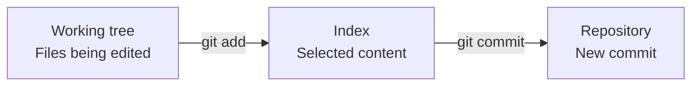
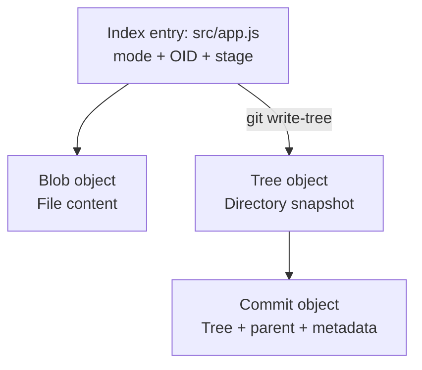

# The Role of the Index in Selecting Content for a Commit

In Git, a commit does not automatically record everything currently in the working directory. Git creates a commit from the content selected into the **index** (also known as the *staging area*). The index is where the next snapshot is prepared: you can stage specific files, stage only part of the changes in a file, review exactly what is about to be committed, and only then create the commit.

Understanding the index is the key to controlling project history. If the working tree contains both a bug fix and an unfinished experiment, you can include only the bug fix in the commit. If you accidentally stage too much, you can unstage or re-select parts while keeping your edited content intact.

This lesson belongs to the **Files and Index** chapter of SOURCE_CONTROL_GIT. The content focuses on the role of the index in selecting content for a commit, how Git compares the three states, how to stage/unstage, and the inspection workflow before saving history.

## 1. Three Important Areas in the Git Workflow

When working with Git, it is necessary to distinguish three places where state is stored:

1. **Working tree:** the files and directories visible in the project folder; this is where you open your editor and make changes.
2. **Index (staging area):** the snapshot selected to be included in the next commit.
3. **Repository:** the commits and objects already stored in Git history.

Basic flow:



`git add` copies the current content of the path into the index. `git commit` creates a commit from the index at the time of committing. Git does not automatically include every change in the working tree into a commit.

### 1.1. Example of the Three States

Suppose `app.js` currently has committed content as version A. You edit the file to version B and run:

```bash
git add app.js
```

The index now holds version B. Afterward, you continue editing the working tree to version C without running `git add` again.

Result:

- Repository (HEAD): version A.
- Index: version B.
- Working tree: version C.

If you run `git commit`, Git creates a commit containing version B. The changes from B to C remain in the working tree and have not been committed.

This is why the index is often called the **next snapshot**: it can differ from both the current commit and the file open in your editor.

## 2. What Does the Index Store?

The index is not simply a list of file names. Each entry typically describes a path along with the information needed to build a tree object:

- Relative path from the repository root.
- File mode, such as regular file, executable, symbolic link, or submodule gitlink.
- Object ID (OID) of the staged content.
- Stage number, usually `0` when there is no conflict.
- Internal flags for performance and path handling.

File content is stored as a blob object; the index entry references that blob by its OID. When committing, Git builds tree objects from the entries in the index, and then the commit object references that tree.



The index is stored in the Git directory, typically `.git/index` in a standard repository. For a linked worktree, the Git directory location may differ; you should not assume `.git` is always a physical directory. Use the following command to view the actual index path:

```bash
git rev-parse --git-path index
```

Do not edit the index file directly with a text editor. Use Git commands such as `add`, `restore --staged`, `reset`, and `rm` to update the index properly.

## 3. The Index Decides What a Commit Contains

Suppose a repository has three files:

```text
src/login.js
src/payment.js
README.md
```

You edit all three files but only want to commit the login changes. You can stage it separately:

```bash
git add src/login.js
```

Then:

```bash
git diff --cached
git status --short
```

`git diff --cached` shows the changes selected in the index compared to the current commit. `git status` indicates which files are staged and which still have unstaged changes.

When you run:

```bash
git commit -m "fix: handle login timeout"
```

The new commit contains what is currently in the index. The unstaged edits in `src/payment.js` and `README.md` remain in the working tree.

### 3.1. A Commit Is a Snapshot of the Index

Git creates a tree object from the index, then creates a commit object pointing to that tree along with its parent and metadata. Therefore, two commits can contain different snapshots even if the working tree did not change between them, provided the index was updated differently.

You can inspect the committed snapshot:

```bash
git show --stat --oneline HEAD
git show HEAD:src/login.js
```

The second command displays the content of `src/login.js` in the HEAD commit, which is not necessarily identical to the content currently on disk.

### 3.2. Changes After Staging Do Not Automatically Enter the Index

A common scenario:

```bash
git add src/login.js
# continue editing src/login.js in the editor
git status --short
```

Git may display `MM` for that file: one change is staged and another change is unstaged. The first letter describes the state of the index compared to HEAD; the second letter describes the working tree compared to the index.

To include the new edits in the commit, run `git add src/login.js` again. To save the new edits for a later commit, simply commit what is already staged.

## 4. Reading Staged and Unstaged States

Diff commands let you compare each pair of states:

| Command | Comparison | Question Answered |
|---|---|---|
| `git diff` | Working tree vs. index | What edits do I still have unstaged? |
| `git diff --cached` | Index vs. HEAD | Which changes will the next commit contain? |
| `git diff --staged` | Equivalent to `git diff --cached` | What is the currently staged content? |
| `git diff HEAD` | Tracked content in working tree vs. HEAD, including both staged and unstaged differences | What are the total current tracked changes compared to the latest commit? |

Example inspection workflow:

```bash
# View unstaged changes
git diff

# View what will go into the commit
git diff --cached

# View short status list
git status --short
```

Do not look only at `git diff` and conclude that the commit will contain that content. If changes have already been staged, `git diff` may be empty while `git diff --cached` still has content.

Regular diff commands do not show untracked files because they are not yet part of the index or a commit. Use `git status --short` to identify them; after staging with `git add`, the new content appears in `git diff --cached`.

### 4.1. Reading the Two Columns in `git status --short`

Short Git status uses two status positions:

- First character: state of the index compared to HEAD.
- Second character: state of the working tree compared to the index.

Some common symbols:

| Symbol | General Meaning |
|---|---|
| ` M` | Tracked file modified in working tree, not yet staged. |
| `M ` | Changes staged in the index. |
| `MM` | Has staged changes and further edits made after staging. |
| `A ` | New file staged. |
| `??` | File not tracked by Git (untracked). |
| ` D` | Tracked file deleted in working tree, deletion not yet staged. |
| `D ` | Deletion staged. |
| `R ` | Git detects a staged change as a rename; renames are inferred when comparing snapshots. |

For renames/copies, status may also display similarity scores or old/new paths depending on the format. Use `git status --porcelain=v1` if you need more stable output for scripts.

## 5. Staging Content with `git add`

`git add` updates the index with content read from the working tree at the moment the command runs.

### 5.1. Staging a Single File

```bash
git add src/login.js
```

This is the clear choice when you only want to include one file in the commit.

### 5.2. Staging Multiple Specific Files

```bash
git add src/login.js src/session.js
```

Directory paths can also be used:

```bash
git add src/auth/
```

Git stages matching changes within that path scope. Check `git diff --cached` again before committing.

### 5.3. Staging All Changes

```bash
git add -A
```

`-A` updates the index with all changes within the pathspec scope: new files, modified files, and deleted files. When run without a pathspec inside a repository, the command considers the entire working tree.

### 5.4. Staging Only Changes to Tracked Files

```bash
git add -u
```

`-u` updates modifications and deletions of already-tracked files; it does not add new untracked files to the index.

### 5.5. Staging the Current Directory

```bash
git add .
```

This command stages changes in the current directory and its subdirectories according to the `.` pathspec. If you are in a subdirectory, the scope may be narrower than the entire repository. When you want to update all changes in the repository, `git add -A` from the repository root is usually clearer in intent.

### 5.6. Ignored Files

Files matching `.gitignore` rules are normally not added to the index by a regular `git add`. If you genuinely need to track an ignored file, you can use:

```bash
git add -f path/to/file
```

Only force-add when you understand why the file was ignored. In particular, never stage secrets, credentials, build files, or personal data just to make untracked warnings go away.

## 6. Selecting Partial Changes to Stage

The index allows selecting individual parts of changes within the same file. This is useful when a single file has multiple edits belonging to different commit goals.

### 6.1. Using `git add -p`

```bash
git add -p src/payment.js
```

Git splits the diff into sections called *hunks* and asks whether you want to stage each one. Some commonly used keys:

| Key | Effect |
|---|---|
| `y` | Stage the current hunk. |
| `n` | Skip the current hunk. |
| `s` | Split the hunk into smaller parts if possible. |
| `e` | Manually edit the patch for the current hunk. |
| `q` | Quit the interactive session. |
| `?` | View key help. |

For example, `payment.js` has two changes: fixing a tax calculation bug and adding experimental logs. You can stage the tax-fix hunk, skip the log hunk, and commit only the bug fix.

After finishing:

```bash
git diff --cached
git diff
```

The first command confirms what was selected; the second shows what remains unstaged.

### 6.2. Using `git add -i`

```bash
git add -i
```

Interactive mode lets you view a list of files, select files, update patches, or perform other staging operations. This is a useful option when you need to review many files before creating a snapshot.

### 6.3. Manually Editing a Patch

With `git add -p`, the `e` option allows editing the patch. This approach is flexible but requires understanding the unified diff structure. An invalid patch or improperly edited context may not apply as intended.

After editing a patch, always review `git diff --cached` and `git diff` to confirm that the index and working tree contain the exact two sets of content you want.

## 7. Unstaging While Keeping Edited Content

If you stage the wrong file or hunk, you can revert the index back to the content from HEAD while keeping the working tree intact.

### 7.1. Unstaging a Single File

```bash
git restore --staged src/payment.js
```

This command updates the file's index entry to match HEAD (by default) and does not overwrite the working tree content. Your edits remain on disk for you to select again later.

An equivalent command commonly used in older Git versions:

```bash
git reset HEAD -- src/payment.js
```

### 7.2. Unstaging Everything

```bash
git restore --staged .
```

This command unstages changes within the current directory scope. If you want to unstage across the entire repository, run from the repository root with the appropriate pathspec:

```bash
git restore --staged :/
```

Then check `git status --short` to ensure only the intended index changes occurred.

### 7.3. Unstaging Partially

You can choose individual hunks to unstage:

```bash
git restore --staged -p src/payment.js
```

Git prompts for each staged hunk whether you want to remove it from the index. This is suitable when part of the changes was staged correctly while another part needs to move back to the unstaged state.

### 7.4. Distinguishing Unstaging from Discarding Modifications

The following two operations have different effects:

```bash
# Only unstage, keeping changes in the working tree
git restore --staged src/payment.js

# Restore the working tree from the index, which can discard unstaged changes
git restore src/payment.js
```

The second command can lose unstaged edits. Before using it, inspect `git diff` and preserve any patches you need to keep. If your goal is only to unstage, use `--staged`.

## 8. Deleting, Renaming, and Adding Files in the Index

The index records snapshot state, not just file content.

### 8.1. Staging File Deletions

If you delete a file via the OS or editor:

```bash
git add -u
```

or:

```bash
git add path/to/deleted-file
```

Git updates the index so that the file no longer appears in the next snapshot.

You can also use:

```bash
git rm path/to/file
```

This command deletes the file from the working tree and stages the deletion in the index. If you only want to remove the file from the index while keeping the local copy:

```bash
git rm --cached path/to/file
```

### 8.2. Renaming Files

```bash
git mv old-name.js new-name.js
```

`git mv` renames the file in the working tree and updates the index. Git does not store a separate object type called “rename”; when comparing snapshots, Git detects renames based on content similarity.

You can also rename using a file manager and then stage the deletion of the old path and addition of the new path. The resulting commit can still be displayed by Git as a rename when detected appropriately.

### 8.3. New Files and Intent-to-Add

A new file sitting only in the working tree is untracked and not yet part of the snapshot. To mark the path and enable viewing a diff before staging the full content, you can use:

```bash
git add -N path/to/new-file.js
```

`-N` (intent-to-add) creates a special entry in the index so Git can show a diff for the new file, without staging the entire content the way a normal `git add` does. Before committing, you need to stage the actual content with `git add path/to/new-file.js`.

## 9. The Index and Normalized Content

Content in the index is not always a byte-for-byte copy of the file in the working tree. During `git add`, Git may apply conversion rules based on attributes and configuration, such as:

- Normalizing line endings via the `text` and `eol` attributes.
- Running a clean filter declared in `.gitattributes`.
- Converting encoding according to `working-tree-encoding`.
- Using Git LFS to replace large content with a pointer in the Git repository.

As a result, the index holds the canonical content that Git will store in the object database. On checkout, smudge mechanisms or reverse conversions can produce the appropriate working tree form.

If the diff after staging looks different from what you expected, check `.gitattributes`, filters, and related Git configuration before committing.

## 10. The Index During a Conflicted Merge

When a merge produces conflicts, the index can hold multiple versions of the same path instead of a single stage `0` entry.

Common stages:

| Stage | Meaning |
|---|---|
| `1` | Merge base (common version before the two branches diverged). |
| `2` | Ours (version from the current branch). |
| `3` | Theirs (version from the branch being merged in). |
| `0` | Resolved and normally staged result. |

Check unmerged entries:

```bash
git ls-files -u
```

After editing the file to resolve the conflict, stage the result:

```bash
git add path/to/conflicted-file
```

This operation replaces the stage 1/2/3 entries with a stage 0 entry for that path. Once all conflicts are resolved and staged, continue the merge or rebase following Git's instructions.

During a conflict, you should not treat the index as a normal commit snapshot until all unmerged paths have been handled.

## 11. Useful Index Inspection Commands

### 11.1. Listing Files in the Index

```bash
git ls-files
```

View mode and OID as well:

```bash
git ls-files --stage
```

Example output:

```text
100644 9f2a... 0       README.md
100755 7bc1... 0       scripts/build.sh
```

The modes indicate the entry type and executable permissions managed by Git; stage `0` is a normal resolved entry.

### 11.2. Viewing Content About to Be Committed

```bash
git diff --cached
git diff --cached --stat
git diff --cached --name-status
```

This is the most important review step before committing. If you use review or CI tools, pull data from the index/commit rather than scanning the entire working tree and assuming everything will be committed.

### 11.3. Viewing the Object of a Path in the Index

```bash
git ls-files --stage -- src/login.js
```

Take the OID and view the blob:

```bash
git cat-file -p <blob-oid>
```

This lets you inspect the exact content actually staged, even if the working tree has since changed.

## 12. Workflow for Selecting Content for a Clean Commit

Suppose you are working on two things in the same branch: fixing a login bug and experimenting with the payment UI. Let's create a commit solely for the login fix:

**Step 1: View all changes**

```bash
git status --short
git diff
```

**Step 2: Select relevant files or hunks**

```bash
git add -p src/login.js
```

Stage each hunk belonging to the login bug fix. Do not stage the UI experiment.

**Step 3: Review the snapshot in the index**

```bash
git diff --cached
git diff --cached --stat
```

Ensure only the login changes are present.

**Step 4: Review the remaining changes**

```bash
git diff
git status --short
```

Confirm the UI experiment remains in the working tree and is unstaged.

**Step 5: Commit**

```bash
git commit -m "fix: handle login timeout"
```

The new commit records only the snapshot currently in the index. Afterward, continue finishing the UI work and stage it for a separate commit.

## 13. Common Misconceptions

### “Git commits all modified files”

No. A standard `git commit` creates a commit from the index. Unstaged changes stay in the working tree.

### “Once a file is staged, all subsequent edits are staged automatically”

No. `git add` records content at the time it is run. Editing afterward creates a difference between the index and the working tree.

### “`git diff` shows the exact content that will be committed”

No. `git diff` compares the working tree against the index. Use `git diff --cached` to view staged content compared to HEAD.

### “Unstaging deletes edits in the file”

`git restore --staged` only updates the index; it preserves working tree content. `git restore <path>` without `--staged` can overwrite the working tree and lose unstaged edits.

### “Git stores renames as a separate object”

No. Git stores tree snapshots; renames are detected when comparing snapshots.

### “A directory is a normal entry in the index”

Git stores files and subtrees; empty directories are not tracked as separate entries. A directory only appears in a snapshot through child paths that have tracked content.

## 14. Key Takeaways

- The index is the snapshot prepared for the next commit.
- `git add` updates the index from working tree content at the time it runs.
- A standard `git commit` creates a commit from the index, excluding unstaged edits.
- `git diff` shows unstaged changes; `git diff --cached` shows staged changes compared to HEAD.
- `git add -p` and `git add -i` allow selecting partial changes.
- `git add -A` updates additions/modifications/deletions; `git add -u` updates tracked files only; `git add .` scopes to the current directory.
- `git restore --staged` unstages while keeping changes in the working tree.
- `git rm --cached` removes a file from the index while keeping the local copy.
- An index entry stores path, mode, OID, and stage; conflicts can create stage 1/2/3 entries.
- Git may normalize content via attributes and filters before storing it in the index.
- Review `git diff --cached` before committing to know the exact snapshot about to be recorded in history.

The index lets you decide piece by piece which content becomes an independent commit. Separating content selection from file editing makes Git history clearer, commits easier to review, and work-in-progress changes safely preserved for the next step.
