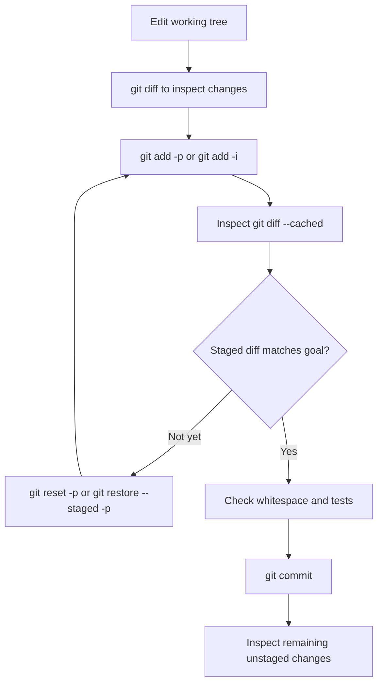

# Selecting Partial Changes with git add -p and git add -i

In a single editing session, you may modify multiple parts of the same file: fixing a bug, renaming a variable, and adding debug logs. If you stage the entire file with `git add <file>`, all changes go into the same commit. Git allows you to select individual parts of your changes for staging, enabling smaller, focused, and easier-to-review commits.

Two commonly used approaches are `git add -p` and `git add -i`. `git add -p` presents each section of changes (*hunk*) for you to decide whether to stage or skip. `git add -i` opens an interactive interface where you can inspect status, stage whole files, add new files, pick hunks, or unstage. Both operate on the index (staging area) and do not create a commit by themselves.

## 1. Understanding Working Tree, Index, and Commit Properly

Git manages content across three key states:

- **HEAD / current commit:** the snapshot already recorded in history.
- **Index (staging area):** the snapshot that will be used to create the next commit.
- **Working tree:** the files you are editing in the working directory.

`git add` updates the index from working tree content. When selecting parts via patch mode, Git applies only the chosen patch portions to the index. Unselected changes remain in the working tree.

You can visualize this as:

```text
HEAD (latest commit)
       |
       | git add -p: select specific hunks
       v
Index (staging area)  <--- snapshot to be committed
       ^
       | unstaged changes remain here
       |
Working tree          <--- all content you are editing
```

`git commit` saves the snapshot from the index. Therefore, a single file can simultaneously contain staged parts and unstaged parts. This is normal behavior when intentionally splitting one set of edits into multiple commits.

## 2. Inspecting Changes Before Staging

Before selecting hunks, check status:

```bash
git status --short
```

Two important diff commands:

```bash
# Changes in working tree compared to index (unstaged).
git diff

# Changes in index compared to HEAD (staged).
git diff --cached
```

If you have not staged anything yet, `git diff` typically displays all changes to tracked files. After staging some hunks, `git diff --cached` displays the selected portion, while `git diff` displays the remaining portion.

You can inspect a single file individually:

```bash
git diff -- src/PaymentService.java
git diff --cached -- src/PaymentService.java
```

Do not rely solely on terminal colors. Read the content of each diff to confirm the exact part going into the commit.

## 3. Using git add -p to Select Hunks

Basic command:

```bash
git add -p
```

Git displays each hunk in the diff between the working tree and the index, then asks whether you want to stage that hunk. Example:

```text
diff --git a/src/PaymentService.java b/src/PaymentService.java
@@ -10,6 +10,7 @@
 public PaymentResult pay(Order order) {
+    validateCurrency(order);
     return gateway.charge(order);
 }

Stage this hunk [y,n,q,a,d,s,e,?]?
```

A hunk is a block of changes consisting of added lines, removed lines, and several context lines. Git groups nearby changes into a single hunk so you can handle them together.

You can also restrict to a specific file:

```bash
git add -p -- src/PaymentService.java
```

The `--` marks the end of options, helping Git interpret the following argument as a path, even if the filename starts with a hyphen.

## 4. Meaning of Options in the Patch Prompt

The prompt typically looks like:

```text
Stage this hunk [y,n,q,a,d,s,e,?]?
```

Main options:

| Key | Meaning |
|---|---|
| `y` | Stage the current hunk into the index |
| `n` | Skip the current hunk, keeping it in the working tree |
| `q` | Quit patch mode; previously selected hunks remain staged |
| `a` | Stage the current hunk and all remaining hunks in the current file |
| `d` | Skip the current hunk and all remaining hunks in the current file |
| `s` | Split the current hunk into smaller hunks if possible |
| `e` | Open the patch for manual editing before applying to the index |
| `?` | Display help for the options |

`a` and `d` apply to the remaining hunks of the current file during the pass; they do not stage or skip every file in the repository.

If you only want to select part of the changes, typically use `y` for hunks to stage and `n` for hunks not ready to commit. If a hunk contains multiple independent changes, try `s` before deciding.

## 5. Splitting a Hunk with the `s` Key

Git may group nearby changes into the same hunk. When a hunk serves two different purposes, enter `s` to ask Git to split it smaller.

Example hunk:

```diff
@@ -20,8 +20,10 @@
 public void process() {
-    logger.info("Start");
+    logger.debug("Start");
     validate();
+    retryPolicy.check();
     execute();
 }
```

If Git can split it, you can stage the log-level change or the retry check separately. When changed lines sit too close together or the context does not allow a safe split, Git may report that it cannot split the hunk. In that case, consider adjusting context or using `e` to edit the patch manually.

Not every hunk can be split. Inspect the diff after selecting to ensure the staged part still produces valid, meaningful source code state.

## 6. Manually Editing a Patch with the `e` Key

When `s` cannot divide a hunk the way you want, enter `e`. Git opens the patch content in your editor so you can edit what gets applied to the index.

In a patch:

- Lines starting with `+` are added content.
- Lines starting with `-` are removed content.
- Lines starting with a space are context used by Git to locate where to apply the patch.

Example patch:

```diff
@@ -1,3 +1,4 @@
 timeout = 30
-retries = 2
+retries = 3
+log_level = "debug"
```

If you only want to stage the `retries` change, you can remove the added `log_level` line from the patch before saving. If you only want to stage adding `log_level` without staging the `retries` change, edit the patch so the corresponding removal/addition lines are not applied to the index. Context lines must remain intact for the patch to apply.

Manual patch editing requires care: a malformed patch or one that no longer matches the content may be rejected. After the editor closes, Git may report that the patch could not be applied. In that event, the working tree still holds your working content; review `git diff` and `git diff --cached` before trying again.

## 7. Using git add -i in the Interactive Interface

Open interactive mode:

```bash
git add -i
```

Git displays an interactive menu. Item names and numbers may vary by version or configuration, though operation groups generally include:

| Menu Command | Purpose |
|---|---|
| `status` | View status across HEAD, index, and working tree |
| `update` | Stage all changes for selected files |
| `revert` | Unstage changes in the index, restoring index to HEAD content for selected files; does not delete edits in working tree |
| `add untracked` | Stage files not yet tracked by Git |
| `patch` | Select individual hunks to stage |
| `diff` | View diff to inspect changes |
| `quit` | Exit interactive mode |
| `help` | View operation instructions |

An example menu might look like:

```text
*** Commands ***
  1: status       2: update       3: revert
  4: add untracked 5: patch       6: diff
  7: quit         8: help
```

In the menu, choose `patch` to stage individual hunks; choose `update` when you want to stage whole files; choose `add untracked` to add new files. `git add -i` fits well when handling many files in a single session and needing an overview before selecting.

## 8. Distinguishing update, revert, and add untracked in Interactive Mode

Items in `git add -i` have distinct effects:

- **update:** brings changes of selected tracked files from the working tree into the index. This is a file-level staging operation.
- **revert:** removes staged changes of selected files by restoring the index to HEAD state. Working tree content remains intact so you can restage later.
- **add untracked:** adds new files to the index. Normally this stages the entire content of selected files.
- **patch:** selects partial changes instead of putting the entire file into the index.
- **diff:** inspects change content before deciding.

Read the interface prompts before confirming. Some operations ask for file numbers or selection ranges; enter `?`/`help` if unsure.

## 9. Staging Part of a File and Verifying Results

Suppose you edited the same file for two purposes:

1. Fixing a payment total calculation bug.
2. Changing log formatting for readability.

You want to commit the bug fix first and leave the log change for a later commit.

Run:

```bash
git status --short
git diff -- src/PaymentService.java
git add -p -- src/PaymentService.java
```

Choose `y` for the bug-fix hunk and `n` for the log-change hunk. After finishing, check both sides:

```bash
# Part that will go into the next commit.
git diff --cached -- src/PaymentService.java

# Part that remains in the working tree.
git diff -- src/PaymentService.java

# File status.
git status --short
```

If the same file has both staged and unstaged changes, `git status --short` may show `MM` in the status column: the first column indicates changes in the index, and the second column indicates unstaged changes in the working tree. This does not mean Git created two independent copies of the file; the index and working tree simply hold two different states.

Once you confirm the staged diff contains only the bug fix, create the commit:

```bash
git diff --cached --check
git diff --cached
git commit -m "fix: correct payment total calculation"
```

After committing, the unstaged log changes remain in the working tree. You can continue editing, staging, and committing them separately.

## 10. Handling New Untracked Files

`git add -p` works on the diff between the working tree and the index. An untracked file has no entry in the index yet, so it normally does not appear in the hunk list.

If you want to stage the entire new file, use:

```bash
git add -- src/NewService.java
```

Or use `add untracked` in `git add -i`.

If you want to select parts of a new file, you can mark it intent-to-add first:

```bash
git add -N -- src/NewService.java
git add -p -- src/NewService.java
```

`git add -N` records the intent to add the path in the index without staging its full content. Afterward, patch mode can display the content as a diff to choose parts to stage. Check carefully with `git status`, `git diff`, and `git diff --cached`; exact behavior may depend on Git version and file state.

Another option is splitting content into smaller files or staging the whole file if its contents belong to one logical unit of change. There is no need to force-split a new file into multiple parts if doing so makes commits harder to understand or creates invalid states.

## 11. Partially Unstaging if You Selected by Mistake

If you staged several hunks and realize part of them should not be in the commit, you can use `git reset` in patch mode:

```bash
git reset -p
```

This command lets you select hunks in the difference between HEAD and the index to unstage. It updates the index toward HEAD for the selected portion; working tree content is not deleted.

You can limit by file:

```bash
git reset -p -- src/PaymentService.java
```

Or use `git restore`:

```bash
git restore --staged -p -- src/PaymentService.java
```

Both approaches adjust the index. Afterward, verify:

```bash
git diff --cached
git diff
git status --short
```

If a new file was staged, there is no version in HEAD to select hunks from in the usual way. When you want to unstage the entire new file while keeping the file on disk, use:

```bash
git restore --staged -- src/NewService.java
```

This command removes the entry from the index while preserving content in the working tree. Before operating, check status to ensure you do not confuse it with deleting content.

## 12. Distinguishing add -p, add -i, and Related Commands

| Command | Effect |
|---|---|
| `git add <path>` | Stages all changes for the path |
| `git add -p` | Interactively stages hunk by hunk |
| `git add -i` | Opens interactive menu to stage by file, new file, or hunk |
| `git add -e <path>` | Manually edits diff patch and applies it to the index |
| `git reset -p` | Unstages hunk by hunk from the index back toward HEAD |
| `git restore --staged -p` | Selects parts to restore in the index from default source (usually HEAD) |
| `git diff` | Views unstaged changes |
| `git diff --cached` | Views staged changes |

`git add -p` is the fastest way when you only need to pick hunks. `git add -i` suits cases where you manage multiple files and perform several operations in one session. `git add -e` is for when you want to adjust the patch directly without stepping through each hunk prompt.

## 13. Cases Unsuitable for Hunk-by-Hunk Staging

Not every type of change can be split line-by-line:

- **Binary files:** Git cannot show a standard line-based diff to stage partial binary content; typically the whole file must be staged.
- **Permission or file mode changes:** executable bit changes are generally managed at the path level, not as text hunks.
- **Rename/move:** Git detects renames when comparing snapshots; staging may involve multiple paths and cannot always be split like plain text content.
- **Interdependent changes:** two hunks may need to stay together for code to compile or pass tests. Staging them separately can produce an invalid intermediate commit.
- **Adjacent hunks:** Git may be unable to split if changes are too close or lack context.

In these cases, consider staging the whole file, breaking changes into smaller edits, or using the patch editor with clear knowledge of the content. The goal is creating meaningful, verifiable commits—not splitting at all costs.

## 14. Selective Staging Workflow Before Committing

A practical workflow you can apply to every commit:

1. View status with `git status --short`.
2. Read unstaged changes with `git diff`.
3. Select hunks with `git add -p` or open `git add -i`.
4. Verify staged diff with `git diff --cached`.
5. Verify remaining changes with `git diff`.
6. Run `git diff --cached --check` to catch whitespace errors.
7. Run tests matching the staged changes; if needed, make sure the working tree does not cause tests to accidentally use unstaged parts.
8. Commit with a message accurately describing the purpose of the staged changes.
9. Check `git status` again to see what unstaged changes remain.

Flow diagram:



## 15. Common Misconceptions

| Misconception | Accurate Understanding |
|---|---|
| `git add -p` commits immediately | It only updates the index; `git commit` must be run separately |
| Staging a hunk alters the working tree | Working tree content stays untouched; only the index is updated |
| A file can only be either staged or unstaged | A single file can contain both staged and unstaged parts simultaneously |
| `git diff` shows all changes | It shows working tree vs. index; use `git diff --cached` for staged changes |
| `a` in patch mode stages all files | It stages the current hunk and remaining hunks of the file being processed |
| `revert` in `git add -i` deletes edits from disk | It unstages in the index; the working tree retains the content |
| Untracked files always appear in `git add -p` | Usually requires `git add -N` first or using `add untracked` to stage the whole file |
| Every file can be partially staged | Binary files and mode/rename changes typically must be handled at the file level |

## 16. Key Takeaways

`git add -p` lets you stage hunk by hunk in the diff between the working tree and the index. Use `y` to stage, `n` to skip, `s` to split a hunk, `e` to edit the patch, `q` to quit, and `?` to view help. `git add -i` provides a broader menu to inspect status, stage whole files, add new files, select hunks, or unstage.

After selective staging, always inspect both `git diff --cached` and `git diff`: one side shows what will be committed, the other shows what remains in the working tree. If you pick wrong, use `git reset -p` or `git restore --staged -p` to adjust the index without losing your edited content. Use hunk-level staging to build focused, reviewable commits that each reflect a single purposeful change.
