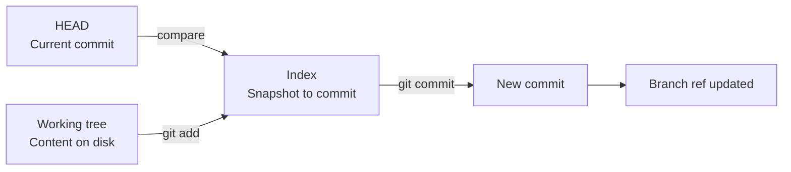

# Creating a Commit from the Index and Inspecting Content Before Writing

In Git, `git commit` creates a new history milestone from the content selected in the **index** (staging area). Before writing a commit, you should review the exact staged snapshot, check for formatting issues, confirm author identity, and write a message describing the change. After committing, verify the new commit and the remaining state of the working tree.

This workflow ensures each commit represents an intentional change that is easy to review, trace, and revert. A good commit typically focuses on one objective, has a message explaining why the change was made, and does not accidentally include test scratch files, secrets, or unfinished work.

This lesson belongs to the **Creating Commits** chapter of SOURCE_CONTROL_GIT. It walks through the entire commit creation lifecycle: preparing the index, reviewing the snapshot, writing the commit, verifying the result, handling hooks, and amending the latest commit when needed.

## 1. Commits Take Content from the Index

Git has three key state areas:

- **HEAD/repository:** the current commit that the branch points to.
- **Index:** the snapshot prepared for the next commit.
- **Working tree:** the files on disk being edited in your editor.

When you run `git commit`, Git creates a commit from the index at that moment. Edits that only exist in the working tree and have not been staged are not automatically included in the commit.



For example, `src/login.js` was staged, and then you kept editing the file in your editor. The index still holds the content from the earlier `git add`; the newer edits are only in the working tree. The commit will contain the version in the index, while the newer edits remain in the working tree.

### 1.1. Check Status Before Committing

Start with:

```bash
git status --short --branch
```

This command tells you the current branch and any staged, unstaged, or untracked files. Then inspect the selected content:

```bash
git diff --cached
git diff --cached --stat
git diff --cached --name-status
```

`git diff --cached` is the primary review step: it shows changes in the index compared to HEAD—that is, the exact content that will be written to the next regular commit.

### 1.2. Check the Unstaged Portion

```bash
git diff
```

This command helps detect edits sitting outside the index. If you plan to commit all work, decide explicitly whether more needs to be staged. If you want a partial commit, confirm the remaining edits are intentionally kept for subsequent work.

### 1.3. Check Whitespace and Patch Errors

```bash
git diff --cached --check
```

This command checks for whitespace issues in the staged portion, such as trailing whitespace or spaces before tabs according to Git's rules. If it reports errors, inspect the indicated locations, fix the file, re-stage the fix, and re-run the check.

`git diff --cached --check` does not replace tests, linters, or logic review. It only checks a specific set of formatting issues.

## 2. Selecting Content for a Commit

### 2.1. Stage Specific Files

If you only want to commit a few files:

```bash
git add -- src/login.js src/session.js
```

Then inspect:

```bash
git diff --cached --name-status
git diff --cached
```

Do not rely on memory regarding which files were staged. Inspect the index right before committing.

### 2.2. Stage All Intended Changes

```bash
git add -A
```

This command updates the index for new, modified, and deleted files across the repository. You still need to review `git diff --cached` afterward; `git add -A` does not mean every file is suitable to commit.

### 2.3. Using `git commit -a` for Tracked Files

Git has a `-a` (or `--all`) option:

```bash
git commit -am "fix: handle login timeout"
```

This option automatically stages modifications and deletions of files already tracked by Git, then creates the commit. It does **not** automatically add new untracked files. This is a shortcut when every modification across tracked files belongs in the same commit.

Do not use `-a` if you need to select only part of the changes or if unfinished edits exist in tracked files. For workflows requiring snapshot control, stage explicitly with `git add` and review `git diff --cached` before committing.

### 2.4. Stage Selectively

When one file contains multiple change objectives:

```bash
git add -p src/payment.js
```

Select the hunks related to the same commit objective. Then check both sides:

```bash
git diff --cached
git diff
```

This avoids bundling a completed bug fix with unfinished experimental code in the same commit.

### 2.5. Unstage Accidental Selections

If you discover something was staged by mistake:

```bash
git restore --staged -- path/to/file
```

This command updates the index to match HEAD while preserving working tree content. Then re-stage the right content to commit. Do not confuse this with `git restore path/to/file` without `--staged`, as that can overwrite unstaged changes in the working tree.

## 3. Review the Snapshot Before Writing

Before running `git commit`, perform a systematic check:

```bash
git status --short --branch
git diff --cached --check
git diff --cached --stat
git diff --cached
```

Ask yourself:

- Which files will be committed?
- Does each change serve the same objective?
- Were any log files, build artifacts, caches, personal files, or secrets staged by mistake?
- Are there edits sitting only in the working tree that you assumed were staged?
- Does the staged content match the expected result after line-ending normalization, clean filters, or Git LFS?
- Do tests, linters, formatters, or security checks need to run before committing?

### 3.1. View Staged Content in a Single File

```bash
git diff --cached -- src/login.js
```

Scoping with a pathspec helps focus review on one file or group of files. If a path starts with `-`, place `--` before the pathspec:

```bash
git diff --cached -- -draft.txt
```

### 3.2. Check for Secrets and Data That Should Not Be Committed

Git does not automatically know which values are confidential. Before committing, watch out for files such as:

- `.env` files containing real tokens or passwords.
- Private keys, credentials, or local config files.
- Database dumps or customer data.
- Logs containing personal information.
- Auto-generated build outputs or binaries not managed in Git by the project.

If a secret is found in the index, unstage it and address the file source before committing. If a secret has already been committed or pushed, deleting it in a new commit does not remove it from older history; revoke/rotate the credentials and follow the appropriate history-remediation process.

## 4. Creating a Commit with `git commit`

### 4.1. Open an Editor to Write the Message

```bash
git commit
```

Git opens the configured editor for you to write the commit message. If no editor is configured, Git uses the environment's default editor.

You can check the configuration:

```bash
git config --show-origin --get core.editor
```

Set a user-level editor, for example:

```bash
git config --global core.editor "code --wait"
```

The command above is an example for Visual Studio Code on PATH. Depending on the editor, a flag may be required so the process waits until the message window closes.

### 4.2. Pass the Message with `-m`

For a simple commit:

```bash
git commit -m "fix: handle login timeout"
```

`-m` passes the message directly without opening an editor. You can pass multiple `-m` flags to create a subject and body:

```bash
git commit \
  -m "fix: handle login timeout" \
  -m "Keep the session active while the refresh request is pending."
```

Message paragraphs are separated by a blank line. In PowerShell, you can write the command on one line or use backticks for line continuation; `\` line continuation is Unix shell syntax.

### 4.3. Read the Message from a File

```bash
git commit -F commit-message.txt
```

`-F` (or `--file`) reads the entire message from a file. This is useful in scripts or when the message spans multiple lines. The file must be prepared with proper content and an encoding supported by your Git environment.

### 4.4. Reuse a Message from a Previous Commit

```bash
git commit -C HEAD
```

`-C` reuses the message and author information from the specified commit. `-c` also takes the previous message but opens the editor for edits:

```bash
git commit -c HEAD
```

These are advanced options; inspect the message afterward to avoid copying content that is no longer appropriate.

## 5. Writing a Readable Commit Message

A commit message is short documentation about the change. Readers may encounter it in `git log`, pull requests, release notes, or when investigating a regression months later.

A commonly used format:

```text
fix: handle login timeout

Keep the session active while the refresh request is pending.
Avoid redirecting users to the sign-in page for a temporary timeout.
```

### 5.1. Subject Line

The subject is the first line and should:

- Describe the main change in a short, specific phrase.
- Use a clear verb, such as `fix`, `add`, `remove`, `update`.
- Avoid vague messages like `update`, `changes`, `fix bug`.
- Keep it concise; many teams target around 50–72 characters, though this is a team convention rather than a hard Git limit.

Better example:

```text
fix: preserve session during token refresh
```

instead of:

```text
update code
```

### 5.2. Body

The body answers questions that the subject does not have room to explain:

- Why is the change needed?
- What was the previous problem?
- How does the fix resolve the issue?
- Are there limitations or consequences reviewers should know about?

Do not repeat the entire diff. Explain context and rationale so readers understand the commit's intent.

### 5.3. Footer

The footer may contain issue IDs, review information, or commit-linking directives depending on project convention:

```text
Refs: APP-248
Reviewed-by: Example Reviewer
```

Some projects use structured trailers:

```bash
git interpret-trailers --parse < commit-message.txt
```

Git does not enforce the same convention across all projects. Follow your repository and CI conventions.

### 5.4. Messages Should Describe Intent, Not Just List Files

A message like `update login.js` says which file changed without explaining why. A message like `fix: preserve session during token refresh` states the objective and helps search history by behavior.

## 6. Commit Identity and Metadata

A commit stores at least two identities:

- **Author:** the person who wrote the change.
- **Committer:** the person who created the current commit object.

Both identities can be the same, though not required. During cherry-pick or rebase, the author may be preserved while the committer is the person executing the new operation.

### 6.1. Check user.name and user.email

```bash
git config --show-origin --show-scope --get user.name
git config --show-origin --show-scope --get user.email
```

Set global identity:

```bash
git config --global user.name "An Nguyen"
git config --global user.email "an@example.com"
```

Set specifically for the current repository:

```bash
git config --local user.name "An Nguyen"
git config --local user.email "an@company.example"
```

Local config overrides global config. If a commit is using the wrong email despite global config being correct, check local config, includes, and environment variables.

### 6.2. View the Identity Git Will Use

```bash
git var GIT_AUTHOR_IDENT
git var GIT_COMMITTER_IDENT
```

These two commands show the author/committer identity resolved by Git in the current environment. Variables such as `GIT_AUTHOR_NAME`, `GIT_AUTHOR_EMAIL`, `GIT_COMMITTER_NAME`, and `GIT_COMMITTER_EMAIL` can also affect the values.

### 6.3. Override the Author for One Commit

```bash
git commit --author="An Nguyen <an@example.com>" -m "docs: clarify setup steps"
```

`--author` changes the commit's author metadata. The committer remains the identity running the command. Use this only when genuinely crediting another author and in compliance with project policy.

### 6.4. Author and Committer Timestamps

Commits store an author date and a committer date. When inspecting:

```bash
git log -1 --format=fuller
```

Git displays both timestamps. Rebase or amend usually creates a new committer date. Timestamps do not determine parent relationships between commits; those relationships are determined by parent OIDs.

## 7. What Does Git Do When Creating a Commit?

Conceptually, the commit process proceeds as follows:

1. Git reads the current index and checks repository state.
2. Pre-commit hooks may run to validate or prepare the message.
3. Git writes tree objects representing the snapshot from the index.
4. Git creates a commit object referencing the tree, current parent, and metadata.
5. The current branch is updated to point to the new commit.
6. The reflog records the ref update; post-commit hooks may run.

If the index has no changes compared to HEAD, Git typically reports nothing to commit. Git does not create empty commits by default.

### 7.1. What Does a Commit Object Contain?

A commit object references:

- Tree object: snapshot of the repository.
- Parent commit: usually HEAD before the commit.
- Author and committer with timestamps.
- Commit message.
- Additional metadata, such as a signature if the commit is signed.

You can view the raw commit:

```bash
git cat-file -p HEAD
```

### 7.2. Why Can Identical Content Have Different Commit OIDs?

A commit OID is computed from the entire commit object. Changing just the parent, author, committer, timestamp, message, or signature produces a commit object with a different OID even if the tree snapshot is identical.

This is why amend and rebase create new commits instead of editing old commits in place.

## 8. Hooks Can Inspect or Reject Commits

Git provides several client-side hooks related to commits:

| Hook | Timing | Role |
|---|---|---|
| `pre-commit` | Before creating the commit | Runs lint/tests or checks staged content; returning non-`0` aborts the commit. |
| `prepare-commit-msg` | After Git prepares the message, before opening the editor | Can pre-populate or edit the message. |
| `commit-msg` | After the message is prepared | Validates the message; returning non-`0` aborts the commit. |
| `post-commit` | After the commit succeeds | Sends notifications or records events; cannot abort the created commit. |

Hooks can slow down commits, modify messages, or reject operations. If a commit fails, read the hook output and re-run the appropriate checks instead of immediately bypassing hooks.

### 8.1. `--no-verify`

```bash
git commit --no-verify -m "fix: handle timeout"
```

This option bypasses `pre-commit` and `commit-msg`. It does not bypass `prepare-commit-msg`. Do not use `--no-verify` as a routine workaround for errors; if you must bypass hooks in an emergency, run alternative checks and document the reason per team process.

### 8.2. Local Hooks Are Not the Only Layer of Defense

Local hooks may not be installed or can be bypassed with options. Important rules should also be enforced in CI or server-side hooks rather than relying solely on each developer's local environment.

## 9. Signing Commits

Some projects require signed commits to verify the creator's identity. Depending on configuration, Git can use GPG or SSH signing.

Sign a commit:

```bash
git commit -S -m "feat: add invoice export"
```

Verify a signature:

```bash
git log --show-signature -1
```

Configure the signing format and key according to Git documentation and organizational policy. Commit signing authenticates the signature against the key and trust configuration; it does not by itself prove the code content is safe or reviewed.

If signing is required and no key is configured, the commit may fail. Configure the appropriate key and agent rather than disabling signing requirements against policy.

## 10. Verifying After Committing

After `git commit` succeeds, do not rely solely on the terminal summary line. Inspect the actual commit.

### 10.1. View the Latest Commit

```bash
git log -1 --oneline --decorate
git show --stat --oneline HEAD
```

The first command shows the latest commit and refs pointing to it. The second summarizes changed files and line counts.

### 10.2. View Metadata

```bash
git show --format=fuller --no-patch HEAD
```

Check the author, committer, timestamps, and message. If you need to inspect raw headers:

```bash
git cat-file -p HEAD
```

### 10.3. View the List of Paths in the Commit

```bash
git diff-tree --no-commit-id --name-status -r HEAD
```

For a root commit, add `--root` to compare against an empty state:

```bash
git diff-tree --root --no-commit-id --name-status -r HEAD
```

### 10.4. View the Commit Diff

For a non-root commit:

```bash
git diff HEAD^ HEAD
```

If the commit is a merge commit, `HEAD^` defaults to the first parent; this diff compares only against the first parent. To see differences against the second parent:

```bash
git diff HEAD^2 HEAD
```

To see how Git displays merge changes, you can use `git show --cc HEAD` or appropriate diff options.

### 10.5. Check What Remains in the Working Tree

```bash
git status --short --branch
```

If changes remain, they may be edits left unstaged before committing or modifications produced by hooks/tools. Do not assume the commit captured every edit.

## 11. Commits Without Changes and `--allow-empty`

If the index does not differ from HEAD, Git normally refuses to create a commit and reports nothing to commit. This is expected behavior.

In certain workflows, a commit that does not change the tree is needed—for example, triggering a pipeline, marking an event, or testing a system:

```bash
git commit --allow-empty -m "chore: trigger deployment pipeline"
```

This commit shares its tree with its parent commit but is still a new commit object with its own parent, metadata, and message. Use this only when the workflow genuinely calls for it; empty commits do not substitute for actual code fixes.

## 12. Fixing the Most Recent Commit with `--amend`

If the commit you just created has a wrong message or missed a small change, you can create a replacement commit with:

```bash
git commit --amend
```

Git creates a new commit replacing the current branch tip. The old commit is not edited in place; the new OID usually differs because metadata, message, or tree changed.

### 12.1. Edit Only the Message

```bash
git commit --amend -m "fix: preserve session during token refresh"
```

### 12.2. Add Forgotten Content

```bash
git add -- src/session.js
git commit --amend --no-edit
```

`--no-edit` keeps the existing message. The new snapshot is built from the current index, so inspect the staged diff before amending to avoid pulling in unrelated changes.

### 12.3. Reset Author When Needed

By default, amend preserves the old commit's author and updates the committer. If you want to set the author to the current identity:

```bash
git commit --amend --reset-author
```

Use this only when the intent is to change author metadata. If you need to keep the original author, omit `--reset-author`.

### 12.4. Do Not Amend Shared Commits Without Coordination

Amend changes the commit OID and rewrites the branch tip. If the commit has already been pushed or others have based work on it, amending can force a force push and cause teammates' histories to diverge.

Only amend unshared commits, or coordinate with your team according to history-rewriting policies. If a commit is already shared, creating a follow-up commit is usually safer and easier to coordinate.

## 13. `git commit --dry-run`

You can preview what Git expects to commit without actually creating a commit:

```bash
git commit --dry-run
```

Dry-run is useful for seeing the list of expected changes and spotting unready states. However, it does not replace `git diff --cached` for line-by-line review, nor does it guarantee every hook or side effect will behave identically to a real commit.

## 14. Sample Commit Creation Workflow

Suppose you just fixed a timeout bug in login and want to create a standalone commit.

**Step 1: Check status**

```bash
git status --short --branch
```

**Step 2: Stage the right files**

```bash
git add -- src/login.js src/session.js
```

**Step 3: Review the snapshot**

```bash
git diff --cached --check
git diff --cached --stat
git diff --cached
```

**Step 4: Run relevant tests**

```bash
npm test -- --runInBand
```

This is only an example for a Node project with an appropriate test script; use your repository's actual test command.

**Step 5: Create the commit**

```bash
git commit -m "fix: handle login timeout" \
  -m "Keep the session active while the refresh request is pending."
```

**Step 6: Verify the commit**

```bash
git show --stat --oneline HEAD
git show --format=fuller --no-patch HEAD
git status --short --branch
```

If unstaged changes remain, continue working or stage them for a separate commit. If the commit fails due to a hook or signing error, inspect the cause and fix the configuration properly.

## 15. Common Errors

### 15.1. `nothing to commit`

The index has no changes compared to HEAD, or the edits you want to record have not been staged yet. Check:

```bash
git status --short
git diff
git diff --cached
```

If you want to commit working tree content, stage the right files first. If you genuinely need an empty commit, use `--allow-empty` with a message explaining the purpose.

### 15.2. Commit Contains Unwanted Files

The usual cause is overly broad staging with `git add .` or `git add -A` without reviewing. Use `git show --stat HEAD` to identify what was recorded. If the commit has not been shared, you can amend after preparing the index properly; if it has been shared, consider a follow-up fix commit or a team-approved history rewrite workflow.

### 15.3. Commit Is Missing Edits Just Made

You may have edited the file after the last `git add`. Check `git diff` and `git diff --cached`. If the edit belongs in the current commit and the commit is unshared, stage the edit and amend; otherwise, create a follow-up commit.

### 15.4. Git Does Not Know Your Identity

Check `user.name`, `user.email`, includes, and environment variables. Configure the appropriate identity at global or local scope. Do not use fake details to bypass the error; commit metadata should accurately reflect the person performing the work per team policy.

### 15.5. Hook Rejected the Commit

Read the hook message, re-run the check command, and fix the data or configuration. Do not use `--no-verify` to mask recurring failures.

### 15.6. Commit Signing Failed

Check the signing key, agent, pinentry, and `gpg.format`/`user.signingkey` configuration for GPG or SSH signing. If the project requires signatures, restore the signing environment rather than disabling the requirement.

## 16. Takeaways

- A regular `git commit` creates a commit from the index, not automatically from every change in the working tree.
- Review `git diff --cached` and run `git diff --cached --check` before writing.
- Use `git commit -m` for short messages, `-F` for messages from a file, and `-c`/`-C` when reusing messages.
- Commit messages should have a specific subject; the body explains rationale and context; footers follow project conventions.
- Author and committer are two distinct metadata fields; inspect them with `git var` and `git log --format=fuller`.
- Hooks can inspect, edit messages, or reject commits; post-commit hooks cannot cancel an already created commit.
- `git commit -S` signs a commit when signing is configured.
- Verify after committing with `git show`, `git diff-tree`, and `git status`.
- `--allow-empty` creates a commit without changing the tree when the workflow has a clear reason.
- `--amend` creates a replacement commit with a new OID; be careful if the commit has already been shared.
- `--dry-run` provides a preview but does not replace detailed review of the staged diff.

A reliable commit starts from an intentionally curated index, passes through a clear review step, carries accurate message and metadata, and is verified after creation. Maintaining this workflow keeps Git history readable and makes changes easier to trace, review, or recover with fewer surprises.
