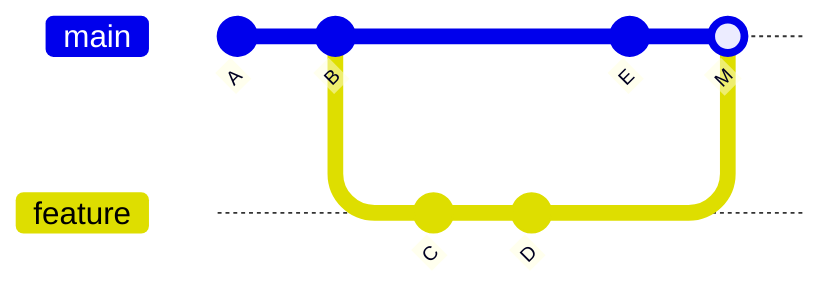
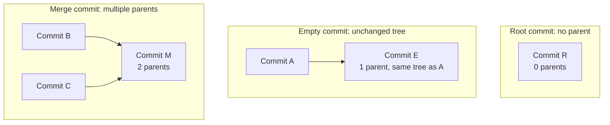

# Empty Commits, Merge Commits, and Root Commits

Not every commit represents a typical content change. Git also supports **empty commits** to record an event without changing the snapshot, **merge commits** to join multiple lines of history, and **root commits** to start a history with no parent commit.

These three commit types have different structures and purposes. An empty commit still has a parent (except when it is also a root commit) while sharing the parent's tree; a merge commit has two or more parents; a root commit has no parent. Understanding the differences helps you choose the right command when initializing repositories, integrating branches, marking events, or combining two independent histories.

This lesson belongs to the **Creating Commits** chapter of SOURCE_CONTROL_GIT. It focuses on commit object structure, how to create each commit type, how to verify parents and trees, and scenarios to avoid in collaborative workflows.

## 1. Viewing Commits Through Trees and Parents

A commit object typically contains:

- The OID of a tree representing the repository snapshot.
- Zero, one, or multiple `parent` lines pointing to previous commits.
- Author and committer with timestamp details.
- Commit message and additional metadata, such as a signature.

You can inspect the current commit structure:

```bash
git cat-file -p HEAD
```

Example of a regular commit:

```text
tree 7a31...
parent 2f10...
author An Nguyen <an@example.com> 1731500000 +0700
committer An Nguyen <an@example.com> 1731500000 +0700

fix: handle login timeout
```

The `tree` field identifies snapshot content. `parent` lines define history relationships. Therefore, to distinguish empty commits, merge commits, and root commits, inspect both the tree and the number of parents.

| Commit Type | Typical Parent Count | Tree Relationship |
|---|---:|---|
| Regular commit | 1 | Usually differs from the parent's tree. |
| Empty commit | 1 (or 0 if an empty root) | Matches the parent's tree; no snapshot change. |
| Merge commit | 2 or more | Tree is the merge result; may differ from or match the first parent's tree. |
| Root commit | 0 | First snapshot of a line of history; may contain files or be empty. |

A commit that is both a merge commit and shares its first parent's tree is still a merge commit. A root commit can simultaneously be an empty commit if the repository was initialized with a commit containing no files.

## 2. What Is an Empty Commit?

An *empty commit* is a commit whose tree matches its parent's tree, meaning the snapshot has no content changes relative to its parent. Even so, the commit object is still new because it has its own parent, metadata, timestamp, or message.

By default, Git does not create a regular commit if the index has no changes relative to HEAD. This prevents accidentally creating empty history milestones. When a workflow genuinely needs a commit solely to record an event, you can explicitly request it with `--allow-empty`.

### 2.1. Creating an Empty Commit

```bash
git commit --allow-empty -m "chore: trigger deployment pipeline"
```

This command creates a new commit even though the index has no changes relative to HEAD. The commit shares its parent's tree, yet has a different OID because the commit object includes parent, author/committer, timestamp, and message.

Before and after history example:

```text
Before:
A---B  main

After:
A---B---E  main
```

`E` does not add or remove any files relative to `B`, yet it is a distinct commit and can be recognized by CI, release automation, or audit processes.

### 2.2. When Should Empty Commits Be Used?

Some situations where it can make sense:

- Triggering a pipeline or deployment configured to run on new commits.
- Marking an operational event that does not modify source code.
- Creating a test milestone for CI/CD workflows.
- Recording a coordination step or checkpoint per team convention.
- Testing hooks, signing, or release workflows without modifying files.

An empty commit should have a message explaining its purpose. If your system provides another way to trigger pipelines, consider options that add less noise to history. Avoid repeatedly creating empty commits just to re-run pipelines without a clear reason or convention.

### 2.3. Empty Commit vs. Empty Commit Message

These two concepts are independent:

- `--allow-empty`: allows creating a commit when the snapshot has not changed.
- `--allow-empty-message`: allows a commit with an empty message.

Example of a content-empty commit with a message:

```bash
git commit --allow-empty -m "chore: mark maintenance window"
```

Example allowing an empty message:

```bash
git commit --allow-empty-message -m ""
```

Example allowing both conditions:

```bash
git commit --allow-empty --allow-empty-message -m ""
```

Empty commit messages make history hard to read and search. Use them only if required by a tool or process; in team work, keep messages meaningful.

### 2.4. Inspecting an Empty Commit

View the commit and its parents:

```bash
git show --no-patch --format=raw HEAD
git rev-parse HEAD^{tree}
git rev-parse HEAD^1^{tree}
```

For a non-root commit, identical tree OIDs indicate the new commit's snapshot matches its first parent. You can check the diff:

```bash
git diff HEAD^1 HEAD
```

No diff output indicates the tree does not differ from the first parent. For a root commit, `HEAD^1` does not exist; compare against the empty tree or run `git show --root` to inspect the initial snapshot.

## 3. What Is a Merge Commit?

A *merge commit* is a commit with two or more parents. It records that independent lines of history were combined at one point.

Example of two branches developing in parallel:



Merge commit `M` has two parents:

1. First parent: the tip of the checked-out branch before merging (`main`, e.g., `E`).
2. Second parent: the tip of the branch being merged in (`feature`, e.g., `D`).

Parent order is stored inside the commit object and matters when using `M^1`, `M^2`, `--first-parent`, or comparing the merge against each parent.

### 3.1. Creating a Regular Merge Commit

Suppose you are on branch `main` and want to integrate `feature/login`:

```bash
git switch main
git merge feature/login
```

If the two branches have diverged, Git normally creates a merge commit after combining content. If conflicts arise, Git pauses for you to resolve them; after staging the resolved files, complete the merge with:

```bash
git add -- path/to/resolved-file
git commit
```

In many cases, `git merge` automatically creates the merge commit when merging succeeds without needing a separate `git commit`. You only run `git commit` yourself after intentionally pausing a merge or finishing after conflict resolution.

### 3.2. Fast-Forward Does Not Create a Merge Commit

If the current branch tip is an ancestor of the branch being merged, Git can simply advance the current branch to the latest commit:

```text
A---B---C  feature/login
    ^
    main
```

Run:

```bash
git switch main
git merge feature/login
```

Git can fast-forward `main` from `B` to `C`. No new commit is created; the `main` ref simply moves.

Fast-forward keeps history linear and is usually the default behavior when possible. If you always want to record a dedicated integration milestone, even when fast-forward is possible, use `--no-ff`.

### 3.3. Forcing a Merge Commit with `--no-ff`

```bash
git merge --no-ff feature/login
```

`--no-ff` forces a merge commit even when Git could fast-forward. This makes history clearly show that a feature branch was integrated:

```text
      C---D  feature/login
     /     \
A---B-------M  main
```

Merge commit `M` retains links to both `B` and `D`. This can be helpful when a team wants visible feature branch boundaries, uses `--first-parent` to read integration history, or reverts an integration according to policy.

`--no-ff` does not create a merge commit if the branch is already integrated and Git reports “Already up to date”; it only prevents fast-forwarding when advancing to the other branch's tip is possible.

### 3.4. Preparing a Merge Without Committing Yet

```bash
git merge --no-commit --no-ff feature/login
```

This combination tells Git to perform the merge and pause before creating the commit, allowing you to review the resulting tree, run tests, or make adjustments. `--no-commit` alone cannot pause a fast-forward because fast-forwarding does not create a merge commit; combine it with `--no-ff` to force Git to prepare a merge commit and stop before writing it.

After inspecting:

```bash
git status
git diff --cached
git diff
```

If the result is satisfactory, create the merge commit:

```bash
git commit
```

If you want to cancel the paused merge:

```bash
git merge --abort
```

Preserve local changes before merging; abort's ability to restore the exact initial state can be affected if the repository already had uncommitted edits beforehand.

## 4. Merge Commits Can Introduce No Content Changes

A merge commit can have the same tree as its first parent while still carrying historical meaning by recording the second parent. This is often called an *empty merge commit* or a merge commit with no diff against its first parent.

### 4.1. The `ours` Strategy

You can create a merge commit that keeps the current branch's tree intact while recording the other branch as merged:

```bash
git switch main
git merge --no-ff -s ours feature/legacy
```

The `ours` strategy uses the current branch's tree as the merge result, ignoring the merged branch's tree content. `--no-ff` ensures Git creates a merge commit rather than fast-forwarding if the two tips have an ancestor relationship. The resulting commit has two parents and history records that `feature/legacy` has been merged into `main`.

This has an important consequence: future merges will treat `feature/legacy` commits as already present in `main`'s history. Changes ignored during the `ours` merge will not automatically reappear in later regular merges.

Use `-s ours` only when the intent is explicitly marking a line of history as handled or discarded in terms of content by deliberate decision. This is not a routine conflict-resolution method.

### 4.2. Distinguishing `-s ours` and `-X ours`

These two syntaxes have different meanings:

```bash
# ours strategy: keep the current branch's tree untouched
git merge --no-ff -s ours feature

# ours option: only prefer the current branch's content in conflict regions
git merge -X ours feature
```

- `-s ours` discards all tree changes from the merged branch while still recording its parent.
- `-X ours` still integrates non-conflicting changes from the other branch; only conflicting regions favor the current branch's version.

Confusing these two options can silently drop large amounts of content changes from the merge result.

### 4.3. Verifying a Merge Commit Has No Diff Against the First Parent

```bash
git show --no-patch --format=raw HEAD
git diff HEAD^1 HEAD
git diff HEAD^2 HEAD
```

If the diff against the first parent is empty while the commit has two parent lines, it is a merge commit with no tree change relative to the pre-merge current branch. The diff against the second parent shows how the two histories differed.

## 5. Squash Merges Are Not Merge Commits

`git merge --squash` takes the content outcome of the merged branch and stages it in the index/working tree without recording that branch's parent relationship in the next commit.

For example:

```bash
git switch main
git merge --squash feature/login
git status
git diff --cached
git commit -m "feat: add login flow"
```

The commit created after a squash merge typically has one parent—the current tip of `main`—just like a regular commit. Individual commits on `feature/login` do not become parents of this commit.

Comparison:

| Integration Method | Content Changes | Parents of Resulting Commit |
|---|---|---|
| Merge commit | Merged result of two branches | Two or more parents. |
| Fast-forward | Current branch tip advances to existing commit | No new commit created. |
| Squash merge | Combines changes into a snapshot for a new commit | Usually only one parent: HEAD before the squash. |
| Rebase then fast-forward | Replays commits onto a new base, then moves ref | Replayed commits have new linear parents; merge creates no separate commit. |

Squash merge is useful when you want the main history to represent each feature as a single commit. In return, Git has no merge parent to recognize that the old feature commits were already integrated. If you keep working on the old branch, understand the sync process to avoid re-integrating changes or creating confusing history.

## 6. What Is a Root Commit?

A *root commit* is a commit with no parent. It starts a new line of history. In the raw commit object, a root commit has a `tree` field and no `parent` lines.

For example:

```text
tree 91ac...
author An Nguyen <an@example.com> 1731500000 +0700
committer An Nguyen <an@example.com> 1731500000 +0700

Initial project snapshot
```

Without a `parent`, this is a root commit. A root commit's snapshot may contain many files or no files at all.

### 6.1. Creating the First Root Commit

Initialize a repository:

```bash
mkdir demo-project
cd demo-project
git init
```

Create a file and stage it:

```bash
printf '# Demo project\n' > README.md
git add README.md
git commit -m "chore: initialize project"
```

The first commit has no parent. Initially, the Git branch is an *unborn branch* before the first commit is created; HEAD symbolically points to the branch name, though the branch ref has no OID yet.

### 6.2. Empty Root Commit

You can create a root commit with no files:

```bash
git init empty-project
cd empty-project
git commit --allow-empty -m "chore: initialize empty repository"
```

This is both a root commit (no parents) and an empty commit (empty tree). After creation, the branch has a tip even though the snapshot contains no files yet.

### 6.3. Inspecting Root Commits

View the raw object:

```bash
git cat-file -p HEAD
```

List root commits across all refs:

```bash
git rev-list --max-parents=0 --all
```

If the repository holds multiple independent histories, this command can return multiple root commits. View history including root changes:

```bash
git log --root --oneline --all
```

Or view the current root's snapshot against an empty state:

```bash
git show --root --stat HEAD
git diff-tree --root --no-commit-id --name-status -r HEAD
```

## 7. Creating an Independent History with an Orphan Branch

Sometimes you need a branch with its own history, sharing no parent relationship with the current branch—such as a branch for deploying static docs or publishing compiled artifacts.

You can create a new branch without a parent using:

```bash
git switch --orphan docs-site
```

The new branch is an unborn branch; the first commit created on it becomes the root commit of its own history. Git prepares the index and working tree from the default start point, so check status before staging or deleting content:

```bash
git status --short
git ls-files --stage
```

Select the content you want in the new history, stage, and commit:

```bash
git add -A
git diff --cached
git commit -m "chore: publish documentation snapshot"
```

`git switch --orphan` does not automatically delete existing files. If your goal is a snapshot containing only a specific set of files, prepare the working tree/index carefully and inspect the diff before committing; do not run bulk deletion commands without backing up content you need to keep.

## 8. Merging Two Histories with No Common Ancestor

Two independent repositories may have developed separately, each with its own root commit. When adding the other repository as a remote and merging, Git may refuse because it cannot find a common ancestor.

For example:

```text
Repository A:  A1---A2

Repository B:  B1---B2
```

No commit is a common ancestor of both histories. If combining them is intentional, run:

```bash
git switch main
git merge --allow-unrelated-histories other/main
```

Git allows merging the two unrelated histories. The result is typically a merge commit with two parents: the current history's tip and the merged history's tip. If both sides share paths with differing contents, conflicts may arise to resolve.

### 8.1. When to Merge Unrelated Histories?

Some scenarios:

- A local project already has commits and later needs to connect to a separately initialized remote repository.
- Importing an independent repository into the current project's history.
- Combining two independently maintained histories after team agreement on integration.

Do not use `--allow-unrelated-histories` merely to bypass a merge error you do not understand. First check remotes, branches, and history:

```bash
git remote -v
git log --graph --oneline --decorate --all
git merge-base HEAD other/main
```

If `git merge-base` returns no common ancestor and these really are two histories meant to be joined, verify the working tree is clean and take a backup before merging.

### 8.2. Verifying a Merge Between Two Roots

After a successful merge:

```bash
git cat-file -p HEAD
git log --graph --oneline --decorate --all
git rev-list --parents -n 1 HEAD
```

The raw commit shows two parents. The graph shows both lines of history meeting at the new merge commit.

## 9. Root, Empty, and Merge Commits in the Graph

These three concepts describe distinct properties of a commit:



| Question | Property to Inspect |
|---|---|
| Is this a root commit? | No `parent` line. |
| Is this an empty commit relative to the first parent? | Tree OID matches the first parent's tree. |
| Is this a merge commit? | Two or more `parent` lines. |
| Is this an empty root commit? | No parents and the tree is the empty tree. |
| Is this a merge commit with no diff against the first parent? | Multiple parents and tree matches the first parent's tree. |

You cannot determine commit type from the message alone. Having the word `merge` in the message does not make a commit a merge commit; parent count is the structural criterion.

## 10. Inspecting Commits with Git Commands

### 10.1. View Parent Count

```bash
git rev-list --parents -n 1 HEAD
```

The output starts with the commit's OID followed by parent OIDs. No OIDs after the commit means it is a root commit.

### 10.2. View Tree OID

```bash
git rev-parse HEAD^{tree}
```

For a commit with parents:

```bash
git rev-parse HEAD^1^{tree}
```

If both OIDs match, the commit's snapshot matches its first parent. For a root commit, `HEAD^1` does not exist; you can inspect the empty tree OID with:

```bash
git hash-object -t tree --stdin < /dev/null
```

This command computes the empty tree OID using Git's current object format; do not hardcode a SHA-1 OID because repositories can use SHA-256.

### 10.3. View Diffs Against Each Parent

```bash
git diff HEAD^1 HEAD
git diff HEAD^2 HEAD
```

The first command compares the merge result with the current branch prior to merging. The second compares with the merged-in branch. For a single-parent commit, `HEAD^2` does not exist.

### 10.4. View Commits by First-Parent History

```bash
git log --first-parent --oneline --decorate
```

`--first-parent` follows only the first parent of merge commits. It is useful for reading integration history on the main branch without diving into every commit of feature branches.

### 10.5. View Merge Commits

```bash
git log --merges --oneline --decorate
```

This filters for merge commits in the inspected history. It is a way to check which branch integration milestones have been recorded.

## 11. Choosing the Right Commit Type for the Situation

| Need | Suitable Approach | Key Consideration |
|---|---|---|
| Start a new repository | Regular root commit | The first commit has no parent. |
| Initialize a repo with no files yet | `git commit --allow-empty` | Creates a root commit with an empty tree. |
| Trigger a workflow via a history milestone | `git commit --allow-empty -m ...` | Creates a new commit without changing the snapshot. |
| Integrate a branch and preserve both histories | `git merge` | When diverged, normally creates a merge commit. |
| Always record an integration milestone even if fast-forwardable | `git merge --no-ff` | Creates a merge commit if the branch is not yet integrated. |
| Review result before writing the merge | `git merge --no-commit --no-ff` | Inspect index and working tree, then commit. |
| Combine changes into a single linear commit | `git merge --squash` then `git commit` | Resulting commit has no parent pointing to the feature branch. |
| Mark a branch handled while discarding its content | `git merge -s ours` | Affects future merges; use only intentionally. |
| Combine two independent histories | `git merge --allow-unrelated-histories` | Carefully check sources and conflicts before joining. |

## 12. Combined Practical Workflow

Suppose a team has an `app` repository and a separately initialized documentation repository. The team wants to join the documentation history into `app`'s `main` branch and record a clear integration milestone.

**Step 1: Inspect current history**

```bash
git log --graph --oneline --decorate --all
git status --short --branch
```

**Step 2: Fetch documentation history**

```bash
git remote add docs https://example.com/team/docs.git
git fetch docs
```

**Step 3: Confirm no common ancestor**

```bash
git merge-base main docs/main
```

If no merge base is found and these genuinely are two independent repositories, proceed with the integration plan.

**Step 4: Merge the two histories**

```bash
git switch main
git merge --allow-unrelated-histories --no-ff --no-commit docs/main
```

**Step 5: Review the result**

```bash
git status
git diff --cached --stat
git diff --cached
```

Resolve any conflicts, stage resolved files, and run relevant tests.

**Step 6: Create the merge commit**

```bash
git commit -m "merge: integrate documentation history"
```

**Step 7: Verify commit structure**

```bash
git rev-list --parents -n 1 HEAD
git cat-file -p HEAD
git log --graph --oneline --decorate --all
```

The output confirms the new commit has two parents and both lines of history are joined. Even if a merge introduces no tree change relative to the first parent, that does not invalidate the second parent; the commit still records the historical relationship.

## 13. Common Mistakes

### 13.1. Git Refuses to Commit When You Want a New Milestone

If the index has not changed relative to HEAD, use `--allow-empty` when an empty commit is genuinely needed. Do not add a meaningless file just to force Git to create a commit.

### 13.2. Thinking an Empty Commit Means an Empty Commit Message

`--allow-empty` and `--allow-empty-message` address two different conditions. Choose the right option and still write a meaningful message.

### 13.3. Merge Does Not Create a Merge Commit

If Git fast-forwards, no new merge commit is created. Use `--no-ff` if team policy requires keeping explicit integration milestones.

### 13.4. `--no-commit` Does Not Pause the Merge

If the merge can fast-forward, `--no-commit` has no commit to pause before. Combine `--no-ff --no-commit` when you need to review the result before writing a merge commit.

### 13.5. Using `-s ours` for Routine Conflict Resolution

`-s ours` discards all content from the other branch in the resulting tree while marking that branch as merged. If you only want to favor ours in conflict regions, consider `-X ours` and carefully review the diff.

### 13.6. Confusing Squash Merge with a Merge Commit

Squash merge stages changes for a regular commit; the new commit has no parent pointing to the squashed branch tip. If you need to record the relationship between two histories, use a merge commit.

### 13.7. Merging Unrelated Histories Without Checking Sources

Before using `--allow-unrelated-histories`, confirm the right remote and branch. Otherwise, you risk joining two unintended projects or pulling unwanted history into the repository.

## 14. Takeaways

- A commit object contains a tree and a list of parents; the parent count defines history structure.
- An empty commit has the same tree as its parent; use `git commit --allow-empty` to create one intentionally.
- `--allow-empty-message` allows empty messages and is independent of `--allow-empty`.
- A merge commit has two or more parents; the first parent is usually the current branch prior to merging.
- Fast-forward only advances the ref and creates no merge commit.
- `--no-ff` forces a merge commit when fast-forward is possible; combine `--no-commit` with `--no-ff` to pause before committing.
- `-s ours` keeps the current branch's tree while recording the other branch as a parent; `-X ours` only favors ours in conflict regions.
- Squash merge does not record the squashed branch's parent.
- A root commit has no parent; a repository can have multiple roots if it holds multiple independent histories.
- `git switch --orphan` creates a branch with a new history; inspect the index/working tree before committing.
- `--allow-unrelated-histories` allows joining two histories with no common ancestor.
- Use `git cat-file`, `git rev-list --parents`, `git rev-parse <commit>^{tree}`, and `git log --graph` to verify structure.

Choose the commit type based on the history goal you need to record: empty commits mark events, merge commits record the integration of multiple development lines, and root commits begin new lines of history. Inspecting trees and parents rather than relying solely on messages lets you determine exactly what Git recorded.
