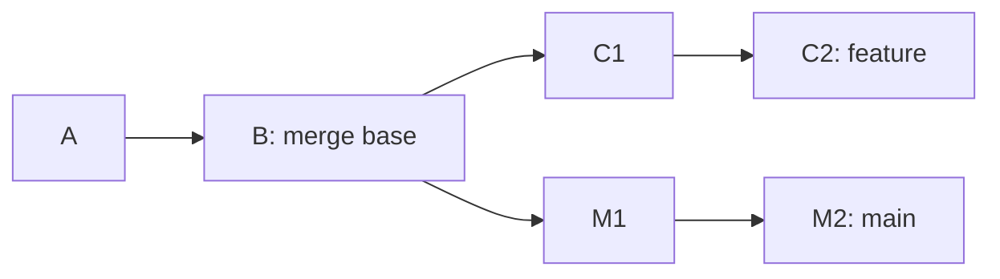

# Distinguishing `A..B` and `A...B` Syntax When Using `git diff`

In Git, `git diff A..B` and `git diff A...B` both accept two commits, yet they answer two different questions. The two-dot form compares **the snapshot at A with the snapshot at B**. The three-dot form finds **the common merge base of A and B**, and then compares that snapshot with B. Therefore, `A...B` is typically useful when reviewing changes specific to one branch since it diverged; `A..B` is useful when you want to see how two current tips differ.

A common point of confusion is thinking the three-dot syntax in `git diff` means "the set of all commits present in only one of the two branches." That is the usual interpretation for `git log A...B`, whereas `git diff` compares tree contents and follows its own rules. To read pull requests, review branches, or inspect differences between two versions, you must choose the right comparison form and the right A/B order.

This lesson belongs to the **Diffing Changes** chapter of SOURCE_CONTROL_GIT. The content progresses from endpoint and merge-base semantics, branching history examples, and diff direction selection, to display options and situations that cause unexpected results.

## 1. `git diff` Compares Snapshot Contents

Git can compare the working tree, the index, and commits. When given two commits, `git diff` compares their trees to find differences in files and contents.

```bash
# Working tree vs. index
git diff

# Index vs. HEAD
git diff --cached

# Working tree vs. HEAD
git diff HEAD

# Snapshots of two commits
git diff A B
```

The `git diff A B` command shows what needs to change to transform snapshot A into snapshot B. Added/removed lines in the patch follow that direction: A is the old side, and B is the new side.

The `A..B` and `A...B` forms are convenient shorthands for commit arguments to `git diff`; they do not turn `git diff` into a commit-listing command. The command still produces a diff between two selected trees.

## 2. `A..B`: Comparing Two Endpoints

With `git diff A..B`, Git directly compares the snapshots of A and B. In the context of `git diff`, this syntax is equivalent to:

```bash
git diff A B
```

Example:

```bash
git diff main..feature
```

This command compares the tree at the current tip of `main` with the tree at the current tip of `feature`. The output includes every difference between the two snapshots, regardless of which branch introduced the change.

### 2.1. Example with Two Diverged Branches

Suppose the history looks like this:

```text
             C1---C2  feature
            /
A---B------+
     \
      M1---M2  main
```

`B` is the common merge base. After branching:

- `feature` has commits `C1`, `C2`.
- `main` has commits `M1`, `M2`.

Run:

```bash
git diff main..feature
```

Git compares the snapshot at `M2` with the snapshot at `C2`. The output answers the question: **how do the two branches currently differ in content?**

If `main` edited a line and `feature` also edited that same line differently, the endpoint diff shows the difference between the two final results. It does not isolate what changes were made on `feature` since the branch point.

### 2.2. Comparison Direction Matters

The following two commands do not produce the same patch direction:

```bash
git diff main..feature
git diff feature..main
```

The first uses `main` as the old side and `feature` as the new side. The second reverses them. They express the same content gap, but the added/removed lines are inverted.

When reading the output, always verify which commit is first and which commit is second. Do not interpret `+` as "added on the feature branch" if the command actually used the reverse order.

## 3. `A...B`: Comparing the Merge Base with B

With `git diff A...B`, Git finds the merge base of A and B, then compares that merge base with B. You can think of it as equivalent to:

```bash
git diff "$(git merge-base A B)" B
```

In PowerShell:

```powershell
$base = git merge-base A B
git diff $base B
```

Example:

```bash
git diff main...feature
```

Git finds the best common ancestor of `main` and `feature` (in the simple history above, `B`), then compares snapshot `B` with the tip of `feature` (`C2`). The output answers the question: **what net content differences has `feature` produced since the common branch point?**

### 3.1. Visualizing with a Graph



The following two commands share the same merge base but have different endpoints:

```bash
# Net changes on feature since B
git diff main...feature

# Net changes on main since B
git diff feature...main
```

The left argument determines the history used to locate the merge base; the right argument is the final snapshot compared against that merge base. Therefore, swapping A and B can completely change the result.

### 3.2. Concrete Content Example

Suppose at merge base `B`, `config.yml` contains:

```yaml
timeout: 30
retry: false
```

After branching:

- `main` changes `timeout` to `60`.
- `feature` keeps `timeout: 30` and changes `retry` to `true`.

With an endpoint diff:

```bash
git diff main..feature -- config.yml
```

Git shows the difference between the two tip snapshots: `timeout` changes from `60` back to `30`, and `retry` changes from `false` to `true`.

With a three-dot diff:

```bash
git diff main...feature -- config.yml
```

Git compares `B` with `feature`. Because `feature` did not change `timeout` relative to the base, `timeout` does not appear. The diff only shows `retry` changing from `false` to `true`.

This is why `A...B` is usually well suited for inspecting branch B's own work when preparing a merge or pull request: it excludes from the diff any changes that only occurred on branch A.

## 4. Quick Comparison Table

| Syntax | Starting Point | Ending Point | Key Question |
|---|---|---|---|
| `git diff A B` | Tree of A | Tree of B | How do the two snapshots currently differ? |
| `git diff A..B` | Tree of A | Tree of B | Equivalent to `git diff A B`. |
| `git diff A...B` | Tree of merge base(A, B) | Tree of B | What has B changed since the common point? |
| `git diff B...A` | Tree of merge base(A, B) | Tree of A | What has A changed since the common point? |

Remember: `A..B` compares two endpoints; `A...B` compares from the merge base to the second endpoint.

## 5. Do Not Confuse `git diff A...B` with `git log A...B`

The two-dot and three-dot notations also appear in history-inspection commands, but their resulting meanings differ.

| Command | Meaning |
|---|---|
| `git diff A..B` | Compare tree A with tree B. |
| `git diff A...B` | Compare tree of merge base(A, B) with tree B. |
| `git log A..B` | List commits reachable from B but not reachable from A. |
| `git log A...B` | List commits reachable from only one of the two sides (symmetric difference), excluding the shared history. |

Example:

```bash
# Commits present on feature that are not yet on main
git log --oneline main..feature

# Commits unique to either side
git log --oneline --left-right main...feature

# Content changed by feature since the merge base
git diff main...feature
```

`git log A...B` can list commits on both A and B. `git diff A...B` only produces a patch from the merge base to B. Never use the output of one command to infer which commits the other command selected.

## 6. Choosing a Command Based on Your Review Goal

### 6.1. Reviewing a Feature Branch's Changes Before Merging

If you are on `main` and want to view changes specific to `feature` since it branched off:

```bash
git diff main...feature
```

This is a common pattern in pull request reviews. When a review platform uses the merge base of the target and source branches, the result generally corresponds to this form.

### 6.2. Seeing How the Current Branch Differs from a Remote-Tracking Branch

```bash
git fetch origin
git diff origin/main..HEAD
```

This command compares two snapshots: `origin/main` as updated by the most recent fetch, and local `HEAD`. It displays the differences between the current states of the two tips.

If you only want to view changes unique to your current branch since diverging from `origin/main`:

```bash
git diff origin/main...HEAD
```

`origin/main` is a local remote-tracking ref and does not update automatically when the remote changes. Run `git fetch origin` before reviewing to avoid comparing against stale data.

### 6.3. Seeing What the Base Branch Has Changed Relative to Feature

Swap the argument order:

```bash
git diff feature...main
```

This command shows the net changes on `main` since the merge base. It is useful when you want to see which changes from the base branch the feature branch is missing, though actual integration still depends on merge/rebase behavior and conflicts.

### 6.4. Viewing Only a Single File or Directory

You can append a pathspec after `--`:

```bash
git diff main..feature -- src/payment.js
git diff main...feature -- src/
```

`--` separates revisions from pathspecs. If a filename starts with `-` or contains wildcards, quote it and use `--` to prevent Git or the shell from misinterpreting the argument.

## 7. Useful Options When Viewing Diffs

The two syntaxes select comparison points; the following options control how the output is displayed.

### 7.1. Viewing a Change Summary

```bash
git diff --stat main...feature
git diff --shortstat main..feature
```

`--stat` displays added/removed line counts per file; `--shortstat` displays only the final summary line.

### 7.2. Viewing Only Filenames and Status

```bash
git diff --name-status main...feature
```

The output shows which files were added, modified, deleted, or detected as renamed by Git. Use `--name-only` if you only need the paths.

### 7.3. Checking Whitespace

```bash
git diff --check main...feature
```

This command checks for certain whitespace errors in the diff. It does not replace linting or tests.

### 7.4. Viewing Word-Level Changes

```bash
git diff --word-diff main...feature
```

`--word-diff` highlights changes by word units rather than whole lines, which is helpful for documentation or long configuration lines.

### 7.5. Comparing Line Indices or Ignoring Whitespace

```bash
git diff --ignore-space-change main..feature
git diff --ignore-all-space main...feature
```

These options alter how Git evaluates whitespace. Use them carefully; ignoring whitespace can hide meaningful changes in certain languages or formats.

### 7.6. Saving a Patch for Review or Application

```bash
git diff main...feature > feature-review.patch
```

This patch contains changes from the merge base to `feature`. It can be read in an editor or applied in a matching working tree with `git apply`, after verifying its source and scope.

## 8. Finding the Merge Base and Verifying the Starting Point

To understand the exact three-dot result, inspect the merge base Git locates:

```bash
git merge-base main feature
```

Then run the equivalent comparison explicitly:

```bash
base=$(git merge-base main feature)
git diff "$base" feature
```

In PowerShell:

```powershell
$base = git merge-base main feature
git diff $base feature
```

If `git merge-base` returns no OID, the two histories may share no common ancestor, the repository may be missing required history, or the refs may be incorrect. In that case, `git diff A...B` cannot work as expected.

### 8.1. Multiple Best Merge Bases Can Exist

In complex graphs, such as criss-cross histories, two commits can have multiple best merge bases. Inspect all of them with:

```bash
git merge-base --all main feature
```

Running `git merge-base main feature` without `--all` returns one best merge base; if multiple exist, which one is chosen is unspecified. Because `git diff A...B` is equivalent to using a single result from `git merge-base A B`, the output may need careful verification when multiple merge bases exist.

Do not confuse this with merge strategies that combine multiple merge bases to construct a virtual merge base. `git diff A...B` does not perform a merge and does not create an intermediate merged snapshot.

### 8.2. Shallow Clones Can Lack Ancestry

If a repository is a shallow clone, commit history may be truncated at a boundary. Git might not see the true merge base between two branches or may report that no common ancestor was found.

Check with:

```bash
git rev-parse --is-shallow-repository
```

If more history is needed, fetch deeper or unshallow according to repository policy:

```bash
git fetch --deepen=100 origin
```

Then re-run `git merge-base` and verify the output. Do not interpret a three-dot diff on an incomplete shallow clone as definitively showing all changes since the true branch point.

## 9. Common Mistakes

### 9.1. Thinking `A..B` Only Lists Changes Specific to B

In `git diff`, `A..B` compares two endpoint trees. It can show differences caused by both A and B evolving after branching. To see B's changes from the merge base, use `A...B`.

### 9.2. Thinking `A...B` Is a Symmetric Diff of Both Branches

No. `git diff A...B` compares the merge base with B. To view A's own changes, reverse it to `git diff B...A`. To list commits unique to either side, use `git log A...B`.

### 9.3. Swapping A and B and Forgetting the Patch Direction

`git diff A B` and `git diff B A` invert added/removed markers. With three dots, swapping also changes which endpoint is compared against the merge base. Always check the revision order before drawing conclusions.

### 9.4. Using a Stale Remote-Tracking Ref

`origin/main` only reflects the most recent fetch. Run `git fetch origin` before comparing against the latest remote state.

### 9.5. No Merge Base Found

Two independent histories or a shallow history may have no local common ancestor. Check `git merge-base`, shallow status, and branch names before proceeding.

### 9.6. Thinking `git diff` Includes Uncommitted Changes When Passed Two Commits

When passed two commits, Git compares the trees of those two commits. Unstaged or staged changes in the current working tree are not automatically added to the diff. Use `git diff`, `git diff --cached`, or `git diff HEAD` for those respective areas.

## 10. Branch Review Workflow Before Merging

Suppose you are preparing to integrate `feature/payment-timeout` into `main`.

**Step 1: Update remote information**

```bash
git fetch origin
```

**Step 2: Inspect the graph and identify both tips**

```bash
git log --graph --oneline --decorate --all
```

**Step 3: Check the merge base**

```bash
git merge-base origin/main feature/payment-timeout
```

**Step 4: Review changes specific to the feature**

```bash
git diff --stat origin/main...feature/payment-timeout
git diff --check origin/main...feature/payment-timeout
git diff origin/main...feature/payment-timeout
```

**Step 5: Compare the two final snapshots if needed**

```bash
git diff origin/main..feature/payment-timeout
```

This command helps show how `feature` and `main` currently differ in their final states. It may include differences from both sides.

**Step 6: Review commits unique to the feature**

```bash
git log --oneline origin/main..feature/payment-timeout
```

This is the list of commits present on `feature` that are not yet reachable from `main`; it is a question about commit history, distinct from a content diff.

**Step 7: Check the working tree status**

```bash
git status --short --branch
```

Make sure the diff you are reviewing is strictly between the two chosen refs and not confused with uncommitted local edits.

## 11. Key Takeaways

- `git diff A..B` is equivalent to `git diff A B`: it compares the tree of A with the tree of B.
- `git diff A...B` is equivalent to `git diff $(git merge-base A B) B`: it compares the merge base with B.
- In `A...B`, the right-hand endpoint B determines which changes are shown; swapping A and B changes the endpoint.
- `git diff A B` has a direction: A is the old side, B is the new side; reversing the order flips addition/deletion markers.
- `git diff A...B` is not a symmetric diff of both branches.
- `git log A...B` is the syntax that lists commits symmetrically present on only one of the two sides.
- Use `git merge-base --all` to detect cases with multiple best merge bases.
- Fetch from the remote before comparing against `origin/main`; remote-tracking refs can be stale.
- Shallow clones may lack ancestry and produce incomplete merge-base results.
- When given two commits, `git diff` compares commit snapshots; use the other diff forms to inspect the working tree and index.
- Use `--` to separate revisions from pathspecs when restricting a diff to specific files or directories.

Choose `A..B` when the question is how two current snapshots differ. Choose `A...B` when the question is what endpoint B has changed since its common merge base with A. If you need to know which commits belong solely to each branch, switch to `git log` with the corresponding commit range rather than inferring it from a patch.
