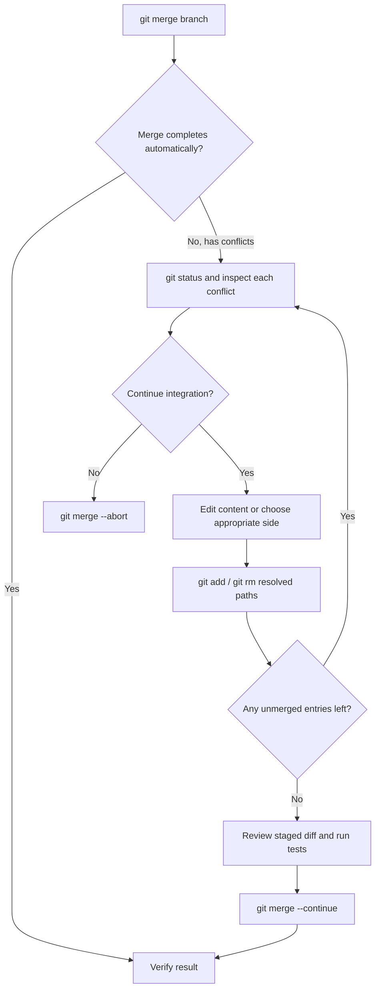

# Completing or Canceling a Merge with git merge --continue, --abort

When `git merge` encounters a conflict, Git pauses midway so you can decide the final content. At this point, the current branch does not yet have a new merge commit; the index may contain unmerged entries and the working tree may contain conflict markers. After resolving everything, you use `git merge --continue` to complete the merge. If you decide to abandon the ongoing merge, use `git merge --abort` to ask Git to return to the state before the merge began.

These two commands handle opposite directions of the same pending merge state. `--continue` requires all conflicts to be resolved and staged; `--abort` cancels the merge process and restores the pre-merge state as far as Git can reconstruct it. Understanding the index, working tree, `MERGE_HEAD`, and recovery limitations helps prevent losing changes when handling conflicts.

## 1. What States Can an Ongoing Merge Have?

Suppose you are on the `main` branch and want to merge `feature/payment`:

```bash
git switch main
git merge feature/payment
```

If Git can merge automatically, the command may finish immediately via fast-forward or by creating a merge commit. If there are conflicts, Git pauses and reports the paths needing attention. The `main` branch continues pointing to the pre-merge commit until the merge commit is created; Git saves the ongoing merge state so you can continue or cancel.

A merge with conflicts typically goes through these steps:

1. Git identifies the merge base and compares changes on both sides.
2. Git automatically combines non-conflicting portions.
3. For portions that cannot be combined automatically, Git writes unmerged entries into the index and may insert conflict markers into the working tree.
4. The user edits content, selects the final result, and stages each resolved path.
5. When no unmerged entries remain, `git merge --continue` creates the merge commit and concludes the merge.

If you do not want to keep the work in progress, `git merge --abort` cancels the ongoing merge. This command is not a tool for undoing a merge commit that has already been created.

## 2. Recognizing an Ongoing Merge

The first command to run after seeing a conflict message is:

```bash
git status
```

Git normally displays a status like:

```text
On branch main
You have unmerged paths.
  (fix conflicts and run "git commit")

Unmerged paths:
  both modified:   src/PaymentService.java
```

Messages may vary by version and conflict type. The `Unmerged paths` section indicates index paths that do not yet have a final merged result.

You can list only the conflicted paths:

```bash
git diff --name-only --diff-filter=U
```

View unmerged entries in the index:

```bash
git ls-files -u
```

Check whether Git is holding a merge state:

```bash
git rev-parse -q --verify MERGE_HEAD
```

When a merge is in progress, `MERGE_HEAD` normally contains the OID of the commit being merged in. If the command does not find `MERGE_HEAD`, there may be no merge in progress; read `git status` to determine what state Git is in. Another operation such as rebase or cherry-pick has its own state markers and requires its corresponding continue/abort command.

## 3. Understanding the Index During a Conflict

In a merge conflict, an unresolved path can have multiple stages in the index:

| Stage | Meaning in a merge |
|---|---|
| `1` | Version from the merge base (common ancestor), if it exists |
| `2` | Version of the current branch, commonly called *ours* |
| `3` | Version of the branch being merged in, commonly called *theirs* |

When the conflict is resolved and you run `git add <path>`, Git places the final result into stage `0` of the index. The unmerged stages for that path are replaced.

Inspect the content of each stage:

```bash
git show :1:src/PaymentService.java
git show :2:src/PaymentService.java
git show :3:src/PaymentService.java
```

Some conflict types do not have all three stages. For example, when both branches add the same path, there is no stage `1` version; when one side deletes and the other modifies, either stage `2` or stage `3` may not exist. Therefore, if `git show :1:<path>` cannot find an object, that does not necessarily mean the repository is corrupted.

In a normal merge, *ours* is the content from the currently checked-out branch and *theirs* is the content from the branch being merged in. This naming depends on merge direction. If you swap the branches in the merge command, the ours/theirs roles swap accordingly.

## 4. Inspecting and Analyzing Conflicts Before Editing

Do not rush to pick one side for every file. First, inspect status and diffs:

```bash
git status
git diff
git diff --cc
```

`git diff` displays unresolved conflicts in a suitable diff format; `git diff --cc` displays a combined diff to show lines involving multiple sides. You can view each side separately against the working tree:

```bash
git diff --ours -- src/PaymentService.java
git diff --theirs -- src/PaymentService.java
```

These commands compare the current working tree content against the ours or theirs version. To inspect each exact snapshot in the index, use `git show :2:<path>` and `git show :3:<path>` as shown earlier.

When Git inserts conflict markers into a text file, the content usually looks like:

```text
<<<<<<< HEAD
// Content from current branch (ours)
=======
// Content from branch being merged in (theirs)
>>>>>>> feature/payment
```

The section between `<<<<<<<` and `=======` is ours; the section between `=======` and `>>>>>>>` is theirs. The label after `>>>>>>>` usually indicates the other side, though it can vary depending on how the merge was invoked.

If conflict style is configured as `diff3` or `zdiff3`, Git also shows the base section between `|||||||` and `=======`. This section is helpful for understanding how both branches diverged from the shared content.

## 5. Resolving Conflicts by Editing Content

This is the most common approach when both sides have changes that need to be preserved.

1. Open the conflicted file in an editor.
2. Read the ours, theirs, and base contents if available.
3. Combine the required logic into one final version.
4. Remove all remaining conflict markers.
5. Save the file.
6. Stage the result to mark the path as resolved.

For example, two branches modify fee calculation:

```text
<<<<<<< HEAD
return amount.add(serviceFee);
=======
return amount.multiply(rate);
>>>>>>> feature/payment
```

The right result may require combining both ideas or picking one calculation according to business rules. Never just delete markers and arbitrarily keep one line. After editing, check the content and run relevant tests.

Stage the resolved file:

```bash
git add -- src/PaymentService.java
```

For paths resolved by deleting the file:

```bash
git rm -- src/LegacyPayment.java
```

`git add` or `git rm` tells Git the final result is ready. Editing content on disk without staging leaves the path in an unmerged state.

## 6. Choosing an Entire Side When Truly Appropriate

If business rules require taking the whole file from one side, you can use `git restore`:

```bash
# Take content from the current branch (ours) into the working tree.
git restore --ours --worktree -- src/PaymentService.java

# Or take content from the branch being merged in (theirs).
git restore --theirs --worktree -- src/PaymentService.java
```

Then stage the result:

```bash
git add -- src/PaymentService.java
```

Commonly seen older equivalent syntax:

```bash
git checkout --ours -- src/PaymentService.java
git checkout --theirs -- src/PaymentService.java
```

`--ours` and `--theirs` select one side's entire version for the path. They do not automatically combine logic from both sides. Only use them when you have verified that discarding the other side's changes is correct.

## 7. Handling Different Types of Conflicts

Not every conflict consists of two marker blocks inside one file.

| Conflict type | Common symptom | How to handle |
|---|---|---|
| Both modified | Both sides edited the same file | Edit final content or intentionally pick one side, then `git add` |
| Both added | Both sides added the same path | Combine contents or rename one side per design, then stage the result |
| Delete/modify | One side deleted, the other modified | Decide whether to keep the edit or keep the deletion; use `git add` or `git rm` accordingly |
| Rename/rename | Both sides renamed the same file to two different paths | Determine the intended target path, handle remaining copies, and stage/remove the right paths |
| Rename/delete | One side renamed, the other deleted | Decide whether the file should still exist and at which path |
| Binary conflict | Binary content cannot be merged line by line | Produce the final artifact with an appropriate tool or pick one side, then stage the file |
| File/directory conflict | One side uses a name as a file, the other as a directory | Choose the final structure, move or remove conflicting paths, then stage the result |

For rename or file/directory conflicts, read the full output of `git status` and `git ls-files -u`. Multiple paths may be involved; resolving one path while overlooking another will prevent the merge from continuing.

## 8. Verifying All Conflicts Are Resolved

After handling each file, check:

```bash
git status
git diff --name-only --diff-filter=U
git ls-files -u
```

If `git diff --name-only --diff-filter=U` and `git ls-files -u` show no paths, the index has no remaining unmerged entries. Even so, still review the staged diff:

```bash
git diff --cached
git diff --cached --check
```

`git diff --cached` shows the snapshot that will be written to the merge commit. `git diff --cached --check` helps catch whitespace errors. Run appropriate tests to verify the combined logic from both branches.

In particular, do not just see `All conflicts fixed` and commit immediately. A conflict can be syntactically resolved yet still violate business logic, miss error handling, or silently drop valid changes from one side.

## 9. Completing the Merge with git merge --continue

Once all conflicts are resolved and staged, continue the merge:

```bash
git merge --continue
```

Git uses the saved merge state to complete the operation and create the merge commit. The commit message editor may open for you to confirm or edit the message. If the project has a `commit-msg` hook, commit signing, or other commit rules, those checks may also run.

Before continuing, you should inspect:

```bash
git status
git diff --cached
git diff --cached --check
```

After the command succeeds, verify the merge commit:

```bash
git status
git log --oneline --graph --decorate -10
git show -s --format="commit: %H%nparents: %P%nsubject: %s" HEAD
```

A standard merge commit has two parents: the first parent is the tip commit of the branch you were on before merging, and the second parent is the tip commit merged in. If the original operation was a fast-forward, Git does not create a merge commit; in that case there is no merge conflict waiting for `--continue`.

### Can You Use git commit Instead of --continue?

In many resolved-merge cases, `git commit` also finishes the merge by creating a commit from the index and existing merge state. However, `git merge --continue` clearly expresses the intent to resume an ongoing merge and is a clear choice in conflict resolution workflows.

If Git reports unmerged paths remain, go back, check staging, and resolve any missing paths. If the commit is blocked by a hook, signing, or commit message check, read the reported error and fix that condition; the merge state usually remains so you can try continuing again.

## 10. Canceling an Ongoing Merge with git merge --abort

If you decide not to continue integrating the branch, run:

```bash
git merge --abort
```

Git attempts to restore the index and working tree to their state before the merge began. The current branch returns to its pre-merge tip commit; merge state such as `MERGE_HEAD` is removed.

After aborting, check:

```bash
git status
git log --oneline --decorate -5
git rev-parse HEAD
```

If the branch is back at the old commit and no merge state remains, the abort operation has finished. Uncommitted changes that existed prior to the merge should be checked carefully because restoration accuracy depends on the initial state and actions taken during the merge.

### When Should You Abort?

- You realize you are merging the wrong branch or wrong commit.
- The conflict scope is too large and you want to update the branch before trying again.
- You need to consult the owner of the changes before deciding how to combine them.
- You want to return to the pre-merge state to make a backup or double-check.
- The current merged result cannot meet requirements and you need to restart with a different plan.

Abort does not delete commits that already exist on the branch being merged; it only cancels the active merge in the current repository.

## 11. Recovery Limitations and Pre-Merge Uncommitted Changes

`git merge --abort` tries to reconstruct the pre-merge state, but it has limits. If the working tree already had uncommitted changes before the merge began, Git may fail to restore every change accurately in certain situations. Therefore, Git documentation recommends committing or stashing changes before running a merge.

Before merging, inspect:

```bash
git status --short --branch
git diff
git diff --cached
```

If there are changes to keep, commit them or intentionally stash them:

```bash
git stash push -u -m "before merging feature/payment"
```

`-u` includes untracked files in the stash. If you need to keep ignored files, consider `-a` and understand its scope before using it. After the merge finishes or aborts, you can restore the stash:

```bash
git stash list
git stash apply stash@{0}
```

Check status before `stash pop`, as applying a stash after a merge can also trigger new conflicts.

If you have already edited conflicts and want to keep your manual resolution work before aborting, back up the needed content outside the working tree or generate an appropriate patch before canceling. Do not assume `--abort` preserves edits made while resolving conflicts.

### When Merge Uses Autostash

If the merge was run with `--autostash` or the corresponding config, Git creates a temporary stash for local changes before merging. When aborting, Git tries to reapply the autostash to the working tree. Reapplying it can produce its own conflicts; inspect `git status` and file contents afterward.

## 12. Distinguishing --abort from --quit

Git also has `git merge --quit`, but its purpose differs from abort:

| Command | Behavior |
|---|---|
| `git merge --continue` | Finishes an ongoing merge after conflicts are resolved and staged |
| `git merge --abort` | Cancels the merge and attempts to restore the pre-merge state |
| `git merge --quit` | Removes ongoing merge state info while leaving the current index and working tree intact |

`--quit` is not a safe way to return to the pre-merge state. It can leave half-processed results in the working tree/index without a merge state to continue through the normal flow. Only use it when you clearly understand why you need to forget the merge state while retaining current file contents.

## 13. Distinguishing Merge Conflicts from Rebase or Cherry-Pick Conflicts

Multiple Git operations can stop due to conflicts, but each operation has its own state and continue/abort commands:

| Operation in progress | Continue | Abort |
|---|---|---|
| Merge | `git merge --continue` | `git merge --abort` |
| Rebase | `git rebase --continue` | `git rebase --abort` |
| Cherry-pick | `git cherry-pick --continue` | `git cherry-pick --abort` |
| Revert | `git revert --continue` | `git revert --abort` |

Always check `git status` before running commands. Do not run `git merge --continue` to continue a rebase or cherry-pick just because they also show conflict markers. If the command does not recognize the corresponding state, check the operation marker and use the command for that specific operation.

## 14. What If the Merge Has Already Completed?

`git merge --abort` only applies while a merge is still in progress. Once the merge commit has been created, abort cannot delete that commit or return the branch to its pre-merge state.

If the merge commit has already been shared and its contents need to be undone, you normally use `git revert` with the appropriate mainline parent:

```bash
git revert -m 1 <merge-commit>
```

`-m 1` selects the first parent as the mainline in the example of merging a feature branch into `main`. Picking the wrong parent can invert unintended content. Inspect parents with:

```bash
git show -s --format="%H%n%P%n%s" <merge-commit>
```

If the merge commit has not been shared and you intentionally want to move the branch back to the previous commit, evaluate `git reset` and create a backup beforehand. Do not treat `merge --abort` as a general undo command for already-completed merges.

## 15. Safe Merge Completion Workflow

A workflow teams can adopt:

1. **Check before merging:** `git status --short --branch`; commit or stash local changes to keep.
2. **Start the merge:** `git merge <branch>` and read Git's output.
3. **List conflicts:** `git status`, `git diff --name-only --diff-filter=U`.
4. **Understand each side:** check `git diff --ours`, `git diff --theirs`, or stages `:1:`, `:2:`, `:3:` as needed.
5. **Resolve:** edit content, handle rename/delete/binary conflicts, and stage each path.
6. **Verify index:** `git ls-files -u` must show no remaining unmerged entries.
7. **Review:** `git diff --cached`, `git diff --cached --check`, and run tests.
8. **Complete:** `git merge --continue`.
9. **Verify:** inspect `git status`, `git log --graph`, and the merge commit's parents.

If at step 4 or 5 you realize you should not proceed, back up any edits to keep and run `git merge --abort`. Then update the branch or coordinate with your team before retrying.

Flow diagram:



## 16. Hands-On Example in a Test Repository

Create a small repository to observe merge states. The commands below use Bash or Git Bash:

```bash
mkdir merge-continue-lab
cd merge-continue-lab
git init -b main
git config user.name "Git Practice"
git config user.email "git-practice@example.com"

printf 'payment mode: standard\n' > settings.txt
git add settings.txt
git commit -m "chore: add payment settings"

git switch -c feature/payment
printf 'payment mode: fast\n' > settings.txt
git commit -am "feat: use fast payment mode"

git switch main
printf 'payment mode: secure\n' > settings.txt
git commit -am "feat: use secure payment mode"
```

Create a conflict:

```bash
git merge feature/payment
git status
git diff --name-only --diff-filter=U
```

Open `settings.txt` and decide the final content. For example, pick secure mode with an explanatory comment:

```text
payment mode: secure
# verified before charge
```

Stage and continue:

```bash
git add settings.txt
git diff --cached
git ls-files -u
git merge --continue
```

Check the result:

```bash
git status
git log --oneline --graph --decorate --all
git show -s --format="%H%n%P%n%s" HEAD
```

To practice aborting, recreate the lab from scratch or use another copy. Trigger the merge conflict as above, then run:

```bash
git merge --abort
git status
git log --oneline --graph --decorate --all
```

The `main` branch must return to the pre-merge commit and no merge state should remain. Use a lab repository to practice both paths; never practice abort or reset on a repository holding important unsaved changes.

## 17. Common Errors When Continuing or Aborting

| Symptom | Possible cause | How to handle |
|---|---|---|
| `git merge --continue` reports unmerged paths | One or more paths were not staged after resolution | Run `git status`, `git ls-files -u`, resolve each path, then `git add`/`git rm` |
| Edited the file yet Git still reports conflict | Content changed on disk, but index was not updated | Stage the right path with `git add` or `git rm` |
| `MERGE_HEAD` not found | No merge in progress, or active operation is rebase/cherry-pick | Read `git status` and use the continue/abort command of the right type |
| `git merge --abort` did not restore as expected | Uncommitted changes existed prior to merge or edits were made during conflict | Check backups/stash, reflog, and file copies; next time commit/stash before merging |
| `git merge --abort` says no merge to abort | Merge already completed or no merge state exists | If you need to undo a shared merge, consider `git revert -m` with the right mainline |
| Merge continuation commit rejected by hook | Hook or commit message rule failed | Fix the reported condition, check staged diff, and re-run `git merge --continue` |
| Commit signing failed | Signing key or signer config not ready | Check signing config and error output; merge state may still wait for completion |
| Untracked files remain after abort | Files created during resolution or by external tools | Inspect each file and delete only when certain it is not needed |
| Accidentally ran `git rebase --continue` | Current state is a merge | Use `git status`; run `git merge --continue` or the command for the active operation |

When errors occur, do not repeatedly run `reset --hard`, `clean -fd`, or delete `.git/MERGE_*` to force Git out of the state. Those actions can cause data loss or leave the repository in an inconsistent state.

## 18. Common Misconceptions

| Misconception | Correct understanding |
|---|---|
| Just removing conflict markers finishes the merge | You must stage the result so the index has no unmerged entries, then continue the merge |
| `git merge --continue` resolves conflicts automatically | It finishes the merge after the user has resolved and staged every path |
| `git merge --abort` deletes the branch being merged | It only cancels the ongoing merge in the current repository |
| Abort always restores every local change unconditionally | Uncommitted changes prior to the merge may not be fully restored in some scenarios |
| Ours is always the main branch | Ours is the current branch at the time merge is invoked |
| Theirs is always the feature branch | Theirs is the branch being merged in, depending on merge direction |
| `git merge --quit` is the same as `--abort` | Quit forgets merge state while keeping current index/working tree; abort tries to restore pre-merge state |
| You can use merge continue for a rebase conflict | Each operation has its own continue/abort command |
| Abort can undo a merge commit already created | Completed merges require an appropriate revert or ref recovery workflow |

## 19. Takeaways

When a merge pauses due to conflicts, start with `git status`, `git diff --name-only --diff-filter=U`, and `git ls-files -u`. Understand that stage `1` is base, stage `2` is ours, and stage `3` is theirs; edit content or choose the appropriate side, then use `git add`/`git rm` to record the result in the index.

Once no unmerged entries remain, review `git diff --cached`, run checks, and use `git merge --continue` to create the merge commit. If you decide to abandon the ongoing merge, use `git merge --abort`; it attempts to restore the pre-merge state, though it does not guarantee preserving all uncommitted changes in every case. Commit or stash work before merging, back up any conflict edits you want to keep, and always check `git status` after continuing or aborting.
