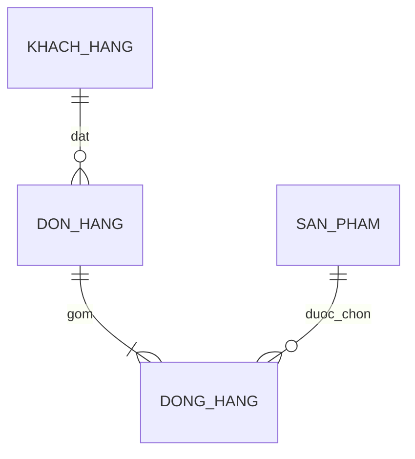

# Three Modeling Levels: Conceptual, Logical, and Physical

When designing data, a development team often needs to answer three distinct questions: **which objects the business is talking about**, **how those objects and rules are represented as data structures**, and **how those structures are concretely implemented on a database management system**. If you try to answer all three questions in a single diagram or a single set of SQL statements, you easily mix business language with technical decisions, miss important rules, or optimize prematurely.

A data model is typically developed across three levels: **conceptual**, **logical**, and **physical**. Each level describes the same business domain at a different level of detail, serving different readers and decisions. The three levels connect to one another: the conceptual model defines scope and meaning, the logical model clarifies structure and constraints, and the physical model turns that structure into an implementable and operable design.

Within **DATABASE_DATA_MODELING**, this approach helps transform business requirements into clear, verifiable, and evolvable data models. It also provides a foundation for choosing the right organization for relational, document, graph, or analytical databases.

## Learning Objectives

After this lesson, you will be able to:

- Distinguish the purpose, contents, and primary audience of conceptual, logical, and physical models.
- Translate a business requirement into entities, relationships, attributes, keys, and constraints at the appropriate level.
- Explain how a single logical model can be implemented across multiple storage paradigms.
- Evaluate physical decisions such as data types, indexes, and partitioning based on queries, scale, and operational requirements.
- Verify consistency across requirements, models, and deployed schemas.

## 1. Why Do We Need Three Modeling Levels?

Consider the requirement: "Customers can place orders; each order consists of one or more line items; each line item references a product and records the quantity and price at the time of purchase."

This requirement contains several layers of information:

- **Business meaning:** what concepts customer, order, product, and line item represent; how they relate to each other.
- **Data structure:** what attributes each concept has; which object identifies which; what keys represent relationships; what validity conditions apply.
- **Implementation:** which data types to use, which tables and indexes to create, where to place constraints, and how to design for real-world queries.

The three modeling levels separate these decisions into steps that can be discussed and verified. They are not three independent copies. When a requirement changes, the team needs to trace that change through the levels to see whether the logical model and physical schema need updating.

| Modeling Level | Question Answered | Primary Audience | Characteristics |
|---|---|---|---|
| Conceptual | Which concepts and relationships exist in the business? | Product owners, domain experts, architects | High-level, uses business language, minimal technical detail |
| Logical | How are data structured and constrained? | Data analysts, data architects, developers | Detailed attributes, identifiers, relationships, and rules; usually independent of a specific DBMS |
| Physical | On which platform is the structure implemented and operated? | Database engineers, developers, operations teams | Tied to DBMS, data types, indexes, partitioning, and storage configuration |

## 2. Conceptual Data Model

The conceptual model describes **what the business needs to record** and **how concepts relate to one another**. It is the high-level picture of the data domain, helping stakeholders align on scope before choosing a storage approach.

### 2.1. Core Components

- **Entities or business concepts:** types of objects to track, such as Customer, Order, Product.
- **Relationships:** how concepts connect, such as Customer places Order; Order contains Line Item.
- **Cardinality:** how many objects can participate in a relationship, typically expressed as one-to-one, one-to-many, or many-to-many.
- **High-level business rules:** conditions meaningful to the business, such as an order must have at least one line item.

At this level, teams should prioritize terminology that business users understand. There is no need to decide on `BIGINT`, `VARCHAR`, index names, partitions, or tablespaces yet. If stakeholders have not agreed on a concept, note the open question instead of silently turning an assumption into a data structure.

### 2.2. Ordering Domain Example

A conceptual model might consist of four concepts:

- **Customer:** the party performing the transaction.
- **Order:** a purchase transaction created by a customer.
- **Line Item:** a specific item entry in an order, carrying quantity and locked-in price.
- **Product:** an item offered for sale.

Relationships and cardinality:

- A customer may have zero orders or many orders; each order belongs to exactly one customer.
- An order has one or more line items; each line item belongs to exactly one order.
- Each line item points to one product; a product may appear in many line items or in none yet.



The diagram helps the team verify language and relationships with the business. For example, if the business allows draft orders without line items yet, the rule "one or more line items" may apply only when the order is confirmed. Clarify when this rule is checked before moving to the logical level.

### 2.3. Expected Deliverables

A good conceptual model should have:

1. A list of concepts with concise, non-overlapping definitions.
2. Relationships named with meaningful verbs.
3. Cardinalities and business rules confirmed or flagged for clarification.
4. Data scope agreed upon with stakeholders.

**Signs of a weak conceptual model:** the diagram contains too many technical columns, concept names are unclear to business users, relationships lack cardinalities, or the same concept is referred to by multiple unexplained names.

## 3. Logical Data Model

The logical model turns the business picture into a data structure detailed enough to verify consistency. It defines **which attributes describe each object, how objects are identified, how they link together, and what conditions valid data must satisfy**.

A logical model is typically independent of a specific DBMS product. However, it can be influenced by the chosen storage paradigm—for example, relational, document, graph, or analytical. Therefore, "logical" does not mean "always relational tables."

### 3.1. Core Components

- **Entities and attributes:** describe the data to store, with names, meanings, value domains, and mandatory/optional status.
- **Identifiers:** primary keys, surrogate keys, or business identifiers; specify what distinguishes one record from another.
- **Relationships and references:** describe how objects connect, including foreign keys when using a relational model.
- **Constraints:** uniqueness, mandatory presence, value domains, cross-record conditions, and business rules to protect.
- **Functional dependencies and normalization:** identify duplicated data, improper dependencies, and risks of anomalies during inserts, updates, or deletes.

### 3.2. Translating the Example to a Relational Logical Model

A relational representation can include the following relations:

| Relation | Attributes | Notable Keys and Constraints |
|---|---|---|
| KHACH_HANG | ma_khach_hang, email, ho_ten | `ma_khach_hang` identifier; email unique and required |
| SAN_PHAM | ma_san_pham, sku, ten, gia_hien_tai | `ma_san_pham` identifier; SKU unique; price non-negative |
| DON_HANG | ma_don_hang, ma_khach_hang, thoi_diem_dat, trang_thai | `ma_don_hang` identifier; references one customer |
| DONG_HANG | ma_don_hang, so_dong, ma_san_pham, so_luong, don_gia_tai_thoi_diem_mua | Composite key `(ma_don_hang, so_dong)`; references order and product; quantity positive, price non-negative |

Here, `DONG_HANG` is an associative entity between Order and Product. It needs to exist because this relationship carries its own data, such as quantity and unit price at purchase time. If you merely stored a list of product IDs inside an order field, it would be difficult to validate individual lines, query by product, and guarantee integrity.

Several important logical decisions:

- **Price at purchase time belongs to the line item.** A product's current price may change, but the locked-in price of past transactions must be preserved per business rules.
- **Line items are identified within the scope of an order.** The composite key `(ma_don_hang, so_dong)` expresses that line numbers only need to be unique inside one order.
- **Email and SKU have uniqueness rules.** You must agree on whether emails are case-sensitive or case-insensitive; comparison rules affect how the constraint is implemented.
- **Quantity and price have value domains.** Zero or negative quantities are rejected, and negative prices are rejected unless allowed by the business.
- **Order status has a valid value set and state transition rules.** The list of statuses can be represented via a value domain, lookup table, or equivalent structure on the deployment platform.

### 3.3. Normalization and Integrity

Normalization helps reduce data duplication and prevent update anomalies. For relational models, the first three normal forms are commonly used for evaluation:

- **First Normal Form (1NF):** every attribute holds an atomic value within its chosen data domain; do not pack unstructured multi-value lists into a single cell when individual elements must be managed.
- **Second Normal Form (2NF):** the relation is in 1NF and every non-key attribute is fully functionally dependent on the entire candidate key; pay special attention to this when using composite keys.
- **Third Normal Form (3NF):** the relation is in 2NF and no non-key attribute is transitively dependent on the key through another non-key attribute.

For example, if the `DON_HANG` table also stores customer email and full name, those details depend on the customer rather than directly on the order. When a customer changes their email, multiple orders may need updating; missing any creates inconsistent data. Separating `KHACH_HANG` and referencing it via `ma_khach_hang` eliminates that duplication.

Normalization is an analytical tool, not a mechanical end goal. A model may intentionally capture a snapshot of a product name or shipping address at purchase time because that is historical transaction data, not an accidental duplicate of current profile info. In analytical data warehouses, star schemas are often intentionally denormalized to simplify queries. Every exception should have a business or performance justification and a strategy for maintaining consistency.

### 3.4. Logical Models Across Storage Paradigms

The same conceptual model can be expressed logically in multiple ways:

| Model Type | How the Ordering Example Is Represented | When It Fits Best |
|---|---|---|
| Relational | Customer, Order, Line Item, Product relations; linked via keys | Consistent transactions, explicit constraints, and flexible join queries required |
| Document | An Order document containing line items; customer and product may be referenced or snapshotted as needed | Data is typically read/written by aggregate; structure varies across document types |
| Graph | Customer, Order, Product nodes; edges `DAT`, `GOM`, `CHON_SAN_PHAM` represent relationships | Focus is multi-hop relationship traversal, paths, or connection networks |
| Analytical | Sales line-item fact linked with customer, product, and time dimensions | Focus is aggregation, measurement, and multidimensional analysis |

Choosing a logical structure should be based on access patterns, transaction boundaries, scale, data flexibility, and consistency requirements. Do not pick a document model just because data "looks like JSON", or a graph model just because the domain has many relationships. Identify core queries and operations first.

## 4. Physical Data Model

The physical model translates the logical structure into a concrete design on a specific platform. It answers **where data is stored, which data types are used, which constraints are enforced, how indexes are created, and how data is organized for operation**.

Unlike the logical model, the physical model depends on a specific DBMS and version. The same logical model can yield different DDL, data types, indexes, and partitioning strategies across PostgreSQL, MySQL, SQL Server, or a document system.

### 4.1. Core Components

- **Storage objects:** tables, columns, collections, documents, nodes, edges, views, or fact/dimension tables.
- **Concrete data types:** integers, strings, date/time types, decimals, JSON types, or DBMS-specific types.
- **Enforced constraints:** `PRIMARY KEY`, `FOREIGN KEY`, `UNIQUE`, `NOT NULL`, `CHECK`, default values, and equivalent mechanisms.
- **Indexes:** structures serving real query patterns, carrying storage and write maintenance costs.
- **Data organization:** partitioning, clustering, compression, tablespaces, or system-specific storage strategies.
- **Operations and change management:** migrations, backups, recovery, access control, monitoring, and growth planning.

### 4.2. PostgreSQL DDL Example

The DDL below illustrates one relational implementation of the ordering example. This is a specific physical choice, not the only valid definition of the logical model.

```sql
CREATE TABLE customer (
    customer_id BIGINT GENERATED BY DEFAULT AS IDENTITY PRIMARY KEY,
    email       VARCHAR(320) NOT NULL UNIQUE,
    full_name   VARCHAR(200) NOT NULL,
    created_at  TIMESTAMPTZ NOT NULL DEFAULT now()
);

CREATE TABLE product (
    product_id    BIGINT GENERATED BY DEFAULT AS IDENTITY PRIMARY KEY,
    sku           VARCHAR(64) NOT NULL UNIQUE,
    name          VARCHAR(250) NOT NULL,
    current_price NUMERIC(12, 2) NOT NULL CHECK (current_price >= 0)
);

CREATE TABLE sales_order (
    order_id    BIGINT GENERATED BY DEFAULT AS IDENTITY PRIMARY KEY,
    customer_id BIGINT NOT NULL REFERENCES customer(customer_id),
    placed_at   TIMESTAMPTZ NOT NULL DEFAULT now(),
    status      VARCHAR(20) NOT NULL DEFAULT 'PENDING'
                CHECK (status IN ('PENDING', 'CONFIRMED', 'SHIPPED', 'CANCELLED'))
);

CREATE TABLE order_item (
    order_id               BIGINT NOT NULL REFERENCES sales_order(order_id),
    line_no                INTEGER NOT NULL CHECK (line_no > 0),
    product_id             BIGINT NOT NULL REFERENCES product(product_id),
    quantity               INTEGER NOT NULL CHECK (quantity > 0),
    unit_price_at_purchase NUMERIC(12, 2) NOT NULL
                           CHECK (unit_price_at_purchase >= 0),
    PRIMARY KEY (order_id, line_no)
);

CREATE INDEX sales_order_customer_placed_idx
    ON sales_order (customer_id, placed_at DESC);

CREATE INDEX order_item_product_idx
    ON order_item (product_id);
```

Physical decisions in this example:

- `BIGINT ... IDENTITY` generates auto-incrementing numeric identifiers using PostgreSQL's mechanism. Other systems may use different syntax or key generation approaches.
- `TIMESTAMPTZ` stores points in time with timezone semantics; applications still need consistent rules for normalization and display.
- `NUMERIC(12, 2)` suits monetary values requiring fixed decimal precision. Never use binary floating-point numbers for monetary calculations requiring exactness.
- `CHECK`, `NOT NULL`, `UNIQUE`, and foreign keys turn part of the logical rules into database-enforced constraints.
- The composite index on `(customer_id, placed_at DESC)` supports fetching recent orders for a customer. The index on `order_item(product_id)` supports querying line items by product.

PostgreSQL automatically creates indexes for primary keys and unique constraints, but it does not automatically index every foreign key column. Therefore, review join queries, deletes/updates on referenced records, and execution plans before adding indexes. Indexing every column increases storage usage and slows down writes.

### 4.3. Trade-offs in Physical Design

A good physical design balances multiple goals:

- **Reads and writes:** indexes accelerate specific queries but must be updated whenever data changes.
- **Consistency and speed:** DBMS-level constraints protect data even when multiple applications write to it, though they can add write overhead or expose poorly structured transactions.
- **Storage and querying:** partitioning can help manage large datasets by time or range; it also adds operational complexity and does not automatically make all queries faster.
- **Flexibility and control:** JSON/document types accommodate evolving structures, but you must define which fields require validation, indexing, and versioning.
- **Performance and evolvability:** denormalization or derived data can accelerate reads, but requires synchronization workflows and drift detection.

Indexes should stem from known query patterns or observed metrics. In PostgreSQL, you can inspect plans using `EXPLAIN (ANALYZE, BUFFERS)` on representative queries in a safe environment. Do not add indexes, partitions, or caches merely because they are commonly viewed as optimization techniques.

## 5. Tracing a Decision Across All Three Levels

A requirement must be traceable end-to-end so the business diagram does not say one thing while the database permits another.

| Business Requirement | Conceptual Model | Logical Model | Illustrative Physical Model |
|---|---|---|---|
| Each order belongs to one customer | Customer — places — Order, order side has exactly one customer | `DON_HANG.ma_khach_hang` references `KHACH_HANG.ma_khach_hang`, non-null | `sales_order.customer_id BIGINT NOT NULL REFERENCES customer(customer_id)` |
| An order has numbered line items | Order — contains — Line Item | Line item key includes order ID and line number | `PRIMARY KEY (order_id, line_no)` |
| Purchase price stays unchanged when product price changes | Line item records the transaction's price | Attribute `don_gia_tai_thoi_diem_mua` belongs to Line Item | `unit_price_at_purchase NUMERIC(12, 2) NOT NULL CHECK (...)` |
| User views recent orders for a customer | Customer — Order relationship | Query filtered by customer and sorted by order timestamp | Index `(customer_id, placed_at DESC)` |

This traceability table supports two-way verification:

1. Top-down from requirements: is every important rule represented in the model and enforced at the appropriate layer?
2. Bottom-up from implementation: does every column, constraint, and index serve a defined requirement, query, or operational goal?

Not every business rule can be expressed with a simple `CHECK`. For instance, "a confirmed order must have at least one line item" may require a transaction, trigger, confirmation workflow, or application-level check depending on the DBMS and write patterns. What matters is specifying where the rule is enforced, how concurrency is handled, and how it is tested.

## 6. Process for Building and Validating the Three Levels

You can carry out the process in the following steps:

1. **Gather requirements and terminology:** identify business goals, actors, events, input/output data, rules, and key queries. Clarify ambiguous terms with domain authorities.
2. **Build the conceptual model:** list concepts, describe meanings, relationships, cardinalities, and high-level rules. Confirm the diagram with stakeholders.
3. **Develop the logical model:** add attributes, identifiers, value domains, mandatory rules, relationships, keys, and constraints. Evaluate functional dependencies, normalization, and historical data cases.
4. **Choose the logical model paradigm:** select relational, document, graph, or analytical structure based on queries, transactions, relationships, scale, and evolution needs.
5. **Design the physical model:** choose the DBMS and version; map data types; specify constraints, indexes, partitioning, and required configuration.
6. **Test with representative data and queries:** verify valid/invalid data, concurrent operations, query plans, write volume, and recovery scenarios.
7. **Manage change:** version the model and migrations; determine compatible rollout ordering between application and schema; test rollback or recovery capability.

### 6.1. Stage Gates by Level

**Before finalizing the conceptual model:**

- Do concept names and definitions align with the business?
- Do relationships and cardinalities accurately reflect real scenarios?
- Which rules remain assumptions or require confirmation?

**Before finalizing the logical model:**

- Does each entity have a clear identification strategy?
- Do attributes have appropriate value domains and mandatory rules?
- Do relationships, keys, and constraints protect integrity?
- Is there duplicated data that causes update anomalies? If denormalized, what are the justification and synchronization mechanism?
- Does the structure support critical business operations and queries?

**Before finalizing the physical model:**

- Do data types provide sufficient value range and precision?
- Which rules are protected by DBMS constraints, and which are controlled in transactions or application logic?
- Are indexes justified by queries and metrics?
- Do partitioning, compression, or special storage choices offer measurable benefits?
- Have migrations, backups, recovery, and monitoring been accounted for?

## 7. Common Confusions

| Confusion | Consequence | How to Address |
|---|---|---|
| Putting data types and indexes into the conceptual diagram | Business users struggle to validate the model; technical decisions appear too early | Keep the conceptual level focused on meaning, relationships, and rules |
| Treating the logical model as unexecuted DDL | Misses attribute meanings, identifiers, dependencies, and constraints | Describe logic independently of DBMS syntax; map physical types only during implementation |
| Thinking every logical model must be relational tables | Forces document, graph, or analytical workloads into ill-suited structures | Select the representation paradigm based on access patterns and data requirements |
| Normalizing everything regardless of purpose | Analytical queries or aggregate reads may become unnecessarily complex | Normalize to control dependencies; denormalize when justified and paired with consistency mechanisms |
| Creating indexes by intuition | Increases storage and write costs without improving critical queries | Base decisions on representative queries, statistics, and execution plans |
| Updating schemas without tracing back to the model | Documentation, applications, and databases gradually drift apart | Manage models, migrations, and compatibility checks as one coordinated change pipeline |

## 8. Summary

The three modeling levels form a progression that clarifies data decisions:

- **Conceptual:** aligns stakeholders on which objects, relationships, and rules the business manages.
- **Logical:** defines attributes, identifiers, links, value domains, and constraints to structure data consistently.
- **Physical:** selects concrete implementation details on a DBMS, including data types, constraints, indexes, partitioning, and operational mechanisms.

Model quality is not measured by the count of tables or indexes. A good model helps readers understand data accurately, enables the system to protect vital rules, and allows the team to evolve structures safely as the business grows.

## Key Terms to Remember

| Term | Meaning |
|---|---|
| Conceptual Data Model | High-level model describing business concepts and relationships |
| Logical Data Model | Detailed model of attributes, identifiers, relationships, and constraints |
| Physical Data Model | Implementation design tied to a specific DBMS and storage layout |
| Cardinality | The number of elements that can participate in a relationship |
| Primary Key | Key used to uniquely identify a record |
| Foreign Key | Key representing a reference and supporting referential integrity |
| Normalization | Process of organizing data to reduce duplication and update anomalies |
| Index | Auxiliary structure that speeds up specific query patterns, at the cost of writes and storage |
| Migration | Versioned schema change deployed through a controlled process |
