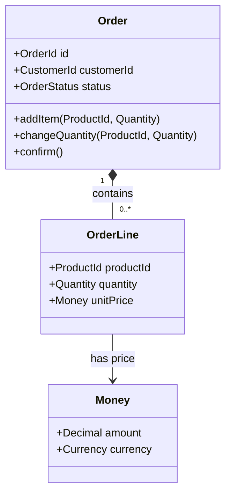
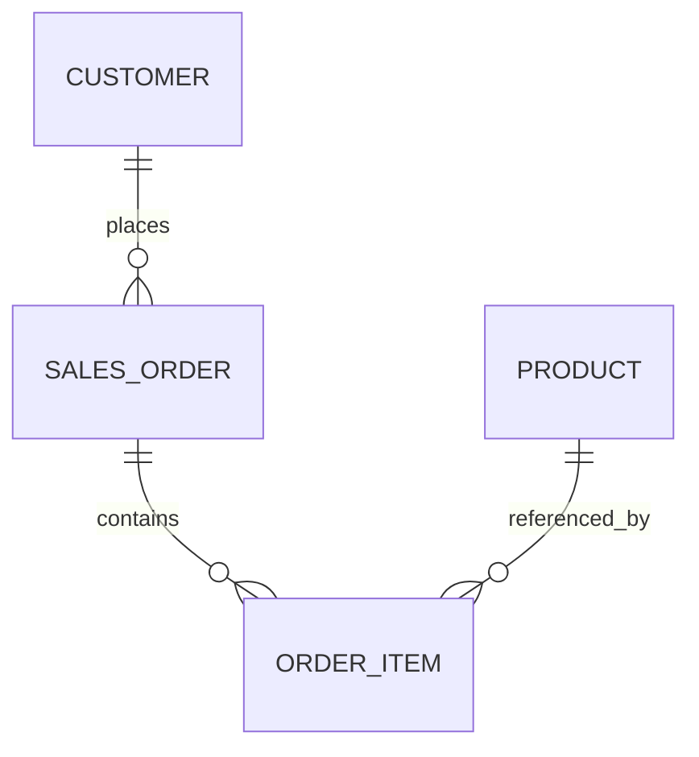
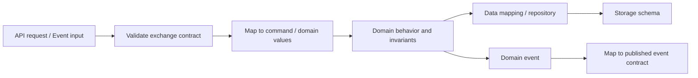

# Distinguishing Data Models, Domain Models, Storage Schemas, and Exchange Contracts

In a software system, the same business concept can appear across multiple documents and components: the domain model describes how the business operates, the data model organizes the information that needs to be managed, the storage schema specifies how data is written to a particular platform, and the exchange contract specifies how data travels across APIs or messages. These artifacts are closely related, yet they answer different questions.

If you treat them as one and the same, teams easily leak database structures into APIs, force object models to mirror tables, or break every consumer whenever a storage table changes. Conversely, if you fail to define the relationships among them, data can lose its meaning when moving from business logic to storage or across external systems.

This lesson uses an ordering example to distinguish these four concepts, show how to translate between them, and demonstrate how to verify consistency within **DATABASE_DATA_MODELING**.

## Learning Objectives

After this lesson, you will be able to:

- Explain the purpose and scope of a domain model, data model, storage schema, and exchange contract.
- Recognize which information belongs to business logic, data structure, implementation, and communication.
- Map a concept across these artifacts while preserving its meaning and rules.
- Distinguish internal changes from changes that affect consumers or persisted data.
- Design appropriate checks for domain rules, data integrity, migrations, and contract compatibility.

## 1. Four Artifacts Answering Four Groups of Questions

Suppose an online store needs to let customers create orders. An order has line items, each referencing a product, with quantity and unit price locked in at purchase time. When an order is confirmed, the system emits a notification so the warehouse can fulfill it.

An overview:

| Artifact | Primary Question | Typical Contents | Primary Users |
|---|---|---|---|
| **Domain Model** | Which concepts, behaviors, and rules exist in the business? | Entities, value objects, aggregates, states, behaviors, invariants, and domain events | Domain experts, analysts, architects, domain developers |
| **Data Model** | Which facts must be represented and managed, and how do they relate? | Entities, attributes, identifiers, relationships, value domains, keys, and data constraints | Data analysts, data architects, development and reporting teams |
| **Storage Schema** | How is data organized and stored concretely on a platform? | Tables/columns or collections/documents, data types, constraints, indexes, partitions, and storage settings | Database engineers, developers, operations teams |
| **Exchange Contract** | What rules must two communicating components follow to send, receive, and interpret data? | Requests/responses, events/messages, fields, types, semantics, validation, errors, and versioning | API providers, consumers, integration partners, and QA |

A **data model** is a structured description of data. It can be expressed at the conceptual, logical, or physical level. A **storage schema** is the concrete implementation structure on a storage platform; it is a specific part of the data modeling progression, typically closest to the physical level.

Domain models and data models overlap because both may mention Customer, Order, and Product. However, a domain model focuses on business meaning, behavior, and rules; a data model focuses on how information is represented and managed. An exchange contract may use a JSON or Avro schema, yet the contract also encompasses semantics, usage conditions, and compatibility rules that a single schema file may not fully capture.

## 2. Domain Model: What Meaning and Behavior Does the Business Have?

A domain model represents the key concepts within a business domain and how they interact. In a Domain-Driven Design (DDD) approach, the model often expresses entities, value objects, aggregates, domain services, domain events, and invariants. Not every project needs to adopt full DDD terminology; the core point is capturing business rules in a shared language.

### 2.1. Common Building Blocks

- **Entity:** an object with a stable identity throughout its business lifecycle. Two entities with identical attributes can still be two distinct objects if their IDs differ.
- **Value Object:** a value defined by its constituent parts, typically immutable. For example, `Money(amount, currency)` or `ProductId`.
- **Aggregate:** a cluster of objects modified together as a consistent unit. The aggregate root is the entry point for performing changes that uphold invariants.
- **Invariant:** a rule that must always hold true across the boundary protected by the model. For example, line item quantity must be greater than 0; only orders in an eligible state can be confirmed.
- **Domain Event:** a business occurrence that has already happened, such as `OrderConfirmed`, which other components can react to.

### 2.2. Ordering Domain Model Example

In this example, `Order` is the aggregate root. It manages `OrderLine` instances and permits modifications only through controlled behaviors.



Some domain rules might include:

1. An order must have at least one valid line before confirmation.
2. Each line's quantity must be a positive integer.
3. Once confirmed, an order's line items cannot be edited directly; if changes are needed, they must go through a dedicated business workflow.
4. Unit price is locked in when a line item is added to the order. Subsequent changes to the product's catalog price do not alter the locked-in transaction price.
5. Total amount is calculated from line items in the same currency using agreed rounding rules.

The `confirm()` method is a domain behavior; it does not necessarily correspond to a database column. `Money` may be a value object combining amount and currency, yet in a relational schema it might be stored across two columns. One aggregate may be persisted across multiple tables or documents; object boundaries in memory do not have to match table boundaries.

### 2.3. Domain Scope and Bounded Context

An organization can have multiple domain models for the same word "Order". In Sales, an order describes a purchase commitment and locked-in prices. In Shipping, the focus may be parcels, delivery addresses, and transit statuses. In Accounting, required data may be receivables and financial documents.

Therefore, you must define bounded contexts and data ownership. Do not force every department into a single object model just because they all talk about an order. When data crosses context boundaries, explicitly define who owns the canonical meaning and how the receiving component maps it into its own model.

## 3. Data Model: Which Information Needs to Be Managed?

A data model describes the data required, its meaning, its structure, and the relationships among pieces of data. Depending on the goal, it may be a high-level business data model, a detailed logical model, or a technology-specific physical model.

For the ordering example, a relational logical model might identify the following entities:

| Data Entity | Key Attributes | Relationships and Data Rules |
|---|---|---|
| CUSTOMER | customer_id, email, full_name | Each order references one customer; email is unique per agreed normalization rules |
| SALES_ORDER | order_id, customer_id, placed_at, status | Each order belongs to one customer; status belongs to a valid value set |
| ORDER_ITEM | order_id, line_no, product_id, quantity, unit_price, currency | Line item belongs to one order; quantity is positive; unit_price is the price at purchase time |
| PRODUCT | product_id, sku, name, current_price, current_currency | SKU is unique; current price is non-negative and includes a currency |



The data model clarifies details that might be overlooked when looking only at domain objects:

- What key and attributes does `ORDER_ITEM` use to identify each line?
- Can an order be persisted before it has any line items, and under which status does that rule change?
- Is unit price stored per line item to preserve history, or always looked up from the product's current price?
- How is email compared regarding case sensitivity and whitespace?
- Do we need to store timestamps, order origin, or synchronization status for auditing and operations?

A data model does not necessarily describe every method like `confirm()` or `changeQuantity()`. It can also serve goals different from the domain model—such as an analytical model with a sales fact and time, product, and customer dimensions. In that case, the data structure is designed for measurement and analytical querying rather than executing sales aggregate behaviors.

### 3.1. Data Constraints and Domain Invariants

Some domain invariants map directly to data constraints, such as `quantity > 0`, `email NOT NULL`, or foreign keys. Other rules require transactional logic or business workflows, such as "an order must have at least one line item before confirmation."

Hence, do not assume every invariant is solved solely by a schema. Explicitly document where each rule is enforced: in the aggregate, transaction, constraint, trigger, workflow, or a combination of mechanisms. If there are multiple write paths, identify which mechanism serves as the final safeguard so different applications do not apply inconsistent rules.

## 4. Storage Schema: How Is Data Written Concretely?

A storage schema is the structure that the storage engine actually understands. In a relational database, it includes tables, columns, data types, keys, constraints, and indexes. In a document database, it may include collections, document shapes, validators, and indexes. In a graph system, it may include labels, relationship types, properties, and constraints.

Part of the relational logical model above can be implemented on PostgreSQL as follows:

```sql
CREATE TABLE customer (
    customer_id BIGINT GENERATED BY DEFAULT AS IDENTITY PRIMARY KEY,
    email       VARCHAR(320) NOT NULL UNIQUE,
    full_name   VARCHAR(200) NOT NULL
);

CREATE TABLE product (
    product_id   BIGINT GENERATED BY DEFAULT AS IDENTITY PRIMARY KEY,
    sku          VARCHAR(64) NOT NULL UNIQUE,
    name         VARCHAR(250) NOT NULL,
    current_price NUMERIC(14, 2) NOT NULL CHECK (current_price >= 0),
    current_currency CHAR(3) NOT NULL
);

CREATE TABLE sales_order (
    order_id    BIGINT GENERATED BY DEFAULT AS IDENTITY PRIMARY KEY,
    customer_id BIGINT NOT NULL REFERENCES customer(customer_id),
    placed_at   TIMESTAMPTZ NOT NULL,
    status      VARCHAR(20) NOT NULL
                CHECK (status IN ('DRAFT', 'PENDING', 'CONFIRMED', 'CANCELLED'))
);

CREATE TABLE order_item (
    order_id   BIGINT NOT NULL REFERENCES sales_order(order_id),
    line_no    INTEGER NOT NULL CHECK (line_no > 0),
    product_id BIGINT NOT NULL REFERENCES product(product_id),
    quantity   INTEGER NOT NULL CHECK (quantity > 0),
    unit_price NUMERIC(14, 2) NOT NULL CHECK (unit_price >= 0),
    currency   CHAR(3) NOT NULL,
    PRIMARY KEY (order_id, line_no)
);

CREATE INDEX sales_order_customer_time_idx
    ON sales_order (customer_id, placed_at DESC);
```

This is one implementation, not a mandatory one-to-one mirror of the domain model:

- The `Order` aggregate is stored across `sales_order` and multiple rows in `order_item`.
- `OrderLine` lives within `Order`'s lifecycle, yet is stored as separate rows for convenient querying and constraints.
- `Money` is flattened into `unit_price` and `currency`; a single value object type in code becomes two columns.
- The product's current price also carries a currency code; when a line item is created, the system locks both amount and currency into the transaction data.
- `order_id` uses a numeric key generated by PostgreSQL, even though the domain may call it `OrderId` independently of the ID generation mechanism.
- `placed_at` serves history and querying; the domain may represent it with a richer temporal type.

A production schema may also include `created_at`, `updated_at`, `row_version`, partitioning columns, or operational metadata. These fields are not necessarily business concepts. Conversely, the domain may contain behaviors and transient objects that never need to be stored as columns.

### 4.1. Why Isn't a Schema the Domain Model?

A schema is tuned for DBMS capabilities, access patterns, and operational requirements. For example, you might create a composite index to serve a query for a customer's most recent orders. That index is not a business rule. You might store `total_amount` to avoid frequent recalculation, in which case you need a mechanism to keep the total consistent with line items.

A schema can also change for purely technical reasons: changing column types, adding indexes, partitioning, or splitting one table into two. If domain meaning and external contracts remain unchanged, these changes usually should not force API consumers to change.

## 5. Exchange Contract: How Do Two Components Interpret Data Consistently?

An exchange contract defines data transmitted across a component boundary. That boundary may be an HTTP API, message broker, webhook, file import/export, or partner integration.

A complete contract should clarify:

- Operation or event name and purpose.
- Fields, data types, units of measure, formats, and semantics.
- Required, optional, nullable fields, and default values.
- Validation rules and data limits.
- Semantics for timestamps, currency, IDs, and statuses.
- Error representation, retries, idempotency, and ordering guarantees where relevant.
- Versioning and compatibility policies when producers or consumers change.

### 5.1. Order Creation API Contract

An API accepting order creation requests might receive a customer ID and a list of products with quantities. The client does not send unit prices so that the sales system retrieves valid prices at order creation time.

Example request:

```json
{
  "customerId": "cst_8421",
  "items": [
    {
      "productId": "prd_105",
      "quantity": 2
    },
    {
      "productId": "prd_208",
      "quantity": 1
    }
  ]
}
```

An illustrative JSON Schema excerpt for the request:

```json
{
  "$schema": "https://json-schema.org/draft/2020-12/schema",
  "type": "object",
  "additionalProperties": false,
  "required": ["customerId", "items"],
  "properties": {
    "customerId": {
      "type": "string",
      "minLength": 1,
      "description": "Customer ID in the sales system"
    },
    "items": {
      "type": "array",
      "minItems": 1,
      "items": {
        "type": "object",
        "additionalProperties": false,
        "required": ["productId", "quantity"],
        "properties": {
          "productId": { "type": "string", "minLength": 1 },
          "quantity": { "type": "integer", "minimum": 1 }
        }
      }
    }
  }
}
```

JSON Schema validates shape and local constraints. It cannot verify on its own that a customer exists, that a product is still for sale, or that a price is active; those checks require business processing and reference data. The contract must also document response semantics, error codes, authentication, authorization, and idempotency in case clients retry after timeouts.

The response may return `orderId`, `status`, `currency`, `totalAmount`, and creation timestamp. That is the public representation for consumers, which may differ from internal column names or types. For example, the API may expose `orderId` as a string to avoid coupling to internal numeric keys.

### 5.2. OrderConfirmed Event Contract

When an order is confirmed, the system may emit an event for the warehouse to consume. An event describes a fact that occurred; consumers should not treat it as a command requesting order confirmation.

```json
{
  "eventId": "evt_9017",
  "eventType": "OrderConfirmed",
  "schemaVersion": 1,
  "occurredAt": "2026-11-21T10:30:00Z",
  "order": {
    "orderId": "ord_7305",
    "customerId": "cst_8421",
    "currency": "VND",
    "items": [
      {
        "productId": "prd_105",
        "quantity": 2,
        "unitPrice": "125000.00"
      }
    ],
    "totalAmount": "250000.00"
  }
}
```

In this example:

- `eventId` uniquely identifies an event and helps consumers deduplicate deliveries.
- `eventType` distinguishes the event kind; `schemaVersion` indicates the structural version.
- `occurredAt` is when the business event occurred, formatted in ISO 8601 UTC.
- `unitPrice` and `totalAmount` are transmitted as decimal strings to prevent consumers from interpreting money with binary floating-point numbers.
- The event contains the data snapshot needed by consumers. Consumers should not have to query an internal table back just to make sense of an emitted event.

An event contract must specify how the event is published after the order-saving transaction commits, how consumers handle duplicates, whether ordering is guaranteed, and what retry or dead-letter queue policy applies on processing failures. These conditions are part of reliable cross-system exchange.

## 6. Mapping Across the Four Artifacts

There is no one-to-one rule linking domain objects, data entities, storage tables, and exchange fields. Mapping depends on each component's purpose and boundaries.

| Concept or Data | Domain Model | Data Model | Storage Schema | Exchange Contract |
|---|---|---|---|---|
| Order | `Order` aggregate with `confirm()` behavior | `SALES_ORDER` entity with relationship to line items | `sales_order` table | `orderId`, `status` in response/event |
| Line item | `OrderLine` entity inside `Order` aggregate | Dependent `ORDER_ITEM` entity | Rows in `order_item` | Elements in `items` array |
| Money | `Money` value object with amount and currency | Amount and currency attributes | `NUMERIC` and `CHAR(3)` or equivalent types | Decimal string and currency code per contract |
| Identifier | `OrderId` type meaningful in domain | Order identifier key | `BIGINT`, UUID, or other type | Opaque string such as `ord_7305` |
| Confirmation rule | `confirm()` behavior checking invariants | Business constraints on status and line items | Partly `CHECK`, partly in transaction/service | Description of operation preconditions and returned errors |

Several intentional differences:

- Domain models have methods and behaviors; data models typically represent states and relationships.
- One aggregate can be stored across multiple tables; one table can also store aggregated data from multiple concepts.
- Storage schemas carry operational metadata and indexes that consumers do not need to know about.
- Exchange contracts can rename fields, merge or split structures, hide internal IDs, and expose only what consumers need.
- An event can carry a historical snapshot so consumers can process independently, even if some fields are computed across multiple storage tables.

### 6.1. Boundary Design Principles

1. **Keep business meaning stable:** the same term must have a clear definition within each bounded context. If two contexts use the same word with different meanings, reflect that difference in models and mappings.
2. **Do not let internal schemas become the default API:** create purposeful request/response DTOs or event schemas. That way, changing a table or storage layout does not automatically break consumers.
3. **Do not turn DTOs into domain entities:** client payloads must be validated and converted into appropriate commands/value objects before invoking domain behavior. Never let arbitrary payloads mutate internal state.
4. **Store the exact data needed to reconstruct history:** prices, addresses, or descriptions at transaction time may require snapshots. Distinguish business-meaningful historical data from copies made purely for speed.
5. **Document the source of truth:** specify which system or bounded context owns the authoritative data. Copies, read models, and event projections must define update mechanisms and drift handling.

## 7. Evolution and Compatibility When Changes Occur

The four artifacts evolve at different cadences. A business change may require updating the domain model, data model, storage schema, and exchange contract. Yet a physical change such as adding an index usually affects only the storage schema. An API contract change might not require table changes if it only alters presentation.

| Change | Artifacts to Review | Impact and Handling |
|---|---|---|
| Order must store shipping address at purchase time | Domain model, data model, storage schema; API/event if exchanged | Identify as historical snapshot; add domain attribute, data field, and migration with clear backfill |
| Optimize recent-orders query | Storage schema | May add an index; verify with query plans and metrics without altering domain or API if semantics stay unchanged |
| API changes `customerId` from number to string | Exchange contract and adapters; may affect consumers | Evaluate breaking change, provide versioning or transition period; no immediate need to alter storage keys |
| Add `RETURN_REQUESTED` status | Domain model, data model, storage schema, and contracts exposing status | Update state transition rules, validation, schema constraints, API/event docs, and consumers |
| Split one table into two to separate large data | Storage schema and mapping/repository layer | Use phased migrations, keeping behavior and external contracts stable where possible |

### 7.1. Contract Compatibility

When modifying an API or event, assess whether producers and consumers can be deployed at different times.

- Adding an optional field is usually easier to keep compatible than adding a required field that older consumers do not send.
- Removing or renaming a field, changing units of measure, altering semantics, narrowing value domains, or changing data types can break consumers.
- A new field may be syntactically optional yet still alter business semantics if consumers need it to process correctly.
- For already published events, you cannot retroactively edit old messages already received by consumers. Maintain support for reading older versions or publish a new event/version per policy.
- Adding `schemaVersion` helps when multiple structures coexist, though a version number alone does not replace compatibility rules and a rollout plan.

### 7.2. Storage Migrations and Contract Changes Are Separate Efforts

For instance, adding `shipping_address` to the orders table requires a migration plan: adding the column, deciding nullable/default settings, backfilling older rows if a reliable source exists, updating application reads/writes, and setting `NOT NULL` only after data satisfies the condition. The API may expose the shipping address in a separate version or simply as an optional field.

Never deploy a destructive data migration just because a contract bumped its version. Nor should you assume a database migration automatically makes consumers understand a new field. The two processes are related, yet each has its own verification gates.

## 8. Validating Each Artifact and Their Integration Points

Each artifact type requires different forms of verification:

| Validation Target | Verification Question | Appropriate Checks |
|---|---|---|
| Domain model | Do rules and behaviors match the business? | Unit tests for invariants, state transitions, and domain services; review with domain experts |
| Data model | Are entities, attributes, relationships, and constraints complete and consistent? | Model review, key/relationship checks, dependency analysis, and requirements traceability |
| Storage schema | Does the DBMS enforce structure and protect data correctly? | Migration tests, constraint tests, integration tests, index and query plan inspection |
| Exchange contract | Do producer and consumer interpret payloads identically? | Schema validation, contract tests, consumer-driven tests, error cases, and version compatibility checks |

Integration boundaries must also be tested:

1. **Domain → data:** is every state or fact that needs persistence represented? Do any storage fields leak internal details into the business model?
2. **Data → storage:** is every important key and constraint mapped to the DBMS, or is an alternative enforcement point explicitly documented?
3. **Domain/data → contract:** do payloads preserve exact meaning, units, timezones, nullability rules, and statuses?
4. **Storage → domain:** can data read back reconstruct the required domain state? Are there null cases, legacy data, or old versions that break mapping?
5. **Contract → consumer:** can consumers handle unknown fields, duplicate events, late-arriving events, and older versions according to policy?

A useful validation is tracing an end-to-end scenario: a customer sends an order creation request; the adapter validates the contract and maps the payload into a command; the domain model validates and creates the order; the repository persists the aggregate via the storage schema; after the transaction commits, the system emits an event conforming to the exchange contract. Each step has a clear responsibility and can be tested independently.



## 9. Common Confusions

| Confusion | Why It Causes Problems | Correct Understanding |
|---|---|---|
| A domain entity must map to one table | Forces object design and persistence into the same boundary | One entity/aggregate may span multiple tables or documents; mapping depends on persistence goals |
| Data model just means database schema | Ignores conceptual, logical, and analytical models | Data models describe data at multiple levels; schemas are one concrete implementation |
| Column names are API field names | Couples consumers to internal details and complicates refactoring | Contracts use names and structures suited to consumers; adapters handle mapping |
| JSON Schema is the entire contract | Validates only part of structure and local rules | Contracts also need semantics, errors, security, idempotency, retries, and versioning |
| Foreign keys protect all business rules | Some rules span multiple rows, states, or workflows | Specify where each invariant is enforced and test at the right layer |
| Adding a field is always compatible | Consumers may rely on strict validation or complete payload semantics | Check consumer policies, schema compatibility, and real behavior before release |

## 10. Practical Workflow

When designing a new feature or modifying existing data, you can follow this sequence:

1. **Define domain and boundaries:** who owns the business logic, which terms need alignment, which components are producers and consumers.
2. **Describe the domain model:** identify entities, value objects, aggregates, behaviors, states, and relevant invariants.
3. **Model the data:** determine what information must be stored or analyzed, along with identifiers, attributes, relationships, value domains, and constraints.
4. **Design the storage schema:** choose the platform, map data types, constraints, indexes, and migrations according to workload.
5. **Define exchange contracts:** design requests/responses or events for consumer needs, documenting semantics, validation, errors, and versioning.
6. **Write explicit mappings:** document domain property ↔ data attribute ↔ storage field ↔ exchange field; call out transformations, aggregations, or unmapped fields.
7. **Test each artifact and boundary:** unit, integration, migration, schema validation, and contract tests.
8. **Plan evolution:** determine rollout order, backward compatibility, backfills, deprecation windows for old versions, and post-release error monitoring.

## 11. Checklist Before Finalizing Design

- [ ] The domain model accurately expresses business terminology, behaviors, and invariants.
- [ ] The data model includes complete entities, attributes, identifiers, relationships, and constraints.
- [ ] Every important rule has a clear enforcement point and testing strategy.
- [ ] The storage schema reflects the data model and fits the workload; indexes are justified.
- [ ] Migrations handle existing data, default values, backfills, and phased deployment.
- [ ] Exchange contracts document fields, semantics, units, formats, required/optional rules, errors, and versions.
- [ ] Consumers do not depend directly on internal table or column names.
- [ ] Mappings across artifacts are traceable and covered by tests at key transformation points.
- [ ] Data ownership and sources of truth are defined across bounded contexts.

## Summary

The domain model expresses business rules and behaviors; the data model describes the data to manage along with its structure and constraints; the storage schema implements data on a storage engine; the exchange contract specifies how components exchange and interpret payloads. They must agree on meaning, yet do not need identical structures.

When making changes, identify which layer the change belongs to, which artifacts are affected, and which consumers must be protected. Explicit mappings, clear data ownership, and proper boundary testing allow a system to evolve without losing data meaning.

## Key Terms to Remember

| Term | Meaning |
|---|---|
| Domain Model | Conceptual model of business objects, behaviors, and rules in a domain |
| Data Model | Description of data, attributes, identifiers, relationships, and constraints |
| Storage Schema | Data structure implemented on a specific storage system |
| Exchange Contract | Rules and structure for exchanging data between producer and consumer |
| Entity | Object distinguished by a stable identity |
| Value Object | Object defined by the values of its constituent attributes |
| Aggregate Root | Primary entry point for modifying an aggregate and protecting invariants |
| Invariant | Business condition that must always hold true within a protected boundary |
| Bounded Context | Boundary within which a domain model and terminology hold consistent meaning |
| Contract Test | Test verifying that producers and consumers adhere to an exchange contract |
