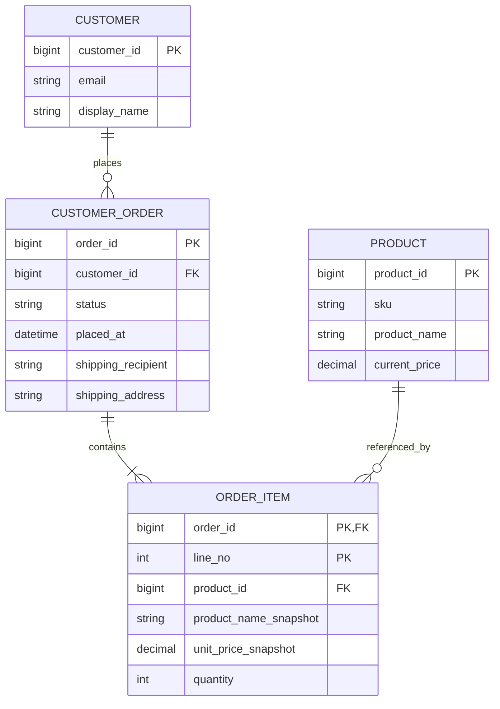

# Learning Path and Criteria for Evaluating a Good Data Model

In the **Fundamentals** chapter of the **DATABASE_DATA_MODELING** module, learners practice turning business requirements into clear data models: identifying entities, attributes, relationships, and rules; translating conceptual models into logical and physical schemas; choosing keys, constraints, normalization, and indexes; and weighing relational, document, graph, and analytical models. The ultimate goal is building data structures that accurately reflect the business, support how the system accesses data, can be verified, and evolve safely.

A good data model is not merely a tidy ERD diagram or a set of tables with foreign keys. It is a justified set of decisions: what data must exist, what each attribute means, which rules must always hold true, how critical queries run, and how the system will change in the future. Therefore, the learning path moves from the business domain to the model, and then to implementation and validation.

## 1. Learning Outcomes

After this lesson, learners will be able to:

- Decompose a business requirement into data to store, rules to protect, and data usage flows.
- Identify entities, value objects, attributes, identifiers, relationships, cardinality, and optionality.
- Translate a conceptual model into a logical schema; choose appropriate primary keys, foreign keys, candidate keys, and constraints.
- Explain the purpose of normalization, recognize redundancy, and choose when to apply controlled denormalization.
- Choose relational, document, graph, or analytical models based on actual data structure and query patterns.
- Propose data types, indexes, and schema change strategies based on workload.
- Validate a model using examples, queries, constraints, edge-case data, and migration scenarios.

## 2. Learning Path from Requirements to a Deployable Model

Study in the order below. Each stage produces an artifact that others can read and critique; do not advance to the next stage while key decisions in the previous stage remain ambiguous.

| Stage | Core Focus | Required Artifact | Completion Criteria |
|---|---|---|---|
| 1. Understand the business | Roles, workflows, nouns, actions, states, rules, and reports | Business glossary, data requirements list, business rules | Two readers understand the same term and interpret rules identically |
| 2. Conceptual model | Entities, value objects, attributes, relationships, cardinality, and optionality | Conceptual ERD or domain diagram | Every relationship is meaningful; every entity has an identity; key rules are documented |
| 3. Logical model | Keys, data dependencies, normalization, join tables, and constraints | DBMS-independent logical schema | No ambiguous dependencies or relationships; rules map to constraints or checks |
| 4. Choose model family | Relational, document, graph, and analytical models | Decision table and chosen model per data flow | Choices are justified by queries, transactions, consistency, and scale |
| 5. Physical design | Data types, nullability, indexes, partitioning, and DBMS specifics | DDL, key query list, and initial index plan | Data types cover value ranges; critical queries can be performance-tested |
| 6. Validation | Sample data, constraints, verification queries, load tests, and trial migrations | Model test suite and test results report | Critical rules are tested; schema changes can be rehearsed |
| 7. Evolution | Business changes, version compatibility, backfills, and retiring old structures | Migration plan and decision records | Applications and data can transition without losing meaning or breaking live flows |

### Stage 1: Start with Business Questions

Do not start by asking "which tables do we need to create?" First clarify:

1. Who creates, reads, updates, and deletes data?
2. Which business events cause data to change?
3. Which objects have independent lifecycles and need identities?
4. Which rules must hold true at all times?
5. Which data must be retained for auditing, reconciliation, or historical explanation?
6. Which queries matter most by frequency, latency, and volume?

Distinguish **business facts** from **technical assumptions**. For example, "an order must have at least one line item" is a business rule. "Line items are stored in a separate table" is a design decision. Mixing the two can cause a team to mistake an implementation choice for an unchangeable rule.

Create a concise glossary. If "customer", "recipient", and "payer" are three distinct roles, the document must state whether they can be the same person. An attribute like "status" also needs defined valid values, meanings, and state transition conditions.

### Stage 2: Build the Conceptual Model

The conceptual model describes the business domain without depending on tables, data types, or database products.

- **Entities** have their own identity and lifecycle, such as Customer, Order, or Product.
- **Value objects** are identified by their values and typically belong to an entity, such as a DateRange or an Address captured at delivery time.
- **Attributes** describe characteristics of an object; define semantic type, mandatory status, value domain, and origin.
- **Relationships** express business meaning between objects, not merely a line on a diagram.
- **Cardinality** describes one-to-one, one-to-many, or many-to-many; **optionality** indicates whether the relationship can be absent.

For every relationship, write it as a sentence. For example: "A customer can place many orders; each order belongs to exactly one customer." Writing it out clarifies both sides of the relationship and exposes unmodeled cases.

Rules like "an order must have at least one line item" or "ordered quantity must be greater than zero" must be documented separately. A standard ERD cannot fully express cross-row rules or state transition workflows.

### Stage 3: Move to the Logical Model

Only when the business domain is clear should you decide how to represent it as data structures.

In a relational model, an entity usually becomes a table; a one-to-many relationship is usually represented by a foreign key on the "many" side; a many-to-many relationship usually requires a join table. Multi-valued attributes usually need separating into their own structure if individual values must be queried, constrained, or updated.

Distinguish the key types:

- **Primary key** uniquely identifies a row and cannot be null.
- **Candidate key** is a minimal set of attributes that can uniquely identify a row.
- **Natural key** comes from the business domain, such as an SKU code; it carries business meaning but may change.
- **Surrogate key** is a technical identifier, usually stable and carrying little business meaning.
- **Foreign key** protects referential relationships across tables.

A table can use a surrogate key as its primary key while still needing a `UNIQUE` constraint on business codes. Relying solely on a surrogate key could allow two customers with the same email or two products with the same SKU even when the business forbids it.

#### Normalization and Controlling Redundancy

Normalization reduces anomalies when inserting, updating, or deleting data:

- **First Normal Form (1NF):** each cell holds a single value from a defined domain; do not use a delimited string to cram a list of values that need independent querying.
- **Second Normal Form (2NF):** the table is in 1NF and every non-key attribute depends fully on the entire candidate key, not just part of a composite key.
- **Third Normal Form (3NF):** the table is in 2NF and non-key attributes do not depend transitively on the key through another non-key attribute.
- **BCNF:** for every non-trivial functional dependency, the determinant must be a superkey.

Do not apply a normal form mechanically to every system. Use normalization as a starting point to keep data consistent, and denormalize only when specific queries or operational needs demonstrate a clear benefit. Every duplicated copy needs a canonical source and synchronization rules.

### Stage 4: Choose Models by Data Shape and Access Patterns

No single model family suits every problem. You can use multiple models in the same system if each serves a clear purpose and has controlled synchronization mechanisms.

| Model Family | Best Suited When | Points to Consider |
|---|---|---|
| Relational | Data is well-structured; relationships and constraints matter; multi-record transactions and join queries are needed | Requires schema, join, and index design; structural changes must be managed |
| Document | Data is typically read or updated as an aggregate; child attributes share the same lifecycle; structure may vary | Embedding data can create copies; overly large documents or independent updates across sub-parts become hard to manage |
| Graph | Connections and multi-hop queries such as paths, dependencies, or recommendations are central | Requires clear definitions of node types, edge types, and direction; queries and constraints have distinct traits |
| Analytical | Large-scale historical aggregations, time-series or multidimensional reporting are required | Must define fact grain, history rules, and sync latency; structures usually optimize for reads and aggregations |

For example, an e-commerce system might use a relational database as the primary transactional store, store order snapshots as documents for certain read flows, use a graph for recommendation links, and stream events to an analytical warehouse for reporting. This architectural choice carries costs: you must define the authoritative source, acceptable latency, duplicate-event handling, and reconciliation when sync fails.

When choosing a model, compare at least five factors: relationship shape, query patterns, transaction boundaries, consistency requirements, and evolution path. Never choose merely because a technology is trendy or because one isolated query looks easier to write.

### Stage 5: Physical Design for the Workload

The physical model turns the logical schema into an implementable structure on a specific DBMS.

- Choose data types based on value domain and precision. Money usually requires exact decimal types rather than binary floating-point numbers.
- Decide nullability according to business meaning. Null must not substitute for empty strings, zero, or an unspecified state if those cases carry distinct meanings.
- Use `CHECK`, `UNIQUE`, `NOT NULL`, and `FOREIGN KEY` to push appropriate rules down to the storage layer.
- Create indexes based on real queries: filter predicates, joins, sort orders, and selectivity.
- Consider partitioning, history retention, or cold storage strategies when scale and access patterns justify them.
- Verify execution plans and metrics on representative data; well-named indexes do not automatically guarantee fast queries.

Every index speeds up certain queries while consuming storage and adding overhead to inserts, updates, and deletes. Therefore, list critical queries first before designing indexes.

## 3. End-to-End Example: Order Data Model

Suppose an online store needs to manage customers, products, and orders. Confirmed rules include:

- A customer can place many orders; each order belongs to one customer.
- An order has at least one line item; each line item belongs to one product.
- Quantity must be a positive integer; unit price at purchase time is non-negative.
- Product name and unit price on a line item must reflect the time of purchase, even if current product information changes.
- Orders must preserve recipient details and shipping address as of order placement.

Initial conceptual model:



An illustrative relational schema can be written as follows. Data types and `CHECK` syntax should be adapted to the chosen DBMS.

```sql
CREATE TABLE customer (
    customer_id BIGINT PRIMARY KEY,
    email VARCHAR(320) NOT NULL,
    display_name VARCHAR(160) NOT NULL,
    CONSTRAINT uq_customer_email UNIQUE (email)
);

CREATE TABLE product (
    product_id BIGINT PRIMARY KEY,
    sku VARCHAR(80) NOT NULL,
    product_name VARCHAR(200) NOT NULL,
    current_price DECIMAL(12, 2) NOT NULL,
    CONSTRAINT uq_product_sku UNIQUE (sku),
    CONSTRAINT ck_product_price_nonnegative
        CHECK (current_price >= 0)
);

CREATE TABLE customer_order (
    order_id BIGINT PRIMARY KEY,
    customer_id BIGINT NOT NULL,
    status VARCHAR(20) NOT NULL,
    placed_at TIMESTAMP NOT NULL,
    shipping_recipient VARCHAR(160) NOT NULL,
    shipping_address VARCHAR(500) NOT NULL,
    CONSTRAINT fk_order_customer
        FOREIGN KEY (customer_id) REFERENCES customer(customer_id),
    CONSTRAINT ck_order_status
        CHECK (status IN ('PENDING', 'PAID', 'SHIPPED', 'CANCELLED'))
);

CREATE TABLE order_item (
    order_id BIGINT NOT NULL,
    line_no INTEGER NOT NULL,
    product_id BIGINT NOT NULL,
    product_name_snapshot VARCHAR(200) NOT NULL,
    unit_price_snapshot DECIMAL(12, 2) NOT NULL,
    quantity INTEGER NOT NULL,
    CONSTRAINT pk_order_item PRIMARY KEY (order_id, line_no),
    CONSTRAINT fk_item_order
        FOREIGN KEY (order_id) REFERENCES customer_order(order_id),
    CONSTRAINT fk_item_product
        FOREIGN KEY (product_id) REFERENCES product(product_id),
    CONSTRAINT ck_item_quantity_positive CHECK (quantity > 0),
    CONSTRAINT ck_item_price_nonnegative
        CHECK (unit_price_snapshot >= 0)
);
```

This design reflects several key decisions:

- The `order_item` table uses a composite key `(order_id, line_no)`, because line numbers only have meaning within the scope of one order.
- `product_id` keeps the link to the canonical product; `product_name_snapshot` and `unit_price_snapshot` preserve transaction meaning at purchase time.
- The foreign key to `product` also shapes lifecycle policy: products already referenced in transactions usually need to be archived or discontinued rather than hard-deleted.
- Shipping details are stored on the order as a snapshot. Merely referencing the customer's current address could corrupt old order history whenever the customer moves.
- `CHECK` constraints enforce row-level conditions. The rule "an order must have at least one line item" spans multiple rows, so it must be enforced within the transaction flow, via an appropriate DBMS mechanism, or via a validation step before confirming the order.
- The `CHECK` on `status` only restricts allowed values; valid transitions from one status to another still require enforcement in the business workflow.

Initial indexes might follow from queries such as "view a customer's recent orders" and "find line items by product":

```sql
CREATE INDEX idx_order_customer_placed
    ON customer_order (customer_id, placed_at);

CREATE INDEX idx_order_item_product
    ON order_item (product_id);
```

These are only design hypotheses. Test real queries, realistically distributed data, and execution plans before committing to keep an index. If queries mostly filter by status and date range, indexes may need a different layout; do not index every column.

### If Using Documents for Orders

An order document can hold recipient details and the list of line items inside one aggregate. This fits when orders are usually read and updated as a unit, line items share the order's lifecycle, and document size bounds are controlled.

Decide whether to embed full product details or store only `product_id` plus snapshot fields. Embedding enables single-read retrieval, yet increases duplication and sync requirements when shared data changes. For historical order data, snapshots are intentional; for current product descriptions, copies can drift without an update policy.

### If Using a Graph for the Sales Domain

A graph can represent customers, products, categories, and relationships such as purchased, co-viewed, belongs-to-category, or co-recommended. Multi-hop queries like "find products purchased by customers who also bought this product" fit node-and-edge representation well.

Define the meaning, direction, properties, and lifespan of each edge. For instance, a "purchased" edge should carry timestamp and order ID to distinguish individual purchases from generic links. If the graph is populated from transactional data, clarify sync latency and how order cancellations are handled.

### If Building an Analytical Model

To analyze revenue, build a fact table with a clearly defined grain (level of detail of each fact row), such as **one row per line item in an order**. Dimensions may include time, product, customer, and delivery region. Measures like quantity and line revenue need consistent definitions.

The grain must be fixed before adding columns or combining facts. If one table mixes order-level and line-level figures, joins can multiply amounts and produce wrong reports. Analytical models commonly accept controlled denormalization to optimize aggregation, yet must keep history rules and data lineage clear.

## 4. Criteria for Evaluating a Good Data Model

Evaluate a model within the context of the system's goals. A model for financial transactions may prioritize integrity and auditability; a model for relationship exploration may prioritize multi-hop queries. You can use the rubric below as an initial scoring guide, then adjust weights based on risk and workload.

| Criterion | Suggested Weight | Evaluation Question |
|---|---:|---|
| Accurate business semantics | 20% | Do entities, attributes, relationships, and states faithfully reflect how the business operates? |
| Data integrity | 20% | Do keys, constraints, and workflows prevent orphaned, duplicate, or out-of-domain data? |
| Consistency and redundancy control | 15% | Are there improper dependencies, multi-place updates, or copies lacking an authoritative source? |
| Query workload fit | 15% | Does the model support critical queries, transactions, and data volumes at acceptable cost? |
| Evolvability | 10% | Can attributes, states, and rules be added via controlled migrations? |
| Security and data governance | 10% | Are minimal collection, access control, retention, and deletion enforced per policy? |
| Understandability and testability | 10% | Do names, documentation, sample data, and checks help others verify decisions? |

Score each criterion from 0 to 4:

- **0 — Missing:** unaddressed or no evidence.
- **1 — Weak:** decisions exist but are vague, lack rules, or cannot be tested.
- **2 — Basic pass:** handles normal cases; some assumptions or boundaries remain unclear.
- **3 — Good:** decisions are clear, justified, and backed by proper constraints and tests.
- **4 — Solid:** backed by evidence on representative data and workloads; risks, trade-offs, and evolution paths are documented.

The total score can be computed as the sum of `(criterion score / 4)` multiplied by its weight. You can use 85/100 as a benchmark for a strong model, 70–84 to request improvements, and below 70 to consider redesigning. These thresholds are only internal review guidelines; for high-risk data, scoring 0 or 1 on a critical criterion can still block approval despite a high overall score.

### Red Flags Warranting Re-Evaluation

- One attribute carries multiple meanings or a status lacks a clear definition.
- Important data is stored as free-form strings even though it needs filtering, constraints, or joins.
- Business identifiers lack uniqueness constraints.
- A business change forces updating multiple copies with no canonical source.
- Foreign keys or deletion rules risk erasing transaction history.
- Indexes are created by guesswork, disconnected from actual queries.
- Analytical tables lack a defined grain, leading to double-counting or inflated sums.
- Migrations require long table locks without a rollout and rollback/forward-fix plan.
- The model stores unnecessary personal data or lacks a retention policy.

## 5. Validating the Model Before Production Use

A reasonable diagram is not proof that a model works correctly. Validate at multiple levels:

1. **Semantic check:** ask domain experts to interpret each entity, relationship, status, and rule in their own words. If two interpretations emerge, refine terminology or add examples.
2. **Structural check:** review primary keys, candidate keys, foreign keys, nullability, data types, `CHECK`, and `UNIQUE` constraints.
3. **Boundary data check:** test empty values, duplicates, maximums, minimums, invalid state transitions, and concurrent operations.
4. **Query check:** run key queries against realistically sized and distributed data; inspect execution plans and latency.
5. **Cross-row rule check:** verify conditions such as an order requiring line items, totals matching line details, or statuses transitioning only along valid paths.
6. **Migration check:** seed legacy data, run migrations, reconcile row counts and semantics, and test applications during transition stages.
7. **Access and lifecycle check:** verify who can read/edit data, how long data is retained, and how deletion or anonymization follows policy.

For example, you can use a verification query to detect orders without line items in an imported dataset:

```sql
SELECT co.order_id
FROM customer_order co
LEFT JOIN order_item oi ON oi.order_id = co.order_id
WHERE oi.order_id IS NULL
  AND co.status IN ('PAID', 'SHIPPED');
```

If business rules require every confirmed order to have at least one line item, this query must return empty for orders in confirmed states. This query is useful for auditing and reconciliation; it does not replace enforcing the rule inside the order creation or confirmation transaction.

## 6. Designing for Model Evolution

Business requirements will change. A good model allows controlled changes while preserving the ability to read legacy data.

For relational changes, use the **expand – migrate – contract** workflow:

1. Add new columns or tables compatibly with currently running application versions.
2. Deploy application versions able to read both old and new structures as needed.
3. Backfill historical data in batches that are safely re-runnable and produce reconciliation counts.
4. Shift read/write traffic to the new structure; monitor errors and discrepancies.
5. Only after all application versions stop using the old structure should you drop old columns or tables.

Renaming or dropping columns directly can break un-updated application instances. For documents, establish schema version conventions, how missing fields are read, and how old documents are handled. For graphs, changing edge semantics requires migration steps and checking dependent queries. For analytical models, changing grain or metric definitions must be communicated because it can alter historical reports.

Every migration should state its purpose, data scope, pre/postconditions, verification metrics, and rollback or forward-fix plan. Test migrations on a realistically sized data copy to uncover runtime, locking, and storage requirements.

## 7. Suggested Practice Plan

You can divide study into six sessions, each producing a concrete deliverable:

| Session | Exercise | Self-Assessment Deliverable |
|---|---|---|
| 1 | Pick a process such as ordering, booking, or course management; simulate user interviews and write rules | Glossary, list of actors, events, and rules |
| 2 | Build a conceptual model and translate each relationship into a sentence | ERD with cardinality, optionality, and rule notes |
| 3 | Translate into a relational schema; define keys and normalize | DDL, keys, constraints, and explanations of table-splitting decisions |
| 4 | Redesign the same domain as a document or graph model; compare against relational | Two options, sample queries, and a trade-off table |
| 5 | Pick key queries, design indexes, and create boundary test data | Query suite, planned indexes, and test results |
| 6 | Add a new requirement, write and rehearse a migration | Migration, data reconciliation, compatibility checks, and final rubric score |

Capstone prompt: design data for a booking system with users, resources, time slots, bookings, and payments. Learners must address two users booking the same time slot, cancellations, refunds, price changes, and history retention. A passing submission includes a conceptual model, logical schema, one physical plan, comparison of at least two model families, critical constraints, verification queries, and a migration plan for one business change.

## 8. Checklist Before Approving a Model

- [ ] Terminology and data definitions align with the business.
- [ ] Every entity has an identity; candidate keys and business keys are defined.
- [ ] Relationships have clear cardinality, optionality, and delete/update rules.
- [ ] Critical rules are protected by constraints or tested workflows.
- [ ] Redundancy is intentional, with a canonical source and sync strategy.
- [ ] Model families are chosen based on queries, transactions, consistency, and scale.
- [ ] Data types, nullability, and indexes have concrete justifications.
- [ ] Sample data and test cases cover both normal cases and edge-case data.
- [ ] Plans exist for migrations, backfills, reconciliation, and error handling.
- [ ] Access permissions, sensitive data, and retention limits have been reviewed.

A model is considered strong when readers can explain what the data represents, which rules the system enforces, how key queries are supported, and how future changes will be rolled out. Following the path from business requirements to validation makes these decisions discussable, evaluable, and improvable with evidence.
