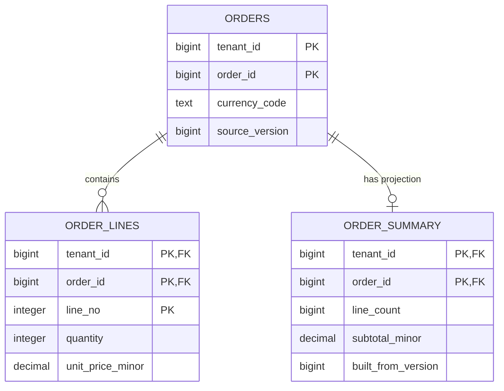
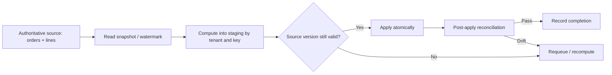
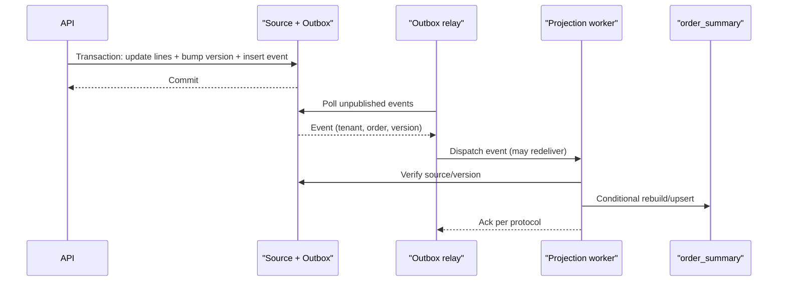

# Rebuilding Derived Data, Reconciliation, and Handling Discrepancies

**Denormalization** can reduce table joins, eliminate redundant computation, and speed up reporting screens. Yet whenever the same information is stored in two forms, you inherit an extra responsibility: **how do you prove the derived data still accurately reflects the source data, and how do you recover if it diverges?**

Suppose an e-commerce system stores order lines in `order_lines` while also maintaining `order_summary.subtotal_minor` so the order list page opens without summing thousands of rows every time. An edit to item quantity commits cleanly in `order_lines`, yet the summary-update job fails. Both tables still look valid in isolation; only **the relationship between them** is broken. No simple `FOREIGN KEY` guarantees that a summary table's total equals the sum of its line items.

This lesson belongs to the **Denormalization** chapter of **DATABASE_DATA_MODELING**. It focuses on turning business requirements into a source–derived model with explicit keys and invariants; organizing **rebuilds**, **reconciliation**, and **remediation** in verifiable ways. The exact same principles apply to relational summary tables, materialized views, caches, search documents, derived graph edges, and analytical fact/dimension tables.

## 1. Distinguish Source Data from Derived Data

In a system, the same number may appear in several places, yet **you should never assume every copy carries equal write authority**.

| Component | Example | Role | Recovery Method |
|---|---|---|---|
| **Source of truth** | `orders`, `order_lines`, and confirmed price records | Records business events/decisions the system commits to | Restore from backup, transaction logs, or authoritative business source |
| **Derived data** | `order_summary`: line count, subtotal | Output of a deterministic function over source data | Recompute from source under the matching rule version |
| **Read model / projection** | Search documents, flattened multi-attribute order listings | Data reorganized to serve a specific query shape | Rebuild or replay from authoritative source/events |
| **Cache** | Redis key holding an order's total | Ephemeral copy that can be lost and repopulated | Evict/reload from source or read model |
| **Locked historical data** | `unit_price_minor` at order placement, invoice display name | May itself be the **source** of a historical event | Must never be overwritten with current price/name |

That last point is vital: **duplicated data does not automatically mean disposable derived data**. The unit price agreed upon at order placement is a transactional fact. Replacing it with today's catalog price during a rebuild corrupts history.

### Specify the Formula Before Designing Sync

For every derived dataset, write explicitly:

\[
D = f(S, V, P)
\]

Where:

- \(D\): derived data to rebuild.
- \(S\): authoritative source dataset.
- \(V\): **transformation rule version**, e.g., pricing formula v2.
- \(P\): domain parameters, e.g., tenant, reporting timestamp, or currency.

Saying "recompute from `orders`" is insufficient: specify **which columns, which scope, which statuses, and which rounding rules**. If the formula changes without bumping the rule version, two summaries can differ even without a technical sync failure.

## 2. Running Example: Order Aggregation

Suppose a tenant manages orders. An order has multiple lines; each line stores a positive integer quantity and a locked-in unit price in the **minor unit** (cents, xu, or the smallest defined unit of that currency).

Example business requirements:

1. Each line has a unique `line_no` within an order, positive quantity, and non-negative unit price.
2. `orders.currency_code` governs the currency for every line in that order; this example forbids mixing currencies within one order.
3. **Subtotal** equals the sum of `quantity × unit_price_minor` across **all currently existing lines on the order**, even while the order is `DRAFT` or `CANCELLED`. Revenue reporting requires its own separate definition of recognized orders.
4. **Line count** is the count of order lines, not total item units.
5. The `order_summary` table is **derived**, rebuildable data; users must never edit totals directly.
6. Any mutation affecting either metric of an order must monotonically increment `orders.source_version` within the same transaction.

We define the formula:

\[
\begin{aligned}
line\_count(o) &= \operatorname{COUNT}\{l \mid l.order\_id=o.id\},\\
subtotal\_minor(o) &= \sum_{l\in lines(o)}
  quantity(l)\times unit\_price\_minor(l).
\end{aligned}
\]

For an order with zero lines, `line_count = 0` and `subtotal_minor = 0`. A `NULL` returned by `SUM` over an empty set must be coalesced to 0 in queries. If business rules later add fractional quantities, taxes, discounts, or multi-currency lines, extend this formula and **bump the rule version** rather than silently adding terms.

### Numeric Example

| Line | Product | Quantity | Minor Unit Price | Minor Line Total |
|---:|---|---:|---:|---:|
| 1 | Pen | 3 | 2,500 | 7,500 |
| 2 | Notebook | 2 | 15,000 | 30,000 |
| **Total** | | **5 units** | | **37,500** |

The derived table must store **`line_count = 2`** and **`subtotal_minor = 37500`**, not line count = 5. Separating count definitions and units is part of **data model specification**, not merely a SQL detail.

## 3. Relational Schema: Separating Source Data and Summary

The example below uses **PostgreSQL 15+**. It is a minimal schema for learning; production systems also include tenant, product, permission, tax, and additional transaction constraints.



```sql
CREATE TABLE orders (
    tenant_id BIGINT NOT NULL,
    order_id BIGINT NOT NULL,
    currency_code CHAR(3) NOT NULL,
    order_status TEXT NOT NULL DEFAULT 'DRAFT',
    source_version BIGINT NOT NULL DEFAULT 0,

    CONSTRAINT pk_orders PRIMARY KEY (tenant_id, order_id),
    CONSTRAINT ck_orders_currency
        CHECK (currency_code ~ '^[A-Z]{3}$'),
    CONSTRAINT ck_orders_status
        CHECK (order_status IN ('DRAFT', 'CONFIRMED', 'CANCELLED')),
    CONSTRAINT ck_orders_version
        CHECK (source_version >= 0)
);

CREATE TABLE order_lines (
    tenant_id BIGINT NOT NULL,
    order_id BIGINT NOT NULL,
    line_no INTEGER NOT NULL,
    quantity INTEGER NOT NULL,
    unit_price_minor NUMERIC(20, 0) NOT NULL,

    CONSTRAINT pk_order_lines
        PRIMARY KEY (tenant_id, order_id, line_no),
    CONSTRAINT fk_lines_order
        FOREIGN KEY (tenant_id, order_id)
        REFERENCES orders (tenant_id, order_id)
        ON DELETE RESTRICT,
    CONSTRAINT ck_line_no CHECK (line_no > 0),
    CONSTRAINT ck_quantity CHECK (quantity > 0),
    CONSTRAINT ck_unit_price_minor
        CHECK (unit_price_minor >= 0)
);

CREATE TABLE order_summary (
    tenant_id BIGINT NOT NULL,
    order_id BIGINT NOT NULL,
    line_count BIGINT NOT NULL,
    subtotal_minor NUMERIC(28, 0) NOT NULL,
    built_from_version BIGINT NOT NULL,
    refreshed_at TIMESTAMPTZ NOT NULL,

    CONSTRAINT pk_order_summary
        PRIMARY KEY (tenant_id, order_id),
    CONSTRAINT fk_summary_order
        FOREIGN KEY (tenant_id, order_id)
        REFERENCES orders (tenant_id, order_id)
        ON DELETE RESTRICT,
    CONSTRAINT ck_summary_line_count
        CHECK (line_count >= 0),
    CONSTRAINT ck_summary_subtotal
        CHECK (subtotal_minor >= 0),
    CONSTRAINT ck_summary_version
        CHECK (built_from_version >= 0)
);
```

### Invariants Currently Protected

- `order_lines` cannot reference a non-existent order or cross into another tenant thanks to the **composite FK**.
- Each order has at most one row per `line_no`.
- Quantities and unit prices stay within declared domains.
- `order_summary` holds at most one summary per order, cannot be orphaned, and rejects negative numbers.
- `orders.source_version` is non-negative, enabling source freshness checks.

### Invariants **Not Yet** Protected by FKs and CHECKs

- No constraint in the schema automatically proves `order_summary.subtotal_minor = SUM(order_lines.quantity × unit_price_minor)`.
- `built_from_version` can be recorded wrongly if a write path bypasses recomputation or version increments.
- `refreshed_at` only records when the job wrote the derived row; it does not prove completeness.
- Single-currency consistency is a **design convention**: every line uses the minor unit of `orders.currency_code`; no currency column sits on lines to prevent mismatches. If changing currency on an order that already has lines is allowed, define explicit conversion or rejection rules.

**Conclusion:** keys and local constraints preserve structural validity, whereas **equivalence between source data and derived data** is a cross-row, cross-table invariant requiring update, reconciliation, and remediation workflows.

## 4. Defining the Source of Truth and Projection Contract

Before deploying a projection, establish a readable, testable **projection contract**.

| Field | Example Value | Why It Matters |
|---|---|---|
| `projection_name` | `order_summary` | Distinguishes from other projections |
| `source_tables` | `orders`, `order_lines` | Identifies authoritative inputs for rebuilds |
| `identity_key` | `(tenant_id, order_id)` | Prevents merging orders across tenants |
| `rule_version` | `order-subtotal-v1` | Ties the formula to a meaningful version |
| `line_count` | Count of `order_lines` rows | Prevents confusion with total unit quantity |
| `subtotal_minor` | Sum of `quantity × unit_price_minor` | Exact decimal arithmetic in minor units |
| `empty_source` | Both metrics = 0 | Prevents divergence between rebuilds and live updates |
| `freshness_version` | `orders.source_version` | Tracks which source version the projection reflects |
| `update_trigger` | Create/edit/delete order lines | Enumerates every event altering the projection |
| `reconciliation_policy` | Compare both version **and** values | Matching versions alone do not prove value accuracy |
| `rebuild_policy` | From authoritative source with version check | Never feed a corrupted projection as input |
| `owner` | Order domain team | Defines who owns formula edits and drift triage |

Keep **calculation rule** versions separate from **source data** versions. `source_version = 14` means the order underwent 14 relevant mutations per policy; `rule_version = 'order-subtotal-v1'` specifies formula v1. Two orders sharing `source_version` do not necessarily hold identical data; conversely, an order whose `source_version` stayed unchanged still needs a rebuild when the formula upgrades from v1 to v2.

### Idempotency Is a Design Requirement

A rebuild is **idempotent** when re-running it on the same source and formula produces the exact same result:

\[
f(S,V,P)=f(S,V,P).
\]

This is mathematically obvious yet **not automatically true in code** if a formula accidentally depends on wall-clock time, unstable row ordering, un-snapshotted external data, or additive updates on top of an existing projection.

For instance, a rebuild doing `SET subtotal = subtotal + delta` double-counts on rerun. Rebuilds that **replace with recomputed source totals** (`SET subtotal = computed_total`) are far easier to keep idempotent.

## 5. Three Models for Updating Derived Data

| Model | Approach | Consistency and Trade-offs |
|---|---|---|
| **Same transaction** | Write source and projection in one DB transaction | Strong consistency if all writers comply; raises transaction cost and contention |
| **Async via events / CDC** | Write source; worker updates projection post-commit | Decouples read and write paths; introduces lag, duplicates/reordering, needs idempotency and replay |
| **Periodic / on-demand rebuild** | Scan source in batches and replace projection values | Easy recovery and drift correction; higher read cost and staleness windows between runs |

These approaches are **not mutually exclusive**. A system can update projections via events for speed, reconcile hourly, and rebuild mismatched keys nightly. Choose based on **freshness** SLAs, precision needs, write frequency, and operational cost.

### 5.1. Same Transaction: Synchronous Updates

A transaction can lock the order, edit lines, increment `source_version`, and recompute the projection before committing. Other readers see either pre-commit or post-commit state per isolation level, never a half-finished update.

Ensure **every write path affecting totals** passes through one controlled gate: APIs, imports, fix scripts, admin actions, and retries. A script running raw `UPDATE order_lines` without bumping version or refreshing the projection breaks the contract.

For orders with huge line counts or rapid edits, rescanning every line on each insert can be expensive. Atomic delta updates are an option, provided retries, edits/deletes, concurrency, and currency rules are tightly controlled.

### 5.2. Asynchronous: Data May Lag Temporarily, Yet Must Converge

Suppose the source transaction commits `source_version=15`; the projection update runs later, during which `order_summary.built_from_version=14`. This is a **valid eventual consistency** state if the system declares clear SLAs.

However, if workers stall or events drop, staleness can persist indefinitely. Monitor lag, retries, dead-letter queues, replayability, watermarks, alerts, and source reconciliation. **Eventual consistency is a conditional convergence contract**, not a license for copies to stay wrong forever.

### 5.3. Rebuild from Source Instead of Hand-Editing Summaries

When totals diverge, never "patch `subtotal_minor` to look right" from a screenshot. Without knowing which formula and source state produced it, the next sync reintroduces the drift.

A sound rebuild must:

1. Identify the authoritative source and rule version.
2. Read a consistent dataset or detect concurrent mutations during reads.
3. Recompute results **per key and matching unit**.
4. Write results guarded against overwriting newer versions with older ones.
5. Re-reconcile, log run metadata, and return the system to normal operation.

## 6. Creating Sample Data and Computing Expected Results

Insert sample orders in tenant 42 with two known lines:

```sql
INSERT INTO orders
    (tenant_id, order_id, currency_code, order_status, source_version)
VALUES
    (42, 9001, 'VND', 'CONFIRMED', 1),
    (42, 9002, 'VND', 'DRAFT', 0);

INSERT INTO order_lines
    (tenant_id, order_id, line_no, quantity, unit_price_minor)
VALUES
    (42, 9001, 1, 3, 2500),
    (42, 9001, 2, 2, 15000);
```

This is **seed data** for illustration: order 9001 starts at version 1 to simulate one completed business change. In production, versions must increment strictly via controlled write transactions, never arbitrary manual values.

Query the source to compute **all orders**, including orders without lines:

```sql
SELECT
    o.tenant_id,
    o.order_id,
    o.source_version,
    COUNT(l.line_no)::BIGINT AS expected_line_count,
    COALESCE(
        SUM(l.quantity::NUMERIC * l.unit_price_minor),
        0
    )::NUMERIC(28, 0) AS expected_subtotal_minor
FROM orders AS o
LEFT JOIN order_lines AS l
  ON l.tenant_id = o.tenant_id
 AND l.order_id = o.order_id
WHERE o.tenant_id = 42
GROUP BY o.tenant_id, o.order_id, o.source_version
ORDER BY o.order_id;
```

Expected output:

| `order_id` | `source_version` | `expected_line_count` | `expected_subtotal_minor` |
|---:|---:|---:|---:|
| 9001 | 1 | 2 | 37500 |
| 9002 | 0 | 0 | 0 |

Here `COUNT(l.line_no)` returns 0 for an empty order because `LEFT JOIN` emits a row with `NULL` line columns. **`COUNT(*)` cannot replace it**: on an empty order, it would return 1. `COALESCE` ensures empty-set sums evaluate to 0.

### Be Careful with Money and Rounding

The example uses integer quantities and `unit_price_minor NUMERIC(20,0)` so additions **need no intermediate rounding**. Never use `FLOAT` for monetary amounts requiring exact reconciliation. With taxes, percentage discounts, or fractional quantities, pin down rounding timing: per line or post-sum, half-up vs. banker's rounding, and exact currency rules. Two formulas differing in rounding order can drift by 1 minor unit even though both "look reasonable."

## 7. Rebuilding One Order in a Controlled Transaction

This is a straightforward way to refresh **one `(tenant_id, order_id)` key** from authoritative data. Crucial assumption: **every transaction mutating order lines locks the parent `orders` row first and increments `source_version` within that transaction**.

```sql
BEGIN;

-- Block concurrent writers on the same order under the shared locking protocol.
SELECT source_version
FROM orders
WHERE tenant_id = 42 AND order_id = 9001
FOR UPDATE;

-- Application must confirm SELECT returned exactly one order.
WITH exact AS (
    SELECT
        COUNT(l.line_no)::BIGINT AS line_count,
        COALESCE(
            SUM(l.quantity::NUMERIC * l.unit_price_minor),
            0
        )::NUMERIC(28, 0) AS subtotal_minor
    FROM order_lines AS l
    WHERE l.tenant_id = 42
      AND l.order_id = 9001
)
INSERT INTO order_summary
    (tenant_id, order_id, line_count, subtotal_minor,
     built_from_version, refreshed_at)
SELECT
    o.tenant_id, o.order_id,
    e.line_count, e.subtotal_minor,
    o.source_version, CURRENT_TIMESTAMP
FROM orders AS o
CROSS JOIN exact AS e
WHERE o.tenant_id = 42
  AND o.order_id = 9001
ON CONFLICT (tenant_id, order_id)
DO UPDATE SET
    line_count = EXCLUDED.line_count,
    subtotal_minor = EXCLUDED.subtotal_minor,
    built_from_version = EXCLUDED.built_from_version,
    refreshed_at = EXCLUDED.refreshed_at;

COMMIT;
```

Because the `orders` row is locked before scanning lines, any writer **following the same locking protocol** cannot modify lines mid-rebuild. If another writer bypasses locking, queries can still observe line states inconsistent with the attached version. That is why **a valid transaction alone is insufficient if write paths are inconsistent**.

`INSERT ... ON CONFLICT DO UPDATE` replaces values with fresh source calculations rather than adding to old values. Re-running on unchanged data yields identical **business values**; `refreshed_at` updates, so idempotency here applies to the two metrics and version, not every metadata byte.

To support rebuilds without blocking writers, you can read at a snapshot and **apply only if the source version still matches**; however, you must guard against races between version checks and writes. A bare `WHERE orders.source_version = saved_version` in a concurrent statement **does not substitute** for proper locking/isolation or compare-and-swap protocols.

### Standard Write Transaction and Source Version

A quantity-edit transaction can follow this sequence:

```sql
BEGIN;

-- Every line mutation on the same order acquires this lock first.
SELECT source_version
FROM orders
WHERE tenant_id = 42 AND order_id = 9001
FOR UPDATE;

UPDATE order_lines
SET quantity = 4
WHERE tenant_id = 42
  AND order_id = 9001
  AND line_no = 1;

-- Increment version only when the business change succeeded.
UPDATE orders
SET source_version = source_version + 1
WHERE tenant_id = 42 AND order_id = 9001;

-- If using synchronous consistency:
-- recompute order_summary in the same transaction before COMMIT.
-- If using async:
-- write an outbox event in this transaction; worker updates projection later.

COMMIT;
```

This snippet **intentionally illustrates only the source write**. Under strong consistency, you must update `order_summary` **before commit**—do not run this snippet verbatim and assume both tables match. Also check `UPDATE order_lines` row count; if 0 rows changed, do not bump `source_version` as if an edit occurred.

## 8. Batch Rebuilds: Snapshots, Staging, and Conditional Application

When repairing millions of `order_summary` rows, locking orders one by one can take too long. A safer workflow decouples **computation**, **application**, and **verification**, while accommodating ongoing source writes.



### Step 1 — Define Scope and Watermark

Record `run_id`, tenant, key range, start timestamp, `rule_version`, and source read watermark. In PostgreSQL, a `REPEATABLE READ` transaction for inventorying queries establishes a **consistent snapshot** across that transaction. However, holding a huge snapshot transaction open too long stresses resources and blocks vacuuming old row versions; batch work and align consistency choices with SLAs.

With CDC/event sequences, a watermark marks **up to which position all events have been processed**. A watermark is not an arbitrary `updated_at` clock; anchor it to defined source sequence IDs or log offsets.

### Step 2 — Compute into Staging and Retain Evidence

A rebuild staging table can store `run_id`, `tenant_id`, `order_id`, `source_version`, `line_count`, `subtotal_minor`, and `rule_version`. Retaining run metadata lets you trace how any value was produced.

Validate staging before applying: zero duplicate keys, source order count matches staged count, non-negative amounts, valid versions/rules. If an order mutated after the snapshot, **requeue it for recomputation** rather than stamping old calculations with a newer version.

### Step 3 — Apply Without Regressing Projections

For each key, guarantee:

- Snapshot-computed results carry the **exact version** that was read.
- If the source has moved to a newer version, never overwrite newer projections with stale numbers.
- If another worker already wrote a higher projection version, never downgrade `built_from_version`.
- All derived columns for a key update **together** in one transaction.
- Retrying the same `run_id`/key never double-adds money or duplicates lines.

A strict, straightforward strategy is **lock source row → verify version → recompute if changed → write projection → commit** in small batches. Lock-light strategies can use conditional version checks and snapshot isolation, provided you prove zero race windows exist.

### Step 4 — Handle Inserts, Edits, and Deletes

Rebuilds are not just updating orders that currently have lines:

- **New orders:** must receive a projection or have explicit read fallbacks.
- **Empty orders:** must still hold zero totals if the contract mandates a summary row per order.
- **Deleted lines:** totals and line counts must drop to match the **current source**.
- **Hard-deleted orders:** purge/close old projections per FK and history rules; summary tables must not retain orphaned rows.
- **Tenant / currency changes:** treat as special migrations; never silently swap keys or sum across currencies.
- **Canceled orders:** this example preserves original line totals; revenue reports must apply separate status filters rather than forcing canceled totals to 0.

**Easy-to-miss trap:** scanning only `order_lines` drops **empty orders** from results. Start from `orders` with a `LEFT JOIN` to preserve the full key set.

## 9. Reconciling Derived Data with Independent Computation

**Reconciliation** is not "glancing daily to see row counts increasing." It is a repeatable comparison between **expected results computed from the authoritative source** and **observed derived rows**, at the same grain and rule version.

### 9.1. Querying for Missing Rows, Stale Versions, and Value Mismatches

```sql
BEGIN TRANSACTION ISOLATION LEVEL REPEATABLE READ READ ONLY;

WITH expected AS (
    SELECT
        o.tenant_id,
        o.order_id,
        o.source_version,
        COUNT(l.line_no)::BIGINT AS expected_line_count,
        COALESCE(
            SUM(l.quantity::NUMERIC * l.unit_price_minor), 0
        )::NUMERIC(28, 0) AS expected_subtotal_minor
    FROM orders AS o
    LEFT JOIN order_lines AS l
      ON l.tenant_id = o.tenant_id
     AND l.order_id = o.order_id
    WHERE o.tenant_id = 42
    GROUP BY o.tenant_id, o.order_id, o.source_version
)
SELECT
    e.tenant_id,
    e.order_id,
    e.source_version,
    s.built_from_version,
    e.expected_line_count,
    s.line_count AS actual_line_count,
    e.expected_subtotal_minor,
    s.subtotal_minor AS actual_subtotal_minor,
    CASE
        WHEN s.order_id IS NULL THEN 'MISSING_PROJECTION'
        WHEN s.built_from_version IS DISTINCT FROM e.source_version
            THEN 'STALE_OR_INCONSISTENT_VERSION'
        WHEN s.line_count IS DISTINCT FROM e.expected_line_count
          OR s.subtotal_minor IS DISTINCT FROM e.expected_subtotal_minor
            THEN 'VALUE_MISMATCH'
        ELSE 'MATCH'
    END AS reconciliation_status
FROM expected AS e
LEFT JOIN order_summary AS s
  ON s.tenant_id = e.tenant_id
 AND s.order_id = e.order_id
ORDER BY e.order_id;

COMMIT;
```

In PostgreSQL, `IS DISTINCT FROM` performs NULL-safe comparisons, clearly separating missing values from equal values. The query returns `MATCH` rows too for full-state verification; in production, filter to divergent rows and log results under `run_id`.

**Note on classification precedence:** if both version and values diverge, this query classifies `STALE_OR_INCONSISTENT_VERSION` first. That does not guarantee values will automatically align once workers catch up. Record **both version-mismatch and value-mismatch flags**, or preserve both comparison columns for deeper triage.

### 9.2. Why Is a Consistent Snapshot Needed?

Reading `orders` at time A, `order_lines` at B, and `order_summary` at C in separate transactions allows concurrent purchases in between to create **false discrepancies**. Running inside a single snapshot transaction avoids comparing three mismatched instants across tables in the same PostgreSQL database.

Across distributed stores, a single-DB snapshot transaction is impossible. Use watermarks/offsets and consistent snapshot exports, or tolerate bounded ambiguity and re-verify before mutating data.

### 9.3. Matching Versions Alone Are Insufficient

A bug in projection update logic might stamp `built_from_version = 17` while missing one line in the sum. Version checks look green while **values are wrong**. Periodic reconciliation must **recompute independently from the authoritative source**, not merely check lag.

Conversely, if values happen to match while versions lag, the projection may have missed offsetting mutations. Depending on contract, still flag lagging keys for inspection or watermark catch-up.

### 9.4. Using Hashes at Large Scale

For search documents or wide multi-attribute projections, compare:

- Key presence/missing/extra counts.
- Counts and sums of numeric attributes.
- Hashes over data with **canonicalized ordering, formatting, encoding, NULLs, and numeric precision**.
- Field-by-field deep checks whenever hashes mismatch.

Hashing shrinks data transfer yet **does not mathematically eliminate collisions**. When hashing, keep drill-down paths and choose hash strength proportional to risk.

## 10. Classifying Discrepancies to Choose Remediation

Not every `MISMATCH` stems from corrupted source data.

| Category | Symptom | Diagnostic Question | Initial Action |
|---|---|---|---|
| **Projection missing** | Source order exists, summary absent | Never built, deleted row, or missed by job? | Rebuild missing key |
| **Acceptable lag** | Lower `built_from_version` within SLA | Are workers catching up or is backlog growing? | Monitor lag; no incident if within bound |
| **SLA-breaching lag** | Old version persists past window | Stalled consumer, poison event, dead-letter? | Restore pipeline, replay/rebuild |
| **Value mismatch** | Matching version, different count/sum | Formula bug, race condition, manual edit? | Quarantine output, recompute from source, investigate |
| **Projection ahead** | Derived version exceeds source version | Replayed wrong key, source restored backward? | Investigate urgently; never decrement versions blindly |
| **Orphan projection** | Summary holds key absent from source | Source deleted, FK bug, cross-system leakage? | Check deletion/history policy |
| **Duplicate processing** | Delta applied twice, inflated totals | At-least-once event processed twice? | Enforce idempotency/dedup, rebuild |
| **Out-of-order events** | Version 12 arrived before 11 | Are gaps and versions checked? | Buffer/replay or switch to full recompute |
| **Rule drift** | Formula differs across workers/batches | Do all components share `rule_version`? | Pin version, rebuild consistently |
| **Source corruption** | Source price/quantity edited erroneously | What was the true business event? | Investigate and fix **source** via business process, then rebuild |

"Projection ahead" should never be dismissed as normal lag: it signals source rollback, tenant mix-up, non-standard version writes, or severe replay bugs. Never run `UPDATE orders SET source_version = ...` just to force version numbers to match.

### Assess Severity by Business Impact

Minor drift on a cart preview screen may be tolerable briefly. Wrong captured payment totals, tax reports, or available stock numbers impact financial and fulfillment decisions.

Evaluate: **affected entities, discrepancy age, monetary/unit impact, user visibility, downstream actions already taken on bad data, recoverability, and audit requirements**. Set alert thresholds by real business risk rather than raw mismatched row counts.

## 11. Event Queues, Outbox, and Duplicate Handling

Asynchronous updates must contend with real-world delivery: brokers may **redeliver messages**, consumers can crash mid-step, and messages across partitions can arrive **out of order**.

### 11.1. Transactional Outbox

Write source mutations and an **outbox event** inside the same transaction. Post-commit, a relay publishes outbox events to workers.



A minimal outbox table:

```sql
CREATE TABLE order_outbox (
    event_id UUID PRIMARY KEY,
    tenant_id BIGINT NOT NULL,
    order_id BIGINT NOT NULL,
    source_version BIGINT NOT NULL,
    event_kind TEXT NOT NULL,
    occurred_at TIMESTAMPTZ NOT NULL DEFAULT CURRENT_TIMESTAMP,
    published_at TIMESTAMPTZ,

    CONSTRAINT fk_outbox_order
        FOREIGN KEY (tenant_id, order_id)
        REFERENCES orders (tenant_id, order_id)
        ON DELETE RESTRICT,
    CONSTRAINT uq_order_event_version
        UNIQUE (tenant_id, order_id, source_version),
    CONSTRAINT ck_outbox_version CHECK (source_version > 0),
    CONSTRAINT ck_outbox_kind
        CHECK (event_kind IN ('ORDER_LINES_CHANGED'))
);
```

Here, **each source version emits one line-change event** and producers supply `event_id`. Real systems emitting multiple event types per version must adapt the unique constraint. The FK above also prevents physically deleting orders that still have outbox rows; design retention and outbox archiving policies accordingly.

Inserting into the outbox **after** committing the source in a separate transaction leaves a failure window: source commits with zero event emitted. A transactional outbox closes that window inside **a single transactional database**, yet does not stop the relay from redelivering. Hence consumers still require deduplication.

### 11.2. Idempotent Consumer

Two common strategies:

- **Full-state projection:** events simply signal "order 9001 changed"; the worker reads current source data and recomputes `order_summary`. If event 12 arrives after event 13, the worker still rebuilds from the latest source at the latest version. Ensure no concurrent worker overwrites newer state with older snapshots.
- **Delta projection:** events carry deltas like `+2500` or `-1 line`, and workers add/subtract directly. Compute cost per event is low, but **every event must apply at most once in effect**, requiring strict ordering, rollback, and compensation logic.

With deltas, merely logging `event_id` is **insufficient** unless marking processed and updating the summary happen atomically. Within one database, combine both in one transaction; across separate stores, implement explicit idempotency/recovery protocols.

Example deduplication table for a PostgreSQL consumer:

```sql
CREATE TABLE projection_applied_events (
    event_id UUID PRIMARY KEY,
    applied_at TIMESTAMPTZ NOT NULL DEFAULT CURRENT_TIMESTAMP
);
```

The consumer attempts inserting `event_id`; only when **the insert actually succeeds** does it apply the delta and commit both together. If `ON CONFLICT DO NOTHING` inserts zero rows, **skip the delta**—otherwise the deduplication table accomplishes nothing.

### 11.3. Ordering and Version Gaps

Suppose a worker receives version 15 while the summary sits at 13. With **delta** events, never mark 15 processed and skip 14: totals will be missing 14's change. Buffer, replay 14, or perform a full-state source rebuild and set the matching version.

Suppose a worker receives version 14 when the summary already sits at 15: never **overwrite** the summary with stale state. With full-state recomputation from the latest source, an older event can act merely as a wake-up signal; it no longer projects version 14's state.

**Rule of thumb:** tag events with `tenant_id`, `order_id`, `source_version`, and `rule_version` (or equivalent metadata); enforce ordering **per aggregate key**, never assuming global wall-clock timestamps preserve order.

## 12. Incident Handling: Pinpoint Bad Data Before Fixing It

Suppose at 09:00, order 9001 shows a summary of 35,000 while source calculation yields 37,500. Remediation must avoid "quick fixes" that destroy forensic evidence.

### Step 1 — Scope and Contain Impact

Identify affected keys/tenants, order count, active formula, divergence start time, and downstream consumers reading the summary. If the projection gates payments or invoicing, consider **blocking decisions on suspect data or reading directly from the source** until recovered.

You do not necessarily halt the whole platform if only one tenant or cache partition is affected; tight containment limits blast radius.

### Step 2 — Capture Evidence

Log `incident_id`, `run_id`, keys, expected vs. actual values, `source_version`, `built_from_version`, `rule_version`, snapshots/watermarks, event IDs, and worker errors. Where policy applies, record hashes or summary counts rather than duplicating sensitive fields needlessly.

Never run `UPDATE order_summary SET subtotal_minor = 37500` before confirming **the source and formula**. Hand-edits get overwritten on the next replay anyway.

### Step 3 — Classify Root Cause

Inspect outbox/backlog, retries, dead-letter queues, write paths skipping version increments, duplicate delta application, formula changes, line-deletion behavior, or long-running transactions. Distinguish normal in-window sync lag from a **broken, non-converging projection**.

### Step 4 — Choose Remediation

| Situation | Appropriate Action |
|---|---|
| Events stuck yet intact | Restore consumer, retry idempotently, then reconcile |
| Lost/untrusted events while source is intact | Rebuild affected keys/ranges from authoritative source |
| Wrong formula across workers | Fix and version formula; rebuild affected projections |
| Corrupted business source | Fix source via authorized, audited workflow, then rebuild dependent projections |
| Dirty cache copy | Invalidate cache and repopulate from source or verified projection |
| Massive dataset under continuous writes | Batch by tenant/key using snapshot/watermark, version guards, and per-batch checks |

### Step 5 — Verify Post-Recovery

Re-reconcile at the **exact same grain** under the fixed rule version. Check missing/orphan keys, amount deltas, lag, applied events, and remaining retries. When new writes continue arriving during recovery, "zero mismatches" on an older snapshot does not prove current convergence; verify watermarks and recent batches.

### Step 6 — Close Incident and Prevent Recurrence

Add regression tests reproducing the exact failure mode, add alerting metrics, lock down bypassed write paths, and update runbooks. Document the **root cause** (e.g., worker re-applied delta after timeout), not merely "backfill succeeded."

## 13. Batch Reconciliation, Alert Thresholds, and Operational Metrics

Rebuilds and reconciliation stay sustainable when driven by continuous metrics rather than user bug reports.

| Metric | Interpretation | Notes |
|---|---|---|
| `projection_missing_count` | Source keys lacking a derived row | Define grace-window policy for newly created keys |
| `orphan_projection_count` | Derived keys with no matching source | May relate to source deletes or history rules |
| `value_mismatch_count` | Keys whose values differ from source formula | Distinguish from acceptable lag |
| `absolute_amount_diff_minor` | Sum of absolute monetary discrepancies | Prevents positive and negative errors canceling out |
| `stale_version_count` | Summary keys lagging behind `source_version` | Track both age and count |
| `oldest_unprocessed_event_age` | Age of oldest unapplied event | Catches stalled workers early |
| `rebuild_duration` / `rebuild_rows_per_sec` | Recovery speed and cost | Break down by tenant, run, rule version |
| `retry_count` / `dead_letter_count` | Event pipeline health | Spikes warrant investigation |
| `post_rebuild_mismatch_count` | Keys still divergent after rebuild | Matters more than whether the job exited 0 |

### Never Sum Signed Discrepancies and Conclude Zero Error

Suppose Order A is short by 1,000 and Order B is over by 1,000. The signed sum is 0, yet **both orders are wrong**. Always track both mismatched key `COUNT` and total **absolute** difference:

\[
\text{total\_absolute\_diff} =
\sum_o \left| expected(o)-actual(o) \right|.
\]

For financial metrics, compare within the **same currency** and period; never add minor units of VND and USD as one metric. In this lesson's examples all orders share VND, whereas multi-currency systems must group by `currency_code` or convert using explicit rates and timestamps.

### Full Checks vs. Sampling

- **Full reconciliation** fits small datasets, high-risk financial data, or batch windows.
- **Incremental reconciliation** prioritizes recently mutated keys via versions/events to lower load.
- **Random and risk-weighted sampling** catches bugs in rarely touched paths, though it cannot prove 100% accuracy.
- **Periodic full audits** remain valuable for catching silent drift from write paths that skipped events or long-lived bugs.

Strong setups pair continuous incremental checks with periodic broader audits tuned to risk and cost.

## 14. When Can You Read the Projection, and When Must You Read the Source?

Your data architecture should explicitly state **each API's consistency contract**.

| Use Case | Recommended Consistency | Rationale |
|---|---|---|
| Quick order listing page | May accept a few seconds of summary lag if labeled clearly | Optimizes read speed and cost |
| Payment / refund confirmation | Read authoritative transaction data under strict currency rules | Never base financial decisions on unchecked stale totals |
| Hourly executive reporting | Anchored snapshot/watermark with declared lag | Prevents mixing half-old, half-new data |
| UI caching | Eventual consistency, TTL, and invalidation | Ephemeral and rebuildable |
| Historical auditing | Authoritative history with evidence and rule versions | Reconstructs exact committed state at time T |

If the UI lets a user edit an order and immediately expects the updated total, async pipelines need **read-your-writes**: await the projection reaching that version, compute directly from source for that read, or display an "updating" state. Never promise "instant updates" if the pipeline can lag.

A helpful pattern is returning `source_version` or `built_from_version` in internal APIs to measure freshness. Ensure versions tie to the exact key and rule—**comparing version numbers never replaces value reconciliation**.

## 15. Denormalization in Document, Graph, and Analytical Stores

The source–derived–reconciliation pattern extends well beyond SQL summary tables.

### 15.1. Documents and Search Indexes

A product search document may bundle brand name, category, available stock, and sales count, even though those facts originate in separate tables and transactions.

When a category name changes, **every product document** holding the old label may need updating. Rebuilds must compute from authoritative sources under a matching rule version; reconciliation should verify missing/extra documents, duplicate keys, critical fields, and ingest watermarks. Distinguish **historical name snapshots** from current labels so you never corrupt committed records.

In document stores, embedding derived data inside a source document enables single-fetch reads; this is safe only when the engine's update/transaction semantics and document size limits fit.

### 15.2. Graphs and Derived Edges

A graph may store `RELATED_TO` co-purchase edges or node popularity metrics derived from raw transactions. These edges and properties are **analytical outputs**, not directly confirmed business relationships.

When recommendation logic changes, track `model_version` or `rule_version`, rebuild edge sets deterministically from inputs, and separate expired edges from edges missing due to pipeline failures. If the graph engine lacks SQL-style referential foreign keys, explicitly verify node existence and edge uniqueness.

### 15.3. Analytics: Facts, Aggregates, and Materialized Views

Data warehouses typically store atomic facts at a defined **grain** (e.g., one order line) alongside daily, tenant, or category rollups. When historical source records undergo backfills or edits, upstream rollups do not auto-heal unless recomputed. Track partition/period watermarks, transformation versions, run logs, and targeted partition recomputation.

**Fan-out trap:** joining an order fact across an N:M relationship (e.g., one product in three categories) before summing revenue triples the numbers. A rebuild running "valid SQL" at the wrong **business grain** still yields invalid derived data. Verify grain definitions and allocation rules before blaming pipeline drift.

In PostgreSQL, materialized views refresh via `REFRESH MATERIALIZED VIEW`; depending on version and state, `CONCURRENTLY` requires prerequisites such as a qualifying unique index and an already-populated view. Refresh commands alone do not define **when data counts as fresh enough** or how cross-service reconciliation works.

## 16. Common Design Pitfalls and How to Avoid Them

| Mistake | Consequence | Better Approach |
|---|---|---|
| No clear source of truth | Nobody knows which side to trust on drift | Document owner, source tables, and write permissions |
| Rebuilding from stale caches/projections | Errors amplify and propagate into new copies | Rebuild strictly from authoritative sources |
| Non-idempotent additive deltas | Retries inflate totals repeatedly | Atomic deduplication or full recomputation |
| Versioning with arbitrary timestamps | Clock skew causes wrong ordering | Use per-aggregate versions or reliable log offsets |
| Ignoring rule versions | Formula changes look like data corruption | Version transformations and plan migrations |
| Skipping empty orders | Missing projections for empty sets | Scan from parent table with `LEFT JOIN` |
| Rebuilding from old snapshot over newer writes | Data regresses backward | Guard with version checks/locks and retries |
| Checking only signed net differences | Offsetting bugs mask each other | Count mismatched keys and sum absolute differences |
| Declaring success because job exited 0 | Jobs can silently drop keys or miscalculate | Reconcile post-apply against watermarks |
| Summing across mixed currencies | Meaningless aggregate numbers | Group by currency and enforce conversion rules |
| "Fixing" source data to match cache | Destroys real business truth | Audit source separately; use documented corrections |
| Omitting run IDs and root-cause logs | Incidents cannot be traced or reproduced | Maintain runbooks, audit logs, metrics, and RCAs |

### Protecting Invariants Under Concurrent Transactions

Regardless of technique, separate **two kinds of safety**:

- **Structural safety:** FKs, PKs, data types, CHECKs, and UNIQUE constraints block invalid shapes at write time.
- **Equivalence safety:** derived values genuinely equal the authoritative calculation at the chosen version/snapshot.

A transaction enforcing every FK can still leave summaries stale if it skips projection updates; an async worker stamped with the right version can still execute the wrong formula. Robust systems require **both disciplined updates and independent reconciliation**.

## 17. Test Suite for Rebuildability and Recovery

| Scenario | Expected Outcome |
|---|---|
| Order with zero lines | `line_count=0`, `subtotal_minor=0` |
| Order with 2 lines, quantities 3 and 2 | `line_count=2`, not 5 |
| Insert/update/delete line via standard write path | `source_version` increments and summary converges per contract |
| Same event delivered twice | Delta not applied twice, or full recompute yields identical result |
| Event version 15 arrives before 14 | Skipped delta not applied blindly; buffered/replayed or rebuilt |
| Worker with version 14 runs after version 15 | Never downgrades `built_from_version` or writes stale values |
| Source mutates mid-batch rebuild | Version mismatch detected and requeued; stale snapshot not stamped as current |
| Last line of an order deleted | Summary resets to 0; projection row retained if contract requires |
| Summary missing a key | Reconciliation flags `MISSING_PROJECTION`; key rebuilt |
| Summary holds right version yet wrong total | Value reconciliation still catches the bug |
| Two bugs offset at +1000 and -1000 | Reports 2 mismatched keys despite zero signed sum |
| Two tenants share identical `order_id` | Isolated cleanly via tenant-composite keys |
| Tax/discount rule version changes | Rebuild runs under new version; never reuses old rule label |
| Catalog list price changes | Locked `unit_price_minor` on existing order lines stays unchanged |
| Consumer crashes between update and ack | Safe retry without losing or duplicating effects |
| Rebuild run twice with no source changes | Both metrics and version remain identical |
| Source data corrupted initially | Rebuilds mirror source; fix source via business process before rebuilding |

When testing concurrency, run **two genuine concurrent transactions** with controlled interleaving. Sequential unit tests cannot prove race-condition safety. For critical systems, simulate replays, dropped messages, network retries, and mid-transaction worker restarts.

## 18. Practice Exercise: Available Inventory Balances

A multi-warehouse platform tracks stock. Its authoritative source is an **inventory movement ledger** keyed by SKU, warehouse, and tenant; each movement has a unique ID, movement type, signed quantity delta, timestamp, and document reference. For fast lookups, the system also stores `inventory_balance` keyed by `(tenant_id, warehouse_id, sku_id)`.

Requirements:

- On-hand stock is the sum of valid movements, while **available** stock also subtracts active reservations.
- Inbound stock events may be redelivered to consumers; receipts must never be double-counted.
- Errors are corrected/canceled via **adjusting entries**, never deleting original ledger rows.
- `inventory_balance` can drift if workers stall or events arrive out of order.
- Before confirming outbound shipments, the system must never oversell available stock beyond policy limits.
- Month-end reporting must reproduce inventory balances at any historical cut-off timestamp.

Design the following:

1. **Define the source of truth**: movement ledger, reservation table, cancellation/adjustment policy, and each table's grain. Separate raw facts from derived balances.
2. **Write formulas** for on-hand, reserved, and available quantities, clarifying returns, damaged goods, and whether negative stock is allowed.
3. **Design keys and constraints** for event IDs, tenant/SKU/warehouse keys, quantities, versions, and unit-of-measure conversions.
4. **Choose sync mechanisms**: same transaction, outbox + consumer, or periodic rebuild. Define freshness SLAs and where caches are forbidden for shipment commitments.
5. **Plan batch rebuilds**: snapshots, tenant/warehouse scoping, staging, watermarks/versions, idempotency, concurrent writes, and adjustment handling.
6. **Write reconciliation queries**: expected vs. stored balances, missing/extra keys, discrepancies, and rule versions.
7. **Define remediation playbooks** for three incidents: duplicate consumer processing, changing the available-stock formula, and source movements missing supporting documents.
8. **Build a test suite** covering duplicate events, out-of-order delivery, two orders competing for the last unit, warehouses with zero movements, and period-end cut-offs.
9. **Compare representations** across relational, document, graph, and data warehouse models, especially for historical queries.

**Success criteria:** clearly distinguish **on-hand** from **available**, never hand-edit balances to mask source bugs, ensure idempotent recovery, and prove shipment commitments read consistent data per business rules.

## 19. Summary

- Denormalization trades read performance for the cost of **maintaining equivalence** between source and derived data.
- Before building a projection, define **source of truth, grain, keys, formula, units, rule version, and freshness contract**.
- **Rebuilding** means recomputing from the authoritative source; it must be idempotent, snapshot/version-guarded, run-logged, and verified post-apply.
- **Reconciliation** compares source-derived expectations against stored projections at the same grain and snapshot—checking missing/extra keys, versions, and value deltas.
- **Discrepancies** can stem from acceptable lag, SLA-breaching staleness, formula bugs, duplicates, out-of-order events, or source bugs. Classify before fixing.
- Outboxes, idempotent consumers, and watermarks support async pipelines; they **never replace** independent reconciliation.
- For data gating payments, inventory, or regulatory reports, specify explicitly when reads must hit consistent source state rather than a potentially lagging projection.
- Remediation requires **evidence, safe rollback/rebuild, regression tests, and root-cause analysis**, not merely making UI numbers temporarily match.
