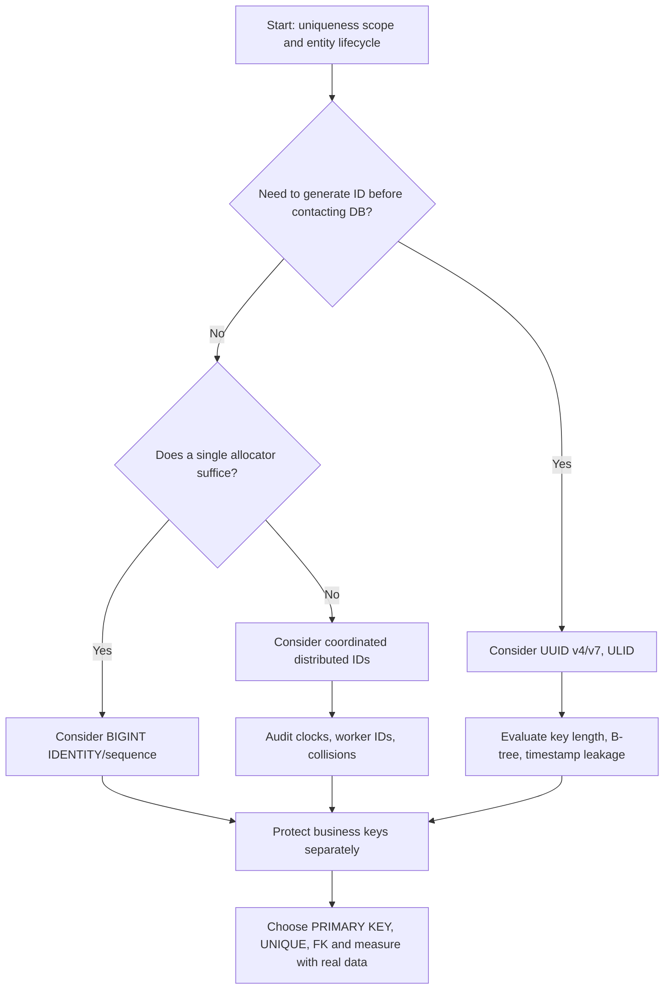

# Choosing Sequential Keys, Distributed Identifiers, or Business Keys Based on Requirements

## 1. Identifier Keys Are Both a Business and Physical Decision

In the `DATABASE_DATA_MODELING` module, translating business requirements into a verifiable data model includes selecting entities, relationships, normalization, keys, indexes, and the physical schema. A critical decision at the **physical modeling** step is choosing how to identify records. Three categories are commonly considered:

- **Sequential keys**: incrementing integer values allocated by the DBMS or an allocation service, such as `BIGINT GENERATED ... AS IDENTITY` in PostgreSQL.
- **Distributed identifiers**: values that can be generated independently across multiple applications, devices, or nodes, such as UUID v4/v7, ULID, or Snowflake-like IDs.
- **Business keys** (*natural/business keys*): an attribute or combination of attributes that already carries meaning in the business domain, such as (`tenant_id`, `sku`) when an SKU is unique only within a single business.

A table may require **multiple candidate keys**, yet declare only **one primary key** (`PRIMARY KEY`). Choosing a primary key does not remove the obligation to protect other business keys with `UNIQUE` constraints and corresponding normalization rules.

For example, a product line might be identified internally by `product_id`, while the rule "within a store, no two products may share the same SKU" still must be enforced on (`store_id`, `sku`). Simply creating `product_id` and skipping the SKU check will allow logically duplicate records.

### Distinguishing the Concepts

| Term | Meaning | Example |
|---|---|---|
| **Primary key** | Column set that uniquely identifies each row, disallowing `NULL` | `product_id` |
| **Candidate key** | Minimal attribute set capable of identifying a row | `product_id`, or (`tenant_id`, `sku`) when guaranteed unique |
| **Surrogate key** | Technical key generated separately, not describing business essence | `BIGINT IDENTITY`, UUID |
| **Business key** | Real attribute carrying meaning in the business domain | Contract number, supplier SKU code |
| **Foreign key** | Column or column group referencing a key guaranteed unique elsewhere by the DBMS | `order_line.product_id → product.product_id` |
| **Idempotency key** | Token tied to **a single request/operation** to prevent re-execution on retries | `(client_id, request_key)` for an order-creation API |

**An idempotency key is not automatically an entity key.** A request may fail or create multiple records, whereas an entity may be modified across many requests. The lifecycles and uniqueness scopes of these two key types must be managed separately.

## 2. From Requirements to Key Selection Criteria

No key type is optimal in every situation. Before deciding, write down an **identity contract**:

1. **Uniqueness scope:** system-wide, per tenant, per integration source, or only within a single table?
2. **Where IDs are generated:** is a central database required, or must apps/devices generate IDs offline?
3. **Lifecycle:** can the key change after creation, or be reused after deletion or data merges?
4. **Scale:** projected record count, write rate, number of generating nodes, transactions per second, and system lifespan?
5. **Observability:** will the ID appear in URLs, partner documents, logs, reports, or public APIs?
6. **Access paths:** lookup by ID, lookup by business code, multi-table joins, time-ordered writes, or batch imports?
7. **Data movement:** are there multiple databases to merge, bidirectional replication, or movement into document/graph models or analytical warehouses?
8. **Operability:** who manages the ID allocator, clock skew incidents, allocation failures, value-range limits, and migrations?

Do not infer that "incrementing IDs" means "an order created earlier will definitely commit first". Likewise, "distributed IDs" does not mean all nodes are guaranteed collision-free **without** proper generation and uniqueness enforcement mechanisms.



Note that this diagram is a **decision guide**, not an absolute formula. If a business code is genuinely immutable, short, unique, and governed stably, it may be a valid primary key choice from the start.

## 3. Sequential Keys: `INTEGER`, `BIGINT`, Identity, and Sequences

In a centralized-write system, an incrementing integer key is simple, easy to inspect, and typically friendly to B-tree indexes. PostgreSQL 16 allows:

```sql
CREATE TABLE customer_account (
    account_id BIGINT GENERATED ALWAYS AS IDENTITY PRIMARY KEY,
    display_name VARCHAR(120) NOT NULL
);

INSERT INTO customer_account (display_name)
VALUES ('Lan Anh')
RETURNING account_id;
```

`GENERATED ALWAYS AS IDENTITY` tells the DBMS to generate the ID during normal writes. PostgreSQL provides controlled explicit value overrides when restoring data, but multiple sources should not arbitrarily pick IDs within the same allocation sequence.

### Strengths

- **Clear sizing:** PostgreSQL `INTEGER` is 4 bytes, `BIGINT` is 8 bytes; 64-bit signed integers offer a massive positive range for long-term growth.
- **Relatively favorable B-tree order:** incrementing IDs insert toward the right edge of the key range, generally scattering index page writes less than purely random UUIDs.
- **Easy to work with:** queries, logs, joins, and parameter passing stay simple. Small tables or internal admin systems rarely need complex ID infrastructure.
- **Keeps business semantics out of keys:** changing an email, SKU, or customer name does not force updating primary keys and foreign keys.

### Limitations to Understand

**1. No guarantee of continuity or gapless sequences.** Sequences can be consumed by rolled-back transactions, failed inserts, sequence caches, or operational changes. Sequential IDs like `101` and `103` are completely normal. Do not use a sequential key as a legal invoice number if business rules require numbering sequences to meet specific audit requirements.

**2. ID value does not tell exact commit time.** A transaction assigned ID `20` may finish after a transaction assigned ID `21`. To sort by creation time, use a timestamp column with clear semantics; if total commit ordering is required, design a dedicated mechanism.

**3. Hard to allocate across uncoordinated writers.** Two independent databases both creating `order_id = 100` will collide when merged. Depending on requirements, you can partition number ranges, allocate via a service, or switch to distributed identifiers.

**4. Type range limits exist.** Signed `INTEGER` tops out at 2,147,483,647. For high-load or long-retained data, choosing `BIGINT` early usually avoids painful 32-bit migrations later, though you must factor in added key/index size and application compatibility.

**5. Easy to guess counts or enumerate IDs when exposed publicly.** This is not an authorization flaw of the ID itself; APIs must still authenticate and enforce object-level access control. You can add an unpredictable public code if security or UX requires it.

On PostgreSQL, tables are normally stored as heap structures; creating a `PRIMARY KEY` does not mean table rows are physically stored in key order. On MySQL/InnoDB, the primary key governs the clustered index structure, so primary key size also affects secondary indexes. Always compare by specific DBMS and engine.

## 4. Distributed Identifiers: Generating IDs Before Writing to a Shared Store

Distributed identifiers are useful when multiple services, devices, or regions must create records independently; when data arrives from queues and needs an ID before storage; or when databases are frequently merged. Distinguish between **not needing a central round-trip per ID** and **absolute zero-collision guarantees**: collisions must still be understood probabilistically or prevented via coordination, with `PRIMARY KEY`/`UNIQUE` acting as the final safety net.

### 4.1. UUID v4: Random and Easy to Generate Independently

UUIDs are 128 bits. Version 4 UUIDs use random bits (122 random bits after accounting for standard version/variant bits), making collision probability negligible when using a quality cryptographic random generator.

Example UUID format: `dfaa0436-f4e9-4f5f-a062-6b34560847a2`.

**Pros:** no central ID server needed; convenient for offline apps, events, multi-writer setups, and batch imports. **Trade-offs:** 16 bytes for a UUID vs. 8 bytes for `BIGINT`; random ordering tends to scatter B-tree inserts, increasing page splits, cache misses, and write costs under some workloads.

In PostgreSQL 16, UUIDs can be stored using the `UUID` type with `gen_random_uuid()` generating v4 UUIDs in the DBMS:

```sql
CREATE TABLE sync_job (
    job_id UUID PRIMARY KEY DEFAULT gen_random_uuid(),
    job_name TEXT NOT NULL
);
```

When the application needs to know the ID **before** sending the request to the DB, it must securely generate the UUID on the application side rather than relying on the DB's `DEFAULT`. Application-side and DB-side allocation should not be mixed without a clear convention.

### 4.2. UUID v7: Time-Ordered Component

UUID v7, specified in RFC 9562, places a millisecond-precision Unix timestamp in its leading bits, combined with bits for value differentiation and ordering within the same time window. Consequently, keys generated near real time tend to preserve index locality better than UUID v4.

However:

- **Approximate creation-time ordering does not equal commit order.** Machines with skewed clocks or IDs generated within the same millisecond can still yield different observed orders.
- **No automatic strict global ordering.** Guaranteeing ordering within a millisecond requires knowing whether the generator uses a monotonic counter.
- **IDs can leak approximate generation timestamps.** Consider this if IDs are publicly exposed and creation times are sensitive.
- **Version compatibility:** PostgreSQL 16's `UUID` type stores v7 cleanly, but do not assume PostgreSQL 16 includes a built-in core UUID v7 generator function. Generate in the application or use a version-verified extension.

The performance advantage of v7 over v4 depends on write volume, fill factor, index size, cache, and storage engine; measure rather than assuming "has a timestamp" automatically means fast.

### 4.3. ULID: 128-Bit Identifier with Compact String Encoding

ULIDs typically combine a **48-bit millisecond timestamp** and **80 bits of randomness**, encoded into 26 Base32 characters under a specific scheme. They are convenient when a more readable string than hyphenated UUIDs is desired, and they sort roughly by creation time when represented and compared according to the spec.

Things to verify:

- Storing ULIDs as strings changes storage/index overhead and collation behavior compared to storing 16-byte binary values.
- String sorting depends on canonical encoding, letter case, and collation rules; not every default string comparison preserves true ULID ordering.
- Monotonic ordering for multiple IDs generated within the same millisecond **depends on the generator**; the ULID specification alone does not turn every implementation into a strict global sequence.
- Enforce canonical-form validation and reject malformed codes or invalid variants when ingesting from external systems.

### 4.4. Snowflake-like: 64-Bit Integer Combining Time, Origin, and Sequence

A Snowflake-style ID generator typically combines a timestamp, a worker/node ID, and a sequence counter within a time slice. General layout:

```text
| Time component | Node/worker ID | Counter within same timestamp |
|----------------|----------------|-------------------------------|
               -> forms a structured integer
```

**Pros:** produces shorter IDs than 128-bit UUIDs; supports multi-node generation with a time-increasing trend. **Limitations:** requires collision-free worker ID allocation, clock rollback handling, wait/reject policies when the per-millisecond counter saturates, timestamp bit-range lifespan limits, and rollout planning as node counts grow.

"Snowflake-like" describes a *design family*, not a single fixed bit layout. Never copy bit widths from one library and assume they fit another system's throughput and node count. If a generator breaks or two nodes receive the same worker ID, `UNIQUE` in the DBMS can block collisions at write time, but it cannot fix the root cause of duplicate generation.

### 4.5. Distributed Identifier Comparison Table

| Type | Logical Size | Independent Generation | Ordering Trend | What Must Be Controlled |
|---|---|---|---|---|
| UUID v4 | 128 bits | Very convenient | Near-random | Cryptographic RNG source, collision math, index cost |
| UUID v7 | 128 bits | Convenient with compliant generator | Near creation time | Clocks, same-millisecond generation policy, timestamp leakage |
| ULID | 128 bits | Convenient | Near creation time | Canonical encoding, collation, monotonic generator if needed |
| Snowflake-like | Usually fits in 64-bit int | Requires node config coordination | Usually time-increasing | Worker IDs, clock rollback, burst rate limits, timestamp bit lifespan |

Query speed cannot be deduced from logical size alone: consider actual column storage type, index key length, clustering behavior, driver support, foreign key width, and application queries.

## 5. Business Keys: When Domain Meaning Can Act as a Key

Business keys are appealing because users already know the code and can look records up directly without surrogate ID mapping. Before using one as a `PRIMARY KEY`, however, answer:

1. **Is the uniqueness scope right?** `sku` is often unique only within a tenant, supplier, or source system—not necessarily across the whole platform.
2. **Is it truly immutable?** Emails, phone numbers, usernames, employee codes, and SKUs can be edited, reassigned, reformatted, or reused.
3. **Are comparison rules defined?** Are `'Abc'` and `'abc'` treated as the same code? Unicode normalization, whitespace, collation, and DBMS version affect `UNIQUE`.
4. **Does it contain sensitive data?** Using national IDs or emails widely as foreign keys can leak sensitive information into logs, URLs, analytics tables, and data exports.
5. **Is it a wide multi-column composite?** Keys composed of multiple long strings inflate foreign keys, indexes, and update costs whenever values change.
6. **Who governs uniqueness?** An external issuer might change formatting, recycle codes after closing records, or issue the same code across independent branches.

### When Can a Business Key Be the Primary Key?

A small reference table with centrally governed, stable, non-sensitive codes can be reasonable:

```sql
CREATE TABLE workflow_state (
    state_code VARCHAR(16) PRIMARY KEY,
    display_name TEXT NOT NULL
);
```

Here `state_code` is the meaningful identity of a managed state, assuming codes do not change arbitrarily. If policies change codes frequently or require versioning, a surrogate key may be better.

### When Should You Have Both a Technical Key and a Business Key?

In a multi-tenant e-commerce system, an SKU may change upon supplier re-import. A stable surrogate key `product_id` keeps transaction lines linked when the SKU changes, while you still enforce:

```sql
CONSTRAINT uq_product_tenant_sku UNIQUE (tenant_id, sku)
```

This is a **scoped candidate/unique key**, not necessarily the `PRIMARY KEY`. If the business allows two suppliers inside the same tenant to use the same SKU, update the scope to (`tenant_id`, `supplier_id`, `sku`) instead of dropping the constraint.

**Watch out for `NULL`:** for optional candidate keys, `UNIQUE` rules on columns containing `NULL` vary across DBMSs. PostgreSQL normally allows multiple `NULL`s in a `UNIQUE` constraint; variants and the `NULLS NOT DISTINCT` option depend on version. If a business code is genuinely required, declare `NOT NULL` explicitly.

## 6. PostgreSQL 16 Example: Internal IDs and Per-Tenant Uniqueness

Suppose a platform hosts multiple merchants; each merchant manages its own SKUs. The application runs on a central PostgreSQL database with no offline ID generation requirement. We choose `BIGINT` as the primary key and retain the business key (`tenant_id`, `sku`):

```sql
CREATE TABLE tenant (
    tenant_id   BIGINT GENERATED ALWAYS AS IDENTITY PRIMARY KEY,
    tenant_code VARCHAR(40) NOT NULL,
    CONSTRAINT uq_tenant_code UNIQUE (tenant_code)
);

CREATE TABLE product (
    product_id BIGINT GENERATED ALWAYS AS IDENTITY PRIMARY KEY,
    tenant_id  BIGINT NOT NULL,
    sku        VARCHAR(64) NOT NULL,
    name       VARCHAR(200) NOT NULL,
    CONSTRAINT fk_product_tenant
        FOREIGN KEY (tenant_id) REFERENCES tenant(tenant_id),
    CONSTRAINT uq_product_tenant_sku
        UNIQUE (tenant_id, sku),
    CONSTRAINT uq_product_tenant_product_id
        UNIQUE (tenant_id, product_id),
    CONSTRAINT ck_product_sku_nonblank
        CHECK (char_length(btrim(sku)) > 0)
);

CREATE TABLE inventory_movement (
    movement_id BIGINT GENERATED ALWAYS AS IDENTITY PRIMARY KEY,
    tenant_id   BIGINT NOT NULL,
    product_id  BIGINT NOT NULL,
    qty_delta   INTEGER NOT NULL,
    recorded_at TIMESTAMPTZ NOT NULL DEFAULT CURRENT_TIMESTAMP,
    CONSTRAINT fk_movement_same_tenant_product
        FOREIGN KEY (tenant_id, product_id)
        REFERENCES product (tenant_id, product_id),
    CONSTRAINT ck_movement_qty_nonzero
        CHECK (qty_delta <> 0)
);
```

**Why add `UNIQUE (tenant_id, product_id)` when `product_id` is already the primary key?** In PostgreSQL, a composite foreign key must reference a column set covered by an appropriate unique/primary constraint, so the example declares an additional `UNIQUE` on (`tenant_id`, `product_id`). As a result, `inventory_movement` cannot link `tenant_id = 10` with a `product_id` belonging to tenant 11. The extra constraint carries storage and write overhead; this is an intentional trade-off so the DBMS itself enforces cross-tenant consistency between tenants and products.

**Properties to evaluate:**

- `UNIQUE(tenant_id, sku)` protects SKU uniqueness **within a tenant**. Case sensitivity, Unicode normalization, and whitespace must be agreed upon. `btrim` here only blocks empty strings after stripping ordinary spaces; it does not normalize all Unicode characters.
- `product_id` remains stable when the SKU changes, simplifying references from orders and inventory events.
- Incrementing `movement_id` does not necessarily match business or commit order. For history queries, rely on `recorded_at` and, where needed, a deterministic tie-breaker.
- Use `tenant_id` in queries and authorization policies to prevent cross-tenant reads. **Primary keys or UUIDs do not replace access checks**; especially in multi-tenant apps, enforce access control at the API and/or DBMS layer.

Key verification queries:

```sql
-- Two tenants are allowed to have the same SKU.
SELECT tenant_id, sku, COUNT(*)
FROM product
GROUP BY tenant_id, sku
HAVING COUNT(*) > 1;  -- Must return empty if UNIQUE is upheld.

-- Common access path: find product by business key.
EXPLAIN
SELECT product_id, name
FROM product
WHERE tenant_id = 10 AND sku = 'SP-001';
```

If you run the `EXPLAIN` example on a newly created empty table, the planner may skip the index because table cost is tiny; test on data with realistic volume and distribution. Uniqueness on the pair also does not mean queries filtering solely by `sku` will optimize the same way as queries filtering by (`tenant_id`, `sku`).

## 7. Distributed Example: UUID Primary Key with Unique Partner Code

Suppose an order is created across multiple independent services before syncing to PostgreSQL. The application can generate UUID v7 using a verified generator; PostgreSQL 16 stores it in a `UUID` column. The convention here is that the application **must supply `order_id`**, because the DDL has no `DEFAULT`:

```sql
CREATE TABLE external_order (
    order_id            UUID PRIMARY KEY,
    tenant_id           BIGINT NOT NULL,
    source_system       VARCHAR(40) NOT NULL,
    source_order_ref    VARCHAR(100) NOT NULL,
    created_at          TIMESTAMPTZ NOT NULL DEFAULT CURRENT_TIMESTAMP,
    CONSTRAINT fk_external_order_tenant
        FOREIGN KEY (tenant_id) REFERENCES tenant(tenant_id),
    CONSTRAINT uq_external_order_source_ref
        UNIQUE (tenant_id, source_system, source_order_ref),
    CONSTRAINT ck_source_system_nonblank
        CHECK (char_length(btrim(source_system)) > 0),
    CONSTRAINT ck_source_ref_nonblank
        CHECK (char_length(btrim(source_order_ref)) > 0)
);
```

Two rules are needed simultaneously:

1. **`order_id` is globally unique across the table**, via properly generated UUIDs and the primary key constraint. The DBMS rejects collisions if a generator fails or two sources reuse an ID.
2. **`(tenant_id, source_system, source_order_ref)` is unique**, when the integration contract stipulates each source issues a unique order reference per tenant. This prevents duplicate records when re-syncing the same source order with a **new UUID**.

Do not rely on UUIDs alone to solve idempotency. For a "create order" API, define whether resending the same `request_key` returns the same result or reports a conflict; you may need a dedicated table storing (`client_id`, `request_key`) and processing state inside the transaction.

If using UUID v4 instead of v7, it can be generated in the application with a standard generator or by PostgreSQL via `gen_random_uuid()`; align this choice with "knowing the ID before sending" and index overhead. Never treat `created_at` as guaranteed to **match** when a UUID v7 was generated: an event may be created on a device and synced hours later.

## 8. Comparing Approaches by Architecture

| Context | Often Well-Founded Option | Rationale and Conditions |
|---|---|---|
| Centralized CRUD app, heavy joins, DB-issued IDs | `BIGINT IDENTITY` + `UNIQUE` on business key | Simple operations, compact key, few allocation points |
| Offline-first app, multiple services creating entities independently | App-generated UUID v4/v7 or ULID | No DB round-trip per ID; requires solid generator and duplicate handling |
| Numeric IDs required, concurrent multi-node high-throughput generation | Snowflake-like or range-allocation service | Must manage worker IDs, clocks, rate limits, and failures |
| Small, short, stably governed lookup catalog | Business key can be `PRIMARY KEY` | Only if non-sensitive, with stable scope and lifecycle |
| Data merged from multiple sources | Global surrogate key + `UNIQUE` source code by namespace | Prevents ID collisions and detects records sharing business identity |
| Multi-tenant system with codes overlapping across tenants | Global `product_id` + `UNIQUE(tenant_id, sku)` or matching composite PK | Uniqueness must state scope; FKs must guard cross-tenant links |
| Public IDs in URLs/APIs | Any key plus access checks; unpredictable public code if needed | Keys are not authorization, though sensitive counts shouldn't leak |

In document, graph, and analytical architectures, the question of **stable identity and uniqueness scope** remains unchanged, even though storage differs from SQL:

- **Document databases:** IDs can be assigned on the client before sync, with business codes stored in dedicated fields backed by unique indexes where supported. Some default IDs embed timestamps, but do not treat them as proof of commit order or universal immutability.
- **Graph databases:** use stable domain identifiers for nodes/edges shared across systems; avoid relying on internal storage IDs if the DBMS can reallocate or change them during moves/restores.
- **Analytical warehouses:** distinguish source business keys from dimension surrogate keys; handle slowly changing dimensions (SCD) and map facts at the right grain. Do not assume one source customer code always maps to a single dimension version.

## 9. Impact on Indexes, Foreign Keys, and Performance

A key's cost is not just the bytes of that single column. It propagates into indexes, foreign keys, joins, caches, network payloads, and API formats.

| Factor | Incrementing Integer Key | Distributed UUID | String / Composite Business Key |
|---|---|---|---|
| Typical width | 8 bytes for `BIGINT` | 16 bytes for `UUID` type | Depends on string length and column count |
| B-tree insert locality | Usually favorable (near-monotonic) | v4 scatters; v7 tends toward better locality | Depends on code domain and write order |
| Key updates when attributes change | Rarely needed | Rarely needed | May require updating many FKs or cascading |
| Joins / FKs | Compact key, easy consistency | Wider than 64-bit integer | Composite or string keys can increase cost |
| Merging multiple sources | Needs coordination / collision avoidance | Convenient independent generation | Requires namespacing and business conflict resolution |
| Direct lookup by displayed code | Needs `UNIQUE` and secondary lookup | Usually needs a business lookup field | Can be direct if code is normalized |

On PostgreSQL, a `PRIMARY KEY` creates a default unique B-tree index, without physically sorting all heap pages in key order. MySQL/InnoDB organizes tables around a clustered primary key; primary key values are embedded in secondary indexes, so wide primary keys can significantly inflate total secondary index size. SQL Server supports clustered and nonclustered choices with design-dependent defaults and behavior. Never extrapolate one engine's benchmarks unchanged to another engine.

**Redundant indexes:** if products are looked up by (`tenant_id`, `sku`) more often than by `product_id`, `UNIQUE(tenant_id, sku)` already provides an appropriate access path. Do not create a duplicate B-tree index on the same column pair simply because one is named a "unique constraint" rather than an "index".

**Measure instead of guessing:** use data with realistic distributions and record table/index sizes, insert throughput, page splits/fragmentation metrics if exposed by the DBMS, join latency, and cache behavior. With PostgreSQL, `EXPLAIN (ANALYZE, BUFFERS)` actually executes the query; run it in an appropriate test environment to avoid unintended expensive writes.

## 10. Migrating Keys in a Live System

Changing a primary key is a high-risk migration because it can affect numerous FKs, indexes, caches, event payloads, APIs, and data warehouses. Specifically:

- **`INTEGER → BIGINT`:** check types in all child tables, sequence/identity configuration, and API/ORM data handling. Type changes may scan or lock tables; test upgrade behavior on the exact DBMS version.
- **Integer → UUID:** establish a UUID generation strategy for existing rows, store `old_id → new_id` mappings, and update all FKs and external consumers. Never swap IDs in a way that breaks links from historical events.
- **Business key → surrogate key:** add the ID column, backfill, retain `UNIQUE` on the business key, and migrate FKs in phases. Switching the primary key while dropping the old uniqueness rule can leave data SQL-valid yet business-broken.
- **Merging multiple sources:** namespace source codes and detect logically duplicate entities before assigning new IDs; distinguish "same code" from "same entity".

An **expand–migrate–contract** plan typically includes: adding the new key and index, resumable batched backfilling, dual-writing or controlled synchronization, reconciling counts and links, shifting read/write paths, and only then retiring the old key. Test rollback, lock duration, and live traffic arriving mid-migration.

Do not lazily turn on `ON UPDATE CASCADE` to compensate for a frequently changing business key. Cascading carries heavy write overhead and does nothing for events, logs, URLs, or data already exported to external systems.

## 11. Test Suite for Key Selection Decisions

A design is only complete once assumptions about ID generation and usage are verified:

| Test Case | What to Confirm |
|---|---|
| Two processes create records concurrently | No lost records; DBMS catches duplicates; app handles unique violations properly |
| Transaction rolls back after fetching a sequential ID | No expectation of gapless IDs; features do not depend on gap-free IDs |
| Two nodes disconnect then resync | Distributed IDs do not collide under load testing; collisions are detected/handled if any occur |
| Node clock moves backward | Timestamp-based generator behaves per spec without looping or hanging indefinitely |
| Exceeding max IDs per millisecond | Generator safely rate-limits, waits, or errors as designed |
| Email / SKU changes | FKs still point to the right entity; business unique key follows policy |
| Two tenants use the same SKU | Allowed if uniqueness scope is per-tenant |
| One tenant uses a duplicate SKU | Rejected by `UNIQUE(tenant_id, sku)` |
| A record references the wrong tenant | Rejected by composite FK or consistency control strategy |
| Retrying the same order creation request | Does not create duplicate business records when required by idempotency contract |
| Batch import from two sources with colliding legacy IDs | Namespace mapping strategy prevents merging distinct entities |
| API uses unpredictable IDs | Per-object authorization checks still enforced |

Inspect key and index metadata on PostgreSQL:

```sql
SELECT conname,
       contype,
       pg_get_constraintdef(oid) AS definition
FROM pg_constraint
WHERE conrelid = 'public.product'::regclass
ORDER BY conname;

SELECT indexname, indexdef
FROM pg_indexes
WHERE schemaname = 'public' AND tablename = 'product'
ORDER BY indexname;
```

These two queries verify that the DBMS actually created the `PRIMARY KEY`, `UNIQUE`, and FK constraints defined in DDL. They do not substitute for concurrency testing or benchmarks.

## 12. Practice Scenarios and Handoff Criteria

**Scenario A – single storefront:** a single system running on centralized PostgreSQL has 10 million historical products, where each product's SKU can change by supplier. Propose a primary key for `product`, a unique key for SKU, and how to preserve links from `order_line` when product codes change.

**Scenario B – offline delivery network:** multiple devices issue receipts while offline, syncing at different times. Compare UUID v4, UUID v7, and Snowflake-like IDs on offline generation, clocks, index cost, and collision risk. Explain why ID order is insufficient to prove delivery order.

**Scenario C – multi-tenant and multi-partner platform:** two partners both use code `INV-100` within their own respective scopes. Define the properly scoped business key, decide whether to use a surrogate key, and design constraints preventing the same invoice from being imported twice.

When submitting a physical design, provide:

1. **Identity definition:** uniqueness scope, lifecycle, and ID change/reuse rules.
2. **Allocation explanation:** generator side, algorithm, column type, and failure/collision strategy.
3. **Data-protecting DDL:** `PRIMARY KEY`, `NOT NULL`, `UNIQUE`, `FOREIGN KEY`, and business code normalization rules.
4. **Operational evidence:** index plan, load tests, type/DBMS limits, multi-node scenarios, and migration plan.
5. **Security and integration boundaries:** access control, public identifiers, data origins, duplicate request handling, and ID exchange standards.

Choosing the right key means choosing a **stable identification rule and a way to defend it under real load**. Sequential keys, UUID/ULID/Snowflake-like IDs, and business keys all have their place; the designer's job is to state assumptions explicitly, make the DBMS enforce required uniqueness, and preserve identity as data grows or moves across systems.
