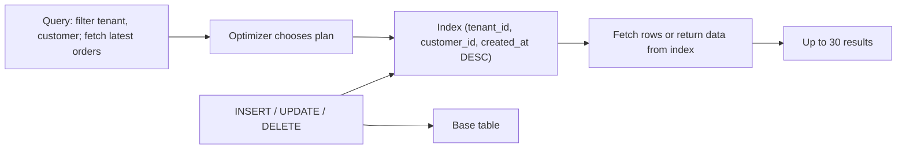

# Single-Column Indexes, Composite Indexes, and Access-Pattern Column Ordering

## 1. From Logical Model to Indexing Decisions

In the `DATABASE_DATA_MODELING` module, the goal is to translate business requirements into clear data models—from entities, relationships, and constraints to normalization, keys, indexes, and the physical schema—while choosing among relational, document, graph, and analytical representations for verifiability, scalability, and evolvability. In the **Physical Modeling** chapter, indexing (*indexes*) is a vital implementation decision because it bridges **data structures** and **real-world access patterns**.

Suppose a sales platform has an orders table with 10 million rows. A frequent query is "list the 30 most recent orders for a customer within a tenant". Creating separate single-column indexes on `tenant_id`, `customer_id`, and `created_at` is **not necessarily** as effective as a single composite index aligned with the filter conditions and sort order. Yet creating too many indexes "just in case" consumes storage, raises write costs, and complicates migrations.

After this lesson, learners should be able to:

- Distinguish **single-column indexes** from **multi-column indexes**, understanding that index keys are ordered by the declared column sequence.
- Derive suitable columns, column ordering, and index types from `WHERE`, `JOIN`, `ORDER BY`, `LIMIT`, and data distribution.
- Explain when a composite B-tree uses prefixes effectively, when omitting a leading column hurts query efficiency, and why the rule "put the highest-selectivity column first" does not hold in every case.
- Recognize indexes automatically created by `PRIMARY KEY`/`UNIQUE` constraints to avoid duplicate indexes; weigh `INCLUDE`, partial indexes, or expression indexes when justified.
- Read `EXPLAIN`, measure runtime performance on representative data, and balance read benefits against write overhead.

## 2. The Nature of Indexes and Core Trade-Offs

Think of a table as a collection of records, and an index as an auxiliary structure helping the DBMS locate data by a search key. B-tree is the most common index type in relational DBMSs. A B-tree index on (`tenant_id`, `customer_id`, `created_at`) organizes values in **left-to-right order** across the three components alongside row locators.



An index clearly pays off when it reduces pages read, eliminates sort work, assists joins, or enforces uniqueness. However, it carries costs:

| Benefits | Costs and Limitations |
|---|---|
| Faster row lookup on selective predicates | Indexes consume disk space and cache; may still require base-table fetches |
| Returns data in key order to avoid `Sort` | Ordering helps only specific filter/sort patterns |
| Can support `LIMIT` or pagination | Not every index fits multi-condition filters |
| `UNIQUE` enforces business constraints | Every write must maintain index structures and check duplicates |
| Assists child-table lookups via foreign keys | Child-side foreign keys may still require manually added indexes depending on DBMS |

In PostgreSQL, tables normally use *heap* storage; a B-tree index holds keys and row pointers, so reading non-indexed columns may require touching the heap. In MySQL/InnoDB, rows are organized around a clustered primary key and secondary indexes store the primary key value to locate rows. In SQL Server, lookup mechanics depend on clustered vs. nonclustered indexes. These differences change real costs, so never extrapolate benchmarks from one engine to all products.

**No index guarantees the DBMS will use it on every execution.** The optimizer compares costs using statistics, table size, selectivity, parameter values, returned row counts, and storage mechanics. A sequential scan may be optimal for tiny tables or queries returning most rows.

## 3. Gather Access Patterns Before Choosing Indexes

Before writing `CREATE INDEX`, build an **access-pattern matrix** describing real queries and their criticality. Suppose `sales_order` has columns:

`order_id`, `tenant_id`, `customer_id`, `order_status`, `created_at`, and `total_amount`.

| Pattern | Query Requirement | Frequency / Target | Key Data and Predicates |
|---|---|---|---|
| A | 50 most recent orders for a tenant in `PAID` status | Very frequent, low latency | `tenant_id = ?`, `order_status = 'PAID'`, `ORDER BY created_at DESC, order_id DESC` |
| B | 30 most recent orders for one customer within a tenant | Frequent | `tenant_id = ?`, `customer_id = ?`, ordered by time |
| C | Tenant orders within a date range, any status | Frequent on reconciliation screen | `tenant_id = ?`, `created_at >= ?`, `created_at < ?` |
| D | Platform-wide monthly revenue report | Batch job | High-volume read, monthly aggregation; may need summary tables / analytical warehouse |
| E | Update one order's status by ID | Very frequent | `order_id = ?`, update exact row, enforce tenant authorization |

To make reliable decisions, also document:

1. **Row counts and distribution:** how many orders per tenant; shares of `DRAFT`, `PAID`, `CANCELLED`; are some customers vastly more active than others?
2. **Read/write ratio:** how many `INSERT`/`UPDATE`/`DELETE` operations per minute compared to reads?
3. **Parameters:** do users typically filter a single status or pick multiple statuses; are there queries omitting `tenant_id`?
4. **Sorting and limits:** does the API return 20–50 rows or export millions at once; does pagination use offset or keyset cursors?
5. **Existing constraints:** which indexes already exist from `PRIMARY KEY`/`UNIQUE`; are there specialized indexes for foreign keys or text search?

Never design indexes from column names alone or from a single sample query divorced from real data.

## 4. Single-Column Indexes: When Do They Fit?

A single-column index has one search key, for example:

```sql
-- Illustration: PostgreSQL's default B-tree index type.
CREATE INDEX idx_order_created_at
    ON sales_order (created_at);
```

This can be useful when the system **frequently queries directly by `created_at`** across the whole table or searches a selective time slice. Yet in a multi-tenant system, typical queries include `WHERE tenant_id = ?`. An index containing only `created_at` may force the DBMS to traverse orders from many other tenants before filtering.

### Selectivity and Value Distribution

Suppose `order_status` has three values and 95% of orders are `PAID`. A single-column index on `order_status` is unappealing for `WHERE order_status = 'PAID'` because most rows must be read anyway. Conversely, if 0.2% of orders are `CANCELLED`, that predicate can be highly selective.

**Selectivity** measures how much a predicate narrows the candidate set—not merely the number of distinct values (*cardinality*) in a column. A low-cardinality column with heavily skewed distribution can still serve a rare-value filter very effectively. Conversely, a key with millions of unique values helps little for a query reading nearly the whole table.

Single-column indexes usually make sense when:

- An important lookup path filters solely by that column, such as a foreign key frequently queried on its own.
- Column values are selective enough for common queries, or the index efficiently provides ordering/limits.
- No existing composite index already covers it with a suitable prefix.
- Adding the index delivers measured read gains exceeding write and storage costs.

Single-column indexes are not mandatory for every foreign key. In PostgreSQL, child-table foreign keys do not auto-create indexes; evaluate whether parent deletes/updates and join queries need that access path. In InnoDB, the engine has its own rules for FK-supporting indexes; inspect actual DDL to avoid duplicate indexes.

## 5. Composite Indexes: Ordered from First Column to Last

An index on `(tenant_id, order_status, created_at DESC, order_id DESC)` organizes entries by:

1. `tenant_id`;
2. within the same `tenant_id`, by `order_status`;
3. within the same tenant and status, by `created_at` descending;
4. on timestamp ties, by `order_id` descending for deterministic ordering.

```text
tenant_id | order_status | created_at           | order_id
----------+--------------+----------------------+---------
10        | PAID         | 2027-05-05 10:00 UTC | 105
10        | PAID         | 2027-05-04 08:00 UTC | 104
10        | PAID         | 2027-05-03 16:00 UTC | 101
10        | DRAFT        | 2027-05-05 11:00 UTC | 106
20        | PAID         | 2027-05-05 09:00 UTC | 230

Illustrative example only: status ordering depends on actual collation/storage type,
and does not attempt to represent the exact lexicographical order of every DBMS.
```

The core concept is the **leftmost prefix**: in a multi-column B-tree, predicates on the first one or few columns narrow the scan range far more effectively than predicates solely on trailing columns.

| Filter / Sort | With Index `(tenant_id, order_status, created_at DESC, order_id DESC)` |
|---|---|
| `tenant_id = 10` | Filters on leading prefix |
| `tenant_id = 10 AND order_status = 'PAID'` | Equality predicates on first two columns; typically efficient |
| Both predicates above + `ORDER BY created_at DESC, order_id DESC LIMIT 50` | Fits the intended access path closely |
| `tenant_id = 10 AND created_at >= ...`, no status filter | Cannot scan `created_at` as one contiguous range per tenant because entries are split by status |
| `order_status = 'PAID'` without `tenant_id` | Missing leading prefix; usually poor for selective lookup |
| Global `ORDER BY created_at DESC` | Time order is partitioned by tenant and status, so it does not match directly |

**The prefix rule is a design guide, not an absolute prohibition.** PostgreSQL can scan the whole index and filter trailing columns, choose a bitmap scan, or pick another plan; optimizer capabilities evolve across versions. What matters is whether the index **reduces data scanned** and query cost, rather than asserting "missing the first column means an index is never used".

### Column Order: Equality, Range, and Sort

A useful heuristic for B-trees is to place frequently **equality-filtered** columns first, followed by **range** or **sort** columns, then evaluate whether remaining columns assist filtering or covering. Do not turn that into a rigid dogma that "every range column goes last":

- `WHERE tenant_id = ? AND order_status = ? ORDER BY created_at DESC`: after two equality columns, `created_at` naturally fetches latest orders.
- `WHERE tenant_id = ? AND created_at >= ? AND created_at < ? ORDER BY created_at DESC`: `(tenant_id, created_at DESC)` can outperform an index placing `order_status` between them if the query **does not filter by status**.
- `WHERE tenant_id = ? AND total_amount > ? ORDER BY created_at DESC`: `(tenant_id, total_amount, created_at)` filters the amount range, yet because it scans an open `total_amount` range, it cannot emit rows globally sorted by `created_at`; prioritizing `created_at` may win when `LIMIT` is small. Benchmark both if both amount filtering and ordering matter.
- `WHERE tenant_id = ? AND order_status IN ('DRAFT','PAID') ORDER BY created_at DESC`: multiple statuses produce multiple separately time-ordered streams; the DBMS may need to merge or sort. Do not assume placing status before timestamp eliminates the sort step.

**Putting the highest-cardinality column first is not mandatory.** For example, when both `tenant_id` and `customer_id` use equality predicates, swapping their order may barely impact that specific query; decide based on prefix-only queries, sort orders, tenant scoping, and index reuse.

## 6. Complete DDL for a Concrete Query Set

The example below uses **PostgreSQL 16**. The platform is multi-tenant; each customer belongs to one tenant; each order belongs to a customer of that same tenant. Composite foreign keys prevent cross-tenant links. This example focuses solely on index design and omits invoices, taxes, payments, and state transition rules.

```sql
CREATE TABLE tenant (
    tenant_id BIGINT GENERATED ALWAYS AS IDENTITY PRIMARY KEY,
    name      VARCHAR(120) NOT NULL
);

CREATE TABLE customer (
    customer_id   BIGINT GENERATED ALWAYS AS IDENTITY PRIMARY KEY,
    tenant_id     BIGINT NOT NULL REFERENCES tenant(tenant_id),
    customer_code VARCHAR(40) NOT NULL,
    full_name     VARCHAR(120) NOT NULL,
    CONSTRAINT uq_customer_tenant_code UNIQUE (tenant_id, customer_code),
    CONSTRAINT uq_customer_tenant_id UNIQUE (tenant_id, customer_id)
);

CREATE TABLE sales_order (
    order_id     BIGINT GENERATED ALWAYS AS IDENTITY PRIMARY KEY,
    tenant_id    BIGINT NOT NULL,
    customer_id  BIGINT NOT NULL,
    order_status VARCHAR(16) NOT NULL DEFAULT 'DRAFT',
    created_at   TIMESTAMPTZ NOT NULL DEFAULT CURRENT_TIMESTAMP,
    total_amount NUMERIC(14, 2) NOT NULL,
    CONSTRAINT fk_order_customer_in_tenant
        FOREIGN KEY (tenant_id, customer_id)
        REFERENCES customer (tenant_id, customer_id),
    CONSTRAINT ck_order_status
        CHECK (order_status IN ('DRAFT', 'PAID', 'CANCELLED')),
    CONSTRAINT ck_order_amount
        CHECK (total_amount >= 0)
);

-- A: 50 most recent orders for a tenant by status.
CREATE INDEX idx_order_tenant_status_recent
    ON sales_order (
        tenant_id, order_status, created_at DESC, order_id DESC
    ) INCLUDE (total_amount);

-- B: order history by customer within a tenant.
CREATE INDEX idx_order_tenant_customer_recent
    ON sales_order (
        tenant_id, customer_id, created_at DESC, order_id DESC
    );

-- C: find all tenant orders by time without filtering status.
-- Create only when workload proves Pattern C is important enough.
CREATE INDEX idx_order_tenant_recent
    ON sales_order (tenant_id, created_at DESC, order_id DESC);
```

The three indexes at the bottom represent **three access paths derived from Patterns A/B/C**. Before deploying to production, verify that Pattern C carries enough load to justify keeping the third index. The index on `order_id` is already created by `PRIMARY KEY`; there is no need to create another single-column index on it.

### 6.1. Pattern A: Equality Filter Then Latest Rows

```sql
EXPLAIN
SELECT order_id, created_at, total_amount
FROM sales_order
WHERE tenant_id = 10
  AND order_status = 'PAID'
ORDER BY created_at DESC, order_id DESC
LIMIT 50;
```

With `idx_order_tenant_status_recent`, the first two columns match equality predicates; the next two match `ORDER BY`; `LIMIT 50` avoids scanning all paid orders for the tenant. `total_amount` is placed in `INCLUDE` so the index can supply the output column without visiting heap pages under favorable visibility conditions.

**`INCLUDE` does not make `total_amount` a search or sort key.** In PostgreSQL it is an index payload column; if a query adds `WHERE total_amount > 1000000`, the DBMS cannot use `total_amount` as a B-tree key component to narrow the scan range.

### 6.2. Pattern B: One Customer's History

```sql
EXPLAIN
SELECT order_id, order_status, created_at, total_amount
FROM sales_order
WHERE tenant_id = 10
  AND customer_id = 200
ORDER BY created_at DESC, order_id DESC
LIMIT 30;
```

The index `(tenant_id, customer_id, created_at DESC, order_id DESC)` fits this pattern. Pattern A's index cannot replace it properly because `customer_id` is absent from the search key. To return `order_status` and `total_amount`, the DBMS may fetch from the heap; adding those columns to `INCLUDE` is only worthwhile if index-only scan and latency gains outweigh size and write costs.

### 6.3. Pattern C: Time-Range Query

```sql
EXPLAIN
SELECT order_id, customer_id, order_status, created_at
FROM sales_order
WHERE tenant_id = 10
  AND created_at >= '2027-05-01 00:00:00+00'::TIMESTAMPTZ
  AND created_at <  '2027-06-01 00:00:00+00'::TIMESTAMPTZ
ORDER BY created_at DESC, order_id DESC
LIMIT 100;
```

Placing `tenant_id` before `created_at` supports time-range scans within each tenant; `created_at DESC, order_id DESC` matches latest-order sorting. Prefer **half-open intervals (inclusive start, exclusive end)** to avoid constructing an "end of day instant" dependent on timestamp precision; for user calendar dates, convert boundaries from the business timezone to instants before filtering.

If Pattern C is rare or routinely exports massive row sets, keeping a dedicated index for C may be uneconomical. Index design must follow workload priority, not merely whether valid DDL can be written.

### 6.4. Why Do `created_at` and `order_id` Appear Together?

Multiple orders can share the exact same timestamp, especially with finite clock resolution. `ORDER BY created_at DESC` alone leaves tied rows in an indeterminate order. `order_id` acts as a tie-breaker for deterministic ordering; the pair also enables **keyset pagination**:

```sql
-- Next page of "latest PAID orders in tenant".
-- Cursor taken from created_at and order_id of the last row on the prior page.
SELECT order_id, created_at, total_amount
FROM sales_order
WHERE tenant_id = 10
  AND order_status = 'PAID'
  AND (created_at, order_id) <
      ('2027-05-05 10:00:00+00'::TIMESTAMPTZ, 12500)
ORDER BY created_at DESC, order_id DESC
LIMIT 50;
```

When both columns sort in the **same descending direction**, tuple comparison `<` cleanly steps to older rows. If mixed `ASC`/`DESC` sorting is required, the cursor condition and index must be redesigned. Keyset pagination avoids the high row-skipping cost of large `OFFSET`s, though it does not create an immutable snapshot if rows are inserted, re-timestamped, or change status between requests.

## 7. `ASC`/`DESC` Direction and Range Predicates

PostgreSQL B-trees can scan both forward and backward. For single-column indexes, a `created_at ASC` index can still serve `ORDER BY created_at DESC` via a backward scan; creating a second index solely to flip direction is rarely necessary.

With **multiple columns and mixed sort orders**, individual column directions matter much more. For example:

```sql
-- Within a tenant, newest date first and largest ID first.
CREATE INDEX idx_order_tenant_time_desc
    ON sales_order (tenant_id, created_at DESC, order_id DESC);

-- Only consider a DIFFERENT index when mixed sorting is required:
-- ORDER BY created_at DESC, order_id ASC
-- A matching index for that pattern would be:
-- (tenant_id, created_at DESC, order_id ASC)
```

This `CREATE INDEX` snippet is a **standalone illustration**: it has the same key as `idx_order_tenant_recent` in Section 6. Once Section 6's index exists, **do not also run this command on the same table** as it creates a duplicate structure. Fully reversed directions can rely on backward scans, whereas mixed directions require inspecting the exact index and query.

For queries with multiple inequality conditions, distinguish three roles:

- **Limiting the scan range:** equality predicates on a prefix plus a range predicate on the next column are especially valuable.
- **In-index filtering after a range:** the DBMS can test remaining conditions while reading index entries, without necessarily shrinking the scanned entry range in the same way.
- **Returning ordered output:** `ORDER BY` must align with the index order once equality-constrained prefixes and scan direction are accounted for.

You cannot optimize every `WHERE` and `ORDER BY` combination simultaneously with one composite index. Prioritize the query group that genuinely governs system quality.

## 8. Covering Indexes, Index-Only Scans, and `INCLUDE`

In PostgreSQL, a **covering index** places extra columns needed in query output inside the index—typically via `INCLUDE`—to enable *index-only scans*. For example:

```sql
CREATE INDEX idx_order_tenant_status_cover
    ON sales_order (tenant_id, order_status, created_at DESC, order_id DESC)
    INCLUDE (total_amount);
```

This merely illustrates the exact structure of `idx_order_tenant_status_recent` already created; **keep only one of them**, as having both is redundant. Distinguish clearly:

| Component | In Example | Role |
|---|---|---|
| Search / sort keys | `tenant_id`, `order_status`, `created_at`, `order_id` | Determine B-tree ordering and filter/sort capability |
| `INCLUDE` column | `total_amount` | Can be read from the index for output; does not order keys |

**An index-only scan is not guaranteed just because columns exist in the index.** In PostgreSQL, MVCC requires verifying row visibility; if a heap page is not marked *all-visible* in the visibility map, the DBMS must still visit the heap. Frequently updated tables benefit less than relatively static ones. Moreover, adding `INCLUDE` enlarges the index and adds maintenance overhead when included columns are updated.

SQL Server also provides `INCLUDE` on nonclustered indexes with different physical internals. MySQL/InnoDB lacks a direct syntactic equivalent to PostgreSQL's `INCLUDE`; output columns covered by secondary indexes plus PK must be analyzed per engine.

## 9. Partial Indexes and Expression Indexes: Only When Access Patterns Justify Them

### 9.1. Partial Indexes for Frequently Queried Row Subsets

If the system primarily reads **paid orders** and `PAID` represents a small fraction of rows, PostgreSQL supports conditional indexes:

```sql
-- ALTERNATIVE option when most queries only look up PAID orders.
-- Do not blindly create alongside all full indexes in Section 6.
CREATE INDEX idx_order_paid_recent
    ON sales_order (tenant_id, created_at DESC, order_id DESC)
    WHERE order_status = 'PAID';
```

This index is smaller than an all-status index when `PAID` share is low, and it does not need `order_status` in the search key since every entry already satisfies the predicate. However, it has limits:

- Does not directly help queries looking for `DRAFT` or `CANCELLED`.
- The optimizer must **prove** the query predicate implies the partial index predicate. A prepared statement with a status bind parameter unknown during *generic plan* selection may fail to use it.
- When data distribution shifts—e.g., `PAID` grows from 3% to 95%—its size and selectivity advantages change.
- Existing indexes must be re-evaluated; avoid keeping both a full index and an overlapping partial index without a concrete purpose.

Partial indexes in PostgreSQL can also enforce conditional uniqueness rules, such as "registration code is unique only while not soft-deleted". When using them for integrity, clarify `NULL` behavior, foreign keys, and delete policies; a partial unique index is not automatically eligible as a foreign key target like a standard unique constraint.

### 9.2. Expression Indexes When Predicates Apply Functions to Columns

Suppose the business looks up customers by email **case-insensitively** under an agreed normalization rule. A query with `WHERE lower(email) = lower(?)` generally cannot use a plain B-tree index on `email` as a direct equality lookup. PostgreSQL supports expression indexes:

```sql
-- Standalone example: table account_email has column email TEXT NOT NULL.
CREATE INDEX idx_account_email_lower
    ON account_email (lower(email));

-- Query must match the indexed expression.
SELECT account_id
FROM account_email
WHERE lower(email) = lower('User@Example.test');
```

This assumes `account_email` already exists—**not** a table created in Section 6's DDL. In real systems, expression indexes also depend on collation, Unicode, and email equivalence policies; `lower` alone does not solve all Unicode edge cases. If uniqueness is a business rule, use a **unique expression index** or an appropriate normalization/equivalence mechanism, not merely a non-unique index.

An expression like `DATE(created_at)` in a filter can likewise defeat timestamp index access paths. For daily reports, prefer writing a timestamp range aligned with business day boundaries to leverage the `created_at` index rather than adding expression indexes to accommodate one SQL query.

## 10. A Column in `WHERE` Does Not Automatically Belong in the Index

When a SQL query has multiple conditions, pick which path serves as the **primary access path**. For example:

```sql
SELECT order_id, total_amount
FROM sales_order
WHERE tenant_id = 10
  AND order_status = 'PAID'
  AND total_amount >= 1000000
ORDER BY created_at DESC, order_id DESC
LIMIT 20;
```

Two distinct strategies:

1. Use `(tenant_id, order_status, created_at DESC, order_id DESC)`, walk newest orders first, and filter `total_amount` until 20 rows match. Works well when the amount filter is not too rare and `LIMIT` is small.
2. Use an index with `total_amount` positioned to isolate high-value orders first, then sort by time. Works well when very few orders meet the amount threshold and sorting that tiny subset is cheap.

SQL syntax alone cannot tell which wins. You need statistics on amounts, statuses, and tenants. Sometimes the DBMS can combine multiple indexes via bitmap operations, yet combining indexes does not necessarily preserve output order and may lose to a single well-matched composite index.

A column appearing in `SELECT` solely for output also does not automatically belong in the search key. It can be read from the heap or considered for `INCLUDE` if index-only scans pay off. Decide based on rows read, cache residency, update rate, and payload size.

## 11. Verifying with `EXPLAIN` and Operational Metrics

**Valid schema execution does not prove an index is helping.** On PostgreSQL, check the estimated plan first:

```sql
EXPLAIN
SELECT order_id, created_at, total_amount
FROM sales_order
WHERE tenant_id = 10
  AND order_status = 'PAID'
ORDER BY created_at DESC, order_id DESC
LIMIT 50;
```

In a test environment with representative data, measure actual execution:

```sql
EXPLAIN (ANALYZE, BUFFERS)
SELECT order_id, created_at, total_amount
FROM sales_order
WHERE tenant_id = 10
  AND order_status = 'PAID'
ORDER BY created_at DESC, order_id DESC
LIMIT 50;
```

`EXPLAIN ANALYZE` **actually runs the query**. For write statements (`INSERT`, `UPDATE`, `DELETE`), run it only in test environments or controlled transactions where side effects are contained. Inspect and compare:

| Signal | Meaning During Evaluation |
|---|---|
| `Index Scan` / `Index Only Scan` / `Bitmap Heap Scan` / `Seq Scan` | Access method chosen by DBMS; none is universally "always right" |
| `Index Cond` | Predicates used to drive index access |
| `Filter`, `Rows Removed by Filter` | How many rows were fetched and then discarded by remaining predicates |
| `Sort` and sort method | Whether extra sorting occurs despite an index |
| `actual rows`, `loops`, actual time | Row counts, execution loops, and latency of each plan node |
| `Buffers: shared hit/read` | Pages found in cache vs. read from storage/OS buffers per PostgreSQL counters |
| `Heap Fetches` in index-only scan | Whether heap pages had to be visited for visibility or missing columns |

Test multiple parameter profiles: small tenants, giant tenants, power users with huge order histories, and skewed time windows. A single run on a freshly created table is rarely representative. After bulk-loading test data, make sure statistics are refreshed (e.g., via `ANALYZE`) before comparing plans.

### Queries to Inspect Indexes and Sizes

```sql
SELECT indexname, indexdef
FROM pg_indexes
WHERE schemaname = 'public'
  AND tablename = 'sales_order'
ORDER BY indexname;

SELECT
    indexrelname,
    idx_scan,
    idx_tup_read,
    idx_tup_fetch,
    pg_size_pretty(pg_relation_size(indexrelid)) AS index_size
FROM pg_stat_user_indexes
WHERE schemaname = 'public'
  AND relname = 'sales_order'
ORDER BY pg_relation_size(indexrelid) DESC;
```

`idx_scan` is a cumulative counter since statistics reset and depends on stats collection behavior. A low count **is not sufficient proof** an index is unused; it might serve seasonal jobs, migrations, or uniqueness constraints. Conversely, a heavily scanned index is not automatically effective if it barely prunes rows read. Combine logs, query patterns, plans, and empirical measurements.

## 12. Write Cost, Storage Footprint, and Duplicate Indexes

Every additional index incurs overhead on row inserts and deletes; updating indexed columns also forces index entry updates. In PostgreSQL, modifying an indexed column or an `INCLUDE` column can forfeit *HOT updates* that otherwise skip index edits in some situations; actual impact depends on updated columns and storage layout.

Measure impact across at least these dimensions:

- **Storage:** how big are total indexes relative to the heap; do string or multi-column indexes inflate page counts?
- **Write throughput:** do `INSERT` and status/amount `UPDATE` latencies rise when adding a new index?
- **Background load:** do WAL volume, vacuum/autovacuum, maintenance, and index rebuild times impact operations?
- **Memory:** multiple indexes compete for buffer cache against hot table data.
- **Redundancy:** `PRIMARY KEY` and `UNIQUE` constraints already create backing unique indexes; another index with the exact same columns, order, and predicates adds no inherent benefit.

For example, `PRIMARY KEY(order_id)` on `sales_order` already serves order lookups by ID. Adding `CREATE INDEX ... ON sales_order(order_id)` is wasteful. Conversely, `UNIQUE(tenant_id, customer_code)` on `customer` does **not** replace `(tenant_id, customer_id, created_at DESC)` on `sales_order`: they serve different tables and access patterns.

### Are Overlapping-Prefix Indexes Always Redundant?

If `(tenant_id, order_status, created_at)` exists, a single-column `(tenant_id)` index can sometimes be dropped because the composite B-tree already leads with `tenant_id`. Yet a narrower index is smaller, and tenant-only scans might benefit from reading fewer pages. Decide whether to drop by comparing sizes, query plans, frequencies, and write costs.

Conversely, `(tenant_id, order_status)` and `(order_status, tenant_id)` serve different query paths even though both enforce the same unique pair when non-`NULL`. Column order governs access paths, without changing which duplicate pairs are forbidden when both columns are non-`NULL`.

### Creating Indexes on Large Tables

Adding an index to a table actively serving writes can acquire locks and consume heavy resources. PostgreSQL supports `CREATE INDEX CONCURRENTLY` to avoid blocking writes in many scenarios, though it has restrictions, **cannot run inside a transaction block**, performs multiple scan passes, and can fail leaving behind an invalid index that must be cleaned up. In MySQL and SQL Server, online index creation capabilities vary by engine, version, edition, and operation type. Always verify behavior in the target environment and prepare rollback/monitoring procedures.

## 13. Differences When Moving to MySQL, SQL Server, or Other Models

| Topic | PostgreSQL 16 | MySQL 8.0 / InnoDB | SQL Server 2022 |
|---|---|---|---|
| Common index for equality/range predicates | B-tree | InnoDB B-tree | Rowstore B-tree commonly used |
| Primary key and row storage | Separate index over heap | Clustered primary key; secondary indexes carry PK | Depends on clustered/nonclustered design |
| Non-key payload | B-tree `INCLUDE` | No direct PostgreSQL-style `INCLUDE` syntax; analyze engine covering | `INCLUDE` on nonclustered indexes |
| Conditional index | `CREATE INDEX ... WHERE ...` | No PostgreSQL-style partial index syntax; redesign if needed | Filtered index with predicate |
| Expression index | Expression index | Functional index by version, with specific limits | Computed columns plus index when eligible |
| Child-side FK index | Not auto-created by `FOREIGN KEY` | InnoDB requires a supporting index and may auto-create if absent | Not auto-created merely by FK |
| Reverse scan / index direction | B-tree supports backward scans | Supports descending indexes in MySQL 8.0 per engine capabilities | Depends on index definition and plan |

Things to check before porting DDL: byte-based key length limits, collations, indexing nullable columns, supported index types by version, indexable expressions, optimizer statistics, and storage engine update costs.

In **document databases**, field order in compound indexes also matters, yet prefix, multikey (array), and document-size rules differ from SQL; base design on document query patterns and the specific engine. In **graph databases**, indexes typically locate starting nodes by property while traversals depend on edge structures, node degrees, and DBMS internals. In **analytical warehouses**, partitioning, clustering, sort keys, zone maps, or columnar indexes often outweigh OLTP-style composite B-trees. Never apply one relational indexing pattern mechanically across all storage models.

## 14. Verifiable Decision Process

A concise workflow to design and review indexes:

1. **State the query problem:** identify key read/write patterns, latency targets, row counts, filters, ordering, and pagination.
2. **Audit existing constraints:** `PRIMARY KEY`/`UNIQUE`, join/FK indexes, current indexes, and DBMS physical layout.
3. **Draft minimal candidates:** prioritize equality prefixes matching access patterns, followed by range or sort columns; check `ASC`/`DESC` directions and tie-breakers.
4. **Check reuse:** can one composite index serve multiple patterns; are single-column or partial indexes genuinely justified separately?
5. **Measure on representative data:** use `EXPLAIN`/`EXPLAIN ANALYZE`, measure time, pages read, storage size, write throughput, and varied parameter values.
6. **Stress-test skew and change:** large tenants, skewed statuses, growing row counts, deep pagination, and frequent updates.
7. **Deploy safely:** build indexes using appropriate online options, monitor post-rollout, and document why each index exists so future migrations stay informed.

Do not treat "the query uses an index" as the sole success criterion. The ultimate goal is meeting query SLAs and data integrity within resource budgets while keeping the schema easy to evolve.

## 15. Practice Exercise: Optimizing Event History Access

A multi-tenant system stores 50 million event records in `audit_event`:

`event_id BIGINT PRIMARY KEY`, `tenant_id BIGINT`, `actor_id BIGINT`, `event_type VARCHAR(30)`, `occurred_at TIMESTAMPTZ`, `payload JSONB`.

Three query patterns:

| Pattern | Query | Assumed Load |
|---|---|---|
| Q1 | 100 latest events for a tenant with `event_type = 'LOGIN_FAILED'` | Very frequent; this event type is 1% of rows |
| Q2 | 50 latest events for an `actor_id` within a tenant | Frequent |
| Q3 | Export all events for a month for reporting | Rare, but may read millions of rows |

Complete the following:

1. Propose composite B-tree indexes for Q1 and Q2 with column orders suited for `WHERE`, `ORDER BY occurred_at DESC, event_id DESC`, and `LIMIT`. Explain why three separate single-column indexes on `tenant_id`, `event_type`, and `occurred_at` would likely underperform the composite indexes.
2. Evaluate a **partial index** dedicated to `LOGIN_FAILED`. When is it smaller and more effective than an index covering all `event_type`s? What happens if the application passes an `event_type` bind parameter to a generic prepared plan?
3. Discuss whether to add `payload JSONB` to `INCLUDE`. State the effects on index width, writes, and index-only scans; explain why large JSON payloads should not be added to an index solely to skip heap fetches without measuring.
4. Explain why Q3 may need a scan/partitioning/sorting strategy or an analytical warehouse instead of adding another B-tree for every reporting filter.
5. List verification test cases: tiny tenant, huge tenant, query returning most of the table, 1 million inserts under load test, `ORDER BY` with identical timestamps, and deep pagination.

**Handoff criteria:** for each proposed index, specify *which access pattern it serves*, *why the column order was chosen*, *which patterns it serves poorly*, *which indexes/constraints already exist*, and *what metrics prove benefits exceed costs*.

Single-column indexes, composite indexes, and column ordering are all tools to serve **well-defined access patterns**. Starting from queries, understanding B-tree prefix and sort boundaries, and measuring both read and write effects allows a designer to choose just enough indexes to protect performance while keeping the data model lean, accurate, and easy to change.
