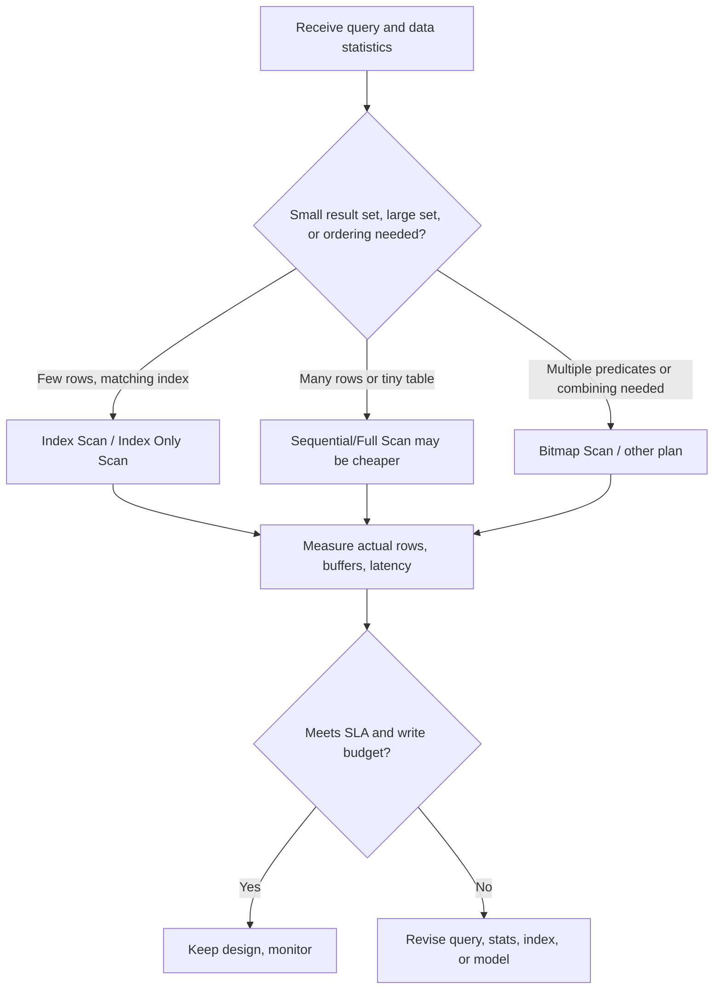

# Selectivity, Write Cost, and the Limits of Adding Indexes

## 1. Indexes Must Be Evaluated by Both Read Benefit and Write Cost

In the `DATABASE_DATA_MODELING` module, learners practice turning business requirements into clear data models: from entities, relationships, constraints, normalization, and keys to indexes and the physical schema. A sound schema must satisfy current queries while staying easy to evolve as data and load shift. Therefore, **never create an index for every column appearing in `WHERE`**. An index can dramatically shorten read latency yet slow down every write, consume memory, inflate storage footprint, and complicate migrations.

This lesson focuses on three questions tied to physical decisions:

1. **Selectivity:** how much does a filter actually reduce the rows that must be read, and does it vary by tenant, status, time, or parameter?
2. **Write cost:** what maintenance operations, logging, data pages, and housekeeping overhead does each added index introduce?
3. **Limits of adding indexes:** when does the DBMS ignore an index, when do indexes overlap, and when should you change the query or storage model instead of adding another index?

The goal is not to maximize the number of indexes or force every query into an `Index Scan`, but to **enforce data constraints and meet performance targets at reasonable operational cost**.

## 2. Understanding Selectivity Properly: Matching Fraction vs. Distinct Value Count

Suppose `audit_event` contains 20 million events. For `event_type = 'LOGIN_FAILED'`, if 200,000 rows match, the **matching fraction** is:

\[
s = \frac{\text{matching rows}}{\text{total rows}}
  = \frac{200\,000}{20\,000\,000}=0.01=1\%
\]

In common usage, a predicate eliminating 99% of rows has **high selectivity**. Conversely, a predicate matching 95% of rows has **low selectivity**. To avoid terminology confusion, this lesson consistently states the *matching fraction*: the smaller the fraction, the more the predicate narrows the candidate set.

A column's **cardinality** is its count of distinct values, not the matching fraction of a specific value. For example:

| Attribute | Distinct Value Count | Example Distribution | Implication |
|---|---:|---|---|
| `event_type` | 4 | `LOGIN_OK` 85%, `LOGIN_FAILED` 1%, `PURCHASE` 10%, `EXPORT` 4% | Few distinct values, yet `LOGIN_FAILED` is still rare |
| `tenant_id` | 5,000 | Largest tenant holds 35% of rows; many tenants under 0.01% | One `tenant_id` value may be huge while another is tiny |
| `actor_id` | 2 million | Some actors have hundreds of thousands of events | Cannot assume every actor owns equal data volume |
| `event_id` | 20 million | Every ID unique | Filtering by ID typically targets very few rows |

From the table above, **distinct count alone is insufficient** to decide whether to index `event_type` or `tenant_id`. You must inspect frequencies of specific values, combined predicates, and actual rows to be read.

### Selectivity Shifts with Filter Scope

A query may filter simultaneously:

```sql
WHERE tenant_id = 42 AND event_type = 'LOGIN_FAILED'
```

Do not estimate row count by multiplying the tenant share by the table-wide `LOGIN_FAILED` share if the two attributes are **correlated**. For example, if tenant 42 is under a login attack, 40% of that tenant's events may be `LOGIN_FAILED` whereas the platform average is 1%. Assuming independence misestimates severely and can cause the optimizer to choose a poor plan.

A predicate's selectivity can also shift over **time**. `processed_at IS NULL` is rare during off-peak hours yet becomes common when the processing queue backs up. Thus statistics and query plans must be checked across multiple operational periods, not once right after table creation.

## 3. How Does Selectivity Affect the Access Plan?

A B-tree typically locates a key range efficiently. Yet total query cost also includes reading index entries, fetching rows outside the index, checking row visibility, and returning output. If a predicate matches most of the table, reading via an index and hopping across many table pages can cost more than a sequential scan.



Examples on 20 million rows:

- `event_id = 15000001` targets a single row: the indexed primary key is an ideal candidate.
- `event_type = 'LOGIN_OK'` matches 85% of rows and returns all columns: a sequential scan is likely better than a single-column index on `event_type`.
- `event_type = 'LOGIN_OK' ORDER BY occurred_at DESC LIMIT 20` can still benefit from **a composite index matching the sort order**, even though the status predicate has low selectivity: the DBMS can stop once 20 rows are found.
- A query requesting only `COUNT(*)` or a few columns may get a different plan than `SELECT *`, because output width and reading directly from the index affect I/O.

**There is no universal fixed threshold** such as "above 10% matching means skip the index" applicable to every table. The crossover point shifts with row width, data distribution, correlation with physical order, cache residency, storage hardware, returned row count, index type, and DBMS.

### Selectivity vs. Physical Locality

Two predicates matching the same 1% of rows can incur very different costs. If matching rows sit close together physically, the DBMS reads fewer pages. If they scatter across many pages, random I/O and cache misses rise. PostgreSQL tracks a `correlation` statistic describing alignment between column value order and physical row order, aiding the optimizer in some cases; however, that metric does **not** replace measuring real queries.

## 4. Single-Column vs. Composite Indexes Through the Lens of Selectivity

For common queries, a composite index behaves very differently from the sum of single-column indexes. Suppose you need:

```sql
SELECT event_id, occurred_at
FROM audit_event
WHERE tenant_id = 42 AND actor_id = 10021
ORDER BY occurred_at DESC, event_id DESC
LIMIT 30;
```

Two single-column indexes `(tenant_id)` and `(actor_id)` can filter each condition separately; some DBMSs can even combine multiple indexes. However, the composite index `(tenant_id, actor_id, occurred_at DESC, event_id DESC)` narrows the range by both equality predicates, reads in the desired order, and stops early at `LIMIT`.

B-tree column order governs **leftmost prefix** usability:

| Index | Well-Suited For | Limitations |
|---|---|---|
| `(tenant_id)` | Fetching all data for one tenant | May have to filter actors and sort many rows |
| `(actor_id)` | Finding one actor globally | Insufficient if actor IDs are only meaningful per tenant |
| `(tenant_id, actor_id)` | Equality filter on tenant and actor | Does not directly provide chronological order |
| `(tenant_id, actor_id, occurred_at DESC, event_id DESC)` | Filter tenant + actor, fetch N most recent events | Worse than a time-only tenant index for tenant-wide queries |
| `(tenant_id, occurred_at DESC, event_id DESC)` | Fetch N latest events for a tenant regardless of actor | Not directly selective by actor when viewing one actor's history |

Column priority does not depend solely on "the column with the highest distinct count". When queries always filter by both tenant and actor, both predicates narrow the set; ordering also depends on prefix-only queries, `ORDER BY` needs, and adjacent queries.

### After a Range Predicate, Trailing Columns Do Not Always Narrow the Scan

With an index on `(tenant_id, occurred_at, event_type)` and query:

```sql
WHERE tenant_id = 42
  AND occurred_at >= '2027-01-01 00:00:00+00'
  AND occurred_at <  '2027-02-01 00:00:00+00'
  AND event_type = 'LOGIN_FAILED'
```

`tenant_id` plus the `occurred_at` range typically determines the key range scanned. `event_type` after the range can be checked inside the index without narrowing the scan span the way a leading equality prefix does. If the query mainly looks up one event type and fetches the latest entries, `(tenant_id, event_type, occurred_at DESC)` may fit better. Two different query patterns may require two structures or prioritizing one pattern.

## 5. Where Does the Write Cost of Each Index Come From?

An `INSERT` does more than append a row to the table: the DBMS must update every affected index, including indexes for primary keys and unique constraints. An `UPDATE` can touch multiple indexes; a `DELETE` must ensure old entries are no longer treated as live data and are reclaimed by storage housekeeping. Every write also interacts with transactions, logging, and recovery.

### 5.1. Common Sources of Overhead

| Cost Source | Practical Impact |
|---|---|
| Finding insertion points and maintaining B-trees | CPU, memory pages, page splits, and page writes as indexes grow and key distributions evolve |
| Multiple index entries per write | More indexes mean more work per write; cannot be judged from one index in isolation |
| WAL/redo logs and recovery | Index modifications generate recovery log records per DBMS rules |
| Disk space and cache pressure | Indexes consume disk and buffers; more indexes compete with tables and hot queries for cache |
| Dead-tuple cleanup / fragmentation | MVCC, vacuum/garbage collection, or index maintenance consumes background resources |
| Uniqueness checks | Unique indexes must detect collisions and may wait on concurrent transactions |
| Index creation or rebuilds | Table scans, resource usage, concurrent-write impact, and deployment time |

Suppose 5 million new events arrive daily; adding four new indexes means each event can trigger **four extra sets of index maintenance work**. Do not naively translate that count into "5x disk writes" because WAL, caching, batching, page layout, and index type alter actual I/O. Measure insert throughput and WAL volume before and after under the same workload.

### 5.2. `UPDATE`s Can Cost More Than Expected

Suppose `audit_event` frequently updates `processed_at` once an event finishes processing. Indexing `processed_at` or creating a partial index with `WHERE processed_at IS NULL` means every transition from unprocessed to processed modifies index membership or values. This can raise write overhead significantly.

PostgreSQL uses MVCC; some updates qualify for the **HOT (Heap-Only Tuple)** optimization when no indexed columns change (alongside other conditions like free space on the page). Indexing a frequently updated column, or referencing it in an index expression/predicate, can forfeit HOT updates. That does not mean status indexes should be strictly banned: such an index may speed up pending-task polling dramatically. It is a **trade-off that must be measured**.

### 5.3. Faster Reads Can Slow Down the Overall System

If an index cuts a dashboard query from 500 ms to 50 ms while adding 2 ms to every event insert across thousands of inserts per second, the trade-off may be net-negative. Weigh the criticality of both paths; never optimize a single read query in isolation.

Write cost also does not scale strictly linearly with index count: different indexes have different key widths, structures, selectivities, and column churn rates. Typical metrics to track include p50/p95/p99 latency, throughput, CPU, WAL/log generation, cache misses, and index footprint during peak load.

## 6. PostgreSQL 16 Example: Schema and Access Patterns

Assume a multi-tenant system recording high-volume audit events. `event_type` belongs to a finite set; `processed_at` is null while pending. This schema serves an indexing lesson rather than a full legal compliance audit architecture.

```sql
CREATE TABLE audit_event (
    event_id     BIGINT GENERATED ALWAYS AS IDENTITY PRIMARY KEY,
    tenant_id    BIGINT NOT NULL,
    actor_id     BIGINT NOT NULL,
    event_type   VARCHAR(20) NOT NULL,
    occurred_at  TIMESTAMPTZ NOT NULL DEFAULT CURRENT_TIMESTAMP,
    payload      JSONB,
    processed_at TIMESTAMPTZ,
    CONSTRAINT ck_audit_event_type
        CHECK (event_type IN ('LOGIN_OK', 'LOGIN_FAILED', 'PURCHASE', 'EXPORT')),
    CONSTRAINT ck_audit_payload_object
        CHECK (payload IS NULL OR jsonb_typeof(payload) = 'object')
);

-- The table has primary key event_id; the DBMS already created a unique index on it.

-- Pattern A: 30 most recent events for an actor within a tenant.
CREATE INDEX idx_event_tenant_actor_recent
    ON audit_event (tenant_id, actor_id, occurred_at DESC, event_id DESC);

-- Pattern B: 50 most recent failed logins per tenant.
-- Conditional index containing only LOGIN_FAILED rows.
CREATE INDEX idx_event_failed_recent
    ON audit_event (tenant_id, occurred_at DESC, event_id DESC)
    WHERE event_type = 'LOGIN_FAILED';
```

Crucially, `PRIMARY KEY(event_id)` already provides ID-based lookup. The two added indexes serve **two distinct query goals**, without adding single-column indexes on every column.

### Pattern A: Tenant and Actor Filter with `LIMIT`

```sql
EXPLAIN
SELECT event_id, occurred_at, event_type
FROM audit_event
WHERE tenant_id = 42
  AND actor_id = 10021
ORDER BY occurred_at DESC, event_id DESC
LIMIT 30;
```

`idx_event_tenant_actor_recent` places the two equality columns first, followed by the two sort columns. When retrieving a few dozen records out of millions, index access avoids scanning and sorting a huge set. On an empty or tiny table, PostgreSQL may still prefer `Seq Scan` as cheaper.

### Pattern B: Filtering Only a Rare Event Type

```sql
EXPLAIN
SELECT event_id, actor_id, occurred_at
FROM audit_event
WHERE tenant_id = 42
  AND event_type = 'LOGIN_FAILED'
ORDER BY occurred_at DESC, event_id DESC
LIMIT 50;
```

`idx_event_failed_recent` indexes only `LOGIN_FAILED` events. When this type is rare, the index stays smaller, sees fewer updates than a matching index over **all events**, and still supports ordering. Still, because every `LOGIN_FAILED` row enters the index, it is not write-free; weigh against query benefit and real failed-login rates.

**Prepared statement caveat:** PostgreSQL must prove the query predicate implies the partial index predicate. With `event_type = $1`, a *generic plan* does not know in advance whether the parameter always equals `LOGIN_FAILED` and may skip the partial index. Test actual application queries, not just SQL literals from examples.

### Pattern C: Finding Unprocessed Events

Suppose a background worker runs:

```sql
SELECT event_id, occurred_at
FROM audit_event
WHERE processed_at IS NULL
ORDER BY occurred_at, event_id
LIMIT 100;
```

One candidate index is:

```sql
-- Create only if measurements show the pending queue needs this access path.
CREATE INDEX idx_event_pending
    ON audit_event (occurred_at, event_id)
    WHERE processed_at IS NULL;
```

This is a classic **read/write trade-off**: the index speeds up scanning a small unprocessed backlog, yet updating `processed_at` removes each row from the partial index, adding write work and blocking HOT updates. If every event is updated shortly after insertion, the index endures nearly as many churn operations as incoming events. If the pending set is small and workers need low latency, it can still be well worth keeping. Measure queue size and processing throughput during both normal and backlogged periods.

**Do not use the `SELECT` above as a safe work-distribution mechanism across competing workers.** When multiple workers claim tasks concurrently, use transactions and contention control (such as row locking with `FOR UPDATE SKIP LOCKED` and a claim protocol), handling retries and idempotency per business rules. An index is an access path, not a concurrency lock guaranteeing only one worker picks up an event.

## 7. Reading Statistics to Understand Optimizer Plan Choices

PostgreSQL stores column statistics to estimate row counts after filtering. For the example table:

```sql
-- Refresh statistics on current data (consider cost on large tables).
ANALYZE audit_event;

SELECT
    attname,
    null_frac,
    n_distinct,
    most_common_vals,
    most_common_freqs,
    correlation
FROM pg_stats
WHERE schemaname = 'public'
  AND tablename = 'audit_event'
  AND attname IN ('tenant_id', 'actor_id', 'event_type', 'occurred_at',
                  'processed_at')
ORDER BY attname;
```

Meaning of fields:

- `null_frac`: fraction of sampled rows containing `NULL`.
- `n_distinct`: estimated distinct values, expressed either as a positive count or a negative fraction of row count per PostgreSQL convention.
- `most_common_vals`/`most_common_freqs`: most frequent values and their frequencies, vital for skewed distributions.
- `correlation`: correlation between value sort order and physical row order, affecting estimated index scan cost.

Statistics are sampled and can grow **stale** after large bulk loads or deletes. For complex distributions, raising statistics targets or adding multi-column statistics can improve estimates, though they incur collection/storage overhead and never fix a poorly written query.

### Multi-Column Correlation

If `tenant_id` and `event_type` have correlated distributions, PostgreSQL 16 can collect extended statistics:

```sql
-- Consider when EXPLAIN reveals misestimates due to multi-column correlation.
CREATE STATISTICS st_event_tenant_type (mcv, dependencies)
ON tenant_id, event_type
FROM audit_event;

ANALYZE audit_event;
```

`mcv` captures common value combinations, while `dependencies` describes functional dependencies. The planner can leverage extended statistics for supported estimate types; it does **not** make every complex predicate exact, nor does it guarantee index usage. Avoid creating arbitrary statistics objects without seeing misestimates on important queries.

## 8. Comparing Estimated and Actual Rows with `EXPLAIN`

On test data sufficiently large and close to production distribution:

```sql
EXPLAIN (ANALYZE, BUFFERS)
SELECT event_id, occurred_at, event_type
FROM audit_event
WHERE tenant_id = 42
  AND actor_id = 10021
ORDER BY occurred_at DESC, event_id DESC
LIMIT 30;
```

`EXPLAIN (ANALYZE, BUFFERS)` **executes the actual query**. For write or resource-heavy queries, choose an appropriate environment; never run it unchecked on load-sensitive production systems.

| Plan Field | Question When Reading |
|---|---|
| `rows=...` (estimated) vs. `actual rows=...` | Did the optimizer estimate result sizes accurately at each node? |
| `Index Cond` | Which predicates actually bound the index scan range? |
| `Filter` and `Rows Removed by Filter` | How many rows did the index pull only to discard afterward? |
| `Sort` / `Incremental Sort` | Did the index supply full ordering or was extra sorting needed? |
| `Heap Fetches` in `Index Only Scan` | Did PostgreSQL still have to visit heap pages for visibility? |
| `Buffers: shared hit/read` | Are pages served mostly from cache or read from storage? |
| `actual time`, `loops`, and total time | Which node dominates latency, and how many times did it loop? |

An index scan with a huge `Rows Removed by Filter` count may indicate mismatched column order or a rare filter outside the index prefix. A sequential scan is not a bug when a query needs most of the table. Conversely, a low-cost plan whose `actual rows` diverges wildly often reflects skewed data, stale statistics, or multi-column correlation.

Measure across multiple profiles: small tenants, giant tenants, rare actors, heavy actors, steady queue, and backlogged queue; run multiple controlled iterations to separate cold-cache from warm-cache effects. Avoid generalizing from a single parameter value.

## 9. Measuring Index Count, Footprint, and Write-Cost Signals

These PostgreSQL administrative queries reveal existing indexes and associated resource usage:

```sql
-- Declared indexes, including the index created by PRIMARY KEY.
SELECT indexname, indexdef
FROM pg_indexes
WHERE schemaname = 'public'
  AND tablename = 'audit_event'
ORDER BY indexname;

-- Index size and access stats over the observation window.
SELECT
    indexrelname,
    idx_scan,
    idx_tup_read,
    idx_tup_fetch,
    pg_size_pretty(pg_relation_size(indexrelid)) AS index_size
FROM pg_stat_user_indexes
WHERE schemaname = 'public'
  AND relname = 'audit_event'
ORDER BY pg_relation_size(indexrelid) DESC;

-- Total table size and index-only size.
SELECT
    pg_size_pretty(pg_total_relation_size('public.audit_event')) AS total_size,
    pg_size_pretty(pg_indexes_size('public.audit_event')) AS indexes_size;

-- Cumulative insert/update/HOT-update/delete stats from the DBMS.
SELECT
    relname, n_tup_ins, n_tup_upd, n_tup_hot_upd, n_tup_del, n_dead_tup
FROM pg_stat_user_tables
WHERE schemaname = 'public'
  AND relname = 'audit_event';
```

When interpreting metrics:

1. `idx_scan` is **cumulative since the last statistics reset**, not scans per minute; an index showing `idx_scan = 0` might still back a unique constraint, seasonal report, or query not run during the observation window.
2. A low `n_tup_hot_upd` ratio does not by itself prove "indexes slowed down writes": it also depends on row width, page free space, `fillfactor`, and which columns `UPDATE` modifies.
3. `pg_total_relation_size` sums table heap, TOAST, and all associated indexes, whereas `pg_indexes_size` sums indexes; comparing before/after snapshots requires identical data and test conditions.
4. Counters are operational indicators, **not** controlled benchmarks. To decide whether to keep or drop an index, observe real queries alongside write throughput and system resources.

## 10. Why "Adding Another Index" May Not Solve the Problem

### 10.1. Too Many Indexes and Duplicate Indexes

If a table already has:

```sql
PRIMARY KEY (event_id)
```

PostgreSQL already created a unique B-tree on `event_id`. Adding `CREATE INDEX ... ON audit_event(event_id)` usually just increases write overhead. Likewise, if `UNIQUE(tenant_id, external_ref)` exists alongside a non-unique index on the exact same two columns with identical structure and no distinct purpose, eliminate the redundancy.

However, a `(tenant_id)` index is **not automatically** useless just because `(tenant_id, actor_id, occurred_at)` exists: the narrower index may be much smaller and better for tenant-only scans. Measure before dropping. Two indexes sharing a prefix but differing in trailing columns or predicates are also not automatically equivalent.

### 10.2. Filter Predicates Incompatible with the Index Type

`WHERE lower(email) = lower(?)` typically cannot leverage a plain B-tree index on `email` as a direct equality lookup. Consider data normalization, an expression index, or an appropriate type/collation. For `payload JSONB @> ...`, PostgreSQL can use a suitable GIN index rather than a B-tree over the entire JSONB value; GIN carries its own structure and write overhead, so create it only when JSON content queries are genuinely frequent.

### 10.3. High-Volume Reads

An aggregation spanning 80% of three years' events will read massive data despite a B-tree index. If that is a primary analytical workload, consider fact/dimension tables, summary tables, columnar stores, partitioning, or analytical warehouses depending on freshness and accuracy requirements. OLTP indexes do not replace storage modeling for wide-scan analytics.

### 10.4. Deep `OFFSET` or Incompatible Sort Orders

`ORDER BY occurred_at DESC LIMIT 20 OFFSET 1000000` still has to skip a million rows even when an index provides ordering. For continuous pagination, **keyset pagination** on (`occurred_at`, `event_id`) is usually far better, provided a deterministic order exists and pagination semantics handle newly arriving rows consistently.

### 10.5. Wide Indexes Are Not Always "Covering"

Putting a large `payload JSONB` column into an index to avoid heap reads inflates entry width, risks hitting DBMS index item limits, and adds write overhead. In PostgreSQL, `INCLUDE` carries payload columns, yet index-only scans still rely on the visibility map; heavily updated tables still visit the heap often. Add columns based on plans and metrics, not simply because they appear in `SELECT`.

## 11. Physical Limits, DBMS Limits, and Index Lifecycle

Verify practical limits on the **exact product, version, engine, and configuration**:

| Limit Category | Questions to Check |
|---|---|
| Key and index item size | How many columns and bytes are allowed in a key; can Unicode strings exceed item or prefix limits? |
| Indexes per table | Are software caps, index disk footprint, build/maintenance work, and write latency acceptable? |
| Data types and operators | Which conditions, sort orders, and types do B-tree, GIN, GiST, BRIN, or other engine indexes support? |
| Expressions / predicates | Can functions be indexed? Must functions be `IMMUTABLE`? Are conditional/filtered indexes supported? |
| Uniqueness | Which rule does the unique index enforce; how are `NULL`s compared; can a partial unique index target an FK? |
| Index build mechanics | Does online/concurrent building acquire locks or perform multiple passes; can failures leave an invalid index? |
| Partitioning and distribution | Are indexes local or global; do unique indexes on partitioned tables require the partition key; how are shards guarded? |
| Maintenance | Do vacuum, bloat, rebuilds/reindexing, statistics, and log volume grow unexpectedly? |

**Never cite a single byte threshold for all DBMSs.** PostgreSQL, MySQL/InnoDB, and SQL Server impose limits dependent on index type, page size, charset, version, and configuration. Creating an index on short sample strings does not prove maximum-length values allowed by business rules will always insert cleanly.

### 11.1. BRIN and GIN Examples: Not Every Query Needs Another B-Tree

An append-only table where `occurred_at` correlates strongly with physical insertion order can suit **BRIN** in PostgreSQL for very wide time-range queries:

```sql
-- Illustration: compact candidate when data is physically time-ordered.
CREATE INDEX idx_event_occurred_brin
    ON audit_event USING BRIN (occurred_at);
```

BRIN summarizes page ranges and rechecks rows inside candidate page ranges; it is typically tiny and light on writes compared to a full B-tree, yet does not serve `ORDER BY ... LIMIT` the way an ordered B-tree does. If late-arriving rows scatter across many time windows, BRIN effectiveness drops.

For JSON containment queries:

```sql
-- Consider only if workload frequently runs WHERE payload @> ...
CREATE INDEX idx_event_payload_gin
    ON audit_event USING GIN (payload jsonb_path_ops);

-- Example @> operation supported by this operator class.
SELECT event_id
FROM audit_event
WHERE payload @> '{"device":"mobile"}'::jsonb;
```

GIN speeds up structural JSONB searches at the cost of extra footprint and write/maintenance overhead, especially with large payloads. Never create every illustrative index at once in production; tie each index to concrete query patterns and metrics.

### 11.2. Building Indexes on Live Tables

PostgreSQL supports `CREATE INDEX CONCURRENTLY` to avoid blocking writes in many scenarios; it runs multiple passes, has restrictions, and **cannot run inside a transaction block**. If it fails, it can leave an invalid index behind that requires cleanup. In MySQL/InnoDB or SQL Server, online/resumable index capabilities depend on version and index type.

Major schema changes must account for peak hours, free disk space, log bandwidth, replication lag, rollback plans, and impact on active queries. Adding an index is never "free just because it doesn't alter business data".

## 12. Controlled A/B Testing Methodology

Instead of relying on intuition, compare **two configurations on identical data and workload**:

1. **Formulate a hypothesis:** "Adding `idx_event_failed_recent` cuts Query B's p95 below 100 ms while increasing insert p95 by less than the team's agreed threshold." Thresholds are system targets, not universal defaults.
2. **Prepare representative data:** realistic row counts, mix of large/small tenants, common/rare event types, late-arriving events, pending backlog counts, and realistic payloads.
3. **Measure baseline:** `EXPLAIN (ANALYZE, BUFFERS)` for queries A/B/C, insert/update p50/p95/p99 and throughput, index size, WAL volume, and host resources.
4. **Apply one deliberate change:** e.g., add only the partial index for B; refresh statistics and rerun the exact test scenario.
5. **Remeasure both reads and writes:** keep test conditions, varied parameters, and iteration counts identical; check overall delta rather than just the single improved query.
6. **Check operational impact:** page/index growth, HOT updates, autovacuum/vacuum activity, index build time, peak-hour latency, and behavior at 2x data scale.
7. **Decide:** keep indexes with proven net benefit, drop candidates failing targets, or revise queries/models if missing indexes aren't the root cause.

Sample measurement scorecard (populate from your test environment—do not treat as pre-existing benchmark numbers):

| Metric | Baseline | After Change | Decision Question |
|---|---|---|---|
| Query B p95 | Measure | Measure | Meets SLA stably across tenants? |
| Event `INSERT` p95 | Measure | Measure | Is added write overhead acceptable? |
| Actual rows scanned / filtered out | `EXPLAIN` | `EXPLAIN` | Did the index truly reduce search work? |
| Index and total table size | Measure | Measure | Is there headroom for growth? |
| HOT update ratio | Table stats | Table stats | Did index changes hurt updates? |
| CPU, WAL/logs, and buffer reads | Observability tools | Observability tools | Did cost shift onto another bottleneck? |

Never compare a cold-cache baseline run against a warm-cache post-change run and claim an index is orders of magnitude faster. Control environment variance, run order, and dataset size.

## 13. Non-Index Access Optimizations: Designing Storage Around Usage

Some situations call for **changing storage layout or query strategy**:

- **Fast-growing event tables:** time-based partitioning aids retention management and narrows scans for some queries, yet does not replace keys, indexes, and per-partition statistics. Predicates must allow partition pruning, and uniqueness on partitioned tables carries DBMS-specific restrictions.
- **Full-dataset aggregate reporting:** summary tables, data marts, or columnar stores often beat OLTP B-trees. Define grain, consistency guarantees, and refresh latency explicitly.
- **Flexible document data:** compound indexes on document fields must match real queries; array indexes can emit many index entries per document with distinct write costs.
- **Graph data:** property indexes locate traversal starting nodes without solving multi-hop traversals; inspect edge structure and node degree distributions.
- **Text search:** full-text indexes or dedicated search engines beat forcing B-trees to handle tokenization, stemming, and relevance ranking.

Thus selectivity and write cost remain universal questions across data models, while indexing mechanics, consistency guarantees, and measurement methods adapt to the chosen DBMS.

## 14. Common Pitfalls

| Misconception | Problem | Remedy |
|---|---|---|
| "Any column in `WHERE` needs an index." | May match most of the table or duplicate another index | Analyze access patterns, matching fraction, `ORDER BY`, `LIMIT`, and existing indexes |
| "Highest-cardinality column always goes first." | Ignores query prefixes, equality/range predicates, and sort order | Choose by workload and benchmark candidate orders |
| "A 5% match rate always uses an index." | Fixed percentages ignore row width, I/O, cache, and clustering | Read actual plans and timings on representative data |
| "`Index Scan` is always faster than `Seq Scan`." | Random page hops can cost more than sequential scans | Compare time, buffers, row counts, and loops |
| "Extra indexes only cost disk, not writes." | Index maintenance raises CPU, WAL, I/O, vacuum work, and blocks HOT updates | Benchmark `INSERT`, `UPDATE`, and `DELETE` |
| "An `INCLUDE` index never reads the heap." | PostgreSQL still checks MVCC visibility | Check `Heap Fetches` and index width |
| "`idx_scan = 0` means delete immediately." | Observation window may miss seasonal queries or unique constraints | Audit constraint roles, query schedules, and stats reset time |
| "Create all illustrative indexes by default." | Index bloat, write amplification, and painful migrations | Require concrete workload and measured justification per index |
| "One B-tree handles all JSON/text searches." | Operators may require GIN, full-text, or specialized indexes | Pick matching access methods and measure cost |
| "Indexing alone fixes full-scan reports." | Workload may be inherently analytical/wide-scan | Consider partitioning, summaries, or an analytical warehouse |

## 15. Practice Exercise: Deciding Which Indexes to Keep or Drop in a Real System

A multi-tenant platform ingests 30 million events/day across 1,000 tenants; 5 large tenants generate 70% of events. `LOGIN_FAILED` averages 0.5% overall, yet spikes to 30% for a tenant under attack. Every event is `INSERT`ed once, and 80% later receive one `UPDATE processed_at`. Data retention is 180 days.

Critical queries:

- **Q1:** 100 latest events for an actor in a tenant, target p95 under 100 ms.
- **Q2:** 50 latest failed logins for a tenant, target p95 under 80 ms.
- **Q3:** worker polls 100 oldest unprocessed events, target p95 under 50 ms.
- **Q4:** platform-wide monthly event counts by type, run once nightly.

Address the following:

1. Compute the matching fraction and row count under the average `LOGIN_FAILED` assumption; explain why table-wide averages mislead estimates for the tenant under attack.
2. Propose at most three additional indexes besides `PRIMARY KEY(event_id)`, specifying which query (Q1, Q2, Q3), `WHERE` predicates, `ORDER BY`, and column order each serves. You may propose omitting an index if backed by reasoning and measurements.
3. Compare a partial index `WHERE event_type = 'LOGIN_FAILED'` against a full index `(tenant_id, event_type, occurred_at DESC, event_id DESC)`. Consider prepared statements and per-tenant `LOGIN_FAILED` skew.
4. Explain the impact of an index `WHERE processed_at IS NULL` when 80% of events later update `processed_at`. Specify measurements to determine whether Q3's read gain outweighs write overhead and worker coordination mechanisms.
5. For Q4, explain when scanning with partitioning/summaries/columnar storage beats adding another B-tree. State reconciliation rules and refresh latency if using summary tables.
6. Design an A/B test with representative data, a before/after scorecard, and decision thresholds covering large tenants, small tenants, skewed data, peak hours, and backlog scenarios.

### Pre-Handoff Physical Modeling Checklist

- [ ] Documented query patterns, frequencies, SLAs, data distributions, and read/write ratios.
- [ ] Distinguished cardinality from matching fraction and checked skew/multi-column correlation.
- [ ] Tied every index to concrete queries; identified indexes auto-created by keys and unique constraints.
- [ ] Evaluated column order, ranges, sorts, `LIMIT`, index-only scans, partial indexes, and expression indexes where appropriate.
- [ ] Measured actual plans, buffer reads, row counts, latency, footprint, WAL/logs, and write costs.
- [ ] Verified DBMS limits, build/maintenance costs, rollback plans, and growth impact.
- [ ] Evaluated changing query or storage models when the workload is inherently wide-scan or analytical.

An index is worth keeping only when **its read benefit, constraint enforcement, or operational requirement** outweighs its maintenance cost. Selectivity is the starting point for estimation, query plans and benchmarks provide empirical proof, and write scale alongside DBMS limits determines whether the schema will continue operating smoothly as it grows.
