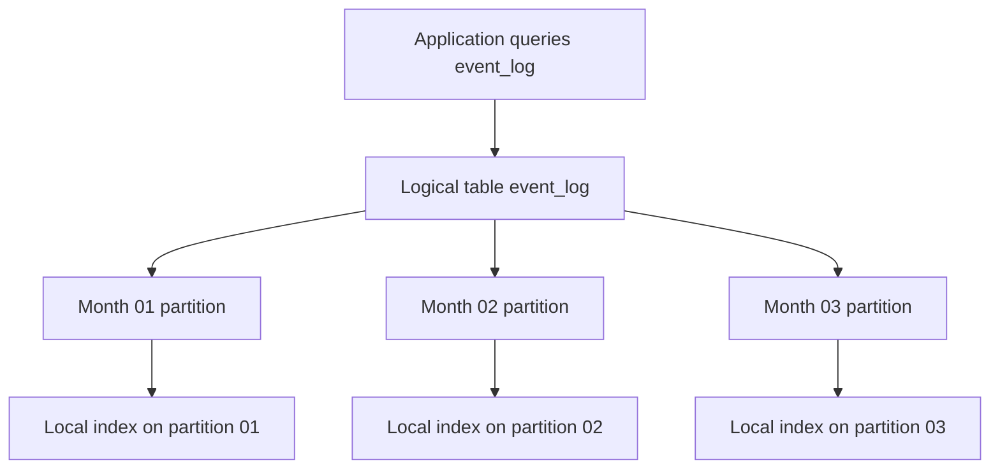

# Table Partitioning by Time, Data Domain, or Distribution Key

## 1. Why Is Partitioning a Physical Modeling Decision?

In the `DATABASE_DATA_MODELING` module, learners turn business requirements into clear data models: from entities, relationships, constraints, and normalization to keys, indexes, and the physical schema. In the **Physical Modeling** step, *partitioning* is the technique of splitting a large logical dataset into smaller storage or management units according to a deterministic rule.

For example, an event-processing system holds 1 billion records and must retain data for 18 months. Users primarily look up events for a tenant within a date range, while operations needs to purge expired data monthly. You can split the event table into **monthly partitions** so time-filtered queries touch only relevant partitions and data lifecycle operations act partition-by-partition.

However, adding partitioning does not automatically speed up every query, nor does it replace keys, indexes, security, or a distributed strategy. Picking the wrong partition key can force queries to scan every partition, concentrate writes onto one hot partition, or complicate global uniqueness enforcement.

After this lesson, learners should be able to:

- Choose among **RANGE** by time, **LIST** by business domain, and **HASH** by distribution key.
- Distinguish **single-DBMS partitioning** from multi-node **sharding**, and recognize how they can combine.
- Write queries that leverage *partition pruning* while still selecting appropriate indexes inside partitions.
- Handle limitations around `PRIMARY KEY`, `UNIQUE`, `FOREIGN KEY`, late-arriving data, and partition-key updates.
- Plan partition pre-creation, storage, cold archiving, detachment/removal, and migration; verify on the exact DBMS and workload.

## 2. How Do Logical Tables, Physical Partitions, Sharding, and Indexes Differ?

**Horizontal partitioning** keeps the same column set while dividing **rows** into mutually exclusive groups by a partition key. In a DBMS supporting partitioned tables, applications normally query the parent table name; the DBMS decides which child partitions to access.



| Concept | Unit of Organization | Typical Purpose |
|---|---|---|
| **Horizontal partitioning** | Groups of **rows** by time, domain, or hash value | Narrow scanned data, manage data in groups, isolate maintenance tasks |
| **Vertical splitting** | Groups of **columns** or 1–1 linked tables | Separate large/rarely used columns, security, or access optimization |
| **Indexes** | Auxiliary structures mapping search keys to rows | Lookup, filtering, sorting, and enforcing uniqueness |
| **Sharding** | Data split across **multiple nodes or clusters** with routing | Scale capacity/writes/reads and distribute resources across nodes |
| **Replication** | Multiple copies of data | High availability, recovery, read scaling depending on architecture |

A table partitioned into 12 months **can still sit on a single machine sharing the same CPU, RAM, and I/O**. Partitioning does not mean having 12 servers or 12x write capacity. Conversely, a sharded system can hold locally partitioned tables on each shard.

Nor is partitioning a substitute for normalization. If customer–order relationships are modeled wrong or lack foreign keys, splitting a table into partitions will not fix those logical defects.

## 3. Three Common Strategies: Time, Data Domain, and Distribution Key

### 3.1. RANGE: Partitioning by Value Intervals, Typically Time

RANGE places rows into contiguous intervals, such as monthly intervals based on `occurred_at`:

```text
[2027-01-01 00:00 UTC, 2027-02-01 00:00 UTC) -> event_log_2027_01
[2027-02-01 00:00 UTC, 2027-03-01 00:00 UTC) -> event_log_2027_02
[2027-03-01 00:00 UTC, 2027-04-01 00:00 UTC) -> event_log_2027_03
```

The notation `[a, b)` means **inclusive of a, exclusive of b**. A row at the exact instant `2027-02-01 00:00 UTC` belongs to the February partition, not January. Half-open intervals avoid boundary overlap between adjacent partitions.

**Fits well when:** queries routinely filter by date/time ranges, data has a time-based lifecycle, and expired data needs bulk archiving or deletion.

**Trade-offs:** new writes may concentrate in the current partition; late-arriving data still has to locate the right older partition; queries without time predicates may scan many partitions.

### 3.2. LIST: Partitioning by Explicitly Listed Domain Values

LIST divides rows by discrete value sets, such as `region_code IN ('APAC', 'EMEA', 'AMER')` or document categories.

**Fits well when:** groups have distinct lifecycle rules, storage locations, maintenance windows, or access paths, and the set of domains is stable and manageable.

**Trade-offs:** new domain values require onboarding plans; row counts may be uneven; changing a record's domain can force moving it across partitions.

"Per-tenant partitioning" is sometimes done with LIST, yet creating one partition per **each of tens of thousands of tenants** can bloat catalog objects and query planning overhead. Consider tenant grouping, HASH, or other distributed approaches.

### 3.3. HASH: Partitioning by Key Hash

HASH applies a function mapping keys to a fixed number of buckets—such as four partitions by `tenant_id`. The goal is usually spreading rows and allowing equality predicates on the partition key to target one bucket.

**Fits well when:** the distribution key is stable, applications query by that key, there is no range-based lifecycle, and rows should distribute relatively evenly across buckets.

**Trade-offs:** time order is unrelated to hash buckets, so deleting "all data older than month X" cannot simply drop one partition; one huge tenant can still make its single hash partition hot.

### Comparison by Design Goal

| Criterion | Time-Based RANGE | Domain-Based LIST | Key-Based HASH |
|---|---|---|---|
| Example partition key | `occurred_at` | `region_code` | `tenant_id` |
| Predicates enabling pruning | Time ranges | Equality / `IN` on domain | Equality on distribution key |
| Monthly retention | Very favorable | Only if domains align with lifecycle | Not directly favorable |
| Even data distribution? | Depends on write volume per period | Depends on size of each domain | Can be fairly even with good key/distribution |
| New data / new domains | Must pre-create future partitions | Must define target for new domain values | New keys follow hash rule automatically |
| Primary risk | Hot current partition, late arrivals | Skewed domains and too many small buckets | Hot tenant, changing bucket count is complex |

Selection rules depend **not just on which column is easiest to split**, but on query patterns, constraints, data growth, and operational needs.

## 4. From Access Patterns to the Partition Key

Suppose a device-monitoring system has these queries:

| Access Pattern | Frequency | Key Predicates | Implication |
|---|---|---|---|
| A. Tenant's events in the last 24 hours | High | `tenant_id = ?`, `occurred_at >= ?` | Time RANGE narrows partitions; tenant/time index narrows within them |
| B. All errors for one device over 30 days | High | `device_id = ?` and date range | Daily/monthly RANGE + device/time index |
| C. Look up one event by `event_id`, date unknown | Medium | `event_id = ?` | Time RANGE may have to search many partitions |
| D. Purge data older than 18 months | Periodic | `occurred_at < cutoff` | Monthly RANGE simplifies management |
| E. Query all records of a tenant regardless of time | Medium | `tenant_id = ?` | Tenant HASH prunes better than time RANGE |
| F. Annual full-dataset summary report | Batch | Reads massive row counts | Partitioning does not replace an analytical data model |

One partition key cannot optimize patterns A–F equally. Given retention requirements and predominantly time-bounded queries, RANGE on `occurred_at` is a solid candidate. If most queries read a tenant's entire history and traffic is balanced, HASH on `tenant_id` may fit better.

Crucially, if you choose time RANGE while an API sends only `event_id`, the DBMS cannot infer the event's month from an ID lacking reliable routing metadata. Consider **updating the query contract**, maintaining an ID → partition key lookup map, or accepting multi-partition scans.

## 5. PostgreSQL 16 DDL: Monthly RANGE-Partitioned Event Table

Assumptions:

- `occurred_at` is when the event occurred, stored as `TIMESTAMPTZ`; partition boundaries use UTC.
- The application reads events by tenant and time range; retention is 18 months.
- `event_id` is a technical identifier generated by identity; **this schema does not claim `event_id` alone is constrained globally unique across the partitioned table**.
- Data outside pre-created monthly partitions is handled by an explicit operational process.

Standalone example using `event_log`:

```sql
CREATE TABLE event_log (
    occurred_at TIMESTAMPTZ NOT NULL,
    event_id    BIGINT GENERATED ALWAYS AS IDENTITY,
    tenant_id   BIGINT NOT NULL,
    device_id   BIGINT NOT NULL,
    event_type  VARCHAR(40) NOT NULL,
    payload     JSONB,
    ingested_at TIMESTAMPTZ NOT NULL DEFAULT CURRENT_TIMESTAMP,

    CONSTRAINT pk_event_log PRIMARY KEY (occurred_at, event_id),
    CONSTRAINT ck_event_type_nonblank
        CHECK (char_length(btrim(event_type)) > 0)
) PARTITION BY RANGE (occurred_at);

CREATE TABLE event_log_2027_01
    PARTITION OF event_log
    FOR VALUES FROM ('2027-01-01 00:00:00+00')
               TO ('2027-02-01 00:00:00+00');

CREATE TABLE event_log_2027_02
    PARTITION OF event_log
    FOR VALUES FROM ('2027-02-01 00:00:00+00')
               TO ('2027-03-01 00:00:00+00');

CREATE TABLE event_log_2027_03
    PARTITION OF event_log
    FOR VALUES FROM ('2027-03-01 00:00:00+00')
               TO ('2027-04-01 00:00:00+00');

-- Define indexes on the partitioned parent table. PostgreSQL creates
-- corresponding indexes on existing and future partitions.
CREATE INDEX idx_event_log_tenant_time
    ON event_log (tenant_id, occurred_at DESC, event_id DESC);

CREATE INDEX idx_event_log_device_time
    ON event_log (device_id, occurred_at DESC);
```

**Key points in this DDL:**

1. `event_log` is the **partitioned parent table**. PostgreSQL stores actual rows in child partitions; the parent holds no single heap of its own like an unpartitioned table.
2. `PRIMARY KEY (occurred_at, event_id)` **includes the partition column `occurred_at`**. In PostgreSQL 16, `PRIMARY KEY`/`UNIQUE` constraints on a partitioned table must include all partition key columns, and the partition key here is not an expression. Uniqueness is enforced via per-partition unique indexes; there is no automatic single global unique index spanning all partitions.
3. `GENERATED ALWAYS AS IDENTITY` supplies IDs during normal writes through the parent table; however, **identity/sequence is not a global uniqueness constraint on `event_id` alone**. Manual imports, merged sources, or allocator issues could introduce identical IDs at different timestamps, which `PRIMARY KEY (occurred_at, event_id)` would allow.
4. Indexes on `tenant_id` and `device_id` help only after pruning and for access paths **inside partitions**. Partition pruning eliminates child tables; indexes narrow rows inside remaining child tables.
5. No `DEFAULT PARTITION` is defined in this example so unexpected timestamps are not silently swallowed. Records outside defined ranges are rejected; applications and operations must monitor routing errors and create partitions on schedule.

### Inserting Data and Monthly Boundaries

```sql
-- Routed to event_log_2027_02.
INSERT INTO event_log (occurred_at, tenant_id, device_id, event_type)
VALUES (
    '2027-02-01 00:00:00+00',
    42, 710, 'DEVICE_CONNECTED'
)
RETURNING event_id, occurred_at;

-- Routed to event_log_2027_01.
INSERT INTO event_log (occurred_at, tenant_id, device_id, event_type)
VALUES (
    '2027-01-31 23:59:59+00',
    42, 710, 'DEVICE_DISCONNECTED'
);

-- Expected error: no partition exists yet for 04/2027.
-- Run separately in a test environment if verifying the error.
INSERT INTO event_log (occurred_at, tenant_id, device_id, event_type)
VALUES (
    '2027-04-10 08:00:00+00',
    42, 710, 'DEVICE_CONNECTED'
);
```

The third statement intentionally illustrates an error case: PostgreSQL does not auto-create next month's partition. To avoid write outages, the system needs a migration process or scheduled job creating future partitions ahead of time while guarding against overlapping or misaligned boundaries.

## 6. Partition Pruning: Skipping Irrelevant Partitions

**Partition pruning** is the ability to eliminate partitions when query predicates prove they cannot contain matching rows. This is usually the primary benefit of time-based partitioning.

Example query reading only February events for tenant 42:

```sql
EXPLAIN (VERBOSE)
SELECT event_id, device_id, event_type, occurred_at
FROM event_log
WHERE tenant_id = 42
  AND occurred_at >= '2027-02-01 00:00:00+00'::TIMESTAMPTZ
  AND occurred_at <  '2027-03-01 00:00:00+00'::TIMESTAMPTZ
ORDER BY occurred_at DESC, event_id DESC
LIMIT 30;
```

With appropriate data and statistics, PostgreSQL can scan only `event_log_2027_02`, skipping January and March partitions. In the plan output, inspect which partition names appear and any partition-pruning indicators. Never assume one specific plan node always appears: the optimizer chooses among plans based on data volume.

### Writing Predicates Properly

Use **inclusive start, exclusive end** intervals directly on the partition key:

```sql
WHERE occurred_at >= :from_instant
  AND occurred_at <  :to_instant
```

A predicate like:

```sql
WHERE date(occurred_at) = DATE '2027-02-15'
```

can obstruct pruning and index access on `occurred_at` because a function is applied to **the column** and date interpretation depends on the session timezone. Convert "the user's calendar day" into timestamp boundaries in the business timezone and filter directly on the timestamp column.

For instance, if reporting uses Vietnam local days, a 1-day boundary can be constructed from local date-times with a named timezone:

```sql
WHERE occurred_at >=
      (TIMESTAMP '2027-02-15 00:00:00'
       AT TIME ZONE 'Asia/Ho_Chi_Minh')
  AND occurred_at <
      (TIMESTAMP '2027-02-16 00:00:00'
       AT TIME ZONE 'Asia/Ho_Chi_Minh')
```

Although Vietnam has no Daylight Saving Time changes in this period, general designs must still account for DST in timezones that observe it; never blindly equate "one calendar day" with every 24-hour span.

### Pruning with Parameters and Prepared Statements

PostgreSQL can prune partitions during planning or at execution time depending on statement type, parameters, and plan choice. A prepared statement lacking exact values when building a generic plan can still benefit from *execution-time pruning* in supported scenarios. Test **actual application queries**, including parameter types and plan behavior, rather than testing only hardcoded SQL literals.

### When Pruning Cannot Work Effectively

```sql
-- No predicate on occurred_at: may have to inspect every partition.
SELECT *
FROM event_log
WHERE event_id = 250001;
```

Querying by `event_id` alone does not identify the month. Having `PRIMARY KEY(occurred_at,event_id)` does not mean a lookup by `event_id` alone gets a global access path. You may need an ID → `occurred_at` lookup strategy, dates added to the API, or a different partitioning scheme if ID-only lookups are top priority.

## 7. LIST by Business Domain: Data Regions and Independent Policies

Consider an invoicing system where `region_code` takes a small set of known values. Operations may require separate storage and maintenance by region:

```sql
-- Standalone example, independent of event_log.
CREATE TABLE invoice_by_region (
    region_code VARCHAR(12) NOT NULL,
    invoice_id  BIGINT NOT NULL,
    tenant_id   BIGINT NOT NULL,
    amount      NUMERIC(16, 2) NOT NULL,
    issued_at   TIMESTAMPTZ NOT NULL,
    CONSTRAINT pk_invoice_by_region
        PRIMARY KEY (region_code, invoice_id),
    CONSTRAINT ck_invoice_amount CHECK (amount >= 0)
) PARTITION BY LIST (region_code);

CREATE TABLE invoice_region_apac
    PARTITION OF invoice_by_region FOR VALUES IN ('APAC');

CREATE TABLE invoice_region_emea
    PARTITION OF invoice_by_region FOR VALUES IN ('EMEA');

CREATE TABLE invoice_region_amer
    PARTITION OF invoice_by_region FOR VALUES IN ('AMER');

-- Example including DEFAULT for undeclared regions.
CREATE TABLE invoice_region_other
    PARTITION OF invoice_by_region DEFAULT;
```

For `WHERE region_code = 'APAC'`, the DBMS can prune other regions. For queries filtering only `tenant_id` without specifying `region_code`, pruning benefits drop sharply.

**`DEFAULT PARTITION` trade-off:** it prevents write failures on new values, yet easily hides data entry typos like `'APACC'`. Later, creating a dedicated partition for values already sitting in the default partition may require moving rows and validating constraints/keys during attach. Use a default partition only with domain checks and row-count monitoring on that branch.

**Changing an invoice's region** can force moving the row across partitions. If `region_code` is part of the primary key and foreign keys, changing regions affects references and history. Clarify whether region is a mutable classification attribute, an immutable issuing location, or true invoice identity. Never pick a frequently updated attribute as the partition key without accounting for row-movement cost.

Crucially: splitting data by region **does not automatically satisfy legal data-residency requirements**. If residency mandates physically storing data inside specific geographic infrastructure, design node/storage placement, replication, backups, and access controls; a LIST partition on a single server does not fulfill geographic isolation.

## 8. HASH by Distribution Key: Benefits and Skew Risks

Consider devices recording telemetry metrics. The system queries primarily by tenant and has no requirement to drop entire months via partitions. One approach is hash partitioning by `tenant_id`:

```sql
-- Standalone example, independent of the tables above.
CREATE TABLE telemetry_by_tenant (
    tenant_id   BIGINT NOT NULL,
    reading_id  UUID NOT NULL,
    observed_at TIMESTAMPTZ NOT NULL,
    metric_name VARCHAR(80) NOT NULL,
    metric_value DOUBLE PRECISION,
    CONSTRAINT pk_telemetry_by_tenant
        PRIMARY KEY (tenant_id, reading_id)
) PARTITION BY HASH (tenant_id);

CREATE TABLE telemetry_p0
    PARTITION OF telemetry_by_tenant
    FOR VALUES WITH (MODULUS 4, REMAINDER 0);

CREATE TABLE telemetry_p1
    PARTITION OF telemetry_by_tenant
    FOR VALUES WITH (MODULUS 4, REMAINDER 1);

CREATE TABLE telemetry_p2
    PARTITION OF telemetry_by_tenant
    FOR VALUES WITH (MODULUS 4, REMAINDER 2);

CREATE TABLE telemetry_p3
    PARTITION OF telemetry_by_tenant
    FOR VALUES WITH (MODULUS 4, REMAINDER 3);

CREATE INDEX idx_telemetry_tenant_time
    ON telemetry_by_tenant (tenant_id, observed_at DESC);
```

For `WHERE tenant_id = 42`, the DBMS computes the bucket and examines only one hash partition. For `WHERE observed_at >= ?` without a tenant filter, it must touch all four partitions even though each partition has a time index.

**Do not confuse HASH partitioning with distributing data across four machines.** In standard PostgreSQL, all four partitions still reside in one database, not automatically across four servers. A "distribution key" in a multi-node architecture also requires routing from key to shard/node, load balancing, and network failure handling.

### Skew and Hot Tenants

HASH spreads **keys** across buckets, without guaranteeing equal byte volume or request volume per bucket. If one tenant generates 40% of traffic, all of that tenant's records still land in the same bucket. Four buckets may hold equal counts of tenants while one bucket absorbs most writes.

When hot tenants exist, consider:

- Choosing a distribution key with better cardinality and load balance, such as `device_id` instead of `tenant_id` if queries target devices.
- Combining multiple columns or controlled "salting" to spread writes; in return, tenant-only queries must touch multiple buckets.
- Multi-level partitioning by time then hash when both time pruning and write distribution matter.
- In sharded systems, isolating giant tenants, rebalancing shards, and smart routing when adding nodes.

**Changing the bucket count is not just editing `MODULUS 4` to `8`.** Existing partition row placement and constraints must be reorganized per DBMS capabilities; in sharded architectures, data must physically migrate across nodes. Plan migrations and benchmarks carefully.

## 9. Partition Key Selection Affects Primary Keys and Uniqueness

This is one of the most consequential constraints when moving from logical to physical models.

### PostgreSQL 16: Unique Constraints Must Include the Partition Key

With:

```sql
PARTITION BY RANGE (occurred_at)
```

on `event_log`, PostgreSQL 16 requires table-level `PRIMARY KEY`/`UNIQUE` constraints to include `occurred_at` (and any other partition key columns). Therefore:

```sql
PRIMARY KEY (occurred_at, event_id)
```

is valid, whereas attempting to place `PRIMARY KEY (event_id)` directly on **the same parent table RANGE-partitioned by `occurred_at`** fails that requirement.

The reason is that uniqueness is enforced via each partition's local indexes: two rows sharing a full key including `occurred_at` must land in the same partition and be caught by that partition's unique index. With `event_id` alone, two records in different months could land in different partitions with no single global unique index spanning both to detect duplicates.

### Distinguishing Uniqueness Goals

| Requirement | Solution to Consider |
|---|---|
| Every (`occurred_at`, `event_id`) is unique | `PRIMARY KEY(occurred_at, event_id)` on time-RANGE table |
| `event_id` strictly unique regardless of month | Identity / time-composite PK alone is **insufficient**; design an appropriate global mechanism |
| (`source_system`, `source_event_id`) never re-imported | Namespaced uniqueness, e.g., in an unpartitioned registry table or verified coordinator |
| Child records must reference exact parent event | Carry full referenced key components; may need both `occurred_at` and `event_id` |
| System needs unpredictable public IDs | Can use UUID/ULID or another code, yet **must still** enforce authorization and global uniqueness |

One approach is an **unpartitioned** registry table holding (`source_system`, `source_event_id`) with `UNIQUE`, inserting into both the registry and event table in the same transaction while handling contention and retries. That adds coordination and write cost; it is not "free global uniqueness".

### Foreign Keys into Partitioned Tables

PostgreSQL 16 supports many foreign-key scenarios referencing or originating from partitioned tables, provided referenced keys satisfy parent unique/PK rules and partition changes account for dependencies. Example annotation table attached to events:

```sql
CREATE TABLE event_annotation (
    occurred_at TIMESTAMPTZ NOT NULL,
    event_id    BIGINT NOT NULL,
    note_id     BIGINT NOT NULL,
    note_text   TEXT NOT NULL,
    CONSTRAINT pk_event_annotation
        PRIMARY KEY (occurred_at, event_id, note_id),
    CONSTRAINT fk_annotation_event
        FOREIGN KEY (occurred_at, event_id)
        REFERENCES event_log (occurred_at, event_id)
);
```

This FK carries the time key too. If the child stored only `event_id`, you could not assume the DBMS finds parent rows across arbitrary partitions and enforces integrity with a single-column FK in this design. Likewise, referencing child records can block or complicate detaching/dropping expired parent partitions; plan lifecycle management for dependent data as well.

**Picking a partition key for speed at the expense of breaking business constraints is flawed design.** If global uniqueness or single-column FKs are mandatory, rethink table structure, a separate identity table, alternative partitioning schemes, or a DBMS supporting global constraints differently.

## 10. Indexes on Partitioned Tables: Pruning and Indexing Are Two Distinct Layers

In PostgreSQL, creating a B-tree on a partitioned table establishes a parent index object plus matching indexes on each child partition. **The parent index is structural/metadata**, not one giant B-tree holding entries across all partitions.

| Scenario | Partition Pruning | Per-Partition Index |
|---|---|---|
| Query February events, tenant 42 | Prunes other months | `(tenant_id, occurred_at DESC, event_id DESC)` finds target slice and order |
| Lookup 1 event by `event_id`, no date | Cannot prune by time RANGE | May have to probe indexes across many partitions if a suitable index exists |
| Total events across 18 months | Must examine all retained partitions | Index scans rarely beat table scans for full totals |
| 30-day query by `device_id` | Scans 1–2 partitions depending on window | `(device_id, occurred_at DESC)` locates device rows inside partitions |

**Do not blindly index every column across every partition.** A table with 60 partitions and 8 indexes per partition creates hundreds of index objects to maintain. Query planner, statistics, vacuum, and migrations all pay for those objects. Measure partition count, index footprint, and real queries.

Crucially, **predicates on the partition key** eliminate partitions, while **predicates on index keys** narrow rows inside the surviving partitions. Both mechanisms complement each other.

### Partitioning and `ORDER BY/LIMIT`

If a query runs `ORDER BY occurred_at DESC LIMIT 30` without a month bound, the DBMS may still coordinate results across multiple partitions via `Merge Append` or another plan. When the query includes a narrow time predicate, fewer partitions participate and costs drop. A small `LIMIT` **does not guarantee** only one partition is read.

## 11. Partition Lifecycle: Pre-Creation, Late Arrivals, Archiving, and Expiration

Time-based partitioning delivers major operational value when paired with clear lifecycle processes.

### 11.1. Pre-Create Future Partitions

If April 1, 2027 begins a new partition, waiting until midnight to run a migration is risky. Create partitions ahead of time with enough lead buffer for write schedules, deployments, and clock skew; monitor regularly for gaps or overlaps.

```sql
-- Run before April 2027 events arrive.
CREATE TABLE event_log_2027_04
    PARTITION OF event_log
    FOR VALUES FROM ('2027-04-01 00:00:00+00')
               TO ('2027-05-01 00:00:00+00');
```

Run in controlled environments avoiding duplicate names or overlapping ranges. Partition management tools can automate creation in some pipelines, though monitoring remains essential.

### 11.2. Late-Arriving Data and Two Kinds of Timestamps

An event may occur on January 31 yet arrive on February 10. If partitioned by `occurred_at`, it routes to January even though `ingested_at` falls in February. Two columns serve two distinct purposes:

- `occurred_at`: when the event **actually happened** per a verified source; useful for historical analysis.
- `ingested_at`: when the DBMS/ingestion pipeline **recorded** the event; useful for lag monitoring, retries, and auditing.

Never overwrite `occurred_at` with ingestion time just to dodge old-partition errors. Decide how late data is still accepted, and whether events arriving after an old month has detached go to cold storage, a special processing queue, or get rejected per integration contract.

### 11.3. Detaching and Handling Expired Data

When an old month expires, **detaching a partition** is far cleaner than row-by-row deletes on a massive table. In PostgreSQL:

```sql
-- Illustrates the admin step only after retention approval,
-- reconciliation, archival plan, and FK/dependency review.
ALTER TABLE event_log
    DETACH PARTITION event_log_2027_01;
```

Once detached, `event_log_2027_01` becomes a standalone table whose rows no longer appear through `event_log`. **Detaching does not mean deleting or safely archiving**: run backup/export procedures, confirm historical readers, verify FKs, and only then drop resources under approved policy.

PostgreSQL versions support `DETACH PARTITION CONCURRENTLY` under certain conditions, with its own locking and transaction constraints. Never assume detaching is always lock-free or instantaneous, especially under concurrent load and foreign-key dependencies.

### 11.4. Default Partitions: Safety Net or Bug Sink?

With a `DEFAULT PARTITION`, out-of-range records land in the default partition. That prevents immediate write outages when a partition is missing, yet can mask bad timezones, wrong years, or corrupted inputs. Later, adding a new partition may force scanning or moving rows out of default, causing scans and locks.

Use a default partition only with monitoring, alerting, volume caps, and a clean procedure to migrate rows into proper partitions. For strict audit logs, rejecting out-of-range records into a dead-letter queue is often easier to verify.

## 12. Partition Granularity: Daily, Weekly, Monthly, or Multi-Level?

There is no rule saying "a 1-billion-row table always splits by day". Granularity is a balancing act:

| Split By | Appropriate When | Risks |
|---|---|---|
| **Day** | Massive daily volume; retention or queries align closely to days | Hundreds or thousands of partitions over years, raising catalog and planning cost |
| **Week** | Weekly volume and reporting patterns balance size vs. object count | Week boundaries and business-week definitions need standardization |
| **Month** | Monthly retention and manageable monthly volume | One month may still be huge for extreme write rates |
| **Quarter/Year** | Smaller datasets or long-horizon reporting | Coarse pruning on short queries; blunt retention drops |
| **Multi-level** | E.g., monthly RANGE then tenant HASH to spread writes | More objects, complex PK/unique rules, and heavier operations |

Estimate partition count:

\[
\text{retained partitions}
\approx
\frac{\text{retention period}}{\text{duration per partition}}
\]

This estimates active time partitions only, excluding pre-created future partitions, defaults, or subpartitions. For instance, 18 months retention at one partition per month yields roughly 18 retained partitions plus future partitions. Daily partitions over 18 months inflate object counts into the hundreds.

Beyond row count, measure **bytes per partition**, index size, VACUUM duration, backup/restore time, index build time, partitions touched per query, and replication/CDC impact. A partition with millions of tiny rows may be easier to manage than one with fewer rows carrying huge JSON payloads.

## 13. When Both Time and Load Distribution Are Needed

An ultra-high-write telemetry platform might need both monthly retention and per-device/per-tenant write spreading. Consider **multi-level partitioning**: parent RANGE by `occurred_at`, with HASH by `tenant_id` inside each month.

```text
event_log
  |
  +-- 2027_01 (RANGE month 1)
  |     +-- hash_0
  |     +-- hash_1
  |     +-- hash_2
  |     +-- hash_3
  |
  +-- 2027_02 (RANGE month 2)
        +-- hash_0
        +-- hash_1
        +-- hash_2
        +-- hash_3
```

**Benefits:** queries filtering both month and tenant prune at both levels; retention stays monthly. **Costs:** one year yields 12 months × 4 buckets = 48 leaf partitions plus parent and intermediate tables; indexes and statistics must be maintained per leaf; changing bucket count or hash policy gets harder.

In PostgreSQL, a unique/PK constraint on a multi-level partitioned table must account for **all involved partition keys** so uniqueness can be enforced on leaves. Never keep `PRIMARY KEY(occurred_at,event_id)` from a single-level design and assume it still works under `tenant_id` HASH subpartitioning. Verify DDL and redesign keys—typically adding `tenant_id`—when subpartitioning by tenant.

If one tenant drives most of the load, HASH by tenant alone cannot split that tenant across multiple buckets. Distribute by a finer key while clarifying query scopes and scatter/gather risks. Mitigating hotspots often requires changing write architecture, not just adding partitions.

## 14. Partitioning vs. Sharding: Distribution Keys Across Multiple Nodes

In distributed DBMSs, a **distribution key / shard key** decides which node or node group holds data. While both may use "hashing", multi-node sharding introduces concerns beyond local partitioned tables:

1. **Routing:** does the app, proxy, or coordinator compute shard placement? Do query predicates include the shard key to avoid scatter-gather across all shards?
2. **Uniqueness:** are `PRIMARY KEY`/`UNIQUE` enforced cluster-wide or only per shard? Must the distribution key be part of unique keys?
3. **Joins and transactions:** two tables co-located by `tenant_id` can join locally; cross-shard relationships may require network shuffles or distributed transactions.
4. **Load balancing:** adding nodes, hot tenants, failover, and rebalancing require migrating data, logs, and indexes.
5. **Consistency:** which shard holds the source of truth, and how are retries, replication lag, and network partitions handled?
6. **Residency and backups:** do storage regions and replicas comply with contracts and regulations?

For example, sharding both `orders` and `order_lines` by `tenant_id` lets tenant queries route cleanly. Sharding `orders` by `order_id` and `order_lines` by `product_id` risks cross-shard order creation and line lookups; foreign key enforcement also depends on whether the DBMS checks references cluster-wide.

Never treat hash buckets in standalone PostgreSQL as multi-node shards, and never treat a distribution key as an access-control boundary. Multi-tenant systems still require tenant authentication, authorization, and cross-tenant isolation checks.

## 15. Selected Differences Across DBMSs

Details below serve as guidance for PostgreSQL 16, MySQL 8.0/InnoDB, and SQL Server 2022. Verify **exact version, engine, and configuration** before finalizing designs.

| Topic | PostgreSQL 16 | MySQL 8.0 / InnoDB | SQL Server 2022 |
|---|---|---|---|
| RANGE / LIST / HASH | Declarative partitioning via `PARTITION BY` | Supports partition types per engine/expressions with specific limits | Partition functions/schemes binding tables/indexes to partition schemes |
| Pruning | Planner prunes at plan or execution time | Optimizer performs partition pruning on eligible predicates | Partition elimination by predicates and partition scheme |
| PK / UNIQUE on partitioned tables | Must include partition key columns per system rules | Unique keys must include columns used in partition expression; verify per engine | Unique indexes on partitioned tables follow partition-column and alignment rules |
| FKs and partitioning | Supports FKs on partitioned tables per version/constraints | User-defined partitioning in InnoDB has **major foreign key restrictions**; verify version docs | Supports FKs; requires careful index alignment and partition switching design |
| Indexes | Corresponding indexes created on child partitions; no default global B-tree | Engine-specific partition/index model; verify uniqueness scope | Aligned vs. nonaligned indexes directly affect `SWITCH` and management |
| Retention | `DETACH`/`DROP` partitions after reconciliation and dependency checks | Managed via `ALTER TABLE ... DROP PARTITION` within engine limits | `SWITCH`/`MERGE`/`SPLIT` workflows subject to alignment |

Above all, **never port PostgreSQL DDL to MySQL or SQL Server merely by renaming keywords**. DBMSs differ in temporal types, FK support, global vs. local indexes, uniqueness rules, migration locks, and partition movement mechanics. Limits also vary by version and product edition.

### Document, Graph, and Analytical Systems

- **Document:** partitioning/sharding typically relies on a document shard key. Pick a well-distributed key present in common queries; sharded uniqueness rules may be constrained by the shard key. Huge documents or unbounded arrays create different challenges from relational tables.
- **Graph:** placing connected nodes and edges on the same machine governs traversal cost; splitting nodes by domain while frequently traversing cross-domain edges causes heavy network hops. Graph partitioning must account for node communities, degrees, and real traversal patterns.
- **Analytical / columnar warehouses:** partitioning by ingestion or business date, clustering/sorting, and key distribution enable pruning, compression, and efficient joins. Distinguish event date from ingestion date, maintain exact grain, and handle late-arriving events.

The goal remains an evolvable, verifiable model, yet no single partitioning layout fits every storage engine.

## 16. Verifying a Partitioned Design

### 16.1. Inspecting the Partition Tree and Leaf Sizes

PostgreSQL 16 provides `pg_partition_tree`:

```sql
SELECT
    relid::regclass AS relation_name,
    parentrelid::regclass AS parent_name,
    isleaf,
    level
FROM pg_partition_tree('public.event_log'::regclass)
ORDER BY level, relid;

SELECT
    pg_size_pretty(pg_total_relation_size('public.event_log_2027_01'))
        AS january_total_size,
    pg_size_pretty(pg_indexes_size('public.event_log_2027_01'))
        AS january_index_size;
```

In PostgreSQL, the **parent** table size of a partitioned table does not automatically aggregate the sizes of all child partitions. To measure total storage, sum across the actual leaves; never report `pg_total_relation_size` of the parent as total dataset footprint.

### 16.2. Verifying Pruning and Indexes Across Query Patterns

```sql
-- Reading a specific month range and specific tenant.
EXPLAIN (ANALYZE, BUFFERS)
SELECT event_id, device_id, occurred_at
FROM event_log
WHERE tenant_id = 42
  AND occurred_at >= '2027-02-01 00:00:00+00'::TIMESTAMPTZ
  AND occurred_at <  '2027-03-01 00:00:00+00'::TIMESTAMPTZ
ORDER BY occurred_at DESC, event_id DESC
LIMIT 30;

-- Without time predicate: compare how many partitions participate.
EXPLAIN (VERBOSE)
SELECT event_id, occurred_at
FROM event_log
WHERE tenant_id = 42
ORDER BY occurred_at DESC
LIMIT 30;
```

`EXPLAIN (ANALYZE, BUFFERS)` **executes the actual query**. Run it only on appropriate data or test environments, especially for write queries. Evaluate plans by partitions actually scanned, `actual rows`, `Buffers`, total latency, `Append`/`Merge Append` overhead, `Sort`, and index scans. One standalone query plan is insufficient for conclusions.

### 16.3. Test Case Matrix

| Test Case | Expected Outcome |
|---|---|
| Insert exactly at start of February | Routes to February partition, not January |
| Insert one second before end of January | Routes to January partition |
| Insert into a month with no partition and no default | Rejected cleanly with alerting/handling path |
| January event ingested in February | Routes by `occurred_at` to January if partition is still attached |
| Two rows duplicating (`occurred_at`, `event_id`) | Rejected by PK |
| Two rows with same `event_id` but different `occurred_at` | Allowed under the **current composite PK**, proving global `event_id` uniqueness is not enforced |
| February query with time predicate | Pruning skips unrelated partitions under supported conditions |
| Query filtering solely by `event_id` | May probe multiple partitions; assess read path cost |
| Partition missing tenant index | Still prunes by month, yet tenant queries inside surviving partitions slow down |
| Very hot tenant under HASH | Measure skew in size, write rate, and latency |
| Updating a row's partition key | Verify row movement behavior, constraints, and FK impact |
| `DETACH` expired partition | Data disappears from parent queries; verify dependencies, archive, and rollback |

**Business verification** always includes tenant access control, required uniqueness, timezone-aware timestamps, and retention policies. A passing pruning test alone never proves all those invariants hold.

## 17. Migrating an Existing Large Table to Partitioning

In PostgreSQL 16, do not assume an ordinary heap table can become a full partitioned parent with a single `ALTER TABLE ... PARTITION BY`. A migration typically creates the new partitioned structure, moves data, and transitions read/write paths.

1. **Audit:** row counts/bytes per month or tenant, top queries, keys/FKs/UNIQUEs, indexes, `NULL` or out-of-range timestamps, late arrivals, and external consumers.
2. **Choose design:** RANGE/LIST/HASH, granularity, partition key, key schema, and indexes; document uniqueness and integrity limits explicitly.
3. **Create partitioned table and future partitions:** standardize `TIMESTAMPTZ` and boundaries; create constraints, indexes, and default vs. reject policy.
4. **Batched backfill:** copy rows from old table to new by partition key while bounding latency, WAL volume, locks, and background load.
5. **Sync new writes:** controlled dual-write or change-data capture; ensure idempotency, ordering, and retry handling.
6. **Reconcile:** row totals, aggregate sums, min/max timestamps, duplicate keys, unrouted records, and FKs across every slice; verify all migrated data.
7. **Switch access paths:** update apps, APIs, time-less queries, reports, CDC, and ORMs; test rollback if cutover fails.
8. **Operational handoff:** scheduled pre-creation, hot-partition monitoring, retention, backups, archiving, and late-data alerting.

A migration succeeds only when every record routes properly, uniqueness/FK rules remain intact, and post-migration metrics reconcile with the source. Faster queries paired with broken uniqueness or missing rows is a failed migration.

## 18. Common Misconceptions and Design Errors

| Misconception | Risk | Remedy |
|---|---|---|
| "Partitioning makes every query faster." | Queries lacking partition-key predicates still scan many partitions | Start from access patterns; measure pruning and indexes |
| "Monthly RANGE creates new months automatically." | Writes fail once time passes declared partitions | Pre-create partitions and alert on missing ranges |
| "Four HASH buckets means writing to four servers." | Still one DBMS without distributed architecture | Distinguish local partitioning from true sharding |
| "HASH always balances load." | One hot tenant can flood one bucket | Measure request/byte skew; pick a distribution strategy that fits |
| "`PK(event_id)` stays globally unique on time-partitioned tables." | Global uniqueness isn't enforced by that DDL in PostgreSQL | Include partition key or design a dedicated global uniqueness mechanism |
| "Partitions replace indexes." | One partition can still hold millions of rows | Design indexes for actual `WHERE`/`ORDER BY` patterns |
| "One partition per tenant is always best." | Too many objects, catalog bloat, indexes, and planning overhead | Group domains, HASH, or consider dedicated shards for huge tenants |
| "`date(occurred_at)` prunes just like timestamp ranges." | Expressions can defeat pruning/indexes and misapply timezones | Convert to timestamp boundary pairs and filter directly |
| "`DEFAULT PARTITION` fixes missing ranges safely." | Hides bad data and complicates attaching new partitions | Monitor, validate, and migrate rows into dedicated partitions |
| "Dropping expired partitions doesn't affect child tables." | FKs, retention, and historical data may conflict | Design lifecycle across dependent tables and backups |
| "Increasing HASH buckets is just changing one number." | Requires reorganizing/moving rows and indexes | Plan rebalancing and benchmark before scaling out |
| "LIST by region satisfies data residency." | Replicas/backups/storage may still live elsewhere | Enforce physical storage placement and replication policies |

## 19. Practice Exercise: Choosing a Strategy for a Multi-Tenant Platform

**Context:** an IoT platform holds 500 million readings, growing by 5 million rows/day. Data must be kept for 12 months; 90% of queries fetch one device's history over the last 7 days, 5% scan a tenant's full month, and 5% look up a single reading solely by `reading_id`. There are 1,000 tenants, one of which drives 35% of writes; 3% of events arrive more than 10 days late. Each month, expired data must be exported to cold storage and removed from OLTP.

Propose a well-reasoned design:

1. **Choose partition key and granularity:** compare daily/monthly RANGE, tenant HASH, and monthly RANGE + HASH. State estimated partition counts, which queries benefit, and which suffer.
2. **Choose primary key:** define how to enforce `reading_id` uniqueness, especially if using time-partitioned PostgreSQL. Do you need `(observed_at, reading_id)`, a registry table, or an API lookup contract change?
3. **Design indexes:** propose indexes for `device_id` + time and `tenant_id` + time queries; estimate write cost as index counts grow.
4. **Handle skew:** under `tenant_id` HASH, why does a tenant driving 35% of traffic still create a hotspot? Propose skew mitigations and their trade-off for tenant-only queries.
5. **Handle late data:** decide whether late events go into old partitions or a special queue; define behavior once a month has detached.
6. **Design retention:** scheduled pre-creation, export, checksums/reconciliation, `DETACH`, backup, and approved deletion; state how dependent FKs/records are handled.
7. **Measurement plan:** compare `EXPLAIN (ANALYZE, BUFFERS)`, partitions scanned, p95/p99 query latency, insert throughput, index footprint, retention execution, and backfill lag on representative data.

### Handoff Checklist

- [ ] Partition key chosen around query patterns, operability, and business rules.
- [ ] Single-DB partitioning distinguished from multi-node sharding, with uniqueness/FK scope defined.
- [ ] RANGE boundaries, timezones, LIST domains, or HASH buckets clearly specified and boundary-tested.
- [ ] Real queries include pruning-friendly predicates; surviving partitions carry needed indexes.
- [ ] Measured skew, hotspots, partition count, row/index footprint, and write/maintenance overhead.
- [ ] Processes ready for pre-creation, late arrivals, backups, archiving, retention, and rollback.
- [ ] Migration and verification confirm zero lost rows, zero business identity collisions, and intact references.

Partitioning succeeds when **access paths, partition keys, and data lifecycles align on a clear goal**. RANGE excels for time and retention; LIST fits stable business domains; HASH spreads keys without eliminating hotspots or sharding complexity. A trustworthy physical model measures both pruning and write overhead while keeping identities and relationships intact as partitions multiply.
