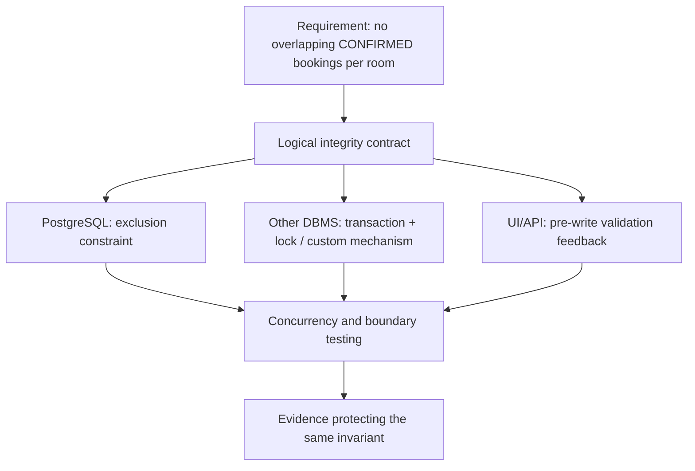

# Distinguishing Logical Constraints from DBMS-Specific Enforcement Mechanisms

## 1. From Business Invariants to Enforcement Mechanisms

In the `DATABASE_DATA_MODELING` module, learners practice turning business requirements into clear data models: identifying entities, relationships, and invariants, normalizing, choosing keys and indexes, and building a verifiable, evolvable physical schema. In the **Physical Modeling** chapter, a common mistake is equating a **logical rule** with a **specific SQL syntax snippet**.

For example, the requirement "a room cannot have two confirmed bookings with overlapping time intervals" is a **booking domain invariant**. PostgreSQL can use an *exclusion constraint* to help enforce it; another DBMS may need transactions with locking or an equivalent coordination mechanism. The logical rule **does not change** even when the enforcement technology changes.

Two layers must be described separately:

- **Logical layer – what must always hold true?** Value domains, uniqueness, referential relationships, capacity limits, valid states, cross-record rules, and consistency under concurrent transactions.
- **Physical layer – how does the system force that rule to hold?** `NOT NULL`, `CHECK`, `UNIQUE`, `FOREIGN KEY`, specialized indexes, triggers, stored procedures, transaction isolation levels, locks, application logic, or orchestration services.

A complete solution states the **enforcement scope**, **check timing**, **violation behavior**, **bypass risks**, and **verification tests**. Successful DDL execution alone does not prove all invariants are protected.

### Learning Objectives

After this lesson, learners can:

1. Express invariants in a DBMS-independent form and classify them across one column, one row, multiple rows, multiple tables, or over time.
2. Map each invariant to the target DBMS's mechanisms; state explicitly what is protected **inside the DB** and what requires transactions or multi-component coordination.
3. Recognize the gap between **declarable** syntax and **actually enforced** constraints across versions, engines, and configurations.
4. Design tests for boundary values, `NULL`, concurrent writes, batch imports, migrations, and write paths bypassing the main UI.
5. Maintain a stable "integrity contract" when migrating across PostgreSQL, MySQL, SQL Server, or document/graph/analytical databases.

## 2. Write Logical Constraints Before Choosing Syntax

Consider a multi-organization (*multi-tenant*) meeting-room booking service. The logical model has `Tenant`, `Room`, and `Reservation`.

| ID | Logical Invariant | Verification Scope |
|---|---|---|
| L1 | Each room belongs to exactly one tenant; every reservation references a room in the same tenant | Cross-table |
| L2 | `room_code` is unique **within a tenant** | Multi-row, scoped |
| L3 | A reservation's start timestamp is strictly before its end timestamp | Single-row, cross-column |
| L4 | Attendee count is a positive integer | Single-column |
| L5 | Status belongs only to `DRAFT`, `CONFIRMED`, or `CANCELLED`; starts as `DRAFT` | Single-column and lifecycle |
| L6 | A `CANCELLED` reservation must have a cancellation reason; non-cancelled reservations have none | Single-row, conditional |
| L7 | No two `CONFIRMED` reservations for the **same room and tenant** have overlapping time intervals | Multi-row, concurrent contention |
| L8 | Attendee count does not exceed room capacity | Cross-table |
| L9 | State transitions are permitted only along approved paths | Old state, new state, time |
| L10 | Users may only operate on data they are authorized to access | Access policy |

A requirement can be written semi-mathematically:

\[
\forall r:\quad r.\mathrm{starts\_at}<r.\mathrm{ends\_at}
\]

\[
\forall r_1\ne r_2,\quad
(r_1.\mathrm{tenant},r_1.\mathrm{room})=(r_2.\mathrm{tenant},r_2.\mathrm{room})
\land r_1.\mathrm{status}=r_2.\mathrm{status}=\mathrm{CONFIRMED}
\Rightarrow \mathrm{interval}(r_1)\cap \mathrm{interval}(r_2)=\varnothing
\]

This uses **half-open intervals** `[start, end)`: a booking ending at 10:00 and another starting at 10:00 **do not overlap**. Defining boundary semantics is a business decision that must be documented before picking DBMS operators.

### Classification Guides Mechanism Selection

| Invariant Kind | Example | Typical Relational DB Mechanism |
|---|---|---|
| Presence | `tenant_id` is required | `NOT NULL` |
| Value domain | `attendees > 0`, status in allowed set | `CHECK`, domain type, or lookup table |
| Uniqueness | (`tenant_id`, `room_code`) does not duplicate | `UNIQUE` or unique index |
| Referential existence | Reserved room must exist | `FOREIGN KEY` |
| Single-row column comparison | `starts_at < ends_at` | `CHECK` |
| Cross-row relationship | Two bookings do not overlap | Exclusion/temporal constraint if supported, or transaction + synchronization |
| Data from another table | `attendees <= room.capacity` | Transactions, triggers/procedures with proper locking, or model redesign |
| State transition flow | Cannot transition `CANCELLED → CONFIRMED` | Transactional logic, triggers, state machine, and audit log |
| Authorization | Tenant A user cannot read Tenant B | Authentication/authorization, optionally paired with row-level security |

Do not try to cram every rule into `CHECK`. Each mechanism has its own visibility scope and check timing.

## 3. The Same Logic Can Be Enforced Across Multiple Layers



Validation in the UI or application gives users fast feedback, yet it does not replace protection where all write paths converge. Paths to account for include APIs, background jobs, maintenance scripts, importers, CDC/replication, and admin tools. Even an app with thorough checks suffers race conditions if two transactions both observe "room is free" and then both insert bookings.

**Practical principles:**

- Invariants enforceable via **declarative DBMS constraints** should be declared in the DB when compatible with architecture and requirements.
- Cross-row or cross-table conditions require **concurrency-safe mechanisms**, not just pre-write check queries.
- For fast-changing rules, external dependencies, or multi-service workflows, the application may coordinate enforcement, provided consistency guarantees and failure recovery are specified.
- The logical specification serves as the source for **contract tests** reused across DBMS migrations or client library changes.

## 4. Declarative Constraints in SQL: Powerful but Clearly Bounded

### 4.1. `NOT NULL` and Missing Values

`NULL` is not zero, an empty string, or `FALSE`. `NOT NULL` blocks inserting/updating a row when the column lacks a value; it does not forbid `''` or spaces.

### 4.2. `DEFAULT` Does Not Enforce an Invariant on Its Own

`DEFAULT 'DRAFT'` applies when a write omits the column or explicitly passes `DEFAULT`; explicitly sending `NULL` is not automatically converted into the default in standard SQL. If status is required, add `NOT NULL`. If the rule is "every new booking **must** start as `DRAFT`", `DEFAULT` **does not prevent** a client from inserting `CONFIRMED` directly: creation and transition controls must live at an appropriate layer.

### 4.3. `CHECK` and Three-Valued Logic

In PostgreSQL and many SQL DBMSs, a `CHECK` only rejects rows when the expression evaluates to **FALSE**; expressions returning **TRUE** or **UNKNOWN** (due to `NULL`) are accepted.

| `attendees` | `CHECK (attendees > 0)` | Behavior |
|---|---|---|
| `3` | TRUE | Accepted |
| `0` | FALSE | Rejected |
| `-2` | FALSE | Rejected |
| `NULL` | UNKNOWN | May be accepted if column lacks `NOT NULL` |

If attendees are required, declare both `attendees INTEGER NOT NULL` **and** `CHECK (attendees > 0)`. For cross-column checks like `starts_at < ends_at`, handle `NULL` deliberately on both timestamps too.

```sql
-- Example: forbid NULLs and empty/reversed intervals.
starts_at TIMESTAMPTZ NOT NULL,
ends_at   TIMESTAMPTZ NOT NULL,
CONSTRAINT ck_time_order CHECK (starts_at < ends_at)
```

`CHECK` fits row-local invariant expressions. Never try to sneak a subquery reading `room` into a standard `CHECK` to fake `attendees <= room.capacity`: cross-table dependencies require different designs.

### 4.4. `UNIQUE` Differs from `PRIMARY KEY`, and `NULL` Handling Varies Across DBMSs

`PRIMARY KEY` designates a row's official identity and forbids `NULL` on its components. `UNIQUE` protects other candidate keys, such as (`tenant_id`, `room_code`). Two columns together can form a unique key even when each individual column repeats.

For **nullable** columns, never assume `UNIQUE` semantics are identical across DBMSs. PostgreSQL 16 treats multiple `NULL`s as distinct by default in unique constraints, while offering `NULLS NOT DISTINCT` to alter that behavior. MySQL generally allows multiple `NULL`s in unique indexes; SQL Server behaves differently, especially for single-column unique indexes. Always write tests against the real DBMS.

### 4.5. `FOREIGN KEY` Protects Links, Not Arbitrary Domain Rules

`FOREIGN KEY (tenant_id, room_id) REFERENCES room(tenant_id, room_id)` ensures the tenant/room pair exists. Declaring two separate single-column FKs—one to tenant and one to room—**fails to prevent** a booking with tenant A referencing a room owned by tenant B.

In PostgreSQL, composite foreign keys default to `MATCH SIMPLE`: if any referencing column is `NULL`, parent validation can be skipped. For required links, mark every FK component `NOT NULL`. For optional composite links where all components must be absent together, consider `MATCH FULL` where supported and test its exact semantics.

## 5. PostgreSQL 16 Enforcement Example: Declarative Invariants

The schema below illustrates L1–L6. It is an **independent example model** and does not imply the remaining invariants are already protected.

```sql
CREATE TABLE tenant (
    tenant_id BIGINT GENERATED ALWAYS AS IDENTITY PRIMARY KEY,
    tenant_name VARCHAR(150) NOT NULL
);

CREATE TABLE room (
    tenant_id BIGINT NOT NULL,
    room_id   BIGINT GENERATED ALWAYS AS IDENTITY,
    room_code VARCHAR(40) NOT NULL,
    capacity  INTEGER NOT NULL,
    CONSTRAINT pk_room PRIMARY KEY (tenant_id, room_id),
    CONSTRAINT fk_room_tenant
        FOREIGN KEY (tenant_id) REFERENCES tenant(tenant_id),
    CONSTRAINT uq_room_tenant_code UNIQUE (tenant_id, room_code),
    CONSTRAINT ck_room_capacity CHECK (capacity > 0),
    CONSTRAINT ck_room_code_nonblank
        CHECK (char_length(btrim(room_code)) > 0)
);

CREATE TABLE reservation (
    tenant_id           BIGINT NOT NULL,
    reservation_id      BIGINT GENERATED ALWAYS AS IDENTITY,
    room_id             BIGINT NOT NULL,
    starts_at           TIMESTAMPTZ NOT NULL,
    ends_at             TIMESTAMPTZ NOT NULL,
    attendees           INTEGER NOT NULL,
    booking_status      VARCHAR(16) NOT NULL DEFAULT 'DRAFT',
    cancellation_reason TEXT,
    created_at          TIMESTAMPTZ NOT NULL DEFAULT CURRENT_TIMESTAMP,

    CONSTRAINT pk_reservation
        PRIMARY KEY (tenant_id, reservation_id),
    CONSTRAINT fk_reservation_room
        FOREIGN KEY (tenant_id, room_id)
        REFERENCES room (tenant_id, room_id),
    CONSTRAINT ck_reservation_time
        CHECK (starts_at < ends_at),
    CONSTRAINT ck_reservation_attendees
        CHECK (attendees > 0),
    CONSTRAINT ck_reservation_status
        CHECK (booking_status IN ('DRAFT', 'CONFIRMED', 'CANCELLED')),
    CONSTRAINT ck_reservation_cancellation
        CHECK (
            (
                booking_status = 'CANCELLED'
                AND cancellation_reason IS NOT NULL
                AND char_length(btrim(cancellation_reason)) > 0
            )
            OR
            (
                booking_status <> 'CANCELLED'
                AND cancellation_reason IS NULL
            )
        )
);

-- Illustrative read path; do not arbitrarily index every column.
CREATE INDEX idx_reservation_room_time
    ON reservation (tenant_id, room_id, starts_at);
```

Reading the DDL against the contract:

1. `pk_room` and `pk_reservation` identify rows within a tenant; `UNIQUE(tenant_id, room_code)` scopes room codes properly.
2. The composite FK ensures `reservation.tenant_id` and `reservation.room_id` match the same `room` row; tenant-level read/write authorization is still needed at the security layer.
3. `NOT NULL` and `CHECK` enforce presence, numeric domains, status sets, time ordering, and cancellation reason rules.
4. `DEFAULT 'DRAFT'` aids initialization without stopping clients from inserting `CONFIRMED`; creation and transition rules need separate enforcement.
5. **L7, L8, and L9 are not yet protected**: two `CONFIRMED` bookings can still overlap; attendees can exceed `room.capacity`; invalid status transitions can occur. These must be designed next.

The `(tenant_id, room_id, starts_at)` index helps query a room's schedule. It **does not prevent overlaps**: ordinary B-tree indexes serve access paths, whereas interval uniqueness requires a different mechanism.

## 6. Cross-Row Invariants: PostgreSQL's Exclusion Constraint

To enforce L7 ("no overlapping confirmed bookings"), PostgreSQL provides **exclusion constraints** backed by GiST, combining equality on tenant/room with interval overlap checks.

```sql
-- Requires extension for GiST operator classes on integer types.
-- Installing extensions depends on permissions and environment configuration.
CREATE EXTENSION IF NOT EXISTS btree_gist;

ALTER TABLE reservation
    ADD CONSTRAINT ex_confirmed_room_time
    EXCLUDE USING gist (
        tenant_id WITH =,
        room_id WITH =,
        tstzrange(starts_at, ends_at, '[)') WITH &&
    )
    WHERE (booking_status = 'CONFIRMED');
```

Meaning:

- `tstzrange(starts_at, ends_at, '[)')` builds a half-open interval (inclusive start, exclusive end).
- `&&` is the interval **overlap** operator.
- `tenant_id WITH =` and `room_id WITH =` scope conflicts to the **same tenant and room**.
- `WHERE (booking_status = 'CONFIRMED')` applies the constraint solely to confirmed bookings. Two drafts may overlap; if both attempt to transition to `CONFIRMED`, the DBMS blocks the conflict.

If Booking A is `[09:00,10:00)` and Booking B is `[10:00,11:00)` in the same room, they do **not** overlap; if B starts at `09:59`, they overlap and cannot both be `CONFIRMED`.

**Operational limits:** the extension must be permitted; GiST carries distinct storage, update, and performance characteristics; the constraint can block a transaction until a competing transaction commits or rolls back, then raise an error. Test concurrency, boundaries, and latency on realistic data. This mechanism is PostgreSQL-specific, not portable SQL syntax across all DBMSs.

### Why Application Pre-Check + `INSERT` Is Not Enough

Consider two concurrent transactions:

```text
T1: SELECT confirmed bookings overlapping [09:00,10:00) -> none found
T2: SELECT confirmed bookings overlapping [09:30,10:30) -> none found
T1: INSERT CONFIRMED booking [09:00,10:00)
T2: INSERT CONFIRMED booking [09:30,10:30)
T1: COMMIT
T2: COMMIT
```

Without a constraint or proper synchronization, both can succeed under default isolation levels even though both "checked first". This is a **check-then-act race**.

Exclusion constraints let the DBMS catch conflicts at write time. On DBMSs lacking an equivalent constraint, one pattern is requiring **every write path** to lock the same `room` row via `SELECT ... FOR UPDATE` inside a transaction, then check overlaps and insert before committing. Every writer must follow the same lock protocol; simply "locking overlapping rows" fails when **no conflicting row exists yet to lock**. Alternatives include higher isolation with retries or discrete time-slot uniqueness tables, all of which must be proven race-free.

## 7. Cross-Table Invariants: Room Capacity Cannot Live in an Ordinary `CHECK`

Rule L8 states:

\[
\forall r:\quad r.\mathrm{attendees}
\leq \mathrm{capacity}(\mathrm{room}(r))
\]

`capacity` lives in `room`. Writing `CHECK (attendees <= room.capacity)` directly inside `reservation` is not a valid single-row SQL constraint. Options to evaluate:

| Approach | How It Works | Conditions for Safety |
|---|---|---|
| API validation | Read capacity, reject over-limit bookings | Early feedback only; insufficient if other writers exist or capacity changes concurrently |
| Locked transaction | Lock room row, read `capacity`, verify `attendees`, then write | All booking create/edit and capacity-edit paths must follow protocol; roll back on violation |
| DB trigger / procedure | DB reads room and validates on write | Must handle locking, concurrency, execution privileges, and `room.capacity` edits |
| Redesign data model | Store capacity/tier snapshot at booking time or use slot/seat rows | Must distinguish snapshot semantics from live room capacity and prevent stale copies |

For instance, if room capacity drops from 12 to 6, what happens to an existing booking for 10 attendees? Two different contracts exist:

- **Active bookings must always fit current capacity:** shrinking `capacity` must be rejected or conflicting active bookings adjusted inside a consistent transaction.
- **Capacity at booking time is an accepted snapshot:** existing bookings keep terms confirmed at booking time; store the snapshot alongside clear rules for room modifications.

You cannot write the right trigger until you settle which contract holds. **Logical constraints precede enforcement mechanisms**.

## 8. Temporal Invariants: Current State vs. State Transition History

`CHECK (booking_status IN (...))` confirms the **current value** is in the allowed set; it knows nothing about the state prior to an `UPDATE`. If the requirement is:

```text
DRAFT -> CONFIRMED -> CANCELLED
   \-----> CANCELLED

CANCELLED cannot return to CONFIRMED.
```

then you must inspect **old and new state** together inside a controlled operation. A common pattern uses an API or stored procedure issuing a conditional update:

```sql
-- PostgreSQL: confirm only a reservation currently in DRAFT.
-- Application must check returned row count and handle 0 rows affected.
UPDATE reservation
SET booking_status = 'CONFIRMED'
WHERE tenant_id = 42
  AND reservation_id = 9001
  AND booking_status = 'DRAFT'
RETURNING reservation_id, booking_status;
```

The `WHERE` predicate turns reading status and updating into **a single conditional row write**, preventing one form of lost update. Yet if another code path allows arbitrary direct `UPDATE`s, transition rules are not fully protected. You can restrict direct table updates in favor of procedures, use triggers, or enforce consistency through a controlled service layer.

When auditing is required, add a **state transition history** table capturing timestamp, actor, prior/next status, reason, and request ID. Never rely on auto-increment IDs as absolute commit ordering; define ordering semantics per requirements. Triggers can record history automatically, while retries, transaction rollbacks, and external events require an outbox pattern if reliable delivery is needed.

## 9. Check Timing: Immediately per Statement or at Commit?

Some invariants hold **at the end of a transaction** even while temporarily violated between statements—such as cyclic references or reordering rows where intermediate updates briefly collide on a unique key.

In PostgreSQL, constraints like `FOREIGN KEY`, `UNIQUE`/`PRIMARY KEY`, and exclusion constraints can be declared `DEFERRABLE` subject to each constraint type's rules. `CHECK` and `NOT NULL` normally **do not support deferral** via `DEFERRABLE`.

Standalone example of a deferrable FK:

```sql
CREATE TABLE parent_ref (
    id BIGINT PRIMARY KEY
);

CREATE TABLE child_ref (
    id BIGINT PRIMARY KEY,
    parent_id BIGINT NOT NULL,
    CONSTRAINT fk_child_parent
        FOREIGN KEY (parent_id) REFERENCES parent_ref(id)
        DEFERRABLE INITIALLY IMMEDIATE
);

BEGIN;
SET CONSTRAINTS fk_child_parent DEFERRED;

-- Insert child before parent: FK final check deferred past INSERT.
INSERT INTO child_ref (id, parent_id) VALUES (1, 10);
INSERT INTO parent_ref (id) VALUES (10);

COMMIT; -- Succeeds because parent row exists by COMMIT.
```

If `parent_ref(10)` is not inserted before `COMMIT`, the transaction is rejected. This feature depends on DBMS and constraint type; never mistake "deferrable" for "permanently disabled". Certain optimizations also restrict deferrable keys—for instance, PostgreSQL's `ON CONFLICT` cannot target deferrable constraints.

### Adding Constraints to Legacy Data

Adding a `CHECK` or FK to a large table with existing violations is a separate problem from checking new transactions. PostgreSQL supports `NOT VALID` and `VALIDATE CONSTRAINT` for applicable constraints (typically `CHECK` and `FOREIGN KEY`): new writes are checked immediately while scanning all existing rows happens in a separate step.

Never assume `NOT VALID` means legacy rows are valid. At handoff, record **full data validation status** and validation outcomes; never mark a table "fully protected" while constraints remain unvalidated.

## 10. "Unique While Not Soft-Deleted" and Conditional Indexes

Suppose deactivated users are marked with `archived_at`; emails must be unique only among **unarchived** users in the same tenant. Logical invariant:

> For any two active rows in the same tenant, normalized emails must not duplicate.

In PostgreSQL, use a **partial unique expression index**:

```sql
-- Standalone example separate from booking tables.
CREATE TABLE customer_contact (
    contact_id BIGINT GENERATED ALWAYS AS IDENTITY PRIMARY KEY,
    tenant_id  BIGINT NOT NULL,
    email      TEXT NOT NULL,
    archived_at TIMESTAMPTZ
);

CREATE UNIQUE INDEX uq_active_contact_email
    ON customer_contact (tenant_id, lower(email))
    WHERE archived_at IS NULL;
```

Here `UNIQUE` applies only where `archived_at IS NULL` and compares `lower(email)`. If two concurrent transactions insert duplicate active emails, the DBMS rejects one. However:

- `lower(email)` is just one **specific normalization rule**, not covering all email syntax, Unicode, or collation subtleties. Finalize the identity policy first.
- A PostgreSQL **partial unique index** cannot automatically serve as a foreign key target like an unconditional `UNIQUE` constraint; relationships must reference another stable key.
- Unarchiving an archived record may fail if another active user in the tenant already claimed that email. Applications need a conflict-handling flow.
- MySQL and SQL Server differ in syntax and capabilities. SQL Server supports filtered unique indexes within its rules; MySQL may require generated/expression columns plus unique indexes combined with `NULL` semantics. Never port this DDL verbatim across DBMSs.

Never turn a business constraint into "a fast index" while forgetting its integrity role. The index above exists primarily to **enforce conditional uniqueness**; lookup speed is a secondary benefit.

## 11. DBMS-Dependent Mechanisms and True Enforcement Capabilities

The same logical requirement can have multiple enforcement paths or only partial native support across products. The table below guides **PostgreSQL 16**, **MySQL 8.0 with InnoDB**, and **SQL Server 2022**; verify exact version/engine, SQL mode, collation, and settings.

| Requirement | PostgreSQL 16 | MySQL 8.0 / InnoDB | SQL Server 2022 |
|---|---|---|---|
| Required column | `NOT NULL` | `NOT NULL` | `NOT NULL` |
| Value domain, single-row cross-column | `CHECK` | `CHECK` enforced from **8.0.16**; older versions differ | `CHECK`; watch for disabled/untrusted status after certain loads/switches |
| Tuple uniqueness | `UNIQUE`, unique index | Unique index/constraint with engine `NULL`/collation rules | `UNIQUE` / unique index, check `NULL` and collation |
| Foreign keys | `FOREIGN KEY`, `DEFERRABLE` where supported | InnoDB FKs with specific index/type rules; no PostgreSQL-style deferrable syntax | FKs with own check rules; no PostgreSQL-style deferrable syntax |
| Conditional uniqueness | Partial unique index `WHERE` | Equivalent design via generated/expression columns if suitable; different syntax | Filtered unique index per product capabilities |
| Non-overlapping intervals | Exclusion constraint with range/GiST | Usually needs transactions/locks or slot tables; no direct exclusion syntax | Usually needs transactions/locks or slot tables; no direct exclusion syntax |
| Old → new state rules | Triggers or conditional update protocol | Triggers / transactions / app logic | Triggers / transactions / app logic |
| Row-level access control | Row-Level Security (*RLS*) with PostgreSQL policies | Typically roles, views, and app logic per architecture | Row-Level Security with own policy mechanism |
| Legacy data transition | `NOT VALID` / `VALIDATE CONSTRAINT` where supported | Online DDL / check rules vary by version | Distinguishes *trusted* constraints vs. untrusted after `WITH NOCHECK` |

**Four migration differences that routinely cause bugs:**

1. **Accepted `CHECK` syntax does not guarantee enforcement** across all historical versions. Pre-8.0.16 MySQL handled `CHECK` very differently; write intentional bad `INSERT` tests to verify.
2. **String comparison and `NULL`:** the same `UNIQUE(email)` can accept/reject different datasets depending on DBMS collation and `NULL` semantics. Switching to a case-insensitive collation can expose collisions previously allowed.
3. **Deferrable FKs:** an importer inserting children before parents inside one transaction works with PostgreSQL `DEFERRABLE` FKs, yet cannot be ported unchanged to MySQL or SQL Server.
4. **Cross-row guarantees:** PostgreSQL offers exclusion constraints; another DBMS lacking them must substitute concurrency-safe transactional designs rather than "dropping the SQL clause because the app still compiles".

### Why Disabling FK Checks Changes the Contract

Some DBMSs allow temporarily disabling or skipping constraint checks during bulk loads. That is not equivalent to "the transaction will re-verify at commit". Loading with checks disabled can admit orphaned rows, and re-enabling checks may not validate historical rows unless an explicit validate/trust step runs. Import procedures must record who authorized bypassing checks, scope, reconciliation steps, and final validation state.

## 12. Consistency Under Concurrency: Constraints, Locks, and Isolation

The gap between logical validation and physical enforcement stands out most under concurrent load.

| Scenario | Naive Flawed Check | Mechanism to Evaluate |
|---|---|---|
| Two transactions insert the same active email | Both `SELECT`s see "not found" | Unique index/constraint; app handles duplicate error and retries properly |
| Two transactions confirm overlapping bookings | Both check before either commits | Exclusion constraint or verified locking + isolation protocol |
| Booking and capacity reduction run concurrently | Both read stale capacity independently | Lock shared source row, transactions/triggers, and conflict policy |
| Two state-transition requests arrive together | Both read `DRAFT` and overwrite | `UPDATE ... WHERE booking_status = 'DRAFT'`, optimistic versioning, or row locks |
| Two services update records across two databases | Each DB checks only local rows | Define cross-service consistency, orchestration, or compensation/reconciliation |

**Transaction isolation levels** do not behave identically across all DBMSs. `READ COMMITTED`, `REPEATABLE READ`, and `SERIALIZABLE` differ in implementation and conflict detection. PostgreSQL `SERIALIZABLE` can abort transactions with serialization failures, requiring applications to **safely retry the entire transaction**. Never assume `SELECT` then `INSERT` inside a transaction is race-free without proving it under the exact isolation level, locking, and queries.

For cross-row invariants, test **two or more concurrent sessions** with interleaved timing rather than sequential `INSERT`s. Single-connection tests cannot prove concurrency safety.

## 13. Access Control and Data Integrity Are Distinct Guarantees

A composite FK (`tenant_id`, `room_id`) prevents bookings from **linking across tenants**. Yet a user authorized to send `tenant_id = 42` to an API could still read Tenant 42's data if the application lacks authentication and authorization—even when every FK is intact.

Distinguish:

- **Data integrity:** DB rejects invalid record states and broken relationships.
- **Authorization:** who may read, create, edit, or delete which records; user/role context must be authenticated and verified.
- **Auditing:** who performed an action and what immutable/retained evidence the system recorded.

PostgreSQL and SQL Server offer their own Row-Level Security mechanisms. When using RLS, check privileged roles, table owners, policy bypass flags, connection pooling, tenant context leaks, and out-of-band write paths. RLS helps scope tenant data visibility without replacing `UNIQUE`, `FOREIGN KEY`, or exclusion constraints.

## 14. Implementation Contract Matrix: One Source of Truth Across Technologies

Handoff documentation should keep **invariant descriptions** separate from DDL:

| ID | Business Invariant | PostgreSQL Enforcement Contract | Remaining Scope to Handle |
|---|---|---|---|
| L1 | Booking matches room tenant | Composite FK (`tenant_id`, `room_id`) | Tenant access authorization |
| L2 | Room code unique per tenant | `UNIQUE(tenant_id, room_code)` | Code normalization rules |
| L3 | Start before end | `NOT NULL` + `CHECK` | Input timezone normalization |
| L4 | Positive attendees | `NOT NULL` + `CHECK` | Upper bound by room capacity |
| L5 | Valid status, defaults to DRAFT | `NOT NULL`, `DEFAULT`, `CHECK` | Initial state and transition rules |
| L6 | Cancelled requires reason | Cross-column `CHECK` | Content policy and cancel permissions |
| L7 | Confirmed bookings never overlap | GiST exclusion constraint | App handling of contention errors |
| L8 | Does not exceed capacity | No declarative constraint in example | Transaction/trigger, including capacity edits |
| L9 | Valid state transitions | Conditional update is part of solution | All writers, audit log, and permissions |
| L10 | Only authorized tenant access | Authorization checks, optional RLS | Authentication and bypass testing |

Practical columns to add include owner, priority, corresponding DDL/migration, DBMS version, returned error code, assurance level, test IDs, invalid legacy data, and validation status.

When switching DBMSs, **keep the "Business Invariant" column unchanged**, rewrite the "Enforcement Contract" column for the target product, and rerun the same contract tests. This preserves "portable semantics" even when syntax is non-portable.

## 15. Testing from Logic to Enforcement

For the PostgreSQL example above, after adding the exclusion constraint, test:

| Case | Action | Expected Result |
|---|---|---|
| T1 | Insert `attendees = 0` | Rejected by `CHECK` |
| T2 | Insert `attendees = NULL` | Rejected by `NOT NULL` |
| T3 | `starts_at = ends_at` | Rejected by `CHECK` |
| T4 | Existing `room_id` belonging to another tenant | Rejected by composite FK |
| T5 | Two rooms with same code in one tenant | Rejected by `UNIQUE` |
| T6 | Two tenants using the same room code | Allowed if uniqueness is per-tenant |
| T7 | `CANCELLED` booking without reason | Rejected by `CHECK` |
| T8 | Two overlapping `DRAFT` bookings in the same room | Allowed under current rules |
| T9 | Two overlapping `CONFIRMED` bookings in the same room | One rejected, even under concurrent writes |
| T10 | Two adjacent `CONFIRMED` bookings meeting at end/start | Allowed under `[)` intervals |
| T11 | Two `CONFIRMED` bookings at same time in different rooms/tenants | Allowed |
| T12 | Book 20 people into a 10-seat room | **Not yet protected by Sections 5/6 DDL**; must have a failing test driving added enforcement |
| T13 | Direct `UPDATE` `CANCELLED → CONFIRMED` with no time conflict | **Not yet protected by status `CHECK`**; test must verify dedicated lifecycle enforcement |
| T14 | Two clients book same room and time in concurrent transactions | At most one `CONFIRMED` exists after commit |
| T15 | Batch import with invalid values or temporarily disabled constraints | Outcomes and validation step must follow import contract |

**Intentional failing tests** (T12/T13) expose existing enforcement gaps. Never mark a requirement "protected" merely because the UI usually prevents users from submitting bad inputs.

### Inspecting Constraint Metadata

```sql
-- PostgreSQL 16: read constraints actually stored.
SELECT
    c.conname,
    c.contype,
    c.convalidated,
    c.condeferrable,
    c.condeferred,
    pg_get_constraintdef(c.oid) AS definition
FROM pg_constraint AS c
WHERE c.conrelid = 'public.reservation'::regclass
ORDER BY c.conname;

-- Inspect indexes on the reservation table.
SELECT indexname, indexdef
FROM pg_indexes
WHERE schemaname = 'public'
  AND tablename = 'reservation'
ORDER BY indexname;
```

`convalidated` shows validation status for applicable constraints, while `condeferrable`/`condeferred` show deferral capabilities and defaults. Metadata inspection cross-checks DDL against the live database without proving triggers, transactions, and write permissions are safely configured. Pair it with behavioral and concurrency tests.

## 16. Changing Requirements and Migrating While Keeping the Logical Contract

Suppose statuses originally included only `DRAFT` and `CONFIRMED`, and the business later adds `CANCELLED`. A sound change workflow:

1. **Update logical specification:** add the status, cancellation rules, who can cancel, and effects on overlapping bookings.
2. **Audit all affected mechanisms:** status `CHECK`, exclusion predicate filtering `CONFIRMED`, triggers/state machines, APIs, reports, and integrations.
3. **Inspect existing data:** are there out-of-set statuses, missing cancellation reasons, legacy rows violating new rules, or clients sending bad codes?
4. **Build verifiable migrations:** update constraints and code, test on a large data clone; plan lock impact and rollback.
5. **Roll out in phases:** consumers must not hardcode only two statuses; monitor constraint errors and schema versions.
6. **Rerun contract tests:** cover old and new scenarios, concurrent writes, and boundary states.

Example adding a new `CHECK` in PostgreSQL to a table with existing data:

```sql
-- Standalone illustration: legacy_reservation table already exists.
ALTER TABLE legacy_reservation
    ADD CONSTRAINT ck_legacy_time_order
    CHECK (starts_at < ends_at) NOT VALID;

-- Inspect/fix legacy rows first, then validate the entire table.
ALTER TABLE legacy_reservation
    VALIDATE CONSTRAINT ck_legacy_time_order;
```

These two commands are a **migration example**, not part of Section 5's booking schema. `NOT VALID` does not skip checking newly inserted or updated rows; it defers scanning all existing rows to a separate step. Do not apply it mechanically to every constraint type: PostgreSQL does not support `NOT VALID` directly for all `UNIQUE`/`PRIMARY KEY` constraints.

When switching DBMSs, migrations must also reconcile numeric precision, temporal types, timezones, collations, `NULL` rules, engines, FK check ordering, and trigger behavior. Every detail can alter the set of accepted records—changing **semantics**, not just syntax.

## 17. When Not Using a Relational Database

The concept of "logical invariants" still applies to **document**, **graph**, and **analytical** databases; only the enforcement mechanisms differ:

| Model | Example Invariant | Mechanisms and Limits to Evaluate |
|---|---|---|
| Document | Each order has non-negative total; each line has positive quantity | Schema/document validation checks structure and intra-document conditions; cross-document rules, transactions, and scoped uniqueness depend on DBMS |
| Document | Order code unique within tenant | Unique compound index where supported; check shard key, `NULL` handling, and upsert/re-import behavior |
| Graph | `Reservation → Room` relationship has exact target multiplicity | Unique constraints, relationship/edge constraints, and transactions per DBMS capabilities; never assume all graph engines enforce cardinality identically |
| Graph | No two paths violate business rules | May require traversal queries + transactions/locks; check consistency and contention |
| Analytical / columnar | One source event is never double-counted in facts | Idempotent ingestion, source business keys, deduplication, and grain checks; OLAP engines may not enforce PK/FK like OLTP |
| Analytical / columnar | Totals by dimension remain consistent | Transform rules, dimension history, quality checks, and reconciliation; "declared keys" are not necessarily enforced |

For example, in a data warehouse, a system may **declare** fact–dimension relationships for optimizer hints or metadata documentation without **enforcing** them like PostgreSQL FKs. Without explicit verification, orphaned fact rows can silently enter reports. Thus integrity contracts must be enforced via pipelines and reconciliation checks when the DBMS lacks native enforcement.

**Technology selection criterion:** ask not only "does the DBMS have syntax for this constraint?", but "are real write paths blocked on violations, are concurrency and node failures handled, and do we have test evidence?"

## 18. Common Misconceptions

| Misconception | Problem | Remedy |
|---|---|---|
| "Having `CHECK` means the column cannot be `NULL`." | `UNKNOWN` can slip through | Add `NOT NULL` and explicitly test `NULL` |
| "`DEFAULT 'DRAFT'` blocks other statuses on insert." | Clients can still pass another valid status | Enforce creation and transition rules |
| "Two single-column FKs ensure same-tenant links." | Can link a room owned by another tenant | Use composite FKs or equivalent constraints |
| "A B-tree index on timestamps prevents overlapping bookings." | Lookup indexes differ from interval constraints | Exclusion/temporal constraints or safe transactions |
| "Pre-write `SELECT` prevents race conditions." | Two transactions can both see no conflict | Constraints, locks, or proper isolation + retries |
| "`UNIQUE(email)` means the same thing on all DBMSs." | `NULL`, collation, and canonicalization differ | Finalize business rules and test per product |
| "Every DBMS has enforced `CHECK` since early versions." | Older versions may parse syntax without enforcing | Verify exact version/engine and run negative insert tests |
| "`NOT VALID` means legacy rows were checked." | Legacy rows remain unverified | Clean data, run `VALIDATE CONSTRAINT`, record result |
| "Triggers automatically guarantee concurrency safety." | Triggers without proper locks/isolation still race | Design transaction protocols and run concurrency tests |
| "RLS is just an advanced FK." | RLS governs access, not link integrity | Separate security and integrity in specifications |
| "Porting DDL that runs means a correct migration." | Differences in `NULL`, time, uniqueness, triggers alter semantics | Use invariant contracts and contract tests |
| "One DB constraint protects all services." | Data in other DBs sits outside local transactions | Specify cross-service consistency and reconciliation |

## 19. Practice Exercise: Enforcing a Business Rule Across Two DBMSs

A class-registration system has:

- `class_session`: class ID, tenant, seat count, start/end times, open/closed status;
- `enrollment`: student, class, enrollment status, enrollment timestamp;
- `payment`: student, class, amount, and payment status.

Business requirements:

1. A student cannot have two **active** enrollments in the same class.
2. Concurrent requests must never enroll more students than the class seat count.
3. Students may only enroll in classes belonging to their own tenant.
4. Closed classes must not accept new enrollments.
5. Payment amounts are non-negative, status belongs to an allowed set, and status updates must follow valid transitions.
6. Data enters from both an API and an off-hours sync service.

**Practice tasks:**

1. Write all six invariants in DBMS-independent language; classify each as single-column, single-row, multi-row, cross-table, or state-transition history.
2. Map each invariant to **PostgreSQL 16**: which declarative constraints suffice, which need partial unique indexes, and which require transactions + locks or other mechanisms?
3. Design an equivalent implementation for **MySQL 8.0/InnoDB or SQL Server 2022**. Highlight features that do not port verbatim—especially conditional uniqueness, `NULL`, triggers, and isolation.
4. Simulate two transactions claiming the last seat concurrently. Show a check/lock/write sequence that causes a race and another sequence that prevents it.
5. Write test cases for duplicate enrollment, cross-tenant enrollment, negative payment, `NULL`, enrolling into a closed class, invalid state transitions, and imports bypassing validation.
6. Propose a migration for an `enrollment` table already containing duplicate rows: how to detect duplicates, resolve business conflicts, add the unique constraint or equivalent mechanism, and validate all rows before cutover.

### Handoff Checklist

- [ ] Invariants written in business terms with clear scope, exceptions, and boundaries.
- [ ] Every invariant has a named enforcement mechanism, constraint/index/transaction name, and owner.
- [ ] Distinguished `CHECK`, `UNIQUE`, FKs, exclusions, triggers, app checks, RLS, and transactions by the **class of problem** each solves.
- [ ] Verified behavior by version/engine, `NULL`, collation, check timing, and constraint-disable modes.
- [ ] Includes intentional failure tests, concurrency tests, alternate write paths, migrations, and retry handling.
- [ ] Any remaining unprotected invariants have documented gaps and completion plans.

**The logical model states what must always hold true; the physical schema and write protocols determine whether the system actually upholds it.** By separating these two layers and verifying with contract tests, designers can switch DBMSs or scale architectures while preserving core data rules.
