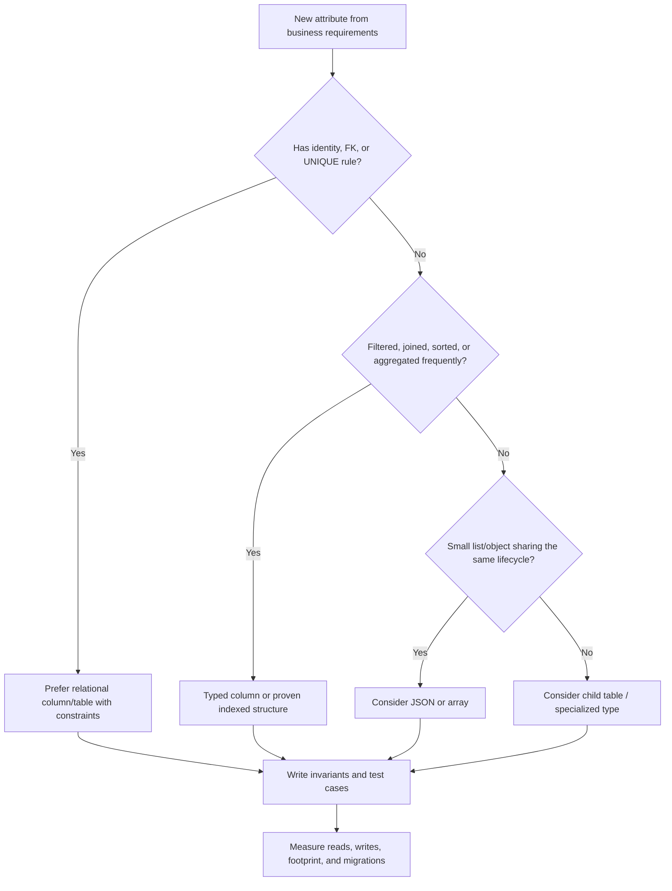

# JSON Columns, Arrays, or Specialized Types and Their Query-Constraint Trade-Offs

## 1. A Flexible Column Does Not Remove the Duty to Model

In the `DATABASE_DATA_MODELING` module, the goal is to turn business requirements into clear, verifiable data models: identifying entities, relationships, constraints, normalization, keys, indexes, and ultimately the physical schema. In the **Physical Modeling** chapter, designers often decide whether an attribute should be a **standard relational column**, a **JSON structure**, an **array**, or a **specialized type** offered by the DBMS.

For example, a multi-tenant product catalog platform has:

- Required, searchable, transactional attributes like `tenant_id`, `sku`, `price_amount`, and `currency_code`.
- Category-specific attributes like color, material, waterproofing, volume, or vendor-specific specs.
- Tag sets like `["eco","new","sale"]`.
- Active time windows during which a product may be sold or a policy applies.

Dumping everything into a single JSON object makes initial ingestion fast, yet weakens foreign keys, data types, required-field checks, optimizer statistics, and query paths. Conversely, adding a separate column or table for **every** ad-hoc attribute can make migrations unwieldy. The real problem is **choosing representations based on semantics, access patterns, and constraints to enforce**, not picking the most permissive type.

### Learning Outcomes

After this lesson, learners can:

1. Distinguish `JSON/JSONB`, arrays, and specialized types from normalized relational structures.
2. Decide which data belongs in standard columns vs. flexible structures; identify update and consistency risks.
3. Understand the differences among **SQL `NULL`**, **JSON `null`**, absent JSON keys, and empty arrays.
4. Identify which invariants can be verified via `NOT NULL`, `CHECK`, `UNIQUE`, and `FOREIGN KEY`, and which require schema validation, triggers, or transactions.
5. Design access paths with B-tree, GIN, GiST, or other index types aligned with **the operators actually queried**, then measure read and write impact.
6. Plan migrating an attribute out of JSON/arrays into a relational model when requirements change.

## 2. A Representation Selection Matrix

Ask about **each field**, rather than first asking "does the DBMS support JSON?":

| Question | Favors Relational Column / Table | JSON or Array May Fit |
|---|---|---|
| Is the attribute an identity or business key? | Yes; needs `UNIQUE`, FK, and strict typing | Only if a dedicated mechanism proves uniqueness |
| Is the attribute required on every row? | Column with `NOT NULL`/`CHECK` is usually clearer | Can validate inside JSON, though contracts and enforcement are more complex |
| Does the field appear often in `WHERE`, `JOIN`, `ORDER BY`? | Direct column indexes and stats work smoothly | Requires operators, expression indexes, or derived columns |
| Is the value set an independent business entity? | Child table, keys, and FKs | Embed only when lifecycle and consistency align |
| Is data sparse, with attributes varying by category? | Could use an explicitly typed attribute table | JSON often extends structures without adding dozens of sparse columns |
| Small list whose order/values belong to one record? | Child table if items need FKs, uniqueness, or independent updates | Arrays can stay simple if small and manipulated wholesale |
| Does data have its own algebra (intervals, coordinates, networks)? | Specialized column if DBMS supports it with clear semantics | Never replace specialized types with JSON just for easy input |
| Needs portability across DBMSs? | Standard SQL types port more easily, though still need verification | JSON/array/range syntax and indexes can be heavily DBMS-specific |

**Default principle:** place core business invariants in easily verifiable relational structures; reserve flexible structures for genuinely flexible data with clear ownership boundaries and validation contracts.



This flowchart is only a guide. A system may use a **hybrid model**: relational columns for keys/prices/currency, JSONB for category-specific specs, and child tables for many-to-many links with dedicated integrity rules.

## 3. Distinguishing `JSON`, `JSONB`, and Document Databases

In PostgreSQL 16, two JSON types are commonly weighed:

- `JSON` stores the raw input JSON text after syntax validation. It preserves input formatting traits such as whitespace, key order, and duplicate keys in the text. Processing operations typically re-parse the text.
- `JSONB` stores a parsed binary representation of the JSON value. It is better suited for querying, offering rich operators and index types like GIN. It **does not preserve key order, whitespace, or duplicate keys** as originally entered; when duplicate keys exist, do not assume every occurrence survives as distinct data.

Example:

```sql
SELECT
    '{"color":"red","color":"blue"}'::json AS raw_json,
    '{"color":"red","color":"blue"}'::jsonb AS normalized_jsonb;
```

If a system must preserve the **exact original document** for signature verification, traceability, or auditing, do not rely on normalized JSONB as the sole evidence. Store the raw payload and parsed/normalized data in two separate fields with distinct purposes, paired with sensitive-data protection and retention policies.

JSONB is **a column type inside a PostgreSQL relational table**; it does not automatically turn PostgreSQL into a document database with the same distributed architecture, transactions, schema validation, or indexing as dedicated document engines. True document databases have their own storage rules, uniqueness semantics, shard keys, transaction limits, and query idioms.

### JSON Is a Typed Value Tree

A JSON document can contain:

```json
{
  "color": "blue",
  "fragile": true,
  "weight_kg": 1.25,
  "dimensions_cm": {"length": 20, "width": 15},
  "compatible_models": ["A1", "A2"],
  "manufacturer_note": null
}
```

JSON has objects, arrays, strings, numbers, booleans, and `null`. Yet a JSON field **does not automatically** carry the guarantees of `NUMERIC(10,2) CHECK (...)` or `REFERENCES product(...)`. If a client sends `"weight_kg": "heavy"`, the text is still valid JSON; the defect is a **data-semantics error**, not a JSON syntax error.

## 4. SQL `NULL`, JSON `null`, Missing Keys, and Empty Arrays

This is a frequent bug source when mapping logical models into JSONB.

| State | Representation | Are They Equivalent? |
|---|---|---|
| No SQL value for the whole column | `attributes IS NULL` | Column lacks a value; can be blocked by `NOT NULL` |
| Column holds an empty object | `'{}'::jsonb` | Valid JSON value containing zero keys |
| Key `weight_kg` absent | `'{}'::jsonb` | No information provided about weight |
| Key holds JSON `null` | `'{"weight_kg":null}'::jsonb` | Key exists and its value is JSON null |
| Key holds number 0 | `'{"weight_kg":0}'::jsonb` | Actual numeric value is zero |
| Key holds empty string | `'{"weight_kg":""}'::jsonb` | String value, not JSON null |
| Empty array | `ARRAY[]::text[]` or `[]` in JSON | List known to have zero elements, distinct from unknown list |

PostgreSQL lets you observe this directly:

```sql
SELECT
    '{}'::jsonb ? 'weight_kg' AS missing_key_present,
    '{"weight_kg":null}'::jsonb ? 'weight_kg' AS null_key_present,
    '{"weight_kg":null}'::jsonb -> 'weight_kg' AS json_null_value,
    '{"weight_kg":null}'::jsonb ->> 'weight_kg' AS text_extraction,
    jsonb_typeof('{"weight_kg":null}'::jsonb -> 'weight_kg')
        AS json_value_type;
```

Logical output:

- `missing_key_present = false`; `null_key_present = true`.
- The `->` operator extracts a JSON/JSONB value; when the key exists with JSON null, it yields a **JSONB null value**, not SQL `NULL`. When the key is absent, extraction returns SQL `NULL`.
- The `->>` operator converts the value to text; both JSON null and an absent key yield SQL `NULL`. Looking solely at `->>` **cannot tell the two cases apart**.
- `jsonb_typeof` returns the string `'null'` for JSON null, yet returns SQL `NULL` when given SQL `NULL`.

For an optional attribute, the designer must choose an explicit contract:

1. Missing key means **not applicable**.
2. JSON null means **unknown**, distinct from absent.
3. Or both are normalized to a single canonical representation and storing both simultaneously is forbidden?

Never leave this implicit. With multiple ingest pipelines, the same business meaning can end up encoded three different ways, distorting filters and aggregations.

## 5. PostgreSQL 16 Hybrid Model: Standard Columns, JSONB, Arrays, and Time Ranges

Suppose a multi-tenant sales platform requires:

- `tenant_id`, per-tenant unique `sku`, non-negative `price_amount`, and well-formed currency code.
- An extensible `attributes` field as a JSON object. If `fragile` is present, it must be boolean; if `weight_kg` is present, it must be a JSON number—rejecting strings or JSON null.
- `tags` as a small tag array with at most 20 elements and no SQL `NULL` elements. This example does **not yet** enforce deduplicated elements or FKs to a tag catalog.
- `available_during` as an optional time range; any specified range must be non-empty.

DDL using PostgreSQL 16:

```sql
CREATE TABLE tenant (
    tenant_id BIGINT GENERATED ALWAYS AS IDENTITY PRIMARY KEY,
    tenant_name VARCHAR(120) NOT NULL
);

CREATE TABLE catalog_product (
    product_id BIGINT GENERATED ALWAYS AS IDENTITY PRIMARY KEY,
    tenant_id  BIGINT NOT NULL REFERENCES tenant(tenant_id),
    sku        VARCHAR(64) NOT NULL,
    name       VARCHAR(200) NOT NULL,
    price_amount NUMERIC(14, 2) NOT NULL,
    currency_code VARCHAR(3) NOT NULL,
    attributes JSONB NOT NULL DEFAULT '{}'::jsonb,
    attribute_schema_version INTEGER NOT NULL DEFAULT 1,
    tags TEXT[] NOT NULL DEFAULT ARRAY[]::text[],
    available_during TSTZRANGE,
    created_at TIMESTAMPTZ NOT NULL DEFAULT CURRENT_TIMESTAMP,

    CONSTRAINT uq_product_tenant_sku UNIQUE (tenant_id, sku),
    CONSTRAINT ck_product_sku_nonblank
        CHECK (char_length(btrim(sku)) > 0),
    CONSTRAINT ck_product_price_nonnegative
        CHECK (price_amount >= 0 AND price_amount <> 'NaN'::numeric),
    CONSTRAINT ck_product_currency_format
        CHECK (currency_code ~ '^[A-Z]{3}$'),
    CONSTRAINT ck_product_attributes_object
        CHECK (jsonb_typeof(attributes) = 'object'),
    CONSTRAINT ck_product_attributes_fragile_boolean
        CHECK (
            NOT (attributes ? 'fragile')
            OR jsonb_typeof(attributes -> 'fragile') = 'boolean'
        ),
    CONSTRAINT ck_product_attributes_weight_number
        CHECK (
            NOT (attributes ? 'weight_kg')
            OR jsonb_typeof(attributes -> 'weight_kg') = 'number'
        ),
    CONSTRAINT ck_product_schema_version
        CHECK (attribute_schema_version > 0),
    CONSTRAINT ck_product_tags_count
        CHECK (cardinality(tags) <= 20),
    CONSTRAINT ck_product_tags_no_null_elements
        CHECK (array_position(tags, NULL) IS NULL),
    CONSTRAINT ck_product_available_nonempty
        CHECK (available_during IS NULL OR NOT isempty(available_during))
);
```

**Meaning and limits of this DDL:**

1. `UNIQUE (tenant_id, sku)` enforces scoped product codes; `product_id` provides a stable surrogate key for references. Collation and `sku` normalization rules still must be finalized if `abc` and `ABC` should collide.
2. `NOT NULL DEFAULT '{}'::jsonb` ensures `attributes` always holds a JSON value; `CHECK jsonb_typeof(...)= 'object'` blocks JSON arrays or scalars where an object is required.
3. The `CHECK`s on `fragile` and `weight_kg` guard **only those two documented fields**. They do not validate the entire category-specific structure, nor do they block negative or absurdly huge `weight_kg` numbers yet. If those invariants matter, add appropriate validation and boundary tests.
4. `NUMERIC(14,2)` encodes a specific currency precision assumption; `currency_code` checks only three-letter shape, **not whether the code is an accepted business currency**. For strict currency catalog integrity, consider a `currency` table and FK.
5. `tags TEXT[]` is a typed text list. `cardinality(tags) <= 20` caps length; `array_position(tags, NULL) IS NULL` forbids SQL null elements. Neither forbids `''`, duplicate tags, unlisted tags, or case variants.
6. `TSTZRANGE` is a PostgreSQL-specific range type. It captures interval boundaries more cleanly than two disconnected timestamps, though applications still need rules for endpoint inclusivity, timezones, gaps, and overlap checks.

PostgreSQL permits the special `NaN` value in `NUMERIC` in some contexts; blocking `NaN` is specific to this example. Never copy PostgreSQL's `::numeric` cast syntax blindly to other DBMSs.

### 5.1. Testing a Valid Insert

Example creating a tenant and product in a single statement without relying on hardcoded IDs:

```sql
WITH new_tenant AS (
    INSERT INTO tenant (tenant_name)
    VALUES ('Minh Hoa Store')
    RETURNING tenant_id
)
INSERT INTO catalog_product (
    tenant_id, sku, name, price_amount, currency_code,
    attributes, tags, available_during
)
SELECT
    tenant_id,
    'SKU-001',
    'Insulated water bottle',
    299000.00,
    'VND',
    '{"color":"blue","fragile":false,"weight_kg":0.45}'::jsonb,
    ARRAY['eco', 'new']::text[],
    tstzrange(
        '2027-01-01 00:00:00+07'::timestamptz,
        '2028-01-01 00:00:00+07'::timestamptz,
        '[)'
    )
FROM new_tenant
RETURNING product_id, attributes, tags, available_during;
```

`attribute_schema_version` receives its default `1`. Explicitly passing `attributes = NULL` is rejected by `NOT NULL`; the DBMS does not convert it to `{}` just because `DEFAULT` exists. Passing `attributes = '{"fragile":"yes"}'::jsonb` fails the boolean check. Passing `{"weight_kg": null}` fails the number check.

### 5.2. Constraint Names Make the Contract Verifiable

Constraints are named so import scripts or APIs can pinpoint which rule failed. However, never expose raw DBMS error strings directly to public users: they can leak internal schema details. Applications should map errors to an API error contract while logging full context in access-controlled logs.

## 6. Arrays: Compact for Small Sets, Weaker Than Child Tables for Integrity

In PostgreSQL, `TEXT[]` is a native array type. Queries can ask:

```sql
-- Products carrying the eco tag.
SELECT product_id, name
FROM catalog_product
WHERE tags @> ARRAY['eco']::text[];

-- Products carrying at least one of eco or sale.
SELECT product_id, name
FROM catalog_product
WHERE tags && ARRAY['eco', 'sale']::text[];
```

The `@>` operator tests containment of all right-hand elements, while `&&` tests whether two arrays share at least one element. Under suitable predicates, PostgreSQL can use a GIN index on the array column; still, updating a single element rewrites the whole array row under PostgreSQL's MVCC mechanics.

**When are arrays acceptable?** Short lists, infrequent edits, no need for foreign keys per element, and applications that usually load/save the whole set with the parent record.

**When should you switch to a child table?**

- Each tag has a canonical code, description, active status, or permission policy requiring an FK to `tag_definition`.
- Each tag may appear **at most once** per product, enforced by the DBMS.
- You need to look up products by tag, aggregate tag frequencies, or update individual links at scale.
- Each link carries its own attributes like `assigned_at`, `assigned_by`, or weight.

Relational alternative:

```sql
-- Alternative to tags TEXT[] when tags carry business identity.
CREATE TABLE tag_definition (
    tag_code VARCHAR(40) PRIMARY KEY,
    display_name TEXT NOT NULL
);

CREATE TABLE product_tag (
    product_id BIGINT NOT NULL
        REFERENCES catalog_product(product_id) ON DELETE CASCADE,
    tag_code VARCHAR(40) NOT NULL
        REFERENCES tag_definition(tag_code),
    assigned_at TIMESTAMPTZ NOT NULL DEFAULT CURRENT_TIMESTAMP,
    CONSTRAINT pk_product_tag PRIMARY KEY (product_id, tag_code)
);

-- May need an index from tag to products when querying by tag.
CREATE INDEX idx_product_tag_code_product
    ON product_tag (tag_code, product_id);
```

`product_tag` has `PRIMARY KEY (product_id, tag_code)` preventing duplicate tags on the same product, plus an FK verifying each tag exists. If this becomes the **source of truth**, stop treating `catalog_product.tags` as a competing source of truth; if both coexist temporarily, implement explicit synchronization and reconciliation.

### Arrays Do Not Replace All Many-to-Many Relationships

Storing foreign `product_id`s inside an array on another table makes per-element foreign key checks and product deletion handling difficult. A junction table expresses identity, cardinality, and referential constraints transparently. Arrays are a **physical optimization for specific access and lifecycle patterns**, not an excuse to skip logical relational modeling.

## 7. JSONB: Querying Flexible Structures Requires Choosing Operators Carefully

PostgreSQL provides multiple JSONB operators. Three common patterns:

```sql
-- Containment: color attribute equals blue.
SELECT product_id, name
FROM catalog_product
WHERE attributes @> '{"color":"blue"}'::jsonb;

-- Check whether top-level key color exists (regardless of value).
SELECT product_id, name
FROM catalog_product
WHERE attributes ? 'color';

-- Extract value as text for expressions.
SELECT product_id, attributes ->> 'color' AS color
FROM catalog_product
WHERE attributes ->> 'color' = 'blue';
```

These three predicates are not interchangeable in every case. `@> '{"color":"blue"}'` checks JSON containment against a JSON string; `? 'color'` checks only top-level key existence; `->>` extracts text for comparison. An index accelerates only the operators its **operator class** is built to support.

### 7.1. GIN for Containment

```sql
-- Fits when @> containment and supported jsonpath operators run frequently.
CREATE INDEX idx_product_attributes_path_gin
    ON catalog_product USING GIN (attributes jsonb_path_ops);

EXPLAIN
SELECT product_id, name
FROM catalog_product
WHERE attributes @> '{"color":"blue"}'::jsonb;
```

`jsonb_path_ops` can be smaller and more targeted than `jsonb_ops` for containment workloads. However, it **does not support the key-existence operator `?`** like the default `jsonb_ops` operator class. If the app primarily runs `attributes ? 'color'`, evaluate GIN `jsonb_ops` or another representation:

```sql
-- ALTERNATIVE to the index above; do not blindly create both.
CREATE INDEX idx_product_attributes_ops_gin
    ON catalog_product USING GIN (attributes jsonb_ops);
```

Keeping two large GIN indexes on the same JSONB column just to have "one `ops` and one `path_ops`" causes heavy write amplification. Inventory the operators actually used, measure real queries, and choose based on evidence.

### 7.2. Expression B-Tree When One JSON Field Is Queried Heavily

If users filter by color constantly, an expression index can fit:

```sql
CREATE INDEX idx_product_tenant_color
    ON catalog_product (tenant_id, (attributes ->> 'color'));

EXPLAIN
SELECT product_id, name
FROM catalog_product
WHERE tenant_id = 42
  AND attributes ->> 'color' = 'blue';
```

This expression B-tree serves **one specific access path** by tenant and color. It does not accelerate arbitrary JSONB queries. If color later becomes a required attribute with a controlled code list appearing across reports, promote `color_code` to a standard column guarded by `NOT NULL`, `CHECK`, or an FK.

### 7.3. Why Casting Extracted JSON Values Easily Fails

Example:

```sql
-- Can fail if weight_kg is the string 'heavy' or not a valid numeric value.
SELECT product_id,
       (attributes ->> 'weight_kg')::numeric AS weight_kg
FROM catalog_product;
```

In our sample schema, a `CHECK` guards `weight_kg` at the **JSON number** level when present, yet unvalidated external feeds, legacy tables lacking the constraint, or pre-constraint rows can still hold out-of-domain or out-of-range numbers. Filtering in the app after retrieval does not make all write paths safe.

If `weight_kg` regularly participates in comparisons, sums, and strict positive bounds, a `NUMERIC(10,3)` column with an explicit `CHECK` is far easier to verify than casting JSON text across every query.

### 7.4. JSONPath and Nested Structures

PostgreSQL supports JSONPath and query operators such as `@?` and `@@`. They express complex conditions over nested arrays and objects cleanly, yet **do not guarantee every JSONPath expression uses an index**. GIN eligibility depends on operator, expression shape, and operator class. Inspect `EXPLAIN` on representative data, especially for large arrays or heterogeneous documents.

## 8. Indexes for Arrays and Ranges: Match Structure to Operations

Specialized types come with their own **query algebras**; never default to B-trees for every predicate.

```sql
-- GIN indexes array elements for supported operators like @> and &&.
CREATE INDEX idx_product_tags_gin
    ON catalog_product USING GIN (tags);

-- GiST serves range operators such as overlap (&&).
CREATE INDEX idx_product_availability_gist
    ON catalog_product USING GIST (available_during)
    WHERE available_during IS NOT NULL;

-- Products whose availability overlaps the requested window.
EXPLAIN
SELECT product_id, name
FROM catalog_product
WHERE available_during &&
      tstzrange(
          '2027-06-01 00:00:00+00'::timestamptz,
          '2027-07-01 00:00:00+00'::timestamptz,
          '[)'
      );
```

With `TSTZRANGE`, supported operators check interval overlap, point containment, subrange containment, and boundary relationships. GiST fits interval predicates; if you only sort by `lower(available_during)`, an expression B-tree is another candidate. Evaluate against real queries.

**Semantic warning:** `available_during IS NULL` here could mean "always available with no time limit" **or** "availability not yet determined"; nothing in the DDL distinguishes the two meanings. If business rules say products are always on sale when `NULL`, a query filtering solely by `available_during && requested_range` will **skip** them because SQL `NULL` produces `UNKNOWN`. APIs and read queries must reflect the chosen `NULL` convention.

### A Specialized Constraint Example: Preventing Overlaps

When a table stores multiple time windows for the same room, "no overlaps" is a **cross-row invariant**. PostgreSQL combines range types, `&&`, and GiST exclusion constraints:

```sql
-- Standalone example separate from catalog_product.
-- Extension provides GiST operator class for BIGINT equality.
CREATE EXTENSION IF NOT EXISTS btree_gist;

CREATE TABLE room_slot (
    room_id BIGINT NOT NULL,
    slot_id BIGINT GENERATED ALWAYS AS IDENTITY PRIMARY KEY,
    active_window TSTZRANGE NOT NULL,
    CONSTRAINT ck_slot_window_nonempty
        CHECK (NOT isempty(active_window)),
    CONSTRAINT ex_room_slot_no_overlap
        EXCLUDE USING GIST (
            room_id WITH =,
            active_window WITH &&
        )
);
```

This constraint rejects any two rows with identical `room_id` and overlapping intervals. If `[09:00,10:00)` and `[10:00,11:00)` meet at the boundary, they do not overlap. This illustrates a **PostgreSQL-specific mechanism**, not portable SQL across all DBMSs. It also has business scope limits: it only prevents time overlaps, without verifying whether the room exists or who is permitted to book it.

## 9. JSON/Array Constraints: Where Does the DBMS Enforce vs. the Application?

A syntactically valid JSON object can still contain business-invalid data. Write down an explicit contract before choosing flexible types.

| Invariant | Possible PostgreSQL Mechanism | Gaps to Watch |
|---|---|---|
| `attributes` is always an object | `JSONB NOT NULL` + `CHECK jsonb_typeof(...)= 'object'` | Empty object `{}` is still allowed |
| `fragile`, if present, is boolean | `CHECK` with `jsonb_typeof` | Does not validate any other keys |
| `weight_kg` is positive within allowed bounds | `CHECK`/trigger or dedicated `NUMERIC` column | Checking type `number` alone does not guard bounds |
| Attributes depend on product category | App-tier schema validation or verified DB mechanism | No single generic native `JSON Schema` constraint built into PostgreSQL 16 |
| Each tag appears at most once | Relational table with `PRIMARY KEY(product_id, tag_code)` or custom validation | Native arrays allow duplicate elements |
| Every tag belongs to a valid catalog | Child table + FK | Standard FKs do not individually reference JSON/array elements |
| Versioned JSON structure | `attribute_schema_version` + matching validator | A version column is mere metadata without enforcement logic |
| List of references to other products | Junction table with FKs | Storing an ID array in JSON creates no FK protection |
| No overlapping schedules | Range + GiST exclusion constraint | Depends on DBMS features and error-handling protocol |

**Avoid unstable functions inside `CHECK`.** PostgreSQL expects `CHECK` expressions to remain invariant for a given row's contents; if a function depends on another table, current time, or mutable config, existing rows can become invalid silently without re-scanning. For cross-table or time-dependent rules, use transactions/triggers and operational processes rather than stuffing them into `CHECK`.

### Using JSON Schema

JSON Schema can describe types, required fields, numeric bounds, string patterns, array layouts, and cross-field dependencies using a chosen validator library. Yet **application-tier validation** protects only writes passing through that validator. With multiple writers:

1. Identify the schema version and source of truth for each product category.
2. Run a consistent validator across APIs, importers, and background jobs.
3. Specify whether "extra fields" are permitted and how legacy versions are handled.
4. Maintain DB-level tests for baseline invariants and contract tests covering every write path.
5. If validating inside the DB via extensions or triggers, verify compatibility, performance, deployment permissions, and validator upgrades.

Never claim "having an `attribute_schema_version` column means the DB enforces schema versions". The column means nothing without logic interpreting and enforcing it.

## 10. Query Trade-Offs: Expressions, Statistics, Index-Only Scans, and Write Amplification

### 10.1. Relational Columns Get Better Statistics Than Dynamic JSON Fields

For standard columns like `price_amount` or `currency_code`, the optimizer maintains direct domain and distribution statistics. For `attributes ->> 'color'`, estimation is harder when values sit inside varied documents unless matching expression indexes/stats exist. Attributes heavily skewed by tenant also mislead estimates without representative stats.

Never assume creating a GIN index automatically gives the optimizer accurate selectivity for **every JSONPath query**. Inspect `EXPLAIN`, compare estimated `rows` with `actual rows`, and test across varied attribute values.

### 10.2. Updating One Logical Field Can Trigger Heavy Write Work

Updating a small key in `attributes` or appending one element to `tags` still creates a full new row version in PostgreSQL under MVCC. Affected indexes must be updated; large JSONB documents may rewrite out-of-line data and touch TOAST. GIN indexes can emit many index entries per document or array. Never treat a JSON field update as editing just a few bytes in place.

If an application updates one attribute at high frequency, promoting it to a relational column or child table avoids rewriting unrelated data and clarifies constraints. Still, an indexed column or expression-indexed column incurs maintenance work; settle the design through benchmarks.

### 10.3. Wide JSONB and Arrays Inflate Unnecessary Reads

`SELECT *` ships bulky JSONB and array payloads to the app even when a listing page needs only `product_id`, `sku`, and `name`. APIs should project only required fields; consider splitting very large or rarely read payloads into a 1–1 auxiliary table when justified by query patterns.

In PostgreSQL, large `attributes` or `tags` values may be stored out-of-line via TOAST in secondary pages. Never estimate real I/O by multiplying row count by "average JSON size" without measuring heap, index, and TOAST footprints.

### 10.4. No Index Is Free

| Option | Benefit | Notable Cost |
|---|---|---|
| Expression B-tree `(tenant_id, attributes ->> 'color')` | Fast color lookup per tenant | Serves only the exact matching expression; updates whenever that JSON key changes |
| GIN `jsonb_path_ops` | Containment and selected JSONPath queries | Does not serve `?` like `jsonb_ops`; multiple entries and write overhead |
| GIN `jsonb_ops` | Broader JSONB operators including key existence | Typically larger and costlier to maintain depending on data |
| Array GIN on tags | `@>`, `&&`, and supported array operators | Index cost scales with element count; no per-element FK or uniqueness |
| Range GiST | Interval overlap queries, exclusion constraints | Structure and cost differ from B-tree; does not replace general sorting |
| Standard column + B-tree | Clear constraints, natural lookup/sort by type | Needs schema migration when expanding, still carries index cost |

On a table with millions of products, **do not create every illustrative index out of habit**. Pick a small candidate set matching critical queries, benchmark on representative data, and retain only indexes with clear net benefit.

## 11. Verifying with `EXPLAIN` and PostgreSQL Storage Metrics

The following checks are meaningful only after loading sufficiently large, realistically distributed data:

```sql
-- 1. Query by JSONB attribute using containment.
EXPLAIN (ANALYZE, BUFFERS)
SELECT product_id, name
FROM catalog_product
WHERE attributes @> '{"color":"blue"}'::jsonb;

-- 2. Look up tags via array.
EXPLAIN (ANALYZE, BUFFERS)
SELECT product_id, sku
FROM catalog_product
WHERE tags @> ARRAY['eco']::text[];

-- 3. Frequent per-tenant attribute lookup.
EXPLAIN (ANALYZE, BUFFERS)
SELECT product_id, sku
FROM catalog_product
WHERE tenant_id = 42
  AND attributes ->> 'color' = 'blue';

-- 4. Table heap, index, and total size including TOAST.
SELECT
    pg_size_pretty(pg_relation_size('public.catalog_product'))
        AS heap_size,
    pg_size_pretty(pg_indexes_size('public.catalog_product'))
        AS index_size,
    pg_size_pretty(pg_total_relation_size('public.catalog_product'))
        AS total_size;
```

`EXPLAIN (ANALYZE, BUFFERS)` **executes the actual query**. Here it runs `SELECT`, though applying it to writes requires a controlled test environment or rollback wrapper. When reading plans, examine:

- `Index Cond`, `Recheck Cond`, `Filter`, and `Rows Removed by Filter`: which predicates are truly resolved by the index vs. rechecked on table rows?
- Estimated vs. actual rows: did the optimizer accurately predict selectivity of JSONB or array predicates?
- `Buffers` and runtime: did the query actually save page reads, or merely swap plan node names?
- `Seq Scan`: on small tables or wide-result queries, sequential scans can be completely optimal.

Measure write cost on the same test dataset before and after indexing: `INSERT` rate, p95 of `UPDATE attributes`/`UPDATE tags`, WAL volume, index size, vacuum pressure, and cache impact. Draw conclusions only across identical data, queries, DBMS version, and load conditions.

## 12. Promoting an Attribute from JSON to a Standard Column: Verifiable Migration

Suppose `weight_kg` initially applied to only a few products and lived inside `attributes`. Later, all shipping calculations need weight-based fees, range filtering, and positive-value checks. That signals it is time to consider **promoting the attribute to a standard column**.

Workflow:

1. **Finalize semantics:** unit in kg, precision, nullability, whether zero is permitted, and distinguishing "not applicable" from "unmeasured".
2. **Audit legacy JSON:** missing keys, JSON null, strings instead of numbers, negative numbers, oversized values, values at multiple paths, and schema versions.
3. **Measure impact:** how many consumers read `attributes.weight_kg`, which write paths update the JSON, and which caches or exports depend on the old layout?
4. **Expand schema:** add `weight_kg NUMERIC(10,3)` initially nullable with a domain-appropriate type; do not force existing rows complete immediately.
5. **Clean data and backfill safely:** cast only after confirming JSON number type and valid range; remediate out-of-bounds values before migrating.
6. **Coordinate during transition:** designate one source of truth and update readers/writers in order; if dual-writing temporarily, verify consistency, idempotency, and rollback.
7. **Add justified constraints and indexes:** `CHECK (weight_kg > 0)`, `NOT NULL` only if allowed by contract and data is clean; add a B-tree if queries genuinely filter/sort by weight.
8. **Reconcile and retire old representation:** verify counts, before/after values, exports, and reports; drop the old JSON key only after zero consumers depend on it.

Example inspection and migration steps in a PostgreSQL test environment:

```sql
-- 1. Detect rows where the key exists but is not a JSON number.
SELECT product_id, attributes -> 'weight_kg' AS invalid_weight
FROM catalog_product
WHERE attributes ? 'weight_kg'
  AND jsonb_typeof(attributes -> 'weight_kg') <> 'number';

-- 2. Only after auditing value domain and fixing out-of-bounds values:
ALTER TABLE catalog_product
    ADD COLUMN weight_kg NUMERIC(10, 3);

-- 3. Backfill JSON numbers; casting to NUMERIC(10,3)
-- can still fail if values exceed allowed precision/scale.
UPDATE catalog_product
SET weight_kg = (attributes ->> 'weight_kg')::numeric
WHERE jsonb_typeof(attributes -> 'weight_kg') = 'number';

-- 4. Enforce positive values when non-NULL.
ALTER TABLE catalog_product
    ADD CONSTRAINT ck_product_weight_positive
    CHECK (weight_kg IS NULL OR weight_kg > 0);
```

These commands are an **illustrative sequence**, not a production-ready migration script. Before step 3, check negative numbers, zero policy, values overflowing `NUMERIC(10,3)`, rounding rules, and long fractional digits. Step 4 will fail if legacy data holds non-positive numbers; clean those via business decisions rather than silently replacing them with dummy numbers.

**Never treat having both a `weight_kg` column and a `weight_kg` JSON key as two permanent sources of truth.** Whenever they can drift, designate one owner and run discrepancy checks throughout the transition.

## 13. Flexible Data and Schema Evolution

JSON is often picked because product categories differ in structure. That flexibility helps, provided evolution is governed:

| Change | Risk If Editing JSON Ad Hoc | Governance Approach |
|---|---|---|
| Rename `waterproof` → `water_resistant` | Old queries miss values | Version schema, support reading both versions during transition |
| Change `weight_kg` from string to number | Cast errors, broken stats and reports | Type contract, migration, validation on all write paths |
| Add a required category-specific field | Legacy documents lack the field | Versioned schema, business-accurate defaults or backfill |
| Turn free-form `tags` into a controlled catalog | Missing FKs or duplicate tags | Migrate to junction/definition tables |
| Embed a large relationship in a JSON array | Document bloat, costly updates, weak FKs and queries | Split into a separate entity/child table with its own key |
| Alter time-range conditions | Boundary inconsistencies, bad date/time data | Standardize `[start,end)`, timezone rules, and boundary tests |

Distinguish **JSON schema** (attribute structure) from **table schema** (column types and constraints). Setting `attribute_schema_version = 2` on a row does not automatically migrate a v1 payload to v2. Adding a new field does not automatically populate legacy rows with defaults. Upgrade policies must define how legacy rows are read, when backfills occur, and when retired versions get rejected.

## 14. Portability: DBMSs Do Not Share the Same Types and Operators

The same idea of "storing JSON/arrays/ranges" varies sharply in implementation:

| Topic | PostgreSQL 16 | MySQL 8.0 / InnoDB | SQL Server 2022 |
|---|---|---|---|
| JSON | Native `JSON` and `JSONB`, operators `->`, `->>`, `@>`, `?`, plus JSONPath | Native `JSON` type with JSON functions and distinct access syntax | Typically stores JSON text in `NVARCHAR` queried via `JSON_VALUE`, `JSON_QUERY`, `OPENJSON`, `ISJSON` |
| JSON syntax validation | Native type accepts valid JSON | `JSON` type validates syntax/representation per engine | `ISJSON`/constraints as supported |
| Per-field JSON schema | `CHECK`, expressions, triggers, app/extension validators | Validation functions vary by version; `CHECK` enforced in supported versions | `CHECK`, JSON functions, computed columns, triggers/app |
| Array types | `TEXT[]`, `INTEGER[]`, and array operators | Typically represented as JSON arrays rather than a general SQL array type | Typically JSON array text or child tables |
| Interval types | `TSRANGE`, `TSTZRANGE`, `DATERANGE`, etc. | Typically two timestamp columns with constraints and transactions/indexes | Typically two timestamp columns; different constraint/index mechanisms |
| Indexing JSON/arrays | Expression B-tree, GIN; GiST for ranges | Generated/functional indexes and multi-valued indexes by version/capability | Indexes on computed columns/expressions designed differently; no PostgreSQL-style GIN |
| Non-overlapping ranges | GiST exclusion constraints where suitable | Typically transactions + locks or slot tables | Typically transactions + locks or slot/transaction designs |

Never mechanically translate `jsonb_path_ops`, `TSTZRANGE`, or `EXCLUDE USING gist` into MySQL or SQL Server. Even `CHECK` in MySQL 8.0 requires checking **exact version** (pre-8.0.16 versions do not enforce `CHECK` as commonly expected). On SQL Server 2022, do not assume a native binary JSON type equivalent to PostgreSQL `JSONB`.

### Other Specialized Types

- **`UUID`:** helpful for distributed identifiers; width, generation, sorting, and indexing differ from incrementing integers.
- **`INET`/`CIDR` (PostgreSQL):** models IP addresses/networks with matching operators; avoid stuffing IPs into JSON strings when subnet checks and domain validation are frequent.
- **`ENUM`/domain:** enforces value sets, yet adding/editing values requires migrations and hurts portability.
- **Spatial/geography/geometry:** represents coordinates and shapes with explicit coordinate reference systems and units; on PostgreSQL, many geospatial features require the PostGIS extension, **not built into core by default**.
- **`ARRAY`/`RANGE`/`MULTIRANGE`:** convenient for specific operations, while constraints and portability must be weighed individually.

Pick a specialized type when **the type's algebra matches the business domain and workload**, not merely because the DBMS lists it.

## 15. When to Move from JSON to a Document Database, Graph, or Analytical Warehouse?

A relational table with JSONB is not the only option. Compare by **data shape and integrity requirements**:

### Document Database

Fits when large objects are routinely read/written as cohesive documents, nested attributes vary by category, and the system wants to evolve on a document model. Check document size caps, compound/multikey indexes, scoped uniqueness against shard keys, transaction guarantees, and validation rules. Embedding unbounded lists inside one document creates update overhead or size ceilings; splitting into referenced collections may still be needed.

### Graph Database

Fits when queries mainly traverse multi-hop relationships—such as "which products are compatible with devices in the same ecosystem", bills of materials/dependencies, or network traversals. Storing ID lists in JSON cannot replace first-class relationships/edges with constraints when traversal is central. Conversely, having one small reference list in JSON does not justify migrating the whole platform to a graph database.

### Analytical / Columnar Warehouse

When the goal is aggregating billions of events by category, tenant, time, or attribute, fact/dimension modeling, columnar storage, and summary tables outperform scanning JSONB on OLTP. Define *grain*, attribute flattening, late arrivals, deduplication, and source key protection. Analytical warehouses often declare PK/FK metadata without OLTP-style enforcement, requiring pipeline data-quality tests.

**Technology decisions** rest not on "does it support JSON?", but on access paths, constraints, write volume, schema evolution, and measured operational cost.

## 16. Boundary Test Suite for the Hybrid Model

To prove DDL and JSON/array contracts match, run independent cases in a test environment:

| Case | Input / Action | Expected Outcome |
|---|---|---|
| 1 | Omit `attributes` on `INSERT` | DB sets `{}` via `DEFAULT` |
| 2 | Explicitly send `attributes = NULL` | Rejected by `NOT NULL` |
| 3 | Send `attributes = '[]'::jsonb` | Rejected by object `CHECK` |
| 4 | `{"fragile":true}` | Accepted under current type check |
| 5 | `{"fragile":"yes"}` or `{"fragile":null}` | Rejected by boolean `CHECK` |
| 6 | `{"weight_kg":1.25}` | Allowed under current `CHECK` |
| 7 | `{"weight_kg":-5}` | **Not yet rejected by type CHECK**; failing test highlighting missing positive-number invariant |
| 8 | `{"weight_kg":"heavy"}` | Rejected by number `CHECK` |
| 9 | `tags = ARRAY[]::text[]` | Empty array accepted per contract |
| 10 | `tags` with 21 elements | Rejected by `cardinality(tags) <= 20` |
| 11 | `tags = ARRAY['eco',NULL]` | Rejected by no-SQL-null `CHECK` |
| 12 | `tags = ARRAY['eco','eco']` | **Allowed under current DDL**; forbidding duplicates needs validation or a junction table |
| 13 | `available_during = 'empty'::tstzrange` | Rejected by non-empty `CHECK` |
| 14 | Two adjacent intervals in `room_slot` | Accepted under `[)` boundaries |
| 15 | Two overlapping intervals for same `room_id` | One rejected by exclusion constraint |
| 16 | Query `attributes @> ...` with GIN `path_ops` | Inspect plan, row counts, and buffers; index can help |
| 17 | Query `attributes ? 'color'` with **only** `path_ops` | Not supported by that operator class |
| 18 | Frequent lookup by `tenant_id` and color | Check expression B-tree, read speed, and update cost |
| 19 | Migrate `weight_kg` from JSON to `NUMERIC` | Zero cast errors, zero lost values, no drift between sources during transition |
| 20 | Ingest via non-UI batch job | DB invariants still hold; app validators must run on every write path |

Cases flagged as **failing tests** (such as negative weight and duplicate tags) highlight **known enforcement gaps**, rather than claiming the DDL is already complete. Decide whether to add constraints or change the model per business rules, then rerun the suite.

## 17. Common Design Mistakes

| Tempting Mistake | Why It Is Wrong or Risky | Remedy |
|---|---|---|
| "Put every attribute into JSON for flexibility." | Loses clear FKs/UNIQUE, hinders stats and queries | Keep keys and core attributes in standard columns/tables |
| "Valid JSON syntax means valid data." | Strings can replace numbers, required fields vanish, domains break | Enforce schema validation and DB constraints at the right layers |
| "JSON null and missing key are identical." | Queries and default rules diverge | Define explicit semantics; distinguish with `?` / `jsonb_typeof` |
| "Tag array guarantees every tag exists in catalog." | No automatic per-element FK | Junction table with FK, or verified validation mechanism |
| "Arrays forbid duplicate tags by default." | Arrays gladly store repeated items | Child-table PK or dedicated validator |
| "Any GIN index accelerates all JSON queries." | Operators and opclasses govern index eligibility | Pick `jsonb_ops`/`jsonb_path_ops` from real predicates and `EXPLAIN` |
| "Create as many GIN/GiST indexes as possible." | Indexes grow huge, slowing writes and VACUUM | Benchmark workload and eliminate overlapping indexes |
| "Updating one JSON key leaves other fields untouched." | MVCC/TOAST and indexes incur full-row/value costs | Measure `UPDATE`s; promote hot attributes to columns or child tables |
| "`CHECK jsonb_typeof='number'` suffices for weight." | Fails to enforce positive bounds, precision, or units | Dedicated `NUMERIC` column or explicit range validation |
| "A version column validates documents automatically." | Just an integer without matching enforcement logic | Version contract + validation across all write paths |
| "JSONB preserves the exact source document." | Alters formatting, key order, and duplicate keys | Store raw payload separately when verbatim evidence is required |
| "Analytical warehouses enforce PK/FKs like OLTP." | Many systems treat keys solely as optimizer metadata | Verify enforcement behavior and add pipeline quality checks |

## 18. Practice Exercise: Multi-Category Product Catalog

**Context:** a marketplace hosts 15 million products across 3,000 tenants in four main categories: apparel, electronics, food, and industrial equipment. Attributes vary:

- **Shared:** `tenant_id`, `sku`, `name`, `price_amount`, `currency_code`, `category_id`.
- **Apparel:** `size`, `color`, `material`.
- **Electronics:** `voltage`, `battery_capacity`, compatible model list.
- **Food:** `expiry_date`, standardized allergen groups.
- **Industrial equipment:** `weight_kg`, operating temperature range, configuration options.

Over the last 30 days, three core query paths dominate: (A) filter by tenant, category, and price; (B) find blue products within a tenant; (C) look up products carrying an allergen group for safety alerts. Daily volume is 500,000 product inserts and 2 million attribute updates.

**Tasks:**

1. Design `product` with required relational columns, per-tenant `UNIQUE`, price, and currency; identify which attributes can **temporarily** live in JSONB.
2. Choose representations for compatible models and allergen groups. If each code must exist in a catalog without duplicates, explain why a junction table with FKs and composite PK beats raw arrays.
3. Design a versioned JSON contract: which fields may be absent, which allow JSON null, and what types/ranges govern `weight_kg`, `voltage`, and `expiry_date`?
4. Compare GIN `jsonb_path_ops`, GIN `jsonb_ops`, and an expression B-tree for Query B. Provide at least two `EXPLAIN` queries and metrics to measure.
5. Propose how to model operating temperature range using two columns with `CHECK` vs. a specialized range type. Explain portability and indexing trade-offs.
6. Plan promoting `color` from JSON to a standard column if Query B traffic grows 100x, including backfill, reconciliation, temporary dual-representation sync, and rollback.
7. Assess write cost when `attributes` averages 60 keys and `tags` averages 40 elements. Does that tag count still fit the earlier 20-element cap, or must the requirement/model change? Do not silently bump limits without justification.

### Physical Model Handoff Checklist

- [ ] Separated core attributes needing keys/FKs/UNIQUE from flexible metadata.
- [ ] Explicitly distinguished SQL `NULL`, JSON `null`, missing keys, empty strings, and empty arrays.
- [ ] Defined type contracts, boundary values, and schema versions for all JSON/array/range fields.
- [ ] Mapped query operators to indexes with matching operator classes; measured reads, writes, and footprint.
- [ ] Ensured per-element references have explicit integrity enforcement.
- [ ] Established a plan to prevent competing sources of truth when migrating JSON to columns or child tables.
- [ ] Verified DBMS differences, application/pipeline paths, and migration impacts.

**Flexible types expand expressiveness without excusing designers from defining and protecting data.** Whenever using JSON, arrays, or specialized types, the designer must state which invariants the DBMS enforces, which queries are genuinely accelerated, what write costs arise, and how the schema evolves cleanly toward stricter modeling when the business demands it.
