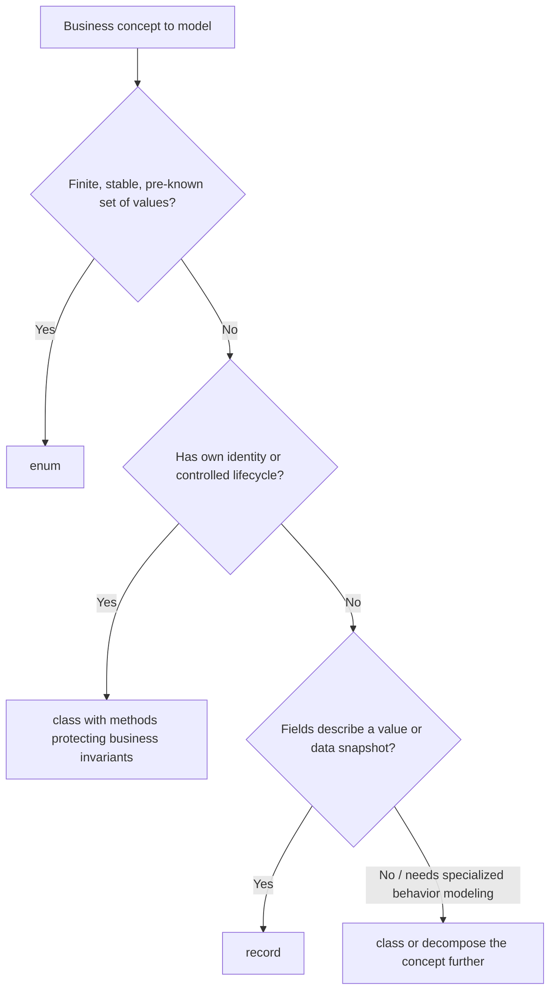

# Choosing `class`, `record`, or `enum` Based on Data Semantics and Lifecycle

When translating business requirements into a data model, choosing a Java type is not merely about picking the shortest syntax. The data type must reflect **what has its own identity**, **what is defined by its value**, **what belongs to a finite set of choices**, and **what is allowed to change over time**. The right choice makes business constraints explicit, reduces update bugs, and establishes a verifiable boundary between the Java model, APIs, and the storage schema.

This lesson belongs to the **Java Models** chapter of the **DATABASE_DATA_MODELING** module: building the skill of turning business requirements into a data model—from entities, relationships, and constraints to normalization, keys, indexes, and physical schemas. Therefore, we examine `class`, `record`, and `enum` through both their meaning in code and their impact when persisting data into relational, document, graph, or analytical databases.

## 1. Three Questions Before Writing Code

Start from the business domain rather than from Java keywords:

1. **Does it have an identity independent of its attributes?** Two orders may have the same total amount and the same status, yet still be two distinct orders. They require a stable identifier and their own lifecycle.
2. **Is the data a value/snapshot or an object that needs to change?** Coordinates, identifiers, request payloads, and query results can usually be represented as immutable values. An order, however, must have its state transitions controlled.
3. **Is the set of options truly closed and relatively stable?** Statuses like `DRAFT`, `PLACED`, `PAID`, `CANCELLED` can be an `enum`. A list of shipping carriers or promotion types added by administrators at runtime should not be hardcoded as an `enum`.

| Criterion | `class` | `record` (Java 16+) | `enum` |
| --- | --- | --- | --- |
| Typical semantics | Entity with identity, behavior, or structure requiring flexible control | Value, DTO, projection, snapshot, or data-carrying event | Named, finite set of constants known at compile time |
| State mutation | Can be allowed via business methods; can also be designed as immutable | Components cannot be reassigned after creation; **shallow immutability only** | Fixed list of constants; avoid adding mutable state to individual constants |
| Equality semantics | Must be explicitly defined by identity or value; defaults to reference equality | Auto-generated `equals`/`hashCode` based on components | Each constant is a unique instance; compared using `==` |
| Java mechanism | Supports inheritance depending on declaration, constructors, fields, and methods | Implicitly `final`, extends `java.lang.Record`, cannot extend another class; can implement interfaces | Extends `java.lang.Enum`, cannot add constants at runtime |
| Storage considerations | Identity, primary key, change management, and concurrency | Immutability and contract compatibility when adding/modifying components | Stable storage codes, constant renaming, and state set evolution |

> **Pragmatic rule:** `class` fits entities with a lifecycle; `record` fits data described by its value; `enum` fits a closed set of choices. These are design guidelines, not rigid laws: a `class` can also be immutable, and a `record` can also hold references to mutable objects.

### Decision Diagram



## 2. Distinguishing Business Lifecycle, Object Lifecycle, and Schema Lifecycle

Three types of lifecycles are often conflated:

- **Business lifecycle:** an order transitions from draft to placed, paid, or cancelled. The same order retains a single `order_id` throughout.
- **In-application data lifecycle:** each API request may create an input `record`; each read creates a new result `record`. These records can be very short-lived and are not long-lived entities.
- **Schema/contract lifecycle:** adding a new status, renaming a column, adding a JSON field, or changing an enum code are changes that affect stored data and data consumers. An `enum` that is closed at the Java level may still need to evolve with business requirements.

For example, two `OrderSnapshot` snapshots of the same order may differ in status and version. They are two **values** at two points in time, whereas `Order` remains the same **entity**. A snapshot is not automatically an audit log; if you need to prove who changed what, when, and why, you must record separate events or audit entries.

## 3. Running Example: An Order Model

Simplified requirements:

- Each order has a unique identifier, a creation timestamp, and a version number.
- A new order starts in `DRAFT` and can move to `PLACED` or `CANCELLED`.
- A `PLACED` order can move to `PAID` or `CANCELLED`.
- `PAID` and `CANCELLED` are terminal states **in this simplified workflow**. If the business supports refunds, returns, or post-payment cancellations, an appropriate workflow must be added.
- The application needs to export an order snapshot to return from an API or pass to data-reading tasks.

From these requirements, we choose:

| Concept | Java Type | Rationale |
| --- | --- | --- |
| `Order` | `class` | Has a stable identity; state changes through controlled operations |
| `OrderId` | `record` | An identifier is a value; two IDs with the same UUID represent the same identifier value |
| `OrderStatus` | `enum` | The statuses within this example's scope form a finite set |
| `OrderSnapshot` | `record` | An immutable snapshot of information at the time of reading |

The following code runs on **Java 17+** when saved to `OrderModelDemo.java`. The example focuses on the domain model without ORM or database transaction integration yet.

```java
import java.time.Instant;
import java.util.Objects;
import java.util.UUID;

record OrderId(UUID value) {
    public OrderId {
        Objects.requireNonNull(value, "value");
    }
}

enum OrderStatus {
    DRAFT, PLACED, PAID, CANCELLED;

    boolean canMoveTo(OrderStatus next) {
        return switch (this) {
            case DRAFT -> next == PLACED || next == CANCELLED;
            case PLACED -> next == PAID || next == CANCELLED;
            case PAID, CANCELLED -> false;
        };
    }
}

final class Order {
    private final OrderId id;
    private final Instant createdAt;
    private OrderStatus status = OrderStatus.DRAFT;
    private long version = 0;

    Order(OrderId id, Instant createdAt) {
        this.id = Objects.requireNonNull(id, "id");
        this.createdAt = Objects.requireNonNull(createdAt, "createdAt");
    }

    void transitionTo(OrderStatus next) {
        Objects.requireNonNull(next, "next");
        if (!status.canMoveTo(next)) {
            throw new IllegalStateException(
                "Cannot change order from " + status + " to " + next
            );
        }
        status = next;
        version++;
    }

    OrderSnapshot snapshot() {
        return new OrderSnapshot(id, status, version, createdAt);
    }
}

record OrderSnapshot(
    OrderId id,
    OrderStatus status,
    long version,
    Instant createdAt
) {
    public OrderSnapshot {
        Objects.requireNonNull(id, "id");
        Objects.requireNonNull(status, "status");
        Objects.requireNonNull(createdAt, "createdAt");
        if (version < 0) {
            throw new IllegalArgumentException("version must be >= 0");
        }
    }
}

public class OrderModelDemo {
    public static void main(String[] args) {
        Order order = new Order(
            new OrderId(UUID.randomUUID()),
            Instant.now()
        );

        OrderSnapshot before = order.snapshot(); // DRAFT, version = 0
        order.transitionTo(OrderStatus.PLACED);
        order.transitionTo(OrderStatus.PAID);
        OrderSnapshot after = order.snapshot();  // PAID, version = 2

        System.out.println(before.status());   // DRAFT
        System.out.println(after.status());    // PAID
        System.out.println(after.version());   // 2

        // order.transitionTo(OrderStatus.CANCELLED);
        // The line above will throw IllegalStateException.
    }
}
```

**Why does this design make sense?**

1. `Order` keeps `id` and `createdAt` stable; there are no public setters allowing arbitrary modification. Changing state must go through `transitionTo`.
2. `OrderStatus` defines the valid set of choices; the `canMoveTo` method captures part of the state transition rules. Additional conditions such as "payment has been collected in full" must still be verified using the corresponding data and business services.
3. `OrderSnapshot` is a value independent of subsequent changes to `Order`. `before.status()` remains `DRAFT` even after the entity has moved to `PAID`.
4. `version` here illustrates the object versioning concept. When integrating JPA with `@Version`, let the ORM manage version increments; do not copy this manual increment mechanism verbatim into a JPA entity.

### Why not use a single `record Order` for everything?

A `record` does not allow reassigning its own components. To change state, the application must instantiate a new `Order` and replace the old value in storage. That **can be valid** in an immutable architecture, but it requires explicit identity management, update concurrency control, and event emission. For an entity with many state transition rules, a `class` encapsulating business operations is usually easier to read and harder to misuse.

Conversely, a `class` with getters/setters for every property does not automatically make a good model: a setter like `setStatus(PAID)` without precondition checks can allow a draft order to "jump straight" to paid.

## 4. Using `record` Properly: Shallow Immutability and Value Constraints

A `record` automatically generates a canonical constructor, component-named accessors, `equals`, `hashCode`, and `toString`; record component fields are `private final`. However, `final` only prevents the **reference** from being replaced—it does not automatically make the referenced object immutable.

```java
import java.util.List;
import java.util.Objects;

record OrderTags(OrderId orderId, List<String> tags) {
    public OrderTags {
        Objects.requireNonNull(orderId, "orderId");
        tags = List.copyOf(tags); // Copy and prevent external modification of the list.
    }
}
```

Without copying, the caller could mutate the original `List` after constructing `OrderTags`; that causes "silent" mutation of the value. `List.copyOf` creates a structurally unmodifiable list and rejects `null` elements; however, if the elements themselves are mutable objects, you still need a deep copy or an immutable element type. Also note that **array** components use array equality (reference equality) in the generated `equals`, so `record Data(byte[] bytes)` does not automatically have content-based equality semantics.

The canonical constructor can validate value domains: quantities must be positive, time intervals must be valid, and currency units must be specified. These constraints must be consistent with API and database validation, rather than delegating responsibility entirely to those two outer layers.

**Good use cases:** request/response DTOs, small value keys like `OrderId`, immutable configuration, query projections, and events like `OrderPaid(OrderId id, Instant occurredAt)`. When a DTO changes, consider JSON/API compatibility or event schemas; changing record components can alter constructors, accessors, and serialization contracts.

## 5. Using `enum` Properly: Closed Sets and Durable Data Codes

An `enum` is useful when adding a new option must go through source code updates and testing. It supports exhaustive `switch` branches, prevents arbitrary constants from being created at runtime, and eliminates string typo bugs like `"PAID"`/`"PAYED"`.

However, when persisting to a database or exchanging data over an API, distinguish between:

- **Java constant name** (`PAID`) is a source-code identifier; renaming it can break legacy data or clients if that name is used as the storage code.
- **Stable business code** (for example `"paid"`) can be assigned explicitly and mapped through an adapter/converter layer. When renaming a Java constant while preserving the business code, stored data remains compatible.
- **Ordinal position** (`0`, `1`, `2`...) is not a business code. Inserting or reordering constants can silently change the meaning of existing data. Avoid persisting `ordinal()`; with JPA, if using an enum directly, specify `@Enumerated(EnumType.STRING)` when the constant name is an acceptable contract, or use an `AttributeConverter` to persist a dedicated code.

Example of an enum with fixed codes, independent of constant names:

```java
enum PaymentState {
    UNPAID("unpaid"),
    SETTLED("paid"),
    REFUNDED("refunded");

    private final String code;

    PaymentState(String code) {
        this.code = code;
    }

    public String code() {
        return code;
    }
}
```

Do not use an `enum` to replace a database table for reference catalogs frequently added, deleted, or edited by users (suppliers, warehouses, custom tags...). When each option carries different data and behavior, consider a `sealed interface` paired with multiple `record`/`class` implementations instead of an enum overloaded with optional fields.

## 6. Translating the Java Model into a Storage Model

Java types and storage structures do not have a one-to-one mapping: one entity `class` may become multiple normalized tables; one DTO `record` may be aggregated from multiple tables; an `enum` may be stored as a string, a stable code, or a foreign key to a lookup table depending on requirements.

### Relational Schema Example (PostgreSQL)

```sql
CREATE TABLE orders (
    id UUID PRIMARY KEY,
    status VARCHAR(16) NOT NULL,
    version BIGINT NOT NULL DEFAULT 0,
    created_at TIMESTAMPTZ NOT NULL,
    CONSTRAINT ck_orders_status
        CHECK (status IN ('DRAFT', 'PLACED', 'PAID', 'CANCELLED')),
    CONSTRAINT ck_orders_version CHECK (version >= 0)
);
```

Here:

- `OrderId` wraps a `UUID` in Java so order IDs are not confused with customer IDs; during persistence, an adapter converts it to a `UUID` column. When using JPA, `OrderId` may require additional mapping such as a converter or embeddable depending on the implementation.
- `status` is a string with a `CHECK` constraint to prevent invalid values. This constraint **only restricts the set of values**; it does not enforce transitions like preventing `DRAFT -> PAID`; transitions must be protected by business logic and conditional writes.
- `version` supports **optimistic locking**: only update when the stored version still equals the version that was read. This handles contention across concurrent requests; `private` in Java cannot protect against another process.
- Only add indexes such as `(status, created_at)` when actual queries and metrics show a benefit; every index adds write and maintenance overhead. The primary key already provides a structure for lookups by `id`.

Example conditional write for the `PLACED -> PAID` transition in PostgreSQL. The placeholders `:order_id` and `:expected_version` are named parameters substituted by the data-access library with actual values, not syntax to run directly in `psql`:

```sql
UPDATE orders
SET status = 'PAID',
    version = version + 1
WHERE id = :order_id
  AND status = 'PLACED'
  AND version = :expected_version;
```

If the updated row count is `0`, you must re-read and re-evaluate because the order may not exist, its status may be invalid, or another transaction may have already updated it. If using an ORM, rely on the ORM's optimistic locking mechanism and corresponding transaction management, avoiding incrementing the version twice. Real-world payment operations also require idempotency and consistency with payment transaction records.

### What About Document, Graph, and Analytical Systems?

| Storage Type | How Java Semantics Apply |
| --- | --- |
| **Document** (e.g., MongoDB) | Can store the entire order state in a single document; the order ID remains the identity, and read/write payloads can be `record`s. Account for atomic updates, versioning, and JSON contract compatibility when adding fields. |
| **Graph** | A `class` or business entity may correspond to nodes with relationships stored separately; `record`/`enum` alone does not determine edge types or node uniqueness. |
| **Analytical / data warehouse** | Immutable snapshots and events make good source data for fact tables or history; current state does not replace state history. Define keys, effective timestamps, and how dimension changes are handled. |

Physical choices must stem from query patterns, consistency requirements, constraints, read/write volume, and schema evolution capability. A good Java type clarifies intent, but it does not automatically determine database design.

## 7. JPA/Hibernate Integration and API Boundaries

When bringing a model into a real application, separate the **domain model**, **persistence model**, and **data transfer model** when each layer's requirements diverge.

- **JPA Entity:** typically uses a `class` with `@Entity`, an `@Id` key, a no-arg constructor as required by JPA, and `@Version` for optimistic locking. A `record` (implicitly `final` and lacking an entity-style no-arg constructor) is not suitable as a **standard JPA entity**. Conversely, records are ideal as DTOs or projections.
- **API DTO:** use a `record` when you want messages with fixed value semantics. Do not return raw entities merely for convenience: lazy relationships, internal fields, and API evolution may differ from storage requirements.
- **Enums in APIs:** whether to return constant names, stable codes, or descriptor objects must be defined as part of the contract. When extending an enum, older clients may encounter unknown values; prepare fallback handling rather than assuming consumers always update simultaneously.
- **Entity equality:** `class` defaults to reference equality. For persisted entities, if identity-based `equals`/`hashCode` is needed, design it carefully—especially with post-persist generated IDs and ORM proxies; do not auto-generate it over all mutable fields.

A clean, manageable boundary flow is: request `record` → application layer validates input → `class` entity executes behavior → repository/transaction persists changes → response `record`. An `enum` can be used internally and mapped to a stable code at the boundary.

## 8. Common Design Mistakes

| Mistake | Consequence | Fix |
| --- | --- | --- |
| Using `record` for a continuously mutating entity without defining version management | Lost updates, confusing lifecycle | Establish a clear immutability and optimistic locking strategy, or use a `class` that manages behavior |
| Using `class` with public setters for every field | Invalid states are easily created | Use valid constructors/factories and domain-specific methods |
| Assuming `record` is deeply immutable | Nested lists/objects still mutate | Use defensive copies and choose immutable components |
| Persisting enums via `ordinal` | Reordering constants corrupts existing data meaning | Persist names or stable codes with a converter |
| Treating every lookup table as an `enum` | Every data change requires a build/deploy | Use a reference table and entity if the set is runtime-configurable |
| Enforcing state transitions only on Java objects | Concurrent writes or alternate write paths violate constraints | Combine domain validation, transactions, optimistic locking, and DB constraints |
| Sharing one model for JPA entity, request, response, and historical data | Data leaks, tight coupling, hard upgrades | Split models at boundaries and write explicit mappings when needed |

## 9. Self-Check Exercise

Given an appointment booking system with `Appointment` (appointment ID, patient, appointment time, status), supporting booking, cancellation, viewing appointment confirmation, and a list of medical specialties managed by administrators:

1. Choose Java types for `Appointment`, `AppointmentId`, `AppointmentConfirmation`, and `AppointmentStatus`. Explain based on identity, lifecycle, and value set.
2. Should medical specialty be an `enum` or an entity/reference table? State conditions that could change this decision.
3. Identify at least two constraints to enforce in Java and two appropriate constraints at the database level.
4. If two staff members simultaneously change an appointment's status, describe how to use `version` to prevent overwriting.
5. If a `NO_SHOW` status is added a year later, list the compatibility areas to review: state transition logic, existing data, constraints, APIs/clients, and reports.

**Reference answer:** `Appointment` is typically a `class` because it has an ID and lifecycle; `AppointmentId` and appointment confirmation can be `record`s; `AppointmentStatus` is an `enum` when statuses are release-controlled; medical specialty should be reference data if users can manage the catalog while the system is running. Specific constraints must derive from business rules: e.g., valid appointment time, no double-booking of a resource in a time slot, unique ID, status within the supported set, and conditional concurrent updates.

## 10. Checklist Before Finalizing a Model

- [ ] Distinguished **entities with identity** from **value objects/DTOs/snapshots**.
- [ ] Modeled lifecycle and state transition rules via business behavior.
- [ ] Chosen `enum` only for closed option sets with a compatible storage code strategy.
- [ ] Verified `record`s do not hold unintended mutable references and include necessary validation.
- [ ] Defined keys, uniqueness, constraints, concurrency, and versioning in storage.
- [ ] Considered API/schema lifecycle, historical data, and query patterns before choosing the physical model.

**Key takeaway:** `class` clearly expresses identity and behavior across an entity's lifecycle; `record` clearly expresses a value or snapshot; `enum` clearly expresses a closed set of states/choices. Model quality comes from preserving these semantics consistently across **Java → API → database**, even as data and business requirements evolve.
