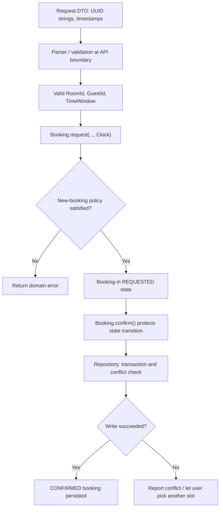
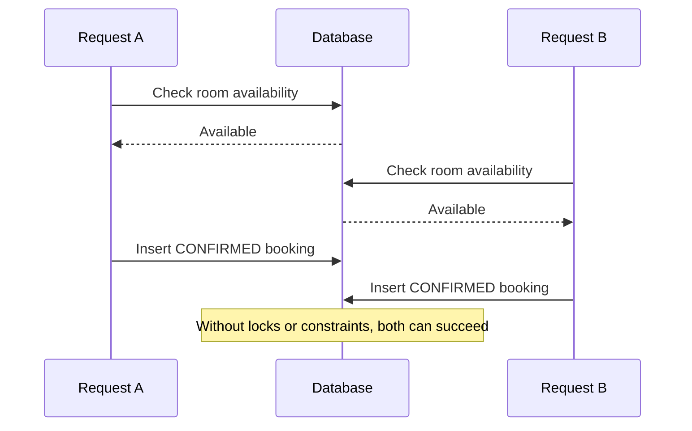

# Constructors, Factories, and Invariants for Valid Object Creation

A Java object can be syntactically constructed yet still be **meaningless from a business standpoint**: a room booking whose end time precedes its start time, an order line with a negative quantity, or an order created directly in a "paid" state without any payment transaction. If such invalid states slip into the system, every consumer of the object has to re-check them repeatedly, and bugs typically surface only during persistence, concurrent processing, or integration with other services.

**Constructors and factories are the boundary where valid objects are formed.** This lesson belongs to the **Java Models** chapter of the **DATABASE_DATA_MODELING** module, where the goal is to translate business requirements into clear entity, relationship, and constraint models; then design normalization, keys, indexes, and physical schemas while considering relational, document, graph, and analytical systems. When validity rules are expressed intentionally in code, we establish a clear basis for deciding which rules must also be enforced at the API, transaction, and database levels.

## 1. What Does a "Valid Object" Mean?

In domain modeling, an **invariant** (business invariant) is a condition that must always hold true whenever an object is observable or usable. Once a `TimeWindow` exists, `start < end` must hold. If an `OrderLine` exists, its quantity must be positive. If a `Booking` is in the `CONFIRMED` state, the system must have all information required for that state.

Validity conditions span multiple scopes:

| Level | Examples | Where to Protect |
| --- | --- | --- |
| **Single field** | `id != null`, quantity `> 0`, non-empty code | Constructor/compact constructor, parser, database constraint |
| **Multiple fields within a value object** | `start < end`; currency must accompany monetary amount | Value object constructor or factory |
| **Multiple fields within an entity/aggregate** | A submitted order must have at least one line; total equals sum of lines per pricing policy | Aggregate creation factory and domain methods |
| **State transitions** | Only a `DRAFT` order can be submitted for approval | Domain method checking the current state |
| **Context-dependent** | Bookings allowed only within the next 90 days | Factory accepting a `Clock`/policy or application service |
| **Cross-entity / transactional** | No two guests may book the same room during overlapping intervals | Transactions, database constraints/locks, and coordinating service |

You cannot put every check inside a constructor: a constructor should not reach out over the network, check user permissions, or silently start a transaction. Nor can you rely solely on the database: an object can be used, computed with, and transmitted **before it is persisted**. The right mindset is to place each check at the proper boundary while preventing invalid states from crossing that boundary.

### Distinguishing Three Easily Confused Concepts

- **Input validation:** does the JSON payload have valid UUID, date, and number formats? Invalid input needs clear user-facing feedback. Input DTOs may temporarily hold raw strings.
- **Model invariants:** a successfully constructed `TimeWindow` must always satisfy `start < end`. Every valid construction path must go through this same rule.
- **Context-dependent business policy:** is a room still available at confirmation time? Policies may evolve over time and depend on shared state, requiring additional checks at execution time.

## 2. When to Use a Constructor, Static Factory, or Factory Service?

| Creation Mechanism | Best Fit When | Strengths | Cautions |
| --- | --- | --- | --- |
| `public constructor` | Inputs are complete and construction has a single unambiguous meaning | Discoverable, direct invocation, ideal for small value objects | Long parameter lists risk swapping arguments; hard to express multiple creation intents |
| **Static factory** such as `of`, `parse`, `createDraft` | Expressive naming, normalization, multiple input forms, or selecting subtypes | Method names clarify intent; can hide the constructor | Avoid turning the factory into a do-everything helper or adding unexpected side effects |
| **Factory service** | Creation requires policies, external services/data sources, or multi-aggregate coordination | Separates context-dependent rules from pure value construction | Check-then-write still has race conditions; must be protected by transactions |
| **Builder** | Many optional fields or multi-step assembly | Readable calls and incremental configuration before building | Intermediate builder state may be incomplete, though the result of `build()` must be valid |

A factory does not require a specific framework or design-pattern ceremony. A method like `static Money.of(...)` is already a static factory. A `BookingService` that instantiates an object after checking policies acts as an application-layer factory. What matters is **who is responsible for enforcing conditions**, not whether a class name ends with `Factory`.

### Example: Compact Constructor for a Value Object

```java
import java.util.Objects;
import java.util.UUID;

record CustomerId(UUID value) {
    public CustomerId {
        Objects.requireNonNull(value, "value");
    }

    static CustomerId parse(String raw) {
        Objects.requireNonNull(raw, "raw");
        return new CustomerId(UUID.fromString(raw));
    }
}
```

Here `new CustomerId(uuid)` fits callers that already hold a `UUID`. `CustomerId.parse(text)` clearly communicates parsing from a string, while the record's canonical constructor centrally enforces `value != null`. Every standard Java path creating a `CustomerId` passes through that check.

Records use a **compact canonical constructor** `public CustomerId { ... }`. In a record, this constructor does not write `this.value = value`; Java automatically assigns the component parameters to the fields after the constructor body finishes. If normalization is needed, reassign the **parameter** inside the compact constructor body before the automatic field assignment occurs.

## 3. Running Example: Creating a Valid Room Booking Request

Suppose a meeting-room management system has these requirements:

1. Each booking has its own ID, room ID, guest ID, time window, and submission timestamp.
2. The time window must have its start earlier than its end.
3. When **creating a new request**, the start time must be in the future, and duration must not exceed 4 hours.
4. Initial status must be `REQUESTED`. Afterward it can be `CONFIRMED` or `CANCELLED`; a cancelled request cannot be confirmed.
5. A room must not have two overlapping confirmed bookings. This rule spans multiple bookings and requires consistent enforcement in storage.

Proposed design:



The diagram shows two distinct protection layers: **single-object validity** and **shared-resource operation validity**. Checking a single object cannot prove a room is still free when concurrent requests are modifying data simultaneously.

### Runnable Java 17+ Code

Save the entire block below to `BookingCreationDemo.java`. The example omits ORM and database code to focus on domain validity. We use `Clock.fixed` so execution results do not depend on the current wall-clock time.

```java
import java.time.Clock;
import java.time.Duration;
import java.time.Instant;
import java.time.ZoneOffset;
import java.util.Objects;
import java.util.UUID;

record BookingId(UUID value) {
    public BookingId {
        Objects.requireNonNull(value, "value");
    }
}

record RoomId(UUID value) {
    public RoomId {
        Objects.requireNonNull(value, "value");
    }
}

record GuestId(UUID value) {
    public GuestId {
        Objects.requireNonNull(value, "value");
    }
}

record TimeWindow(Instant startInclusive, Instant endExclusive) {
    public TimeWindow {
        Objects.requireNonNull(startInclusive, "startInclusive");
        Objects.requireNonNull(endExclusive, "endExclusive");
        if (!startInclusive.isBefore(endExclusive)) {
            throw new IllegalArgumentException(
                "Start must be before end"
            );
        }
    }

    Duration duration() {
        return Duration.between(startInclusive, endExclusive);
    }
}

enum BookingStatus {
    REQUESTED, CONFIRMED, CANCELLED
}

record BookingSnapshot(
    BookingId id,
    RoomId roomId,
    GuestId guestId,
    TimeWindow slot,
    BookingStatus status,
    Instant requestedAt
) {
    public BookingSnapshot {
        Objects.requireNonNull(id, "id");
        Objects.requireNonNull(roomId, "roomId");
        Objects.requireNonNull(guestId, "guestId");
        Objects.requireNonNull(slot, "slot");
        Objects.requireNonNull(status, "status");
        Objects.requireNonNull(requestedAt, "requestedAt");
    }
}

final class Booking {
    private final BookingId id;
    private final RoomId roomId;
    private final GuestId guestId;
    private final TimeWindow slot;
    private final Instant requestedAt;
    private BookingStatus status;

    // All internal construction paths share structural invariants.
    private Booking(
        BookingId id,
        RoomId roomId,
        GuestId guestId,
        TimeWindow slot,
        Instant requestedAt,
        BookingStatus status
    ) {
        this.id = Objects.requireNonNull(id, "id");
        this.roomId = Objects.requireNonNull(roomId, "roomId");
        this.guestId = Objects.requireNonNull(guestId, "guestId");
        this.slot = Objects.requireNonNull(slot, "slot");
        this.requestedAt = Objects.requireNonNull(
            requestedAt, "requestedAt"
        );
        this.status = Objects.requireNonNull(status, "status");
        if (requestedAt.isAfter(slot.startInclusive())) {
            throw new IllegalArgumentException(
                "Request time cannot be after start time"
            );
        }
    }

    // Factory for a NEW request: checks rules at creation time.
    public static Booking request(
        RoomId roomId,
        GuestId guestId,
        TimeWindow slot,
        Clock clock
    ) {
        Objects.requireNonNull(slot, "slot");
        Objects.requireNonNull(clock, "clock");
        Instant now = clock.instant();
        if (!slot.startInclusive().isAfter(now)) {
            throw new IllegalArgumentException(
                "New booking must start in the future"
            );
        }
        if (slot.duration().compareTo(Duration.ofHours(4)) > 0) {
            throw new IllegalArgumentException(
                "Booking duration exceeds four hours"
            );
        }
        return new Booking(
            new BookingId(UUID.randomUUID()),
            roomId,
            guestId,
            slot,
            now,
            BookingStatus.REQUESTED
        );
    }

    // Used internally at the persistence boundary when restoring data.
    // Does not re-check the "must start in the future" rule.
    static Booking restoreFromStorage(
        BookingId id,
        RoomId roomId,
        GuestId guestId,
        TimeWindow slot,
        Instant requestedAt,
        BookingStatus status
    ) {
        return new Booking(
            id, roomId, guestId, slot, requestedAt, status
        );
    }

    public void confirm() {
        if (status != BookingStatus.REQUESTED) {
            throw new IllegalStateException(
                "Only REQUESTED booking can be confirmed"
            );
        }
        status = BookingStatus.CONFIRMED;
    }

    public void cancel() {
        if (status == BookingStatus.CANCELLED) {
            throw new IllegalStateException(
                "Booking is already cancelled"
            );
        }
        status = BookingStatus.CANCELLED;
    }

    public BookingSnapshot snapshot() {
        return new BookingSnapshot(
            id, roomId, guestId, slot, status, requestedAt
        );
    }
}

public class BookingCreationDemo {
    public static void main(String[] args) {
        Clock fixedClock = Clock.fixed(
            Instant.parse("2030-06-01T08:00:00Z"),
            ZoneOffset.UTC
        );

        TimeWindow slot = new TimeWindow(
            Instant.parse("2030-06-01T09:00:00Z"),
            Instant.parse("2030-06-01T10:30:00Z")
        );
        Booking booking = Booking.request(
            new RoomId(UUID.randomUUID()),
            new GuestId(UUID.randomUUID()),
            slot,
            fixedClock
        );

        System.out.println(booking.snapshot().status()); // REQUESTED
        booking.confirm();
        System.out.println(booking.snapshot().status()); // CONFIRMED
        booking.cancel();
        System.out.println(booking.snapshot().status()); // CANCELLED

        // booking.confirm(); // IllegalStateException
        // new TimeWindow(slot.endExclusive(), slot.startInclusive());
        // IllegalArgumentException
    }
}
```

**Notable points:**

- `TimeWindow` cannot have inverted endpoints, even when instantiated elsewhere. This invariant **holds for every interval**, independent of the current date.
- `Booking.request` ties new creation to rules **at request time**, driven by the injected `Clock`. Tests can use a fixed clock without waiting for real time.
- `Booking` keeps its constructor `private`, so regular code cannot pick an arbitrary initial state via `new Booking(..., CONFIRMED)`.
- `confirm` only permits transitions from `REQUESTED`. The check does not live in a public `setStatus` setter; it is bound to the business action.
- `BookingSnapshot` exposes read data at the moment of the call. Even if `Booking` changes state afterward, the earlier snapshot retains the prior state because all record fields used are immutable types.
- `restoreFromStorage` is a controlled reconstitution path for historical data; it still uses the constructor protecting **structural** validity, while intentionally skipping the new-request policy ("must start in the future") for a booking created last month.

This is a minimal model: `restoreFromStorage` has package-private visibility, so it is not a security barrier against code in the same package. In a real system, limit mapper/repository responsibilities and test reconstituted data; never turn a restore path into a public API accepting arbitrary states from users.

## 4. Constructors Protecting Invariants: Validate, Normalize, Copy

### 4.1. Validating Required Preconditions

A good constructor checks conditions determinable from the **current arguments**:

```java
import java.math.BigDecimal;
import java.util.Objects;

record OrderLine(String productCode, int quantity, BigDecimal unitPrice) {
    public OrderLine {
        Objects.requireNonNull(productCode, "productCode");
        Objects.requireNonNull(unitPrice, "unitPrice");
        if (productCode.isBlank()) {
            throw new IllegalArgumentException("Blank product code");
        }
        if (quantity <= 0) {
            throw new IllegalArgumentException("Quantity must be positive");
        }
        if (unitPrice.signum() < 0) {
            throw new IllegalArgumentException("Negative unit price");
        }
    }
}
```

In this example, the constructor prevents an order line with a negative quantity or blank product code. However, a bare `BigDecimal` price does not specify currency. If the system supports multiple currencies, a better model uses `Money` with an explicit currency code and decimal policy. Totals also require checking rounding differences, discounts, and taxes at the aggregate level.

### 4.2. Normalizing Before Assigning Fields

If two textual representations must be treated as the same value, the constructor can normalize them. In a record compact constructor, reassign the component parameter:

```java
import java.util.Locale;
import java.util.Objects;

record ProductCode(String value) {
    public ProductCode {
        Objects.requireNonNull(value, "value");
        value = value.strip().toUpperCase(Locale.ROOT);
        if (!value.matches("[A-Z0-9-]{3,24}")) {
            throw new IllegalArgumentException("Invalid product code");
        }
    }

    static ProductCode parse(String raw) {
        return new ProductCode(raw);
    }
}
```

Under this policy, `ProductCode(" ab-12 ")` and `ProductCode("AB-12")` are equal. Yet this is a **business decision**: do not strip whitespace or alter casing if the source system considers them distinct, especially for identifiers issued by external systems. Once normalized codes are stored as unique keys, the database must have a compatible constraint to avoid situations where the application treats two codes as equal while the database allows two separate rows.

### 4.3. Defensive Copying for Mutable Data

`final` and `record` do not automatically protect mutable components such as `List`s or arrays.

```java
import java.util.List;
import java.util.Objects;

record Basket(List<OrderLine> lines) {
    public Basket {
        Objects.requireNonNull(lines, "lines");
        lines = List.copyOf(lines);
        if (lines.isEmpty()) {
            throw new IllegalArgumentException("Basket cannot be empty");
        }
    }
}
```

`List.copyOf` creates a structurally unmodifiable list and rejects `null` elements. Deep immutability still depends on `OrderLine` inside being immutable as well (here it is a record with immutable components). For `byte[]`, you must copy both on input and on output, or use an appropriate value type; otherwise callers can still mutate state after the constructor has validated it.

## 5. Static Factories Expressing "Creation Intent"

Factory names distinguish construction paths with different meanings:

| Method Name | Common Semantics | Example |
| --- | --- | --- |
| `of(...)` | Create from already-prepared components | `Money.of(amount, currency)` |
| `parse(...)` | Parse a text representation that may have format errors | `CustomerId.parse(raw)` |
| `from(...)` | Convert from another type or representation | `TimeWindow.from(rangeDto)` |
| `createDraft(...)`, `request(...)` | Create an entity in a specific initial state | `Booking.request(...)` |
| `restoreFromStorage(...)` | Reconstitute trusted persisted state at an internal boundary | `Booking.restoreFromStorage(...)` |

These are **naming conventions**, not a standard Java API. Factory names must reflect actual behavior. If `createDraft` returns a submitted entity, a misleading name defeats the design.

A factory can also **select an implementation** based on parameters or reuse immutable objects. However, never cache blindly just because a method is called a factory: entities with identity and mutable state require proper identity, lifecycle, and concurrency rules.

### A Long Constructor Easily Invites Mix-Ups

```java
record ShippingAddress(
    String street,
    String ward,
    String city,
    String province,
    String postalCode
) {}

// Easy to pass same-typed parameters in the wrong order:
// This is only an example of the risk of a long parameter list.
// new ShippingAddress("A", "B", "C", "D", "E");
```

When multiple parameters share type `String`, group them into named value objects such as `Street` and `PostalCode` or use a factory with a structured input. A builder works well when there are many optional fields, provided the final product is validated before being returned.

## 6. Builders Must Never Let Invalid Objects Escape

A builder is a **mutable intermediate object** that may be incomplete, unlike the final product. Therefore `build()` must be the validity enforcement boundary.

Reusing `OrderLine` and `Basket` defined in Section 4, a simple builder can be written as:

```java
import java.util.List;
import java.util.ArrayList;

final class CartDraft {
    private final List<OrderLine> lines = new ArrayList<>();

    CartDraft add(OrderLine line) {
        lines.add(java.util.Objects.requireNonNull(line));
        return this;
    }

    Basket build() {
        return new Basket(lines);
    }
}
```

`new CartDraft()` can temporarily exist with an empty list because it represents an **in-progress build**, not a valid `Basket`. `new CartDraft().build()` is rejected by `Basket`'s constructor. This is cleaner than allowing a `Basket` in a "pending validation" state and forcing every consumer to check `isValid()`.

If business steps span a long period and genuinely need to persist incomplete state, model them as an **explicit valid business state** (for example, `OrderDraft` with rules different from `SubmittedOrder`), rather than treating an under-populated object as a complete entity.

## 7. Differences Between Validation at Creation, Mutation, and Reconstitution

One of the subtlest bugs is applying the same time-dependent rule to **every object instantiation**.

Suppose new room bookings must start in the future. A booking validly created on June 1 for June 2 must still be readable from the database on June 5. If the repository calls `Booking.request` when loading data, the "must start in the future" rule will reject a completely valid historical booking.

Therefore:

- **Durable structural invariants:** non-null ID, `start < end`, status in supported set; checked on both new creation and reconstitution.
- **New-creation policy conditions:** start time in the future, maximum duration under current policy; checked only when accepting a new request.
- **State transition conditions:** confirm only if currently requested, never confirm after cancellation; checked when the operation runs.
- **Global consistency conditions:** no overlapping confirmed bookings for the same room; enforced at the transaction/database level where concurrent requests can be observed.

**Never interpret a reconstitution path as permission to skip all validation.** Database records can also become invalid due to partial migrations, direct writes, legacy versions, or integration bugs. The repository must define supported data formats, verify durable invariants, and have a strategy for malformed records: reject, log, repair via migration, or quarantine the row so invalid models do not propagate.

In **event-sourced** systems, state reconstitution replays historical events under versioned rules rather than re-invoking current commands. Rules governing new commands and rules for reading old events must stay separate so today's business changes do not break historical replay.

## 8. Do Not Confuse Single-Object Validity with System-Wide Consistency

`Booking.request` only sees one booking's slot and the clock at invocation time. It cannot determine whether another process has already booked the room.

Example of two concurrent requests:



Even when both the constructor and `confirm()` are completely correct, both bookings can be valid Java objects **individually**, while the overall dataset becomes inconsistent. Additional safeguards are needed at the persistence layer:

- Define a transaction encompassing both the check and the state change; choose isolation/locking based on the conflict type.
- Use unique constraints for keys and unique codes; for interval bookings, consider an appropriate PostgreSQL **exclusion constraint** to prevent overlapping confirmed intervals for the same room. Merely adding `UNIQUE(room_id, starts_at)` does not prevent intervals with different start times from intersecting.
- For updates to the **same row**, use optimistic locking via `version` to prevent lost updates. Row-level versioning alone cannot stop two separate booking rows from contending for the same room.
- Treat write failures as expected business outcomes: report a conflict, offer alternative slots, or conditionally retry; never assume a pre-write check remains valid at commit time.

## 9. Corresponding Database Constraints

Example PostgreSQL schema for bookings:

```sql
CREATE TABLE room_bookings (
    id UUID PRIMARY KEY,
    room_id UUID NOT NULL,
    guest_id UUID NOT NULL,
    starts_at TIMESTAMPTZ NOT NULL,
    ends_at TIMESTAMPTZ NOT NULL,
    requested_at TIMESTAMPTZ NOT NULL,
    status VARCHAR(16) NOT NULL,
    version BIGINT NOT NULL DEFAULT 0,

    CONSTRAINT ck_time_window
        CHECK (starts_at < ends_at),
    CONSTRAINT ck_requested_at
        CHECK (requested_at <= starts_at),
    CONSTRAINT ck_booking_status
        CHECK (status IN ('REQUESTED', 'CONFIRMED', 'CANCELLED')),
    CONSTRAINT ck_booking_version CHECK (version >= 0)
);
```

The table above reflects invariants **checkable on a single row**. In a system with `rooms` and `guests` tables, consider foreign keys on `room_id` and `guest_id` to those tables when managed in the same database. There is no overlap prevention constraint here yet; that must be designed specifically around the resource scope and status, paired with transactions.

Example conditional update for **one booking** checking both status and version:

```sql
UPDATE room_bookings
SET status = 'CONFIRMED',
    version = version + 1
WHERE id = :booking_id
  AND status = 'REQUESTED'
  AND version = :expected_version;
```

`:booking_id` and `:expected_version` are named parameter placeholders for a data-access library, not SQL syntax executable directly in `psql`. If affected rows equal `0`, the booking may not exist, may have already changed state, or may have been updated by another transaction. The repository must classify the outcome for the application; if an ORM already manages `@Version`, do not manually increment `version` on top of the ORM's mechanism.

### Layer-by-Layer Java ↔ Database Mapping

| Condition | Java | Database |
| --- | --- | --- |
| Valid booking ID | `BookingId` verifies non-null UUID | `PRIMARY KEY`, `NOT NULL` |
| Defined room and guest | Non-null `RoomId`, `GuestId` | `NOT NULL`, `FOREIGN KEY` if applicable |
| Valid time window | `TimeWindow` enforces `start < end` | `CHECK (starts_at < ends_at)` |
| Status in supported set | `BookingStatus enum` | `CHECK`, stable code, or lookup table |
| Valid state transition path | `confirm()`/`cancel()` | `UPDATE ... WHERE status = ...` and transaction |
| No lost updates on same row | Cannot be solved by constructors alone | `version`/optimistic locking |
| No double-booked room | Service validates request, queries conflicts | Transaction and constraints/locks to prevent races |

**Principle:** Java constraints ensure the model is used **meaningfully**, while database constraints protect **shared data across multiple clients and processes**. Intentionally duplicating rules across both layers is sound as long as both express the exact same semantics and are updated together when schemas change.

## 10. JPA/Hibernate, Serializers, and Frameworks That Instantiate Differently

Most ORM frameworks instantiate entities and populate fields differently from a regular `new` call. In JPA, an entity is typically a `class` with a `public` or `protected` no-arg constructor, requiring class and method signatures compatible with provider proxies when needed. Thus, our `final class Booking` with a `private` constructor fits a self-managed domain model, **not code you can slap `@Entity` onto and use as-is**.

There are several approaches for JPA integration:

1. **Separate persistence entities from the domain model:** the repository maps database rows/JPA entities to `Booking` via an internal reconstitution path, keeping domain constructors strict. The trade-off is mapping overhead.
2. **Use the JPA entity directly as the domain entity:** follow JPA's constructor, mapping, lifecycle, and proxy requirements; restrict setters and provide factories/domain methods; combine Bean Validation, database constraints, and real rehydration tests. A framework-only no-arg constructor can create an intermediate state before fields are populated, so never mistake that intermediate state for a business-ready entity.
3. **Use records as DTOs or value objects:** many serializers support records, while mapping a record as a JPA embeddable depends on the JPA/provider version; never assume a record works as a standard JPA entity.

**Validation annotations** like `@NotNull` and `@Positive` only take effect where the framework actively triggers validation; they do not automatically turn every Java constructor into a guarded boundary. Multi-field invariants or before/after state checks still require explicit domain code and appropriate constraints.

**Deserialization** must also be treated as an input path: JSON requests should not directly overwrite an entity's `status` field, nor should clients reach `restoreFromStorage`. Accept a DTO, parse into domain values, invoke a valid factory/command, and map expected exceptions into structured API errors.

## 11. Error Classification and API Design for Object Creation

Not every error should raise the same exception type. Suggestions:

| Scenario | Appropriate Response |
| --- | --- |
| Malformed UUID string or missing JSON field | Return field-level validation error without exposing stack traces |
| Constructor receives `null` for a required field | `NullPointerException` with message or consistent domain error |
| `TimeWindow(end, start)` or negative quantity | `IllegalArgumentException` or domain validation error type |
| Calling `confirm()` on a cancelled booking | `IllegalStateException` or invalid-state domain exception |
| Room was just booked by someone else | Service/repository conflict; return appropriate status such as HTTP 409 |
| Database row violates invariants after migration | Data integrity error; block propagation, log, and fix via remediation process |

A booking creation API might follow this flow:

```text
JSON request
   -> validate syntax and required fields
   -> parse UUID/Instant
   -> RoomId, GuestId, TimeWindow (constructors protect structure)
   -> Booking.request(..., clock) (new-creation policy)
   -> transaction: persist REQUESTED / confirm with conflict check
   -> response DTO from BookingSnapshot
```

Do not use `boolean isValid()` in place of invariants on an already-published object, because callers can forget to call it. Pre-check helpers can be handy for immediate UI feedback, but **the actual creation/write boundary must still validate**.

## 12. Avoid "Patchwork" Setters or Fake Default Values

Examples like the following make invariants hard to enforce:

```java
// Example to avoid: the object can exist in an ill-defined state.
class BadBooking {
    String roomId;
    String guestId;
    java.time.Instant start;
    java.time.Instant end;
    String status = "CONFIRMED";
}
```

A caller can instantiate `new BadBooking()` and read `status` while `roomId` and timestamps are all `null`. Defaulting to `CONFIRMED` even lets an unverified request appear confirmed.

Avoid sentinel values such as `UUID(0,0)`, `"UNKNOWN"`, `1970-01-01`, or magic negative numbers when they are not valid domain values. If data is genuinely optional, model that explicitly (e.g., an unknown field allowed only in `DRAFT`) and validate before transitioning to a state requiring complete information. `Optional` is often helpful on search-result APIs, though not a good default for every entity field.

**Do not leak `this` from a constructor** via callbacks, listener registrations, or starting threads before all fields are initialized; other code could observe a partially constructed state. External side effects such as sending emails, publishing events, and calling payment APIs belong in the application workflow **after** the object is validly created and the transaction reaches the right checkpoint.

## 13. Verifying Creation and Reconstitution Conditions

When designing constructors and factories, test **valid**, **invalid**, and **time/context-sensitive** cases.

| Scenario | Expectation | Verification Point |
| --- | --- | --- |
| `new TimeWindow(t1, t2)` with `t1 < t2` | Created successfully | Record constructor |
| `new TimeWindow(t, t)` | Rejected | Record constructor |
| `new RoomId(null)` | Rejected | Record constructor |
| New request with `start == clock.instant()` | Rejected | `Booking.request` |
| New request longer than 4 hours | Rejected | `Booking.request` |
| Valid new booking with fixed clock | `REQUESTED` | `Booking.request` |
| `confirm()` from `REQUESTED` | `CONFIRMED` | Entity method |
| `confirm()` from `CANCELLED` | Rejected | Entity method |
| Restoring an old booking whose `start` has passed | Succeeds if structurally valid | `restoreFromStorage` |
| Two transactions confirming overlapping slots for a room | At most one valid operation commits per non-overlap policy | Database/transaction |

When rules mention "before 17:00" or "within 30 days", inject `Clock` or a policy abstraction so time boundaries can be tested deterministically. For global data constraints, run real transactional integration tests; a unit test mocking the repository to return "room available" does not prove safety against race conditions.

### Exercise 1 — Designing an Order

An order can be created as `DRAFT` with no line items; when transitioning to `SUBMITTED`, it must have at least one line item, a valid shipping address, and a non-negative total. Once `SUBMITTED`, the line-item list cannot be modified directly.

Propose constructors, static factories, and state transition methods so no incomplete `SUBMITTED` order can exist. Identify which invariants belong to `OrderLine`, which belong to the `Order` aggregate, and which constraints belong in the database.

**Hint:** `Order.createDraft(customerId)` creates a draft state with its own validity rules; `addLine` is permitted while still in draft; `submit(address, pricingPolicy)` validates everything before transitioning state. Do not rely solely on a `submitted` boolean paired with public setters.

### Exercise 2 — Factories Depending on Shared Data

A system issues unique voucher codes per campaign. Two processes concurrently observe that a code does not yet exist and both try to create a voucher with that code. Explain why a valid `VoucherCode` and a valid `Voucher.create(...)` are insufficient to prevent duplicates, and propose an SQL constraint and conflict-handling response.

**Hint:** create a unique constraint on `(campaign_id, code)`, handle unique-violation errors within the transaction, and return an appropriate error. When generating codes automatically, retry with a different code under a bounded retry policy; never assume uniqueness merely because a pre-insert check passed.

### Exercise 3 — Evolving Rules

In year one, each booking may last up to 4 hours. Next year, a new policy caps bookings at 2 hours. Historical 3-hour bookings still need to be loaded and displayed in reports. State where to update the creation rule and how to ensure old records still load cleanly; distinguish schema migration, policy, and API contracts.

**Hint:** update the factory policy for **new commands**; continue accepting historical bookings that satisfy durable invariants. If status semantics change or old records lack newly required fields, define an explicit versioning/migration policy.

## 14. Checklist Before Finalizing the Model

- [ ] Each value object has a constructor/factory enforcing invariants locally so invalid values cannot escape.
- [ ] Each entity is created in a meaningful initial state; callers cannot assign arbitrary states via setters.
- [ ] Durable invariants, creation policies, state transition conditions, and global data conditions are clearly separated.
- [ ] Necessary normalization or defensive copying runs before the object is exposed as valid.
- [ ] A controlled reconstitution path exists for historical data and does not re-run current creation-time policies.
- [ ] API validation, domain rules, and database constraints align, backed by transactions/locking for concurrent consistency.
- [ ] ORMs/serializers cannot bypass invariants through unchecked mapping or deserialization.
- [ ] Edge cases, invalid state transitions, historical data loading, and real write contention are tested.
- [ ] When creation rules change, stored data compatibility, APIs, reports, and migration strategies are evaluated.

**Key takeaway:** constructors enforce **valid value structure**; static factories express **business creation semantics**; domain methods protect **state transitions**; factory services and transactions/databases enforce **context-dependent and shared-data conditions**. Assigning responsibilities cleanly makes the Java model trustworthy and preserves consistency when mapped to a physical schema.
