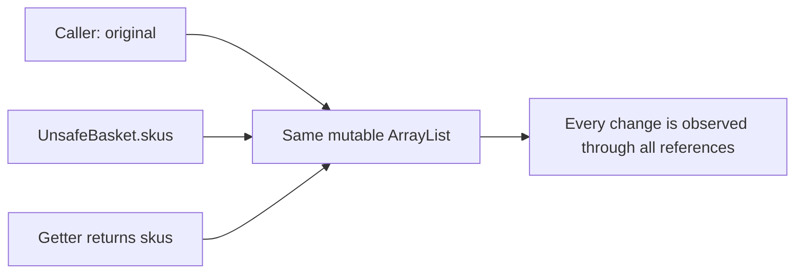
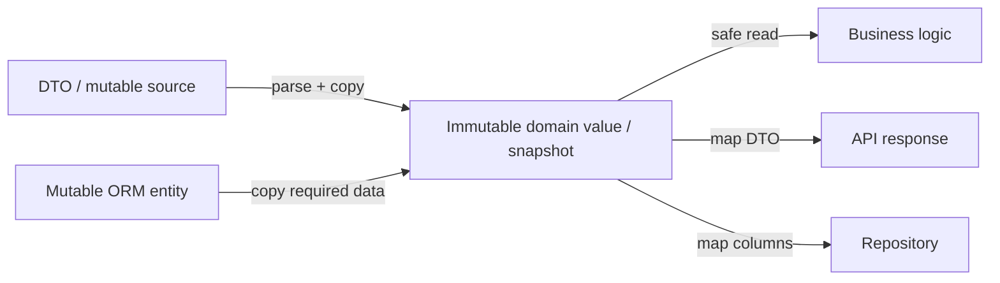

# Designing Immutability and Defensive Copying for Mutable Data

An object declared `final` can still change in subtle, hard-to-spot ways. For instance, an order snapshot holding a `List<OrderLine>` and a `byte[]` binary payload: if external code still holds a reference to the original list or array, it can modify the contents **after the snapshot has been created**. As a result, the displayed total, the API response, and the data written to the database may no longer reflect the same business state.

This lesson belongs to the **Java Models** chapter in the **DATABASE_DATA_MODELING** module. The module's goal is to translate business requirements into clear entity, relationship, constraint, normalization, key, index, and physical schema models; and to compare relational, document, graph, and analytical models so we choose verifiable, evolvable structures. **Immutability** and **defensive copying** preserve data semantics as data crosses these boundaries.

## 1. Immutability Is a Behavioral Contract, Not Just a Keyword

A value is considered immutable if **its observable state cannot change after successful creation**. Having no setters is helpful, but insufficient: a reference to a `List` or `Date` can still be used to mutate the object without ever calling a setter on the enclosing class.

| Concept | Exact Meaning | What Is Not Guaranteed |
| --- | --- | --- |
| `final class` | Cannot be subclassed | Fields and referenced objects can still change |
| `final` on a field | Field reference cannot be reassigned after initialization | Does not prevent modifying contents of the referenced object |
| `private` on a field | Cannot be accessed directly outside the class | Constructors/getters can still leak the reference |
| `record` | Component fields are `private final`; generates accessors, canonical constructor, and component-based equality | Only **shallowly** immutable if components are mutable |
| `Collections.unmodifiableList(list)` | Blocks list mutation **through the wrapper** | Changes to the backing `list` remain observable |
| `List.copyOf(list)` | Returns a structurally unmodifiable list, isolated from later structural edits to a mutable source | Does not deep-copy mutable elements |
| Array `clone()` | Creates a new array with corresponding elements | For object arrays, elements still share references |
| `String`, `UUID`, `Instant`, `BigDecimal` | Common Java value types with immutable behavior | Do not automatically enforce domain rules like currency or valid timestamps |

Three levels must be distinguished:

1. **Reference immutability:** the `final List<Item> items` field always points to the same list instance.
2. **Container structure immutability:** nobody can add, remove, or replace elements in the list through any path.
3. **Deep immutability of the object graph:** both the list and every observable element inside it remain unchanged.

When modeling a business snapshot, you typically need level 3 **for all data within the snapshot's scope**. You do not necessarily have to copy every object in the system: you must determine clearly which parts are owned and which can be safely shared.

## 2. The Root Bug: Multiple References Pointing to Mutable Data

Suppose an application constructs a basket from a list passed in by a controller:

```java
import java.util.ArrayList;
import java.util.List;

final class UnsafeBasket {
    private final List<String> skus;

    UnsafeBasket(List<String> skus) {
        this.skus = skus; // Retains caller's mutable reference.
    }

    List<String> skus() {
        return skus;      // Returns that exact same reference.
    }
}

final class UnsafeBasketExample {
    static void show() {
        List<String> original = new ArrayList<>();
        original.add("BOOK-001");
        UnsafeBasket basket = new UnsafeBasket(original);

        original.clear();
        System.out.println(basket.skus().size()); // 0: modified via input.

        basket.skus().add("PEN-002");              // Modified via output.
    }
}
```

The `final` keyword only stops `skus` from being reassigned; it does not block `clear` or `add` on the underlying list.



This phenomenon is called **aliasing**: multiple variables or fields hold references to the same object. During design, audit both **entry paths** and **exit paths**:

- **Entry paths:** do constructors, factories, setters, builders, mappers, callbacks, or deserializers retain references owned by someone else?
- **Exit paths:** do getters, record accessors, iterators, `stream`s, callbacks, or return methods expose internal mutable state?
- **Nested paths:** inside `List<List<T>>`, `Map<K, MutableValue>`, or `byte[][]`, can inner-layer objects still be mutated?

## 3. Defensive Techniques at Entry and Exit Boundaries

### 3.1. Lists and Maps Holding Immutable Elements

When elements are already immutable, `List.copyOf` and `Map.copyOf` are usually clean choices:

```java
import java.util.List;
import java.util.Map;
import java.util.Objects;

record CatalogView(List<String> productCodes, Map<String, String> labels) {
    public CatalogView {
        productCodes = List.copyOf(
            Objects.requireNonNull(productCodes, "productCodes")
        );
        labels = Map.copyOf(
            Objects.requireNonNull(labels, "labels")
        );
    }
}
```

A `record` compact constructor lets you reassign **component parameters**, which Java then assigns to the `final` fields. After construction, `productCodes()` returns a structurally unmodifiable list, and `labels()` returns an unmodifiable map.

**Limitations and decisions to be aware of:**

- `List.copyOf` and `Map.copyOf` reject `null` elements, keys, and values. This is a helpful safeguard if the model forbids nulls, though it must be an intentional design choice.
- `Map.copyOf` does not guarantee preserving the iteration order of the source map. If order is part of the output contract, use an ordered structure with an appropriate defensive copy rather than relying on incidental ordering.
- `List.copyOf` may reuse an already-immutable list; the goal is **guaranteeing safe contents**, not necessarily allocating a new array every time.
- `List.copyOf` still only copies element references. Using `List<String>` or `List<Instant>` is safer than `List<MutableLine>` when deep immutability is required.

### 3.2. Difference Between Unmodifiable Wrappers and Copies

```java
import java.util.ArrayList;
import java.util.Collections;
import java.util.List;

final class ViewVsCopyExample {
    static void show() {
        List<String> source = new ArrayList<>(List.of("A"));
        List<String> liveView = Collections.unmodifiableList(source);
        List<String> snapshot = List.copyOf(source);

        source.add("B");
        System.out.println(liveView); // [A, B] — sees changes in the source.
        System.out.println(snapshot); // [A]    — retains the value at copy time.
    }
}
```

`Collections.unmodifiableList(source)` **does not copy**; it is merely a view preventing mutations through the wrapper itself. Using `Collections.unmodifiableList(new ArrayList<>(source))` adds a structural copy before wrapping. Neither approach deep-copies mutable elements.

Several expressions that are easy to misunderstand:

| Expression | Mutate structure via result? | Source mutations affect result? | Mutable elements independent? |
| --- | --- | --- | --- |
| `result = source` | Yes | Yes | No |
| `Collections.unmodifiableList(source)` | No | **Yes** | No |
| `new ArrayList<>(source)` | Yes | No for list structure | No |
| `List.copyOf(source)` | No | No for mutable source structure | No |
| `source.stream().toList()` (Java 16+) | No | No for mutable source structure after creation | No |
| Construct new immutable elements then `List.copyOf` | No | No, if all observed data in elements is safely captured | Yes, within captured scope |

When the source is being mutated **concurrently**, both `stream` traversal and list copying require an appropriate synchronization or snapshot contract. Calling `copyOf` does not automatically make multi-field reads atomic.

### 3.3. Arrays and APIs Using Mutable Types

Java arrays can be mutated at any time, even when the field holding the array is `final`. The standard safe rule is **copy on entry, copy on exit**:

```java
import java.util.Arrays;
import java.util.Objects;

final class BinaryValue {
    private final byte[] content;

    BinaryValue(byte[] input) {
        this.content = Objects.requireNonNull(input, "input").clone();
    }

    byte[] content() {
        return content.clone();
    }

    @Override
    public boolean equals(Object other) {
        return this == other
            || (other instanceof BinaryValue that
                && Arrays.equals(content, that.content));
    }

    @Override
    public int hashCode() {
        return Arrays.hashCode(content);
    }
}
```

If you used `record BinaryValue(byte[] content)`, the generated accessor would return the raw array reference unless overridden. Even if you override the accessor to return a copy, the generated `equals` and `hashCode` for an array component still use **reference** equality, not content comparison. Therefore, a `final class` with `Arrays.equals`/`Arrays.hashCode` is usually simpler when an array carries value semantics.

Similarly, legacy classes like `java.util.Date` and `Calendar` are mutable; when forced to interact with them, copy on entry/exit or convert to immutable `java.time` types such as `Instant`, `LocalDate`, or `LocalDateTime`. A read-only `ByteBuffer` created with `asReadOnlyBuffer()` can still share backing memory with the original buffer; if data must remain unchanging, manage buffer ownership or copy first.

## 4. Complete Java 17+ Example: Order Snapshot Protected from Reference Mutation

Suppose the business requirements are:

1. Each order has an identifier, product lines, and display labels.
2. Each line has an SKU code, a positive integer quantity, and a non-negative unit price.
3. The snapshot must preserve the lines and labels as of creation time, even if the controller keeps mutating the input collections.
4. Binary attachment content must be protected on both input and output.

Save the following to `DefensiveCopyDemo.java` to run on **Java 17+**:

```java
import java.math.BigDecimal;
import java.util.ArrayList;
import java.util.Arrays;
import java.util.HashMap;
import java.util.List;
import java.util.Map;
import java.util.Objects;
import java.util.UUID;

record OrderId(UUID value) {
    public OrderId {
        Objects.requireNonNull(value, "value");
    }
}

record OrderLine(String sku, int quantity, BigDecimal unitPrice) {
    public OrderLine {
        Objects.requireNonNull(sku, "sku");
        sku = sku.strip();
        if (sku.isEmpty()) {
            throw new IllegalArgumentException("SKU must not be blank");
        }
        if (quantity <= 0) {
            throw new IllegalArgumentException(
                "Quantity must be positive"
            );
        }
        Objects.requireNonNull(unitPrice, "unitPrice");
        if (unitPrice.signum() < 0) {
            throw new IllegalArgumentException(
                "Unit price must not be negative"
            );
        }
    }

    BigDecimal lineTotal() {
        return unitPrice.multiply(BigDecimal.valueOf(quantity));
    }
}

record OrderSnapshot(
    OrderId id,
    List<OrderLine> lines,
    Map<String, String> labels
) {
    public OrderSnapshot {
        Objects.requireNonNull(id, "id");
        lines = List.copyOf(Objects.requireNonNull(lines, "lines"));
        labels = Map.copyOf(Objects.requireNonNull(labels, "labels"));
        if (lines.isEmpty()) {
            throw new IllegalArgumentException(
                "Order snapshot requires at least one line"
            );
        }
    }

    BigDecimal total() {
        return lines.stream()
            .map(OrderLine::lineTotal)
            .reduce(BigDecimal.ZERO, BigDecimal::add);
    }
}

final class FileContent {
    private final byte[] bytes;

    FileContent(byte[] source) {
        this.bytes = Objects.requireNonNull(source, "source").clone();
    }

    byte[] bytes() {
        return bytes.clone();
    }

    int size() {
        return bytes.length;
    }

    @Override
    public boolean equals(Object other) {
        return this == other
            || (other instanceof FileContent that
                && Arrays.equals(bytes, that.bytes));
    }

    @Override
    public int hashCode() {
        return Arrays.hashCode(bytes);
    }
}

public class DefensiveCopyDemo {
    public static void main(String[] args) {
        List<OrderLine> inputLines = new ArrayList<>();
        inputLines.add(new OrderLine(
            "BOOK-001", 2, new BigDecimal("49.50")
        ));

        Map<String, String> inputLabels = new HashMap<>();
        inputLabels.put("channel", "web");

        byte[] inputFile = { 1, 2, 3 };

        OrderSnapshot snapshot = new OrderSnapshot(
            new OrderId(UUID.randomUUID()), inputLines, inputLabels
        );
        FileContent file = new FileContent(inputFile);

        // Caller mutates source AFTER creating snapshot.
        inputLines.clear();
        inputLabels.put("channel", "mobile");
        inputFile[0] = 9;

        System.out.println(snapshot.lines().size());           // 1
        System.out.println(snapshot.labels().get("channel"));  // web
        System.out.println(snapshot.total());                  // 99.00
        System.out.println(file.bytes()[0]);                   // 1

        // Caller mutates an array returned by the getter.
        byte[] result = file.bytes();
        result[0] = 7;
        System.out.println(file.bytes()[0]);                   // Still 1

        System.out.println(
            file.equals(new FileContent(new byte[] { 1, 2, 3 }))
        );                                                     // true

        // snapshot.lines().clear();
        // Uncommenting will throw UnsupportedOperationException.
    }
}
```

**Design explanation:**

- `OrderLine` only contains `String` and `BigDecimal`, which are immutable types; its constructor rejects non-positive quantities, blank SKUs, and negative prices. It is the **value object** for a captured line.
- `OrderSnapshot` only accepts `List<OrderLine>`, not `List<MutableOrderLine>`. Since elements are immutable, a structural copy via `List.copyOf` suffices for the line data in this example.
- `Map<String,String>` is also content-safe when keys and values are immutable. If a map holds values like `List`, `Date`, or objects with setters, redesign the nested data structure.
- `FileContent` is a `final class` with a private `byte[]` field. Both constructor and getter clone the array; `equals`/`hashCode` compare **array contents** to express value semantics.
- `BigDecimal` in this example does not normalize scale; `new BigDecimal("10.0")` and `new BigDecimal("10.00")` can differ under record `equals`. When unit prices represent money, replace them with `Money` carrying a currency code and explicit normalization/rounding rules.

The scope of "immutable snapshot" here covers **the values held in the snapshot after creation**, not the entire order in storage. A snapshot merely captures one point in time; consistent reads across multiple tables or threads still require additional mechanisms.

## 5. When Copying a Collection Still Allows Mutation: Mutable Elements

`List.copyOf` only captures the **list structure**; it does not turn mutable elements into immutable ones:

```java
import java.util.List;

final class MutableLine {
    private final String sku;
    private int quantity;

    MutableLine(String sku, int quantity) {
        this.sku = sku;
        this.quantity = quantity;
    }

    String sku() {
        return sku;
    }

    int quantity() {
        return quantity;
    }

    void changeQuantity(int next) {
        quantity = next;
    }
}

record ShallowSnapshot(List<MutableLine> lines) {
    public ShallowSnapshot {
        lines = List.copyOf(lines);
    }
}

final class ShallowCopyExample {
    static void show() {
        MutableLine line = new MutableLine("BOOK-001", 2);
        ShallowSnapshot snapshot = new ShallowSnapshot(List.of(line));

        line.changeQuantity(99);
        System.out.println(snapshot.lines().get(0).quantity()); // 99
    }
}
```

Although `snapshot.lines()` forbids `add`/`remove`, the element inside is still the exact same `MutableLine` held by the caller. When creating a snapshot from mutable data, **capture each element into an immutable type**:

```java
import java.math.BigDecimal;
import java.util.List;

final class LineMappingExample {
    static List<OrderLine> snapshotLines(List<MutableLine> drafts) {
        return drafts.stream()
            .map(line -> new OrderLine(
                line.sku(),
                line.quantity(),
                new BigDecimal("49.50") // Example unit price.
            ))
            .toList();
    }
}
```

In the second example, `OrderLine` holds immutable data. If you also need to carry mutable prices, discounts, currency codes, or option lists, create value objects for **every component** instead of skipping them. Reading `sku` and `quantity` from a `MutableLine` must also belong to the same logical point in time: if the source is concurrently mutated between reads, you can still produce an *inconsistent* snapshot even though the captured values are immutable afterward.

### Complex Object Graphs

| Source Structure | Safe Copy When Goal Is an Immutable Snapshot |
| --- | --- |
| `List<String>` | `List.copyOf` if nulls carry no special meaning |
| `List<MutableLine>` | Map each element to an immutable value object, then use an unmodifiable list |
| `Map<String, List<String>>` | Copy each value list, then copy the map |
| `byte[][]` | Copy the outer array and every inner `byte[]` array |
| `Set<MutableKey>` or `Map<MutableKey,V>` | Convert keys to immutable types; mutable key hashes are a major hazard |
| Graphs with reference cycles | Define ownership boundaries; use immutable structures/IDs instead of ad-hoc recursive copying |

For a nested map like `Map<String,List<String>>`, you can write:

```java
import java.util.Map;
import java.util.List;
import java.util.stream.Collectors;

final class NestedCopy {
    static Map<String, List<String>> copy(
        Map<String, List<String>> source
    ) {
        return source.entrySet().stream()
            .collect(Collectors.toUnmodifiableMap(
                Map.Entry::getKey,
                entry -> List.copyOf(entry.getValue())
            ));
    }
}
```

Here both the map and each inner list are unmodifiable, and the strings inside are immutable. If iterating the source map occurs while another thread mutates it, you still need synchronization or a reliable source snapshot.

## 6. Ownership Matters More Than Unconditional Copying

Not every reference is dangerous. If the source type is already immutable and provides no path to expose mutable internal state, it can be **safely shared**:

- `String`, `Instant`, `LocalDate`, `Duration`, `UUID`, and `BigDecimal` can generally be retained directly.
- A `record` containing only immutable value objects is a good candidate for sharing.
- Collections guaranteed unmodifiable by libraries and holding immutable elements can be used directly, depending on the contract.

However, copy or convert to immutable types wherever **ownership crosses a boundary**:



If a factory receives a list that is already immutable, copying it again every time can spend CPU/memory without increasing safety. `List.copyOf` simplifies input contracts, yet does not replace evaluating element counts, size bounds, and the cost of creating large snapshots.

Document the API contract explicitly:

- **Accepts a snapshot:** constructor/factory guarantees no alias to mutable caller input is retained.
- **Returns an immutable value:** callers can read and share safely, and cannot mutate through the result.
- **Returns an intentional mutable copy:** callers are permitted to modify that copy without affecting internal state.
- **Returns a live view:** callers will observe mutations to the backing object; this is a different contract and must be named clearly.

Avoid naming a method `getSnapshot()` if it returns a live view that changes over time.

## 7. Immutability Does Not Automatically Mean a Thread-Safe Snapshot

A properly constructed snapshot can be shared across many reader threads without mutation. However, **the process of capturing a snapshot from mutable sources** may observe data at inconsistent points in time.

For example, inventory has two fields: available quantity and version. If thread A decreases inventory and then increments version while thread B reads both fields without synchronization, B can capture a mismatched pair.

One way to coordinate via an internal lock:

```java
record InventoryView(int available, long version) {
    public InventoryView {
        if (available < 0 || version < 0) {
            throw new IllegalArgumentException("Invalid inventory view");
        }
    }
}

final class Inventory {
    private final Object lock = new Object();
    private int available;
    private long version;

    Inventory(int initial) {
        if (initial < 0) {
            throw new IllegalArgumentException("Negative stock");
        }
        this.available = initial;
    }

    void reserve(int amount) {
        if (amount <= 0) {
            throw new IllegalArgumentException("Non-positive amount");
        }
        synchronized (lock) {
            if (amount > available) {
                throw new IllegalStateException("Not enough stock");
            }
            available -= amount;
            version++;
        }
    }

    InventoryView snapshot() {
        synchronized (lock) {
            return new InventoryView(available, version);
        }
    }
}
```

`snapshot()` captures both `available` and `version` under **the same lock** used by update operations. Consequently, every `InventoryView` represents a consistent state of that `Inventory` object. If any other update path bypasses the lock, this guarantee no longer holds.

Things to distinguish:

- `final` and `List.copyOf` protect immutability **after creation**; they do not make the capture operation atomic.
- `volatile` on a collection reference does not make the collection's elements thread-safe or immutable.
- Copy-on-write and concurrent collections have their own semantics; understand each API's snapshot/iterator guarantees before using them.
- If a snapshot is built from **multiple database rows**, you need an appropriate transaction or consistent-read mechanism. A `synchronized` lock in one JVM cannot synchronize multiple application instances.

## 8. Java Immutability and Storage Consistency Are Two Different Layers

An immutable `OrderSnapshot` in memory does not mean the order row in the database is immutable. Another client can change price or quantity right after the snapshot is read.

Example relational schema for orders and order lines:

```sql
CREATE TABLE purchase_orders (
    id UUID PRIMARY KEY,
    version BIGINT NOT NULL DEFAULT 0,
    created_at TIMESTAMPTZ NOT NULL,
    CONSTRAINT ck_order_version CHECK (version >= 0)
);

CREATE TABLE purchase_order_lines (
    order_id UUID NOT NULL REFERENCES purchase_orders(id),
    line_no INTEGER NOT NULL CHECK (line_no > 0),
    sku VARCHAR(64) NOT NULL,
    quantity INTEGER NOT NULL CHECK (quantity > 0),
    unit_price NUMERIC(20, 4) NOT NULL CHECK (unit_price >= 0),
    PRIMARY KEY (order_id, line_no)
);
```

This is an illustrative model. In multi-currency domains, include currency codes and appropriate rounding/precision policies; `NUMERIC(20,4)` is not a universal default for every price. Schemas also need relationships, constraints, and indexes tailored to actual queries.

When updating an order, you can use **optimistic locking**:

```sql
UPDATE purchase_orders
SET version = version + 1
WHERE id = :order_id
  AND version = :expected_version;
```

`:order_id` and `:expected_version` are data-access library placeholders. If the updated row count is `0`, the record may not exist or may have been modified by another transaction. Wrap the version update and related line modifications **in the same transaction**; every write path must honor the version convention for this mechanism to be reliable. When using an ORM with `@Version`, let the ORM manage the version instead of incrementing it twice.

**Reading multi-table snapshots:** if a repository reads the header first and the lines afterward without guaranteeing a single point-in-time view, an immutable snapshot can record a combination that never existed simultaneously. Use an appropriate consistent query or transaction with a defined isolation level (such as PostgreSQL `REPEATABLE READ` when suitable) to obtain consistent source data before constructing `OrderSnapshot`.

**Immutability does not equal immutable history:** if you require audit logs, event streams, or legally binding records, you need append-only/history storage designs, write-permission controls, and storage-level verification workflows. An immutable Java record does not replace those mechanisms.

## 9. Boundaries Across JPA, APIs, Document, and Analytical Models

### 9.1. Domain Models, JPA Entities, and DTOs

JPA/Hibernate typically manages mutable entity `class`es, tracking changes via a persistence context, lazy loading, and provider constructor/proxy rules. Do not mechanically force every JPA entity to be an immutable `record` or `final` class. Instead, you can:

1. Use JPA entities for persistence and map to **immutable domain snapshots/DTOs** when returning data outward.
2. In the domain layer, use immutable value objects like `Money`, `OrderId`, and `TimeWindow`; map via `@Embeddable` or converters according to JPA/provider capabilities.
3. Never return managed entity lists or ORM lazy collections directly over an API as an "immutable snapshot".
4. When business state must change, execute through domain/service methods and persist inside an explicit transaction; create read snapshots after consistent data is obtained.

Never assume `Collections.unmodifiableList(entity.getLines())` is a snapshot: the underlying list can still change as the ORM loads or updates relationships. Convert each line into an immutable DTO/value object and copy the list after retrieving all required data.

### 9.2. JSON/APIs and Caching

JSON carries no Java memory references once serialized, yet objects **prior to serialization** can still be mutated. APIs should build response DTOs/snapshots from consistently read state, use explicit field types, and prevent deserializers from binding input collections directly into domain entities without validation.

When a cache holds an immutable value object, multiple requests can share the same reference without risking mutation. However, the cache still needs **expiration, update, and invalidation** strategies when source data changes; "caching immutable values" does not mean "cached data is always fresh." When versioned reads are needed, store version/effective timestamps alongside values.

### 9.3. Other Storage Engines

| Storage Engine | Implications for Immutability and Snapshots |
| --- | --- |
| **Relational** | Snapshots may combine multiple rows; use transactions, locks, constraints, and versions to prevent inconsistent reads/writes |
| **Document** | Copy nested Java objects before writing JSON/BSON; atomic updates depend on document boundaries and version/conditional writes; do not confuse in-memory copies with multi-document transactions |
| **Graph** | Snapshots of node/edge relationships require a consistent read timestamp, not just copying one node's properties |
| **Analytical / warehouse** | Immutable events/snapshots help make calculations reproducible, yet still require keys, timestamps, dimension versioning, source-correction policies, and late-arriving data handling |

Across every physical model, ensure the semantics chosen in Java remain intact as data passes through serializers, adapters, databases, and downstream consumers.

## 10. Correctness, Performance, and Memory Cost

Defensive copying is not free. A huge list or a multi-hundred-MB blob can allocate substantial heap data on every request. Still, skipping copies without clear ownership causes far subtler bugs.

Practical strategies include:

- **Eliminate mutability at boundaries first:** use `Instant` instead of `Date`, and immutable value objects instead of unstructured `Map<String,Object>`.
- **Capture only what is needed:** query projections fetch only required fields; avoid copying an entire entity graph just to return a few attributes.
- **Use safe sharing:** references to genuinely immutable data can be shared; `List.copyOf` need not reallocate when the input is already a suitable immutable list.
- **Enforce input limits:** bound file sizes, element counts, JSON depth, and resource budgets before copying untrusted input.
- **Set explicit streaming boundaries:** for large files, streams and checksums often fit better than holding an entire `byte[]` in a value object. The contract then centers on stream consumption/storage rather than an in-heap binary snapshot.
- **Measure before optimizing:** if profiling proves copying is a bottleneck, revisit ownership architecture, immutable data structures, and representation optimization; never return a raw mutable buffer just to save one copy without a safe contract.

**Be careful with data privacy:** copying `byte[]` creates additional copies in memory. It guards against alias mutation, but does not ensure sensitive data is wiped from memory after use. Secrets protection requires dedicated design.

## 11. Common Mistakes When Building Models

| Mistake | Impact | Fix |
| --- | --- | --- |
| `private final List<T>` keeping the mutable input reference | Callers can silently mutate internal state | Copy in constructor/factory |
| Getter returning an internal array | Callers mutate elements despite `final` field | Clone or copy on return |
| Wrapping with `unmodifiableList(source)` and calling it a snapshot | Source mutations still appear in the result | Copy structure before wrapping |
| `List.copyOf(List<MutableItem>)` assuming deep immutability | Elements can still be mutated | Convert elements to immutable types |
| `record X(byte[] data)` expecting content-based `equals` | Two arrays with identical bytes compare unequal | Use a class with `Arrays.equals`/`hashCode` or custom comparison semantics |
| Snapshot read from two unsynchronized sources | Data may reflect different points in time | Use locks, transactions, or a suitable snapshot contract |
| Cache storing shared mutable DTOs | One request corrupts another | Cache immutable values; replace with new versions on update |
| Copying entire graphs everywhere | Wastes memory, CPU, and adds complexity | Clarify ownership and required capture scope |
| Assuming immutable records protect the DB | Lost updates and overwritten history still occur | Add transactions, constraints, versions, and auditing as needed |

## 12. Self-Check with Edge Cases

Distinguish **post-creation immutability** from **creation-time consistency** with these test cases:

| Case | Expected Result |
| --- | --- |
| Caller clears source list after `new OrderSnapshot(...)` | List inside snapshot remains intact |
| Caller mutates source labels map | Labels inside snapshot remain intact |
| Caller calls `snapshot.lines().clear()` | Throws `UnsupportedOperationException` |
| Caller mutates input `byte[]` or array returned by getter | Contents of `FileContent` remain unchanged |
| Two `FileContent` instances hold distinct byte array references with identical bytes | `equals` returns `true`, `hashCode` is consistent |
| A `MutableLine` inside `List.copyOf` is mutated | Shallow snapshot still sees the mutation — shows why elements must be copied |
| `Map<String,List<String>>` copied at each nesting layer | Neither map structure nor inner lists change when source mutates |
| Two threads update and read `Inventory` under the same lock | Each `InventoryView` captures a consistent state/version pair |
| Repository reads header and details from two different DB snapshots | Semantics can be inconsistent even though the Java object is immutable |
| Adding a field to a published API DTO/snapshot | Requires evaluating serialization/schema and client compatibility |

Do not merely check whether setters exist. Hold a reference to the mutable input, instantiate the object, mutate the input, and inspect the output; also attempt to mutate the output itself. For nested data, mutate **inner-layer elements**. For concurrent sources, test snapshot creation while state is changing, ideally with controlled thread coordination or integration tests.

## 13. Applied Exercises

### Exercise 1 — Order with a Mutable Line List

An API receives `List<LineDraft>`, where `LineDraft` has setters for quantity and unit price. After creating the `OrderView` response, logging middleware or the controller still retains references to the original drafts.

Choose:

1. Java types for `LineDraft` and `OrderLine`; explain why `List.copyOf(drafts)` alone is insufficient.
2. How to convert lines into immutable value objects before constructing `OrderView`.
3. Where to validate positive quantity, non-negative price, currency codes, and total calculation logic.
4. How to ensure reading the order and its lines from the database reflects a single consistent point in time.

**Hint:** use mutable DTOs at the boundary if required by the framework, convert each line to an immutable `OrderLine`, then build `OrderView` holding a safe `List<OrderLine>`. Shared constraints belong in both the domain and database, while multi-table reads require an appropriate transaction/consistency mechanism.

### Exercise 2 — Attachments and Hashing

A `record Attachment(byte[] data)` is used as a `HashMap` key. Two uploads have identical bytes in different arrays; after inserting into the map, the caller mutates the source array.

Identify two distinct bugs: **reference-based equality** and **mutable aliasing**. Propose a replacement type with input size validation, defensive copy on entry/exit, and content-based `equals`/`hashCode`. Analyze the cost when blobs are very large.

**Hint:** a `final class` owning a cloned array and comparing via `Arrays.equals`; for large blobs, consider object storage and representing immutable metadata/hash/IDs alongside actual integrity verification.

### Exercise 3 — Inventory Snapshot Across Multiple Processes

A system reads inventory from two tables, `stock_balances` and `stock_reservations`, and emits `InventorySnapshot(available, reserved, version)`. Multiple processes place orders and release stock concurrently.

Explain why an immutable `record` and `List.copyOf` do not guarantee `available + reserved` corresponds to a single point in time. Design appropriate transaction boundaries, conditional writes, or atomic update models; explain how to detect stale snapshots.

**Hint:** require a consistent snapshot view when reading across tables; when writing, protect shared resources using transactions, locks, or version conditions. Use a version field to detect changes across requests, without treating in-JVM copying as a database lock.

## 14. Checklist Before Finalizing Models and Schemas

- [ ] Identified data owned by the object vs. references that may be safely shared.
- [ ] Distinguished `final`, unmodifiable views, shallow copies, and deep immutability.
- [ ] Constructors/factories defensively copy mutable collections, arrays, or objects on entry.
- [ ] Getters/accessors do not expose internal mutable data outside the published contract.
- [ ] When collections hold mutable elements, each element is copied/converted as needed.
- [ ] When value objects hold arrays, `equals`/`hashCode` compare contents when semantics require it.
- [ ] Verified invariants during snapshot creation, including when sources are updated concurrently.
- [ ] Defined transactions, locks, versions, and database constraints where consistent reads/writes are required.
- [ ] DTOs, JPA entities, and JSON/document/analytics representations preserve snapshot semantics.
- [ ] Accounted for data size, copying overhead, API compatibility, and historical lifecycle.

**Key takeaway:** immutability is the promise that **a created value will not change through any valid reference**. Defensive copying enforces that promise at boundaries involving mutable data. For a snapshot to remain meaningful to the business, sources must also be read in a consistent state and writes must be protected with appropriate database mechanisms.
