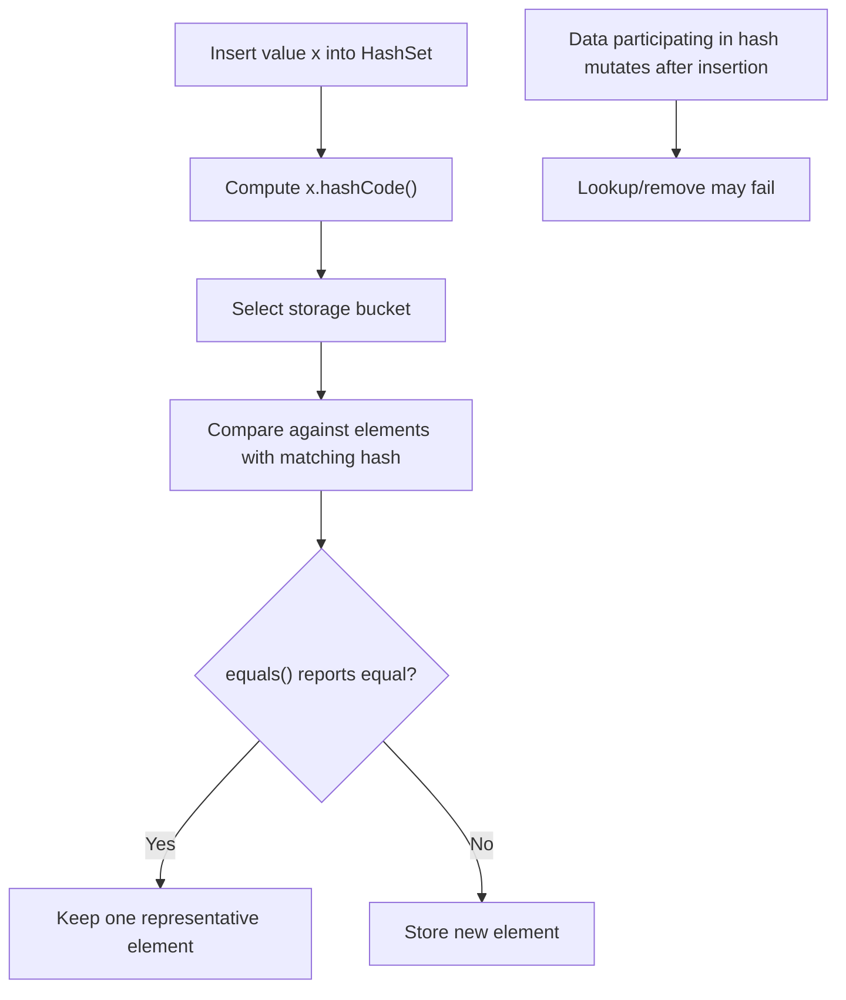

# `equals` and `hashCode` Based on Entity or Value Semantics

Two Java objects with identical displayed fields do not necessarily represent the same entity. Conversely, two objects loaded by separate queries can represent **the exact same order**, even though they reside at different memory addresses and reflect states read at different times. How `equals` and `hashCode` are implemented governs how `HashSet`, `HashMap`, `distinct()`, duplicate checks, and many library mechanisms interpret **"equality"**.

This lesson belongs to the **Java Models** chapter of the **DATABASE_DATA_MODELING** module. Within this module, we translate business requirements into clear entities, relationships, and constraints; connect Java semantics to keys, uniqueness, normalization, indexes, and physical schemas; and recognize when relational, document, graph, or analytical models represent identity and value differently. The goal is to choose **equality rules suited to the business domain**, then uphold them consistently across Java, APIs, and databases.

## 1. The First Question: "Equal" in What Sense?

In an ordering application:

- Two amounts `Money(10.00, USD)` with the same currency and value are **two equal values**, regardless of which request or query created them.
- Two `OrderId` values holding the same UUID represent **the same identifier value**.
- Two `Order` objects representing the same order ID may be the **same business entity**, even if one is `DRAFT` and the other is `PAID`.
- Two orders with the same customer, same order lines, and same total amount are still **two distinct entities** if they have different `OrderId`s.
- Two report export rows with identical columns may be **two observations carrying the same values**; if the business must preserve both underlying transactions, deduplicating across all columns will lose data.

Quick distinction:

| Concept | Typically Appropriate Equality Semantics | Example |
| --- | --- | --- |
| **Value object** | All **meaningful** components equal after normalization | `Money`, `Quantity`, `TimeWindow` |
| **Typed ID** | Inner value equal **and same ID type** | `OrderId` distinct from `CustomerId` |
| **Entity with stable ID** | Same business identity, independent of mutable state | `Order` with the same `OrderId` |
| **Snapshot/DTO** | All selected snapshot fields equal | `OrderSnapshot`, `PriceQuote` |
| **Event** | Depends on contract: same event ID or same payload? | Two events with identical payloads can still be two separate occurrences |
| **Catalog/configuration** | Must define the business key or data identity upfront | Currency code, warehouse code, supplier code |

Never apply the same policy to every class just because the IDE has a *Generate equals/hashCode* button. Write down a testable statement, such as: "Two `Order` instances are equal if and only if they represent the same `OrderId`," or "Two `Money` instances are equal when their normalized amounts and currencies match."

## 2. Java's `equals` and `hashCode` Contract

`Object.equals(Object)` and `Object.hashCode()` carry strict requirements:

1. **Reflexive:** for any non-`null` object `x`, `x.equals(x)` must return `true`.
2. **Symmetric:** `x.equals(y)` and `y.equals(x)` must return the same result.
3. **Transitive:** if `x.equals(y)` and `y.equals(z)`, then `x.equals(z)`.
4. **Consistent:** if comparison inputs do not change, repeated calls must return the same result.
5. **Against `null`:** `x.equals(null)` must always return `false`.
6. **Relation to hash:** if `x.equals(y)`, then **strictly** `x.hashCode() == y.hashCode()`.

The converse is **not true**: two unequal objects may still share the same hash (a hash collision). A hash is a bucketing mechanism to speed up lookups, **not sole proof of identity**. A good `hashCode` distributes reasonably well, yet honoring the contract matters far more than attempting to manufacture a "unique" hash.

Diagram of impact on `HashSet`:



With default `Object`, `equals` checks **reference identity** and `hashCode` aligns with that semantics. Whenever overriding `equals`, override `hashCode` accordingly. Never assume the default `hashCode` is always a physical memory address; the JVM makes no such guarantee.

### Quick Audit Checklist for an Implementation

| Question | Why It Matters |
| --- | --- |
| Does `equals(null)` return `false`? | Preserves the Object contract |
| Is it symmetric across superclass/subclass, proxies, and domain objects? | Prevents results from depending on argument order |
| Do fields in `equals` participate in `hashCode` with the same semantics? | Ensures maps/sets locate elements properly |
| Can those fields mutate while the object is a map key? | Prevents "losing" elements in hash buckets |
| Does a transient object already have a stable ID? | Determines whether ID-based identity is safe |
| Do Java rules match DB unique constraints/collations? | Prevents Java treating two values as duplicates while DB stores two rows, or vice versa |

## 3. Value Objects: Equal by Meaningful Data

Value objects have no separate lifecycle or identity. When their values are equivalent under domain rules, they should compare equal. With Java 17+, `record` is convenient because it generates `equals` and `hashCode` across all **record components**.

Strongly typed identifiers example:

```java
import java.util.Objects;
import java.util.UUID;

record OrderId(UUID value) {
    public OrderId {
        Objects.requireNonNull(value, "value");
    }
}

record CustomerId(UUID value) {
    public CustomerId {
        Objects.requireNonNull(value, "value");
    }
}
```

Two `new OrderId(sameUuid)` instances are equal by value, whereas `OrderId` and `CustomerId` are not equal even when wrapping the same UUID. This is a double benefit of typed IDs: the compiler prevents passing the wrong type, and `equals` respects identifier type boundaries.

### 3.1. Normalizing Before Comparing

A value object may need to normalize inputs so two representations with the same meaning produce identical components:

```java
import java.util.Locale;
import java.util.Objects;

record Sku(String value) {
    public Sku {
        Objects.requireNonNull(value, "value");
        value = value.strip().toUpperCase(Locale.ROOT);
        if (!value.matches("[A-Z0-9-]{3,32}")) {
            throw new IllegalArgumentException("Invalid SKU");
        }
    }
}
```

Under that **business-approved** rule, `Sku(" book-01 ")` equals `Sku("BOOK-01")`. If an external source considers letter case or whitespace significant, do not normalize automatically. Normalization rules must be documented and kept consistent with stored data, validation, and unique constraints.

### 3.2. `BigDecimal`: Numerically Equal Does Not Always Mean `equals`

`BigDecimal` considers scale in `equals`:

```java
import java.math.BigDecimal;

final class DecimalEqualityExample {
    static void show() {
        BigDecimal a = new BigDecimal("10.0");
        BigDecimal b = new BigDecimal("10.00");

        System.out.println(a.compareTo(b) == 0); // true
        System.out.println(a.equals(b));          // false
        System.out.println(a.hashCode() == b.hashCode()); // false
    }
}
```

When `record Money(BigDecimal amount, Currency currency)` uses default `equals`, `10.0 USD` and `10.00 USD` will differ unless normalized. Never write `equals` using `compareTo() == 0` while keeping BigDecimal's default `hashCode`, because equal objects would then produce different hashes.

In some domains, scale itself **carries meaning** (for example, measurement precision of `2.50` vs `2.5`). Decide semantics according to the business domain and design the type accordingly.

### 3.3. Arrays and Mutable Collections

`record Payload(byte[] bytes)` does not automatically compare array contents: `byte[]` compares by reference by default. If bytes represent a value needing content comparison, use defensive copying and `Arrays.equals`/`Arrays.hashCode` as in this example:

```java
import java.util.Arrays;
import java.util.Objects;

final class BinaryKey {
    private final byte[] bytes;

    BinaryKey(byte[] source) {
        this.bytes = Objects.requireNonNull(source, "source").clone();
    }

    byte[] bytes() {
        return bytes.clone();
    }

    @Override
    public boolean equals(Object other) {
        return this == other
            || (other instanceof BinaryKey key
                && Arrays.equals(bytes, key.bytes));
    }

    @Override
    public int hashCode() {
        return Arrays.hashCode(bytes);
    }
}
```

If a component is a `List<T>`, `List.equals` itself compares elements in order, yet a mutable list can still alter equality/hash results after the object enters a set or map. To act as a stable value object, copy the list and ensure every element participating in equality is also immutable. For `Set`, order is irrelevant in equality; for `Map`, comparison is based on the entry set regardless of iteration order. Choose the collection matching the data semantics.

## 4. Entities: Equal by Business Identity

An entity maintains a stable identity across its lifecycle, even as its state changes. For example, an order:

```text
Order{id=O-123, status=DRAFT, total=0}
                     |
                     v
Order{id=O-123, status=PLACED, total=100}
                     |
                     v
Order{id=O-123, status=PAID, total=100}
```

If `Order` compared all attributes, changing status would make the "same order" look unequal. If `Order` were placed as a `HashMap` key and `status` changed, its hash would change, breaking lookups.

A clean approach for self-managed domain objects is **assigning an immutable ID at creation time** and comparing by ID:

```java
import java.util.Objects;
import java.util.UUID;

record OrderId(UUID value) {
    public OrderId {
        Objects.requireNonNull(value, "value");
    }
}

enum OrderStatus { DRAFT, PLACED, PAID }

final class Order {
    private final OrderId id;
    private OrderStatus status;

    private Order(OrderId id, OrderStatus status) {
        this.id = Objects.requireNonNull(id, "id");
        this.status = Objects.requireNonNull(status, "status");
    }

    static Order createDraft() {
        return new Order(
            new OrderId(UUID.randomUUID()), OrderStatus.DRAFT
        );
    }

    // Example rehydration used in a trusted repository layer.
    static Order reconstitute(OrderId id, OrderStatus status) {
        return new Order(id, status);
    }

    OrderId id() {
        return id;
    }

    OrderStatus status() {
        return status;
    }

    void place() {
        if (status != OrderStatus.DRAFT) {
            throw new IllegalStateException("Only DRAFT may be placed");
        }
        status = OrderStatus.PLACED;
    }

    void pay() {
        if (status != OrderStatus.PLACED) {
            throw new IllegalStateException("Only PLACED may be paid");
        }
        status = OrderStatus.PAID;
    }

    @Override
    public boolean equals(Object other) {
        return this == other
            || (other instanceof Order that
                && id.equals(that.id));
    }

    @Override
    public int hashCode() {
        return id.hashCode();
    }
}

public class EntityEqualityDemo {
    public static void main(String[] args) {
        Order first = Order.createDraft();
        java.util.Set<Order> known = new java.util.HashSet<>();
        known.add(first);

        Order loaded = Order.reconstitute(
            first.id(), OrderStatus.PAID
        );

        System.out.println(first == loaded);      // false
        System.out.println(first.equals(loaded)); // true
        System.out.println(known.contains(loaded)); // true

        first.place();
        first.pay();
        System.out.println(known.contains(first)); // true
    }
}
```

**Limitations to understand:** this is a standalone domain `final class`, **not yet a JPA entity**. It receives a stable ID at construction, so `hashCode` never changes across state transitions. Two instances with the same ID and different statuses share the same identity, **which does not mean the two state snapshots are consistent or can be merged automatically**. During persistence, version control, transactions, and concurrency handling are still required.

If the identifier could change, ID-based equality would no longer be stable. That is why `Order.id` is `private final` with no setter. Designs using database-generated IDs must handle pre-persist state separately.

## 5. Values and Entities Behave Differently in `HashSet` and `HashMap`

For `HashMap<OrderId, Order>`, the immutable `OrderId` is a safe key that avoids complications when the entity changes state. For `Map<Money, PriceTier>`, amount normalization and currency policies become critical. For `Map<Order, Metadata>`, the entity's hash implementation must remain stable throughout its lifetime as a map key.

### 5.1. Example Bug from Mutable Fields Participating in Hash

```java
import java.util.HashSet;
import java.util.Objects;
import java.util.Set;

final class BadTicket {
    private final String id;
    private String status;

    BadTicket(String id, String status) {
        this.id = Objects.requireNonNull(id);
        this.status = Objects.requireNonNull(status);
    }

    void setStatus(String next) {
        status = Objects.requireNonNull(next);
    }

    @Override
    public boolean equals(Object other) {
        return this == other
            || (other instanceof BadTicket that
                && id.equals(that.id)
                && status.equals(that.status));
    }

    @Override
    public int hashCode() {
        return Objects.hash(id, status);
    }
}

final class MutableHashExample {
    static void show() {
        Set<BadTicket> tickets = new HashSet<>();
        BadTicket ticket = new BadTicket("T-1", "OPEN");
        tickets.add(ticket);

        ticket.setStatus("CLOSED");
        // contains/remove may fail: the hash has changed.
        System.out.println(tickets.contains(ticket));
    }
}
```

There is no guarantee `contains` will locate the element after mutating fields included in the hash. Behavior depends on buckets and runtime hash collisions. For entities, derive `equals`/`hashCode` from a stable ID, or use an **immutable ID as the key** if the entity lifecycle is complex. For value objects, forbid mutating hash-participating components after creation.

### 5.2. Never Use a Hash as a Unique Identifier

Hash equality never proves two values are identical. Never use Java's 32-bit `hashCode` as a primary key, transaction ID, or security fingerprint. If you need to verify file contents, choose a strong digest (such as SHA-256) and a proper verification protocol; even then, distinguish content digests from business IDs and plan collision handling per system requirements.

## 6. Java Records: Strengths and Limits of Auto-Generated Equality

Given a record:

```java
record Coordinates(double latitude, double longitude) {}
```

Java generates `equals`/`hashCode` from the `latitude` and `longitude` components. This works well when the value is strictly a coordinate pair under a clear convention; however, not every record is automatically a **domain-sound** value object.

Cases requiring attention:

- **`BigDecimal`:** different scales affect `equals` unless normalized in the constructor.
- **`byte[]` and other arrays:** default to reference-based array equality.
- **Mutable lists:** a record has final fields, yet the list or its elements can still mutate and change `equals`/`hashCode`.
- **Floating-point numbers:** for locations or measurements, two nearby numbers are not automatically equal. Putting an `epsilon` tolerance inside `equals` can break **transitivity**: A is near B, B is near C, yet A is not near C.
- **DTO/API snapshots:** equality covers all components; adding a new field changes equality semantics. When independent identity is needed, do not confuse a DTO with an entity.

Example enforcing deep immutability for a list:

```java
import java.util.List;
import java.util.Objects;

record CartSnapshot(List<String> skuCodes) {
    public CartSnapshot {
        skuCodes = List.copyOf(
            Objects.requireNonNull(skuCodes, "skuCodes")
        );
    }
}
```

`String` is immutable, so this `CartSnapshot` has both an unmodifiable list and immutable elements; record `equals`/`hashCode` remain stable after creation. If replaced with `List<MutableCartLine>`, `List.copyOf` only protects list structure, not individual element values.

## 7. Equality Across Inheritance: Preserving Symmetry and Transitivity

Class hierarchies complicate equality. If a superclass uses `instanceof Parent` and a subclass adds fields to `equals`, you can end up with:

```text
parent.equals(child) == true
child.equals(parent) == false
```

This violates symmetry. One clean approach for value objects is using `final class` or `record` so inheritance cannot alter the set of fields participating in equality. When inheritance is used, design equality holistically across the hierarchy (type-matching rules, fields, symmetry/transitivity) rather than tacking on `super.equals(...)` ad hoc.

Two type-checking choices carry different consequences:

| Type Check | Advantage | Risk |
| --- | --- | --- |
| `getClass() == other.getClass()` | Only compares identical runtime classes, preventing certain inheritance bugs | ORM proxies have a different runtime class than the target entity |
| `other instanceof MyFinalClass` | Clean for non-extensible types; accommodates proxies when subtypes are possible | If the class is non-final and subclasses extend equality arbitrarily, contracts can break |

Never apply a single "trick" blindly across all JPA entities. Proxies, bytecode enhancement, and entity hierarchies behave differently depending on the provider and mapping strategy; choose an equality policy testable across separate persistence contexts.

## 8. JPA/Hibernate: Post-`persist` Generated IDs and Proxies

This differs from the `Order` example where an ID is assigned immediately at creation:

1. `new CustomerEntity()` has no `id` yet when the database generates keys.
2. After `persist`/`flush` (depending on strategy), the entity receives an ID.
3. Objects representing the same row can be loaded via `find`, `getReference`, or another persistence context.
4. Hibernate may generate proxies or use bytecode enhancement; runtime classes and loading timing can differ across instances.

### 8.1. Why Comparing IDs with `Objects.equals(id, other.id)` Can Fail

Two **newly created, unsaved** entities both have `id == null`. If `equals` simply checks `Objects.equals(id, other.id)`, they compare equal despite being two distinct new entities. This causes a `Set` to drop one element or corrupts associations prior to persist.

### 8.2. Why Computing `hashCode` from a Late-Generated ID Can Fail

An unsaved entity inserted into a `HashSet` has `id == null`. After persist, an ID is assigned, the ID-based hash changes, and subsequent `contains`/`remove` calls may fail. Generating IDs prior to persist avoids this, though not every design allows it.

### 8.3. Strategies to Consider

| Strategy | When Appropriate | Trade-offs / Conditions |
| --- | --- | --- |
| **Assign stable ID at creation** (UUID, ULID per policy) | Domain model owns ID generation without relying on DB assignment | Must ensure generation quality and uniqueness constraints; handle legacy imports carefully |
| **Immutable, unique business key** | A stable domain-recognized code exists with a matching DB constraint | Unsuitable if the key can actually change or is absent at creation |
| **DB-generated ID; transient entity equals only itself; constant/stable hash** | Identity needed post-persist without changing collection hashes | Must handle proxies/classes and hash distribution trade-offs; test with actual provider |
| **Keep entities inside persistence context; use ID/value DTOs in external maps/sets** | Avoids using entities as long-lived hash keys | Still requires clear rules for ORM-managed association collections |

A simple **non-proxy** illustration for an entity with a late-assigned ID:

```java
import java.util.Objects;

class GeneratedIdEntity {
    private Long id; // null before an ID is assigned.

    Long id() {
        return id;
    }

    void assignIdForDemo(Long value) {
        if (id != null) {
            throw new IllegalStateException("ID already assigned");
        }
        id = Objects.requireNonNull(value, "value");
    }

    @Override
    public final boolean equals(Object other) {
        if (this == other) {
            return true;
        }
        if (!(other instanceof GeneratedIdEntity that)) {
            return false;
        }
        return id != null && id.equals(that.id);
    }

    @Override
    public final int hashCode() {
        // Does not change when id transitions from null to an actual value.
        return GeneratedIdEntity.class.hashCode();
    }
}
```

The snippet above illustrates only two points: **distinct transient entities are not equal** and **the hash does not change when an ID is assigned**. A per-class constant `hashCode` can degrade performance when large sets/maps hold many instances of the same class. More importantly, this is **not a complete JPA/Hibernate recipe**: `final equals`, `instanceof`, proxies, entity hierarchies, field vs. property access strategies, and provider proxy rules interact in subtle ways. In real JPA projects, choose entity/proxy type checks suited to your provider and test with `find`, `getReference`, transient/managed/detached states, and associations.

Never expose public setters to alter an ID or business key if those fields form the basis of equality. For natural business keys, verify that they are **truly immutable** per product rules: customer emails, phone numbers, and display names are often editable, making them poor choices for entity identity.

## 9. `equals` Is Not a Database Unique Constraint

In Java, `equals` only applies to objects currently compared in memory. In the database, **primary/unique keys and transactions** protect data across concurrent requests and multiple processes.

Suppose:

```sql
CREATE TABLE orders (
    id UUID PRIMARY KEY,
    customer_id UUID NOT NULL,
    status VARCHAR(16) NOT NULL,
    total_amount NUMERIC(20, 2) NOT NULL,
    currency_code CHAR(3) NOT NULL,
    version BIGINT NOT NULL DEFAULT 0,
    CONSTRAINT ck_total_amount_nonnegative CHECK (total_amount >= 0),
    CONSTRAINT ck_version_nonnegative CHECK (version >= 0)
);

CREATE TABLE customers (
    id UUID PRIMARY KEY,
    customer_code VARCHAR(32) NOT NULL UNIQUE,
    display_name TEXT NOT NULL
);
```

These are two illustrative tables; a complete system also requires a `FOREIGN KEY` from `orders.customer_id` to `customers.id` when managed in the same database, along with keys and indexes tailored to queries. `Order` compares equal by `id`, whereas `customer_code` is a customer's unique business code; the two concepts may serve different equality/lookup roles. Never use `total_amount`, `status`, or `display_name` as identity if they are allowed to change.

### Watch Out for Normalization and Collation Rules

If `Sku("ab-1")` equals `Sku("AB-1")` because Java uppercases values, yet the DB column uses a case-sensitive collation and stores both strings, the database may allow rows that Java considers duplicates. Conversely, a DB using a case-insensitive/accent-insensitive collation or different whitespace semantics than Java may reject a pair of values that Java considers distinct.

Define the **canonical stored form**, corresponding unique indexes/constraints, and a migration policy if legacy data violates the rule. Never rely on `equals` to replace `UNIQUE`, and never assume every database compares strings identically to Java.

### Write Consistency

Two transactions can both check "customer code does not exist yet" and then both attempt to insert. Checking a `HashSet` or calling `equals` in one JVM does not prevent races across processes. A `UNIQUE(customer_code)` constraint forces the database to accept at most one row under proper conditions; the application must handle duplicate errors and optionally perform bounded retries when codes are auto-generated.

If one order is loaded and modified differently by two transactions, ID-based equality still returns `true`; it **does not detect lost updates**. Use `version`/optimistic locking or another transaction/locking strategy as required. Equality only answers "is this the same business object?", not "is this copy of the data still current?"

## 10. Relational, Document, Graph, and Analytical Models

Identity or value semantics must be preserved when mapping Java objects to each storage engine:

| Storage Model | Identity | Value Equality / Key Considerations |
| --- | --- | --- |
| **Relational** | Primary keys, foreign keys, unique constraints; Java entities map by ID | Columns across tables can be combined into DTOs/records with content equality; align normalization and collation |
| **Document** | `_id` or document key can serve as stable identity | Two documents with identical payloads but different `_id`s are usually different entities; nested values can compare equal by content |
| **Graph** | Node/edge IDs or business keys depending on graph DB and domain | Two nodes with the same label/properties are not necessarily the same entity; relationships between nodes have their own identity and validity periods |
| **Analytical / warehouse** | Business keys, surrogate keys, event IDs, effective timestamps | Two fact rows with identical metrics are not necessarily duplicate events; dimension snapshots are versioned; deduplication must follow explicit keys and policies |

For example, in an analytics pipeline, two "order placed for 100 USD" events with identical payloads but different event IDs can be **two genuine events**. Deduplicating via `record PurchaseEvent(amount, currency)` risks dropping real transactions. Identify the event ID, source, and timestamp; event IDs can drive idempotency per the event contract, while payload equality remains useful for comparing values.

## 11. Common Mistakes and Fixes

| Mistake | Consequence | Fix |
| --- | --- | --- |
| Overriding `equals` without overriding `hashCode` | Two equal objects land in different hash buckets | Implement and test both in sync |
| Comparing entities across all mutable fields | Same entity compares unequal after updates; `HashSet` lookups fail | Use stable identity |
| Comparing two new entities via `null == null` on ID | Two transient entities compare equal | Only equate by ID when non-null, or assign IDs early |
| Computing hash from a late-generated ID | Hash changes after persist | Design a stable hash or use separate ID/value keys |
| Using `BigDecimal.compareTo` in `equals` while keeping scale-dependent hash | Violates hash contract | Normalize first, or implement matching equality and hash |
| Using a record with a mutable array expecting content equality | Byte-identical arrays compare unequal; unstable hashes | Defensive copy and implement content-based equality/hash |
| Using `equals` with an epsilon tolerance | Can break transitivity | Quantize under explicit rules or write a separate `approximatelyEqual` helper |
| Using mutable fields inside a `HashMap` key | Lookup/removal fails after mutation | Use immutable keys; never mutate hash-participating components |
| Rigid `getClass()` checks with ORM proxies | Entity and proxy for the same row compare unequal | Verify equality strategy against real provider/proxies |
| Relying on Java equality to guarantee DB uniqueness | Duplicates across concurrent processes | PK/UNIQUE, transactions, conflict handling |
| Merging report rows by full content | Drops distinct historical events or states | Deduplicate by event ID/business key and defined timestamps |

## 12. Meaningful Testing

For `equals`/`hashCode`, tests should verify both **the contract** and **the lifecycle**, not just a pair of identically constructed objects.

| Scenario | Expectation |
| --- | --- |
| `a.equals(a)`; `a.equals(null)` | `true`; `false` |
| `a.equals(b)` and `b.equals(a)` | Same result |
| `a.equals(b)`, `b.equals(c)` | If both true, `a.equals(c)` must be true |
| `a.equals(b)` is true | `a.hashCode() == b.hashCode()` |
| Two `OrderId`s with the same UUID | Equal, same hash |
| `OrderId` and `CustomerId` with the same UUID | Not equal |
| Two numerically equal `Money` instances with different input scales | Equal after defined normalization policy |
| Two `Order`s with the same ID but different statuses | Equal by identity |
| Mutating status after inserting `Order` into a `HashSet` | Still found if hash depends only on stable ID |
| Two transient entities with null IDs (with DB-generated IDs) | Not automatically equal |
| Entity from `find` and proxy/detached instance for the same row | Matches designed identity semantics; test on real JPA provider |
| Creating a record holding a collection then mutating the input | Immutable value's equality/hash remain unchanged |
| Two transactions creating the same customer code | Database rejects duplicate commit when constraint is in place |

Simple contract verification example (runs alongside the types from Section 4):

```java
import java.util.HashSet;
import java.util.Set;

final class OrderEqualityCheck {
    static void verify() {
        Order order = Order.createDraft();
        Order copy = Order.reconstitute(
            order.id(), OrderStatus.PAID
        );

        if (!order.equals(copy) || !copy.equals(order)) {
            throw new AssertionError("Symmetry or ID equality failed");
        }
        if (order.hashCode() != copy.hashCode()) {
            throw new AssertionError("Hash contract violated");
        }

        Set<Order> orders = new HashSet<>();
        orders.add(order);
        order.place();
        if (!orders.contains(copy)) {
            throw new AssertionError("Hash changed with entity status");
        }
    }
}
```

This is a self-check example, not a substitute for ORM integration tests. For real entities, tests must cover transient → managed → detached states, `flush`/`clear`, proxy references, entity `Set` associations, and provider ID assignment. These checks are especially important when code relies on `equals` for associations and caching.

## 13. Applied Exercises

### Exercise A — Product Codes and Normalization

A system receives SKU codes from multiple channels: `" ab-02 "`, `"AB-02"`, and `"Ab-02"`. Business rules state codes are case-insensitive with leading/trailing whitespace trimmed.

1. Design `Sku` as a record or final class so all three values compare equal.
2. Explain your choices for `equals`/`hashCode` and how null/blank inputs are validated.
3. Design a unique constraint or canonical storage column, and describe how to migrate if the database already contains duplicates under the new policy.

**Hint:** normalize via `strip().toUpperCase(Locale.ROOT)` in the constructor; use an immutable value object; the database must enforce uniqueness on the canonical stored form.

### Exercise B — Entity with a Late-Generated ID

An `Invoice` has a `Long id` key generated by the database upon persist. The application adds two new invoices (both with null IDs) into a `HashSet` and then persists them.

1. Why can using `Objects.equals(id, other.id)` in `equals` cause one invoice to be dropped?
2. Why can computing `hashCode` from `id` cause an element to vanish from its bucket after persist?
3. Propose at least two resolution strategies and discuss risks around proxies/providers, performance, and ID stability.

**Hint:** assign a stable UUID prior to persist if the domain and schema allow; if keeping DB-generated IDs, transient objects should equal only themselves and the hash must remain constant throughout their lifetime as keys; verify with real JPA tests.

### Exercise C — Deduplicating Transaction Events

Two `PaymentReceived` events share `amount=100.00` and `currency=USD`, but have different `eventId` and `paymentId` values. The system uses `Set<PaymentReceived>` to drop duplicates.

1. Is full-payload equality appropriate here? Why or why not?
2. How should event ID, payment ID, and payment details be distinguished?
3. Propose where to enforce idempotency when events are processed across multiple processes.

**Hint:** compare/deduplicate by the key defined in the messaging contract, not merely by monetary amount. The database can maintain a `processed_events(event_id PRIMARY KEY, processed_at, ...)` table within the relevant transaction to prevent duplicate processing per policy; account for retries and ID scope.

## 14. Checklist Before Finalizing Models

- [ ] Stated in plain words whether each class uses **same-identity** or **same-value** semantics.
- [ ] `equals` satisfies reflexivity, symmetry, transitivity, consistency, and `null` handling.
- [ ] Every pair of equal objects produces the same `hashCode`; never assume unique hashes.
- [ ] Components participating in equality/hash are immutable or stable while used as keys.
- [ ] Value objects define normalization policies for `BigDecimal`, codes, arrays, collections, and units where needed.
- [ ] Entities have a clear ID strategy across transient/managed/detached states and never use mutable status fields as identity.
- [ ] For JPA/Hibernate, tested proxies, post-persist keys, hierarchies, and `Set` associations against the real provider.
- [ ] Aligned Java equality with PK/UNIQUE constraints, column types, collations, normalization, and data constraints.
- [ ] Separated identity checks from version control, transactions, global uniqueness, and auditing.
- [ ] Document/graph/analytical pipelines distinguish content-matched records from entities/events with distinct IDs.

**Key takeaway:** `equals` answers **"in what sense are these two objects considered one?"**; `hashCode` helps Java locate them efficiently while strictly obeying that answer. For **value objects**, compare normalized meaningful components. For **entities**, rely on stable identity and handle ID lifecycle explicitly. Pair this with database keys, constraints, and transactions so those semantics hold true across shared data.
