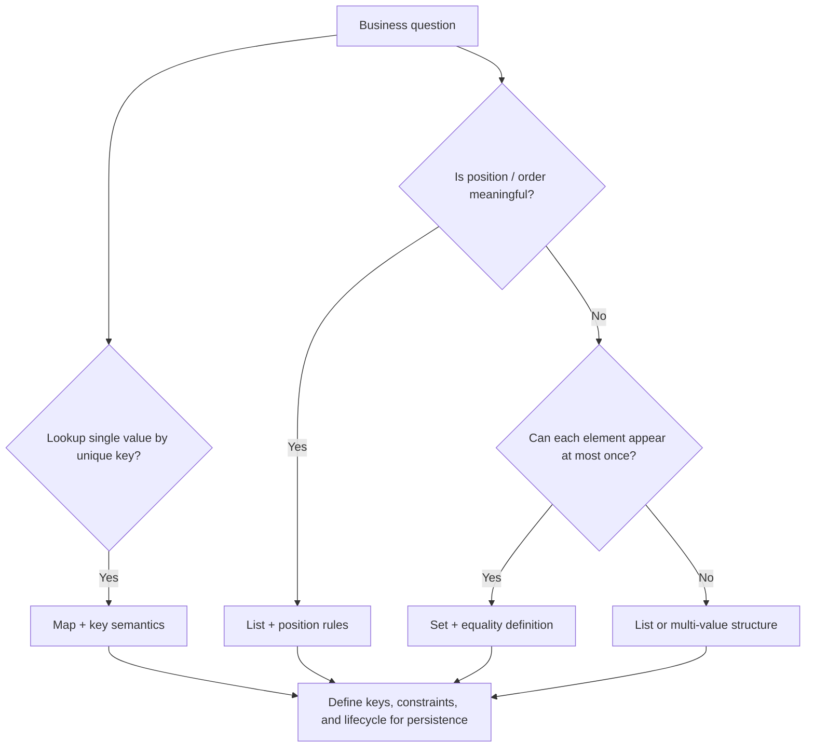
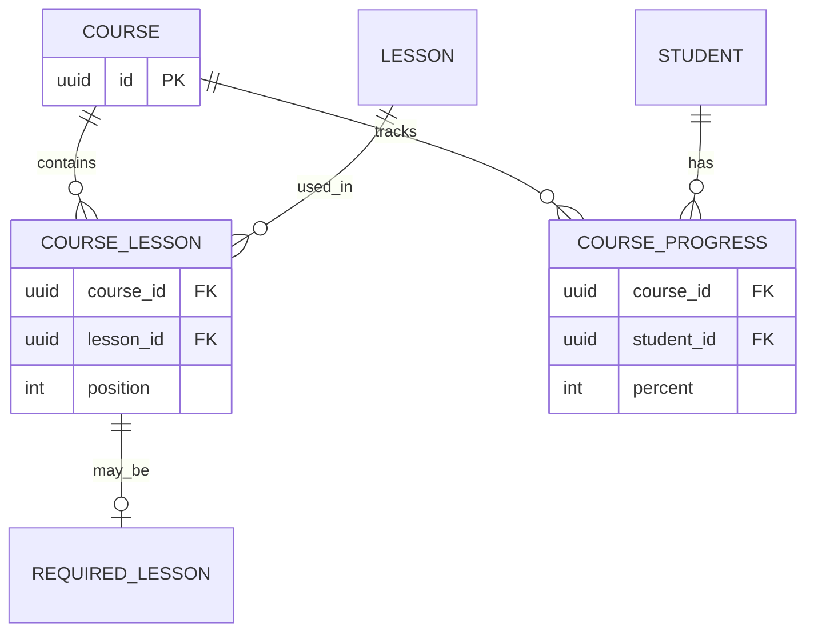

# `List`, `Set`, and `Map` by Ordering, Uniqueness, and Relationship Type

Suppose a training system has a course consisting of lessons in **learning order**, a set of **required** lessons, and a lookup table of **each student's progress**. All three are collections of data, yet you cannot arbitrarily swap `List` for `Set` or `Map`: ordering, duplication rules, and lookup-key semantics determine which data states are valid.

This lesson belongs to the **Java Models** chapter of the **DATABASE_DATA_MODELING** module. The module's goal is to translate business requirements into clear entity, relationship, and constraint models—from normalization, keys, and indexes to physical schemas—while comparing relational, document, graph, and analytical storage. Accordingly, we choose `List`, `Set`, and `Map` based on **business meaning**, verify behavior in Java, and then translate those meanings into verifiable database relationships and constraints.

## 1. Three Questions That Determine Collection Type

Before choosing a Java interface, answer these questions:

1. **Does order carry meaning?** If "Lesson 1 → Lesson 2 → Lesson 3" is a learning path, changing order alters product behavior. A list can represent order, whereas a general set makes no positional promise.
2. **May two elements with the same value or identity appear multiple times?** A playlist can play the same song twice. Conversely, a student must not have two enrollments for the same course and student ID merely because a request was resubmitted.
3. **Is there a key used to look up a single value?** Student progress can be looked up by `StudentId`. Within one course, each ID maps to one current progress entry.

| Interface | Core Semantics | Duplicates | Ordering / Lookup | Examples |
| --- | --- | --- | --- | --- |
| `List<E>` | Indexed sequence of elements | **Allowed** by contract, though business rules may forbid | Access by position; order carries meaning | Lesson sequence, invoice lines, operation sequence |
| `Set<E>` | Collection of distinct elements under equality rules | **Forbids** two equal elements coexisting | No positional index; iteration order depends on implementation | Unique tags, granted permissions, member set |
| `Map<K,V>` | Mapping from key → value | **Unique keys**; `V` values may duplicate | Lookup by key; iteration order depends on implementation | ID → progress, product code → stock |

A `Map<K,V>` is not a `Collection<V>`: it is a structure of key/value pairs, exposing `keySet()`, `values()`, and `entrySet()` to view each aspect. Nor does `Map` automatically mean a "one-to-one relationship": multiple distinct keys can point to the same value.

> **Selection rule:** Choose according to the data contract first; pick `ArrayList`, `HashSet`, `HashMap`, or an ordered implementation only after defining the semantics to preserve.

## 2. Ordering Does Not Mean the Same Thing in Every Collection

### 2.1. `List` Preserves Position and Permits Repeats

```java
import java.util.List;

final class SequenceExample {
    static void show() {
        List<String> playlist = List.of("INTRO", "QUIZ", "INTRO");
        System.out.println(playlist.get(0));         // INTRO
        System.out.println(playlist.get(2));         // INTRO
        System.out.println(playlist.size());          // 3
        System.out.println(playlist.equals(
            List.of("QUIZ", "INTRO", "INTRO")
        ));                                            // false
    }
}
```

Two lists are equal when they have the same size and equal elements at every position. `["A", "B"]` differs from `["B", "A"]` even though the set of values looks the same. The fact that `List` **permits** repeated elements does not mean every business case should allow them; if a course must not include the same lesson twice, enforce that constraint explicitly.

### 2.2. `Set` Treats Uniqueness as Core Semantics

```java
import java.util.HashSet;
import java.util.Set;

final class UniqueExample {
    static void show() {
        Set<String> tags = new HashSet<>();
        System.out.println(tags.add("JAVA")); // true
        System.out.println(tags.add("JAVA")); // false
        System.out.println(tags.size());       // 1
    }
}
```

`Set.add` returns `false` when the set already contains an equal element. Yet the outcome depends on the element's `equals`/`hashCode` policy (or a sorted set's comparator). If elements are entities with late-generated IDs or mutable keys, uniqueness may not reflect business intent. Prefer immutable value objects and typed IDs when building identity sets.

### 2.3. `Map` Enforces Unique Keys, Not Unique Values

```java
import java.util.HashMap;
import java.util.Map;

final class LookupExample {
    static void show() {
        Map<String, Integer> scores = new HashMap<>();
        scores.put("S-1", 80);
        scores.put("S-2", 80); // Value 80 may repeat.
        Integer previous = scores.put("S-1", 90);

        System.out.println(previous);          // 80
        System.out.println(scores.get("S-1")); // 90
        System.out.println(scores.size());     // 2
    }
}
```

Calling `put` with an existing key **replaces** the old value. If the data represents a student's score history, `Map<StudentId,Integer>` loses earlier attempts; use a structure holding multiple attempts or an entity with its own ID and timestamp.

## 3. Choosing an Implementation: Iteration Order, Sorting, and Cost

The Java Collections Framework separates **interfaces** (contracts) from **implementations** (storage/traversal mechanics). The table below describes typical behavior in Java 17+:

| Structure | Ordering Characteristic | Common Operations | When Appropriate |
| --- | --- | --- | --- |
| `ArrayList` | Preserves indexed order | Fast `get(i)`; inserting/removing in the middle may shift many elements | Read sequences, frequent iteration or positional access |
| `LinkedList` | Preserves element order | Per-node/reference overhead; `get(i)` typically traverses nodes | Certain head/tail operations; usually consider `ArrayDeque` for queues/deques |
| `HashSet` | **No guarantee** on iteration order | Fast average `contains/add/remove` with stable hashes | Unordered sets |
| `LinkedHashSet` | Typically preserves **insertion order** | Higher memory cost than `HashSet` | Iterating unique elements in first-seen order |
| `TreeSet` | Iterates in sorted order via comparator/natural order | Typically `O(log n)` | Sets requiring sorted order and range queries |
| `HashMap` | **No guarantee** on iteration order | Fast average `get/put/remove` with good hashes | Key-based lookups |
| `LinkedHashMap` | Insertion order by default; configurable access order | Extra link metadata overhead | Iterating a map in a stable order |
| `TreeMap` | Iterates in sorted key order | Typically `O(log n)` | Range lookups, key navigation |

These complexities are general models, not guarantees that every operation is `O(1)`. Performance also depends on data size, hash collisions, memory layout, traversal patterns, and concurrency requirements. `HashMap` may produce an apparently "stable" order across a few runs, yet that is not a product contract; changing data or JVM versions can change the order.

### 3.1. Insertion Order Differs from Sorted Order

```java
import java.util.LinkedHashSet;
import java.util.Set;
import java.util.TreeSet;

final class OrderModes {
    static void show() {
        Set<Integer> inserted = new LinkedHashSet<>();
        inserted.add(30);
        inserted.add(10);
        inserted.add(20);
        System.out.println(inserted); // [30, 10, 20]

        Set<Integer> sorted = new TreeSet<>(inserted);
        System.out.println(sorted);   // [10, 20, 30]
    }
}
```

`LinkedHashSet` is useful when deduplicating while keeping original appearance order; `TreeSet` represents comparison order, not user drag-and-drop order. When order is editable business data, store an explicit **position/sequence number** instead of relying on implicit collection insertion order.

### 3.2. `TreeSet`/`TreeMap` and Comparators

In sorted structures, a comparator returning `0` treats two keys as equivalent for lookup/insertion, even if `equals` on the object returns `false`. If a comparator only compares `lastName`, two students with different IDs but the same last name will be collapsed into one by `TreeSet`.

```java
import java.util.Comparator;
import java.util.Set;
import java.util.TreeSet;

record Student(String id, String lastName) {}

final class ComparatorExample {
    static void show() {
        Comparator<Student> byNameThenId = Comparator
            .comparing(Student::lastName)
            .thenComparing(Student::id);
        Set<Student> students = new TreeSet<>(byNameThenId);
        students.add(new Student("S-1", "Tran"));
        students.add(new Student("S-2", "Tran"));
        System.out.println(students.size()); // 2
    }
}
```

In this example, comparing by last name **and** ID avoids merging two students with the same last name. However, because `record Student` defines equality across both `id` and `lastName`, adding another field to the record that is omitted from the comparator can cause the comparator and `equals` to diverge again. When using a `SortedSet` as a full-contract `Set`, the comparator should be **consistent with equals** over the key domain, or the differing semantics must be documented; if the true goal is uniqueness by ID, consider `Set<StudentId>` and sort at presentation time.

## 4. Business Relationships Do Not Emerge Automatically from Collections

A Java collection only captures how **one object references other values in memory**. It does not define foreign keys, ownership, historical records, transactions, or cross-process consistency.



| Business Relationship | Possible Java Representation | Common Relational Storage |
| --- | --- | --- |
| An order has lines in display order | `List<OrderLine>` | `order_lines` table with `order_id` and `position` |
| An article has unique tags | `Set<TagCode>` | Join table `article_tags` with `PRIMARY KEY(article_id, tag_code)` |
| Each student has one current progress in a course | `Map<StudentId, Progress>` scoped to course | `course_progress` table with `PRIMARY KEY(course_id, student_id)` |
| A student has multiple exam attempts | `List<Attempt>` or `Map<StudentId,List<Attempt>>` when grouped by student | `attempts` table where each attempt has its own ID and timestamp |
| Many students take many courses | `Set<StudentId>` in a course aggregate, or collection on student side | Join table `enrollments(course_id, student_id)` |
| A product belongs to many categories and vice versa | `Set<CategoryId>` at read boundary | Many-to-many relation table with composite key |

From `List` or `Set` alone you **cannot fully infer cardinality**: a list may hold multiple objects yet still be part of a single aggregate, while a `Map` can hold lists to represent one-to-many. Separately determine which entities have identity, whether the relationship carries its own attributes, how relationships are created/removed, and whether history must be preserved.

## 5. Running Example: Course, Required Lessons, and Progress

Simple requirements:

- A course has an ordered list of lessons (`List<LessonId>`). Within **this course**, a lesson must not appear twice; this is an **extra** constraint beyond the `List` contract.
- Some lessons belong to `requiredLessons` (`Set<LessonId>`); this set must be a **subset** of the lessons in the course.
- Each student has one current progress percentage (`Map<StudentId,Integer>`) in the range 0–100; multiple students may share the same percentage.
- Read results must remain unmodifiable via the source collections after creating the snapshot.

### Runnable Java 17+ Code

Save the entire snippet below as `CourseCollectionDemo.java`:

```java
import java.util.ArrayList;
import java.util.HashMap;
import java.util.HashSet;
import java.util.List;
import java.util.Map;
import java.util.Objects;
import java.util.Set;
import java.util.UUID;

record LessonId(UUID value) {
    public LessonId {
        Objects.requireNonNull(value, "value");
    }
}

record StudentId(UUID value) {
    public StudentId {
        Objects.requireNonNull(value, "value");
    }
}

record CourseSnapshot(
    List<LessonId> lessonOrder,
    Set<LessonId> requiredLessons,
    Map<StudentId, Integer> progressPercent
) {
    public CourseSnapshot {
        lessonOrder = List.copyOf(
            Objects.requireNonNull(lessonOrder, "lessonOrder")
        );
        requiredLessons = Set.copyOf(
            Objects.requireNonNull(requiredLessons, "requiredLessons")
        );
        progressPercent = Map.copyOf(
            Objects.requireNonNull(progressPercent, "progressPercent")
        );

        if (lessonOrder.isEmpty()) {
            throw new IllegalArgumentException(
                "Course must have lessons"
            );
        }
        Set<LessonId> knownLessons = new HashSet<>(lessonOrder);
        if (knownLessons.size() != lessonOrder.size()) {
            throw new IllegalArgumentException(
                "Lesson ID must be unique within this course"
            );
        }
        if (!knownLessons.containsAll(requiredLessons)) {
            throw new IllegalArgumentException(
                "Required lesson is missing from lesson order"
            );
        }
        for (Integer percent : progressPercent.values()) {
            if (percent < 0 || percent > 100) {
                throw new IllegalArgumentException(
                    "Progress must be between 0 and 100"
                );
            }
        }
    }

    List<LessonId> requiredInLearningOrder() {
        return lessonOrder.stream()
            .filter(requiredLessons::contains)
            .toList(); // Preserve learning order rather than relying on Set order.
    }
}

public class CourseCollectionDemo {
    public static void main(String[] args) {
        LessonId intro = new LessonId(UUID.randomUUID());
        LessonId practice = new LessonId(UUID.randomUUID());
        LessonId review = new LessonId(UUID.randomUUID());
        StudentId learner = new StudentId(UUID.randomUUID());

        List<LessonId> ordered = new ArrayList<>(
            List.of(intro, practice, review)
        );
        Set<LessonId> required = new HashSet<>(
            Set.of(intro, review)
        );
        Map<StudentId, Integer> progress = new HashMap<>();
        progress.put(learner, 75);

        CourseSnapshot snapshot = new CourseSnapshot(
            ordered, required, progress
        );

        // Mutable sources change after snapshot is created.
        ordered.clear();
        required.clear();
        progress.put(learner, 10);

        System.out.println(snapshot.lessonOrder().size());       // 3
        System.out.println(snapshot.lessonOrder().get(0)
            .equals(intro));                                     // true
        System.out.println(snapshot.requiredInLearningOrder()
            .equals(List.of(intro, review)));                    // true
        System.out.println(snapshot.progressPercent().get(learner)); // 75

        // snapshot.lessonOrder().clear(); // UnsupportedOperationException
        // new CourseSnapshot(List.of(intro, intro), Set.of(intro), Map.of());
        // IllegalArgumentException: duplicate lesson ID
    }
}
```

In this example, `List` preserves lesson order; `Set` represents membership/uniqueness; `Map` represents the progress lookup function. `List.copyOf`, `Set.copyOf`, and `Map.copyOf` protect collection structure; `LessonId`/`StudentId` and `Integer` elements are immutable, so snapshot data cannot be mutated through them.

**Three important business decisions:**

1. `List` inherently allows duplicates. The constructor uses `new HashSet<>(lessonOrder).size()` to forbid **duplicate lesson IDs within the same course**. If the system allows a lesson to repeat twice in a path, this constraint must change.
2. `Set.copyOf` silently drops duplicates if the input collection contains repeats. If a request sends a `List` and business rules require **reporting an error when users submit duplicates**, check before converting to a `Set`.
3. `Map<StudentId,Integer>` holds only **current** progress. It does not record individual updates, who made them, or when. If history/auditing is required, design a dedicated event entity/table.

### Concurrency Consistency Warning

`CourseSnapshot` constructs safely once given **three consistent source collections**. However, if one thread mutates `ordered`, `required`, or `progress` while another thread copies them, the result can be inconsistent or copying may fail. Maintain a single synchronization/transaction boundary when reading the sources; post-creation immutability does not replace atomicity of the capture step.

## 6. Mapping to the Relational Model: Ordering, Uniqueness, and Lookup Keys

To implement these requirements accurately in PostgreSQL, model the lesson list as a **relationship with a position attribute**, required lessons as a unique relation, and the progress map as a relation with a composite key.

```sql
CREATE TABLE courses (
    id UUID PRIMARY KEY,
    title TEXT NOT NULL
);

CREATE TABLE lessons (
    id UUID PRIMARY KEY,
    title TEXT NOT NULL
);

CREATE TABLE students (
    id UUID PRIMARY KEY,
    display_name TEXT NOT NULL
);

-- Ordered list of lessons per course: has position and forbids duplicate lesson IDs.
CREATE TABLE course_lessons (
    course_id UUID NOT NULL REFERENCES courses(id),
    lesson_id UUID NOT NULL REFERENCES lessons(id),
    position INTEGER NOT NULL CHECK (position > 0),
    PRIMARY KEY (course_id, lesson_id),
    UNIQUE (course_id, position)
);

-- A required lesson must already belong to the course.
CREATE TABLE required_course_lessons (
    course_id UUID NOT NULL,
    lesson_id UUID NOT NULL,
    PRIMARY KEY (course_id, lesson_id),
    FOREIGN KEY (course_id, lesson_id)
        REFERENCES course_lessons(course_id, lesson_id)
);

-- One student has one current progress entry per course.
CREATE TABLE course_progress (
    course_id UUID NOT NULL REFERENCES courses(id),
    student_id UUID NOT NULL REFERENCES students(id),
    percent SMALLINT NOT NULL CHECK (percent BETWEEN 0 AND 100),
    PRIMARY KEY (course_id, student_id)
);
```

### 6.1. `List` Ordering Requires a Column and `ORDER BY`

`position` represents meaningful order. To reconstruct `List<LessonId>`:

```sql
SELECT lesson_id
FROM course_lessons
WHERE course_id = :course_id
ORDER BY position ASC;
```

`:course_id` is a named parameter substituted by the data-access library, not syntax executed directly in `psql`. In SQL, **without `ORDER BY`, result row order is never guaranteed**, even when the table has a primary key or index. `PRIMARY KEY(course_id, lesson_id)` ensures each lesson appears at most once per course; `UNIQUE(course_id, position)` prevents two lessons from sharing the same position.

Those two constraints **do not guarantee contiguous positions 1, 2, 3…**. If deleting lesson 2 must shift positions 3, 4, …, design the reorder behavior inside a transaction; some systems intentionally leave gaps to simplify insertions. When swapping two positions governed by a unique constraint, direct updates can cause a transient uniqueness violation; plan safe position updates (such as using a temporary open slot, appropriate locking, or deferrable constraints where suitable in PostgreSQL).

### 6.2. `Set` Maps to Scoped Uniqueness

`PRIMARY KEY(course_id, lesson_id)` on `required_course_lessons` ensures the same lesson cannot be marked required twice in a course. The composite foreign key forces every required lesson to actually exist in `course_lessons`. This is a **database** constraint that holds even if another service writes data without using a Java `Set`.

If the relationship entity carries attributes like `assignedAt`, `assignedBy`, `isRequired`, or effective timestamps, do not hide everything inside a `Set<LessonId>`. You may need a `CourseLesson` entity or a join table with metadata to represent the relationship's lifecycle.

### 6.3. `Map` Maps to Key → One Current Value

`PRIMARY KEY(course_id, student_id)` expresses that within a single course, each student has one current progress record. Reading into a map:

```sql
SELECT student_id, percent
FROM course_progress
WHERE course_id = :course_id;
```

When mapping returned rows, specify how duplicate keys are handled (if a query involves a non-unique join). Never silently overwrite an earlier row with a later one if a duplicate actually signals a model or query bug.

If progress history must be retained, a `progress_events(event_id, course_id, student_id, percent, occurred_at, ...)` table is a different concept. From that history you can compute the **latest entry** to build `Map<StudentId,Integer>` at read time, provided you define tie-breaking for identical timestamps and handling for late-arriving events.

## 7. Cardinality and Join Tables: `Map` Is Not Always 1–1

Understand cardinality at the business level:

| Cardinality | Example | Java Read Representation | Storage Modeling Hint |
| --- | --- | --- | --- |
| 1–1 | An order has one current shipping address | `Address`, or `Optional<Address>` if genuinely optional | Embedded columns or child table with unique FK |
| Ordered 1–N | A course has a sequence of lessons | `List<LessonId>` | FK + `position` + scoped key/uniqueness |
| Unordered 1–N | An article has many distinct tags | `Set<TagId>` | Child/join table with unique pair |
| N–N | Many students take many courses | `Set<StudentId>` or `Set<CourseId>` by read direction | `enrollments(course_id, student_id)` with composite key |
| Key → one current value | Student progress per course | `Map<StudentId, Integer>` | Composite key `(course_id, student_id)` |
| Key → many values | Each student's exam attempts | `Map<StudentId,List<Attempt>>` when grouped in memory | `attempts` table with own PK and FKs to student/course |

An N–N join table can also carry enrollment date, status, role, grade, and data source. In that case, **enrollment is an associative entity with its own data**, so model it as `Enrollment` rather than merely `Set<StudentId>`.



The diagram illustrates the relational structure. If the product has required-lesson policies per **course version**, or progress per **enrollment attempt**, the keys must include version/enrollment IDs; you cannot assume one `StudentId` always maps to one progress record across all history.

## 8. `Map` in Java: Overwriting, Missing Data, and Duplicate Keys

### 8.1. `get` Returning `null` Can Have Two Meanings

With `HashMap`, `get(key) == null` may occur because **the key is absent** or because the key is mapped to `null`. `containsKey` distinguishes the two cases. With `Map.of`/`Map.copyOf`, null keys and values are forbidden, so a `null` return unambiguously means the key is absent under that contract.

```java
import java.util.HashMap;
import java.util.Map;

final class MissingVsNull {
    static void show() {
        Map<String, Integer> scores = new HashMap<>();
        scores.put("S-1", null);

        System.out.println(scores.get("S-1"));         // null
        System.out.println(scores.containsKey("S-1")); // true
        System.out.println(scores.containsKey("S-2")); // false
    }
}
```

For business data, instead of overloading `null` to mean "not taken", "unauthorized", or "in progress", design an explicit status type or record; never conflate a sentinel value with a missing key.

### 8.2. `Collectors.toMap` Does Not Know How to Resolve Duplicate Keys on Its Own

```java
import java.util.List;
import java.util.Map;
import java.util.stream.Collectors;

record StudentScore(String studentId, int score) {}

final class DuplicateKeyExample {
    static void show() {
        List<StudentScore> input = List.of(
            new StudentScore("S-1", 60),
            new StudentScore("S-1", 90)
        );

        // Without merge function: throws IllegalStateException on duplicate key.
        // Map<String, Integer> invalid = input.stream()
        //     .collect(Collectors.toMap(
        //         StudentScore::studentId, StudentScore::score
        //     ));

        Map<String, Integer> highestScore = input.stream()
            .collect(Collectors.toMap(
                StudentScore::studentId,
                StudentScore::score,
                Integer::max
            ));
        System.out.println(highestScore.get("S-1")); // 90
    }
}
```

`Integer::max` here reflects a **highest-score** policy, not a universal default for every domain. If the requirement is "latest score", you need timestamps and a rule selecting the newest record. If duplicate keys indicate an anomaly, fail loudly instead of silently picking one entry.

### 8.3. `Map` Keys Must Be Stable

`HashMap` and `HashSet` depend on `equals`/`hashCode`. If a mutable key changes after `put`, `get` or `remove` may fail to find the entry. For identity-bearing data like `Student`/`Course`, use immutable `StudentId`/`CourseId` values as keys. When using `TreeMap`, the comparator defines key equivalence as analyzed in Section 3.

## 9. Immutability, Nulls, and Collection APIs

When passing collections across layers, distinguish:

| Factory / Method | Structurally Immutable? | Allows `null`? | Detects Duplicate Elements? |
| --- | --- | --- | --- |
| `List.of("A","B")` | Yes | No | `List` allows duplicates |
| `Set.of("A","B")` | Yes | No | Throws `IllegalArgumentException` if duplicates passed |
| `Map.of("A",1)` | Yes | No for keys/values | Throws `IllegalArgumentException` if duplicate keys passed |
| `List.copyOf(source)` | Yes | No for elements | Preserves duplicates and order |
| `Set.copyOf(source)` | Yes | No for elements | **Merges** duplicate elements |
| `Map.copyOf(source)` | Yes | No for keys/values | Source map already has unique keys under its policy |
| `Collections.unmodifiableList(source)` | Only blocks edits via wrapper | Per source data | Still reflects source mutations |

`List.copyOf` and `Map.copyOf` do not deep-copy mutable elements or values; if full data immutability is needed, each element must be an immutable value object or be copied/normalized. Large snapshots also require evaluating memory cost and synchronization while capturing from sources.

In DTOs, `List.empty` and `null` can mean different things: "zero elements" vs. "not loaded" or "field omitted". Define the API contract before replacing `null` with empty collections everywhere.

## 10. Relationships via JPA/Hibernate: Collections Do Not Create Constraints Automatically

ORMs support `@OneToMany`, `@ManyToMany`, and various collection persistence strategies. Yet the Java type is only **part** of the decision:

- `List` may need `@OrderColumn` to persist relationship positions; `@OrderBy` sorts by an attribute on read, which is a **different** semantics from user-edited order. Exact support depends on JPA/provider versions.
- `Set` in ORM entities requires stable `equals`/`hashCode` on elements. Post-persist generated IDs, proxies, and transient states can cause `Set` relationships to behave unexpectedly when equality is wrong.
- `Map` can be mapped with `@MapKey`, `@MapKeyColumn`, or separate relations/tables depending on whether keys come from entities or values. Do not assume every map automatically becomes a two-column table.
- **Owning side**, cascades, orphan removal, and transactions are lifecycle decisions, not determined solely by `List`/`Set`. `CascadeType.REMOVE` on shared many-to-many entities can cause unintended deletions.
- When exposing data via APIs, avoid returning managed collections or lazy proxies directly. Convert to DTOs/snapshots with proper ordering and uniqueness after reading consistent data.

Never use `new HashSet<>(items)` as a "fix" for duplicate relationship rows caused by bad data: it can mask broken JOINs or missing unique constraints. Identify and fix the root cause in the model or DB.

## 11. Concurrency and Collection Mutation

`ArrayList`, `HashSet`, and `HashMap` are not thread-safe for uncoordinated concurrent mutations. If one thread updates while another iterates, you can observe inconsistent results or exceptions. Never rely on fail-fast iterators as a correctness mechanism.

Options include:

- **Immutable state:** each change produces a new snapshot and publishes the reference safely, avoiding mutating data being read.
- **Lock synchronization:** related reads/snapshots and writes use the same lock when a consistent point-in-time view is needed.
- **Concurrent collections:** `ConcurrentHashMap` permits concurrent operations on the map, but does not provide an atomic transaction spanning multiple keys and operations. It forbids `null` keys and values.
- **Database transactions:** data shared across multiple JVMs/instances must be protected via locks, unique constraints, optimistic locking, or suitable database mechanisms; in-JVM `synchronized` is not enough.

Example safe current-score update for a single key:

```java
import java.util.concurrent.ConcurrentHashMap;
import java.util.concurrent.ConcurrentMap;

final class ScoreCache {
    private final ConcurrentMap<String, Integer> scores =
        new ConcurrentHashMap<>();

    void keepHighest(String studentId, int nextScore) {
        if (nextScore < 0 || nextScore > 100) {
            throw new IllegalArgumentException("Score out of range");
        }
        scores.merge(studentId, nextScore, Integer::max);
    }

    Integer highest(String studentId) {
        return scores.get(studentId);
    }
}
```

`merge` performs an atomic per-key update per the `ConcurrentHashMap` contract. This does not prove the cache is always consistent with the database or student authorization rules; you still need synchronization, versioning, and invalidation strategies. `Map.copyOf(scores)` produces an unmodifiable result, yet while the source is changing it does not guarantee a multi-key snapshot at a single logical instant.

## 12. Document, Graph, and Analytical Models: Preserving Collection Semantics

| Storage Type | Ordering, Uniqueness, and Keys |
| --- | --- |
| **Document** | JSON/BSON arrays preserve element order and allow duplicates. Objects/maps have field-name keys, yet do not replace business unique constraints; combine validation, document update rules, and appropriate indexes. |
| **Graph** | Nodes and edges represent relationships; two edges with the same endpoints may be two valid events/relationships or duplicate data depending on domain. When edges are ordered, store `position`/`sequence` on the edge or intermediate relationship node. |
| **Analytical / warehouse** | Fact tables have no inherent order; "top N" requires `ORDER BY` and tie-breaking rules. Deduplicate by appropriate event ID/business key rather than blindly applying `DISTINCT` across all columns. |
| **Relational** | Lists need `position` and `ORDER BY` queries; Sets need scoped PK/UNIQUE; Maps need single/composite keys ensuring one value per key under the contract. |

In a document model, a `lessonIds` array can hold duplicate IDs unless validated; converting it to a `Set` when reading in Java **silently drops duplicate information**. In a graph database, `ENROLLED_IN` edges may carry their own enrollment dates and statuses; collapsing by endpoint pairs loses history if re-enrollment is allowed. In a warehouse, multiple rows for the same student ID usually represent **time-series observations**, not simple duplication errors.

## 13. Common Design Mistakes

| Mistake | Consequence | Adjustment |
| --- | --- | --- |
| Using `HashSet` to preserve user drag-and-drop order | Iteration order is not guaranteed | Use `List` + business position; use `LinkedHashSet` only when insertion order and uniqueness suffice |
| Using `List` and forgetting duplicate checks | Same entity appears multiple times against policy | Define distinct-by-ID invariant and DB unique constraint |
| Using `Set` to "clean up" duplicate DB rows | Masks JOIN/constraint bugs, loses information | Inspect source data and relational keys |
| Using `Map` for multi-valued history per key | Newer entries overwrite older ones | Use `List<Attempt>` or an event table with ID/timestamp |
| Using mutable entities as `HashMap` keys | Lookups fail after field/hash changes | Use immutable typed IDs or value keys |
| Assuming SQL returns rows in `position` order automatically | Results may appear out of order | Include `ORDER BY position` in the query |
| Using a `TreeSet` comparator that omits identity fields | Drops distinct business elements | Use a consistent comparator, or collect IDs in a set and sort in the view |
| Using `Set.copyOf` to "validate" duplicate inputs | Duplicates are silently merged | Check distinct count first and report an explicit error |
| Relying on Java `Set` alone for system-wide uniqueness | Concurrent requests can still insert duplicates | PK/UNIQUE, transactions, and conflict handling |
| Treating `ConcurrentHashMap` like a database transaction | Multi-key operations are non-atomic; cache can go stale | Design transactions/versions and source sync mechanisms |

## 14. Practice Exercises

### Exercise A — Order Line List

An order has lines displayed by position and may contain the same `ProductId` multiple times due to different batches or promotions. Choose `List`, `Set`, or `Map`. Propose an `order_lines` table (keys, position, SKU, quantity, discount) allowing multiple lines for the same product while forbidding duplicate positions within an order. Write a query that restores the exact order.

**Hint:** use `List<OrderLine>`; line identity can be `(order_id,line_no)` or a dedicated `line_id`, with `UNIQUE(order_id,position)` preserving order. Do not add `UNIQUE(order_id,product_id)` if business rules allow the same product across multiple lines.

### Exercise B — Members and Permissions

A group has many members, and a person can belong to many groups. Each membership has `role`, `joinedAt`, and `status`. Propose a storage design and Java representation for fast checks of current member IDs without losing metadata or change history.

**Hint:** a `group_memberships(group_id,user_id,...)` table with a composite key if only one active membership exists; a membership ID and effective timestamps may be needed to preserve history. `Set<UserId>` is only a membership projection, insufficient as the full model when the relationship carries attributes.

### Exercise C — Multiple Exam Attempt Scores

Data contains three attempts by the same student: 60, 90, and 75 at three different timestamps. The API must return **highest score**, **most recent score**, and **full history**. Choose three appropriate representations and define the conversion policy from `List<Attempt>` to each, avoiding accidental overwrites in a `Map`.

**Hint:** persist all attempts with ID and timestamp; build `Map<StudentId,Integer>` for highest score using `max`; latest score needs `occurredAt` and a tie-breaking rule; history is `List<Attempt>` with deterministic `ORDER BY occurred_at, attempt_id`.

### Exercise D — Checking the Course Schema

Consider the three collections `lessonOrder`, `requiredLessons`, and `progressPercent` from Section 5. Identify invariants that cannot be verified from a single field: required lessons are a subset of course lessons, unique lesson IDs, and progress 0–100. Determine which invariants live in the constructor, which PK/UNIQUE/CHECK/FK rules live in the database, and which operations need transactions when updating multiple tables simultaneously.

**Hint:** cross-table subset rules can use a composite FK; none of the simple constraints in the example enforce contiguous positions automatically. Moving a lesson to another position requires conditional writes and careful unique-constraint handling within a transaction.

## 15. Checklist Before Finalizing the Model

- [ ] Explicitly answered what ordering, duplication, and lookup keys mean in the business domain.
- [ ] Used `List` only when sequence/position is needed or repeats are allowed; added uniqueness invariants if duplicates are forbidden.
- [ ] Used `Set` only when uniqueness is clearly defined via `equals`/`hashCode` or an appropriate comparator.
- [ ] For `Map`, defined policies for overwrites, missing keys, null values, and duplicate keys.
- [ ] Keys and elements participating in equality remain immutable or stable throughout their lifetime in maps/sets.
- [ ] Insertion order, sorted order, and business order are clearly distinguished.
- [ ] When persisting SQL relations, designed PK/FK, `UNIQUE`, position columns, and `ORDER BY` at the right scope.
- [ ] For time-effective or historical data, avoided losing information by collapsing into a current-state map/set.
- [ ] Collections exposed over APIs or caches have appropriate immutability and ownership boundaries.
- [ ] Transactions, concurrency controls, and constraints keep data consistent across concurrent requests.
- [ ] Mappings to document, graph, and warehouse models preserve ordering, value sets, and relationship identity.

**Key takeaway:** `List` answers **"in what sequence do elements appear?"**; `Set` answers **"which distinct elements belong to the set?"**; `Map` answers **"which value does each key map to?"**. Those are three distinct semantics. When translating them into tables, documents, graph edges, or analytical datasets, clarify positions, keys, uniqueness, history, and transaction boundaries so the model never loses meaning.
