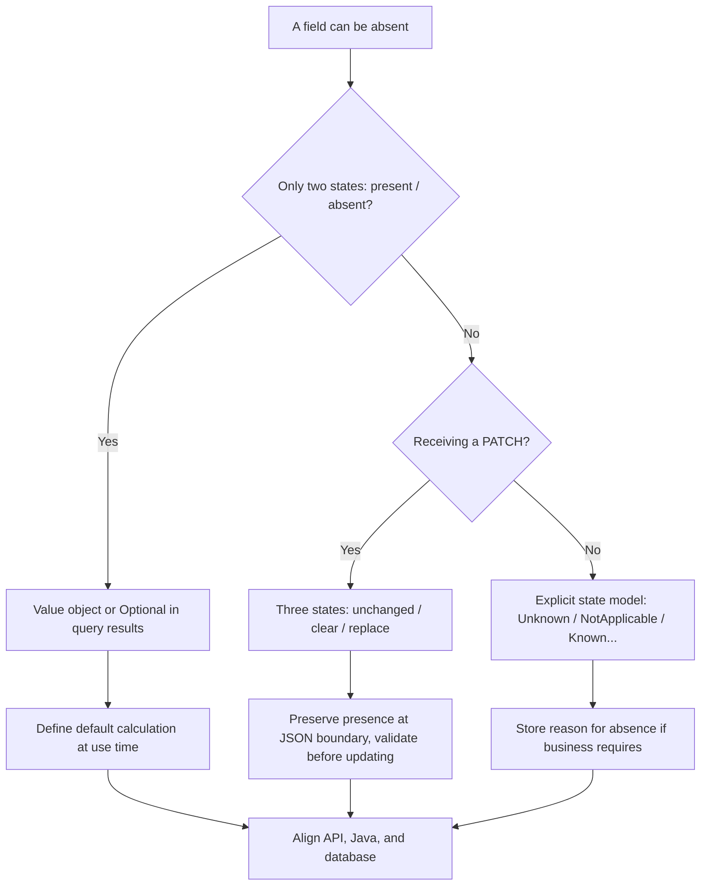

# Representing Optional Elements Without Conflating Absence with Default Values

Suppose a notification system lets users configure **maximum notifications per day**. A user who has not set a personal limit inherits the organization's default policy, say 20 notifications/day. Another user explicitly chooses **0** to mute notifications. If the system saves both cases as `0`, or eagerly writes `20` wherever unconfigured, it can no longer tell a real user choice from an inferred value.

The problem becomes even sharper in partial-update APIs: a request **omitting** `notificationLimit` may mean "keep as-is", whereas `"notificationLimit": null` means "clear personal configuration and revert to inherited". Both differ from `"notificationLimit": 0`. This is a data modeling problem, not merely choosing between `Optional` and `null` in Java.

This lesson belongs to the **Java Models** chapter of the **DATABASE_DATA_MODELING** module. The module's scope is translating business requirements into entities, relationships, and constraints—from normalization, keys, and indexes to physical schemas—and comparing relational, document, graph, and analytical storage so models remain unambiguous, evolvable, and testable. We will classify "absent data" states, design them in Java 17+, and compare how they map across JSON/APIs, SQL, and other data stores.

## 1. "Missing" Is Not a Default Value

A field can lack a value for several **business-distinct reasons**.

| State | Practical Question | Example | Should It Auto-Default? |
| --- | --- | --- | --- |
| **Omitted** | Did the caller omit this field? | PATCH without `notificationLimit` | No: in PATCH, typically means keep unchanged |
| **Explicit clear** | Did the caller ask to remove the configured value? | `"notificationLimit": null` under a specific PATCH contract | No: this is an **action** |
| **Unconfigured (unset/inherit)** | Does stored state currently have no override? | Column `notification_limit IS NULL` | May **compute** default at use time without overwriting storage |
| **Explicit value** | What exact number did the caller choose? | `"notificationLimit": 0` | No: `0` may mean block all |
| **Empty string or collection** | Did the caller supply an empty value? | `""`, `[]` | Domain-dependent; do not automatically treat as missing |
| **Unknown** | Does a value exist even though we haven't collected it? | Date of birth unknown | Not necessarily equivalent to "not applicable" |
| **Not applicable** | Does the concept even make sense for this object? | Expiration date for a perpetual permission | Model explicitly if significant |
| **Not loaded** | Has the application simply not queried the data yet? | Lazy ORM association | Must never conclude the value is truly absent |
| **Redacted** | Does data exist that the caller is unauthorized to see? | Internal field hidden by permissions | Should not report "no data" if that misleads |

**Key definition:** "optional" merely says a value *may be absent*, without **explaining why** or specifying what to do when it is absent. Simply adding `?`, `null`, `Optional`, or a sentinel value is insufficient to express every state in the table.

### Counterexample

Consider three update requests:

```json
{}
```

```json
{"notificationLimit": null}
```

```json
{"notificationLimit": 0}
```

Under the API contract chosen for this lesson:

1. `{}`: **do not change** the stored limit.
2. `null`: **clear** the personal limit so it **inherits** the organization configuration.
3. `0`: **explicitly set** the limit to 0.

If all of them are parsed into `Optional<Integer>` producing `Optional.empty()` for both an omitted field and `null`, the next step can no longer distinguish **keep unchanged** from **clear**. That information is already lost at the API boundary.

## 2. Process for Choosing the Right Model

Before writing code, answer these questions:

1. **What does the absence of a value mean?** Unconfigured, not applicable, unknown, cleared, or not loaded?
2. **Are zero or empty values valid?** Does `0` notifications differ from unconfigured? Does an empty list mean "zero members" or "members not queried"?
3. **Is there a dynamic default?** If the organization policy changes, should users without an override automatically pick up the new value or retain the old number?
4. **Is this a create, full replacement, or partial update?** POST, PUT, and PATCH may define different missing-field contracts.
5. **Must reasons for absence be distinguished in the database and analytics?** If analytics must separate "unknown" from "not applicable", a single nullable column usually falls short.



You do not need a complex type for every optional field. `Optional<CustomerId>` on a finder method is often enough. However, when absence affects **updates, pricing, permissions, or historical records**, express it precisely.

## 3. `Optional<T>`: Expressing Present or Absent in Java

`java.util.Optional<T>` represents a result that is either **present** or **absent**. It fits methods like "find customer name by ID" where not finding a match is normal.

```java
import java.util.Map;
import java.util.Optional;
import java.util.UUID;

record CustomerId(UUID value) {}
record CustomerName(String value) {}

final class CustomerLookup {
    private final Map<CustomerId, CustomerName> names;

    CustomerLookup(Map<CustomerId, CustomerName> names) {
        this.names = Map.copyOf(names);
    }

    Optional<CustomerName> findName(CustomerId id) {
        return Optional.ofNullable(names.get(id));
    }
}
```

`findName(id)` returns `Optional.empty()` if no name exists for that ID in the map. Callers must decide what happens when absent instead of dereferencing `null`:

```java
import java.util.Optional;

final class OptionalUsage {
    static String display(Optional<CustomerName> result) {
        return result
            .map(CustomerName::value)
            .filter(name -> !name.isBlank())
            .orElse("Unknown customer");
    }
}
```

Here the string "Unknown customer" is **display data chosen by the UI**, not a name silently assigned and persisted for the customer.

### Key APIs

| API | Meaning | Note |
| --- | --- | --- |
| `Optional.of(value)` | Guaranteed non-null value | Throws if null |
| `Optional.ofNullable(value)` | Converts null into `empty` | Only use when null is already established to mean absent |
| `Optional.empty()` | No value | Carries no reason for absence |
| `map(f)` | Transforms value if present | If `f` returns `null`, result becomes `Optional.empty()` |
| `flatMap(f)` | Chains computation where `f` returns Optional | Avoids `Optional<Optional<T>>` |
| `ifPresent` / `ifPresentOrElse` | Handles present/absent branches | Fits actions with no return value |
| `orElse(value)` | Returns fallback value | The `value` expression is evaluated **eagerly**, even when Optional is non-empty |
| `orElseGet(supplier)` | Computes fallback lazily when needed | Use when fallback is costly or has side effects |
| `orElseThrow(...)` | Throws a specific error when absent | When business logic requires a value |

Never call `get()` without ensuring presence; throwing `NoSuchElementException` is rarely a good business error. Never write `Optional.ofNullable(x).orElse(0)` casually if `0` is a distinct, meaningful choice.

### When Should `Optional` Be Avoided?

- **Do not use `Optional` to model the three states of PATCH:** it has only two states and cannot distinguish *omitted* from *explicit clear*.
- **Consider avoiding `Optional` as fields on JPA entities or wire DTOs:** the JPA specification does not require providers to map `Optional` as persistent properties; serializers and libraries also vary in support. Usually store a nullable/explicit domain field and return `Optional` from accessor methods.
- **Do not use `Optional` to mask broken invariants:** if `OrderId` is always required, the constructor should reject null instead of returning `Optional<OrderId>` everywhere.
- **Do not treat Optional as a loading-state indicator:** `Optional.empty()` does not distinguish "queried and absent" from "not yet queried".

## 4. Default Values Are Computation Rules, Not Necessarily Stored Data

Suppose an organization's notification limit is 20 today and updated to 15 next week.

| User | Stored `configuredLimit` | Effective Value When Default = 20 | When Default Changes to 15 |
| --- | ---: | ---: | ---: |
| A (unconfigured) | `NULL` | 20 | 15 |
| B (explicitly chose 0) | `0` | 0 | 0 |
| C (explicitly chose 20) | `20` | 20 | 20 |

If the system copies 20 into A's column upon account creation, later it cannot tell unconfigured A apart from C who **explicitly chose 20**. When the organization policy changes, should A change too? You cannot tell from a column holding `20`.

Keep two concepts separate:

- **Configured value:** `Optional<Integer>`, or a nullable column, indicating whether an override exists.
- **Effective value:** an integer **computed from the override and current policy**.

```java
import java.util.Optional;

final class LimitRule {
    static int effective(
        Optional<Integer> configured,
        int organizationDefault
    ) {
        if (organizationDefault < 0 || organizationDefault > 100) {
            throw new IllegalArgumentException("Invalid default");
        }
        return configured.orElse(organizationDefault);
    }
}
```

This method preserves `Optional.of(0)` as `0`; only `empty` falls back to the default. If policies have effective dates, org hierarchies, user groups, or versions, the calculation may need additional context. Never silently persist the effective value into the "configured" field if the business requires preserving the distinction.

## 5. Partial Updates: Three States Needed, Not Two

For `PATCH`, a single field needs at minimum:

1. **Unchanged** — omitted in request; keep existing value.
2. **Clear** — explicitly cleared in request; remove override and return to unconfigured state.
3. **Replace(value)** — new value supplied in request; **`0` remains a valid new value**.

A Java 17+ **sealed interface** makes these cases explicit at the type level, rather than passing a nullable `Integer` paired with an ambiguous boolean.

### 5.1. Complete, Runnable Java 17+ Example

Save the following code to `OptionalFieldDemo.java`. No libraries outside the JDK are needed. The example represents "no personal override" using a nullable field **inside the entity**, while the update API requires an explicit variant.

```java
import java.util.Objects;
import java.util.Optional;
import java.util.UUID;

public class OptionalFieldDemo {

    record UserId(UUID value) {
        public UserId {
            Objects.requireNonNull(value, "value");
        }
    }

    record DeliveryNote(String text) {
        public DeliveryNote {
            Objects.requireNonNull(text, "text");
            text = text.strip();
            if (text.isEmpty()) {
                throw new IllegalArgumentException(
                    "Delivery note must not be blank"
                );
            }
        }
    }

    sealed interface FieldUpdate<T>
        permits FieldUpdate.Unchanged,
                FieldUpdate.Clear,
                FieldUpdate.Replace {

        T applyTo(T current);

        record Unchanged<T>() implements FieldUpdate<T> {
            @Override
            public T applyTo(T current) {
                return current;
            }
        }

        record Clear<T>() implements FieldUpdate<T> {
            @Override
            public T applyTo(T current) {
                return null; // Null is used only internally to mean "no override".
            }
        }

        record Replace<T>(T value) implements FieldUpdate<T> {
            public Replace {
                Objects.requireNonNull(value, "value");
            }

            @Override
            public T applyTo(T current) {
                return value;
            }
        }
    }

    record PreferencesPatch(
        FieldUpdate<DeliveryNote> note,
        FieldUpdate<Integer> notificationLimit
    ) {
        public PreferencesPatch {
            Objects.requireNonNull(note, "note");
            Objects.requireNonNull(
                notificationLimit, "notificationLimit"
            );
        }
    }

    static final class Preferences {
        private final UserId userId;
        // Null = no note / no override, per domain definition.
        private DeliveryNote note;
        private Integer configuredNotificationLimit;

        Preferences(UserId userId) {
            this.userId = Objects.requireNonNull(userId, "userId");
        }

        Optional<DeliveryNote> note() {
            return Optional.ofNullable(note);
        }

        Optional<Integer> configuredNotificationLimit() {
            return Optional.ofNullable(configuredNotificationLimit);
        }

        int effectiveNotificationLimit(int organizationDefault) {
            if (organizationDefault < 0 || organizationDefault > 100) {
                throw new IllegalArgumentException("Invalid default");
            }
            return configuredNotificationLimit != null
                ? configuredNotificationLimit
                : organizationDefault;
        }

        void apply(PreferencesPatch patch) {
            Objects.requireNonNull(patch, "patch");

            DeliveryNote nextNote = patch.note().applyTo(note);
            Integer nextLimit = patch.notificationLimit()
                .applyTo(configuredNotificationLimit);

            // Validate all candidate values BEFORE mutating state.
            if (nextLimit != null && (nextLimit < 0 || nextLimit > 100)) {
                throw new IllegalArgumentException(
                    "Configured limit must be 0..100"
                );
            }

            note = nextNote;
            configuredNotificationLimit = nextLimit;
        }
    }

    public static void main(String[] args) {
        Preferences prefs = new Preferences(
            new UserId(UUID.randomUUID())
        );

        System.out.println(prefs.effectiveNotificationLimit(20)); // 20

        // Leave note untouched, but explicitly set limit = 0.
        prefs.apply(new PreferencesPatch(
            new FieldUpdate.Unchanged<>(),
            new FieldUpdate.Replace<>(0)
        ));
        System.out.println(prefs.effectiveNotificationLimit(20)); // 0
        System.out.println(
            prefs.configuredNotificationLimit().isPresent()
        ); // true

        // Set note, but clear the limit override.
        prefs.apply(new PreferencesPatch(
            new FieldUpdate.Replace<>(
                new DeliveryNote("  Deliver at reception desk  ")
            ),
            new FieldUpdate.Clear<>()
        ));
        System.out.println(prefs.effectiveNotificationLimit(20)); // 20
        System.out.println(prefs.effectiveNotificationLimit(15)); // 15
        System.out.println(prefs.note().orElseThrow().text());
        // Deliver at reception desk

        // No fields updated.
        prefs.apply(new PreferencesPatch(
            new FieldUpdate.Unchanged<>(),
            new FieldUpdate.Unchanged<>()
        ));
        System.out.println(prefs.note().isPresent()); // true
    }
}
```

**Why does the example use both `Optional` and `null`?** Inside `Preferences`, `null` is used strictly internally with a **well-defined** meaning: "no override". Getters return `Optional` so callers never handle nulls directly. In `PreferencesPatch`, however, a single `null` cannot express both "omitted" and "clear requested", so we use the three variants of `FieldUpdate`.

Computing `nextNote` and `nextLimit` and **validating before assigning** prevents partial updates if the new limit is invalid. Note that this operates only on **a single in-memory object**, without thread-safety or database transaction handling yet. When concurrent requests update the same row, the repository also needs versioning/locking to prevent lost updates.

### 5.2. What If a `null` Value Also Carries Its Own Business Meaning?

The example contract uses `Clear` to reset a field to "no override". If the domain genuinely needs **setting an explicit `null` with its own meaning** alongside a clear operation, three states are not enough. Add a variant such as `SetExplicitNull` or a value type representing that specific state. Never force two distinct operations into a single `Clear`.

Conversely, if a request parses into `FieldUpdate.Replace<>(null)`, the constructor intentionally rejects it so "set value" never silently turns into "clear".

## 6. JSON/APIs: Do Not Lose Presence Information During Parsing

JSON transport has at least three representations to distinguish for a field: **key absent**, key with value `null`, and key with an actual value.

| JSON Request | Key Check | Domain Variant in Example |
| --- | --- | --- |
| `{}` | `notificationLimit` absent | `Unchanged` |
| `{"notificationLimit":null}` | Key present, value is `null` | `Clear` |
| `{"notificationLimit":0}` | Key present, integer `0` | `Replace(0)` |
| `{"notificationLimit":15}` | Key present, integer `15` | `Replace(15)` |
| `{"notificationLimit":""}` | Key present, non-numeric string | Validation error; do not treat as missing |
| `{"notificationLimit":-1}` | Key present, out-of-range number | Validation error; do not clamp to `0` |

At the API boundary, a mapper must inspect **whether the key is present** before converting to the model. Illustrative example with Jackson (`JsonNode`, requiring the Jackson dependency in your project):

```java
import com.fasterxml.jackson.databind.JsonNode;

final class PatchParser {
    static OptionalFieldDemo.FieldUpdate<Integer> limitChange(
        JsonNode root
    ) {
        if (!root.isObject()) {
            throw new IllegalArgumentException("Object JSON required");
        }
        if (!root.has("notificationLimit")) {
            return new OptionalFieldDemo.FieldUpdate.Unchanged<>();
        }

        JsonNode value = root.get("notificationLimit");
        if (value.isNull()) {
            return new OptionalFieldDemo.FieldUpdate.Clear<>();
        }
        if (!value.isIntegralNumber() || !value.canConvertToInt()) {
            throw new IllegalArgumentException(
                "notificationLimit must be an integer or null"
            );
        }
        return new OptionalFieldDemo.FieldUpdate.Replace<>(
            value.intValue()
        );
    }
}
```

`root.has("field")` separates an omitted key from a key whose value is `null`. By contrast, helpers like `hasNonNull` or a DTO with only a nullable `Integer` field collapse those two states into one. The snippet above illustrates preserving **presence**; a production adapter must also handle unknown fields, authorization checks, and full validation.

### Notes on HTTP PATCH

- With **JSON Merge Patch** (media type `application/merge-patch+json`), omitted members remain unchanged, `null` typically **removes the member**, and other values replace per merge-patch rules. This approach does not work if the API needs `null` as a distinct meaningful value.
- With **JSON Patch** (media type `application/json-patch+json`), clients send explicit operations such as `add`, `remove`, and `replace` by path. It cleanly separates operation from value, though preconditions, paths, and API contracts must be enforced carefully.
- With **PUT** replacing the entire resource, an omitted field may carry different semantics than PATCH. Never apply PATCH's "keep unchanged" rule to PUT unless the contract explicitly specifies it.
- Configuring a serializer to omit nulls or default values can **alter request semantics**. Serialization settings must match the presence contract; never blindly enable omit-null or omit-default on PATCH request DTOs.

**For read-only fields** hidden by authorization, do not explain a field's absence from a response as "user did not configure it". It may be a projection omission or redaction.

## 7. SQL: `NULL`, `DEFAULT`, `0`, and Effective Values

From the `Preferences` model, an illustrative PostgreSQL schema:

```sql
CREATE TABLE user_preferences (
    user_id UUID PRIMARY KEY,
    delivery_note TEXT NULL,
    notification_limit SMALLINT NULL,
    version BIGINT NOT NULL DEFAULT 0,

    CONSTRAINT ck_note_nonblank CHECK (
        delivery_note IS NULL
        OR length(btrim(delivery_note)) > 0
    ),
    CONSTRAINT ck_limit CHECK (
        notification_limit IS NULL
        OR notification_limit BETWEEN 0 AND 100
    ),
    CONSTRAINT ck_version_nonnegative CHECK (version >= 0)
);
```

Here:

- `notification_limit IS NULL` means **no override**, so the policy applies when needed.
- `notification_limit = 0` means the user **explicitly chose 0**.
- `notification_limit = 20` is an explicit override and **does not automatically change** when the organization default changes.
- `delivery_note IS NULL` means no note; empty/whitespace-only strings are rejected by the `CHECK` constraint under this example's policy.
- `version` prepares the row for optimistic locking across concurrent requests.

### 7.1. SQL `DEFAULT` Differs from Business Defaults

If the schema uses:

```sql
-- Illustrates the difference; DO NOT run alongside the schema above without
-- deciding to change the storage policy.
ALTER TABLE user_preferences
    ALTER COLUMN notification_limit SET DEFAULT 20;
```

then an `INSERT` omitting this column stores `20` instead of `NULL`. That **loses the fact that "the user has not configured a value"** for those inserted rows. Moreover, on a nullable column, explicitly inserting `NULL` is not replaced with `20` just because `DEFAULT 20` exists. Distinguish:

| INSERT Operation | Nullable Column with `DEFAULT 20` | Meaning |
| --- | --- | --- |
| Omit `notification_limit` entirely | Stores 20 | Uses the schema default at insert time |
| Use the `DEFAULT` keyword | Stores 20 | Instructs the DB to fill the default |
| Explicitly write `NULL` | Stores NULL | No override per this lesson's schema |
| Explicitly write `0` | Stores 0 | Explicit choice of 0 |

If unconfigured users should **inherit a dynamic default**, avoid putting `DEFAULT 20` on the override column. Business defaults should be resolved from a versioned or effective-dated policy/configuration.

### 7.2. Reading Effective Values with `COALESCE`

```sql
SELECT user_id,
       notification_limit AS configured_limit,
       COALESCE(notification_limit, :organization_default)
           AS effective_limit
FROM user_preferences
WHERE user_id = :user_id;
```

`COALESCE` returns its first non-`NULL` argument. Thus `0` is preserved while `NULL` falls back. `:organization_default` and `:user_id` are data-access library placeholders, not syntax executable directly in `psql`.

In reporting queries, retain both `configured_limit` and `effective_limit` whenever you need to distinguish user choice from applied policy. If defaults vary over time or by organization, queries must join the corresponding policy rather than substituting a single current constant across all historical records.

### 7.3. Conditional Updates: *Omitted Field* vs. *Set to NULL*

One way to map a PATCH request to SQL is passing a separate **presence flag** alongside each value:

```sql
UPDATE user_preferences
SET delivery_note =
        CASE WHEN :note_supplied
             THEN :note_value
             ELSE delivery_note
        END,
    notification_limit =
        CASE WHEN :limit_supplied
             THEN :limit_value
             ELSE notification_limit
        END,
    version = version + 1
WHERE user_id = :user_id
  AND version = :expected_version;
```

When `limit_supplied = FALSE`, keep existing; when `TRUE` and `limit_value = NULL`, clear override; when `TRUE` and `limit_value = 0`, set 0. These are **four parameters expressing two presence/value pairs**, avoiding `COALESCE(:limit_value, notification_limit)` because `COALESCE` treats **clearing to NULL** the same as **no change**.

In production code, bind every parameter with the proper SQL type and execute inside a transaction. When no fields change, you may skip the `UPDATE` to avoid bumping `version` unnecessarily. If `UPDATE` affects 0 rows, distinguish non-existent record, version mismatch, or other cases per policy and return the appropriate conflict response. When an ORM manages `@Version`, do not manually increment `version` as well.

### 7.4. Three-Valued Logic and SQL Constraints

In SQL, `NULL` is not `0`, an empty string, or boolean `false`. Comparisons like `notification_limit = NULL` never match NULL rows; instead use:

```sql
SELECT user_id
FROM user_preferences
WHERE notification_limit IS NULL;
```

Expressions involving `NULL` frequently evaluate to **UNKNOWN**, not standard TRUE/FALSE. SQL `CHECK` constraints accept both TRUE **and UNKNOWN** (rejecting only FALSE), so declare `NOT NULL` or explicit conditions whenever a value is mandatory. In our example, `notification_limit` is intentionally nullable, whereas `version BIGINT NOT NULL` must never be missing.

PostgreSQL also provides `IS DISTINCT FROM` for null-safe comparisons when detecting changes between two potentially NULL values:

```sql
SELECT
    NULL IS DISTINCT FROM 0   AS differs_from_zero,
    NULL IS DISTINCT FROM NULL AS differs_from_null;
-- true, false
```

This is PostgreSQL syntax; check syntax and semantics for other databases.

## 8. Optional Relationships: 0..1 Differs from "Not Loaded"

An order may not yet have an assigned approver: the `Order → Approver` relationship is **0..1**. In a relational database, this can be stored as `approver_id UUID NULL REFERENCES users(id)`. If the column is `NULL`, no approver is assigned at read time.

In a JPA/Hibernate layer, however:

- A **lazy** association may simply be **unloaded**, even though a relationship exists in the database.
- A getter returning `null` due to implementation details does not prove "absent" if a DTO was only partially populated or a mapper skipped the field.
- A **0..N** relationship may genuinely be empty (`[]`), or may simply not have been queried. Data loading state and cardinality are **two separate axes**.
- Never return `Optional.empty()` from a repository when the data **was never queried** and let callers interpret it as "not found".

In APIs, distinguish **projection** (field not requested / unauthorized to view) from **known absent value**. If a workflow requires distinguishing missing, not applicable, and pending states, return explicit domain states rather than overloading null.

### Relationship with Database Constraints

```sql
-- Example usage if the orders and users tables already exist:
-- ALTER TABLE orders
-- ADD COLUMN approver_id UUID NULL REFERENCES users(id);
```

A foreign key guarantees any **non-NULL** `approver_id` points to an existing user; it does not automatically enforce valid approval workflows. If approvers must come from a specific role, you still need permission/business checks, transactions, and possibly specialized constraints.

## 9. When "Unknown" and "Not Applicable" Must Be Stored Separately

A nullable column only distinguishes **value present** from **NULL**; it cannot explain whether NULL means unmeasured, unentered, not applicable, or removed.

Analytical example for `warranty_end` (warranty expiration date):

| Case | Interpretation |
| --- | --- |
| `Known(2028-12-31)` | Defined expiration date exists |
| `Unknown` | Warranty concept applies, but date is not yet known |
| `NotApplicable` | Product policy has no expiration date |
| `NotProvided` | Sender omitted the field; follow-up needed |

When these states affect metrics, SLAs, or workflows, design a **sum type** (state variants) in Java and a corresponding state/reason column in the database. A Java 17+ illustration:

```java
import java.time.LocalDate;
import java.util.Objects;

sealed interface WarrantyEnd
    permits WarrantyEnd.Known,
            WarrantyEnd.Unknown,
            WarrantyEnd.NotApplicable {

    record Known(LocalDate date) implements WarrantyEnd {
        public Known {
            Objects.requireNonNull(date, "date");
        }
    }

    record Unknown() implements WarrantyEnd {}
    record NotApplicable() implements WarrantyEnd {}
}
```

With `WarrantyEnd.Unknown`, the application can explain "unknown"; with `NotApplicable`, the application should not prompt the user for an expiration date. A bare `Optional<LocalDate>` cannot tell those two cases apart.

The schema can enforce the rule:

```sql
CREATE TABLE product_warranties (
    product_id UUID PRIMARY KEY,
    end_state VARCHAR(16) NOT NULL,
    end_date DATE NULL,

    CONSTRAINT ck_end_state CHECK (
        end_state IN ('KNOWN', 'UNKNOWN', 'NOT_APPLICABLE')
    ),
    CONSTRAINT ck_end_consistency CHECK (
        (end_state = 'KNOWN' AND end_date IS NOT NULL)
        OR
        (end_state <> 'KNOWN' AND end_date IS NULL)
    )
);
```

This schema requires a date when state is `KNOWN`, and forbids a date in the other two states. Add a `NOT_PROVIDED` variant only when the business **genuinely** treats it as a persistent state; in many APIs, "not sent" is merely a **request** property and should not be persisted as a product state.

## 10. Document, Graph, and Analytical Models: Preserving Absence Semantics

| Data Store | States Commonly Conflated | Appropriate Modeling |
| --- | --- | --- |
| **Relational** | `NULL` can stand for many reasons; `DEFAULT` can mask "no override" | Precise nullable columns, explicit status/reason columns if needed, `NOT NULL`/`CHECK`/FK |
| **Document/JSON** | An **absent** member differs from a `null` member; mappers may inject defaults | Define presence rules in APIs, enforce schema validation; store source and version if needed |
| **Graph** | Absence of an `ASSIGNED_TO` edge does not prove no approver exists: the edge may be unloaded or restricted | Separate genuinely absent relationships, unqueried data, and projections |
| **Analytical/warehouse** | `0` differs from unknown; dropping reasons skews statistical denominators | Quality/availability status columns, measured values, effective timestamps, and missing-data rules |

In document databases, querying for a **non-existent** field vs. a field with value **`null`** can have different semantics depending on the engine. Never deduce from Java's `Optional.empty()` that the source JSON lacked the key; if that distinction matters, preserve presence metadata during ingestion.

In reporting, **0 orders** is a concrete observation, whereas **no order data** may mean the source has not synced yet. If both are replaced with `0`, dashboards can misreport business performance. Store pipeline status and update timestamps, and separate actual measurements from estimates or fallbacks.

## 11. Anti-Patterns to Avoid

| Code / Design Pattern | Why Is It Wrong or Risky? | Alternative |
| --- | --- | --- |
| `int limit = 0` when request field is omitted | Conflates absence with explicit choice of 0 | Track presence, then use `Unchanged/Clear/Replace` |
| `Integer limit = null` for all PATCH states | Cannot tell omitted from explicit clear | Model at least three update states |
| `Optional.empty()` for both unloaded and absent | Callers treat unread data as non-existent | Separate loading/read state from domain state |
| `value == 0 ? default : value` | Loses valid choice of 0 | Fall back only when genuinely **no override** exists |
| `value.isBlank() ? null : value` everywhere | Blank string may carry meaning or be invalid input | Set per-field policy |
| `map.get(key) == null` means key absent | Map may hold key mapped to null | Use `containsKey` or a null-forbidding map contract |
| `map.getOrDefault(key, x)` to replace null | If key **exists** with null value, result can still be null | Define missing/null clearly; handle both branches explicitly |
| `COALESCE(:patchValue, column)` for PATCH | Cannot perform an explicit clear to NULL | Use presence flags or explicit operation types |
| `DEFAULT 20` on override column needing dynamic inheritance | Persists 20 even when user made no choice | Keep override column `NULL` and compute effective value via policy |
| Using one `NULL` for unknown, not applicable, withheld | Cannot compute statistics or drive workflows accurately | Constrained status/reason columns |
| Assuming entity `Optional` fields work in every ORM/serializer | Mapping depends on libraries and versions | Use supported storage types and convert at boundaries |
| Backfilling defaults into historical data when fields are missing | Corrupts historical meaning, fabricates data | Migrate per explicit policy; store version/source where needed |

## 12. Testing by Presence × Value × Policy Matrix

Testing only a single "normal" value is insufficient. Cover **omitted**, **`null`**, **`0`**, **valid values**, **invalid values**, and **changing defaults**.

| Input / State | Expected Outcome |
| --- | --- |
| PATCH `{}` when `12` is stored | Keeps `12` |
| PATCH `{"notificationLimit":null}` when `12` is stored | Clears override; `configuredLimit` becomes absent |
| PATCH `{"notificationLimit":0}` | Stores and uses `0`; no fallback |
| PATCH `{"notificationLimit":25}` | Stores 25 if within allowed range |
| PATCH `{"notificationLimit":-1}` | Rejected; leaves other fields untouched |
| PATCH `{"notificationLimit":""}` | Rejected as invalid type; not treated as missing |
| No override, org default changes from 20 to 15 | Effective changes from 20 to 15 |
| Explicit override 20, org default changes from 20 to 15 | Effective stays 20 |
| `note` omitted in PATCH | Keeps current note |
| `note: null` per contract | Clears note |
| `note: ""` when blanks forbidden | Validation error; does not silently clear |
| Two PATCH requests reading the same old version | At least one detects conflict via version check |
| `notification_limit IS NULL` query | Selects only unconfigured users, excluding users who set 0 |
| `WarrantyEnd.Unknown` vs `NotApplicable` | Workflows and analytics distinguish both states |

At the API boundary, test the actual serializer/deserializer configuration: some setups silently drop default/null fields or populate primitive defaults before business logic receives the request. At the database layer, test `NULL` vs. `0`, constraints, presence-flagged updates, and optimistic locking conflicts.

## 13. Practice Exercises

### Exercise A — Shipping Fee Configuration

A store has `defaultShippingFee = 30_000 VND`. Sellers can configure per-product fees, where **0 VND** means free shipping. A product without an override uses the store's default fee.

Design `ShippingFeeOverride`, the effective-fee calculation, and the SQL column. Distinguish **omitted**, **clear override**, and **set 0**. State what happens if the store default changes to 35,000 VND.

**Hint:** represent the override as an optional `Money` value object; 0 remains a valid `Money` value. Partial updates need three operations. Never copy the store default into the override column when no seller override exists.

### Exercise B — Unknown End Date

A contract management system supports fixed-term contracts, open-ended contracts, and contracts whose end date **has not yet been updated**. Is `Optional<LocalDate>` sufficient to express all three? Propose a sealed type, constructor invariants, and a table schema ensuring `end_state = 'KNOWN'` can never occur with `end_date IS NULL`.

**Hint:** `Known(date)`, `OpenEnded`, `Unknown`; when contracts have a start date, verify end date is not before start date in the `Known` variant. The database pairs a state column with a consistent `CHECK` constraint.

### Exercise C — Approver Relationship

An order has a nullable `approver_id`. An admin API returns a list of orders, loading approvers only in the detail view; some users lack permission to view approver info.

Distinguish **no approver**, **not loaded**, and **redacted**. Propose DTOs and endpoint/projection designs that prevent clients from misinterpreting omitted fields. Specify the FK constraint and where authorization checks live.

**Hint:** use response metadata or explicit endpoint contracts rather than equating every omitted field with `Optional.empty()`; FKs enforce referential integrity, while authorization belongs in the API/service layer.

### Exercise D — Log Sync and Reporting

An analytics pipeline has a `sales_count` column: `0` means **synced and confirmed zero orders**; `NULL` means **source data not yet received**. A dashboard currently uses `COALESCE(sales_count,0)` to plot charts.

Describe which statistics become wrong, and propose how to represent sync status and display rules. If a report aggregates weekly totals, explain how to pick the denominator and handle days with missing data.

**Hint:** distinguish confirmed zero days from unsynced days by storing a `COMPLETE/PENDING/FAILED` status with data timestamps; never replace missing with 0 before defining the statistical policy.

## 14. Checklist Before Finalizing Model and Schema

- [ ] Modeled **omitted**, **absent**, **explicit clear**, **zero/empty**, and **default** separately whenever their meanings differ.
- [ ] Used `Optional` for present/absent results when only two states exist; never used it to mask PATCH states.
- [ ] Defined an explicit ADT/operation for partial updates: keep unchanged, clear, replace.
- [ ] Decided whether defaults are **computed at use time** or **persisted at creation time**; never mixed both policies.
- [ ] JSON parser preserves **key presence**, and validation rejects invalid types and values.
- [ ] SQL `NULL` and `0` carry distinct meanings; `DEFAULT`, `COALESCE`, and `UPDATE` preserve those semantics.
- [ ] Unknown/not-applicable/not-loaded/redacted states are separated where needed for workflows, authorization, or reporting.
- [ ] Enforced `NOT NULL`, `CHECK`, FKs, and versioning/transactions in the database.
- [ ] Tested `null`, omitted, `0`, empty string, policy changes, historical records, and concurrent PATCH requests.
- [ ] APIs, JPA mappings, document/graph stores, and analytics preserve the chosen states or document any intentional projection loss.

**Key takeaway:** `Optional.empty()` does not mean zero, an empty string, a default value, "not loaded", or "redacted". For **optional values**, preserve the meaning of absence. For **PATCH**, preserve **keep unchanged, clear, and set value**. For **databases**, design nullable columns, constraints, and default policies so data traveling across layers never turns a real user choice into an inferred guess.
