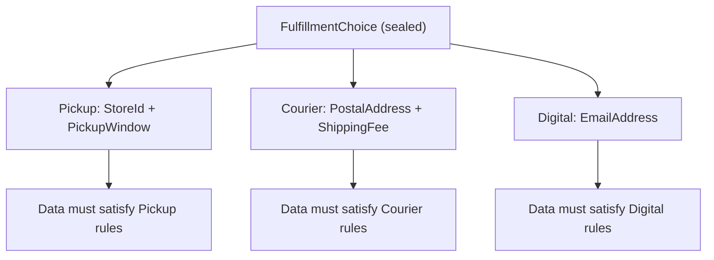
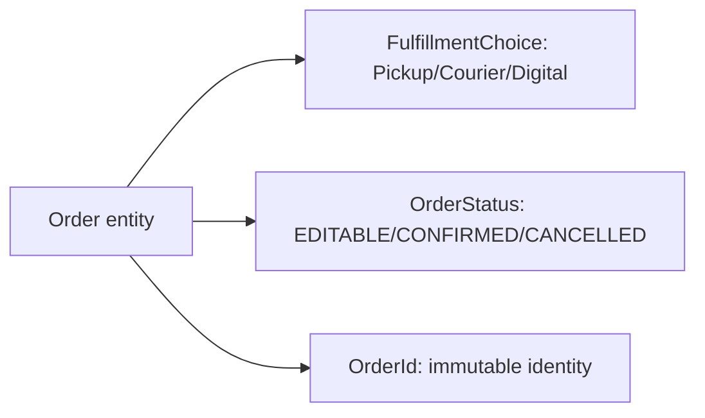

# Sealed Classes and Hierarchies for Finite Data Variants

An order can be fulfilled via **in-store pickup**, **courier delivery to an address**, or **digital product delivery**. These three methods require completely different information: in-store pickup needs a pickup location and time window; courier delivery needs a street address and shipping fee; digital delivery needs an email address. Cramming all fields into one class with numerous nulls and boolean flags makes it far too easy to create nonsensical states such as a digital delivery order with a physical shipping fee and no email.

In Java 17+, `sealed class` and `sealed interface` allow you to model a **hierarchy with a directly controlled set of variants**. Paired with `record` and invariant-checking constructors, you can turn the rule "there are only three order fulfillment modes" into a type-system constraint rather than a mere comment.

This lesson belongs to the **Java Models** chapter of the **DATABASE_DATA_MODELING** module. The module focuses on translating business requirements into verifiable entities, relationships, and constraints—moving from normalization, keys, and indexes to physical schemas—while comparing relational, document, graph, and analytical models. Therefore, alongside Java syntax, this lesson explains how to preserve **variant sets, data structure, constraints, and evolvability** when storing or transmitting data.

## 1. When Does a Model Have a "Finite Set of Variants"?

A variant set is **finite under the current contract** when the business explicitly defines all possible cases and each case carries its own data. For example:

| Concept | Variants | Distinct Data |
| --- | --- | --- |
| Order fulfillment method | `Pickup`, `Courier`, `Digital` | Store/window; address/fee; email |
| Authentication outcome | `Authenticated`, `Denied`, `NeedsVerification` | Session; reason; verification prompt |
| Payment method | `BankTransfer`, `CashOnDelivery`, `CardToken` | Transfer details; delivery address; token |
| Expiration date | `Known`, `Unknown`, `NotApplicable` | Date or no payload |
| Business event | `OrderPlaced`, `PaymentReceived`, `OrderCancelled` | Event-specific fields |

The key insight is that **not every case is the same object with a few flags**. Each variant has required fields and fields that have no meaning whatsoever.

Example of an error-prone model:

```java
// Illustrates an anti-pattern; NOT a recommended design.
final class DeliveryData {
    String type;
    String storeId;
    String pickupStart;
    String pickupEnd;
    String street;
    String city;
    Long shippingFeeCents;
    String email;
}
```

This class allows `type = "DIGITAL"` with `email = null`, or `type = "PICKUP"` with `shippingFeeCents = -10`. Every caller must write multi-branch checks and can easily miss a case.

Designing with a **sum type (variant type)** expresses "**either** variant A, **or** B, **or** C", where each variant is a **product** of its own required fields.



**Benefit:** A `FulfillmentChoice` variable can only hold an instance of an allowed subtype; each subtype protects its own data. This eliminates countless invalid field combinations *before* the database is even involved.

## 2. How Does `sealed` Work in Java 17?

`sealed` is a standard feature as of **Java 17**. A `sealed` class or interface only allows **explicitly permitted direct subtypes** to extend or implement it.

```java
sealed interface DeliveryChoice
    permits PickupChoice, CourierChoice, DigitalChoice {}

record PickupChoice(String storeCode) implements DeliveryChoice {}
record CourierChoice(String street) implements DeliveryChoice {}
record DigitalChoice(String email) implements DeliveryChoice {}
```

`record`s are implicitly `final`, making them ideal as **finite leaves** in a hierarchy. If other code tries to declare `class DroneChoice implements DeliveryChoice` without permission, the compiler rejects it.

### 2.1. Key Rules of `permits`

- Every **direct** permitted subtype must declare exactly one of three modifiers: `final`, `sealed`, or `non-sealed`. A `record` satisfies this through its implicit `final` modifier.
- If a `sealed` subtype continues as `sealed` at a lower level, that level declares its own direct permitted subtypes.
- Choosing `non-sealed` **re-opens that branch for further inheritance**; at that point the hierarchy is no longer completely closed at its leaves, even though direct subtypes remain listed.
- With **named modules**, permitted subtypes must reside in the same module as the sealed type; when **not using named modules**, they must reside in the same package.
- `permits` can be inferred by Java if direct subtypes are declared in the **same compilation unit** per language rules. Writing `permits` explicitly usually makes lessons easier to read and keeps the API contract clear.
- A `final class` cannot be subclassed; a `non-sealed class` can be extended under normal Java rules.

Multi-level hierarchy example:

```java
sealed interface Action permits Command, Query {}

sealed interface Command extends Action
    permits CreateCommand, CancelCommand {}

record CreateCommand(String title) implements Command {}
record CancelCommand(String id) implements Command {}

non-sealed interface Query extends Action {}
```

Here command types are closed at `CreateCommand` and `CancelCommand`. However, any accessible type in Java may implement `Query`; therefore you **cannot** claim `Action` has only three leaf types at all times. When the business requires a genuinely fixed set of cases, never use `non-sealed` carelessly.

## 3. How `sealed` Differs from `enum`, Records, and Ordinary Polymorphism

| Tool | Can Carry Variant-Specific Payloads? | Controlled Subtype Set? | When to Use |
| --- | --- | --- | --- |
| `enum` | Constants can have properties/behavior, but cannot have distinct field schemas like variant records | Fixed constant set | Fixed statuses/codes not needing varied data shapes |
| `sealed interface` + `record` | **Yes**; each record declares its own fields | **Yes** on direct subtypes; fully closed if every branch ends in final/record | Variants with differing data; messages/commands/results |
| `sealed abstract class` | Yes; can share state and code | Yes | Need shared implementation/invariants or controlled constructors |
| Ordinary interface | Yes, via arbitrary classes | Open subtype set | Plugin systems or external extension points |
| Single record with `type` field and nullable fields | Yes, but invalid field combinations still exist at type level | No | Only consider as DTO/wire format paired with explicit validation |

If you only have `DRAFT`, `SUBMITTED`, and `PAID` statuses that **carry no distinct payloads**, `enum OrderStatus` may suffice. If `PAID` must carry `paymentId` and `paidAt`, while `CANCELLED` carries `reason` and `cancelledAt`, a payload-carrying variant set expresses intent much more clearly.

**Note:** `sealed` controls **who can extend or implement**, not immutability. A `final class` subtype can still expose setters and mutable collections. Use `record`s, immutable fields, defensive copying, and constructor validation whenever the contract requires immutability.

## 4. Self-Contained Java 17+ Example: Three Order Fulfillment Modes

Suppose business rules state:

1. `Pickup`: requires a store ID and a pickup window whose start precedes its end.
2. `Courier`: requires a delivery address and a non-negative shipping fee. Fees are measured in **USD cents** in this example.
3. `Digital`: requires a recipient email address, with no physical address or shipping fee.
4. An order has **only one** fulfillment choice at a time; fulfillment may be changed while the order remains in an editable state.

### Runnable Code on Java 17

Save the entire block below to `SealedFulfillmentDemo.java`; all types sit inside one class for a complete standalone demonstration:

```java
import java.time.Instant;
import java.util.List;
import java.util.Objects;
import java.util.UUID;

public class SealedFulfillmentDemo {

    record StoreId(UUID value) {
        public StoreId {
            Objects.requireNonNull(value, "value");
        }
    }

    record PickupWindow(Instant startsAt, Instant endsAt) {
        public PickupWindow {
            Objects.requireNonNull(startsAt, "startsAt");
            Objects.requireNonNull(endsAt, "endsAt");
            if (!startsAt.isBefore(endsAt)) {
                throw new IllegalArgumentException(
                    "Pickup start must precede end"
                );
            }
        }
    }

    record PostalAddress(String street, String city) {
        public PostalAddress {
            Objects.requireNonNull(street, "street");
            Objects.requireNonNull(city, "city");
            street = street.strip();
            city = city.strip();
            if (street.isEmpty() || city.isEmpty()) {
                throw new IllegalArgumentException(
                    "Street and city must be provided"
                );
            }
        }
    }

    record ShippingFee(long usdCents) {
        public ShippingFee {
            if (usdCents < 0) {
                throw new IllegalArgumentException(
                    "Shipping fee cannot be negative"
                );
            }
        }
    }

    record EmailAddress(String value) {
        public EmailAddress {
            Objects.requireNonNull(value, "value");
            value = value.strip();
            // Minimal validation to stay focused on variant modeling.
            if (value.isBlank() || !value.contains("@")) {
                throw new IllegalArgumentException(
                    "Invalid email"
                );
            }
        }
    }

    sealed interface FulfillmentChoice
        permits Pickup, Courier, Digital {}

    record Pickup(StoreId store, PickupWindow window)
        implements FulfillmentChoice {
        public Pickup {
            Objects.requireNonNull(store, "store");
            Objects.requireNonNull(window, "window");
        }
    }

    record Courier(PostalAddress address, ShippingFee fee)
        implements FulfillmentChoice {
        public Courier {
            Objects.requireNonNull(address, "address");
            Objects.requireNonNull(fee, "fee");
        }
    }

    record Digital(EmailAddress recipient)
        implements FulfillmentChoice {
        public Digital {
            Objects.requireNonNull(recipient, "recipient");
        }
    }

    enum OrderStatus { EDITABLE, CONFIRMED, CANCELLED }

    static final class Order {
        private final UUID id;
        private FulfillmentChoice fulfillment;
        private OrderStatus status;

        private Order(UUID id, FulfillmentChoice fulfillment) {
            this.id = Objects.requireNonNull(id, "id");
            this.fulfillment = Objects.requireNonNull(
                fulfillment, "fulfillment"
            );
            this.status = OrderStatus.EDITABLE;
        }

        static Order create(FulfillmentChoice choice) {
            return new Order(UUID.randomUUID(), choice);
        }

        void changeFulfillment(FulfillmentChoice next) {
            if (status != OrderStatus.EDITABLE) {
                throw new IllegalStateException(
                    "Fulfillment cannot change now"
                );
            }
            fulfillment = Objects.requireNonNull(next, "next");
        }

        void confirm() {
            if (status != OrderStatus.EDITABLE) {
                throw new IllegalStateException(
                    "Only an editable order may be confirmed"
                );
            }
            status = OrderStatus.CONFIRMED;
        }

        FulfillmentChoice fulfillment() {
            return fulfillment;
        }

        OrderStatus status() {
            return status;
        }
    }

    static String instructions(FulfillmentChoice choice) {
        Objects.requireNonNull(choice, "choice");
        if (choice instanceof Pickup p) {
            return "Pick up at store " + p.store().value()
                + " from " + p.window().startsAt();
        }
        if (choice instanceof Courier c) {
            return "Ship to " + c.address().street()
                + ", " + c.address().city()
                + "; USD cents: " + c.fee().usdCents();
        }
        if (choice instanceof Digital d) {
            return "Send access details to " + d.recipient().value();
        }
        throw new IllegalStateException(
            "Unhandled fulfillment variant: " + choice.getClass()
        );
    }

    public static void main(String[] args) {
        Pickup pickup = new Pickup(
            new StoreId(UUID.randomUUID()),
            new PickupWindow(
                Instant.parse("2030-01-10T08:00:00Z"),
                Instant.parse("2030-01-10T10:00:00Z")
            )
        );
        Courier courier = new Courier(
            new PostalAddress("12 Main Street", "Hanoi"),
            new ShippingFee(250)
        );
        Digital digital = new Digital(
            new EmailAddress("reader@example.com")
        );

        List<FulfillmentChoice> choices =
            List.of(pickup, courier, digital);
        choices.forEach(choice ->
            System.out.println(instructions(choice))
        );

        Order order = Order.create(pickup);
        order.changeFulfillment(digital);
        order.confirm();
        System.out.println(order.status()); // CONFIRMED
        System.out.println(instructions(order.fulfillment()));

        // order.changeFulfillment(courier);
        // Uncommenting will throw IllegalStateException.
        // new PickupWindow(
        //     Instant.parse("2030-01-10T10:00:00Z"),
        //     Instant.parse("2030-01-10T08:00:00Z")
        // );
        // Uncommenting will throw IllegalArgumentException.
    }
}
```

In this code:

- `FulfillmentChoice` is a **sum type**; each `record` is a variant with only its required fields, needing no boolean flags or unrelated nullable fields.
- `PickupWindow` and `PostalAddress` validate their own invariants; `ShippingFee(0)` is valid, while negative fees are rejected.
- `Order` is an **entity with an ID and lifecycle**, whereas `Pickup`/`Courier`/`Digital` are **values describing a choice**. Changing the choice does not require creating a new order.
- The variants exist independently of the `EDITABLE/CONFIRMED` lifecycle state. Avoid creating classes like `ConfirmedCourierOrder`, `EditableCourierOrder`, `ConfirmedPickupOrder`, ... unless you genuinely need a state-product structure.
- `instructions` only accesses fields belonging to each variant. There is no `switch` on a string `type` followed by manual null checks on every field.
- The example intentionally performs minimal email checks to keep the focus on types. Real systems need proper syntax validation and address verification per product rules rather than treating `contains("@")` as full email validation.

**Important limitation:** the `FulfillmentChoice` type alone cannot ensure that a digital product is never assigned physical shipping, or that a store is actually open during the chosen pickup window. Conditions depending on other data must be checked in application services/transactions and reinforced by appropriate constraints.

## 5. Handling Variants: Polymorphism or Type Dispatch?

There are two main approaches for implementing variant-dependent behavior.

### 5.1. Placing Behavior on the Interface and Variants

When behavior is a **stable part of the domain**, declare a method on the interface for each subtype to implement:

```java
sealed interface FeeRule
    permits FreeFee, FixedFee {
    long feeCents();
}

record FreeFee() implements FeeRule {
    @Override
    public long feeCents() {
        return 0;
    }
}

record FixedFee(long cents) implements FeeRule {
    public FixedFee {
        if (cents < 0) {
            throw new IllegalArgumentException("Negative fee");
        }
    }

    @Override
    public long feeCents() {
        return cents;
    }
}
```

Adding a new variant forces the new subtype to implement the abstract method. This works well when **behavior is tightly coupled to the data type** and does not require separating multiple read-side projections.

### 5.2. Keeping Behavior in External Handlers (Visitor / Pattern Matching)

When the same data structure serves **multiple purposes**—UI rendering, auditing, database persistence, messaging, fee calculation—keep variants as **pure data** and place logic in dedicated handler functions. For example, `instructions` uses `instanceof` and extracts variant-specific fields.

**Java version notes:**

- Java 17 supports **pattern matching for `instanceof`** as a standard feature, e.g., `if (choice instanceof Pickup p)`.
- **Pattern matching for `switch` over sealed types** became a standard feature in Java 21; in Java 17 it was only a preview feature that evolved across releases. The Java 17 example above **uses no preview features**.
- When compiling with Java 21+, a `switch` expression covering all subtypes of a closed sealed hierarchy receives compile-time **exhaustiveness** checking.

Example **for Java 21+ only** (written as a method inside `SealedFulfillmentDemo` above):

```java
// Java 21+: place this method inside SealedFulfillmentDemo.
static String typeLabel(FulfillmentChoice choice) {
    return switch (choice) {
        case Pickup p -> "PICKUP";
        case Courier c -> "COURIER";
        case Digital d -> "DIGITAL";
    };
}
```

If `LockerPickup` is later added to the closed hierarchy and a switch lacks `default`, recompiling the handler detects the missing branch. **Do not add a `default` branch merely to silence missing-case checks** when the goal is forcing every variant to be handled intentionally. For previously compiled code encountering a new runtime type, you still need a proper compatibility strategy; compile-time exhaustiveness does not replace version coordination across independently deployed services.

### Which Approach to Choose?

| Problem | Typically Suitable Approach |
| --- | --- |
| Each variant naturally knows how to compute one stable behavior | Polymorphic method on the interface |
| Multiple consumers read the same variants but format/process them differently | Record data + separate handler functions |
| Frequently adding **behaviors**, rarely adding variants | Separate handlers or visitor let you add operations without editing every variant |
| Frequently adding **variants**, rarely adding behaviors | Polymorphism reduces the number of places needing new branches |
| Contract requires compiler-verified exhaustiveness | Closed sealed hierarchy + Java 21 pattern `switch` without `default` |

Do not turn a sealed type into an "all-knowing" class with dozens of methods coupled to HTTP, SQL, email, and UI simultaneously. Domain variants should hold their invariants and semantics; adapters handle external systems.

## 6. Designing Constructors So Invalid States Are Hard to Create

A sealed interface **does not automatically enforce invariants across fields**. That responsibility belongs to each subtype's constructor or factory.

Example checks:

| Variant | In-Object Invariants | External Conditions |
| --- | --- | --- |
| `Pickup` | `store != null`, `window != null`, `start < end` | Does the store exist/stay open; is the pickup slot still available? |
| `Courier` | Complete address fields, fee `>= 0` | Is delivery supported in this zone; does fee match pricing policy? |
| `Digital` | Structurally valid recipient | Can the product be delivered digitally; is the email verified? |

Fields absent from a subtype **never need to be set to null**. That directly shrinks the number of invalid combinations your program can represent.

An advanced example: if `Digital` requires either an `EmailAddress` or an `AccountId`, do not put both nullable fields in one record and count nulls. Instead, introduce a nested sealed type:

```java
import java.util.Objects;

sealed interface DigitalRecipient
    permits RecipientEmail, RecipientAccount {}

record RecipientEmail(String address)
    implements DigitalRecipient {
    public RecipientEmail {
        Objects.requireNonNull(address, "address");
        if (address.isBlank()) {
            throw new IllegalArgumentException("Blank email");
        }
    }
}

record RecipientAccount(String accountId)
    implements DigitalRecipient {
    public RecipientAccount {
        Objects.requireNonNull(accountId, "accountId");
        if (accountId.isBlank()) {
            throw new IllegalArgumentException("Blank account ID");
        }
    }
}
```

However, **do not nest sealed types for every attribute**. When there is simply one genuinely optional value without multiple distinct shapes, a controlled nullable field or `Optional` on a query API suffices. Use rich types where they eliminate real domain ambiguity.

## 7. Separating Data Variants from Lifecycle State

Two questions are often conflated:

1. **How is the order fulfilled?** `Pickup`, `Courier`, `Digital`.
2. **What lifecycle stage is the order in?** `EDITABLE`, `CONFIRMED`, `CANCELLED`.

These are **two orthogonal axes**. With 3 fulfillment modes and 3 statuses, creating 9 subclasses is a classic sign of *combinatorial explosion*; adding one new status multiplies the class count.



Modeling via composition lets you add a status without modifying any variant's structure. Nevertheless, **cross-axis constraints** can still exist: for example, once `CONFIRMED`, fulfillment cannot be changed. In the example, `changeFulfillment` blocks edits after confirmation. Those rules belong to the entity/aggregate and transactions, not inside a value record.

When statuses themselves carry **distinct payloads** (such as `Paid(paymentId, paidAt)` and `Cancelled(reason, cancelledAt)`), a sealed type for the **status** itself may fit better than an enum. Base the choice on actual data needs, not because `sealed` is newer than `enum`.

## 8. Relational Schema: Mapping a Sealed Hierarchy to PostgreSQL

SQL has no direct `sealed` keyword. To preserve the same semantics, choose an appropriate storage pattern. For our order example, a common approach uses a **discriminator column** identifying the variant alongside the corresponding payload columns.

### 8.1. Single Table for All Variants with a Shape-Enforcing `CHECK`

Complete illustrative PostgreSQL schema (shipping fee uses `BIGINT` USD cents; multi-currency not yet modeled):

```sql
CREATE TABLE stores (
    id UUID PRIMARY KEY,
    store_name TEXT NOT NULL
);

CREATE TABLE orders (
    id UUID PRIMARY KEY,
    status VARCHAR(16) NOT NULL CHECK (
        status IN ('EDITABLE', 'CONFIRMED', 'CANCELLED')
    ),
    version BIGINT NOT NULL DEFAULT 0 CHECK (version >= 0)
);

CREATE TABLE order_fulfillment (
    order_id UUID PRIMARY KEY REFERENCES orders(id),
    kind VARCHAR(12) NOT NULL CHECK (
        kind IN ('PICKUP', 'COURIER', 'DIGITAL')
    ),

    pickup_store_id UUID REFERENCES stores(id),
    pickup_starts_at TIMESTAMPTZ,
    pickup_ends_at TIMESTAMPTZ,

    courier_street TEXT,
    courier_city TEXT,
    shipping_fee_cents BIGINT,

    digital_email TEXT,

    CONSTRAINT ck_pickup_window CHECK (
        pickup_starts_at IS NULL
        OR pickup_ends_at IS NULL
        OR pickup_starts_at < pickup_ends_at
    ),
    CONSTRAINT ck_shipping_fee_nonnegative CHECK (
        shipping_fee_cents IS NULL OR shipping_fee_cents >= 0
    ),
    CONSTRAINT ck_fulfillment_shape CHECK (
        (
            kind = 'PICKUP'
            AND pickup_store_id IS NOT NULL
            AND pickup_starts_at IS NOT NULL
            AND pickup_ends_at IS NOT NULL
            AND courier_street IS NULL
            AND courier_city IS NULL
            AND shipping_fee_cents IS NULL
            AND digital_email IS NULL
        )
        OR
        (
            kind = 'COURIER'
            AND pickup_store_id IS NULL
            AND pickup_starts_at IS NULL
            AND pickup_ends_at IS NULL
            AND courier_street IS NOT NULL
            AND length(btrim(courier_street)) > 0
            AND courier_city IS NOT NULL
            AND length(btrim(courier_city)) > 0
            AND shipping_fee_cents IS NOT NULL
            AND digital_email IS NULL
        )
        OR
        (
            kind = 'DIGITAL'
            AND pickup_store_id IS NULL
            AND pickup_starts_at IS NULL
            AND pickup_ends_at IS NULL
            AND courier_street IS NULL
            AND courier_city IS NULL
            AND shipping_fee_cents IS NULL
            AND digital_email IS NOT NULL
            AND length(btrim(digital_email)) > 0
        )
    )
);
```

Here:

- `kind` is the **discriminator**: identifies which variant the row represents.
- `ck_fulfillment_shape` prevents payloads from multiple variants appearing together while requiring all fields of the chosen variant.
- `PRIMARY KEY(order_id)` ensures at most one fulfillment row per order; the FK ensures the order exists.
- `ck_pickup_window` rejects end times at or before start times when both are present; for `PICKUP`, the shape constraint additionally requires both to be non-null.
- PostgreSQL `CHECK` constraints only reject FALSE, while UNKNOWN from NULL passes. Therefore combine `IS NULL`/`IS NOT NULL` and value predicates carefully; never assume `CHECK (x > 0)` automatically forbids NULL.
- `shipping_fee_cents` is a non-negative integer. When expanding to multiple currencies, add a currency code and minor-unit policy, or another normalized monetary representation.

**Two important limitations:** the schema above guarantees **at most one** fulfillment per order, yet an order could exist without an `order_fulfillment` row; ensuring **every** order has a fulfillment requires transactional creation workflows and/or additional enforcement. Nor does the constraint prove the email is deliverable or the address is serviceable. Cross-row and external conditions belong to policies, foreign keys, transactions, or appropriate integrations.

### 8.2. Reading and Reconstituting Subtypes from Data

A repository can read a row and dispatch on `kind` to construct the matching record:

```text
order_fulfillment.kind = PICKUP
    -> read pickup_store_id, pickup_starts_at, pickup_ends_at
    -> StoreId + PickupWindow
    -> new Pickup(...)

order_fulfillment.kind = COURIER
    -> read courier_street, courier_city, shipping_fee_cents
    -> PostalAddress + ShippingFee
    -> new Courier(...)

order_fulfillment.kind = DIGITAL
    -> read digital_email
    -> new Digital(...)
```

Never call `new Digital(null)` to "salvage" a corrupt record. If `kind` is unrecognized, columns are missing, or invariants fail, the repository must have an explicit policy: reject loading, log a data error, run a migration, or quarantine the record. Never silently fall back to a default subtype that might trigger wrong shipments or charges.

### 8.3. Parent Table with One Child Table per Subtype

An alternative design:

```text
order_fulfillment(order_id PK, kind)
    |
    +-- pickup_details(order_id PK/FK, store_id, starts_at, ends_at)
    |
    +-- courier_details(order_id PK/FK, street, city, fee_cents)
    |
    +-- digital_details(order_id PK/FK, email)
```

The advantage is avoiding nullable variant columns in one wide table; each child table enforces its own constraints directly. The trade-off is needing joins on read, and **standard foreign keys alone do not guarantee each parent row has exactly one matching subtype child row**. You need transactions, constraints, triggers, or DB-level enforcement capable of guaranteeing the "exactly one" rule. Never assume `sealed` in Java protects against writes from another service.

### 8.4. Choosing a Storage Model

| Strategy | Advantages | Risks / Costs |
| --- | --- | --- |
| **Single table + discriminator** | Simple single-row reads; shape constraints live directly in the table | Many nullable columns; adding variants requires updating CHECK/schema/mappings |
| **Class table / table per variant** | Variant columns cleanly separated; local constraints per child table | Requires joins; hard to enforce exactly-one subtype with standard FKs alone |
| **JSONB payload + discriminator** | Flexible across differing payloads; convenient when shapes evolve rapidly | Needs JSON Schema/validation or dedicated CHECKs; internal indexing/querying/FKs are harder |
| **Split into separate aggregates** | Fits when each type has a genuinely independent lifecycle | No longer one sealed value within a single lifecycle; requires identity & orchestration |

Choose based on query patterns, variant stability, integrity needs, and data volume. There is no rule saying "sealed always means single-table inheritance".

## 9. JPA/Hibernate and Serialization

A domain model built with `sealed interface` and `record` does not always map directly to a JPA `@Entity` hierarchy. Providers typically require constructors and proxy/bytecode enhancement; implicitly `final` records and restricted sealed subtypes may clash with proxy subclassing.

Organizational options:

1. **Separate persistence models:** a JPA entity holds discriminator and payload columns, and the repository constructs `Pickup/Courier/Digital` domain values—keeping domain invariants independent of the ORM.
2. **Use provider-supported mapping:** for genuine entity hierarchies, choose an appropriate inheritance strategy and test with your exact Hibernate/JPA version, proxies, lazy loading, cascades, and state policies.
3. **Use JSON/DTOs at boundaries:** parse request DTOs by discriminator, validate variant-specific payloads, and then instantiate domain records. Never allow consumers to pass arbitrary class names for deserialization.

A discriminator-based JSON schema might look like:

```json
{
  "kind": "PICKUP",
  "storeId": "53d825e4-065c-4c6f-8dca-3910542ecbe2",
  "pickupWindow": {
    "startsAt": "2030-01-10T08:00:00Z",
    "endsAt": "2030-01-10T10:00:00Z"
  }
}
```

```json
{
  "kind": "COURIER",
  "address": {
    "street": "12 Main Street",
    "city": "Hanoi"
  },
  "shippingFeeCents": 250
}
```

```json
{
  "kind": "DIGITAL",
  "recipientEmail": "reader@example.com"
}
```

Applications can use JSON Schema `oneOf` or library-supported discriminator mapping to enforce exactly one valid shape. However, `oneOf` only works when sub-schemas are mutually exclusive as intended; pay close attention to required fields, discriminators, unknown fields, and versioning. Never assume every Java mapper preserves semantics if validation is skipped.

**Security:** never enable polymorphic deserialization from untrusted user-supplied class names. Use an allowlisted set of tags/type IDs with explicit mapping; for sensitive payloads, avoid logging raw payloads and enforce per-variant authorization checks.

## 10. Adding a New Variant: Type, Schema, and Contract Changes

Suppose the business adds `LockerPickup`: picking up from a parcel locker with `lockerId` and `expiryAt`. In Java, we add the subtype and update `permits`:

```java
// Illustrates the structural change; does not directly replace the Java 17 demo above.
sealed interface FulfillmentChoice
    permits Pickup, Courier, Digital, LockerPickup {}

record LockerPickup(String lockerId, java.time.Instant expiryAt)
    implements FulfillmentChoice {}
```

Yet adding the class **does not finish the feature**. Check every boundary:

| Boundary | Changes to Verify |
| --- | --- |
| **Domain model** | `LockerPickup` invariants, ID, expiration time, factories, change policies |
| **Application handlers** | Handlers, mappers, fee calculation, UI, auditing, policies; Java 21 sealed switches catch missing branches at build time |
| **API/JSON** | New tag, payload schema, validation, responses, and older clients |
| **Database** | `LOCKER` discriminator, columns or child table, constraints, indexes, migrations, and rollback |
| **Messages/events** | Do older consumers recognize the new tag? Is versioning or gated rollout needed? |
| **Analytics/reports** | Do grouping tables recognize the new method, or do reports accidentally filter it out? |
| **Multi-version deployment** | Writer/reader deploy order, rolling-update compatibility, rollback handling |

### Closed Code vs. Open Systems

`sealed` informs **source code within a single build** who may extend a type; it **does not force** two independently deployed services to share the same release version over the network.

If a newer producer emits `"kind": "LOCKER"` while an older consumer only knows three kinds, the older consumer must fail in a controlled manner: reject explicitly, route to a monitored dead-letter/retry queue, or accept only after upgrading. Never silently coerce it to `Pickup` or `Courier` if doing so could cause misdeliveries.

For long-lived stored payloads, include a `schemaVersion` or stable tag/normalization strategy so applications can interpret legacy data. When retiring a variant, plan how historical rows, migrations, and previously recorded events will be read rather than simply deleting the Java class.

### Phased Evolution

A safe rollout sequence when adding a new variant is typically:

1. Update consumers, databases, mappings, and schemas to **read** the new tag or reject it gracefully.
2. Update APIs and business handlers, adding tests for both valid and invalid payloads.
3. Enable **writing** the new tag once all relevant readers are ready.
4. Monitor deserialization errors, historical records, data-quality metrics, and rollback behavior.

Exact sequencing depends on service topology, feature flags, and compatibility contracts. Do not assume safe rolling deployments solely from Java compiler checks.

## 11. When Are Sealed Types Not Appropriate?

Do not use sealed hierarchies as a default pattern everywhere:

- **Plugin systems where external modules add new types:** `sealed` blocks valid extensions from outside modules; an open interface with a plugin registry fits better.
- **Data with many independent attribute combinations:** dozens of flags yield hundreds of combinations; instead of creating a subclass per combination, compose value objects and rule sets.
- **Simple labels with no distinct payloads:** an `enum` is usually sufficient with less boilerplate.
- **Variants changing rapidly at runtime via configuration:** a versioned data schema with a validator often works better than closed compile-time types, while still validating inputs.
- **Domain models heavily tied to complex JPA proxies:** keep sealed types at the domain/DTO layer rather than forcing them onto ORM entities.

The crux is having a **recognized set of variants that is part of the business contract**, not using a language feature simply because it exists.

## 12. Impact on Document, Graph, and Analytical Models

| Storage Model | How Variants Are Represented | What Must Be Preserved |
| --- | --- | --- |
| **Relational** | Discriminator + payload columns, or child table per subtype | PK/FK, shape `CHECK`s, transactions, variant-oriented indexes/queries |
| **Document** | Object with `kind` and variant-specific fields, `oneOf` schema or validator | Stable tags, complete payloads, never conflate unknown/null with another variant |
| **Graph** | Labeled/typed nodes or edges, or intermediate relation nodes | Edge cardinality, variant properties, and history; two edges of the same type are not automatically one entity |
| **Analytical / warehouse** | `fulfillment_kind` dimension, dedicated attribute columns/tables, facts referencing order/ID | Never lump a new type into "other" unflagged; effective timestamps and schema versions |

In a graph database, "in-store pickup" might be modeled as an edge from the order to a `Store` node with a time window, while "digital delivery" links to an account/digital recipient. That is a **relationship modeling** choice, not a literal translation of Java subtypes named `Pickup` or `Digital`.

In a warehouse, event records like `FulfillmentSelected` can capture `orderId`, `kind`, `occurredAt`, and payload or reference keys. Two events with the same `kind` and payload at different timestamps or IDs may represent two distinct customer changes; deduplicating by value record loses history.

## 13. Testing Across Every Variant and Boundary

Tests must cover **exhaustiveness of the variant set**, **in-variant invariants**, and **storage consistency**.

| Scenario | Expectation |
| --- | --- |
| Creating `Pickup` with `PickupWindow(start < end)` | Succeeds |
| `PickupWindow(start >= end)` | Rejected by constructor |
| `Courier` with negative fee | Rejected by `ShippingFee` |
| `Digital` missing email | Rejected by constructor/value type |
| `Order` transitioning from `EDITABLE` to `CONFIRMED` | Succeeds |
| Changing fulfillment after `CONFIRMED` | Rejected by domain method |
| JSON `kind=PICKUP` containing disallowed `recipientEmail` | Validation error; never silently ignore mismatched fields |
| SQL `kind=DIGITAL` with non-null `pickup_store_id` | Violates `ck_fulfillment_shape` |
| SQL `kind=COURIER` with `shipping_fee_cents=-1` | Violates constraint |
| Repository reading row with unsupported `kind` | Controlled error/routing; never guess a subtype |
| Adding `LockerPickup` in Java 21 with unhandled switch | Compile-time exhaustiveness flags missing branch on rebuild |
| Older consumer receiving new tag via JSON | Responds per compatibility policy without misinterpreting data |
| Two requests modifying one order's fulfillment concurrently | Protected by version/transactions, not constructors alone |

For real databases, run integration tests against an actual PostgreSQL instance to verify `CHECK` constraints, FKs, and transaction behavior. A Java unit test does not prove the database rejects malformed rows written by another service or a migration script.

### Testing Each Subtype's Contract

JUnit 5 example (illustrative, requires JUnit dependency; accesses nested types of `SealedFulfillmentDemo` in the same package):

```java
import static org.junit.jupiter.api.Assertions.*;
import org.junit.jupiter.api.Test;

final class FulfillmentTest {
    @Test
    void feeCannotBeNegative() {
        assertThrows(IllegalArgumentException.class,
            () -> new SealedFulfillmentDemo.ShippingFee(-1));
    }

    @Test
    void digitalHasNoPhysicalDeliveryFields() {
        var digital = new SealedFulfillmentDemo.Digital(
            new SealedFulfillmentDemo.EmailAddress(
                "reader@example.com"
            )
        );
        assertInstanceOf(
            SealedFulfillmentDemo.FulfillmentChoice.class,
            digital
        );
    }
}
```

If tests live in a different package, adjust visibility of the nested types accordingly; this JUnit snippet simply illustrates testing within the same package as the demo file. Do not make every subtype `public` solely for test frameworks.

## 14. Practice Exercises

### Exercise A — Support Ticket States

A support ticket has states: `New(createdAt)`, `Assigned(agentId, assignedAt)`, `Resolved(resolvedAt, resolutionCode)`, and `Rejected(reason, rejectedAt)`. Write `sealed interface TicketState` and the four records. Identify which fields never need to be nullable, where state transition rules live, and how to persist this in a database.

**Hint:** each record validates its own payload. The `Ticket` entity holds identity and transitions state via domain methods. The database uses a discriminator + shape constraint or child tables; forbid persisting `RESOLVED` without a resolution code.

### Exercise B — Shipping Fee Calculation Methods

An order supports `FreeShipping`, `FlatFee(Money)`, and `DistanceBased(ratePerKm, distanceKm)`. Decide whether to use an enum or sealed type; represent fees and quantities with explicit units and non-negative guards. If `SubscriptionIncluded(planId)` is added later, which handlers and database tables must change?

**Hint:** a sealed type fits when each variant holds distinct data. Note that total fees may depend on rate tables/taxes and versioned policies; do not compute everything inside constructors.

### Exercise C — Open Plugin System

A platform lets partners install plugins providing custom payment methods. Using `sealed interface PaymentMethod` would prevent plugins in external modules from implementing arbitrary subtypes. Propose a design offering both safe **core variants** and external extensions without editing `permits` for every plugin.

**Hint:** separate an open plugin API from the internal transaction model, using an adapter/registry with approved type tags and versioned payloads. Never instantiate classes from untrusted network class names.

### Exercise D — Updating the Schema for a New Variant

Given `order_fulfillment` from Section 8, product requirements add `LockerPickup(lockerId, expiryAt)`. Propose a migration adding columns, extending `CHECK`, updating Java/JSON mappings, sequencing rollout, and testing rollback. Explain what older consumers will do upon encountering `kind='LOCKER'`.

**Hint:** open read paths before enabling writes for the new tag; use feature flags if needed. Never silently treat the new type as `PICKUP`. Account for historical rows and deployed service versions.

## 15. Checklist Before Finalizing a Variant Hierarchy

- [ ] Verified the business genuinely has a **finite set of cases** best modeled as distinct variants.
- [ ] Chose `enum` when only labels are needed, or a sealed hierarchy when variants carry distinct payloads and invariants.
- [ ] Every permitted subtype intentionally declares `final`, `sealed`, or `non-sealed`; avoided accidental open branches.
- [ ] Each subtype has a constructor/factory enforcing invariants; avoided unrelated nullable fields.
- [ ] Separated data variants from entity lifecycle state to avoid unnecessary class multiplication.
- [ ] Handler branches cover all variants; understand the difference between Java 17 `instanceof` and Java 21 pattern `switch`.
- [ ] Defined keys, relationships, discriminators, shape constraints, read/write consistency, and transactions in the database.
- [ ] JSON/JPA mappers never bypass validation or deserialize from untrusted class names.
- [ ] Established a versioning/deployment strategy for adding, renaming, or retiring variants so older consumers handle unknown tags safely.
- [ ] Tested constructors, state transitions, malformed JSON, SQL constraints, and multi-version compatibility.
- [ ] Preserved each variant's semantics, relationships, and attributes in document/graph/analytical models.

**Key takeaway:** `sealed` closes the set of **permitted direct subtypes**, while `record`s and constructors enforce **valid data within each subtype**. This hierarchy expresses "one of the recognized cases", not "an object carrying any arbitrary mix of flags". When mapping the model to databases or APIs, still enforce discriminators, shape constraints, transactions, and schema evolution strategies so every layer agrees on the same variant set.
