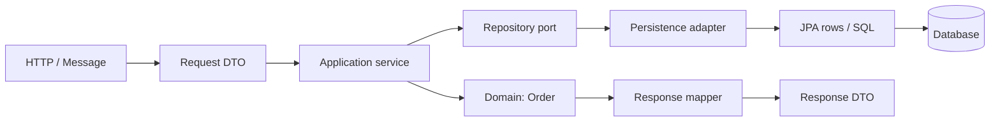
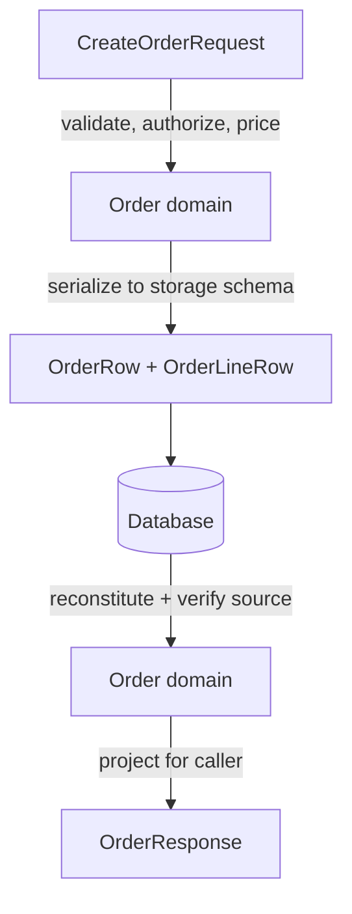

# Separating Domain Models, Transfer DTOs, and Persistence Objects

A single Java class named `Order` can end up serving as the API return type, the JPA entity, and the business-logic object all at once. This looks economical at first: no converters to write, no extra classes, no distinguishing between representations. Yet as the system grows, a database table change can break the API contract; a client-supplied field can bind directly to a sensitive column; or an order confirmation flow can accidentally bypass business invariants.

**Separating the domain model, Data Transfer Objects (DTOs), and persistence model** places each decision at its proper boundary of responsibility. All three models may describe the same real-world concept, yet they answer **three distinct sets of questions**:

- **Domain:** What is an order, what operations may be performed on it, and which states are valid?
- **Transfer:** Which fields may a client send or see, under which API contract and version?
- **Persistence:** What are the actual tables, foreign keys, primary keys, constraints, and read/write mechanisms?

This lesson belongs to the **Java Models** chapter of the **DATABASE_DATA_MODELING** module: developing the skill of turning business requirements into entities, relationships, invariants, keys, indexes, and physical schemas while considering how they map across relational, document, graph, or analytical models. Examples use **Java 17+**, Jakarta Bean Validation, and JPA concepts; specific classes or libraries may vary by framework, yet the boundary-separation principle remains unchanged.

## 1. Why One Class Is Usually Not Enough

Suppose an e-commerce system requires:

1. Creating a draft order for a customer belonging to the current tenant.
2. Adding product lines with positive quantities; unit prices come from the system's pricing policy and are **locked at line-creation time**.
3. Confirming an order only when it has at least one line and has not already been confirmed or cancelled.
4. Every order line must reference a product belonging to the **same tenant**.
5. Public APIs must not allow clients to set `status`, `unit_price_minor`, `tenant_id`, or `version`.
6. The database must preserve relationships to customers, products, and order history.
7. Schemas, ORMs, or API presentations can evolve without rewriting all order-confirmation logic.

A single class overloaded with every annotation is often written like this:

```java
// Anti-example: not a pattern to copy into production.
@Entity
public class Order {
    @Id
    public UUID id;

    public long tenantId;
    public UUID customerId;
    public String status;
    public long subtotalMinor;

    @OneToMany
    public List<OrderLine> lines;
}
```

If a JSON serializer accesses the entity directly, clients can see internal fields and ORM relationships; if a controller binds a request directly into the entity, callers can try setting `status = "CONFIRMED"` or `subtotalMinor = -1`. When a storage column is added, the JSON payload shape can shift unintentionally. JPA also brings framework mechanics such as managed state, proxies, lazy loading, dirty checking, and constructor requirements—none of which are domain concepts that belong in business logic.

**The crux:** the issue is not that one class name appears in multiple places, but that **a decision at one boundary is allowed to silently alter another boundary**.

## 2. Three Model Types and Three Contracts

| Criterion | Domain Model | Transfer DTO | Persistence Model |
|---|---|---|---|
| Primary question | "Which business rules must hold?" | "Who may send or receive what?" | "How is data written and read?" |
| Example names | `Order`, `OrderLine`, `Money` | `CreateOrderRequest`, `OrderResponse` | `OrderRow`, `OrderLineRow` |
| Invariants | State transitions, totals, quantities | Payload structure, formats, required request fields | PK, FK, unique, check, version, indexes |
| Lifecycle | Follows the order concept | Scoped to a request/response or message | Follows transactions, ORM sessions, schemas |
| Specific dependencies | Domain language, Java logic | JSON, API versioning, validation | JPA/JDBC, SQL, ORM mappings |
| Hidden fields | Not a direct API surface | Only fields explicitly made public | May include technical keys/metadata |
| Replaceability | Preserved when changing DB/transport | Keeps compatibility when changing storage | Schema can change without altering domain behavior |

You do not necessarily need **exactly three classes per field**. An immutable value object may be shared across well-defined boundaries. However, **never assume by default** that every domain class can be serialized directly or every JPA entity belongs in an API.

### Dependency Flow Diagram



Data flows through adapters and mappers, while **source-code dependency direction** should be chosen deliberately: the domain need not import `@Entity`, `HttpServletRequest`, or JSON annotations; the adapter layer depends on domain interfaces/definitions, rather than forcing the domain to know which database engine is used.

In small applications, layers can be simplified. What should never be compromised are data correctness, write permissions, and contract boundaries.

## 3. Domain Modeling Starts from Invariants, Not SQL Columns

Let us identify the rules of an order:

| ID | Domain Invariant | Who Must Enforce It? |
|---|---|---|
| O-01 | An order has an ID and belongs to exactly one tenant/customer | Domain, service, persistence |
| O-02 | A line has positive `lineNo`, an identified product, and positive quantity | Domain and persistence |
| O-03 | Locked unit price is non-negative and preserves minor-currency semantics | Domain and persistence |
| O-04 | Within one order, `lineNo` values do not repeat | Domain, PK/unique in DB |
| O-05 | Confirmation is allowed only from `DRAFT` and with at least one line | Domain, synchronized write path |
| O-06 | Subtotal equals the sum of line totals | Computable in domain; if persisted as summary, must reconcile |
| O-07 | Customer and products must belong to the same tenant | Application + composite FKs |
| O-08 | When two users edit an order concurrently, updates must not silently overwrite | Transactions / optimistic lock / DB |
| O-09 | Clients must not dictate unit prices or tenant IDs | DTOs and authorization at application boundary |

No single `Order` class—no matter how well designed—can enforce O-07 on its own without access to customer/product ownership records. That is a **cross-aggregate** or **cross-table** invariant; it requires application orchestration and storage constraints. Conversely, O-05 is a direct rule of the "confirm order" behavior and belongs squarely in the domain model.

### Distinguishing Entity, Value Object, and Aggregate

- **Domain entity:** has identity and lifecycle. Two orders with identical contents but different `orderId`s are still two separate orders.
- **Value object:** carries value and immutability with no separate ID; e.g., `Money` or `Quantity`.
- **Aggregate:** a cluster of objects updated together under one consistency boundary. `Order` is the aggregate root managing its lines and confirmation rules.

`OrderLine` may act as a child entity within the aggregate if identified by `lineNo` and edited/removed individually within an order. If the business treats each line as an immutable value without its own lifecycle, the domain representation can reflect that. **Never infer aggregate boundaries from `@OneToMany`**; ORM annotations only describe storage relationships.

## 4. Java Code: Domain Model Free of JPA and HTTP Dependencies

### 4.1. Status Enum and Order Line

```java
package example.domain;

public enum OrderStatus {
    DRAFT,
    CONFIRMED,
    CANCELLED
}
```

```java
package example.domain;

import java.util.Objects;
import java.util.UUID;

public record OrderLine(
        int lineNo,
        UUID productId,
        int quantity,
        long unitPriceMinor) {

    public OrderLine {
        if (lineNo <= 0) {
            throw new IllegalArgumentException("lineNo must be positive");
        }
        Objects.requireNonNull(productId, "productId");
        if (quantity <= 0) {
            throw new IllegalArgumentException("quantity must be positive");
        }
        if (unitPriceMinor < 0) {
            throw new IllegalArgumentException("unitPriceMinor must be non-negative");
        }
    }

    public long lineTotalMinor() {
        return Math.multiplyExact((long) quantity, unitPriceMinor);
    }
}
```

Prices here are expressed as `long` **minor units** (e.g., VND or cents per currency convention), never `double`. `Math.multiplyExact` detects arithmetic overflow instead of silently wrapping to a wrong total. In multi-currency systems, use a `Money` value object carrying currency code and scale/rounding rules; never sum minor units from two different currencies together.

The line class has no `@Column`, `@JsonProperty`, or framework annotations. It enforces local invariants at creation time regardless of whether constructed from HTTP, messaging, or database reads.

### 4.2. The `Order` Aggregate and State Transitions

```java
package example.domain;

import java.util.HashSet;
import java.util.List;
import java.util.Objects;
import java.util.Set;
import java.util.UUID;

public record Order(
        UUID id,
        long tenantId,
        UUID customerId,
        String currencyCode,
        OrderStatus status,
        List<OrderLine> lines) {

    public Order {
        Objects.requireNonNull(id, "id");
        if (tenantId <= 0) {
            throw new IllegalArgumentException("tenantId must be positive");
        }
        Objects.requireNonNull(customerId, "customerId");
        Objects.requireNonNull(currencyCode, "currencyCode");
        if (!currencyCode.matches("[A-Z]{3}")) {
            throw new IllegalArgumentException("invalid currency code");
        }
        Objects.requireNonNull(status, "status");
        Objects.requireNonNull(lines, "lines");

        lines = List.copyOf(lines);
        Set<Integer> lineNumbers = new HashSet<>();
        for (OrderLine line : lines) {
            if (!lineNumbers.add(line.lineNo())) {
                throw new IllegalArgumentException("duplicate lineNo");
            }
        }
        if (status == OrderStatus.CONFIRMED && lines.isEmpty()) {
            throw new IllegalArgumentException("confirmed order must have lines");
        }
    }

    public static Order draft(
            UUID id, long tenantId, UUID customerId,
            String currencyCode, List<OrderLine> lines) {
        return new Order(
            id, tenantId, customerId, currencyCode,
            OrderStatus.DRAFT, lines
        );
    }

    public Order confirm() {
        if (status != OrderStatus.DRAFT) {
            throw new IllegalStateException(
                "only a draft order can be confirmed"
            );
        }
        if (lines.isEmpty()) {
            throw new IllegalStateException(
                "cannot confirm an empty order"
            );
        }
        return new Order(
            id, tenantId, customerId, currencyCode,
            OrderStatus.CONFIRMED, lines
        );
    }

    public long subtotalMinor() {
        long total = 0;
        for (OrderLine line : lines) {
            total = Math.addExact(total, line.lineTotalMinor());
        }
        return total;
    }
}
```

This is an **immutable domain pattern** using `record` for conciseness—not a mandate that every aggregate must be a record. `List.copyOf` prevents callers from modifying lines after creation; state changes return a new `Order`. Regardless of which code invokes the constructor, a `CONFIRMED` order can never be empty.

**Intentional scope limits:** this example implements only `confirm()`, omitting line add/edit/delete, cancellation, cost price, taxes, or discounts. When adding those commands, preserve invariants: e.g., disallow editing lines after confirmation, forbid duplicate line numbers, and forbid negative quantities. Never let `Order` accept a `List<OrderLine>` and expose a getter returning a directly mutable list.

### 4.3. Should the Domain Hold `version`?

JPA's `@Version` serves persistence-level lost-update protection. It is not necessarily a domain concept. In this example, the domain record **does not contain** the DB version; the adapter/repository tracks the version of the loaded row and applies optimistic locking when writing.

If the domain itself has a **document revision** concept or a rule like "only edit plan revision 5", that version may be genuine domain data worth modeling separately. Never conflate optimistic-lock row versions with "contract version", "API version", or "pricing-rule version".

## 5. DTOs: Exchange Contracts, Not Backdoors for Mutating Data

A DTO is a structure dedicated to **an exchange boundary**: HTTP requests/responses, commands on a message bus, or inter-service communication. It can differ from the domain in field names, representations, and granularity.

### 5.1. Requests Contain Only What Users Are Allowed to Propose

```java
package example.api;

import jakarta.validation.Valid;
import jakarta.validation.constraints.NotNull;
import jakarta.validation.constraints.Positive;
import java.util.List;
import java.util.UUID;

public record CreateOrderLineRequest(
    @NotNull UUID productId,
    @Positive int quantity
) {}

public record CreateOrderRequest(
    @NotNull UUID customerId,
    @NotNull List<@Valid CreateOrderLineRequest> lines
) {}
```

There is **no** `tenantId`, `unitPriceMinor`, `status`, `version`, or `createdBy` in the public request:

- `tenantId` comes from the authenticated/authorized context, never trusted from caller input.
- Unit prices come from a trusted pricing service, possibly backed by an active quote/price lock.
- Initial status is set to `DRAFT` by the use case.
- `version` is concurrency metadata that can travel via `ETag`/`If-Match` headers on edit commands, never an arbitrary field clients set on the entity.

Here `lines` permits an empty list if business rules allow creating empty drafts; `@NotNull` is not `@NotEmpty`. If another endpoint creates and confirms immediately, that endpoint's request can add `@NotEmpty` and **still** rely on the domain to validate before confirming.

`@Positive` and `@NotNull` are **input validation** before running the use case; they do not replace domain invariants. Requests may also arrive from batch jobs or messages bypassing the HTTP validator, and database rows can be touched by other paths.

### 5.2. Responses Are Tailored to Readers

```java
package example.api;

import java.util.List;
import java.util.UUID;

public record OrderLineResponse(
    int lineNo,
    UUID productId,
    int quantity,
    long unitPriceMinor,
    long lineTotalMinor
) {}

public record OrderResponse(
    UUID orderId,
    String status,
    String currencyCode,
    long subtotalMinor,
    List<OrderLineResponse> lines
) {}
```

The response includes computed totals so the UI does not have to duplicate formulas, while **omitting** internal keys/metadata such as `rowVersion`, retry traces, last-modified-by internals, or unauthorized customer fields.

Never reuse `OrderLineResponse` as a request because requests have no authority to specify unit prices. Two types sharing several field names still have **different meanings and data ownership**. Separating them lets you evolve responses without accidentally loosening requests.

### 5.3. Command, Query, and Event DTOs Have Different Goals

| Kind | Examples | Focus |
|---|---|---|
| **Command/request** | `CreateOrderRequest`, `ConfirmOrderRequest` | Intent to mutate data; fields caller is allowed to choose |
| **Query/response** | `OrderResponse`, `OrderListItemResponse` | Data shape tailored to a specific screen or use case |
| **Integration event** | `OrderConfirmedV1` | Fact that already happened; versioned schema for external consumers |
| **Batch import DTO** | `ImportOrderRow` | Potentially unclean external input requiring reconciliation and error reporting |

Do not reuse one DTO across every endpoint merely because fields look similar. An order list view may need `subtotalMinor` and `lineCount` without loading all lines; a detail view may need line items and different display flags. Evaluate each DTO against its **actual consumer contract**.

## 6. Persistence Model: Stored Data and DB Constraints

A persistence model expresses how the domain is stored: keys, relationships, columns, nullability, versions, and ORM/JDBC mechanics. It may split one aggregate across multiple tables or store several values in a JSON column. **Not every JPA entity is a domain entity, and not every domain entity maps to a single table.**

### 6.1. SQL Schema for the Example

In the relational model, composite foreign keys enforce that orders, customers, and products all belong to the same tenant. We keep globally unique UUIDs for `order_id`/`line_id` for convenient referencing, paired with tenant-scoped unique constraints for cross-tenant-safe FKs.

```sql
-- PostgreSQL 15+, illustrative schema.
CREATE TABLE customer_accounts (
    tenant_id BIGINT NOT NULL,
    customer_id UUID NOT NULL,
    display_name TEXT NOT NULL,
    CONSTRAINT pk_customer_accounts
        PRIMARY KEY (tenant_id, customer_id),
    CONSTRAINT ck_customer_name CHECK (btrim(display_name) <> '')
);

CREATE TABLE catalog_products (
    tenant_id BIGINT NOT NULL,
    product_id UUID NOT NULL,
    sku TEXT NOT NULL,
    CONSTRAINT pk_catalog_products
        PRIMARY KEY (tenant_id, product_id),
    CONSTRAINT uq_catalog_sku
        UNIQUE (tenant_id, sku),
    CONSTRAINT ck_catalog_sku CHECK (btrim(sku) <> '')
);

CREATE TABLE orders (
    order_id UUID PRIMARY KEY,
    tenant_id BIGINT NOT NULL,
    customer_id UUID NOT NULL,
    currency_code CHAR(3) NOT NULL,
    status_code VARCHAR(16) NOT NULL DEFAULT 'DRAFT',
    row_version BIGINT NOT NULL DEFAULT 0,

    CONSTRAINT uq_order_with_tenant
        UNIQUE (tenant_id, order_id),
    CONSTRAINT fk_order_customer
        FOREIGN KEY (tenant_id, customer_id)
        REFERENCES customer_accounts (tenant_id, customer_id)
        ON DELETE RESTRICT,
    CONSTRAINT ck_order_status
        CHECK (status_code IN ('DRAFT', 'CONFIRMED', 'CANCELLED')),
    CONSTRAINT ck_currency_code
        CHECK (currency_code ~ '^[A-Z]{3}$'),
    CONSTRAINT ck_row_version CHECK (row_version >= 0)
);

CREATE TABLE order_lines (
    line_id UUID PRIMARY KEY,
    tenant_id BIGINT NOT NULL,
    order_id UUID NOT NULL,
    line_no INTEGER NOT NULL,
    product_id UUID NOT NULL,
    quantity INTEGER NOT NULL,
    unit_price_minor BIGINT NOT NULL,

    CONSTRAINT uq_line_number_in_order
        UNIQUE (tenant_id, order_id, line_no),
    CONSTRAINT fk_line_order
        FOREIGN KEY (tenant_id, order_id)
        REFERENCES orders (tenant_id, order_id)
        ON DELETE RESTRICT,
    CONSTRAINT fk_line_product
        FOREIGN KEY (tenant_id, product_id)
        REFERENCES catalog_products (tenant_id, product_id)
        ON DELETE RESTRICT,
    CONSTRAINT ck_line_no CHECK (line_no > 0),
    CONSTRAINT ck_line_quantity CHECK (quantity > 0),
    CONSTRAINT ck_line_price CHECK (unit_price_minor >= 0)
);

CREATE INDEX ix_lines_by_order
    ON order_lines (tenant_id, order_id, line_no);
```

`ix_lines_by_order` is an index **illustrating the query pattern**. In PostgreSQL, `UNIQUE (tenant_id, order_id, line_no)` already creates a B-tree with that exact column prefix; therefore **do not actually create an extra `ix_lines_by_order` in production if it duplicates the existing unique index**. Check `EXPLAIN` and drop redundant indexes to avoid unnecessary write overhead.

**Key invariant highlights:**

- FK `orders(tenant_id, customer_id)` prevents a tenant A order from referencing a tenant B customer.
- FK `order_lines(tenant_id, product_id)` prevents a line from referencing another tenant's product.
- FK `order_lines(tenant_id, order_id)` guarantees lines belong to an order in the same tenant.
- `UNIQUE (tenant_id, order_id, line_no)` prevents duplicate line numbers.
- `CHECK` constraints enforce domain bounds on quantity and unit price.
- **No** simple FK/`CHECK` alone enforces "a `CONFIRMED` order always has at least one line". The confirmation path must validate and synchronize this.
- Stored `unit_price_minor` is an intentional **transaction snapshot**; later catalog price changes must never retroactively alter existing order lines.

Using a globally unique UUID for `orders.order_id` alongside `tenant_id` does not replace tenant authorization checks. Every normal user query still needs tenant scoping or equivalent isolation.

### 6.2. A JPA Entity Need Not Be the Domain Object

A minimal persistence entity:

```java
package example.persistence;

import jakarta.persistence.Column;
import jakarta.persistence.Entity;
import jakarta.persistence.Id;
import jakarta.persistence.Table;
import jakarta.persistence.Version;
import java.util.UUID;

@Entity
@Table(name = "orders")
public class OrderRow {
    @Id
    @Column(name = "order_id", nullable = false)
    private UUID id;

    @Column(name = "tenant_id", nullable = false)
    private long tenantId;

    @Column(name = "customer_id", nullable = false)
    private UUID customerId;

    @Column(name = "currency_code", nullable = false, length = 3)
    private String currencyCode;

    @Column(name = "status_code", nullable = false, length = 16)
    private String statusCode;

    @Version
    @Column(name = "row_version", nullable = false)
    private long rowVersion;

    protected OrderRow() {} // For JPA.

    public UUID getId() { return id; }
    public long getTenantId() { return tenantId; }
    public UUID getCustomerId() { return customerId; }
    public String getCurrencyCode() { return currencyCode; }
    public String getStatusCode() { return statusCode; }
    public long getRowVersion() { return rowVersion; }

    public void updateStatusCode(String newStatusCode) {
        this.statusCode = newStatusCode;
    }
}
```

Here the JPA entity is strictly a **storage object**, carrying physical column names, `@Id`, and `@Version`. It does not decide when an order may be confirmed. The mapper/application only calls `updateStatusCode` **after** the domain model has produced a valid state.

The snippet above shows only the core fields and status update; an order-creation adapter needs a factory/constructor for new rows, plus an `OrderLineRow` matching the lines table. There is no reason for domain `Order` to extend `OrderRow` or share its constructor.

### 6.3. Avoid Overusing `@OneToMany`

You can map parent–child relationships with `@OneToMany` or query lines by `(tenant_id, order_id)` via a dedicated repository. Both choices carry trade-offs across `fetch`, `cascade`, `orphanRemoval`, object lifecycle, and generated SQL statements.

Never treat an ORM collection structure as the automatic definition of an aggregate. For example, an order aggregate manages line edits inside a transaction, yet the `order_lines` table still needs strong constraints in case batch imports or operational scripts write directly.

When using ORM lazy loading, never hand entities to a JSON serializer: serialization can trigger unintended queries, lazy-initialization errors, reference cycles, or massive data loads. Build response DTOs from an intentionally chosen **query shape**.

## 7. Deliberate Mapping Between the Three Representations

Mappers transform **representations**; they must never become places that silently approve invalid business states.



### 7.1. Response Mappers Are Projections, Not Full-Object Dumps

```java
package example.api;

import example.domain.Order;
import example.domain.OrderLine;
import java.util.List;

public final class OrderResponseMapper {
    private OrderResponseMapper() {}

    public static OrderResponse fromDomain(Order order) {
        List<OrderLineResponse> lines = order.lines().stream()
            .map(OrderResponseMapper::mapLine)
            .toList();

        return new OrderResponse(
            order.id(),
            order.status().name(),
            order.currencyCode(),
            order.subtotalMinor(),
            lines
        );
    }

    private static OrderLineResponse mapLine(OrderLine line) {
        return new OrderLineResponse(
            line.lineNo(),
            line.productId(),
            line.quantity(),
            line.unitPriceMinor(),
            line.lineTotalMinor()
        );
    }
}
```

This code shows that exposed fields form an explicit **allowlist**, not everything the entity happens to hold. If the system stores personal data, internal cost, or audit metadata, the mapper never leaks them into responses just because the database stores them.

### 7.2. Reconstituting the Domain from Persistence

An adapter can fetch an `orders` row and its `order_lines` rows sorted by `line_no`, then construct the domain model:

```java
// Illustrates the algorithm inside an adapter, not a complete class.
Order restored = new Order(
    row.getId(),
    row.getTenantId(),
    row.getCustomerId(),
    row.getCurrencyCode(),
    OrderStatus.valueOf(row.getStatusCode()),
    lineRows.stream()
        .sorted(Comparator.comparingInt(OrderLineRow::getLineNo))
        .map(l -> new OrderLine(
            l.getLineNo(),
            l.getProductId(),
            l.getQuantity(),
            l.getUnitPriceMinor()
        ))
        .toList()
);
```

During reconstitution, **never silently skip malformed rows**. If the database holds an unrecognized `status_code`, duplicate line numbers, an empty confirmed order, or out-of-range numbers, the mapper should raise a traceable/reconcilable error rather than turning corrupt data into a "fake valid" domain object.

This snippet uses `OrderLineRow` as an unshown persistence model; a real adapter can use JPA entities, JDBC row mapping, or SQL projections. `OrderStatus.valueOf` works only when DB codes match enum names; if stored codes differ or version evolution is needed, use an explicit converter and an unknown-value policy.

### 7.3. Input Mapping Requires Trusted Context Data

You cannot feed `CreateOrderRequest` straight into the `OrderLine` domain constructor because the request **lacks locked prices** and proof of shared tenant ownership. The application service must:

1. Obtain `tenantId` from the authenticated security context, not from caller JSON.
2. Verify `customerId` belongs to the tenant and is active/eligible.
3. Verify each `productId` belongs to the same tenant, is sellable, and matches pricing policies.
4. Retrieve the authoritative quote/unit price for the currency and time of the use case; **lock** that price into the domain line.
5. Assign stable `lineNo` and `orderId` values and create the `DRAFT` aggregate.
6. Persist everything inside a transaction enforcing constraints and conflict handling.

If clients may propose coupon codes or quantities, treat those as **input proposals**; discount eligibility and monetary totals must be computed and verified by authoritative server logic.

## 8. Application Services and Repository Ports

The domain expresses business behavior; the **application service** coordinates callers, transactions, repositories, and external services.

### 8.1. Repository Interface Shaped by Domain Needs

```java
package example.application;

import example.domain.Order;
import java.util.Optional;
import java.util.UUID;

public interface OrderRepository {
    Optional<Order> findById(long tenantId, UUID orderId);
    void save(Order order);
}
```

This is an application **port**, not a JPA contract. Adapters may use JPA, JDBC, or a document store, provided they honor `findById` and `save` semantics within the transaction. This simplified interface omits an expected version parameter; implementations must apply optimistic/pessimistic locking policies or include a version token in the API when updates depend on a previously read snapshot.

### 8.2. Confirm Order Use Case

```java
package example.application;

import example.domain.Order;
import java.util.UUID;

public final class ConfirmOrderUseCase {
    private final OrderRepository orders;

    public ConfirmOrderUseCase(OrderRepository orders) {
        this.orders = orders;
    }

    // Transaction managed by application boundary / decorator.
    public Order confirm(long authenticatedTenantId, UUID orderId) {
        Order current = orders.findById(authenticatedTenantId, orderId)
            .orElseThrow(() -> new OrderNotFoundException(orderId));

        Order confirmed = current.confirm();
        orders.save(confirmed);
        return confirmed;
    }
}
```

`OrderNotFoundException` above represents an application exception (to be defined in project code); the snippet illustrates the use case without showing transaction configuration, fine-grained authorization, or HTTP error mapping. Calling `save` does not **automatically make the whole flow atomic** without an enclosing transaction boundary.

**Responsibility split:**

- HTTP controller/adapter: request parsing, authentication, structural validation, response codes.
- Use case: tenant resolution, authorization, aggregate retrieval, transaction coordination, notifications.
- Domain: enforcing "only drafts confirm", "confirmed orders require lines".
- Repository adapter: tenant-scoped reads/writes, optimistic locking/transactions.
- Database: PK/FK/unique/check and cross-table constraints.

If only controllers validate business rules, batch jobs or message consumers can bypass them; if only the domain checks tenant consistency without access to authoritative records, mismatched references slip through. Layers must **work together**, rather than stuffing every check into one class.

## 9. Transactions and Concurrency: Separating Layers Does Not Separate Consistency

Splitting domain and persistence models makes code easier to evolve, yet raises a critical question: **what guarantees correct writes when two users modify the same order concurrently?**

### 9.1. Optimistic Locking with `@Version`

Suppose two requests T1 and T2 both read `row_version = 5`. T1 confirms the order and commits, bumping version to 6. T2 attempts to save a change based on version 5; the ORM detects the mismatch and throws an optimistic-locking error at flush/commit.

In JPA, `@Version` works properly when **updating a managed entity**; it does not automatically guard arbitrary native SQL statements. A repository adapter must never instantiate a fresh entity with a default version and blindly `merge` it as if it were the previously read row; track version/identity explicitly and distinguish inserts from updates.

A safe state-transition flow looks like:

1. Inside a transaction, load the managed `OrderRow` by **tenant + orderId**.
2. Load required `OrderLineRow` records and construct the domain `Order`.
3. Call `order.confirm()`; if invalid, abort without writing.
4. Apply the domain-validated status to the managed `OrderRow`.
5. Flush/commit; translate version conflicts into appropriate retry or conflict errors.

### 9.2. Child-Row Updates Must Share the Same Locking Strategy

**Pitfall:** placing `@Version` only on `OrderRow` while another flow modifies `order_lines` without touching the parent row. T1 can verify lines exist while T2 deletes all lines, and both commit in sequence—producing an empty `CONFIRMED` order.

Therefore, every operation **adding, editing, or deleting lines** that can affect order invariants must participate in the same concurrency control: e.g., lock the parent `orders` row with `SELECT ... FOR UPDATE` before modifying lines, or always bump the parent's version with conflict detection, or use `SERIALIZABLE` isolation with bounded retries and centralized write paths. `@Version` on the parent alone is **insufficient** if another code path mutates child rows independently.

### 9.3. Transaction Failures and Retries

A transaction can fail due to FKs, unique constraints, optimistic locking, deadlocks, or connection drops. When retrying, distinguish operations that are safe to replay. For order creation, if a client resends the same request after a timeout, generating two distinct `orderId`s creates duplicate orders; use an **idempotency key** with a tenant/use-case unique constraint when retries should yield a single order.

Database/JPA exceptions should be translated by adapters into meaningful application errors, never leaking raw stack traces or table names to public APIs.

## 10. Price and Total Accuracy Across Layers

`OrderLine.unitPriceMinor` in the domain is a **point-in-time price snapshot**, not a live pointer reading the current price from `Product`. The application layer must define:

- **Quote source:** active price lists, promotions, taxes, customer tiers, or currency.
- **Locking moment:** at line creation, confirmation, or payment?
- **Quote expiration:** if a draft sits for days, must confirmation revalidate current prices?
- **Rounding rules:** minor units, precision, discounts, taxes, and overflow bounds.
- **Historical immutability:** after confirmation, locked prices remain fixed unless an audited adjustment is recorded.

When Java uses `long` and the database uses `BIGINT`, handle limits and overflow consistently. `Math.addExact`/`Math.multiplyExact` catch overflow in the domain; DB `BIGINT` also caps range, yet **never validates the subtotal formula on its own**. If an aggregate stores a derived summary column for fast reads, define the source of truth and reconciliation/rebuild checks.

Never have `ProductRow` read `getCurrentPrice()` when displaying historical orders. Doing so makes past order totals change silently whenever catalog prices are updated.

## 11. Identity, Value Objects, Nullability, and Data Types

### 11.1. Identifiers and Data Keys

A `UUID orderId` identifies an order in the domain; `orders.order_id` is the technical PK. In multi-tenant systems, operations treat `(tenantId, orderId)` as the logical key. Even when UUIDs are globally unique, **tenant-scoped queries** remain a mandatory security control.

You can wrap IDs in value objects such as:

```java
package example.domain;

import java.util.UUID;

public record OrderId(UUID value) {
    public OrderId {
        if (value == null) {
            throw new IllegalArgumentException("missing order id");
        }
    }
}
```

`OrderId` prevents swapping UUIDs inside the domain (such as passing `customerId` where `orderId` is expected). Meanwhile, DTOs can still carry UUID strings/`UUID`s and ORMs can store `UUID` columns, with mappers wrapping and unwrapping at boundaries. Whether every ID warrants a dedicated value object depends on domain complexity and type-safety payoff.

### 11.2. Nullability Differs Across Boundaries

| Case | Recommended Representation | Meaning |
|---|---|---|
| Request missing `customerId` | Validation error | Caller omitted required input |
| Domain `Order.customerId` | Non-null | Valid orders always belong to a customer |
| DB `orders.customer_id` | `NOT NULL` + FK | Blocks orphan writes / bypassed apps |
| Response without payment date yet | Omit field or documented nullable field | Order not yet paid |
| External import missing customer | Separate staging/import model | Not yet ready to become a complete domain `Order` |

Never pass `null` to "sneak past" a domain constructor when source data is incomplete. Keep malformed imports in **staging** with reconciliation errors; promote to the core aggregate only once all invariants hold.

### 11.3. Enums and Status Codes

The domain `OrderStatus` is an enum; the DB stores string `status_code` with a `CHECK` constraint; response DTOs return status codes. All three may share names yet have **independent lifecycles**:

- New statuses must be supported by domain state transitions.
- DB migrations must allow new codes before writers start persisting them.
- Older API consumers may not recognize new codes; plan API versioning or explicit fallback behavior.

Never use Java `enum.ordinal()` as DB values or API contracts if constant order can ever change. When using ORM enums, prefer stable code mappings and controlled migrations; never assume `@Enumerated` replaces backward-compatibility planning.

## 12. Performance and N+1: DTOs Do Not Mean Always Loading Full Aggregates

A list screen needing 100 orders with line counts and totals does not need every line item's product details. If the repository loads 100 `OrderRow` entities and lazy-loads `orderLines` per order, it triggers an **N+1 query pattern**.

This does not mean abandoning separation. It means **matching read paths to the use case**.

### 12.1. Separate Write Models from Read Projections When Needed

A write path like `ConfirmOrderUseCase` loads the full domain aggregate to verify invariants. By contrast, `ListOrdersQuery` can execute an optimized SQL/projection query returning only:

```text
OrderListItem
  orderId
  customerName
  status
  subtotalMinor
  currencyCode
```

Query DTOs can be populated directly from tailored queries or reconciled summary tables. You do not have to hydrate 100 `Order` aggregates only to map them into 100 DTOs.

This aligns with **lightweight CQRS**: the write path enforces invariants while the read path optimizes display queries. You do not need event sourcing, message buses, or separate databases just to use dedicated read projections. If a read model becomes eventually consistent, the API contract must account for and communicate that lag.

### 12.2. Query Planning and Indexing

For the example schema:

- Querying `orders` by `(tenant_id, order_id)` leverages the corresponding unique index.
- Querying `order_lines` by `(tenant_id, order_id)` uses the leading prefix of `UNIQUE (tenant_id, order_id, line_no)`.
- Per-customer reporting may need an index on `(tenant_id, customer_id)` in `orders` under high volume.
- Foreign keys do not always auto-create child-side indexes; verify with your engine and actual queries.
- A DTO alone never speeds up a query: inspect `EXPLAIN` plans, pagination, tenant filters, and payload sizes.

A balanced approach uses fetch joins/entity graphs when full details are needed, query projections for list views, and clean read/write separation. Never flip every association to `EAGER` merely to dodge lazy-loading errors during entity serialization.

## 13. Controlled Independent Evolution of API, Domain, and Database

Separating the three models enables deliberate change without forcing every consumer to update simultaneously.

| Change | Primary Impact | Strategy |
|---|---|---|
| Rename `status_code` column in DB | Persistence model / migration | Update adapter mapping; DTOs/domain keep existing semantics |
| Add internal `risk_score` field | Database and possibly domain | Keep unexposed in public APIs |
| API v2 renames `orderId` to `id` | DTO / serializer and API clients | Adjust mapper; domain/DB IDs stay unchanged |
| Add `ON_HOLD` status | Domain, transitions, DB, and API | Coordinate migration and consumers with versioning policy |
| Add shipping fee to order total | Domain rules and reporting | Define new formula, snapshots/reconciliation, and migration |
| Switch between ORM and JDBC | Persistence adapter | Keep repository port and behavioral tests intact |
| Move read model to document/search index | Read adapter / DTO | Protect source of truth and convergence SLAs |

Layer separation **does not make every change free**. If the business redefines what "confirmed order" means, domain code, tests, historical data, APIs, and the DB may all need updates. The payoff is **knowing exactly where and why to change**, instead of breaking everything because all concerns share one class.

### 13.1. Expand–Migrate–Contract Strategy

For schema changes while multiple app versions run concurrently:

1. **Expand:** add new columns/tables in a way compatible with older writers and readers.
2. **Migrate/backfill:** migrate data with reconciliation, handling unmappable rows explicitly.
3. **Switch:** point adapters to the new columns; keep APIs stable unless a contract change is requested.
4. **Contract:** drop legacy structures only after all clients/workers stop depending on them and data checks pass.

Separate DTOs keep JSON contracts insulated from renamed DB columns, yet they do not automatically make dual-write/backfill consistent. Define a clear source of truth during transitions.

### 13.2. Compatibility Rules for Events and External APIs

For an `OrderConfirmedV1` event, never serialize the entire domain object and call it a stable contract. Adding a domain field or refactoring a class can break out-of-process consumers. Use versioned integration event DTOs with explicit schemas, omitting internal fields and including idempotency/event IDs where needed.

## 14. Security: Preventing Mass Assignment and Data Leaks

Using one entity for both input and output invites **mass assignment**: clients submit unauthorized fields such as `isAdmin`, `tenantId`, `paidAmount`, `approvedBy`, or `rowVersion`, and binders/mappers write them straight onto the entity.

Separate request DTOs and allowlisted mappings reduce that risk:

```text
Client JSON
  customerId: C-1
  lines: ...
  status: CONFIRMED       <- not in request contract
  tenantId: 999           <- not in request contract
  unitPriceMinor: 1       <- not in request contract
```

Still, simply omitting a field from a request record does not guarantee the deserializer rejects extra JSON fields; many deserializers default to **ignoring unknown properties**. Choose and test an explicit reject-or-ignore policy. Above all, the application must **never** trust non-allowlisted fields to decide prices, tenants, or state transitions.

In addition:

- Scope every query by tenant and enforce object-level authorization.
- Never rely on an unguessable `orderId` UUID as sufficient access control.
- Never expose emails, cost prices, or internal payment details just because the entity holds them.
- Never let message consumers or import jobs bypass mandatory domain/DB rules.
- Record audit logs at proper boundaries without dumping unnecessary secrets or sensitive payloads into logs/DTOs.

**DTOs are a contract defense layer**, not a substitute for authorization, transactions, or database constraints.

## 15. Ingestion, Document, Graph, and Analytical Scenarios

Separating domain, transfer, and persistence models is not tied to SQL backends.

| Storage Architecture | Domain Model | Transfer DTO | Persistence / Read Model |
|---|---|---|---|
| **RDBMS** | `Order` with invariants | JSON request/response | JPA rows or multi-table JDBC mapping |
| **Document** | `Order` still enforces confirmation rules | API DTOs | Document with embedded or referenced lines, versioned against lost updates |
| **Graph** | Rules like "order belongs to customer, line to order" | Request/query DTOs | Nodes/edges, engine-enforced cardinality and permissions |
| **Analytics** | Business rules define grain and metrics | Query/report DTOs | `FactOrderLine`, time-variant dimensions, snapshots |

### Document: Domain Model Need Not Mirror JSON Documents

A document database can store a single order document containing a `lines` array. That physical layout works well when operations typically read/write the whole aggregate and document sizes stay bounded. Yet domain `Order` still enforces the same invariants as in an RDBMS, and the adapter must handle concurrency when two requests update the same document.

If a document embeds `customerName` for fast reads, clarify whether it is a historical point-in-time snapshot or derived profile data; never corrupt historical order records just because embedding is convenient.

### Graph: Stored Relationships Do Not Replace Domain Behavior

A graph stores `Order`, `Customer`, and `Product` nodes linked by `HAS_LINE` and `REFERENCES` edges. Domain `Order.confirm()` still requires at least one line; an edge's mere existence does not prevent cross-tenant references or duplicate line numbers. Graph adapters must enforce matching constraints within the engine's capabilities.

### Analytics: Read DTOs at the Right Grain

A revenue report can build `OrderRevenueRow` directly from **order-line** grain facts without instantiating millions of `Order` aggregates. Pick the right grain carefully: joining order-level revenue across multiple lines causes *fan-out* double counting. Analytics layers must define snapshots, currencies, history, versions, and sources of truth rather than blindly copying API response DTOs.

## 16. Testing Across Every Boundary

A layered design pays off when **each boundary has tests matching its responsibilities**.

| Test Case | Primary Layer | Expected Outcome |
|---|---|---|
| Create `OrderLine(quantity = 0)` | Domain unit test | Rejected |
| Create `OrderLine(unitPriceMinor = -1)` | Domain unit test | Rejected |
| Subtotal exceeds `long` range | Domain unit test | Throws overflow error rather than wrapping silently |
| Confirm `DRAFT` order with zero lines | Domain unit test | Rejected |
| Confirm `DRAFT` order with lines | Domain unit test | Returns valid `CONFIRMED` order |
| Re-confirm an already `CONFIRMED` order | Domain unit test | Rejected by state machine |
| Two lines with duplicate `lineNo` | Domain unit test | Rejected |
| Request missing `customerId` | DTO / transport validation | Clear input validation error |
| Request sends extra `tenantId`/`status` | API contract / security test | Fields ignored or rejected per policy; never persisted |
| Client proposes a very low unit price | Application test | Server ignores client price |
| Customer belongs to another tenant | Adapter integration test | Rejected by FK / authorization |
| Product belongs to another tenant | Adapter integration test | Rejected by FK / authorization |
| Two lines share `(tenant,order,lineNo)` | Database integration test | Rejected by unique constraint |
| Mapping an empty confirmed order from DB | Persistence mapping test | Surfaces corrupt data error rather than masking it |
| Two transactions edit parent/child concurrently | Concurrency integration test | No lost updates or empty confirmed orders |
| JSON response checked for internal fields | API contract test | Internal fields absent |
| Listing 100 orders | Read adapter performance test | No excessive N+1 queries; minimal payload |
| Renaming SQL column via migration | Persistence integration test | API/domain semantics unchanged; data intact |

**Separate logic tests from storage tests:** an in-memory unit test cannot verify composite FKs or `@Version` under concurrent transactions. Conversely, an integration test with FKs does not prove the domain blocks invalid state transitions if another write path bypasses it.

### 16.1. Domain Tests Need No Database Startup

```java
package example.domain;

import static org.junit.jupiter.api.Assertions.*;
import java.util.List;
import java.util.UUID;
import org.junit.jupiter.api.Test;

class OrderTest {
    @Test
    void emptyDraftCannotBeConfirmed() {
        Order draft = Order.draft(
            UUID.randomUUID(),
            42,
            UUID.randomUUID(),
            "VND",
            List.of()
        );

        assertThrows(IllegalStateException.class, draft::confirm);
    }

    @Test
    void validDraftCanBeConfirmed() {
        Order draft = Order.draft(
            UUID.randomUUID(),
            42,
            UUID.randomUUID(),
            "VND",
            List.of(new OrderLine(
                1, UUID.randomUUID(), 2, 12000
            ))
        );

        Order confirmed = draft.confirm();

        assertEquals(OrderStatus.CONFIRMED, confirmed.status());
        assertEquals(24000, confirmed.subtotalMinor());
        assertEquals(OrderStatus.DRAFT, draft.status());
    }
}
```

This is a JUnit 5 test targeting the lesson's domain code; no JPA, servlet container, or database is required to verify core rules. Testing FKs, transactions, and JSON serialization requires dedicated integration and contract suites.

### 16.2. Adapter Tests Need Production-Like Database Semantics

Do not test JPA against a mocked repository and claim FK constraints work. Test against an actual schema or environment matching production semantics:

1. Create two tenants with overlapping business codes.
2. Test inserting `order_lines` within the same tenant and across tenants.
3. Test `lineNo` uniqueness conflicts within an order.
4. Run two concurrent transactions updating status and lines in competing sequences.
5. Verify full rollback when any line fails validation.
6. Inspect list queries and N+1 behavior via SQL counts and query plans.

When using `@Version`, test through flush and commit; exceptions may occur later than the `save` call. Ensure the application never publishes an external "order confirmed" event **before the transaction commits**, or use a transactional outbox to prevent divergence between the database and message broker.

## 17. Common Anti-Patterns

| Anti-Pattern | Why It Is Risky | Replacement |
|---|---|---|
| Controller accepts `@RequestBody OrderRow` | Mass assignment, schema coupling | Request DTO with allowlist and validation |
| Controller returns raw JPA entity | Field leaks, lazy-load issues, serialization cycles | Response DTO / query projection |
| Domain class extends JPA base entity for "reuse" | Mixes domain logic with ORM session/lifecycle | Value objects or domain-meaningful abstractions |
| Domain getter returns a freely mutable collection | Bypasses aggregate invariants | Immutable copies and explicit mutation commands |
| DTO accepts `unitPriceMinor` and saves directly | Lets clients dictate prices | Resolve from verified pricing/quote service |
| Using `@NotNull` on DTO and skipping domain/DB checks | Other write paths bypass validation | Defense-in-depth aligned to each boundary |
| Mapper turns unknown status into `DRAFT` | Masks corrupt data/migration bugs | Fail loudly, version mappings, reconcile |
| `@Version` on parent only while child rows are updated directly | Lost updates, violates confirmed-has-lines invariant | Shared transaction/locking protocol |
| Using entities for every list view | N+1 queries, over-fetching | Query projections selecting only needed fields |
| Copying three models 1:1 with no real boundary | Adds boilerplate without value | Separate where contracts and evolution actually diverge |
| Schema change immediately breaks API | Client breakage from tight coupling | Versioned DTOs + mappers |
| Silently ignoring corrupt DB rows during mapping | Data exists while business behavior breaks | Fail/flag errors and remediate source data |

**Avoid dogma:** a tiny internal CRUD app with negligible domain rules can use a simpler structure as long as authorization, schemas, and contracts remain protected. Three-layer separation shines brightest when **business rules evolve independently**, multiple write paths exist, domain logic requires strong testing, or APIs and schemas have distinct lifecycles. The goal is **managing coupling**, not maximizing class count.

## 18. Practice Exercise: Course Enrollment Management

An online learning platform has these requirements:

- `Student` belongs to a tenant.
- `Course` has a current tuition fee and enrollment status.
- `Enrollment` represents a student enrolling in a course, recording the **locked tuition fee**, enrollment date, and status.
- A student may re-enroll in the same course in a later term; the two enrollments have distinct IDs.
- Two concurrent `ACTIVE` enrollments for the same student–course pair are forbidden.
- Clients send only `courseId`; `studentId` and `tenantId` come from the login session. Clients must not supply the locked tuition or `COMPLETED` status.
- Once completed, an enrollment cannot simply drop back to `ACTIVE`; any administrative correction requires an explicit command and audit trail.
- A dashboard frequently lists enrollments with course title and status; optimized projections may be used.

Complete the following:

1. **Domain model:** identify aggregates/entities/value objects; write `enroll()` and `complete()`, locked-tuition rules, and state transitions.
2. **Request DTOs:** design `EnrollRequest` and `CompleteEnrollmentRequest` (if needed); explicitly list fields callers cannot dictate.
3. **Response DTOs:** design detail and dashboard views; decide whether two distinct DTOs are warranted.
4. **Persistence model:** sketch the ERD, choose `enrollment_id` keys, tenant-composite FKs, and indexes; explain how to block two `ACTIVE` enrollments for the same pair.
5. **Mapping:** describe reading authoritative tuition to build the domain, mapping domain to DB rows, and building responses without leaking internal metadata.
6. **Concurrency:** simulate two concurrent enrollment requests; explain why `SELECT COUNT(*) = 0` before insert is insufficient. Consider a partial/conditional unique index on `ACTIVE` rows if supported by the DBMS, alongside transactions and conflict handling.
7. **History:** explain why locked tuition in `Enrollment` must not change with `Course.currentTuition`; design state-transition history if auditing is required.
8. **Testing:** write at least three domain unit tests, three FK/unique/transaction integration tests, and two API contract tests.
9. **Technology comparison:** if storing enrollments in a document store or feeding analytics, redefine source of truth, grain, and projections while preserving business invariants.

**Success criteria:** the same business rules are expressed consistently across **all three boundaries**, no client field can escalate privileges, the domain holds real behavior, persistence enforces keys/FKs and transactional concurrency, and DTOs evolve independently of schemas when appropriate.

## 19. Summary

- The **domain model** protects business semantics, invariants, and behavior without depending on JSON or JPA.
- **DTOs** define exchange contracts. Requests accept only fields callers are permitted to decide; responses expose only fields consumers are authorized to see.
- The **persistence model** maps keys, FKs, uniqueness, stored states, versions, and read/write mechanics; a JPA entity is not automatically a domain entity.
- **Mappers** convert representations intentionally and catch corrupt data instead of legitimizing invalid states.
- **Application services** enforce authorization, fetch trusted data, and coordinate transactions and adapters; the domain stays unaware of HTTP or DB details.
- **Cross-table and concurrency invariants** require DB constraints and synchronized write paths; splitting classes alone never prevents race conditions.
- **Reads** can use optimized query projections/DTOs without hydrating full aggregates for every screen.
- The core value of separating these three models is **controlled evolution of APIs, business logic, and storage**, preserving testability and data correctness.
