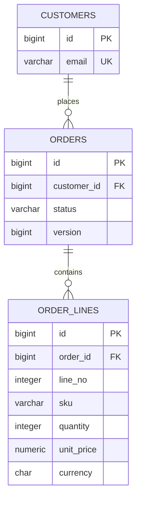

# Object-Relational Impedance Mismatch

In an object-oriented application, developers typically model business logic using classes, objects, attributes, and references. A relational database, on the other hand, stores information using tables, rows, columns, keys, and set-based operations. While representing the same business domain, the two models answer different questions: **how should objects collaborate when the program runs?** and **how should data be organized, constrained, queried, and maintained over time?**

This mismatch is called *object–relational impedance mismatch*. It arises even when each model, considered on its own, is properly designed. Object–Relational Mapping (ORM) helps translate between the two models, but it does not automatically eliminate differences in identity, relationships, lifecycle, querying, and consistency.

Within the scope of **DATABASE_DATA_MODELING**, the goal is to understand this mismatch before choosing storage structures. Good design starts from business requirements, identifies entities and invariants, and then deliberately decides how to represent them in both the relational schema and application code.

## 1. Two Models Viewing the Same Data in Two Ways

| Aspect | Object Model | Relational Model |
|---|---|---|
| Unit of representation | Objects with state and behavior | Rows in a table, with values in columns |
| Identity | Object reference; sometimes an additional business identifier | Primary keys, candidate keys, and unique constraints |
| Associations | Reference properties, object collections | Foreign keys, join tables, and `JOIN` operations |
| Structure | Classes, composition, inheritance, polymorphism | Relations, columns, SQL types, constraints |
| Access | Traversing references: `order.getCustomer()` | Set-based queries: `SELECT`, `JOIN`, `GROUP BY` |
| Lifecycle | Created, mutated, dereferenced; tied to memory and application | `INSERT`, `UPDATE`, `DELETE`; persists across sessions |
| Consistency | Methods, domain rules, in-code checks | `NOT NULL`, `UNIQUE`, `CHECK`, `FOREIGN KEY`, transactions |
| Ordering | `List` has a defined position | Query results have no guaranteed order without `ORDER BY` |

You cannot assume that one class always corresponds to exactly one table, one attribute always corresponds to exactly one column, or a reference can always be loaded without issuing a query. This assumption is the root of many ORM design bugs.

### Running Example: Orders

Suppose a sales system has the following rules:

- Each order belongs to exactly one customer.
- An order contains multiple order lines; each line records the product, quantity, and unit price at the time of ordering.
- Quantity must be greater than 0; an order line must not exist independently outside an order.
- Order lines are displayed in the order arranged by the user.
- Two concurrent confirmation requests must not silently overwrite each other's state.

In Java code, we can visualize an object graph:

```text
Order
 ├── id
 ├── customer ──────────> Customer
 ├── status
 └── lines: List<OrderLine>
       ├── OrderLine(lineNo=1, sku="BOOK-01", quantity=2, ...)
       └── OrderLine(lineNo=2, sku="PEN-02", quantity=1, ...)
```

In a relational database, the corresponding structure consists of three tables with explicit keys:



Minimal PostgreSQL schema example:

```sql
CREATE TABLE customers (
    id BIGINT GENERATED ALWAYS AS IDENTITY PRIMARY KEY,
    email VARCHAR(255) NOT NULL UNIQUE
);

CREATE TABLE orders (
    id BIGINT GENERATED ALWAYS AS IDENTITY PRIMARY KEY,
    customer_id BIGINT NOT NULL REFERENCES customers(id),
    status VARCHAR(20) NOT NULL
        CHECK (status IN ('NEW', 'CONFIRMED', 'CANCELLED')),
    version BIGINT NOT NULL DEFAULT 0
);

CREATE TABLE order_lines (
    id BIGINT GENERATED ALWAYS AS IDENTITY PRIMARY KEY,
    order_id BIGINT NOT NULL REFERENCES orders(id) ON DELETE CASCADE,
    line_no INTEGER NOT NULL CHECK (line_no > 0),
    sku VARCHAR(64) NOT NULL,
    quantity INTEGER NOT NULL CHECK (quantity > 0),
    unit_price NUMERIC(19, 2) NOT NULL CHECK (unit_price >= 0),
    currency CHAR(3) NOT NULL,
    UNIQUE (order_id, line_no)
);

CREATE INDEX idx_orders_customer_id ON orders(customer_id);
CREATE INDEX idx_order_lines_order_id ON order_lines(order_id);
```

Here, `Order.lines` is a `List<OrderLine>`, whereas in the database, order lines are storage-wise independent rows linked via `order_id`; position is stored in `line_no`. The `Order.customer` reference is represented by `customer_id` and a foreign key. Meanwhile, `version` supports update conflict detection and is not a business attribute meant for display.

**Note:** `ON DELETE CASCADE` only illustrates a policy of deleting order lines together with the order. It must be decided based on data retention rules; a real-world system may prohibit deleting orders that already have transactions and use an archival status instead.

## 2. Common Forms of Mismatch

### 2.1. Object Identity Differs from Row Identity

In Java, `a == b` checks whether two variables point to the same object instance. In SQL, a row is identified by a key, such as `orders.id = 42`. Two Java objects loaded in **two different persistence contexts** may represent the same row `orders.id = 42` without sharing the same reference:

```java
Order first  = entityManagerA.find(Order.class, 42L);
Order second = entityManagerB.find(Order.class, 42L);

// Two instances may differ even though both represent order 42.
boolean sameReference = first == second; // may be false
```

Within a typical JPA persistence context, the same entity type with the same primary key is managed as a single identity. This guarantee does not extend across different sessions, HTTP requests, or services.

Distinguish three kinds of identity:

1. **Technical identity**: `orders.id`, usually a stable surrogate key.
2. **Business identity**: the order code visible to customers; it may require `UNIQUE`, but has its own generation, change, or scoping rules.
3. **In-memory identity**: the concrete object reference at runtime.

Do not automatically use all entity attributes to compute `equals()` and `hashCode()`: entity state frequently changes, associations can create cycles, and keys are often generated after `persist()`. If an entity participates in a `HashSet` or serves as a `HashMap` key, establish an equality and hashing policy that remains stable across its lifecycle; avoid mechanically generating those methods from all fields.

### 2.2. Associations and Collections Differ from Foreign Keys

A reference like `order.customer` gives the impression that `Customer` is always resident in memory. In the database, `customer_id` is just a foreign key value; reading the customer's email requires a query or preloaded data.

Object structures also express relationships in diverse ways:

| Construct in Code | Typical Relational Representation | Questions to Answer |
|---|---|---|
| `Order.customer` | `orders.customer_id`, many-to-one | Which side holds the foreign key? Is it required? |
| `Order.lines` | `order_lines.order_id`, one-to-many | Should removing an element from the collection delete the row? |
| `Student.courses` | Join table `enrollments(student_id, course_id, ...)` | Does the relationship have extra attributes like enrollment date? |
| `Order.lines: List` | `order_lines.line_no` and `ORDER BY` | Does order carry business meaning or is it just for presentation? |

For many-to-many relationships with their own attributes, the join table should usually be modeled as an **associative entity** (`Enrollment`) rather than merely a hidden collection: this allows constraining enrollment date, status, role, or relationship uniqueness.

Domain relationships also differ from **aggregate** boundaries: an order may own the lifecycle of its order lines while only **referencing** the customer. Therefore, `cascade = ALL` may make sense from order to order lines, but is usually dangerous from order to customer.

### 2.3. Inheritance and Polymorphism Have No Direct Equivalent

Classes can inherit (`Payment` → `CardPayment`, `BankTransferPayment`) and dispatch methods dynamically. SQL tables do not have a universal inheritance/polymorphism mechanism across database engines.

Three common mapping strategies:

| Strategy | Storage Layout | Pros | Trade-offs |
|---|---|---|---|
| Single table for the entire hierarchy (`SINGLE_TABLE`) | One table with a discriminator column | Simple polymorphic queries, no hierarchy joins needed | Many nullable columns; subtype-specific constraints are harder |
| Base table and subtype tables (`JOINED`) | Shared fields in parent table, specific fields in child tables | Separates common parts, clearly expresses structure | Requires extra joins when reading a complete subtype |
| One table per concrete class (`TABLE_PER_CLASS`) | Separate table for each concrete subtype | Each type's data is stored separately | Queries on the parent type may require `UNION`; keys and constraints are more complex |

Do not choose a strategy solely based on the current Java inheritance tree. Consider common query patterns, how frequently subtypes change, type-specific mandatory rules, and schema evolution capability. Many business domains only need a `type` column and *composition* rather than entity inheritance.

### 2.4. Mismatched Data Types and Value Structures

A `Money(amount, currency)` is a **value object** with two components that represents a single business value. SQL may store it as two columns `unit_price` and `currency`, a child table, or a JSON column. There is no fixed rule that "one object = one column."

Several cases require explicit decisions:

- **Currency/Money:** use exact types like `BigDecimal`/`NUMERIC` together with a currency code; avoid `double` for monetary values requiring decimal precision. Define rounding rules at business boundaries.
- **Time:** distinguish absolute instants (`Instant`/`TIMESTAMP WITH TIME ZONE` per DB semantics) from local dates (`LocalDate`/`DATE`), display time zones, and calendar rules.
- **Enums:** `EnumType.STRING` is more readable than ordinals, but renaming an enum alters stored values; application code and SQL constraints must evolve in sync.
- **Nulls:** `null` in Java does not clearly convey the difference between "does not exist," "unknown," and "not applicable"; SQL `NULL` follows three-valued logic. You must define when `NOT NULL` is an invariant.
- **Collection/Map:** can be extracted to a child table, a join table, or stored as JSON if the data is relatively self-contained and rarely needs internal joins or filtering.

For example, Java can encapsulate `unitPrice` and `currency` into an `@Embeddable Money` inside the entity, while the schema still uses two independently constrained columns. This keeps the domain language clear without sacrificing constraints and queryability.

### 2.5. In-Memory Lifecycle Differs from Storage Lifecycle

A Java object can be newly created, managed, detached from a persistence context, or marked for removal. Database rows only actually change when the corresponding SQL statements execute within a transaction.

In JPA, distinguish between:

- **Transient:** entity is not yet managed, usually has no corresponding database row.
- **Managed:** entity belongs to a persistence context; attribute changes are detected on `flush`.
- **Detached:** entity is no longer managed; modifying fields does not automatically write to the database.
- **Removed:** entity is marked for deletion in the persistence context; the delete statement is synchronized on `flush`.

`flush` synchronizes SQL statements with the database but does **not** mean `commit`. The transaction can still roll back. `cascade` also does not mean business ownership: it only specifies how certain persistence operations propagate. `orphanRemoval = true` is only appropriate when removing a component from an aggregate truly means deleting it.

In particular, Java garbage collection reclaiming an object does **not** mean deleting its row in the database.

### 2.6. Graph Navigation Differs from Set-Based Querying

Object-oriented code encourages writing:

```java
for (Order order : orders) {
    System.out.println(order.getLines().size());
}
```

Suppose `orders` contains 100 orders, and `lines` is lazily loaded and not yet initialized. This snippet may trigger **1 query to fetch the orders + 100 queries to fetch the order lines**. This is the **N+1 query** problem, causing extra database round-trips and increased latency. The exact count depends on how the ORM queries, caches, and batch-fetches; not every case results in exactly 101 queries.

One way to fetch the needed dataset in bulk:

```java
List<Order> orders = entityManager.createQuery("""
        select distinct o
        from Order o
        left join fetch o.lines
        where o.id in :ids
        """, Order.class)
    .setParameter("ids", ids)
    .getResultList();
```

`JOIN FETCH` here aims to load order lines for **a selected set of orders**. It is not a rule to "always eager load." Joining a collection can multiply the number of SQL rows; combining a collection fetch join with `LIMIT/OFFSET` pagination or multiple collections can hit restrictions or cause unexpected performance degradation. For large list views, it is often better to fetch the **page of order IDs first**, then fetch the required associations for that ID set; if only the line count is needed, use a `COUNT`/`GROUP BY` query or a DTO projection.

Example when only the line count per order is needed:

```sql
SELECT o.id, COUNT(ol.id) AS line_count
FROM orders AS o
LEFT JOIN order_lines AS ol ON ol.order_id = o.id
WHERE o.id = :order_id
GROUP BY o.id;
```

Practical takeaway: **design queries from the data the screen/use case needs**, and only then decide on the fetch strategy. A reference in an object model is not a promise that accessing the association is free.

### 2.7. Ordering in a List Differs from Unordered Relations

`List<OrderLine>` has element positions, whereas in a relational table, there is no default row order. Even if a query happens to return rows in primary key order today, that is not guaranteed.

If reordering two order lines is a business operation, store `line_no`, enforce validity constraints, and always query with `ORDER BY line_no`. JPA can use `@OrderColumn` for certain mappings or an explicit position attribute combined with `@OrderBy`. Choose a single source of truth for ordering, and handle duplicate positions or concurrent updates.

If a collection simply represents an unordered set of values, do not create a meaningless position column.

### 2.8. Invariants in Methods Differ from Database Invariants

Suppose the `OrderLine` constructor checks `quantity > 0`. That rule protects one object creation path, but it does not protect against direct SQL, data imports, admin tools, other applications, or future code changes.

For invariants expressible at the row and relation level, prefer database constraints:

| Rule | Domain Code | Database Protection |
|---|---|---|
| Quantity > 0 | Reject invalid order line | `CHECK (quantity > 0)` |
| Order line must belong to an order | Validate when creating `OrderLine` | `order_id NOT NULL` and `FOREIGN KEY` |
| Line position unique within the same order | Validate when ordering | `UNIQUE (order_id, line_no)` |
| Order status within allowed set | Enum or state machine | `CHECK`, lookup table, or suitable mechanism |
| Transition `CONFIRMED → NEW` prohibited | State transition methods enforcing rules | Requires proper transaction/concurrency control; a simple row-level `CHECK` cannot verify transition history |

The domain model controls **meaning and sequence of operations**; the database protects **data integrity against all write sources**. Not every invariant can be expressed with a single `CHECK`: for example, "total equals the sum of lines," cross-table limits, or historical rules require additional design using transactions, derived data, triggers, or appropriate coordination mechanisms.

## 3. A JPA Mapping Requires Deliberate Decisions

With the order schema above, the following illustrative code highlights key mapping decisions (omitting business constructors, getters, and input validation to focus on relationships):

```java
@Entity
@Table(name = "orders")
public class Order {
    @Id
    @GeneratedValue(strategy = GenerationType.IDENTITY)
    private Long id;

    @ManyToOne(fetch = FetchType.LAZY, optional = false)
    @JoinColumn(name = "customer_id", nullable = false)
    private Customer customer;

    @OneToMany(
        mappedBy = "order",
        cascade = CascadeType.ALL,
        orphanRemoval = true
    )
    @OrderBy("lineNo ASC")
    private List<OrderLine> lines = new ArrayList<>();

    @Enumerated(EnumType.STRING)
    @Column(nullable = false, length = 20)
    private OrderStatus status = OrderStatus.NEW;

    @Version
    private long version;

    protected Order() {} // JPA requires a no-arg constructor

    public void addLine(OrderLine line) {
        line.attachTo(this);  // update the side owning the foreign key
        lines.add(line);
    }
}

@Entity
@Table(name = "order_lines")
public class OrderLine {
    @Id
    @GeneratedValue(strategy = GenerationType.IDENTITY)
    private Long id;

    @ManyToOne(fetch = FetchType.LAZY, optional = false)
    @JoinColumn(name = "order_id", nullable = false)
    private Order order;

    @Column(name = "line_no", nullable = false)
    private int lineNo;

    @Column(nullable = false)
    private String sku;

    @Column(nullable = false)
    private int quantity;

    @Column(name = "unit_price", precision = 19, scale = 2, nullable = false)
    private BigDecimal unitPrice;

    @Column(length = 3, nullable = false)
    private String currency;

    protected OrderLine() {}

    void attachTo(Order order) {
        this.order = order;
    }
}
```

Assume `Customer` is a separately mapped entity and `OrderStatus` has values `NEW`, `CONFIRMED`, and `CANCELLED`. Imports, business constructors, getters, and validation are omitted; this is an **illustrative mapping**, not complete standalone runnable code.

Notable points:

1. **The foreign key belongs to `OrderLine.order`.** `mappedBy = "order"` indicates that `Order.lines` is the inverse side of the bidirectional relationship. When adding an order line, you must update the owning side, not just `lines.add(line)`.
2. **Customers have an independent lifecycle.** `@ManyToOne` does not attach `CascadeType.REMOVE` to the customer. Deleting an order must not cascade-delete a customer referenced by many orders.
3. **Order lines belong to the order.** `cascade = ALL` and `orphanRemoval = true` reflect the decision that order lines do not exist independently. If cancelled order line history must be retained, replace this with an appropriate status/audit policy.
4. **Ordering has its own data.** `lineNo` and `@OrderBy` align with the `UNIQUE (order_id, line_no)` constraint. Swapping positions must be handled carefully so intermediate update steps do not violate `UNIQUE`.
5. **Controlled concurrent updates.** `@Version` enables the ORM to detect updates based on a stale version, typically via `UPDATE ... WHERE id = ? AND version = ?` and checking the affected row count.

### When Two Concurrent Requests Modify the Same Order

Suppose A and B both read an order with `version = 7`. A confirms and saves, incrementing the version to 8. When B attempts to update based on version 7, the system must detect the conflict and handle it per business rules (prompting the user to reload, or retrying in a controlled manner after reading the new state).

SQL illustration of optimistic locking:

```sql
UPDATE orders
SET status = 'CONFIRMED',
    version = version + 1
WHERE id = :order_id
  AND version = :expected_version;
```

If the updated row count is **0**, either the record no longer exists or the version has changed; the application should distinguish these cases if required by business logic. JPA manages versioning for standard entity updates, whereas hand-written `bulk UPDATE` statements may bypass this mechanism if not designed carefully.

Optimistic locking prevents *lost updates* on the protected row; it does not automatically solve all race conditions across multiple rows, such as "only allow ordering a quantity within available stock." In such cases, you must define appropriate transactions, locks, conditional updates, and isolation levels.

## 4. Modeling Decisions That Keep Mismatch Under Control

### 4.1. Do Not Turn Every Class into a Table

Distinguish the types of components in the business domain:

| Component | Design Question | Common Storage Approach |
|---|---|---|
| **Entity** (`Order`) | Does it have an identity and lifecycle to track? | Table with a primary key |
| **Value object** (`Money`, `Address`) | Is it compared by value and replaced as a whole? | Embedded group of columns, child table, or JSON depending on queries |
| **Aggregate root** (`Order`) | Which object protects invariants and coordinates changes? | Root entity; child tables still have their own keys/constraints |
| **DTO / view model** (`OrderSummary`) | Exactly what data does the screen/API need? | Projection result; does not necessarily have a table or entity |
| **Domain service** | Is there behavior that does not naturally belong to a single entity? | Usually not a table |

An `Address` embedded into a customer may fit well when addresses are only displayed per customer. If system-wide searches by normalized address, shared addresses, or address history tracking are needed, the storage design may need to change. Base decisions on **queries, constraints, ownership, and rate of change**, not solely on the number of classes.

### 4.2. Choose Aggregate Boundaries and Relationship Direction

Do not default to exposing every database relationship as bidirectional in Java. From `Order` to `Customer`, you might only need `customerId` or a unidirectional reference; `Customer` does not necessarily need `List<Order>`.

Every bidirectional collection increases synchronization responsibility on the owning side, risks pulling large graphs, and complicates serialization. Only add an association to an entity when domain behavior genuinely needs to traverse it. Reporting reads can use dedicated repositories or queries.

For each relationship, specify explicitly:

- Multiplicity: one-to-one, one-to-many, many-to-many; whether the relationship is mandatory.
- Which side holds the foreign key; `ON DELETE` or `RESTRICT` policy.
- Transaction boundaries and whether mutations must go through the aggregate root.
- Deletion, history retention, and ownership transfer rules.
- Query needs: primary traversal direction and pagination requirements.

### 4.3. Design the Schema for Data Before Optimizing the Object API

The relational model must prevent orphan records, duplication, loss of accuracy, and update anomalies. For example:

- Customer name should not be copied into every order merely to match an `Order.customer.name` shape if it is meant to represent the customer's current attribute.
- Conversely, the **unit price at the time of ordering** must be captured in `order_lines.unit_price`: this is transaction-specific historical data, not improper duplication. If you only reference the current price in the products table, historical order totals could change when the price list is updated.
- If business rules allow the same SKU to appear multiple times with different promotions, do not arbitrarily add `UNIQUE(order_id, sku)`. A position constraint `UNIQUE(order_id, line_no)` has a different meaning.

Thus, normalization does not mean forbidding all value copies: distinguish **information sharing the same meaning** from **immutable point-in-time snapshots**.

### 4.4. Map According to Actual Read and Write Patterns

Domain models are typically optimized for writes: calling `order.confirm()` and ensuring valid state transitions. An order list page, however, needs ID, total amount, customer name, and line count. Forcing a list page to load the entire entity graph just to compute those values wastes memory and queries.

You can choose:

1. **Entities/aggregates** for state-changing transactions.
2. **Projections/DTOs** for list queries and reports.
3. **Dedicated SQL queries or read models** for multi-table aggregations, analytics, or large queries.

This does not necessarily mean implementing full CQRS. It simply acknowledges that the update model and read shapes do not always share the same optimal structure.

### 4.5. Treat Latency and Consistency as Part of the Design

Choices around `LAZY`, `EAGER`, fetch joins, batch fetching, or caching all impact query counts, transferred data volume, and transaction conditions. No single loading configuration works best for every use case.

- **Lazy:** avoids loading unused data, but can trigger N+1 queries or association access after the context closes.
- **Eager:** convenient when a small association is always needed, but easily over-fetches data and complicates queries.
- **Fetch join/entity graph:** fits queries where needed associations are known upfront; must account for pagination and row multiplication.
- **Projection:** efficient for screens needing only a few columns; do not treat DTOs like managed entities for ad-hoc updates.
- **Cache:** can reduce repeated queries, but requires expiration, invalidation/update strategies, and freshness verification.

Analyze against expected record volumes and actual *query plans*. Indexes on foreign keys supporting common join directions, filters, or sorting should be evaluated based on workload rather than indexing every column.

## 5. Process for Turning Requirements into a Consistent Model

A practical workflow for ORM modeling:

**Step 1 — Write down behaviors and invariants.** For example: "an order can be confirmed only once," "an order line belongs to exactly one order," "ordered price does not change when product price updates." Distinguish rules requiring transactions from rules expressible as constraints.

**Step 2 — Identify identities and lifecycles.** Determine entities, value objects, and aggregate roots; ask when each component is created/deleted and which object has authority to mutate it.

**Step 3 — Design storage relations.** Choose primary keys, foreign keys, unique keys, `NULL`/`CHECK` constraints, historical data strategy, ordering, and versioning. Normalize data sharing the same meaning; deliberately store snapshots when the business requires them.

**Step 4 — Design mappings.** Determine owning side of relationships, uni- vs. bidirectional navigation, cascade, orphan removal, value-object embedding, enums, money/time types, and inheritance strategy if applicable.

**Step 5 — Design queries per use case.** List screens/APIs and returned columns. For each query, estimate cardinality, check for N+1, pagination, and indexes serving `JOIN`, `WHERE`, and `ORDER BY`.

**Step 6 — Verify with data and concurrency.** Test create–read–update–delete flows, invalid data, the same entity across multiple contexts, concurrent updates, and multi-row loads. Inspect actual SQL statements, query counts, and DB constraints.

### Pre-Finalization Design Checklist

| Question | Sign That the Design Needs Review |
|---|---|
| Which entity protects the core invariants? | Modifying one order requires directly editing multiple entities outside a single transaction |
| Are bidirectional relationships used just "for convenience"? | Serialization causes cycles, queries automatically pull the entire graph |
| Do tables enforce identity and referential constraints? | Duplicate emails, orphan order lines, or negative quantities can still be inserted |
| Does collection order matter? | The UI relies on arbitrary database return order |
| Which fields are historical snapshots? | Old order prices change when current product prices change |
| Do queries fit the data scale? | Listing 100 orders issues hundreds of SQL statements or loads all order lines |
| Are concurrent writes handled? | Two users changing state simultaneously result in the later request overwriting data |
| Can the schema evolve without data loss? | Renaming an enum, changing key types, or altering inheritance strategies breaks reading old data |

## 6. Common Misconceptions

**"The ORM will automatically design a good schema."** Tools can generate DDL from annotations, but they do not know all historical rules, retention policies, performance needs, aggregate boundaries, or migration constraints. For production environments, schema changes must be explicitly managed and tested.

**"Setting `EAGER` eliminates N+1 issues."** Eager fetching can over-fetch data, produce huge joins, or still issue multiple supplemental queries. The right approach is to identify specific read needs and measure generated queries.

**"Every association should have `cascade = ALL`."** Cascades should follow true lifecycle ownership. If `Order` cascades to `Customer`, an operation on one order could affect an object shared by many orders.

**"An entity must contain every field and collection used by the API."** DTOs/view models return the exact data shape the API needs; entities can preserve clean business invariants and behavior.

**"Validating in Java is enough; DB constraints aren't needed."** Java code does not control every write path. Fundamental invariants should be protected by data types and constraints at the database level.

**"A normalized schema always eliminates duplicated values."** A product's current price and a committed unit price are two facts at different points in time. A business-meaningful snapshot is not redundant duplication.

**"No error on update means no conflict occurred."** Without version management, conditional writes, and proper transactions, the last update can silently overwrite earlier changes.

## 7. Self-Check Exercise

**Scenario:** A course management system has `Course`, `Student`, and a list of enrolled students. Each enrollment has an enrollment timestamp, status (active/cancelled), and final grade. Staff need to view a course's student roster ordered by enrollment time; instructors need to aggregate active student counts across 500 courses at once.

Answer for yourself:

1. Why does `Course.students: List<Student>` fail to fully represent the requirements?
2. Which tables, foreign keys, unique keys, and ordering columns are needed?
3. When should an associative entity `Enrollment` be used instead of a plain `@ManyToMany`?
4. Should the 500-course summary query iterate over `course.getStudents()` in a loop?
5. How should concurrent requests enrolling the same student into the same course be handled?

**Suggested Answers:**

- `Enrollment` has its own identity/lifecycle and attributes (`enrolled_at`, `status`, `final_grade`). An `enrollments` table with `course_id` and `student_id` is more appropriate than a hidden join table.
- If each student has at most one enrollment record per course, place `UNIQUE(course_id, student_id)`; if retaking across multiple terms is allowed, add a term identifier or another key per business rules.
- Sort on read using `ORDER BY enrolled_at, id`. Storing a separate position column is unnecessary if ordering is strictly chronological. Add a tie-breaker key so results remain deterministic when two enrollments share the same timestamp.
- Aggregating active students should use a query filtered with `WHERE status = 'ACTIVE'` and `GROUP BY course_id` (or an equivalent projection) instead of loading all 500 collections.
- A database unique constraint acts as the final safeguard against duplicate enrollments; the application must catch concurrency errors and translate them into an appropriate message or idempotent behavior.

## 8. Key Takeaways for Data Modeling

Object–relational impedance mismatch is a **difference in how data and behavior are organized**, not a technical bug that annotations can erase. Resilient design clearly separates: object identity from row identity; references from foreign keys; aggregate lifecycle from record lifecycle; object navigation from set-based querying; and domain invariants from database constraints.

An ORM is valuable when it bridges representations that were chosen intentionally. Before finalizing a mapping, verify three things simultaneously: **the business domain is accurately modeled, the data is properly constrained, and the queries perform well at expected scale**.
