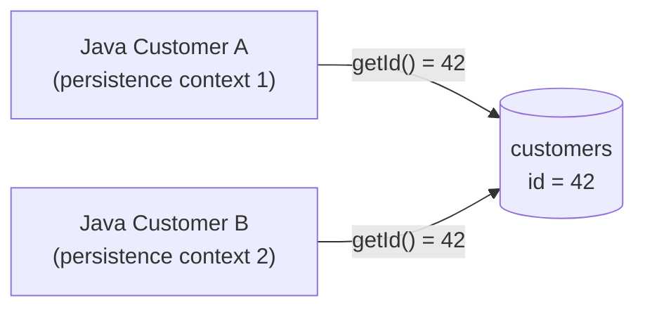

# Distinguishing Java Object Identity from Stored Record Keys

In Java, an object can be identified by its **in-memory reference**. In a relational database, a record is identified by its **key** and table constraints. These two concepts solve different problems: where an object resides in the running program, and which business entity is being persisted across application runs.

This discrepancy is especially important when using Object–Relational Mapping (ORM). A single row `customers.id = 42` can be represented by multiple different Java objects across multiple sessions. Conversely, a newly created Java object may not yet have a primary key or a corresponding row in the database. Conflating the two easily leads to entity comparison bugs, duplicate records, broken `HashSet` behavior, accidental state overwrites, or data loss.

In the **DATABASE_DATA_MODELING** module, this lesson places identity on both sides of the design: *object classes and business rules*; and *tables, candidate keys, primary keys, foreign keys, and integrity*. The goal is not to pick a single `equals()` formula to apply mechanically to all entities, but to understand which identity needs to exist at which layer and how to verify it through constraints and queries.

## 1. Four Concepts Commonly Lumped Together as "ID"

| Concept | Meaning | Example | Scope of Guarantee |
|---|---|---|---|
| **Reference identity** | Two variables point to the exact same Java object | `a == b` | Within the current program run and active memory |
| **Logical equality** | Two objects are considered equal per Java code rules | `a.equals(b)` | Defined by the class; must obey the `equals`/`hashCode` contract |
| **Persistence identity** | A row uniquely identified in a table | `customers.id = 42` | Enforced by primary key and database constraints |
| **Business/natural key** | A value used by users or business systems to identify an entity | `(tenant_id, customer_code)` | Scope and stability defined by business rules |

Not every pair is equivalent:

- If `a == b` is `true`, then `a` and `b` are definitely the same object at the moment of the check.
- `a.equals(b)` being `true` does not imply `a == b` is `true`; two distinct objects can be considered equal.
- Two entities with the same primary key and the same entity type can represent the same stored row even if they are two separate instances.
- Two records with the same display name are not necessarily the same customer; conversely, a customer who changes their name remains the same entity.

### Visualizing One Row Loaded into Multiple Objects



In the diagram above, A and B do not necessarily share the same reference: `A == B` can be `false`. However, both represent the row with primary key 42. A primary-key-based `equals()` policy can treat A and B as equal; the default policy inherited from `Object` does not.

## 2. Reference Identity and Equality in Java

### 2.1. What Does the `==` Operator Check?

For two reference-type variables, `==` returns `true` when they hold **the same reference**; it does not query the database and does not call `equals()`.

```java
Customer a = new Customer("C-001", "An");
Customer b = a;
Customer c = new Customer("C-001", "An");

System.out.println(a == b); // true: same object
System.out.println(a == c); // false: two distinct new objects
```

This snippet assumes `Customer` has a matching illustrative constructor. Having identical attribute values on `a` and `c` does **not** change the reference comparison result.

Do not confuse reference comparison with comparing keys wrapped in Java objects:

```java
Long firstId = 128L;
Long secondId = 128L;

boolean sameBoxedReference = firstId == secondId; // do not rely on this
boolean sameNumericValue = firstId.equals(secondId); // true
```

For `Long` keys, use value comparison such as `Objects.equals(firstId, secondId)`. The `==` operator on two `Long` variables compares boxed object references, unless contextual unboxing occurs.

### 2.2. `equals()` Does Not Inherently Carry Business Meaning

`Object.equals()` defaults to comparing reference identity. A class can override it to compare by attributes or keys. For instance, a **value object** representing money can define equality by amount and currency:

```java
record Money(BigDecimal amount, String currency) {
    Money {
        Objects.requireNonNull(amount);
        Objects.requireNonNull(currency);
    }
}

Money x = new Money(new BigDecimal("10.00"), "USD");
Money y = new Money(new BigDecimal("10.00"), "USD");

System.out.println(x == y);      // false
System.out.println(x.equals(y));  // true
```

Note that `BigDecimal.equals()` takes *scale* into account; thus `new BigDecimal("10.0")` and `new BigDecimal("10.00")` are **not** equal under `BigDecimal.equals()`, even though `compareTo()` returns 0. If you want monetary equality by numeric value, design scale normalization or a comparison rule and build a matching `hashCode()`. Java `record` is useful for simple value objects; it is not inherently suitable for mapping to JPA entities that have lifecycles and proxies.

**Entities differ from value objects:** two customers with the same name and address are not necessarily the same customer. When a customer's name or address changes, the customer's identity must remain stable. Therefore, comparing entities by "all current fields" is usually inappropriate.

### 2.3. The `equals()` and `hashCode()` Contract Directly Affects Entities

When overriding `equals()`, Java requires reflexivity, symmetry, transitivity, consistency when the compared data does not change, and `x.equals(null)` always returning `false`. Furthermore:

> If `a.equals(b)` is `true`, `a.hashCode() == b.hashCode()` **must** be `true`. Two unequal objects may still share the same hash code.

This is the foundation of `HashSet` and `HashMap`. If a field participating in `hashCode()` changes **after** the object has been placed into a hash-based collection, the object can end up in the wrong bucket:

```java
// Example of a buggy approach: hashCode depends on id assigned after persist.
@Override
public int hashCode() {
    return Objects.hash(id);
}

Set<Customer> customers = new HashSet<>();
Customer customer = new Customer("C-001", "An"); // id = null
customers.add(customer);

entityManager.persist(customer); // at some point id gets assigned
// After id changes, customers.contains(customer) may return false.
```

Exactly when `id` is populated depends on the key generation strategy and the ORM. The core issue is **an unstable hash code while the object resides in a collection**. Similarly, using mutable `name` or `email` fields to compute the hash also causes bugs.

## 3. Record Keys Are Defined by the Schema

### 3.1. Primary Keys, Candidate Keys, and Business Keys

Consider a sales system serving multiple organizations (*tenants*). Each tenant may use its own customer codes like `C-001`. This code is unique only **within a single tenant**; two tenants can both use `C-001`.

```sql
CREATE TABLE customers (
    id BIGINT GENERATED ALWAYS AS IDENTITY PRIMARY KEY,
    tenant_id BIGINT NOT NULL,
    customer_code VARCHAR(40) NOT NULL,
    display_name VARCHAR(180) NOT NULL,
    email VARCHAR(254),
    version BIGINT NOT NULL DEFAULT 0,
    CONSTRAINT uq_customer_tenant_code
        UNIQUE (tenant_id, customer_code)
);
```

Here:

- `id` is a **surrogate primary key**. It is used to link records and typically carries no business meaning.
- `(tenant_id, customer_code)` is a **business-meaningful candidate key** protected by a `UNIQUE` constraint. Its uniqueness scope is per tenant, not system-wide.
- `display_name` and `email` are attributes. You should not automatically treat email as an immutable identity if users are allowed to change their email or if the same email can validly appear under business policy.

In the relational model, a candidate key is a set of attributes that uniquely identifies a row such that no proper subset still suffices for unique identification. The system chooses one suitable key as the primary key; other keys can be protected with `UNIQUE` along with `NOT NULL` when full key semantics are required.

**Caution with `NULL`:** `UNIQUE` constraint behavior for multiple `NULL` values varies across database engines and configuration options. If an identifier is mandatory, declare `NOT NULL` rather than relying on `UNIQUE` alone.

### 3.2. Primary Keys Are a Long-Term Contract Between Tables

An order must reference a valid customer. In a multi-tenant system, we also need to prevent an order in tenant A from referencing a customer in tenant B. One approach is a composite foreign key:

```sql
-- Add a column pair eligible to be referenced by a composite FK.
ALTER TABLE customers
ADD CONSTRAINT uq_customer_tenant_id UNIQUE (tenant_id, id);

CREATE TABLE sales_orders (
    id BIGINT GENERATED ALWAYS AS IDENTITY PRIMARY KEY,
    tenant_id BIGINT NOT NULL,
    customer_id BIGINT NOT NULL,
    status VARCHAR(20) NOT NULL,
    CONSTRAINT fk_order_customer_same_tenant
        FOREIGN KEY (tenant_id, customer_id)
        REFERENCES customers (tenant_id, id)
);
```

`UNIQUE(tenant_id, id)` is an auxiliary constraint supporting the composite reference; `id` is already unique via the primary key. The benefit of this design is that the database enforces same-tenant integrity **even when writes arrive from paths outside the Java application**. Authorization and tenant-scoped access control still need to be enforced at the appropriate layer; the foreign key constraint strictly ensures relationship validity.

If the model is not multi-tenant, a single-column foreign key `customer_id REFERENCES customers(id)` is usually sufficient. Do not add extra columns and complexity when business rules do not require them.

### 3.3. Primary Keys Can Be Natural Keys or Composite Keys

There is no rule that every table must use `BIGINT IDENTITY`:

| Identification Approach | Example | Suitable When | Trade-offs to Consider |
|---|---|---|---|
| Integer surrogate | `customers.id = 42` | You want short, stable join keys | Must create separate `UNIQUE` constraints for business rules |
| Application-assigned UUID | `orders.id = UUID` | You need to generate IDs before writing or across multiple nodes | Index/key size, generation strategy, ordering, and performance must be evaluated |
| Natural key | Standardized stable code | Value is truly unique, rarely changes, and has lasting semantics | Changing code rules can cascade into FKs |
| Composite key | `(course_id, student_id)` | Record represents a unique relationship between two entities | Every referencing FK needs multiple columns; awkward if multiple enrollments are allowed |

For example, `enrollments(course_id, student_id)` can use a composite key if **each student can enroll in each course at most once**. If retaking across terms is allowed, that pair no longer uniquely identifies an enrollment; you must add `term_id` or choose `enrollment_id` and place a unique constraint matching the new rule.

Persistence identity must reflect entities that can **change and persist over time**. Do not pick a key merely because you haven't observed duplicate data today.

## 4. How Does JPA Manage Identity?

### 4.1. A Persistence Context Has an Identity Map

In JPA, a **persistence context** tracks managed entities, organized by entity type and primary key. For a given entity identity within the same persistence context, qualifying lookups typically return the exact same managed instance:

```java
Customer first  = em.find(Customer.class, 42L);
Customer second = em.find(Customer.class, 42L);

System.out.println(first == second); // true within the same persistence context
```

This example assumes a customer with key 42 exists and both operations use the same `EntityManager` and persistence context. The second `find` can be resolved directly from the identity map without re-querying the database.

This guarantee is **not application-wide uniqueness**. Two independent `EntityManager` instances can load two distinct objects:

```java
Customer fromA = emA.find(Customer.class, 42L);
Customer fromB = emB.find(Customer.class, 42L);

System.out.println(fromA == fromB); // typically false
System.out.println(fromA.getId().equals(fromB.getId())); // true
```

Do not use `==` to decide whether two entities returned across different transactions, HTTP requests, or services represent the same stored entity. Check via key, entity type, and if needed, tenant scope.

### 4.2. Entity State Does Not Equal Record State

A JPA entity has common lifecycle states:

| Entity State | Meaning for Java Object | Relationship to Database |
|---|---|---|
| **New/transient** | Newly created with `new`, not yet managed by context | May not have a key or a database row yet |
| **Managed** | Tracked by context | Changes can be synchronized on `flush` |
| **Detached** | Previously managed, no longer belongs to the current context | May still hold a key even though field edits generate no automatic SQL |
| **Removed** | Marked for deletion in context | SQL `DELETE` is executed at the appropriate sync point |

Do not infer that `id != null` means the row has been committed. The ORM may allocate a key before the transaction commits; the transaction could still roll back afterward, or code might manually assign an ID to an unsaved object.

### 4.3. When the Key Appears Depends on the ID Generation Strategy

```java
@Id
@GeneratedValue(strategy = GenerationType.IDENTITY)
private Long id;
```

With `IDENTITY`, the database typically generates the key upon `INSERT`; the ORM may have to insert early to obtain the key. With `SEQUENCE`, the ORM usually fetches a number from the sequence before inserting. With application-generated UUIDs, the key can be available immediately after the constructor runs. Exact timing depends on the provider, configuration, and database.

Three distinct milestones:

1. **Object exists** after `new`.
2. **Object has a key** when the key is assigned.
3. **Row is committed** after the transaction succeeds.

Do not conflate all three. For example, an insert transaction receives `id = 42` and then rolls back: the object may still hold the value 42, yet no row exists in the database after rollback.

### 4.4. `merge()` Does Not Turn Every Reference into One Object

A common mistake is treating `merge(detached)` as an operation that re-attaches the exact object passed in.

```java
Customer detached = loadCustomerInPreviousTransaction();

Customer managed = em.merge(detached);
System.out.println(detached == managed); // typically false

managed.changeDisplayName("New Name");
// Perform commit/flush per the active transaction.
```

`merge` returns the corresponding managed instance; the passed-in object remains detached. It may copy state from detached to managed, depending on configuration and provider mechanics. If you keep mutating `detached` after `merge` and expect automatic dirty checking, the desired update may not happen.

Additionally, the detached state may be **stale** relative to the database. A safe update policy requires a version or write condition to avoid overwriting another transaction's data.

### 4.5. Proxies and Lazy Loading Introduce Extra Pitfalls for Class Checks

An ORM may return a proxy to defer loading related data. A proxy can be a dynamically generated subclass; therefore using:

```java
if (getClass() != other.getClass()) return false;
```

inside `equals()` risks treating a real entity and a proxy of the same entity as different classes in some providers. Conversely, casually using `instanceof` across an entity hierarchy can also break symmetry if a subclass alters equality rules.

Design `equals()` to fit the **actual entity type, inheritance strategy, and ORM provider**. Do not generate `equals()` across all fields, and never touch lazy collections inside it.

## 5. Designing `equals()` and `hashCode()` for Entities

There is no universal formula that works well for every entity. Ask first: "By what criteria do two objects represent the same entity, and is that criterion stable from creation through persistence?"

### 5.1. Strategy Based on Database-Assigned Primary Key

For `Customer` not participating in entity inheritance in this example, you can use the primary key **when non-null** for equality while keeping `hashCode()` constant throughout the object's lifecycle:

```java
import jakarta.persistence.*;
import java.util.Objects;

@Entity
@Table(
    name = "customers",
    uniqueConstraints = @UniqueConstraint(
        name = "uq_customer_tenant_code",
        columnNames = {"tenant_id", "customer_code"}
    )
)
public class Customer {

    @Id
    @GeneratedValue(strategy = GenerationType.IDENTITY)
    private Long id;

    @Column(name = "tenant_id", nullable = false)
    private Long tenantId;

    @Column(name = "customer_code", nullable = false, length = 40)
    private String customerCode;

    @Column(name = "display_name", nullable = false, length = 180)
    private String displayName;

    @Version
    @Column(nullable = false)
    private Long version;

    protected Customer() {} // required by JPA

    public Customer(Long tenantId, String customerCode, String displayName) {
        this.tenantId = Objects.requireNonNull(tenantId);
        this.customerCode = Objects.requireNonNull(customerCode);
        this.displayName = Objects.requireNonNull(displayName);
    }

    public Long getId() {
        return id;
    }

    public void changeDisplayName(String nextName) {
        this.displayName = Objects.requireNonNull(nextName);
    }

    @Override
    public boolean equals(Object other) {
        if (this == other) return true;
        if (!(other instanceof Customer)) return false;

        Customer that = (Customer) other;
        return getId() != null && getId().equals(that.getId());
    }

    @Override
    public int hashCode() {
        return Customer.class.hashCode();
    }
}
```

**Example assumptions:** `Customer` has no entity subclass hierarchy and the system uses a single table-wide primary key. This snippet illustrates the equality policy; it may need adjustments for proxies, bytecode enhancement, and the chosen ORM's inheritance strategy. Other business validations and migrations are not fully shown in this example.

Desired behavior:

- `customer.equals(customer)` is `true` for the object itself, even when `id = null`.
- Two distinct new objects, both with `id = null`, are **not automatically** equal.
- Two objects of the same type with the same assigned primary key are equal even if loaded from two different contexts.
- Changing `displayName` or `version` does not change identity.
- `hashCode()` does not change when `id` transitions from `null` to a concrete number, thereby avoiding `HashSet` bucket bugs.

**Trade-off:** a class-constant `hashCode()` puts all entities of the same type into the same bucket. For very large hash collections, this can degrade performance. If you need to hold millions of entities in a `HashSet`, re-evaluate the data structure and identity policy rather than treating this snippet as an absolute optimal solution.

### 5.2. Strategy Based on a Stable Business Identifier

If the domain has a natural key that **never changes**, is assigned before the object enters any collection, and is unique within a defined scope, that key can be used for equality. Example:

```java
record CustomerKey(long tenantId, String customerCode) {
    CustomerKey {
        Objects.requireNonNull(customerCode);
    }
}

CustomerKey keyA = new CustomerKey(7, "C-001");
CustomerKey keyB = new CustomerKey(7, "C-001");
CustomerKey keyC = new CustomerKey(8, "C-001");

System.out.println(keyA.equals(keyB)); // true
System.out.println(keyA.equals(keyC)); // false: different tenant
```

This is an **identifier value object**, well-suited as a lookup key or for passing between layers. If an entity chooses `CustomerKey` as the basis for `equals/hashCode`, both `tenantId` and `customerCode` must remain immutable throughout the object's lifecycle. If customers are allowed to rename code `C-001` to `C-002`, this criterion is no longer stable; a surrogate ID or another immutable key is better suited.

Distinguish:

- **Entity equality:** "Is this the same customer?"
- **Value equality:** "Do two addresses or two monetary amounts have the same content?"
- **Business identifier:** "Which code does the user use to look up the customer?"

In many systems, the business code is a **unique search key**, while the entity's `equals` relies on the surrogate ID. This makes sense if the code can validly be edited while the entity's identity remains intact.

### 5.3. Practices to Avoid or Explicitly Justify

| Practice | Problem |
|---|---|
| `equals()` comparing all entity attributes | Updating state "changes identity"; prone to lazy loading, cycles, and hard-to-control behavior |
| Treating two new entities with `id == null` as equal | All unsaved objects collapse into a single element in a `Set` |
| `hashCode()` using auto-generated `id` that changes after `persist` | Breaks lookup in hash-based collections |
| `equals()` relying on `getClass()` without considering proxies | Entity and proxy may fail to compare as expected |
| `equals()` comparing by `id` while ignoring entity type | Two different tables both having `id = 42` can be mistaken for the same entity |
| `equals()` based on mutable name/email | Identity fluctuates with attributes and business rules |
| Using auto-generated `equals/hashCode` annotations over all fields and relations | Can trigger lazy relations, recursion, and changing hash codes |

In particular, an entity with a database-generated `id` must never use `Objects.equals(this.id, other.id)` on its own: if both `id` values are `null`, the result is `true` even though they are two distinct entities. The unsaved-key case must be handled explicitly.

## 6. Different Kinds of IDs in a Business Flow

Suppose a customer creation API receives the following payload:

```json
{
  "tenantId": 7,
  "customerCode": "C-001",
  "displayName": "Anh Duong Company"
}
```

When processing this, the application should distinguish these questions:

1. **Is creating this customer allowed?** Check business rules and tenant authorization.
2. **Does code `C-001` already exist in tenant 7?** Look up by business key `(tenant_id, customer_code)`.
3. **Could two concurrent creation requests produce two rows?** The database constraint `UNIQUE(tenant_id, customer_code)` must prevent duplicates, even if both previously "checked and saw nothing."
4. **After creation, what primary key does the record hold?** `customers.id` assigned by the database, e.g., 42.
5. **Which identifier should the API return?** Depends on the API contract: technical ID, business code, or both; not every internal ID needs to be exposed externally.

Example of two processes attempting to create the customer concurrently:

```text
T1: SELECT ... WHERE tenant_id=7 AND customer_code='C-001' -> not found
T2: SELECT ... WHERE tenant_id=7 AND customer_code='C-001' -> not found
T1: INSERT customer -> succeeds
T2: INSERT customer -> UNIQUE violation
```

"Check-then-insert" is **not enough** to guarantee uniqueness under concurrency. The database is the ultimate enforcer of uniqueness across all write paths. The application must translate constraint errors into appropriate responses; if idempotent creation is desired, explicitly define how repeated inputs are handled.

### Why `@Version` Is Not an Identity Key

Two entities with the same `id` but different `version` still represent **the same record**, merely at different points in time or state:

```text
Customer { id=42, version=3, displayName="Old Name" }
Customer { id=42, version=4, displayName="New Name" }
```

`@Version` is used for **optimistic locking**, helping detect updates based on stale state. It must not participate in `equals()` used to identify the same entity. Having the same identity also does **not** guarantee that two objects hold the same fresh data.

To save a change safely, the ORM mechanism can execute a conditional update equivalent to:

```sql
UPDATE customers
SET display_name = :next_name,
    version = version + 1
WHERE id = :id
  AND version = :previous_version;
```

If zero rows are updated, the record may have been deleted or modified by another transaction. The application must handle the conflict, reload, or prompt the user to decide. Hand-written bulk update statements must check whether they bypass the ORM's automatic version mechanism.

## 7. Composite Keys: Relationship Identity Is Also Data

Suppose a student can enroll in a given course at most once:

```sql
CREATE TABLE enrollments (
    course_id BIGINT NOT NULL REFERENCES courses(id),
    student_id BIGINT NOT NULL REFERENCES students(id),
    enrolled_at TIMESTAMP NOT NULL,
    status VARCHAR(20) NOT NULL,
    PRIMARY KEY (course_id, student_id)
);
```

The row identity of `enrollments` is the pair `(course_id, student_id)`. In Java, this key pair should be represented as an **immutable value** with consistent `equals()`/`hashCode()` rules, mapped via `@EmbeddedId` or `@IdClass` as required by JPA. Minimal example:

```java
@Embeddable
public class EnrollmentId implements java.io.Serializable {
    @Column(name = "course_id", nullable = false)
    private Long courseId;

    @Column(name = "student_id", nullable = false)
    private Long studentId;

    protected EnrollmentId() {}

    public EnrollmentId(Long courseId, Long studentId) {
        this.courseId = Objects.requireNonNull(courseId);
        this.studentId = Objects.requireNonNull(studentId);
    }

    @Override
    public boolean equals(Object other) {
        if (this == other) return true;
        if (!(other instanceof EnrollmentId)) return false;
        EnrollmentId that = (EnrollmentId) other;
        return courseId.equals(that.courseId)
            && studentId.equals(that.studentId);
    }

    @Override
    public int hashCode() {
        return Objects.hash(courseId, studentId);
    }
}

@Entity
@Table(name = "enrollments")
public class Enrollment {
    @EmbeddedId
    private EnrollmentId id;

    @Column(name = "enrolled_at", nullable = false)
    private LocalDateTime enrolledAt;

    @Column(nullable = false)
    private String status;

    protected Enrollment() {}
}
```

Imports for JPA, `Objects`, and `LocalDateTime` are omitted. In real `@EmbeddedId` usage, you also need to decide whether to map `Course`/`Student` associations with `@MapsId` or keep the raw key fields; never maintain two unsynchronized sources of key values. Once used as an ID, `courseId` and `studentId` must not be arbitrarily mutated. Using `Long` in the example implies the component IDs are already established before creating the enrollment.

**If business rules allow retaking courses:** the composite key above no longer fits. You can use:

```sql
CREATE TABLE enrollments_v2 (
    enrollment_id BIGINT GENERATED ALWAYS AS IDENTITY PRIMARY KEY,
    course_id BIGINT NOT NULL REFERENCES courses(id),
    student_id BIGINT NOT NULL REFERENCES students(id),
    term_code VARCHAR(20) NOT NULL,
    UNIQUE (course_id, student_id, term_code)
);
```

In this version, `enrollment_id` identifies each enrollment attempt; the triple `(course_id, student_id, term_code)` enforces the rule "one enrollment per term." If re-enrolling within the same term is allowed, the `UNIQUE` rule must also change. **Persistence identity is a modeling decision derived from requirements**, not just a Java annotation.

## 8. Distinguishing Identity When Designing APIs, Caches, and Integrations

### In APIs

A DTO may carry `customerId` for detail endpoint calls and `customerCode` for user lookup. Two fields serve two purposes. On update:

```text
PUT /customers/42
Body: { "displayName": "Anh Duong Company" }
```

`42` routes to the record, yet the server still needs to verify the caller is authorized to modify that record. If data is partitioned by tenant, tenant checks must not be skipped simply because there is a table-wide unique integer key.

### In Caching

ID-based caches must define namespaces. For example, `customer:42` makes sense if `42` is globally unique and the cache holds only one object type; if IDs are only unique per tenant or multiple entity types share the cache, the cache key must include distinguishing dimensions such as `customer:{tenantId}:{id}`. When display values change, the cache must be updated or invalidated at the right time; **having an ID does not guarantee cached data is fresh**.

### In Data Integration

Two systems may assign two different surrogate IDs to **the exact same real-world customer**. Thus you cannot join data across systems merely by comparing `customers.id`. You need an appropriate reconciliation rule: a governed shared identifier, a cross-system ID mapping table, or a deduplication/matching workflow.

Conversely, two records sharing an email or name are not sufficient proof they refer to the same person or organization. Integration design should distinguish **internal identity**, **source-system-assigned identity**, and **business matching keys**.

## 9. Process for Choosing IDs When Turning Requirements into a Data Model

Apply these questions sequentially:

**Step 1 — Identify entities and existence boundaries.** If a customer changes their name, are they still the same customer? If a student retakes a course, does it create a new enrollment? If an order is cancelled, must its history be preserved?

**Step 2 — Find candidate keys.** Which attributes are unique per business rules? Is the uniqueness scope system-wide, per tenant, per store, or per term? Are they allowed to change?

**Step 3 — Choose the storage primary key.** Weigh surrogate IDs, UUIDs, natural keys, or composite keys based on stability, foreign keys, scale, and integration needs. Do not assign business meaning to auto-increment numbers unless required by the business.

**Step 4 — Protect identity in the database.** Declare `PRIMARY KEY`, `UNIQUE`, `NOT NULL`, and `FOREIGN KEY` accordingly. For multi-tenancy, consider same-scope relationship constraints and avoid application-only checks.

**Step 5 — Choose the Java entity equality policy.** Separate transient from persisted states; assess the impact of post-`persist` generated IDs, collections, proxies, and entity inheritance. Use immutable values for value objects.

**Step 6 — Verify lifecycles and concurrency scenarios.** Test newly created entities, post-`persist`/`flush`, post-`detach`/`merge`, loading across two contexts, insertion into a `HashSet`, version conflicts, and concurrent requests creating the same business code.

### Sample Test Matrix

| Scenario | Expected Outcome |
|---|---|
| Two variables pointing to one object | `a == b` is `true` |
| Two new objects with the same name, no ID yet | Not automatically the same entity |
| Two `find` calls for the same ID in one persistence context | Same managed entity via identity map |
| Two contexts loading the same key of the same entity type | References may differ, persistence identity remains identical |
| Entity added to `HashSet` first, then assigned a key | `hashCode` remains stable and element is still found |
| `merge(detached)` | Use the object returned by `merge` for further modifications |
| Two transactions concurrently creating `(tenant_id, customer_code)` | Database rejects duplicate record via `UNIQUE` |
| Two copies with same ID but different versions | Same entity, different state; stale update must be detected |
| A tenant A order pointing to a tenant B customer | Composite foreign key or appropriate guard must reject it |
| An entity's display name is updated | Does not alter entity identity |

## 10. Applied Exercise

**Context:** A multi-store inventory management system has `Product`, `Warehouse`, and `StockBalance` classes. Each store defines its own SKU codes. The same SKU code can appear in two different stores; product names can change. One product has multiple stock balances across different warehouses. Two staff members can adjust stock quantities concurrently.

Answer these questions:

1. Why should `product.name` not be used as the primary key or the sole basis for `equals()`?
2. If each store has unique SKU codes, which columns must have `UNIQUE`? When could SKU serve as a natural key?
3. For `StockBalance`, when should you choose `PRIMARY KEY (product_id, warehouse_id)`, and when should you use a surrogate `balance_id`?
4. Two `Product` objects loaded from two `EntityManager` instances have the same `id`; is `==` guaranteed to return `true`?
5. If an entity is placed into a `HashSet` while `id = null` and then the database assigns an ID, what is the risk if `hashCode()` depends on ID?
6. When two staff members update the same stock balance, does relying solely on `equals()` prevent lost updates? What mechanism must be added?

**Suggested Solution Outline:**

- Display names are mutable and not guaranteed unique. Product identity should exist independently of its name.
- If SKU is unique **per store**, place `UNIQUE(store_id, sku)` with non-null columns. Only use SKU for equality if that composite identifier is immutable over the lifecycle and established as the domain's true identity.
- If a stock balance is unique for exactly one product–warehouse pair, a composite key can work. If multiple balance records are needed per batch, date, or version, you must add identifying dimensions or use a surrogate key with business constraints.
- Two persistence contexts do not guarantee the same Java reference; distinguish `==` from row keys.
- A changing ID-dependent hash code can cause `HashSet.contains` to fail. Use a stable equality/hash policy or avoid putting entities without IDs into hash collections in that flow.
- `equals()` only helps identify objects. Preventing overwrites requires transaction rules, `@Version`/optimistic locking, or conditional balance updates/appropriate locking when business logic demands atomicity.

## 11. Core Takeaways

A Java object is **a running instance**; a data row is **a persisted state identified by a key**. The same row can be materialized into multiple Java instances, while a new instance may not yet have a row or primary key.

When data modeling, determine **which entities must be identified over time**, **which keys guarantee uniqueness in the database**, **which values users use for lookup**, and **which equality rules fit the Java/JPA lifecycle**. Separating those four questions makes keys and relationships easy to verify, prevents ORM bugs, and supports model evolution as business requirements change.
