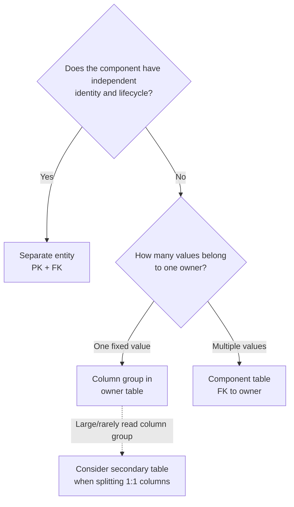
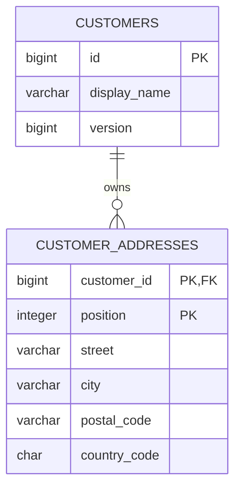

# Mapping Value Objects to Multiple Columns or Component Tables

In an object-oriented model, many business concepts are represented as **value objects**: monetary amount and currency, shipping address, date range, coordinates, or dimensions. A value object typically holds multiple attributes yet is treated by the business as **a single meaningful value**, such as `Money(150000, "VND")`, rather than two disconnected pieces of data.

A relational database does not force every Java object to be stored as a separate record. A `Money` value can span two columns `amount` and `currency` in the **same table** as the order; multiple `Address` values belonging to a customer can reside in a **component table** containing a foreign key to the customer. This is a *data modeling* decision: does the value need an independent identity, can it be mutated separately, how is it read/queried, and what constraints does it require?

This lesson belongs to the **Object Mapping** chapter of **DATABASE_DATA_MODELING**. The goal is to turn business requirements into verifiable relational structures: distinguishing values from entities, choosing between column groups and component tables, mapping with Java/JPA, protecting invariants with SQL, and evaluating query, update, and schema evolution costs.

## 1. How Do Value Objects Differ from Entities?

An **entity** has its own identity and a tracked lifecycle. A **value object** is identified by its *value content*; no independent identifier is needed to decide "is this the same value?"

For example, two different orders sharing the same delivery address:

```text
Order #1001
  shippingAddress = Address("12 Street A", "Da Nang", "550000", "VN")

Order #1002
  shippingAddress = Address("12 Street A", "Da Nang", "550000", "VN")
```

The two addresses are equal **by value**, yet each order is entitled to keep a snapshot of the address at the time of ordering. A customer updating their default address tomorrow must not silently alter the historical address of today's two orders.

| Aspect | Entity (`Customer`, `Order`) | Value object (`Money`, `Address`) |
|---|---|---|
| Identification | By persistent key/identity | By defined value components |
| Mutation | Identity persists while state changes | Usually replaced **as a whole value** with a new value |
| Sharing | Can be referenced by multiple entities | Values can be copied across multiple owners |
| Lifecycle | Can exist and be managed independently | Usually depends on owning entity or aggregate |
| SQL representation | Table with its own primary key | Column group or component rows attached to owner |

Not every Java class without an `id` is a value object. If an "address" has a contact person, verification status, update history, is referenced by multiple orders, and has its own lifecycle, it may have become an **address entity**. The criterion lies in the business domain, not in Java types or annotations.

### Three Principles for Modeling Value Objects

1. **Value-based equality:** attributes participating in `equals()`/`hashCode()` are explicitly defined; do not use Java reference identity as a business concept.
2. **Immutability in usage:** construct a new value rather than mutating a shared value. Even if the ORM requires a no-arg constructor and assignable fields, avoid public setters that expose arbitrary mutation.
3. **Intrinsic invariants:** for example, money must have a currency, start date must not follow end date, coordinates must be within valid bounds. Invariants checkable in SQL must also be expressed in the schema.

## 2. Choosing Column Groups, Component Tables, or Separate Entities

Suppose an application has `Order.total: Money` and `Customer.savedAddresses: List<Address>`. Both are value objects, yet they have **different multiplicities and access patterns**.

| Business Need | Typically Suitable Relational Representation | Typical JPA Mapping |
|---|---|---|
| A single value with fixed attributes, e.g., order total | Multiple columns on the **owner table** | `@Embeddable` + `@Embedded` |
| Two values of the same type on one entity, e.g., subtotal/shipping fee | Two differently named column groups | `@AttributeOverrides` |
| Multiple values of the same type owned by an owner, e.g., saved addresses | **Component table** with a foreign key to the owner | `@ElementCollection` + `@CollectionTable` |
| A large/rarely used column group placed in a 1-to-1 auxiliary table | Secondary table sharing the owner's primary key | `@SecondaryTable` |
| Component with identity, shared references, or independent lifecycle | Separate entity table with its own key and relationships | `@OneToOne` / `@OneToMany` |
| A flexible structure needing few internal SQL constraints or queries | Can consider a JSON/document column | Mapping depends on ORM and DB capabilities |

General decision flow:



This is a **decision guide**, not a rigid algorithm. Query needs, data size, integrity, ownership, and schema evolution strategies may make another choice more suitable.

## 3. Mapping a Value Object to Multiple Columns: `Money`

### 3.1. Write Invariants Before Writing Annotations

Suppose each sales order has two values: **subtotal** and **shipping fee**. Each consists of an amount and a currency code; both must be non-negative and use the same currency to be summed directly.

Do not simply create `BigDecimal amount` and implicitly assume all values are VND. Currency is part of the meaning, and the system may support multiple currencies later. For monetary values requiring decimal precision, use `BigDecimal`/`NUMERIC` instead of `double`/`FLOAT`.

```java
import jakarta.persistence.Column;
import jakarta.persistence.Embeddable;
import java.math.BigDecimal;
import java.math.RoundingMode;
import java.util.Locale;
import java.util.Objects;

@Embeddable
public class Money {

    @Column(name = "amount", precision = 19, scale = 2, nullable = false)
    private BigDecimal amount;

    @Column(name = "currency_code", length = 3, nullable = false)
    private String currencyCode;

    protected Money() {
        // JPA requires a no-arg constructor with this visibility.
    }

    public Money(BigDecimal amount, String currencyCode) {
        this.amount = Objects.requireNonNull(amount, "amount")
                .setScale(2, RoundingMode.UNNECESSARY);

        String code = Objects.requireNonNull(currencyCode, "currencyCode")
                .toUpperCase(Locale.ROOT);
        if (!code.matches("[A-Z]{3}")) {
            throw new IllegalArgumentException("Currency code must be 3 letters");
        }
        this.currencyCode = code;
    }

    public BigDecimal getAmount() {
        return amount;
    }

    public String getCurrencyCode() {
        return currencyCode;
    }

    @Override
    public boolean equals(Object other) {
        if (this == other) return true;
        if (!(other instanceof Money)) return false;
        Money that = (Money) other;
        return Objects.equals(amount, that.amount)
                && Objects.equals(currencyCode, that.currencyCode);
    }

    @Override
    public int hashCode() {
        return Objects.hash(amount, currencyCode);
    }
}
```

The example uses `setScale(2, UNNECESSARY)` to normalize representation and reject values with more than two non-zero decimal digits. This is a **business assumption of the example**, not a rule for all currencies; some currencies and financial products require different scales. Checking three letters only validates *format*, not whether the code is a valid ISO 4217 code.

Because `BigDecimal.equals()` considers scale, normalizing scale in the constructor prevents `10.0` and `10.00` from becoming two distinct representation states when objects are constructed validly. For different requirements, define comparison and hashing policies explicitly.

### 3.2. Using `@Embedded` to Spread Values Across Columns

Entity `PurchaseOrder` owns two `Money` values. We assign distinct column names using `@AttributeOverrides`:

```java
import jakarta.persistence.*;
import java.util.Objects;

@Entity
@Table(name = "purchase_orders")
public class PurchaseOrder {

    @Id
    @GeneratedValue(strategy = GenerationType.IDENTITY)
    private Long id;

    @Embedded
    @AttributeOverrides({
        @AttributeOverride(
            name = "amount",
            column = @Column(
                name = "subtotal_amount", precision = 19,
                scale = 2, nullable = false
            )
        ),
        @AttributeOverride(
            name = "currencyCode",
            column = @Column(
                name = "subtotal_currency", length = 3, nullable = false
            )
        )
    })
    private Money subtotal;

    @Embedded
    @AttributeOverrides({
        @AttributeOverride(
            name = "amount",
            column = @Column(
                name = "shipping_fee_amount", precision = 19,
                scale = 2, nullable = false
            )
        ),
        @AttributeOverride(
            name = "currencyCode",
            column = @Column(
                name = "shipping_fee_currency", length = 3, nullable = false
            )
        )
    })
    private Money shippingFee;

    @Version
    @Column(nullable = false)
    private Long version;

    protected PurchaseOrder() {}

    public PurchaseOrder(Money subtotal, Money shippingFee) {
        replaceAmounts(subtotal, shippingFee);
    }

    public void replaceAmounts(Money newSubtotal, Money newShippingFee) {
        Objects.requireNonNull(newSubtotal);
        Objects.requireNonNull(newShippingFee);
        if (newSubtotal.getAmount().signum() < 0
                || newShippingFee.getAmount().signum() < 0) {
            throw new IllegalArgumentException("Subtotal and shipping fee must be non-negative");
        }
        if (!newSubtotal.getCurrencyCode()
                .equals(newShippingFee.getCurrencyCode())) {
            throw new IllegalArgumentException("Both amounts must share the same currency");
        }
        this.subtotal = newSubtotal;
        this.shippingFee = newShippingFee;
    }
}
```

Both value groups are stored in **one row** of the `purchase_orders` table:

| id | subtotal_amount | subtotal_currency | shipping_fee_amount | shipping_fee_currency | version |
|---:|---:|---|---:|---|---:|
| 101 | 150000.00 | VND | 25000.00 | VND | 0 |

Corresponding PostgreSQL schema:

```sql
CREATE TABLE purchase_orders (
    id BIGINT GENERATED ALWAYS AS IDENTITY PRIMARY KEY,
    subtotal_amount NUMERIC(19, 2) NOT NULL,
    subtotal_currency VARCHAR(3) NOT NULL,
    shipping_fee_amount NUMERIC(19, 2) NOT NULL,
    shipping_fee_currency VARCHAR(3) NOT NULL,
    version BIGINT NOT NULL DEFAULT 0,
    CONSTRAINT ck_nonnegative_amounts
        CHECK (subtotal_amount >= 0 AND shipping_fee_amount >= 0),
    CONSTRAINT ck_same_currency
        CHECK (subtotal_currency = shipping_fee_currency),
    CONSTRAINT ck_subtotal_currency_format
        CHECK (subtotal_currency ~ '^[A-Z]{3}$'),
    CONSTRAINT ck_shipping_currency_format
        CHECK (shipping_fee_currency ~ '^[A-Z]{3}$')
);
```

The `CHECK` constraints in the example are PostgreSQL-specific, notably the regex operator `~`. On other database engines, constraint syntax may differ. Checking a three-letter format still does not replace a currency lookup table when you need to guarantee only approved codes are used.

**Why add SQL constraints if the constructor already checks?** Because the database can receive data from imports, other applications, manual SQL, or older code versions. `@Column(nullable = false)` expresses mapping intent, but in systems with migration-managed schemas, verify that the constraints actually exist in the database.

### 3.3. Consequences of Mapping to the Same Table

A change to `subtotal` typically becomes an `UPDATE` on the `purchase_orders` row. Components of `Money` can be used directly in SQL:

```sql
SELECT id,
       subtotal_amount + shipping_fee_amount AS payable_amount,
       subtotal_currency
FROM purchase_orders
WHERE subtotal_amount >= 100000
ORDER BY payable_amount DESC;
```

In JPQL, embedded attributes can be navigated via path expressions, for example:

```java
var query = em.createQuery("""
    select p
    from PurchaseOrder p
    where p.subtotal.amount >= :minAmount
    """, PurchaseOrder.class);
query.setParameter("minAmount", new BigDecimal("100000.00"));
```

`@Embedded` does not create a new table or foreign key. The database sees ordinary numeric and string columns; the Java model provides the `Money` class to centralize value rules, avoiding passing loose parameters and mixing up currencies.

## 4. Mapping `Address`: A Value with Multiple Attributes

Address is a good example because its representation must consider **geographic and business context**. For a domestic system, storing `street`, `city`, `postalCode`, `countryCode` may suffice; for international systems, regions, states/provinces, districts, and postal codes vary and require more flexible design.

A simplified Java model:

```java
import jakarta.persistence.*;
import java.util.Objects;

@Embeddable
public class Address {
    @Column(name = "street", nullable = false, length = 200)
    private String street;

    @Column(name = "city", nullable = false, length = 120)
    private String city;

    @Column(name = "postal_code", nullable = false, length = 24)
    private String postalCode;

    @Column(name = "country_code", nullable = false, length = 2)
    private String countryCode;

    protected Address() {}

    public Address(
            String street, String city,
            String postalCode, String countryCode) {
        this.street = Objects.requireNonNull(street);
        this.city = Objects.requireNonNull(city);
        this.postalCode = Objects.requireNonNull(postalCode);
        this.countryCode = Objects.requireNonNull(countryCode);
    }

    public String getStreet() { return street; }
    public String getCity() { return city; }
    public String getPostalCode() { return postalCode; }
    public String getCountryCode() { return countryCode; }

    @Override
    public boolean equals(Object other) {
        if (this == other) return true;
        if (!(other instanceof Address)) return false;
        Address that = (Address) other;
        return Objects.equals(street, that.street)
                && Objects.equals(city, that.city)
                && Objects.equals(postalCode, that.postalCode)
                && Objects.equals(countryCode, that.countryCode);
    }

    @Override
    public int hashCode() {
        return Objects.hash(street, city, postalCode, countryCode);
    }
}
```

Postal code is represented as `String` because it can contain leading zeros or letters in some countries. Normalization and non-blank checks should be added per real business rules; the constructor here only illustrates enforcing required fields.

### 4.1. Two Addresses on the Same Entity

Suppose an invoice requires both `billingAddress` and `shippingAddress`, both snapshots at invoice issuance time. The fields in both value objects share names, so placing them in the same table requires **renaming columns at each usage**:

```java
@Entity
@Table(name = "invoices")
public class Invoice {
    @Id
    @GeneratedValue(strategy = GenerationType.IDENTITY)
    private Long id;

    @Embedded
    @AttributeOverrides({
        @AttributeOverride(name = "street",
            column = @Column(name = "bill_street", nullable = false, length = 200)),
        @AttributeOverride(name = "city",
            column = @Column(name = "bill_city", nullable = false, length = 120)),
        @AttributeOverride(name = "postalCode",
            column = @Column(name = "bill_postal_code", nullable = false, length = 24)),
        @AttributeOverride(name = "countryCode",
            column = @Column(name = "bill_country_code", nullable = false, length = 2))
    })
    private Address billingAddress;

    @Embedded
    @AttributeOverrides({
        @AttributeOverride(name = "street",
            column = @Column(name = "ship_street", nullable = false, length = 200)),
        @AttributeOverride(name = "city",
            column = @Column(name = "ship_city", nullable = false, length = 120)),
        @AttributeOverride(name = "postalCode",
            column = @Column(name = "ship_postal_code", nullable = false, length = 24)),
        @AttributeOverride(name = "countryCode",
            column = @Column(name = "ship_country_code", nullable = false, length = 2))
    })
    private Address shippingAddress;

    protected Invoice() {}
}
```

This snippet illustrates the annotations and omits business constructors. For fields inside `Address`, columns `bill_street` and `ship_street` are stored directly in the `invoices` table. There is no `address_id` just to represent these two value objects.

When a customer updates their default address, the two snapshots saved on the invoice **do not automatically change**. That is an appropriate historical decision for invoices; for a "currently active delivery address," requirements may differ.

### 4.2. Handling Optional Value Objects

An `Address` can be optional, such as when no shipping address has been provided before completing checkout. With a multi-column model, the question "is an address present?" is not equivalent to a single `NULL` column.

There are two common approaches:

- **Mandatory:** each address column has `NOT NULL` and application rules ensure all components are supplied.
- **Optional:** allow the entire column group to be null together, but **never accept a half-populated address**; enforce appropriate data constraints and verify ORM read behavior.

SQL example (if the four shipping address columns are optional):

```sql
ALTER TABLE invoices
ADD CONSTRAINT ck_shipping_address_all_or_none
CHECK (
    (ship_street IS NULL
     AND ship_city IS NULL
     AND ship_postal_code IS NULL
     AND ship_country_code IS NULL)
    OR
    (ship_street IS NOT NULL
     AND ship_city IS NOT NULL
     AND ship_postal_code IS NOT NULL
     AND ship_country_code IS NOT NULL)
);
```

**To apply this optional example**, the `ship_*` columns must first be created/altered to be nullable; the `Invoice` snippet above declared them mandatory. Treat the two versions as **two distinct design choices**, rather than running `ALTER` directly on a mandatory schema and expecting nulls to work.

An ORM may interpret an all-null column group as `null` or as an embedded object with null fields depending on configuration/provider. Do not rely on unverified implicit behavior; the API must define clearly how "no address yet" is represented.

## 5. Multiple Value Objects: Using a Component Table

Suppose a customer can save **multiple suggested addresses** to pick from when placing an order. Each address has no separate business ID; users only add, edit by replacing, or remove values from the customer's list. In that case, a component table `customer_addresses` is a natural fit.

### 5.1. Relational Structure



```sql
CREATE TABLE customers (
    id BIGINT GENERATED ALWAYS AS IDENTITY PRIMARY KEY,
    display_name VARCHAR(180) NOT NULL,
    version BIGINT NOT NULL DEFAULT 0
);

CREATE TABLE customer_addresses (
    customer_id BIGINT NOT NULL
        REFERENCES customers(id) ON DELETE CASCADE,
    position INTEGER NOT NULL CHECK (position >= 0),
    street VARCHAR(200) NOT NULL,
    city VARCHAR(120) NOT NULL,
    postal_code VARCHAR(24) NOT NULL,
    country_code VARCHAR(2) NOT NULL,
    PRIMARY KEY (customer_id, position)
);
```

Because `position` is the index in the list, the pair `(customer_id, position)` identifies **the row in the storage structure**. It does not turn an address into an entity with business identity. If the customer reorders the list, `position` may change while the `Address` content stays identical.

`ON DELETE CASCADE` in this example reflects a policy: suggested addresses are deleted when the customer is deleted. Actual deletion rules still depend on transaction history, legal retention, and other data requirements; addresses captured on invoices must not be deleted because of this relationship.

### 5.2. Mapping with `@ElementCollection` and `@CollectionTable`

```java
import jakarta.persistence.*;
import java.util.ArrayList;
import java.util.Collections;
import java.util.List;
import java.util.Objects;

@Entity
@Table(name = "customers")
public class Customer {

    @Id
    @GeneratedValue(strategy = GenerationType.IDENTITY)
    private Long id;

    @Column(name = "display_name", nullable = false, length = 180)
    private String displayName;

    @Version
    @Column(nullable = false)
    private Long version;

    @ElementCollection(fetch = FetchType.LAZY)
    @CollectionTable(
        name = "customer_addresses",
        joinColumns = @JoinColumn(name = "customer_id")
    )
    @OrderColumn(name = "position")
    private List<Address> savedAddresses = new ArrayList<>();

    protected Customer() {}

    public void addAddress(Address address) {
        savedAddresses.add(Objects.requireNonNull(address));
    }

    public void replaceAddress(int index, Address nextAddress) {
        savedAddresses.set(index, Objects.requireNonNull(nextAddress));
    }

    public void removeAddress(int index) {
        savedAddresses.remove(index);
    }

    public List<Address> getSavedAddresses() {
        return Collections.unmodifiableList(savedAddresses);
    }
}
```

`Address` is the `@Embeddable` class defined above. The field annotations on `Address` name `street`, `city`, `postal_code`, and `country_code` matching the columns of `customer_addresses`.

Role of each annotation:

- `@ElementCollection`: this is a collection of **values**, not a collection of entities; elements belong to the owner's lifecycle.
- `@CollectionTable`: stores elements in a separate table and joins back to the customer via `customer_id`.
- `@OrderColumn`: maintains `List` ordering in the `position` column; ordering has storage significance, so it must be verified on read-back.
- `fetch = LAZY`: avoids loading the entire list when only basic customer info is needed; actual read needs still determine the fetch plan.

If maintaining **user-arranged order** is not needed, you can use `Set<Address>` or a `List` with an appropriate query/sort order. `@OrderBy` on an attribute, such as `city`, is **not equivalent** to `@OrderColumn`: the former sorts from existing data, while the latter stores list positions.

### 5.3. Lifecycle, Immutability, and Updates

Adding an `Address` to `savedAddresses` does not require calling `persist(address)` separately: it is a value owned by the owner. Removing an element from the collection means **removing the value from the customer's list**; upon synchronization, the ORM adjusts the rows in `customer_addresses`.

Create a new `Address` object and replace the element rather than mutating fields on an object referenced in multiple places:

```java
customer.replaceAddress(0, new Address(
    "25 Street B", "Hanoi", "100000", "VN"
));
```

For a `List` with `@OrderColumn`, inserting in the middle or deleting can force the ORM to update position values across many rows. For value collections without stable per-element keys, some providers may emit multiple `DELETE`/`INSERT` statements to synchronize changes. **Do not assume the cost is exactly one UPDATE statement**: enable SQL statistics/logging on representative data to evaluate it.

`@Version` on the owner helps control concurrent updates, but when modifying collections, version-increment behavior must be **tested against the actual ORM and configuration**; custom bulk SQL/JPQL statements written by the application may not obey default optimistic locking. If two users edit the list simultaneously, define clearly which conflicts to reject and how retries work.

### 5.4. A Component Table Is Not an Independent Entity

`customer_addresses` has physical rows, keys, and indexes, yet `Address` in the domain model remains a value object:

- There is no `AddressRepository.findById(...)` as with an independent entity.
- Do not fabricate a random `address_id` just to attach business identity to a value.
- Equal `Address` copies can validly appear on two customers or at two positions if requirements permit.
- Users replace an address value; there is no need to track that "address #793" remains the same entity across edits.

If you need to route an API request like "edit address 793," share the same address across multiple owners, manage an independent verification status, or store its version history, consider promoting address to an **entity** with its own key. That is a domain model change, not just an annotation swap.

## 6. One Value Object in a 1-to-1 Secondary Table: `@SecondaryTable`

Besides collection component tables, JPA supports **splitting columns of the same entity** into an auxiliary table via `@SecondaryTable`. This is an option when a data group has exactly **one value** per owner but you want to store it physically in another table—for example, a delivery address with many attributes rarely used in list queries.

Schema example:

```sql
CREATE TABLE shipment_records (
    id BIGINT GENERATED ALWAYS AS IDENTITY PRIMARY KEY,
    tracking_code VARCHAR(80) NOT NULL UNIQUE
);

CREATE TABLE shipment_destinations (
    shipment_id BIGINT PRIMARY KEY
        REFERENCES shipment_records(id) ON DELETE CASCADE,
    street VARCHAR(200) NOT NULL,
    city VARCHAR(120) NOT NULL,
    postal_code VARCHAR(24) NOT NULL,
    country_code VARCHAR(2) NOT NULL
);
```

`shipment_destinations.shipment_id` is both the primary key of the secondary table and the foreign key to the owning entity. There is no independent address identity.

```java
@Entity
@Table(name = "shipment_records")
@SecondaryTable(
    name = "shipment_destinations",
    pkJoinColumns = @PrimaryKeyJoinColumn(name = "shipment_id")
)
public class ShipmentRecord {
    @Id
    @GeneratedValue(strategy = GenerationType.IDENTITY)
    private Long id;

    @Column(name = "tracking_code", nullable = false, length = 80)
    private String trackingCode;

    @Embedded
    @AttributeOverrides({
        @AttributeOverride(name = "street",
            column = @Column(name = "street", table = "shipment_destinations",
                nullable = false, length = 200)),
        @AttributeOverride(name = "city",
            column = @Column(name = "city", table = "shipment_destinations",
                nullable = false, length = 120)),
        @AttributeOverride(name = "postalCode",
            column = @Column(name = "postal_code", table = "shipment_destinations",
                nullable = false, length = 24)),
        @AttributeOverride(name = "countryCode",
            column = @Column(name = "country_code", table = "shipment_destinations",
                nullable = false, length = 2))
    })
    private Address destination;

    protected ShipmentRecord() {}
}
```

This is an illustrative mapping omitting imports, business constructors, and getters. Row creation in the secondary table, join behavior, and fetch behavior must be verified against the JPA provider. Placing data in a secondary table **does not automatically guarantee faster queries**: depending on the query and fetch mechanism, the ORM may still join the secondary table when loading the entity.

### Distinguishing Three Table Patterns

| Table Pattern | How Many Rows per Owner? | Domain Semantics |
|---|---:|---|
| Embedded columns directly in owner table | 1 owner row | Value object is part of the entity's state |
| `@SecondaryTable`, secondary PK is also owner FK | At most 1 secondary row per 1 owner | Still the same entity, columns split to another table |
| `@ElementCollection`, owner FK in collection table | 0 to many component rows | Multiple value objects owned by one owner |
| `@OneToMany` to a separate entity | 0 to many entities | Each element has its own identity and lifecycle |

Do not use `@SecondaryTable` to represent multiple addresses for a customer because the multiplicity does not match. Likewise, do not use `@ElementCollection` for an entity needing independent transactions and references merely because it has only a few attributes.

## 7. Technical Distinctions Worth Understanding

### 7.1. `@AttributeConverter` Does Not Replace Multi-Column `@Embeddable`

JPA `AttributeConverter<X, Y>` converts a Java value of type `X` into a database representation of type `Y`, typically stored in **one column**. It works well for converting an enum or single-value type to a string/code. A standard converter **does not automatically expand a `Money` into two independent columns** `amount` and `currency`.

Therefore, if business logic needs to query, compute, and constrain individual components in SQL, multi-column `@Embeddable` is usually clearer. If you choose to serialize the whole value into a single string or JSON, you must accept trade-offs in querying, constraints, and evolvability.

### 7.2. A Value Object Can Contain Another Value Object

For instance, `Address` can contain `GeoPoint(latitude, longitude)` or `Money` can contain a currency code structure. Nested embeddables can be used when the ORM supports that mapping style and proper override paths are specified.

A model such as:

```text
DeliveryAddress
 ├── street
 ├── city
 └── coordinates: GeoPoint
       ├── latitude
       └── longitude
```

can be flattened into four columns `street`, `city`, `latitude`, `longitude` on the owner table. The important part is defining cross-field constraints, such as `latitude` between -90 and 90, `longitude` between -180 and 180, and both coordinates present together or absent together.

For nested embeddables, avoid column name collisions when reusing a type in multiple places; override annotations must reflect exact property paths and be tested with the actual provider.

### 7.3. Direct Column Access Makes Data Easier to Verify

Storing money as `amount` and `currency` allows the database to execute:

```sql
SELECT subtotal_currency, SUM(subtotal_amount) AS total
FROM purchase_orders
GROUP BY subtotal_currency;
```

**Never sum monetary amounts of different currencies directly into a single total.** When multi-currency reporting is needed, you must have an exchange rate policy, conversion timestamp, and corresponding rate data. The value object structure makes it obvious that currency is an inseparable part of the calculation.

If filtering by city across saved addresses is needed:

```sql
SELECT DISTINCT c.id, c.display_name
FROM customers AS c
JOIN customer_addresses AS a ON a.customer_id = c.id
WHERE a.city = :city;
```

Consider indexes based on actual workload, for example:

```sql
CREATE INDEX idx_customer_addresses_city_customer
    ON customer_addresses(city, customer_id);
```

This index helps certain queries filtering by `city` and returning the owner; it is not a mandatory index for every system. The primary key `(customer_id, position)` already serves list lookups by `customer_id` in many DBMSs, but query plans and actual indexes should still be verified.

### 7.4. N+1 Can Still Occur with Component Tables

`@ElementCollection(fetch = LAZY)` avoids loading addresses when unused, but if you fetch 100 customers and loop over `customer.getSavedAddresses()`, the ORM may issue one list query plus many follow-up queries.

Solutions depend on the use case:

- List view needing only `id` and `displayName`: use a projection and do not load addresses.
- Single customer detail view: load that customer's collection within an appropriate transaction.
- View comparing multiple customers and addresses: consider batch fetching or a set-based query; verify actual query counts.
- When paginating: be careful with collection fetch joins because joins can multiply rows; consider paginating owner IDs first and then querying the collection by that ID batch.

Do not default every collection to `EAGER` to avoid lazy-loading errors. That usually just trades the issue for over-fetching data or unpredictable SQL plans.

### 7.5. Protecting Consistency of Each Value

Consider the four-column address example: the application may assert that an `Address` object always has all fields populated, yet the database still needs `NOT NULL` or an "all-present / all-absent" constraint depending on business rules.

For a money amount and currency pair, rules might include:

| Invariant | Where to Enforce |
|---|---|
| `amount` has appropriate precision | `BigDecimal`/`NUMERIC(p,s)` and rounding tests |
| `currencyCode` is present | Value object constructor and `NOT NULL` |
| Currency code has valid format / belongs to allowed set | Application validation and constraint/lookup table |
| Two added monetary amounts share the same currency | Domain method; can add `CHECK` if in the same row |
| Address contains required fields | Constructor, `NOT NULL`, or cross-column `CHECK` |
| Two suggested addresses cannot be duplicates | Domain collection rules and appropriate `UNIQUE` if truly required |

Do not assume `@Embeddable` automatically generates all constraints or guarantees valid elements across every write path. Annotations are part of the mapping; the deployed schema and constraint tests confirm data integrity.

## 8. When Must a Value Object Become an Entity?

A common scenario: initially a store only saves a customer's list of suggested addresses. Later, new requirements emerge:

1. Each address needs its own ID for direct selection via API.
2. Staff verify an address with verification status and audit history.
3. Multiple accounts can share the same verified address.
4. You want to block/disable an address without deleting orders that referenced it.

These requirements indicate **the address now has its own identity and lifecycle**. An alternative design could be:

```sql
CREATE TABLE verified_addresses (
    id BIGINT GENERATED ALWAYS AS IDENTITY PRIMARY KEY,
    street VARCHAR(200) NOT NULL,
    city VARCHAR(120) NOT NULL,
    postal_code VARCHAR(24) NOT NULL,
    country_code VARCHAR(2) NOT NULL,
    verification_status VARCHAR(20) NOT NULL,
    version BIGINT NOT NULL DEFAULT 0
);

CREATE TABLE customer_address_links (
    customer_id BIGINT NOT NULL REFERENCES customers(id),
    address_id BIGINT NOT NULL REFERENCES verified_addresses(id),
    PRIMARY KEY (customer_id, address_id)
);
```

Now `VerifiedAddress` is an entity, and the customer–address relationship can be many-to-many. You can still store a **shipping address snapshot** on orders/invoices as a value object: having a "currently verified address" entity does not mean historical transactions should point to its mutable version.

Legacy data must be evaluated during migration: do duplicate addresses actually represent the same real-world entity, is string normalization reliable enough, and do ownership rules change? Never automatically merge two address rows solely because their strings match.

## 9. Comparison with JSON/Document Columns

A multi-field value object can also be stored as JSON if the database and ORM support it—for example, a display configuration irrelevant to relational integrity that is only read/written as a whole.

| Criterion | Multiple Relational Columns | Component Table | Single JSON/Document Column |
|---|---|---|---|
| Per-field validation | `NOT NULL`, `CHECK`, explicit data types | Like relational columns, plus owner FK | Depends on DB features; often needs custom rules |
| Filtering/aggregating by field | Direct SQL | Join then filter; indexable | Requires JSON functions/operators and suitable index types |
| Element cardinality | Fits one fixed value | Fits 0..n collection | Can hold multiple elements inside the document |
| Partial updates | `UPDATE` columns | Insert/delete/update rows | Depends on DB and how the ORM writes JSON |
| Schema evolution | Column/constraint migrations | Join/child table migrations | Usually more flexible, but data versioning and validation are harder |

There is no rule that JSON is always faster or better for value objects. If a field must be filtered frequently, strictly constrained, used in `JOIN`s, or aggregated, relational columns are easier to verify. If the structure evolves rapidly and is almost always read as one blob, JSON can make sense. Depending on the DBMS, some JSON constraints and indexes are available; verify specifically rather than assuming they do not exist.

## 10. Design Process from Requirements to Schema

**Step 1 — Write down business rules.** By what content is the value compared? Are there cases where one field changes while remaining the same independent entity? Must historical snapshots be retained?

**Step 2 — Determine multiplicity and ownership.** Does an owner have exactly one `Money`, two `Address` values, or many suggested addresses? Do elements exist independently if the owner is deleted?

**Step 3 — Choose the relational structure.** Place a single value object in columns of the same table, use a collection table with an owner FK, or use a 1-to-1 secondary table when there is a clear physical reason. If elements need independent identity, switch to an entity model.

**Step 4 — Choose column names and types.** When the same value object type appears multiple times, use clear prefixes. Choose `NUMERIC(p,s)` for money, `VARCHAR` for postal codes, and date/time types matching actual semantics; do not turn everything into generic strings.

**Step 5 — Constrain the data.** Write `NOT NULL`, `CHECK`, `UNIQUE`, `FOREIGN KEY`, and deletion policies per business rules. For optional components, specify explicitly how nulls are permitted.

**Step 6 — Map and encapsulate changes.** Use `@Embeddable`/`@Embedded`, override columns for repeated uses, `@ElementCollection` for collections, and replace whole objects through business methods while avoiding arbitrary public setters.

**Step 7 — Verify through queries and updates.** Save and reload, test value equality, validate invalid inputs, inspect SQL for insert/reorder/delete operations, check for N+1 queries, and test concurrent updates.

### Pre-Finalization Checklist

| Question | Sign That the Model Needs Review |
|---|---|
| Does the value object need its own ID? | There is an `address_id` solely to distinguish two identical strings with no entity behavior |
| Is part of the value being dropped? | Storing `amount` while forgetting `currency` or exchange rate timestamp |
| Do two value objects of the same type collide on column names? | Both `billingAddress` and `shippingAddress` map to `street` |
| Are mandatory columns protected? | Manual SQL can insert null amounts or half-populated addresses |
| Does collection order actually need storage? | Creating `position` for data that only needs sorting by city |
| What is the cost of replacing elements? | One reorder triggers many unexpected updates/inserts/deletes |
| Is the value object mutated in place? | Mutating a shared instance corrupts multiple owners |
| Do queries match the data scale? | A page of 100 customers loads thousands of unused addresses |
| Is historical data immutable? | Editing the default address alters addresses on old invoices |
| Should it be promoted to an entity? | Elements have status, history, and dedicated APIs yet are forced into `@ElementCollection` |

## 11. Practice Exercise

**Context:** A ticketing platform manages `TicketOrder`. Each order contains:

- `baseFare` consisting of amount and currency code.
- `serviceFee` consisting of amount and currency code; both amounts share the same currency and are non-negative.
- `buyerContact` consisting of full name, email, and phone number; the invoice must preserve exact details at purchase time.
- `attendeeNames`, an ordered list of attendee names on the tickets.
- Later, the business wants to verify **each attendee** individually, issue check-in codes, record entry timestamps, and track ticket transfer history.

Design:

1. Which values fit `@Embeddable` and multi-column mapping?
2. Which columns and constraints are needed for `baseFare`/`serviceFee`?
3. Should `attendeeNames` use a column group or a component table? If order must be preserved, what column is needed?
4. Once check-in and transfer requirements arrive, is a value object of attendee names still sufficient?
5. Which scenarios must be tested to catch discrepancies between Java values and SQL data?

**Suggested Answers:**

- `Money` is a two-part value object; `BuyerContact` can also be a value object. Contact details on the order are a historical snapshot, not necessarily a reference to a mutable buyer profile.
- Use `base_fare_amount`/`base_fare_currency` and `service_fee_amount`/`service_fee_currency`; add `NOT NULL`, exact `NUMERIC` types, non-negative `CHECK` constraints, and a rule that both currency codes match if summed directly.
- `attendeeNames` has variable cardinality, so it fits a table `ticket_order_attendees(order_id, position, attendee_name)`. You can use an `@ElementCollection` of `String` with `@OrderColumn`, along with PK/FK and position constraints.
- Once each person has a check-in code, status, transfer history, and identity across the process, modeling a **Ticket/AttendeeRegistration entity** is more appropriate than a plain string value. `PersonName` can still be a value object inside the new entity.
- Test save–reload round-trips, value object `equals/hashCode`, SQL constraints, list ordering, element replacement, concurrent edits, query counts when loading many orders, and immutability of historical invoice details.

## 12. Key Takeaways

A value object can be **one concept in the domain model yet multiple columns in the relational model**. When there is a single fixed value, `@Embeddable` and `@Embedded` usually express it most clearly; when an owner holds multiple values, a component table with `@ElementCollection` makes multiplicity and foreign keys explicit. `@SecondaryTable` serves splitting columns of **the same entity** into a 1-to-1 auxiliary table; a separate entity is only appropriate when the component has independent identity and lifecycle.

Correct mapping does not stop at annotations. You must verify **value equality, business invariants, column names and types, keys/constraints, deletion policies, query costs, and schema evolvability**. When every mapping decision is grounded in business requirements and verified in the database, the model stays clear in Java and reliable over the long-term life of the data.
