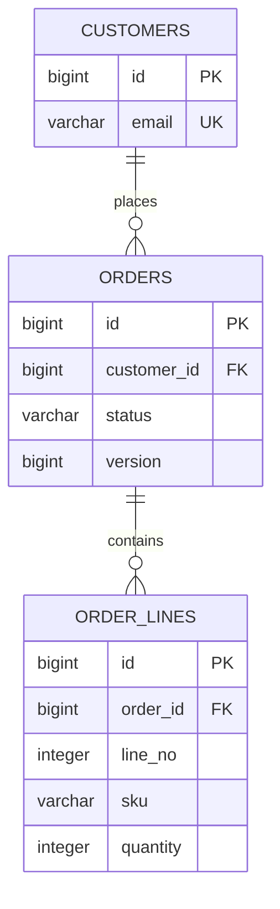
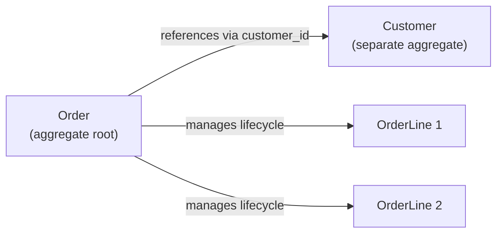

# Mapping Relationships and Distinguishing Owning Side from Business Owner

A sales system might say: "An order belongs to a customer" and "An order owns its order lines." In Java, both statements can be represented with object references. In a relational database, both can use foreign keys. However, when mapping with JPA, the **association owning side** and the **business owner** (*aggregate root*) are two distinct concepts.

- **The owning side in the ORM** determines which side of the mapping has the authority to synchronize relationship changes into the foreign key or join table. This is a technical mapping rule.
- **The business owner** determines who is allowed to create, mutate, or delete components and protect invariants within a transaction. This is a domain rule.
- **The table holding the foreign key** is a relational schema design decision. It determines where the reference value is stored and where the database enforces integrity.

These three concepts are often related, yet they are **not synonymous**. If confused, a developer might update only the `mappedBy` collection without updating the foreign key, accidentally delete shared entities via `cascade`, or allow aggregate components to be modified while bypassing business rules.

In the **DATABASE_DATA_MODELING** module, we move from business requirements to entities, relationships, multiplicities, foreign keys, and constraints before choosing JPA configurations. This lesson focuses on how to represent one-to-one, many-to-one, one-to-many, and many-to-many relationships; how to identify the association owning side; and how to keep the mapping consistent with the data lifecycle.

## 1. Three Meanings of "Ownership"

| Perspective | Question to Answer | Example |
|---|---|---|
| **Business / Domain** | Who is responsible for enforcing rules, creating, and ending lifecycles? | `Order` is the aggregate root, coordinating `OrderLine` |
| **ORM / JPA mapping** | Changes on which side are used to update the link in SQL? | `OrderLine.order` has `@JoinColumn` and is the owning side |
| **Relational schema** | Where is the foreign key or link row stored? | `order_lines.order_id` references `orders.id` |

In a bidirectional `Order`–`OrderLine` relationship, the side storing the FK is on `order_lines`. Thus `OrderLine.order` is usually the JPA owning side. Yet in business terms, `Order` is the lifecycle owner of the order lines: users add lines **through the order**, and the order is responsible for validating quantity, price, and order status.

This leads to an important insight:

> An entity can be the **aggregate owner** even when its collection is the **inverse side** in the JPA mapping.

Similarly, `Order.customer` can be the owning side of a many-to-one relationship because `orders.customer_id` is the FK, yet that does **not** permit deleting an order to cascade-delete the customer. A customer is an entity with its own independent lifecycle.

### Running Example

Requirements for an ordering system:

1. Each order links to exactly one existing customer.
2. A customer can have many orders and continues to exist even if an order is deleted.
3. An order contains multiple order lines; each line belongs to only one order and has no independent lifecycle.
4. Only orders in `DRAFT` status can add or remove lines.
5. Line quantity must be greater than 0; line ordering matters when printing the order.
6. Data must remain valid even when written via direct SQL or another application.

Entity-relationship diagram:



The object model can be visualized as follows:

```text
Customer                  Order (aggregate root)
  id <-------------------- customer
                              |
                              +-- lines: List<OrderLine>
                                    |
                                    +-- order: Order
```

In this diagram, `Order.customer` is a reference to another aggregate, whereas `Order.lines` is a set of components controlled by `Order`. Although both may use foreign keys, their lifecycle semantics are completely different.

## 2. Design Foreign Keys Before Choosing Annotations

A minimal PostgreSQL schema for the requirements above:

```sql
CREATE TABLE customers (
    id BIGINT GENERATED ALWAYS AS IDENTITY PRIMARY KEY,
    email VARCHAR(255) NOT NULL UNIQUE
);

CREATE TABLE orders (
    id BIGINT GENERATED ALWAYS AS IDENTITY PRIMARY KEY,
    customer_id BIGINT NOT NULL,
    status VARCHAR(20) NOT NULL
        CHECK (status IN ('DRAFT', 'CONFIRMED', 'CANCELLED')),
    version BIGINT NOT NULL DEFAULT 0,
    CONSTRAINT fk_orders_customer
        FOREIGN KEY (customer_id) REFERENCES customers(id)
);

CREATE TABLE order_lines (
    id BIGINT GENERATED ALWAYS AS IDENTITY PRIMARY KEY,
    order_id BIGINT NOT NULL,
    line_no INTEGER NOT NULL CHECK (line_no > 0),
    sku VARCHAR(64) NOT NULL,
    quantity INTEGER NOT NULL CHECK (quantity > 0),
    CONSTRAINT fk_order_lines_order
        FOREIGN KEY (order_id) REFERENCES orders(id),
    CONSTRAINT uq_order_line_position UNIQUE (order_id, line_no)
);

CREATE INDEX idx_orders_customer_id ON orders(customer_id);
CREATE INDEX idx_order_lines_order_id ON order_lines(order_id);
```

What the database protects:

- `orders.customer_id NOT NULL`: an order always has a customer.
- `fk_orders_customer`: cannot reference a non-existent customer.
- `order_lines.order_id NOT NULL`: an order line cannot exist independently in storage.
- `UNIQUE(order_id, line_no)`: cannot have two identical positions within the same order.
- `CHECK(quantity > 0)`: write paths outside Java also cannot store zero or negative quantities.

In this example, `ON DELETE CASCADE` is omitted from the FK so that deletion policies are coordinated explicitly through the ORM and application. If the business allows deleting both an order and its lines at the database level, DB-level cascading can be chosen after weighing its impact on history, auditing, and other writers. **JPA cascading is not identical to SQL `ON DELETE CASCADE`**; each mechanism operates at a different layer.

Indexes on FKs help queries that join or filter by owner, though not every DBMS creates indexes on the referencing side automatically. Verify against the actual schema and query plans.

## 3. Owning Side and Inverse Side in JPA

### 3.1. Fundamentals of Bidirectional Relationships

A bidirectional relationship allows navigating from object A to B and from B back to A. For example:

```java
order.getLines();       // Order -> OrderLine
line.getOrder();        // OrderLine -> Order
```

Two Java references are **two navigation paths for the same relationship** in the database, not two independent foreign keys. JPA needs to know which side is the source of truth for managing the link:

- **Owning side** holds the configuration managing the FK/join table. Changes on this side count as relationship changes to synchronize.
- **Inverse side** uses `mappedBy` to point to the property on the owning side; it describes the reverse navigation path without managing a separate link.

In a standard bidirectional `@OneToMany`/`@ManyToOne` relationship, `@ManyToOne` is the owning side because the FK lives in the child entity's table. In a `@ManyToMany` relationship, the owning side is the side declaring/maintaining the join table; the FKs reside in that join table. With unidirectional mapping, one side can manage the link on its own without `mappedBy`.

**Distinction:** "Owning side" does not mean that entity is the aggregate root, has the right to delete the target object, or holds all business invariants.

### 3.2. Bidirectional One-to-Many: `Order.lines` and `OrderLine.order`

Illustrative Java/JPA example, omitting imports, getters, and some constructors to focus on mapping:

```java
@Entity
@Table(name = "orders")
public class Order {

    @Id
    @GeneratedValue(strategy = GenerationType.IDENTITY)
    private Long id;

    @ManyToOne(fetch = FetchType.LAZY, optional = false)
    @JoinColumn(name = "customer_id", nullable = false)
    private Customer customer;

    @Enumerated(EnumType.STRING)
    @Column(nullable = false, length = 20)
    private OrderStatus status = OrderStatus.DRAFT;

    @OneToMany(
        mappedBy = "order",
        cascade = CascadeType.ALL,
        orphanRemoval = true
    )
    @OrderBy("lineNo ASC")
    private List<OrderLine> lines = new ArrayList<>();

    @Version
    @Column(nullable = false)
    private Long version;

    protected Order() {}

    public Order(Customer customer) {
        this.customer = Objects.requireNonNull(customer);
    }

    public void addLine(OrderLine line) {
        requireDraft();
        Objects.requireNonNull(line);
        if (line.getOrder() != null) {
            throw new IllegalStateException("Order line already belongs to an order");
        }
        if (line.getQuantity() <= 0) {
            throw new IllegalArgumentException("Quantity must be > 0");
        }

        line.attachTo(this);
        lines.add(line);
    }

    public void removeLine(OrderLine line) {
        requireDraft();
        if (lines.remove(line)) {
            line.detachFromOrder();
        }
    }

    private void requireDraft() {
        if (status != OrderStatus.DRAFT) {
            throw new IllegalStateException("Only draft orders can be modified");
        }
    }
}

@Entity
@Table(name = "order_lines")
public class OrderLine {

    @Id
    @GeneratedValue(strategy = GenerationType.IDENTITY)
    private Long id;

    @ManyToOne(fetch = FetchType.LAZY, optional = false)
    @JoinColumn(name = "order_id", nullable = false)
    private Order order; // OWNING SIDE in JPA

    @Column(name = "line_no", nullable = false)
    private int lineNo;

    @Column(nullable = false, length = 64)
    private String sku;

    @Column(nullable = false)
    private int quantity;

    protected OrderLine() {}

    public Order getOrder() { return order; }
    public int getQuantity() { return quantity; }

    void attachTo(Order order) {
        this.order = Objects.requireNonNull(order);
    }

    void detachFromOrder() {
        this.order = null;
    }
}
```

Assume `Customer` is mapped separately; `OrderStatus` defines `DRAFT`, `CONFIRMED`, `CANCELLED`; and order lines are assigned a valid `lineNo > 0` by ordering logic before saving. Imports from `jakarta.persistence` and `java.util` are omitted. This code is an **illustrative mapping**, not a complete production class: line constructors, `lineNo` assignment policies, SKU validation, access control, and transactions must be added during real implementation.

Key takeaways:

1. `OrderLine.order` declares `@JoinColumn(name = "order_id")` and is therefore the **owning side**. It is the source of truth for writing `order_lines.order_id`.
2. `Order.lines` declares `mappedBy = "order"`. The string `"order"` is the **Java property name on `OrderLine`**, not the SQL column name `order_id`.
3. `Order` is the **business aggregate root**. The `addLine` method validates business preconditions and then synchronizes both references.
4. `cascade = ALL` and `orphanRemoval = true` apply only from the order to lines within its lifecycle; this is a business-driven choice, not because `Order` has `mappedBy`.
5. `Order.customer` is also the owning side of the `customer_id` FK, yet it does **not** have `CascadeType.REMOVE`. A customer is referenced by many orders and has an independent lifecycle.

### 3.3. Why Update Both Ends of the Relationship?

Suppose:

```java
order.getLines().add(line); // modifies only the inverse collection
```

Without setting `line.order = order`, the Java object graph becomes inconsistent:

```text
order.lines contains line
line.order == null
```

For the bidirectional relationship above, JPA relies on the owning side to manage the FK. Hence updating only the inverse side is **not a reliable way to persist the link**; the provider may fail to write `order_id` as intended or trigger a constraint error. Conversely, setting only `line.order = order` without updating `order.lines` may save the FK while leaving the in-memory collection out of sync until reloaded.

To keep both sides aligned:

- Encapsulate relationship changes in **a domain method** such as `Order.addLine`.
- Avoid exposing public setters on both sides.
- Pick a single entry point for application calls; for this aggregate, changes must go through `Order`.
- Verify after `flush` and after reloading in a fresh persistence context.

**Especially on deletion:** with `orphanRemoval = true`, removing `line` from the collection marks the order line for deletion. `detachFromOrder` only keeps the in-memory graph consistent; because the `order_id` FK is `NOT NULL`, the line **cannot be saved** in an `order = null` state. If you want to move a line to another order, do not use this orphan-removal workflow; redesign ownership and transfer rules explicitly.

### 3.4. Verify Actual SQL

Creating an order with two lines can lead to operations equivalent to:

```sql
INSERT INTO orders (customer_id, status, version)
VALUES (:customer_id, 'DRAFT', 0);

INSERT INTO order_lines (order_id, line_no, sku, quantity)
VALUES (:new_order_id, 1, 'BOOK-01', 2);

INSERT INTO order_lines (order_id, line_no, sku, quantity)
VALUES (:new_order_id, 2, 'PEN-02', 1);
```

The ORM determines SQL ordering and timing according to the provider, ID generator, and flush behavior; this models the expected outcome rather than promising the ORM emits these exact three statements verbatim.

Enable SQL logging in development and inspect actual `order_id` values. Do not rely solely on `order.getLines().size()` returning 2 in the same session: the Java collection can look temporarily right even while the FK has not been synchronized.

## 4. Technical Owner of Each Relationship Kind

### 4.1. Many-to-One (`@ManyToOne`)

This is usually the most direct mapping because one row holds an FK to another row:

```java
@ManyToOne(fetch = FetchType.LAZY, optional = false)
@JoinColumn(name = "customer_id", nullable = false)
private Customer customer;
```

In the `orders` table, `customer_id` stores the customer's ID. Setting `order.customer = customerB` (via an appropriate domain method) causes the ORM to update the FK to customer B. Whether this is **permitted by business rules** is a separate question: confirmed orders might forbid changing the customer even though the mapping allows writing the FK.

If `Customer.orders` is desired for reverse navigation, you can add:

```java
@OneToMany(mappedBy = "customer")
private List<Order> orders = new ArrayList<>();
```

Here `Customer.orders` is the inverse side. Do not add this collection automatically just because the table has an FK: every collection adds graph maintenance cost, risk of large queries, serialization cycles, and unnecessary coupling. Querying a customer's orders via a repository can satisfy the use case as well.

### 4.2. Unidirectional One-to-Many (`@OneToMany` without `mappedBy`)

Not every one-to-many collection needs a back-reference. JPA can map it unidirectionally:

```java
@OneToMany
@JoinColumn(name = "order_id")
private List<OrderLine> lines;
```

In this case, the collection side **manages the association** even though the physical `order_id` FK still resides on `order_lines`. Some strategies/providers may execute an extra `UPDATE` to assign the FK when inserting elements. Thus the rule "the owning side is always the entity whose table holds the FK" **only applies to the common bidirectional `@OneToMany`/`@ManyToOne` form**, not as a universal definition for every mapping style.

With a unidirectional `@OneToMany` **without specifying `@JoinColumn`**, default JPA mapping may use a join table. That is a different storage structure that must be checked when inspecting DDL and SQL. Choosing unidirectional, bidirectional, FK, or join table must come from query needs and authority over mutating the relationship.

### 4.3. One-to-One (`@OneToOne`)

For example, an account has a supplementary profile, and the profile cannot exist independently. A **shared primary key** can be used:

```sql
CREATE TABLE accounts (
    id BIGINT GENERATED ALWAYS AS IDENTITY PRIMARY KEY,
    username VARCHAR(100) NOT NULL UNIQUE
);

CREATE TABLE account_profiles (
    account_id BIGINT PRIMARY KEY
        REFERENCES accounts(id),
    display_name VARCHAR(120) NOT NULL
);
```

Illustrative mapping:

```java
@Entity
@Table(name = "accounts")
public class Account {
    @Id
    @GeneratedValue(strategy = GenerationType.IDENTITY)
    private Long id;

    @OneToOne(
        mappedBy = "account",
        cascade = CascadeType.ALL,
        orphanRemoval = true
    )
    private AccountProfile profile; // inverse side
}

@Entity
@Table(name = "account_profiles")
public class AccountProfile {
    @Id
    @Column(name = "account_id")
    private Long id;

    @MapsId
    @OneToOne(fetch = FetchType.LAZY, optional = false)
    @JoinColumn(name = "account_id", nullable = false)
    private Account account; // owning side

    @Column(name = "display_name", nullable = false)
    private String displayName;
}
```

In real implementation, these entities need JPA no-arg constructors, bidirectional attachment helpers, and domain behavior; the example omits them to focus on `@MapsId` and `mappedBy`.

- `AccountProfile.account` manages the link via the `account_id` FK/PK.
- `Account.profile` is the reverse navigation path.
- `@MapsId` indicates the profile's primary key is derived from the account's ID.
- `cascade`/`orphanRemoval` is placed on `Account` because **business rules** dictate that the profile belongs to the account's lifecycle.

One-to-one relationships using a separate FK (without sharing a PK) must also have a `UNIQUE` constraint on the FK column so the database enforces a maximum multiplicity of one. Declaring `@OneToOne` in Java without schema uniqueness is a source of data corruption.

### 4.4. Many-to-Many (`@ManyToMany`)

Suppose many employees hold many access roles, and a role is assigned to many employees. Join table:

```sql
CREATE TABLE employees (
    id BIGINT GENERATED ALWAYS AS IDENTITY PRIMARY KEY
);

CREATE TABLE roles (
    id BIGINT GENERATED ALWAYS AS IDENTITY PRIMARY KEY,
    code VARCHAR(64) NOT NULL UNIQUE
);

CREATE TABLE employee_roles (
    employee_id BIGINT NOT NULL REFERENCES employees(id),
    role_id BIGINT NOT NULL REFERENCES roles(id),
    PRIMARY KEY (employee_id, role_id)
);
```

Mapping:

```java
@Entity
@Table(name = "employees")
public class Employee {
    @Id
    @GeneratedValue(strategy = GenerationType.IDENTITY)
    private Long id;

    @ManyToMany
    @JoinTable(
        name = "employee_roles",
        joinColumns = @JoinColumn(name = "employee_id"),
        inverseJoinColumns = @JoinColumn(name = "role_id")
    )
    private Set<Role> roles = new HashSet<>(); // owning side

    protected Employee() {}
}

@Entity
@Table(name = "roles")
public class Role {
    @Id
    @GeneratedValue(strategy = GenerationType.IDENTITY)
    private Long id;

    @ManyToMany(mappedBy = "roles")
    private Set<Employee> employees = new HashSet<>(); // inverse side

    protected Role() {}
}
```

`Employee.roles` is the owning side because it manages the rows in `employee_roles`. Yet `Employee` **does not own the lifecycle of `Role`**: deleting an employee must not delete a shared role. Therefore, do not declare `CascadeType.REMOVE` between two shared entities. In practice, a unidirectional `Employee.roles` mapping may suffice if `Role.employees` serves no domain operation.

**Sample mapping note:** imports, business constructors, getters, and lifecycle methods are not fully shown in this snippet. Add them along with bidirectional maintenance rules during real integration. This example compares owning vs. inverse sides, not a standalone runnable project.

### 4.5. Many-to-Many with Attributes: Replace with an Associative Entity

When requirements add `assigned_at`, `assigned_by`, `expires_at`, or approval status to role assignments, **the link itself has become business data**. A plain `@ManyToMany` mapping cannot naturally handle these attributes.

A better design:

```sql
CREATE TABLE role_assignments (
    id BIGINT GENERATED ALWAYS AS IDENTITY PRIMARY KEY,
    employee_id BIGINT NOT NULL REFERENCES employees(id),
    role_id BIGINT NOT NULL REFERENCES roles(id),
    assigned_at TIMESTAMP NOT NULL,
    expires_at TIMESTAMP,
    CONSTRAINT uq_employee_role UNIQUE (employee_id, role_id),
    CONSTRAINT ck_assignment_period
        CHECK (expires_at IS NULL OR expires_at > assigned_at)
);
```

Then model a `RoleAssignment` entity with two `@ManyToOne` associations to `Employee` and `Role`. Both `@ManyToOne` fields can be the owning sides of **two distinct FKs**. Which entity is allowed to grant/revoke assignments is a **domain** decision, typically placed in the service or aggregate responsible for authorization.

If history of multiple assignments of the same role must be kept, `UNIQUE(employee_id, role_id)` no longer fits; you must define a versioning/assignment policy and new constraints. That is a change in **link identity**, not merely an annotation adjustment.

## 5. Cascade, Orphan Removal, and Business Ownership

Three mechanisms often appear together yet work differently:

| Mechanism | Primary Meaning | What It Does Not Mean |
|---|---|---|
| `cascade = PERSIST/MERGE/REMOVE/...` | Propagates selected JPA operations along the relationship | Two entities automatically belong to the same aggregate |
| `orphanRemoval = true` | Deletes a child entity when removed from an owning relationship | Child entities can be freely moved between owners |
| SQL `ON DELETE CASCADE` | DB automatically deletes dependent rows when the referenced row is deleted | JPA automatically knows and syncs all objects in the persistence context |

### 5.1. When Cascade Makes Sense

An `Order` contains `OrderLine` items that have no independent meaning. When creating an order, adding three lines and calling `persist(order)` makes sense so JPA persists the lines too via `CascadeType.PERSIST`. When deleting a draft order, `CascadeType.REMOVE` (or an equivalent deletion mechanism) can delete the lines.

However, in systems requiring orders to be kept after confirmation, physical deletion may be prohibited. `cascade = ALL` in the example serves the case where line lifecycle depends on the order; it does not replace the rule "confirmed orders cannot be deleted," which must be enforced in domain methods/APIs and data policies.

### 5.2. When Cascade Becomes Dangerous

`Order.customer` is a mandatory association, yet `Customer` can be referenced by many orders. If configured as:

```java
@ManyToOne(cascade = CascadeType.REMOVE)
private Customer customer;
```

then deleting an order can cause JPA to attempt deleting the customer as well. That violates business rules and may be blocked by the database due to other orders referencing the customer. **Being on the owning side of an association does not grant permission to delete the referenced entity**.

Many-to-many relationships with shared `Role`, `Tag`, or `Category` entities must also avoid cascade removal that could wipe out shared entities when one owner is deleted.

### 5.3. Does `orphanRemoval` Fit Ownership Transfers?

Suppose order A contains line item X, and later X needs to move to order B. If `Order.lines` has `orphanRemoval = true`, removing X from A may schedule X for deletion; immediately assigning X to B does not reliably cancel that deletion in a safe/portable way. JPA also does not treat changing the owner of an orphaned entity as an arbitrarily guaranteed operation.

If the domain truly permits transferring components between owners, design an explicit transfer process: create a new line in B from the values to preserve, record a transfer event, or revisit aggregate boundaries and orphan-removal policies. Never silently mutate `line.order` inside a public setter.

## 6. Aggregate Boundaries Cannot Be Inferred from FKs or `mappedBy`

In Domain-Driven Design, an **aggregate** is a cluster of objects treated as a consistency boundary for invariants; the **aggregate root** is the entry point authorized to coordinate changes within the cluster. Not every FK between two tables means both rows belong to the same aggregate.

In our example:

- `Order` and its `OrderLine`s form one aggregate under the assumption "lines have no independent lifecycle."
- `Customer` is a separate aggregate. `Order` merely references the customer via an FK.
- Creating, confirming, or cancelling an order must go through `Order`'s business rules.
- Updating a customer's profile is not an operation within `Order`'s lifecycle, even though `Order` holds an FK to the customer.

### Visual Distinction



**A single relationship can combine different policies simultaneously:**

| Entity Pair | SQL/JPA Relationship | Business Rule | Suggested Lifecycle Policy |
|---|---|---|---|
| `Order → Customer` | `orders.customer_id`; `@ManyToOne` is owning side | Order references an existing customer | Never cascade remove to customer |
| `Order → OrderLine` | `order_lines.order_id`; `OrderLine.order` is owning side | Lines only editable via draft order | Appropriate cascade; orphan removal if removing from order truly deletes the line |
| `Employee ↔ Role` | Join table; one `@ManyToMany` side is owning | Grant/revoke roles via defined use case | Never delete shared `Role` |
| `Account → AccountProfile` | One-to-one, shared PK/FK | Profile belongs to account lifecycle | Cascade and orphan removal via account can make sense |

Do not confuse an aggregate with a distributed transaction across multiple systems. If a rule must coordinate multiple aggregates, design consistency at the use-case, database transaction, or asynchronous coordination level appropriate to requirements; `cascade` alone cannot solve it.

### Example of an Invariant Enforced Through the Aggregate Root

Do not allow:

```java
orderLine.setQuantity(-5);
```

Instead, quantity changes can go through `Order`:

```java
public void changeQuantity(OrderLine line, int newQuantity) {
    requireDraft();
    if (!lines.contains(line)) {
        throw new IllegalArgumentException("Line does not belong to this order");
    }
    if (newQuantity <= 0) {
        throw new IllegalArgumentException("Quantity must be > 0");
    }
    line.changeQuantityWithinOrder(newQuantity);
}
```

This illustrates a method inside `Order`; it assumes `OrderLine` has a package-private `changeQuantityWithinOrder` method. Domain checks provide meaningful business error messages; SQL constraint `CHECK(quantity > 0)` provides the final safety net against other write paths.

## 7. Relationship and Integrity Constraints Must Be Expressed in the Database

Annotations describe the mapping, while core invariants must be enforced in the actual schema:

| Requirement | SQL Constraint | JPA Hint |
|---|---|---|
| Every order must have a customer | `NOT NULL` + `FOREIGN KEY` | `@ManyToOne(optional = false)`, `@JoinColumn(nullable = false)` |
| Every line must belong to exactly one order | `order_id NOT NULL` + FK | `OrderLine.order` owning side, disallow arbitrary FK edits |
| One profile per account | Shared PK or `UNIQUE(account_id)` | `@OneToOne`, consider `@MapsId` |
| No duplicate role assignment per employee | `PRIMARY KEY(employee_id, role_id)` or `UNIQUE` | Join table relationship or associative entity |
| No duplicate line position within an order | `UNIQUE(order_id, line_no)` | `@OrderBy` or `@OrderColumn` per semantics |
| No negative quantities | `CHECK(quantity > 0)` | Domain validation |
| No cross-tenant entity references | Composite FK including scope columns or equivalent integrity check | Key/tenant mapping aligned with schema |

### 7.1. Do Not Confuse Mandatory Relationships with Cascade

`@ManyToOne(optional = false)` means **the association cannot be absent** in the JPA model; `@JoinColumn(nullable = false)` expresses that the FK column should be non-null. Neither causes the related entity to be saved or deleted automatically.

If you create an order with a transient `Customer` (no database row yet) and the relationship does not cascade persist to customer, the ORM may throw an unsaved-entity error or the DB may reject the FK. That is usually the right outcome: the use case should create the customer first or load an existing customer, rather than turning order creation into an accidental customer creation.

### 7.2. Collection Ordering Requires an Explicit Decision

`Order.lines: List<OrderLine>` implies Java ordering, whereas SQL relations have no default order. Two common choices:

- Maintain a business-managed `lineNo` field and use `@OrderBy("lineNo ASC")`; the schema should enforce `UNIQUE(order_id, line_no)` if positions are unique.
- Use `@OrderColumn(name = "position")` so the ORM maintains `List` positions; test insert, delete, and reorder operations carefully, especially alongside unique constraints.

`@OrderBy` sorts by a stored attribute value; `@OrderColumn` manages a dedicated position column. They do **not** mean the same thing. The main code example uses `lineNo` and `@OrderBy`; therefore the application must assign, update, and constrain `lineNo` properly.

### 7.3. Deleting a Row Referenced by an FK

With `order_lines.order_id REFERENCES orders(id)` and no `ON DELETE CASCADE`, a direct SQL statement:

```sql
DELETE FROM orders WHERE id = :order_id;
```

will be rejected by the database if referencing order lines still exist. That is the expected integrity protection. When deleting via JPA with cascade remove configured and permitted by business rules, the ORM may delete the lines before deleting the order. Both mechanisms must align with actual data retention policies.

Do not blindly enable both JPA cascade and DB cascade hoping for "double safety." Decide who executes the deletion, and understand the consequences for caches, auditing, triggers, and direct SQL operations.

## 8. Querying and Performance Related to Mapping Direction

### 8.1. Having a Java Association Does Not Mean Data Is Loaded

`Order.lines` and `Order.customer` can be lazy associations. When a screen needs a list of 200 orders without line details, loading all `lines` is wasteful. Conversely, if a loop accesses `order.getLines()` across 200 orders after loading the list, the ORM can trigger **N+1 queries**.

Query according to the use case:

```java
// When only line counts per order are needed:
var counts = em.createQuery("""
    select o.id, count(l.id)
    from Order o
    left join o.lines l
    where o.id in :ids
    group by o.id
    """, Object[].class)
    .setParameter("ids", orderIds)
    .getResultList();
```

This query returns aggregated data without initializing each order's `Order.lines` collection. For a single-order edit screen, a fetch join or entity graph may be more appropriate. Inspect actual SQL and note that fetch-joining a collection can multiply result rows; paginating owners alongside collections requires careful design.

### 8.2. Bidirectional Relationships Are Optional

If a use case only navigates from order line to order, mapping only `OrderLine.order` may suffice. If a screen needs to list a customer's orders, a repository can query:

```sql
SELECT id, status
FROM orders
WHERE customer_id = :customer_id
ORDER BY id DESC;
```

Nothing forces `Customer` to hold `List<Order>`. Adding a bidirectional relationship adds synchronization overhead, risks of recursion in `toString`/`equals`/JSON serialization, and the hazard of loading large object graphs.

### 8.3. SQL Optimization Does Not Change Business Ownership

Changing a fetch strategy, adding an index, or using a projection does not alter aggregate boundaries defined by the domain. Likewise, moving an FK from one table to another or introducing a join table may change the JPA owning side, yet it does not automatically change who is authorized to cancel an order, delete a line, or assign a role.

## 9. Transactions and Concurrent Updates

The ORM owning side determines **which end writes the link**; it does not automatically ensure two concurrent business operations remain valid.

Suppose two staff members both load an order in `DRAFT`:

```text
T1: reads Order #42, status = DRAFT, version = 7
T2: reads Order #42, status = DRAFT, version = 7
T1: adds line A
T2: confirms the order
T1/T2: both attempt to save changes
```

If the invariant is "no lines may be added after the order is confirmed," you must decide how conflicts are detected. `@Version` on `Order` supports optimistic locking when the owner row is updated per the provider's mechanism. However, whether changes **only to a collection or child rows** increment `Order`'s version depends on the mapping and provider. Never assume every collection edit automatically increments the root's version.

Design approaches to evaluate:

1. Execute domain operations within clearly scoped transactions.
2. Use optimistic locking and ensure the root/version participates whenever root invariants are affected.
3. For high-contention invariants, `PESSIMISTIC_WRITE`, conditional SQL updates, or another throughput-appropriate locking strategy may be needed.
4. When an optimistic lock error occurs, never overwrite blindly; reload the state and let business logic decide whether to retry or reject.

Do not treat entity `equals()` or `cascade` as conflict resolution mechanisms. They handle object identification and lifecycle propagation, not concurrency control.

### `flush` Does Not Mean `commit`

Calling `em.flush()` tells JPA to synchronize pending changes to the database within the current transaction. The transaction can still roll back, so seeing an FK or link row after `flush` does not mean the change is committed. When testing mappings, verify persisted data after commit in a fresh persistence context.

## 10. Common Mistakes

**Mistake 1 — "The owning side is the business owner."** `OrderLine.order` holds `order_id` and manages the FK in JPA, yet `Order` is the root protecting invariants for adding/removing lines.

**Mistake 2 — "Adding to a `mappedBy` collection is enough to save the FK."** For bidirectional relationships, keep both owning and inverse sides consistent; changing only the inverse side may fail to synchronize as expected.

**Mistake 3 — "Put `cascade = ALL` on every relationship."** Cascade remove on `Order.customer` or `Employee.roles` can attempt to delete entities shared across many records.

**Mistake 4 — "`orphanRemoval` is how you move elements between parents."** Orphan removal expresses deleting a component that lost its owner, not arbitrary ownership transfers.

**Mistake 5 — "`@ManyToMany` is always enough."** Relationships with their own attributes, history, status, or identity require an associative entity.

**Mistake 6 — "A `@OneToOne` annotation guarantees the database won't have two records."** Without a shared PK or `UNIQUE` constraint in the schema, other write paths can still violate multiplicity.

**Mistake 7 — "Always map bidirectionally to make navigation easier."** Every extra direction adds graph consistency cost and risks lazy loading or serialization loops; add it only when a use case needs it.

**Mistake 8 — "ORM configuration dictates the entire deletion policy."** Physical deletion, soft deletion, history retention, and FK `ON DELETE` rules must come from data retention requirements.

**Mistake 9 — "The collection is a `List`, so SQL is already ordered."** SQL guarantees no order without an appropriate sorting column/clause.

**Mistake 10 — "One successful `flush` means all concurrency invariants are safe."** Consider transactions, locking, constraints, and cross-row/cross-aggregate rules.

## 11. Process for Designing Relationships from Business Requirements

### Step 1 — State Multiplicity and Mandatory Rules Explicitly

For example: "each order has exactly one customer," "each line belongs to only one order," "one order has many lines," "a role can be held by many employees." From there choose 1–1, 1–n, or n–n multiplicity and matching `NOT NULL`/`UNIQUE` constraints.

### Step 2 — Identify Lifecycles and Aggregates

Ask "does deleting A delete B?", "does B exist independently?", "who can modify the relationship?", and "when must invariants hold?" The answers guide add/remove methods and cascade/orphan-removal evaluation.

### Step 3 — Design Keys and Join Tables

Choose FKs, join tables, primary/candidate keys, indexes, deletion policies, and ordering constraints. If an association has its own attributes, consider an associative entity from the start.

### Step 4 — Choose Object Navigation

Identify which directions use cases need to traverse. Choose unidirectional if sufficient; for bidirectional, explicitly designate the owning and inverse sides. `mappedBy` references a **Java property**, not a SQL column.

### Step 5 — Encapsulate Link Mutations

Place add/remove/transfer methods on the component holding business responsibility. Synchronize both ends of bidirectional relationships, avoiding public setters on all sides.

### Step 6 — Choose Cascade and Orphan Removal Based on Ownership

Only cascade remove when the target entity genuinely belongs to the owner's lifecycle; never delete shared entities just because the ORM allows it. For history, design statuses or retention policies before allowing deletion.

### Step 7 — Verify SQL and Concurrency

Test create, add, remove, delete, and re-link operations; inspect FKs after commit in a new context. Measure SQL to catch N+1 queries, verify actual FK/unique/check constraints, and test two concurrent transactions modifying the aggregate.

### Decision Checklist

| Question | What Happens If You Skip It? |
|---|---|
| Which side holds the FK or join table? | Mapping mismatches schema; may generate unexpected join tables |
| Which side is the JPA owning side? | Only inverse side is edited and stored data never changes |
| Who is the aggregate root? | Allows editing/deleting components while bypassing business rules |
| Is a bidirectional relationship truly needed? | Prone to inconsistent object graphs and over-fetching |
| Does the component have its own lifecycle? | Cascade remove accidentally deletes shared objects |
| What does removing from the collection mean? | Misusing orphan removal or leaving orphan rows |
| Does the link have attributes or history? | Forcing business data into an under-expressive `@ManyToMany` |
| Is multiplicity enforced in SQL? | Many-to-one/one-to-one invariants broken by other writers |
| Is there a business-meaningful order? | `List` returns random or reshuffled results |
| Are concurrent link edits safe? | State overwrites or aggregate invariant violations |

## 12. Applied Exercise

**Context:** An e-learning application has `Course`, `Lesson`, `Instructor`, and `Student`:

- A course has multiple lessons ordered by sequence number. Each lesson belongs to one course and has no independent meaning if the course is deleted.
- An instructor can lead many courses; a course has one primary instructor. Instructors exist independently of courses.
- Students enroll in many courses, and each course has many students. An enrollment has a timestamp, status, final grade, and can be cancelled.
- Published courses must not have their lesson order changed without opening a new version release workflow.

Answer these questions:

1. Which table holds the FK between `Course` and `Lesson`? In a bidirectional relationship, which property should be the owning side?
2. Which entity is the aggregate root protecting the rule "published courses cannot reorder lessons"?
3. Should `CascadeType.REMOVE` be configured from `Course` to `Instructor`? Why or why not?
4. Why should the `Student`–`Course` relationship not use a plain `@ManyToMany`?
5. What keys/constraints does the SQL schema need to enforce multiplicity and ordering?
6. How can two concurrent requests reordering lessons be prevented from causing a lost update?

**Suggested Solution Outline:**

- `lessons.course_id` is the FK to `courses.id`; `Lesson.course` with `@ManyToOne` and `@JoinColumn` is the JPA owning side. `Course.lessons` uses `@OneToMany(mappedBy = "course")` if reverse navigation is needed.
- `Course` is the aggregate root for `Lesson` per the requirements; the lesson-reordering method must check published status and versioning rules.
- `Instructor` has an independent lifecycle, so do not cascade remove from `Course`; deleting a course must never delete the instructor.
- `Enrollment` is an associative entity with `student_id`, `course_id`, `enrolled_at`, `status`, and `grade`. Two `@ManyToOne` relationships from `Enrollment` to `Student`/`Course` can be the owning sides of the two FKs.
- The `lessons` table needs an FK and can place `UNIQUE(course_id, lesson_no)` and `CHECK(lesson_no > 0)`. The `enrollments` table needs a primary key and `UNIQUE(student_id, course_id)` if each student has at most one enrollment record per course. If retaking is allowed, adjust the constraint per term/attempt rules.
- Protect lesson reordering with transactions and aggregate-level locking/versioning suited to the provider, while letting the DB reject duplicate positions. Do not assume collection edits always increment the root's version automatically.

### Self-Verify with Data

Try saving a course with three lessons, reloading it from another persistence context, and confirming:

```sql
SELECT l.id, l.course_id, l.lesson_no
FROM lessons AS l
WHERE l.course_id = :course_id
ORDER BY l.lesson_no;
```

Next, attempt to insert two lessons with the same `(course_id, lesson_no)`; the database must reject it if the unique constraint is deployed. Try deleting a draft course and verify lesson row behavior per the chosen cascade policy. Try deleting an instructor referenced by a course; the DB must enforce FK integrity rather than allowing dangling references.

## 13. Key Takeaways

**The JPA owning side answers "which side manages the link in SQL?", whereas the aggregate root answers "who is permitted to change the link in business logic?"** The table holding a foreign key or join table is how the schema stores and protects the relationship; business ownership cannot be deduced solely from FK placement.

When modeling relationships, combine **SQL multiplicity, keys, and constraints** with **Java navigation direction, owning/inverse sides, cascade/orphan removal, aggregate lifecycle, and transactions**. A sound design guarantees that domain operations have a clear entry point, both sides of a bidirectional link stay synchronized, committed data upholds invariants, and queries remain efficient at expected scale.
