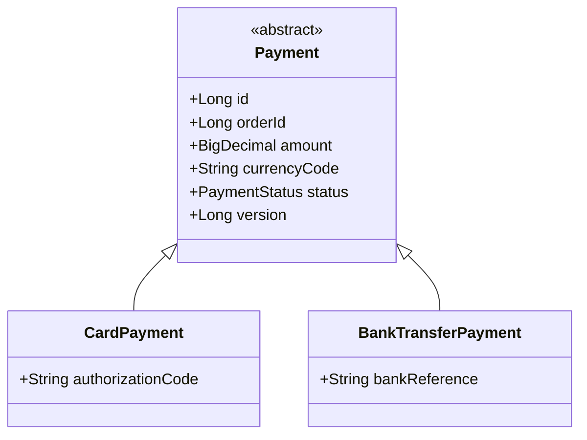
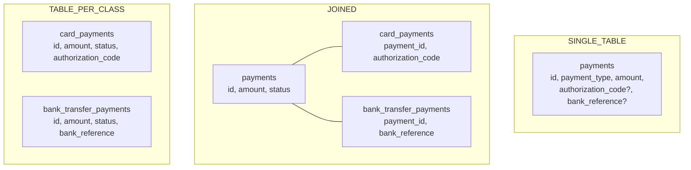
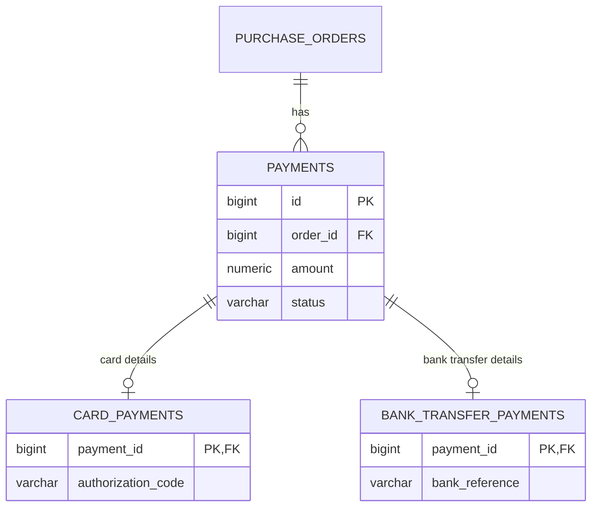
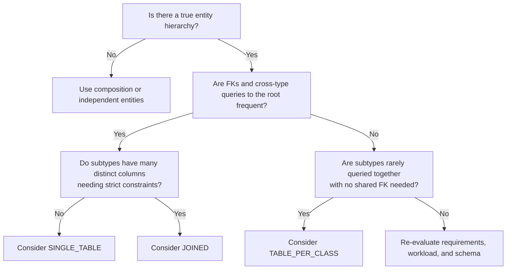

# Choosing Tables for Inheritance: Single Table, Joined Tables, or Table per Concrete Class

In Java, inheritance expresses that multiple objects share common parts while each type carries distinct data or behavior. For example, a payment can be made by card or by bank transfer. Both share an amount, an order, and a status, yet differ in transaction verification details. When storing them in a relational database, a new question emerges: **across how many tables will a class hierarchy be stored, where does the primary key reside, and how do queries across all types work?**

JPA provides three main strategies: **one table for the entire hierarchy** (`SINGLE_TABLE`), **a base table joined with subtype tables** (`JOINED`), and **a separate table per concrete class** (`TABLE_PER_CLASS`). They differ in far more than annotations; each choice impacts key structure, constraint enforcement, polymorphic queries, indexing, consistency, and schema evolution cost.

This lesson belongs to the **Object Mapping** chapter of **DATABASE_DATA_MODELING**. The goal is to translate business requirements into a verifiable data model and then pick an appropriate object mapping, rather than letting a Java inheritance diagram dictate the entire database design. Examples use Java/JPA and PostgreSQL SQL; table names, column names, and ORM-generated SQL should be cross-checked against your target DBMS and provider.

## 1. The Problem: Payments Share a Concept Yet Have Type-Specific Data

Suppose the system supports two payment methods:

- **Card payment** (`CardPayment`): carries a provider authorization code (`authorizationCode`).
- **Bank transfer** (`BankTransferPayment`): carries a bank transaction reference (`bankReference`).

Every payment has `id`, `orderId`, `amount`, `currencyCode`, `status`, and `version` for concurrent update detection. Each payment belongs to **only one** type at recording time. Records are persisted long-term for reconciliation, so the payment type and transaction details must not vanish simply because Java refactors its class structure.



Initial invariants:

1. Amount must be greater than 0, currency code must be specified, and status must belong to the allowed set.
2. Each payment must link to an existing order.
3. For card payments, `authorizationCode` is mandatory; for bank transfers, `bankReference` is mandatory.
4. History queries need to retrieve **all** payments for an order, regardless of subtype.
5. No two rows may represent the same payment identity when querying across the hierarchy.

Points 4 and 5 can change the table choice even when the Java class set is identical. Remember that an *is-a* relationship in Java has no direct equivalent in SQL tables: tables do not natively understand inheritance, method overriding, or runtime type dispatch.

### Three Possible Storage Layouts



These three diagrams represent **three alternative options**, not three table groups coexisting in one design. The sections below compare each option using the same business requirements.

## 2. Single-Table Strategy: `SINGLE_TABLE`

### 2.1. Structure and Role of the Discriminator Column

All entities in the hierarchy share **one table**, `payments`. Common columns appear once; subtype-specific attributes also live in the table, typically taking `NULL` for other types.

```sql
-- Assumes purchase_orders(id) already exists.
-- Option A: create only this table for the entire hierarchy.
CREATE SEQUENCE payment_id_seq;

CREATE TABLE payments (
    id BIGINT PRIMARY KEY,
    order_id BIGINT NOT NULL REFERENCES purchase_orders(id),
    payment_type VARCHAR(24) NOT NULL,
    amount NUMERIC(19, 2) NOT NULL CHECK (amount > 0),
    currency_code CHAR(3) NOT NULL,
    status VARCHAR(20) NOT NULL
        CHECK (status IN ('PENDING', 'SETTLED', 'FAILED')),
    version BIGINT NOT NULL DEFAULT 0,
    authorization_code VARCHAR(100),
    bank_reference VARCHAR(100),
    CONSTRAINT ck_payment_type
        CHECK (payment_type IN ('CARD', 'BANK_TRANSFER')),
    CONSTRAINT ck_required_subtype_fields
        CHECK (
            (payment_type = 'CARD'
             AND authorization_code IS NOT NULL
             AND bank_reference IS NULL)
            OR
            (payment_type = 'BANK_TRANSFER'
             AND bank_reference IS NOT NULL
             AND authorization_code IS NULL)
        )
);

CREATE INDEX idx_payments_order_id ON payments(order_id);
CREATE INDEX idx_payments_status_type ON payments(status, payment_type);
```

Sample data:

| id | order_id | payment_type | amount | status | authorization_code | bank_reference |
|---:|---:|---|---:|---|---|---|
| 11 | 801 | CARD | 150000.00 | SETTLED | AUTH-991 | `NULL` |
| 12 | 802 | BANK_TRANSFER | 250000.00 | PENDING | `NULL` | BANK-887 |

`payment_type` is the **discriminator**: used by the ORM when reading to determine which subtype a row belongs to. Subtype-specific columns must be nullable at the column level because one subtype has no value for another subtype's fields. However, nullable **does not mean lacking business constraints**: `ck_required_subtype_fields` forces the appropriate fields of each type to be populated.

Row-level `CHECK` constraints handle rules like "card type requires an authorization code" well because all fields live in the same row. If the domain involves complex relationships or a growing number of type-specific columns, `CHECK` expressions can become long and hard to maintain.

### 2.2. JPA Mapping

```java
import jakarta.persistence.*;
import java.math.BigDecimal;

@Entity
@Table(name = "payments")
@Inheritance(strategy = InheritanceType.SINGLE_TABLE)
@DiscriminatorColumn(
    name = "payment_type",
    discriminatorType = DiscriminatorType.STRING,
    length = 24
)
public abstract class Payment {

    @Id
    @GeneratedValue(strategy = GenerationType.SEQUENCE, generator = "payment_seq")
    @SequenceGenerator(
        name = "payment_seq",
        sequenceName = "payment_id_seq",
        allocationSize = 1
    )
    private Long id;

    @Column(name = "order_id", nullable = false)
    private Long orderId;

    @Column(nullable = false, precision = 19, scale = 2)
    private BigDecimal amount;

    @Column(name = "currency_code", nullable = false, length = 3)
    private String currencyCode;

    @Enumerated(EnumType.STRING)
    @Column(nullable = false, length = 20)
    private PaymentStatus status;

    @Version
    @Column(nullable = false)
    private Long version;

    protected Payment() {}
}

@Entity
@DiscriminatorValue("CARD")
public class CardPayment extends Payment {
    @Column(name = "authorization_code", length = 100)
    private String authorizationCode;

    protected CardPayment() {}
}

@Entity
@DiscriminatorValue("BANK_TRANSFER")
public class BankTransferPayment extends Payment {
    @Column(name = "bank_reference", length = 100)
    private String bankReference;

    protected BankTransferPayment() {}
}
```

This code illustrates the annotations: business constructors, getters, state-transition methods, and input validation are omitted. `PaymentStatus` is an enum containing `PENDING`, `SETTLED`, and `FAILED`. With the self-managed schema in the PostgreSQL example, you must create **one sequence** `payment_id_seq` before using this ID generation strategy, e.g., `CREATE SEQUENCE payment_id_seq`, or align the generator with your chosen key-generation mechanism.

Important note: subtype-only fields **must not declare `nullable = false` on the shared column**. Doing so can generate `NOT NULL` in DDL for a column that rows of another subtype must leave blank. Per-subtype mandatory rules belong in domain validation and conditional database constraints.

### 2.3. Query Characteristics

Cross-type queries are typically very direct:

```sql
SELECT id, payment_type, amount, currency_code, status
FROM payments
WHERE order_id = :order_id
ORDER BY id;
```

In JPA:

```java
List<Payment> payments = em.createQuery("""
    select p
    from Payment p
    where p.orderId = :orderId
    order by p.id
    """, Payment.class)
    .setParameter("orderId", orderId)
    .getResultList();
```

The ORM instantiates `CardPayment` or `BankTransferPayment` based on the discriminator. No `JOIN` between base and subtype tables is needed because there is only one table.

To fetch only card payments:

```sql
SELECT id, authorization_code
FROM payments
WHERE payment_type = 'CARD'
  AND status = 'SETTLED';
```

When the system reaches millions of payments, consider composite indexes tailored to actual filter patterns and selectivity. For instance, `(status, payment_type)` suits certain reports, while queries by `order_id` benefit from an index on that column. Do not blindly index every column, since each index increases write overhead.

### 2.4. Advantages and Limitations

**Advantages:** fewer tables, simple polymorphic queries, a single primary key space, FKs from other tables can point directly to `payments(id)`; adding a subtype usually just requires new columns and updating the discriminator/constraints.

**Limitations:** if subtypes proliferate and each has many specific fields, the table accumulates many `NULL` columns; subtype-specific mandatory rules become complex; changing types can leave stale data in old columns; a single shared table creates coupling across feature teams.

**Best suited when:** there are few subtypes, most columns are shared, polymorphic queries are frequent, a shared FK to `Payment` is needed, and discriminator-based subtype constraints are manageable.

## 3. Joined-Table Strategy: `JOINED`

### 3.1. Splitting Common and Subtype-Specific Columns

Every `Payment` has one row in the base table `payments`. Each instance of a concrete subtype has **one additional row** in its corresponding subtype table. The subtype table's primary key is simultaneously a foreign key to the base table.

```sql
-- Option B: completely replaces Option A.
CREATE SEQUENCE payment_id_seq;

CREATE TABLE payments (
    id BIGINT PRIMARY KEY,
    order_id BIGINT NOT NULL REFERENCES purchase_orders(id),
    amount NUMERIC(19, 2) NOT NULL CHECK (amount > 0),
    currency_code CHAR(3) NOT NULL,
    status VARCHAR(20) NOT NULL
        CHECK (status IN ('PENDING', 'SETTLED', 'FAILED')),
    version BIGINT NOT NULL DEFAULT 0
);

CREATE TABLE card_payments (
    payment_id BIGINT PRIMARY KEY
        REFERENCES payments(id) ON DELETE CASCADE,
    authorization_code VARCHAR(100) NOT NULL
);

CREATE TABLE bank_transfer_payments (
    payment_id BIGINT PRIMARY KEY
        REFERENCES payments(id) ON DELETE CASCADE,
    bank_reference VARCHAR(100) NOT NULL
);

CREATE INDEX idx_payments_order_id ON payments(order_id);
```

Diagram:



The diagram notation represents a relationship from one base row to *at most one* row in each child table. Domain rules still demand **exactly one subtype** for a complete payment. The two FKs `card_payments.payment_id` and `bank_transfer_payments.payment_id` alone **cannot guarantee** that a base row always has exactly one child row and never appears in both child tables.

### 3.2. JPA Mapping

Keeping the same fields and generator on `Payment` as before, swap the inheritance annotation as follows:

```java
@Entity
@Table(name = "payments")
@Inheritance(strategy = InheritanceType.JOINED)
public abstract class Payment {
    @Id
    @GeneratedValue(strategy = GenerationType.SEQUENCE, generator = "payment_seq")
    @SequenceGenerator(
        name = "payment_seq",
        sequenceName = "payment_id_seq",
        allocationSize = 1
    )
    private Long id;

    @Column(name = "order_id", nullable = false)
    private Long orderId;

    @Column(nullable = false, precision = 19, scale = 2)
    private BigDecimal amount;

    @Column(name = "currency_code", nullable = false, length = 3)
    private String currencyCode;

    @Enumerated(EnumType.STRING)
    @Column(nullable = false, length = 20)
    private PaymentStatus status;

    @Version
    private Long version;

    protected Payment() {}
}

@Entity
@Table(name = "card_payments")
@PrimaryKeyJoinColumn(name = "payment_id")
public class CardPayment extends Payment {
    @Column(name = "authorization_code", nullable = false, length = 100)
    private String authorizationCode;

    protected CardPayment() {}
}

@Entity
@Table(name = "bank_transfer_payments")
@PrimaryKeyJoinColumn(name = "payment_id")
public class BankTransferPayment extends Payment {
    @Column(name = "bank_reference", nullable = false, length = 100)
    private String bankReference;

    protected BankTransferPayment() {}
}
```

Note: this is an **alternative configuration** of the same Java classes, not a second set of identically named entities in the same project. Imports and business methods are omitted. `@PrimaryKeyJoinColumn` specifies the column name in the child table used to join via the primary key; when using default names matching the provider's conventions, the annotation may be optional.

In `JOINED`, subtype columns can directly use `NOT NULL` on the subtype table because rows of other types **never appear** in that table. This is a substantial advantage over single-table mapping when many type-specific fields must be constrained.

### 3.3. Polymorphic Reads and Writes

Inserting a card payment typically corresponds to two SQL steps within the same transaction:

```sql
INSERT INTO payments (id, order_id, amount, currency_code, status, version)
VALUES (nextval('payment_id_seq'), :order_id, 150000.00, 'VND', 'PENDING', 0)
RETURNING id;

INSERT INTO card_payments (payment_id, authorization_code)
VALUES (:generated_payment_id, 'AUTH-991');
```

This illustrates the write logic; exact ID retrieval timing and SQL details depend on the generator/provider. If the transaction rolls back, no orphaned `payments` row without its subtype row may remain. Ensuring one business operation writes both rows atomically is the responsibility of transactions and write logic.

Reading a card payment may require a `JOIN`:

```sql
SELECT p.id, p.order_id, p.amount, p.status, c.authorization_code
FROM payments AS p
JOIN card_payments AS c ON c.payment_id = p.id
WHERE p.id = :payment_id;
```

For a polymorphic query `SELECT p FROM Payment p`, the ORM may join multiple child tables to determine the subtype or emit a different SQL plan. Do not assume it only reads `payments` when the application asks for full subtype objects. For reports needing only common data, a **projection** over the base table lowers cost:

```sql
SELECT order_id, status, SUM(amount) AS total_amount
FROM payments
WHERE currency_code = 'VND'
GROUP BY order_id, status;
```

In this model, joining subtype tables is unnecessary if the report relies solely on base columns.

### 3.4. Cross-Table Integrity

`JOINED` protects several invariants via FKs and `NOT NULL`:

- No `card_payments` row can exist without a corresponding `payments` row.
- `authorization_code` is mandatory for card rows.
- Deleting the base row can delete details via `ON DELETE CASCADE` if retention policies permit.

Watch out for **direct SQL writes**:

```sql
INSERT INTO payments (order_id, amount, currency_code, status)
VALUES (:order_id, 50000, 'VND', 'PENDING');
-- Forgot to insert into child table: ordinary FKs cannot prevent this.
```

A base row with no child row—or with rows in both `card_payments` and `bank_transfer_payments`—could arise if relying solely on the FKs in the example. JPA normally inserts the right child row when persisting properly, but systems with multiple write paths should consider centralized transactional APIs, a discriminator with appropriate verification mechanisms, triggers, or an alternative data design.

In standard SQL, you cannot write a plain `CHECK` on `payments` alone that queries both child tables. Nor should you build intricate constraints just to guard a hierarchy that does not truly need polymorphism. Compare with `SINGLE_TABLE` if subtype integrity must be enforced simply by the database.

### 3.5. Advantages and Limitations

**Advantages:** common columns live in one place, subtype tables have clean `NOT NULL` and specific constraints, adding a subtype barely touches other tables, FKs from other tables can point to `payments(id)`; queries on common columns run directly against the base table.

**Limitations:** writing an entity usually touches multiple tables; reading a full subtype requires a join; polymorphic queries may require multiple joins; the database needs extra mechanisms if it must self-enforce "exactly one child table per base row."

**Best suited when:** subtypes have many distinct fields, strict per-table constraints are required, a shared identity/relationship across the hierarchy is still needed, and polymorphic query frequency does not make join overhead a bottleneck.

## 4. Table-per-Concrete-Class Strategy: `TABLE_PER_CLASS`

### 4.1. Each Concrete Class Gets a Complete Table

In this strategy, a `CardPayment` resides in `card_payments` with **both common and specific columns**. A `BankTransferPayment` resides in `bank_transfer_payments`, also carrying all common columns. With `Payment` declared `abstract`, there is typically no base table holding all payments.

```sql
-- Option C: no shared payments table.
CREATE SEQUENCE payment_id_seq;

CREATE TABLE card_payments (
    id BIGINT PRIMARY KEY,
    order_id BIGINT NOT NULL REFERENCES purchase_orders(id),
    amount NUMERIC(19, 2) NOT NULL CHECK (amount > 0),
    currency_code CHAR(3) NOT NULL,
    status VARCHAR(20) NOT NULL
        CHECK (status IN ('PENDING', 'SETTLED', 'FAILED')),
    version BIGINT NOT NULL DEFAULT 0,
    authorization_code VARCHAR(100) NOT NULL
);

CREATE TABLE bank_transfer_payments (
    id BIGINT PRIMARY KEY,
    order_id BIGINT NOT NULL REFERENCES purchase_orders(id),
    amount NUMERIC(19, 2) NOT NULL CHECK (amount > 0),
    currency_code CHAR(3) NOT NULL,
    status VARCHAR(20) NOT NULL
        CHECK (status IN ('PENDING', 'SETTLED', 'FAILED')),
    version BIGINT NOT NULL DEFAULT 0,
    bank_reference VARCHAR(100) NOT NULL
);

CREATE INDEX idx_card_payments_order_id
    ON card_payments(order_id);
CREATE INDEX idx_bank_payments_order_id
    ON bank_transfer_payments(order_id);
```

Assume all IDs are allocated from the **same sequence**:

```sql
INSERT INTO card_payments (
    id, order_id, amount, currency_code,
    status, authorization_code
)
VALUES (
    nextval('payment_id_seq'), :order_id, 150000, 'VND',
    'PENDING', 'AUTH-991'
);
```

Why allocate IDs from a shared source? Both tables have **separate** primary key constraints, so `card_payments.id = 42` and `bank_transfer_payments.id = 42` are both valid to the database. If the application requires a `Payment` to be uniquely identified across the entire hierarchy by `id` alone, you need a **shared ID space** or a consistently designed `(type, id)` identifier. A shared sequence prevents collisions in standard creation flows, though by itself it does not stop direct SQL from inserting duplicate IDs across both tables. This is a cross-table integrity limitation to keep in mind.

### 4.2. JPA Mapping

```java
@Entity
@Inheritance(strategy = InheritanceType.TABLE_PER_CLASS)
public abstract class Payment {

    @Id
    @GeneratedValue(strategy = GenerationType.SEQUENCE, generator = "payment_seq")
    @SequenceGenerator(
        name = "payment_seq",
        sequenceName = "payment_id_seq",
        allocationSize = 1
    )
    private Long id;

    @Column(name = "order_id", nullable = false)
    private Long orderId;

    @Column(nullable = false, precision = 19, scale = 2)
    private BigDecimal amount;

    @Column(name = "currency_code", nullable = false, length = 3)
    private String currencyCode;

    @Enumerated(EnumType.STRING)
    @Column(nullable = false, length = 20)
    private PaymentStatus status;

    @Version
    private Long version;

    protected Payment() {}
}

@Entity
@Table(name = "card_payments")
public class CardPayment extends Payment {
    @Column(name = "authorization_code", nullable = false, length = 100)
    private String authorizationCode;

    protected CardPayment() {}
}

@Entity
@Table(name = "bank_transfer_payments")
public class BankTransferPayment extends Payment {
    @Column(name = "bank_reference", nullable = false, length = 100)
    private String bankReference;

    protected BankTransferPayment() {}
}
```

These classes are illustrative variants omitting imports and business constructors. In JPA, `TABLE_PER_CLASS` is declared on the root entity, while root data is repeated in each concrete subclass table. If the root entity is **non-abstract**, it may also have its own table for direct root instances; the example deliberately makes the root abstract to prevent an ambiguous "generic payment" without a method.

**Regarding ID generation:** avoid defaulting to independent per-table auto-increment `IDENTITY` columns and then assuming `id` is unique across all subtypes. A hierarchy-wide sequence or application-generated UUID is usually better suited, and you must verify how your provider supports the chosen generation strategy.

### 4.3. Concrete Queries and Polymorphic Queries

When a report only cares about card payments, the query is very simple:

```sql
SELECT id, order_id, amount, authorization_code
FROM card_payments
WHERE status = 'SETTLED';
```

When viewing all payments, the database must combine sources:

```sql
SELECT id, order_id, amount, currency_code, status,
       'CARD' AS payment_type
FROM card_payments
WHERE order_id = :order_id
UNION ALL
SELECT id, order_id, amount, currency_code, status,
       'BANK_TRANSFER' AS payment_type
FROM bank_transfer_payments
WHERE order_id = :order_id;
```

`UNION ALL` preserves all rows; use it when the two tables represent disjoint subtypes. To sort the combined result, add `ORDER BY` outside the unioned query. The ORM may generate `UNION`/`UNION ALL` or different SQL depending on the provider; never assume polymorphic queries are as cheap as reading a single table.

A total-amount report must keep currencies separate:

```sql
SELECT currency_code, SUM(amount) AS total_amount
FROM (
    SELECT currency_code, amount
    FROM card_payments
    WHERE status = 'SETTLED'
    UNION ALL
    SELECT currency_code, amount
    FROM bank_transfer_payments
    WHERE status = 'SETTLED'
) AS all_payments
GROUP BY currency_code;
```

Never sum VND and USD into a single number without explicit currency conversion rules.

### 4.4. The Shared Foreign Key Problem

Suppose you need `refunds.payment_id` to point to **any** payment. With `SINGLE_TABLE` and `JOINED`, an FK can point to `payments(id)`. With `TABLE_PER_CLASS`, **there is no shared `payments` table**, so you cannot write:

```sql
-- Cannot be used when no payments table exists:
-- FOREIGN KEY (payment_id) REFERENCES payments(id)
```

A standard relational FK cannot express "this key must exist in **one of two** tables." Alternatives include switching to a shared base table, introducing an identity/registry table, using a `(payment_type, payment_id)` pair with custom enforcement, or splitting separate FKs per type. Every alternative involves trade-offs in integrity and querying.

Therefore, if many tables in the system must reference a **generic Payment**, `TABLE_PER_CLASS` is usually a poor fit even though single-subtype queries look tidy. This is a **data modeling** decision that annotations alone cannot fix.

### 4.5. Advantages and Limitations

**Advantages:** each type's table is self-contained with its own constraints, has no columns belonging only to other subtypes, and queries on a single subtype need no hierarchy joins.

**Limitations:** common columns and constraints are duplicated across tables; polymorphic queries require unions; adding a subtype forces updating combined reports; no simple FK to the root; difficult to guarantee hierarchy-wide ID uniqueness using standard DDL alone.

**Best suited when:** subtypes are rarely queried together, few relationships need to reference the root, lifecycles and query volumes differ markedly per type, and the team is prepared to maintain duplicated common schema definitions.

## 5. Comparison Table of the Three Strategies

| Criterion | `SINGLE_TABLE` | `JOINED` | `TABLE_PER_CLASS` |
|---|---|---|---|
| Table layout | One table for the whole hierarchy | Base table + one table per subtype | One complete table per concrete subtype |
| Common columns | Stored once | Stored once in base table | Duplicated in every concrete table |
| Subtype-specific columns | Same table, usually nullable | Separate table, can be `NOT NULL` | Separate table, can be `NOT NULL` |
| Discriminator needed | Yes, to identify type | Optional, not always required | No shared column; type inferred from table |
| Writing one subtype | Usually one row | Base row + subtype row | One row in subtype table |
| Querying one full subtype | One table | Join base and subtype tables | One table |
| Querying whole hierarchy | Simple on one table | May need joining multiple child tables | Typically unions across tables |
| FK to shared root | Convenient | Convenient | No shared target table |
| Subtype field constraints | Discriminator-based `CHECK` | `NOT NULL` and constraints on child table | `NOT NULL` and constraints on each table |
| Adding a subtype | Add columns/constraints if subtype has new fields | Add child table | Add concrete table, update union queries/integrations |
| Primary risks | Sparse null columns and complex constraints | Join overhead; base/child rows can drift if written outside ORM | Schema duplication; union queries; hard polymorphic FKs |

No strategy can be ranked fastest in every scenario. Performance depends on cardinality, row width, indexes, subtype distribution, query shapes, caching, and actual query plans. The comparison table helps form an **initial hypothesis**; verify it with representative data.

### Making Decisions Based on Queries and Invariants



This flowchart guides you to ask the right questions, not as a rigid rule. Some hierarchies prioritize absolute correctness and evolvability over optimizing a single query; other systems only query subtypes independently and should avoid adding an unnecessary base table.

## 6. Is Inheritance Actually the Right Domain Model?

Before choosing annotations, check whether the **"is-a"** relationship is stable. If a payment can switch processing methods multiple times, or always carries the same data except for provider configuration, using multiple subtypes can make the schema harder to evolve without delivering genuine behavioral differences.

### 6.1. One Entity with a Type Column and Composition

When types are very similar, you may only need:

```java
@Entity
public class Payment {
    @Id
    private Long id;

    @Enumerated(EnumType.STRING)
    private PaymentMethod method;

    // Common fields; method-specific details can be value objects.
}
```

This design avoids JPA inheritance: `Payment` is one entity with a `method` attribute, holding details via composition. It still requires deciding how to store method-specific fields, yet avoids forcing every minor variation into a subclass.

### 6.2. Using `@MappedSuperclass` When You Only Want Mapping Reuse

A common confusion: `@MappedSuperclass` is **not an entity inheritance strategy with polymorphic queries**.

```java
@MappedSuperclass
public abstract class AuditedRecord {
    @Column(name = "created_at", nullable = false)
    private Instant createdAt;
}

@Entity
@Table(name = "card_payments")
public class CardPayment extends AuditedRecord {
    @Id
    private Long id;
}
```

Here, `created_at` is mapped into `card_payments`, yet `AuditedRecord` is not an entity with its own table. You cannot query `AuditedRecord` via `em.find(AuditedRecord.class, id)` or target a JPA association at it as a polymorphic entity. `@MappedSuperclass` is meant for **reusing column and mapping definitions**, not representing a shared queryable entity set.

Do not equate `TABLE_PER_CLASS` with `@MappedSuperclass`. Both place common fields into child tables, yet `TABLE_PER_CLASS` is true **entity inheritance** with a root entity and polymorphic query semantics; `@MappedSuperclass` merely passes field mappings down to subclasses.

### 6.3. When to Use an Associative Entity or Composition?

If a payment goes through multiple verification steps, each with its own status and history, you can model `Payment` + `PaymentAttempt` or `PaymentMethodDetails` rather than a deep inheritance hierarchy. If processing methods change dynamically by configuration, composition is usually more flexible than inheritance.

**Choosing a class hierarchy must start from domain invariants and lifecycles**; do not create subtypes solely to avoid nullable columns or because data can be grouped by an enum.

## 7. Keys, Discriminators, and Referential Constraints

### 7.1. Primary Key Across the Hierarchy

In `SINGLE_TABLE` and `JOINED`, a `payments(id)` row provides a shared identity space, convenient when a `Refund` or `PaymentEvent` points to any payment.

```sql
CREATE TABLE payment_events (
    id BIGINT GENERATED ALWAYS AS IDENTITY PRIMARY KEY,
    payment_id BIGINT NOT NULL REFERENCES payments(id),
    event_type VARCHAR(40) NOT NULL,
    occurred_at TIMESTAMP NOT NULL
);
```

With `JOINED`, the FK only verifies that the base row exists; correctness of the subtype row still relies on transactional operations and extra safeguards if multiple writers exist.

In `TABLE_PER_CLASS`, without a root table, this DDL cannot be applied directly. An alternative is using a composite key `(payment_type, payment_id)` with per-type lookup tables or validation procedures, though that is more complex than a normal FK and must be designed carefully during integration.

### 7.2. Discriminators Need Not Be Business Attributes

`payment_type` in `SINGLE_TABLE` tells the ORM which Java class to instantiate. Business users may call payment types "card" or "bank transfer," yet **the discriminator is a storage convention**. Renaming the `CardPayment` class should not force changing stored values if a stable value like `CARD` is set via `@DiscriminatorValue`.

Changing `CARD` to `CREDIT_CARD` requires a data migration and updating constraints, views, reports, APIs, or consumers relying on the old code. Never assume refactoring a class name automatically updates table data.

### 7.3. Database Inheritance Constraints Are Not Always Symmetric

| Invariant | `SINGLE_TABLE` | `JOINED` | `TABLE_PER_CLASS` |
|---|---|---|---|
| Every payment has a unique ID | PK on one table | PK on base table, PK/FK on child | PK per table; needs shared rule if ID must be hierarchy-unique |
| Type belongs to allowed set | `CHECK(payment_type IN ...)` | Enforced by child tables or discriminator/extra rules | Determined by concrete table |
| Card authorization code mandatory | Conditional `CHECK` | `NOT NULL` on `card_payments` | `NOT NULL` on `card_payments` |
| Only one subtype per entity | Discriminator-based `CHECK` | FKs alone do not guarantee exactly one child table | One row per type table; cross-table IDs need governance |
| FK from external entity to any payment | FK to `payments` | FK to `payments` | No FK to root without a shared table |

Key point: **annotations do not replace actual constraints**. If the ORM auto-generates schemas in development while production uses separate migrations, verify that production schemas actually include the expected PKs, FKs, `CHECK`s, and `UNIQUE` constraints.

## 8. Performance: Choose from Workload, Not Table Count

### 8.1. Common Query Patterns

Suppose a workload consists of:

- 70%: fetch details of a single payment by ID.
- 20%: aggregate amounts across all types by date/status.
- 10%: fetch method-specific fields.

These are **illustrative assumptions**; real ratios must be measured. For workloads heavy on cross-type queries, `SINGLE_TABLE` is often convenient. `JOINED` can perform well when reports only need base columns, though it incurs join costs when loading full subtype objects. `TABLE_PER_CLASS` complicates cross-type reporting due to table unions.

In a system where 95% of queries read only `CardPayment` with just one nightly cross-hierarchy reconciliation job, table-per-concrete-class may be worth considering. However, if other business tables need a shared FK to `Payment`, subtype query benefits must be weighed against referential integrity complexity.

### 8.2. Indexes and Query Plans

- `SINGLE_TABLE`: consider indexes on `order_id`, status, date, and discriminator if the workload frequently filters by type.
- `JOINED`: base table needs indexes for filters; PK/FK on child tables usually support key joins. Avoid joining all subtypes when only common-column projections are needed.
- `TABLE_PER_CLASS`: each table needs indexes tuned to its own workload; `UNION ALL` queries can scan multiple tables, and adding subtypes adds branches to the union.

Measure using `EXPLAIN (ANALYZE, BUFFERS)` in PostgreSQL on representative datasets. Inspect JPA query counts, latency, rows scanned, table size, index overhead, and write times. Never deduce performance purely from the strategy name.

### 8.3. Difference Between Entity Queries and Projections

JPQL:

```java
// Polymorphic query: results include both CardPayment and BankTransferPayment.
List<Payment> entities = em.createQuery(
    "select p from Payment p where p.status = :status",
    Payment.class
).setParameter("status", PaymentStatus.SETTLED)
 .getResultList();
```

When loading entities, the provider must reconstruct the exact subtype and its state. If a screen only needs `id`, `amount`, and `status`, a DTO projection or SQL query selecting only those columns saves work, especially under `JOINED` and `TABLE_PER_CLASS`. Projection optimization varies by provider; inspect the generated SQL.

### 8.4. Polymorphic Pagination

With `SINGLE_TABLE`, hierarchy-wide pagination is usually simpler in SQL. With `JOINED`, subtype joins can make plans heavier. With `TABLE_PER_CLASS`, consistent pagination across multiple tables requires sorting the **entire combined set**, not blindly taking the top 20 rows from each table and concatenating them.

Always specify a deterministic sort order, such as `ORDER BY created_at DESC, id DESC`, and consider keyset pagination for very large datasets when required. Timestamp fields must exist in the actual schema; `created_at` here is an illustrative suggested column not shown in the earlier sample DDL.

## 9. Schema Evolution When Adding a New Subtype

Suppose six months later `WalletPayment` is introduced with `walletProvider` and `providerTransactionId`.

| Strategy | Main Schema Steps |
|---|---|
| `SINGLE_TABLE` | Add nullable specific columns; extend discriminator and `CHECK`; add indexes if workload needs them |
| `JOINED` | Create `wallet_payments(payment_id PK/FK, ...)`; update mapping and business logic |
| `TABLE_PER_CLASS` | Create `wallet_payments` with all common + specific columns; update combined reports, ID generator, and reference flows |

All options require migrations and testing against existing data. The difference lies in **blast radius**: `SINGLE_TABLE` widens the shared table; `JOINED` adds a child table; `TABLE_PER_CLASS` must keep common columns consistent across all concrete tables and every aggregate query.

### 9.1. Migrating from `SINGLE_TABLE` to `JOINED`

For example, when the `payments` table accumulates too many subtype-specific columns and subtype constraints become hard to maintain, you can migrate to `JOINED` in steps:

1. **Map existing data:** audit `payment_type` distribution, abnormal null combinations, rows not fitting any subtype, and apps or reports reading specific columns.
2. **Design child tables:** create `card_payments` and `bank_transfer_payments` with PK/FK, choosing which columns move and adding appropriate constraints.
3. **Backfill data:** copy specific columns into child tables by ID from the old table; reconcile row counts by type, verifying zero lost records and zero key collisions.
4. **Synchronize writers during transition:** choose a maintenance window or controlled dual-write mechanism; avoid having new app code read child tables while legacy paths only write to the base table.
5. **Switch mappings and queries:** deploy `JOINED` entities, update reports and custom queries, and verify optimistic locking, FKs, and insert/delete ordering.
6. **Verify and clean up legacy structure:** drop old columns/discriminator or compatibility layers only after data and all consumers have moved to the new read path.

This is a migration framework, not a blind script to run as-is. Zero-downtime systems require multi-version compatibility, batched backfills, race handling, and solid rollback plans. Changing annotations **does not** automatically migrate data from base-table columns into subtype tables.

### 9.2. Class Refactoring Is Not Database Migration

A Java refactor can split `Payment` into multiple subtypes or rename classes while keeping the schema unchanged through mapping configuration. Conversely, changing inheritance strategies can require major physical schema changes even if the Java API looks nearly identical.

Because data outlives a single application deployment, manage schemas through versioned migrations and verify against real data. Never rely on automatic schema-update features to replace migration planning for important data.

## 10. Verifying Mapping and Integrity

A strategy is only suitable when it is **domain-accurate, properly constrained, and meets workload targets**. Direct verification checks:

| Check | Expected Outcome |
|---|---|
| Persist a `CardPayment` then reload via `Payment` | Returns the right subtype and attribute values |
| Persist a `BankTransferPayment` | Type-specific fields saved, no type mix-up |
| Query `SELECT p FROM Payment p` | Returns all valid subtypes |
| Query only `CardPayment` | Does not pull bank transfer rows |
| Insert `0` or negative amount via SQL | DB rejects via `CHECK` |
| Insert card payment missing `authorization_code` | DB rejects via chosen constraint |
| Insert non-existent `order_id` | DB rejects via FK |
| Insert same ID into multiple tables in `TABLE_PER_CLASS` | Must have detection/prevention policy if hierarchy-wide ID uniqueness is required |
| Delete base row in `JOINED` | Child details handled per retention policy |
| Cross-type query over millions of payments | Measure actual query plan, latency, and index usage |
| Add a new subtype | Legacy data still readable; combined queries and constraints updated |
| Two transactions edit the same payment | `@Version` or appropriate locking detects conflict |

### A JPA Polymorphic Query Test

```java
// Sketch inside a test transaction, assuming business constructors exist.
CardPayment card = createValidCardPayment(orderId, "AUTH-991");
BankTransferPayment bank = createValidBankPayment(orderId, "BANK-887");

em.persist(card);
em.persist(bank);
em.flush();
em.clear(); // Detach managed instances to verify read-back mapping.

List<Payment> result = em.createQuery("""
    select p
    from Payment p
    where p.orderId = :orderId
    """, Payment.class)
    .setParameter("orderId", orderId)
    .getResultList();

// Assert count is 2 and runtime types match.
```

`createValidCardPayment`/`createValidBankPayment` are hypothetical test helpers, not built-in JPA APIs. When testing against the database, run inside an appropriate transaction; to verify committed state, use a fresh transaction and persistence context.

### What to Inspect in SQL Logs

**`SINGLE_TABLE`:** are card and bank transfer entities inserted into the same table? Does the discriminator hold the right value? Do root queries filter, sort, and use indexes as expected?

**`JOINED`:** does inserting a payment write both base and child tables? Does it join on the right key? After rollback, is any partial data left behind? Do common-column projections avoid unnecessary joins?

**`TABLE_PER_CLASS`:** do IDs share a generator? Do root queries perform reasonable unions? Do combined reports cover new subtypes? Do references using `payment_id` guarantee referential validity?

## 11. Common Mistakes

**"Every subclass must have its own table."** `SINGLE_TABLE` stores all subtypes in one table. The class tree does not dictate table count.

**"`JOINED` is always more normalized and better than `SINGLE_TABLE`."** It separates subtype data more cleanly, yet can increase join count, write statements, and the complexity of enforcing exactly one subtype.

**"Single-table design cannot enforce subtype field constraints."** Conditional `CHECK` constraints based on the discriminator plus application validation work well; constraints simply get unwieldy as subtypes multiply.

**"Put `@Column(nullable = false)` on every child field in `SINGLE_TABLE`."** This causes conflicts because other subtypes require that column to be null.

**"`TABLE_PER_CLASS` comes with a shared FK to the root."** Without a shared base table, standard FKs cannot reference all concrete tables at once.

**"Independent auto-increment IDs per `TABLE_PER_CLASS` table are harmless."** They can produce duplicate IDs across the hierarchy, making polymorphic queries or associations ambiguous if the design relies on ID alone.

**"`@MappedSuperclass` and `TABLE_PER_CLASS` are the same thing."** One only reuses mappings; the other is entity inheritance with polymorphic query semantics.

**"Changing the annotation is enough to migrate data."** Switching strategies usually requires migrating tables, indexes, FKs, legacy data, and reports.

**"Java types already separate subclasses, so SQL checks aren't needed."** Direct SQL, import jobs, or other apps can insert bad data; storage invariants must be guarded in the DB at the appropriate level.

**"Fewer tables is always the fastest way to query."** Very wide tables also carry overhead; a well-indexed subtype table can be fast for subtype-specific queries. Always measure.

## 12. Process for Choosing a Strategy for a New Hierarchy

**Step 1 — Write down use cases and invariants.** Which types have distinct data, do they share one business identity, can an object switch types, and which types need separate history?

**Step 2 — Identify primary queries.** Are cross-type queries frequent or mostly subtype-specific? Which fields need filtering, pagination, or aggregation? What row counts and subtype distributions are expected?

**Step 3 — Map keys and references from other tables.** Do `Refund`, `PaymentEvent`, or `Order` need an FK to any `Payment`? If so, favor a shared identity protected by the database.

**Step 4 — List per-type constraints.** Mandatory columns, specialized relationships, candidate keys, hierarchy-wide vs. per-subtype uniqueness, deletion policies, and states.

**Step 5 — Compare the three physical schemas.** Sketch tables, PK/FKs, discriminators, nullability, indexes, and SQL for key queries; do not compare annotations alone.

**Step 6 — Build controlled Java/JPA mappings.** Pick the matching `@Inheritance`; verify `@DiscriminatorValue`, `@Table`, keys and ID generation, transactions, and versioning.

**Step 7 — Test bidirectionally.** Save from Java and reload via both root and subtype; run valid/invalid SQL writes and check ORM behavior; verify polymorphic query results.

**Step 8 — Benchmark performance and plan evolution.** Benchmark with realistic data, inspect query plans, and plan scenarios for adding future subtypes or changing constraints.

## 13. Design Exercise

An asset management platform tracks three categories:

- `LaptopAsset`: serial number, CPU/RAM specs, warranty.
- `VehicleAsset`: license plate, VIN/chassis number, inspection date.
- `SoftwareLicenseAsset`: vendor, license type, expiration date.

Every asset has `assetId`, `ownerDepartmentId`, `purchaseDate`, `purchaseCost`, and `status`. The system has a `maintenance_tickets` table referencing **any type of asset**. Monthly reports aggregate asset purchase cost by department and status. IT frequently queries laptops and licenses separately; Operations queries vehicles separately.

Answer these questions:

1. Which requirements make `TABLE_PER_CLASS` inconvenient?
2. Should you choose `SINGLE_TABLE` or `JOINED` if each asset category has 20–30 distinct mandatory attributes?
3. Design PK/FK for `maintenance_tickets` to guarantee a ticket cannot reference a non-existent asset.
4. If choosing `SINGLE_TABLE`, what constraints ensure laptops have serial numbers while vehicles do not require them?
5. If choosing `JOINED`, which SQL queries should be inspected for general reports and asset details?
6. If `IoTDeviceAsset` is added a year later, how does migration differ across the three strategies?
7. If polymorphic behavior in Java is not needed, is there a simpler model than entity inheritance?

### Solution Guide

- Because `maintenance_tickets` must FK to any asset type, a shared root table is far more convenient than validating references across multiple concrete tables. Combined reporting also avoids broad union logic.
- When each subtype has many mandatory type-specific fields, `JOINED` is usually a strong candidate: specific fields can be `NOT NULL` on child tables while `assets` holds the shared identity and columns for reporting. Still measure join overhead.
- Place `assets(id PK)` on the root, and `maintenance_tickets.asset_id NOT NULL REFERENCES assets(id)`; with `JOINED`, each subtype table holds `asset_id PK/FK` to the root.
- With `SINGLE_TABLE`, use `asset_type` and conditional `CHECK` constraints per type; fields not belonging to the active type can be null. Serial numbers can have a subtype-scoped partial `UNIQUE` index if business rules require it and the DB supports it.
- With `JOINED`, department/status reports can read `assets` directly; laptop details join `assets` with `laptop_assets`. Polymorphic entity queries may join multiple subtypes depending on the provider.
- Adding a subtype: single table requires adding columns/constraints; joined adds a child table; table-per-class requires creating a full table and extending all combined queries/reference flows.
- If only data varies by a type code without true polymorphic behavior, you can use a single `Asset` entity with a type and components/value objects, or independent tables with a shared read model. Weigh integrity and query needs before deciding.

## 14. Key Takeaways

**`SINGLE_TABLE` favors a single identity space and simple cross-type queries; `JOINED` favors clean subtype tables with dedicated constraints at the cost of joins; `TABLE_PER_CLASS` favors independent tables per type while complicating polymorphic queries and shared FKs.** Each can be right in the proper context.

Before picking an inheritance strategy, define **entities and identity**, **per-subtype invariants**, **referencing relationships**, **query workload**, and **schema evolvability**. Then verify with PK/FK/`CHECK` constraints, ORM-generated SQL, and test data. A sound mapping keeps the Java model expressive, lets the database protect data integrity, and allows the system to evolve as business requirements grow.
