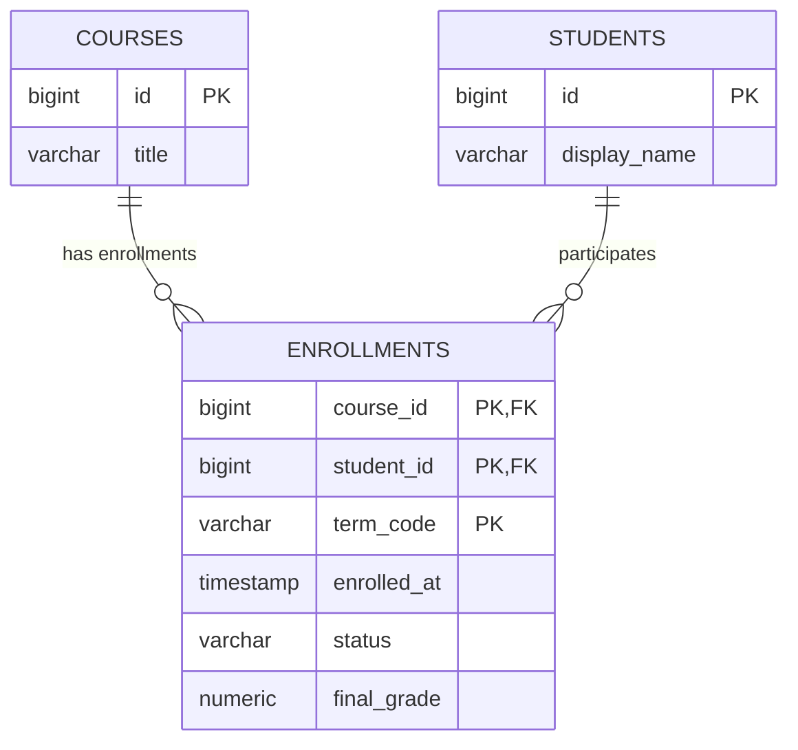
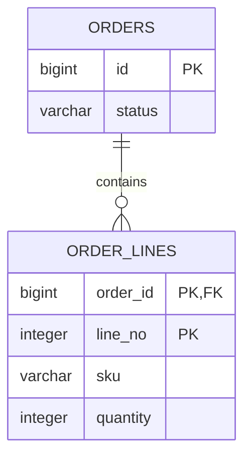

# Designing Composite Keys and Derived Identity from Model Requirements

In the relational model, a record can be identified by **a single column** or by **a combination of multiple columns**. For instance, code `SKU-01` may only be unique within one store; a student may enroll in the same course across different terms; order line 3 only has meaning when you know which order it belongs to. These cases raise two important questions:

1. Is a **composite key** necessary to express unique identity within the business scope?
2. Does **dependent/derived identity** arise when a child record's identifier contains the parent record's key?

In Java, an `Enrollment` or `OrderLine` object is still an ordinary instance. In SQL, its identity may be `(course_id, student_id, term_code)` or `(order_id, line_no)`. With JPA, we must represent composite identity using `@EmbeddedId` or `@IdClass`, and decide when an association to a parent entity participates in the key via `@MapsId`.

This lesson belongs to the **Object Mapping** chapter of **DATABASE_DATA_MODELING**. The goal is to turn business requirements into consistent keys, relationships, constraints, indexes, and ORM mappings; recognize trade-offs when choosing natural, composite, or surrogate keys; and verify the design with data, queries, transactions, and a schema evolution plan.

## 1. Start with the Question: "What Makes This Record Unique?"

Consider three cases:

| Entity | Identification per Requirements | Potential Candidate Key |
|---|---|---|
| Store product | One SKU unique within **each store** | `(store_id, sku)` |
| Course enrollment | One student enrolling in one course within **each term** | `(course_id, student_id, term_code)` |
| Order line | Line number `line_no` belonging to **a specific order** | `(order_id, line_no)` |

In the product example, stores A and B may both use SKU `BOOK-01`. Hence `sku` alone does not identify products system-wide. A composite key `(store_id, sku)` clarifies the uniqueness scope; a single-column key `product_id` can also serve as the primary key, yet a unique constraint is still needed for the business combination.

In the course enrollment example, if a student is allowed to retake the same course in another term, `(course_id, student_id)` is **no longer the key** for each enrollment. You must add the term or another enrollment identifier per requirements.

In the order line example, `line_no = 3` carries no standalone meaning; only `(order_id = 91, line_no = 3)` identifies a specific position. However, if users are free to reorder lines, `line_no` can change. You must then evaluate: is it truly a **stable identity** of the line, or merely a positional attribute?

### Distinguishing Easily Confused Concepts

| Concept | Function | Example |
|---|---|---|
| **Candidate key** | Minimal set of attributes uniquely identifying a record per business rules | `(store_id, sku)` |
| **Primary key (PK)** | Candidate key chosen as the table's main identifier | `PRIMARY KEY (course_id, student_id, term_code)` |
| **Surrogate key** | Technical identifier not derived from business attributes | `enrollment_id BIGINT` |
| **Foreign key (FK)** | Enforces references to an allowed key in another table | `enrollments.course_id → courses.id` |
| **Composite key** | Key spanning multiple columns; can be a PK, UNIQUE, or FK | `(tenant_id, customer_id)` |
| **Derived/dependent identity** | Entity identity containing the identity of a referenced parent entity | `OrderLineId(orderId, lineNo)` |
| **Composite index** | Query access structure over multiple columns | `INDEX (course_id, term_code)` |

**A composite key and a composite index are not synonymous.** A non-unique index on `(course_id, term_code)` only speeds up lookups; it does not enforce that a student enrolls only once. Conversely, `PRIMARY KEY(course_id, student_id, term_code)` is the table's identification rule, typically backed by a unique index in the database.

## 2. Using Course Enrollment Requirements to Design a Composite Key

Suppose an online learning platform has these requirements:

- Each `Course` and `Student` exists independently with its own ID.
- A student can enroll in the same course across multiple terms such as `2026-FALL` and `2027-SPRING`.
- Within a single term, a student has **at most one** enrollment record per course.
- An enrollment record has `enrolled_at`, `status`, and `final_grade`.
- When status transitions from `ACTIVE` to `CANCELLED`, it remains **the same record**; a new row must not be created automatically.

Here, `Enrollment` is not merely a pure many-to-many link: it has its own state and business lifecycle. The candidate identity of an enrollment is `(course_id, student_id, term_code)`.



### 2.1. SQL Schema with a Composite Primary Key

PostgreSQL example:

```sql
CREATE TABLE courses (
    id BIGINT GENERATED ALWAYS AS IDENTITY PRIMARY KEY,
    title VARCHAR(200) NOT NULL
);

CREATE TABLE students (
    id BIGINT GENERATED ALWAYS AS IDENTITY PRIMARY KEY,
    display_name VARCHAR(200) NOT NULL
);

CREATE TABLE enrollments (
    course_id BIGINT NOT NULL,
    student_id BIGINT NOT NULL,
    term_code VARCHAR(20) NOT NULL,
    enrolled_at TIMESTAMP NOT NULL,
    status VARCHAR(20) NOT NULL
        CHECK (status IN ('ACTIVE', 'COMPLETED', 'CANCELLED')),
    final_grade NUMERIC(5, 2),
    PRIMARY KEY (course_id, student_id, term_code),
    CONSTRAINT fk_enrollment_course
        FOREIGN KEY (course_id) REFERENCES courses(id),
    CONSTRAINT fk_enrollment_student
        FOREIGN KEY (student_id) REFERENCES students(id),
    CONSTRAINT ck_enrollment_grade
        CHECK (final_grade IS NULL
               OR (final_grade >= 0 AND final_grade <= 100))
);

CREATE INDEX idx_enrollment_student_term
    ON enrollments(student_id, term_code);
```

The schema expresses two **distinct** protections:

1. Two FKs ensure the referenced course and student exist.
2. The composite PK ensures no two records share the same `(course_id, student_id, term_code)` triple.

There is no need to add `UNIQUE(course_id, student_id, term_code)` redundantly because the primary key already protects that triple. The PK also forces all participating columns to be non-`NULL`. `status` and `final_grade` are **mutable state** and must not be included in the key identifying the enrollment.

Example:

| course_id | student_id | term_code | status |
|---:|---:|---|---|
| 10 | 51 | 2026-FALL | ACTIVE |
| 10 | 51 | 2027-SPRING | ACTIVE |
| 10 | 52 | 2026-FALL | CANCELLED |

The first two rows are valid because the same student and course appear in different terms. Inserting a fourth row with `(10, 51, 2026-FALL)` again will be rejected by the PK, regardless of the new `status`.

### 2.2. When Is the Key Combination Insufficient?

Suppose a student is allowed to re-enroll **multiple times within the same term** after cancelling. The rule "one record per triple" no longer holds. Options to consider:

- Add `attempt_no` to the key: `(course_id, student_id, term_code, attempt_no)`.
- Assign a stable `enrollment_id` to each attempt and place `UNIQUE` matching active rules.
- Separate `Enrollment` (student–course–term relation) and `EnrollmentAttempt` (individual attempts) if both concepts meaningfully exist.

Do not blindly choose `attempt_no` or a surrogate ID without clarifying whether cancelling and re-enrolling counts as **reopening the same record** or **a completely separate attempt**. That is a domain decision affecting primary keys and data history.

## 3. Mapping Composite Keys with `@Embeddable` and `@EmbeddedId`

JPA allows grouping composite PK components into **one identifier class**. This class is annotated with `@Embeddable`, and the entity uses `@EmbeddedId`.

### 3.1. What Properties Does the Identifier Class Need?

A proper `EnrollmentId` contains `courseId`, `studentId`, and `termCode`:

```java
import jakarta.persistence.Column;
import jakarta.persistence.Embeddable;
import java.io.Serializable;
import java.util.Objects;

@Embeddable
public class EnrollmentId implements Serializable {

    @Column(name = "course_id", nullable = false)
    private Long courseId;

    @Column(name = "student_id", nullable = false)
    private Long studentId;

    @Column(name = "term_code", length = 20, nullable = false)
    private String termCode;

    protected EnrollmentId() {
        // JPA requires a no-arg constructor.
    }

    public EnrollmentId(Long courseId, Long studentId, String termCode) {
        this.courseId = Objects.requireNonNull(courseId);
        this.studentId = Objects.requireNonNull(studentId);
        this.termCode = Objects.requireNonNull(termCode);
        if (termCode.isBlank()) {
            throw new IllegalArgumentException("Term code must not be blank");
        }
    }

    public Long getCourseId() { return courseId; }
    public Long getStudentId() { return studentId; }
    public String getTermCode() { return termCode; }

    @Override
    public boolean equals(Object other) {
        if (this == other) return true;
        if (!(other instanceof EnrollmentId)) return false;
        EnrollmentId that = (EnrollmentId) other;
        return Objects.equals(courseId, that.courseId)
                && Objects.equals(studentId, that.studentId)
                && Objects.equals(termCode, that.termCode);
    }

    @Override
    public int hashCode() {
        return Objects.hash(courseId, studentId, termCode);
    }
}
```

Key requirements for a JPA ID class:

- Must be `Serializable` per JPA rules.
- Must have a no-arg constructor with suitable visibility for the provider; `protected` usually works.
- Must implement `equals()`/`hashCode()` based on **exactly the key components**, consistent with the comparison semantics of the column types.
- Key components must remain stable after the entity is persisted. Never expose arbitrary public setters for `courseId`, `studentId`, or `termCode`.
- Length, term-code normalization, casing, and string comparison rules must match the database. For example, the constructor above does not normalize `termCode`; a real system needs an explicit policy.

Never put `status`, `enrolledAt`, or `finalGrade` inside `EnrollmentId`. They change during the record's lifecycle and do not participate in the PK. A key object should be small, stable, and used to pass/compare identity rather than holding a large entity graph.

### 3.2. Entity with `@EmbeddedId`

```java
import jakarta.persistence.*;
import java.math.BigDecimal;
import java.time.LocalDateTime;
import java.util.Objects;

@Entity
@Table(name = "enrollments")
public class Enrollment {

    @EmbeddedId
    private EnrollmentId id;

    @Column(name = "enrolled_at", nullable = false)
    private LocalDateTime enrolledAt;

    @Column(nullable = false, length = 20)
    private String status;

    @Column(name = "final_grade", precision = 5, scale = 2)
    private BigDecimal finalGrade;

    protected Enrollment() {}

    public Enrollment(EnrollmentId id, LocalDateTime enrolledAt) {
        this.id = Objects.requireNonNull(id);
        this.enrolledAt = Objects.requireNonNull(enrolledAt);
        this.status = "ACTIVE";
    }

    public EnrollmentId getId() { return id; }

    public void cancel() {
        if ("COMPLETED".equals(status)) {
            throw new IllegalStateException("Cannot cancel a completed enrollment");
        }
        this.status = "CANCELLED";
    }
}
```

In this variant, the entity **stores only the FK values as IDs**; it does not yet have Java fields `Course course` or `Student student`. You can still look it up by key:

```java
EnrollmentId key = new EnrollmentId(10L, 51L, "2026-FALL");
Enrollment enrollment = em.find(Enrollment.class, key);
```

JPA uses the components inside `EnrollmentId` to build the row lookup condition across all three columns. Even though Java has a single `id` field, the database still has a **three-column** PK. This maps one key object to multiple columns, not a concatenated string column like `"10-51-2026-FALL"`.

### 3.3. Querying by Attributes Inside a Composite ID

JPQL can navigate property paths:

```java
List<Enrollment> enrollments = em.createQuery("""
    select e
    from Enrollment e
    where e.id.courseId = :courseId
      and e.id.termCode = :termCode
    order by e.id.studentId
    """, Enrollment.class)
    .setParameter("courseId", 10L)
    .setParameter("termCode", "2026-FALL")
    .getResultList();
```

Semantically equivalent SQL:

```sql
SELECT course_id, student_id, term_code,
       enrolled_at, status, final_grade
FROM enrollments
WHERE course_id = 10
  AND term_code = '2026-FALL'
ORDER BY student_id;
```

Index utilization depends on **index column order** and query characteristics; do not assume a PK `(course_id, student_id, term_code)` is optimal for filtering on `course_id + term_code`. We examine this in the indexing section.

## 4. Derived Identity: When a Child Key Contains the Parent Key

Some entities only have meaning within the scope of another entity. `OrderLine` is an example: "line 2 of order 91" is identified by `(order_id, line_no)`.

This relationship style is often called an **identifying relationship**: the foreign key to the parent is also **part or all of the child's primary key**. In JPA, derived identity maps an ID field from the ID of a related entity.



### 4.1. Schema with an FK Participating in the PK

```sql
CREATE TABLE orders (
    id BIGINT GENERATED ALWAYS AS IDENTITY PRIMARY KEY,
    status VARCHAR(20) NOT NULL
        CHECK (status IN ('DRAFT', 'CONFIRMED'))
);

CREATE TABLE order_lines (
    order_id BIGINT NOT NULL,
    line_no INTEGER NOT NULL CHECK (line_no > 0),
    sku VARCHAR(64) NOT NULL,
    quantity INTEGER NOT NULL CHECK (quantity > 0),
    PRIMARY KEY (order_id, line_no),
    CONSTRAINT fk_line_order
        FOREIGN KEY (order_id) REFERENCES orders(id)
);
```

Here:

- `orders.id` is the independent identity of the order.
- `order_lines.order_id` is both an **FK** and **part of the PK**.
- `line_no` is unique only **within one order**, not table-wide.
- A line is identified by the exact pair `(order_id, line_no)`. There is no separate `line_id`.

Because `order_id` is part of the PK, it cannot be null. However, the FK/PK only protects data structure; the rule "only `DRAFT` orders can be edited" still needs to be enforced by domain logic, transactions, and proper concurrency control.

### 4.2. Mapping with `@MapsId("orderId")`

Define a key value object:

```java
import jakarta.persistence.*;
import java.io.Serializable;
import java.util.Objects;

@Embeddable
public class OrderLineId implements Serializable {

    @Column(name = "order_id", nullable = false)
    private Long orderId;

    @Column(name = "line_no", nullable = false)
    private Integer lineNo;

    protected OrderLineId() {}

    public OrderLineId(Long orderId, Integer lineNo) {
        this.orderId = Objects.requireNonNull(orderId);
        this.lineNo = Objects.requireNonNull(lineNo);
        if (lineNo <= 0) {
            throw new IllegalArgumentException("lineNo must be > 0");
        }
    }

    public Long getOrderId() { return orderId; }
    public Integer getLineNo() { return lineNo; }

    @Override
    public boolean equals(Object other) {
        if (this == other) return true;
        if (!(other instanceof OrderLineId)) return false;
        OrderLineId that = (OrderLineId) other;
        return Objects.equals(orderId, that.orderId)
                && Objects.equals(lineNo, that.lineNo);
    }

    @Override
    public int hashCode() {
        return Objects.hash(orderId, lineNo);
    }
}
```

`OrderLine` entity:

```java
@Entity
@Table(name = "order_lines")
public class OrderLine {

    @EmbeddedId
    private OrderLineId id;

    @MapsId("orderId")
    @ManyToOne(fetch = FetchType.LAZY, optional = false)
    @JoinColumn(name = "order_id", nullable = false)
    private Order order;

    @Column(nullable = false, length = 64)
    private String sku;

    @Column(nullable = false)
    private int quantity;

    protected OrderLine() {}

    public OrderLine(Order order, int lineNo, String sku, int quantity) {
        this.order = Objects.requireNonNull(order);
        if (order.getId() == null) {
            throw new IllegalArgumentException("Order must have an ID first");
        }
        this.id = new OrderLineId(order.getId(), lineNo);
        this.sku = Objects.requireNonNull(sku);
        if (quantity <= 0) {
            throw new IllegalArgumentException("quantity must be > 0");
        }
        this.quantity = quantity;
    }

    public OrderLineId getId() { return id; }
}
```

Assume `Order` is an entity with `getId()` and its key is assigned before constructing `OrderLine`. Imports in the second snippet are omitted. The key annotation is:

```java
@MapsId("orderId")
@ManyToOne(fetch = FetchType.LAZY)
@JoinColumn(name = "order_id")
private Order order;
```

`@MapsId("orderId")` states that the `orderId` attribute inside `OrderLineId` **is mapped from the identifier of the `order` association**. Thus we avoid two independently writable mappings for the same `order_id` column.

In this design, changing `line.order` to another order alters **the row's primary key itself**. Mutating the PK of a managed entity is generally not supported by JPA like a normal field update. If business rules require moving a line to another order, model a delete/recreate workflow or choose a different stable identity.

### 4.3. Creation Order of Parent and Child

The order has a database-generated `IDENTITY` key. An illustrative flow:

```java
Order order = new Order("DRAFT"); // illustrative constructor
em.persist(order);
em.flush();                       // ensures ID is available in this example

OrderLine line = new OrderLine(order, 1, "BOOK-01", 2);
em.persist(line);

// Commit transaction; verify after commit in a fresh context.
```

`flush` here is simply used to illustrate when the parent key appears; **it does not mean every business flow must call flush manually**. Depending on key generation strategies, an ORM may obtain an ID right after `persist` or automatically order parent/child inserts when using cascade. Also, `flush` is **not `commit`**; the transaction can still roll back.

When the parent ID is not yet determined, avoid constructing a dummy `OrderLineId(-1, 1)` to fix later. That blurs key semantics and can break `equals/hashCode` if the ID was already placed in a `Set`/`Map`. Let the ORM's relationships and ID generator supply the ID consistently, or use an application-assigned key generated before aggregate creation if business logic requires it.

## 5. `@IdClass`: Representing Composite Keys with Multiple `@Id` Fields

JPA also provides `@IdClass`. Unlike `@EmbeddedId`, which bundles the entire key into one `id` field, `@IdClass` places `@Id` on **each key property** of the entity and uses an ID class to describe that set of properties.

### 5.1. The `@IdClass` Key Class

```java
import java.io.Serializable;
import java.util.Objects;

public class EnrollmentKey implements Serializable {
    public Long courseId;
    public Long studentId;
    public String termCode;

    public EnrollmentKey() {}

    public EnrollmentKey(Long courseId, Long studentId, String termCode) {
        this.courseId = Objects.requireNonNull(courseId);
        this.studentId = Objects.requireNonNull(studentId);
        this.termCode = Objects.requireNonNull(termCode);
    }

    @Override
    public boolean equals(Object other) {
        if (this == other) return true;
        if (!(other instanceof EnrollmentKey)) return false;
        EnrollmentKey that = (EnrollmentKey) other;
        return Objects.equals(courseId, that.courseId)
                && Objects.equals(studentId, that.studentId)
                && Objects.equals(termCode, that.termCode);
    }

    @Override
    public int hashCode() {
        return Objects.hash(courseId, studentId, termCode);
    }
}
```

The `EnrollmentKey` class requires property names and types **matching the `@Id` properties** of the entity. The example uses public fields to illustrate this requirement concisely; production code can use private fields with constructors/getters aligned with provider access rules.

### 5.2. Entity Mapping with Scalar IDs

```java
@Entity
@Table(name = "enrollments")
@IdClass(EnrollmentKey.class)
public class Enrollment {

    @Id
    @Column(name = "course_id", nullable = false)
    private Long courseId;

    @Id
    @Column(name = "student_id", nullable = false)
    private Long studentId;

    @Id
    @Column(name = "term_code", length = 20, nullable = false)
    private String termCode;

    @Column(name = "enrolled_at", nullable = false)
    private LocalDateTime enrolledAt;

    @Column(nullable = false, length = 20)
    private String status;

    @Column(name = "final_grade", precision = 5, scale = 2)
    private BigDecimal finalGrade;

    protected Enrollment() {}
}
```

This is an **alternative version** of the earlier `Enrollment` entity targeting the same table. Never declare both `@EmbeddedId` and `@IdClass` on the same entity.

With `@IdClass`, JPQL queries use `e.courseId` and `e.termCode` instead of `e.id.courseId` and `e.id.termCode`:

```java
List<Enrollment> rows = em.createQuery("""
    select e
    from Enrollment e
    where e.courseId = :courseId
      and e.termCode = :termCode
    """, Enrollment.class)
    .setParameter("courseId", 10L)
    .setParameter("termCode", "2026-FALL")
    .getResultList();

EnrollmentKey key = new EnrollmentKey(10L, 51L, "2026-FALL");
Enrollment one = em.find(Enrollment.class, key);
```

With this entity, if navigation to `Course` and `Student` is needed, you can add **read-only associations over the FK columns** to avoid two writable mappings for the same column:

```java
@ManyToOne(fetch = FetchType.LAZY)
@JoinColumn(name = "course_id", insertable = false, updatable = false)
private Course course;

@ManyToOne(fetch = FetchType.LAZY)
@JoinColumn(name = "student_id", insertable = false, updatable = false)
private Student student;
```

The scalar `courseId`/`studentId` fields still govern the FK values when persisting. Hence calling `enrollment.setCourse(otherCourse)` alone should not be expected to change the database key; the design must standardize how links are initialized and maintained. Another JPA option is mapping `@Id` associations with derived identity under `@IdClass`, though field names/types in the ID class must follow JPA and provider rules strictly; pick one verified pattern rather than mixing arbitrarily.

### 5.3. Comparing the Two Representations

| Criterion | `@EmbeddedId` | `@IdClass` |
|---|---|---|
| Key on the entity | One `EnrollmentId id` field | Multiple direct `@Id` fields |
| ID class | `@Embeddable`, `Serializable` | Plain ID class, `Serializable` |
| JPQL path | `e.id.courseId` | `e.courseId` |
| Reusing key as value object | Natural, pass one object | ID class still exists, though fields sit on the entity |
| Derived identity with associations | `@MapsId` is usually intuitive | Supported with `@Id`/associations per JPA rules |
| Common pitfalls | Mapping two writable bindings to one column; mutating key post-persist | Property names/types mismatching the ID class |

Choosing `@EmbeddedId` versus `@IdClass` is primarily an entity API design and mapping clarity choice. **Both can map the exact same composite PK in the database.** Never change an entire schema just to swap how Java represents the key.

## 6. One-to-One Derived Identity: `@MapsId` Without an Attribute Name

Not every dependent identity spans multiple columns. In a one-to-one relationship with a **shared primary key**, the child entity's PK is itself the FK referencing the parent entity.

Example: an `Account` has at most one `AccountProfile`, and the profile has no identity independent of the account:

```sql
CREATE TABLE accounts (
    id BIGINT GENERATED ALWAYS AS IDENTITY PRIMARY KEY,
    username VARCHAR(80) NOT NULL UNIQUE
);

CREATE TABLE account_profiles (
    account_id BIGINT PRIMARY KEY
        REFERENCES accounts(id),
    display_name VARCHAR(160) NOT NULL
);
```

In JPA:

```java
@Entity
@Table(name = "account_profiles")
public class AccountProfile {

    @Id
    @Column(name = "account_id")
    private Long id;

    @MapsId
    @OneToOne(fetch = FetchType.LAZY, optional = false)
    @JoinColumn(name = "account_id", nullable = false)
    private Account account;

    @Column(name = "display_name", nullable = false, length = 160)
    private String displayName;

    protected AccountProfile() {}
}
```

Here `@MapsId` takes no argument because **the entire `AccountProfile.id` key** is derived from `Account.id`. When the child key is an `@EmbeddedId` with multiple components, use `@MapsId("componentName")` to target the specific dependent part.

`AccountProfile` remains an entity if the domain manages profile contents separately, yet its identity **depends** on the account. The FK/PK prevents an account from having two profiles with different IDs. How a profile is created, deleted, or retained must follow domain lifecycle rules; `@MapsId` by itself configures neither cascade nor orphan removal.

## 7. Distinguishing Identifying and Non-Identifying Relationships

An existing relationship does not have to participate in the child table's primary key.

### 7.1. Identifying Relationship

```sql
CREATE TABLE order_lines (
    order_id BIGINT NOT NULL REFERENCES orders(id),
    line_no INTEGER NOT NULL,
    sku VARCHAR(64) NOT NULL,
    PRIMARY KEY (order_id, line_no)
);
```

Here changing `order_id` changes the **identity** of the line. This structure reflects that "line 2" only makes sense within one specific order.

### 7.2. Non-Identifying Relationship

```sql
CREATE TABLE order_lines (
    id BIGINT GENERATED ALWAYS AS IDENTITY PRIMARY KEY,
    order_id BIGINT NOT NULL REFERENCES orders(id),
    line_no INTEGER NOT NULL CHECK (line_no > 0),
    sku VARCHAR(64) NOT NULL,
    UNIQUE (order_id, line_no)
);
```

In this version, `order_lines.id` is an independent technical identity. `order_id` and `line_no` can still form a **unique business key** without being the PK. These two versions are mutually exclusive alternatives; do not run both `CREATE TABLE` statements in the same database.

| Question | PK `(order_id, line_no)` | PK `id` + `UNIQUE(order_id, line_no)` |
|---|---|---|
| Is line number part of the key? | Yes | No |
| Changing `line_no` | Changes PK; usually handled as identity change | Only updates a position attribute; keeps `id` |
| Another table referencing a line | FK requires `(order_id, line_no)` | Single-column FK `line_id` |
| Stable identity across reordering | No, if `line_no` changes | Yes |
| Enforcing unique position in order | Enforced by PK itself | Requires `UNIQUE(order_id, line_no)` |
| Expressing dependency on order | Visible directly in PK | Expressed via FK, lifecycle, and constraints |

**A surrogate key does not eliminate business constraints.** If you choose `line_id` and forget `UNIQUE(order_id, line_no)`, the system can still insert two lines at the same position. Conversely, a composite PK can be too rigid if sequence numbers are frequently reordered.

### 7.3. "Lifecycle Dependency" Does Not Force a Dependent PK

An `OrderLine` may be deleted along with its `Order` and edited only through the aggregate root while still carrying its own `id` so price adjustments, audits, or transaction logs can reference it stably. Lifecycle dependency and identity dependency are **two separate decisions**.

Therefore:

- Choose an **identifying relationship** when the parent key is truly part of the child's business identity and remains stable.
- Choose a **non-identifying relationship** when the child needs a stable ID across reordering, state transitions, or when multiple external tables reference it.
- Choose cascade/orphan removal from **business ownership**, not solely from whether an FK participates in the PK.

## 8. Composite Foreign Keys Protecting Tenant Scope

Composite keys apply not only to PKs. They also help the database enforce **properly scoped relationships** in multi-tenant systems.

Suppose each customer has an ID unique only **within a single tenant**. The same `customer_id = 5` can appear in tenants A and B:

```sql
CREATE TABLE customers (
    tenant_id BIGINT NOT NULL,
    customer_id BIGINT NOT NULL,
    display_name VARCHAR(150) NOT NULL,
    PRIMARY KEY (tenant_id, customer_id)
);

CREATE TABLE orders (
    tenant_id BIGINT NOT NULL,
    order_id BIGINT NOT NULL,
    customer_id BIGINT NOT NULL,
    status VARCHAR(20) NOT NULL,
    PRIMARY KEY (tenant_id, order_id),
    CONSTRAINT fk_order_customer_same_tenant
        FOREIGN KEY (tenant_id, customer_id)
        REFERENCES customers(tenant_id, customer_id)
);
```

With only `orders.customer_id → customers.customer_id`, the reference lacks tenant information to select the exact customer; in this schema, `customer_id` alone is not even a valid unique target key. A composite FK `(tenant_id, customer_id)` lets the database reject a tenant A order pointing to a tenant B customer.

### 8.1. What Happens When Part of the Key Is Missing?

Suppose an application reads `customer_id = 5` from a request without constraining `tenant_id`. SQL could read the wrong customer if the query filters by only one column. When the PK is `(tenant_id, customer_id)`, every single-customer lookup must include full scope:

```sql
SELECT display_name
FROM customers
WHERE tenant_id = :tenant_id
  AND customer_id = :customer_id;
```

A composite FK protects **cross-row integrity**, yet it does not replace authorization checks, tenant authentication, or Row Level Security. Tenant isolation must be enforced across the appropriate layers of the system.

### 8.2. A Global Key Plus a Composite UNIQUE Can Be Simpler

If `customers.id` is already globally unique across the database, you can use:

```sql
CREATE TABLE customers (
    id BIGINT GENERATED ALWAYS AS IDENTITY PRIMARY KEY,
    tenant_id BIGINT NOT NULL,
    display_name VARCHAR(150) NOT NULL,
    UNIQUE (tenant_id, id)
);
```

When a composite FK is needed for tenant isolation, `UNIQUE(tenant_id, id)` lets child tables reference that column pair even though `id` alone is already a unique PK. This keeps a single-column PK convenient for other FKs while adding same-tenant referential enforcement where required.

Not every multi-tenant table needs a composite PK. Weigh ID scoping, cross-tenant shared data, FK count, partitioning strategy, and the desired level of database-enforced integrity.

## 9. Column Ordering in Composite Keys and Indexes

In terms of uniqueness, `PRIMARY KEY (course_id, student_id, term_code)` and `PRIMARY KEY (term_code, course_id, student_id)` enforce the same set of triples, assuming all columns are mandatory. However, **column ordering in the accompanying B-tree index** can heavily affect performance.

Example workload:

- Look up a specific enrollment by all three columns.
- List students in a course **for a given term**.
- List all courses a student is enrolled in during a term.

With PK:

```sql
PRIMARY KEY (course_id, student_id, term_code)
```

the B-tree index naturally accelerates `course_id = ?` or `course_id = ? AND student_id = ?`. A query filtering only by `student_id` cannot use the leading prefix of the index in the same way. A query filtering by `course_id` and `term_code` may only use the `course_id` prefix effectively and then filter `term_code` additionally, depending on the query plan and DB capabilities.

If querying by course and term is very common, you can add:

```sql
CREATE INDEX idx_enrollments_course_term_student
    ON enrollments(course_id, term_code, student_id);
```

If querying by student and term is common:

```sql
CREATE INDEX idx_enrollments_student_term
    ON enrollments(student_id, term_code);
```

These illustrative indexes are chosen **based on workload**; you do not necessarily create all of them at once. Avoid redundant indexes and verify with `EXPLAIN (ANALYZE, BUFFERS)` in PostgreSQL using representative data. Every index adds storage, update, and write overhead.

### Long Composite Keys Propagate to Foreign Keys

If multiple tables reference `Enrollment`, a three-column PK forces referencing FKs to carry all three columns:

```sql
CREATE TABLE enrollment_reviews (
    id BIGINT GENERATED ALWAYS AS IDENTITY PRIMARY KEY,
    course_id BIGINT NOT NULL,
    student_id BIGINT NOT NULL,
    term_code VARCHAR(20) NOT NULL,
    reviewed_at TIMESTAMP NOT NULL,
    FOREIGN KEY (course_id, student_id, term_code)
        REFERENCES enrollments(course_id, student_id, term_code)
);
```

When many external tables must reference a record or a key component might change, a surrogate `enrollment_id` combined with `UNIQUE(course_id, student_id, term_code)` can make the design easier to evolve. The trade-off is managing an extra technical key while keeping the business unique constraint.

## 10. Updates, Deletes, and Concurrency with Composite IDs

### 10.1. Do Not Mutate Primary Keys Like Normal Fields

The `courseId`, `studentId`, and `termCode` fields identify the record. Directly mutating `termCode` on an already persisted enrollment attempts to change the entity's identity. Modifying the PK of a managed entity **is not a standard update guaranteed by JPA**; some providers throw errors or behave unexpectedly.

If an enrollment must move to a new term, determine what that means in business terms:

- **A new enrollment:** create a new `Enrollment` and close/cancel the old one, preserving history.
- **Correcting a term data-entry mistake:** run a controlled correction/migration workflow checking FKs, uniqueness, and referencing tables; never bury it in an ordinary setter.
- **One enrollment spanning multiple terms:** redesign the identity because term is no longer a stable component of identity.

This is why clarifying **what is allowed to change** matters more than whether a key is natural.

### 10.2. Concurrent Creation of the Same Composite Key

Two requests may both check that an enrollment does not exist yet:

```text
T1: SELECT ... WHERE course_id=10 AND student_id=51 AND term_code='2026-FALL'
    -> not found
T2: SELECT ... same condition -> not found
T1: INSERT -> succeeds
T2: INSERT -> PRIMARY KEY violation
```

Checking in Java before inserting helps return early feedback, yet **never replaces the PK constraint** under concurrent transactions. The application must handle key-violation errors appropriately: return a conflict, recognize an idempotent retry with the same intent, or re-read state; never treat all errors as success.

### 10.3. Optimistic Locking Protects State

A composite key identifies **which record** to update; it does not prevent two concurrent status updates from overwriting each other. Add a version column:

```sql
ALTER TABLE enrollments
ADD COLUMN version BIGINT NOT NULL DEFAULT 0;
```

And in the entity:

```java
@Version
@Column(nullable = false)
private Long version;
```

An equivalent conditional update statement:

```sql
UPDATE enrollments
SET status = 'COMPLETED',
    version = version + 1
WHERE course_id = :course_id
  AND student_id = :student_id
  AND term_code = :term_code
  AND version = :expected_version;
```

If zero rows are updated, either the key no longer exists or the version has changed. Respond according to business rules. `@Version` works independently of whether `@EmbeddedId` or `@IdClass` is used. Hand-written bulk SQL/JPQL statements must account for `version` explicitly since they do not always go through automatic optimistic locking.

### 10.4. Deleting a Parent When the Child PK Contains the FK

With `order_lines(order_id, line_no)`, the database blocks deleting `orders.id` while referencing lines remain unless the FK specifies `ON DELETE CASCADE`. If the domain permits deleting draft orders along with their lines, configure appropriate cascading in JPA or the DB per an explicit policy.

A dependent PK **does not automatically** permit deleting the parent; and `@MapsId` **does not trigger `CascadeType.REMOVE`**. Design lifecycle, history retention, and auditing rules separately.

## 11. Evolving from a Composite Key to a Surrogate Key

Suppose `Enrollment` initially used `PRIMARY KEY(course_id, student_id, term_code)`. Later, multiple tables such as `grades`, `attendance`, and `certificates` reference the enrollment, and business rules allow changing terms due to schedule adjustments. A single-column ID can reduce FK complexity.

New layout:

```sql
CREATE TABLE enrollments_v2 (
    enrollment_id BIGINT GENERATED ALWAYS AS IDENTITY PRIMARY KEY,
    course_id BIGINT NOT NULL REFERENCES courses(id),
    student_id BIGINT NOT NULL REFERENCES students(id),
    term_code VARCHAR(20) NOT NULL,
    enrolled_at TIMESTAMP NOT NULL,
    status VARCHAR(20) NOT NULL,
    UNIQUE (course_id, student_id, term_code)
);
```

Transition diagram:


In a real system, do not simply create `enrollments_v2` and drop the old table. An **expand–migrate–contract** plan requires:

1. Inventory every PK/FK, index, view, repository, API, and import flow depending on the old triple.
2. Add the new ID column, backfill unique values for existing data, and verify no nulls/duplicates.
3. Add the new FK column to child tables; backfill by joining on the old composite key.
4. Reconcile row counts and consistency across every table; design synchronization if both old and new application versions write during transition.
5. Switch applications and consumers to the new ID, verifying rollback and recovery paths.
6. Drop old PK/FKs and switch final constraints only once no writer or query still depends on them.

The goal is to **preserve business identity and historical data** while swapping the physical identification mechanism. If the new uniqueness rule is no longer the triple, update `UNIQUE` after defining re-enrollment and history semantics; never keep a unique constraint that contradicts business rules.

### When Migration Is Unnecessary

If the triple is genuinely immutable, few tables reference it, and queries mostly supply the full key, a composite PK can remain suitable long-term. There is no rule that "every composite PK must be replaced with a surrogate ID."

## 12. Common Mistakes

**"Just concatenate multi-column keys into a string."** Storing `"10_51_2026-FALL"` in a single column breaks FKs to `courses`/`students`, per-part validation, and index queries. Use separate typed and constrained columns when components carry relational meaning.

**"Having `UNIQUE` means you must use a composite PK."** You can use `id` as the PK and `UNIQUE` for the business key; the two choices serve different goals.

**"PK fields can be edited like normal attributes."** Changing part of a PK changes identity; revisit the model or use a proper data-correction procedure.

**"`@EmbeddedId` automatically creates associations to parent entities."** It only describes key columns; entity navigation and derived identity require proper association mappings such as `@MapsId`.

**"`@MapsId` means JPA automatically creates the parent."** It synchronizes the association's identifier with the key; it does not decide whether persist cascades.

**"Putting both `@IdClass` and `@EmbeddedId` on an entity is safer."** The two styles are alternatives; mixing them produces conflicting mappings.

**"Any index works equally well for a three-column PK."** Column order and filter predicates govern index effectiveness; verify with query plans.

**"Having `tenant_id` in both tables prevents cross-tenant references."** If the FK only uses ID without scope, the DB can still allow wrong-tenant links; use a composite FK or an equivalent integrity mechanism.

**"Composite keys prevent all concurrency bugs."** A PK prevents duplicate-identity records; lost updates and multi-row invariants still require versioning/transactions/locking.

**"Order lines belong to an order, so `(order_id, line_no)` must be the PK."** If `line_no` is frequently reordered, a surrogate `line_id` plus `UNIQUE(order_id, line_no)` can be much more stable.

## 13. Design Process from Requirements to Mapping

**Step 1 — Define entities and identity semantics.** What makes two records the same entity over time? Is a retake a new record or an update to an old one?

**Step 2 — List candidate keys, uniqueness scope, and mutability.** Check tenant, term, natural codes, sequence numbers, null limits, and value normalization policies.

**Step 3 — Choose the PK and keep needed business uniques.** If the composite key is immutable and compact, consider a composite PK; if components vary or many tables reference it, consider a surrogate PK with `UNIQUE`.

**Step 4 — Draw FKs and ownership boundaries.** When a child's key contains the parent's key, mark an identifying relationship; when it is only a reference, choose a non-identifying relationship. Keep this distinct from aggregate/lifecycle ownership.

**Step 5 — Pick the JPA mapping.** Use `@EmbeddedId` or `@IdClass`; use `@MapsId` when identity derives from an association; ensure no two mappings share write ownership of the same column.

**Step 6 — Plan indexes around queries.** List queries by full key, tenant, student/term, or owner; pick column ordering and extra indexes from actual workload.

**Step 7 — Test failure scenarios.** Duplicate composite PK, invalid FK, null ID, mutating PK parts, saving child before parent, reading in a fresh context, two concurrent transactions creating the same key, concurrent updates, and schema changes.

### Pre-Review Design Checklist

| Question | Sign That the Design Needs Review |
|---|---|
| Does the composite key truly identify one entity? | Putting mutable status or unstable sequence numbers into the PK |
| Can any key component be missing or nullable? | Partially undefined ID treated as a complete ID |
| Do FKs reference the **full column set**? | A tenant A order can point to a tenant B customer |
| Does the JPA ID class have proper `equals/hashCode`? | Equal keys yield different hashes, or key changes after persist |
| Does `@MapsId` match the ID component name? | ORM creates duplicate columns or fails to sync parent key |
| Are constraints enforced outside the app? | Two concurrent requests create duplicate enrollments |
| Are FKs from other tables overly wide? | Many tables must store three- or four-column keys |
| Do indexes match query filters? | Queries mainly filter by `student_id` while the index starts with `course_id` |
| How are term changes / retakes handled? | Term code mutated directly inside a managed primary key |
| Are lifecycle rules wrongly tied to PK design? | Choosing cascade solely because the child PK includes an FK |

## 14. Applied Exercise: Clinic Shift Schedule

**Context:** A system has `Clinic`, `Doctor`, `Room`, and `ShiftAssignment`. Within a clinic, room codes are unique only to that clinic. Each doctor can be assigned to many shifts. Each shift is identified by work date and shift code (`MORNING`/`AFTERNOON`). A room has at most one doctor during a given shift, while a doctor can be assigned to different rooms across different shifts. Assignments have a confirmation status, and staff can move an assignment to another room when adjusting schedules.

Answer these questions:

1. What is the business key of `Room` if `roomCode` is unique only within each clinic?
2. What is the candidate key for a room shift slot by date and shift?
3. Should `(clinic_id, room_code, work_date, shift_code)` be the primary key of `ShiftAssignment` if room reassignment is a common operation?
4. How can you keep a stable `assignment_id` while still guaranteeing no two doctors are assigned to the same room on the same shift?
5. If `ShiftAssignment` references `Room` via a composite key, which columns must the FK contain?
6. What tests are needed to verify JPA mapping, composite keys, concurrency, and schedule queries?

### Reference Solution Guide

- For rooms, `(clinic_id, room_code)` is the business key. You can use a composite PK directly or a surrogate `room_id` with `UNIQUE(clinic_id, room_code)`.
- For a shift slot, `(clinic_id, room_code, work_date, shift_code)` is a **slot-allocation uniqueness key** if each room–date–shift holds at most one assignment. However, it may not be the durable identity of an **assignment record** if rooms change frequently.
- If `ShiftAssignment` needs to keep its ID across room changes and multiple audit records point to it, choose `assignment_id` as the PK; add `UNIQUE(clinic_id, room_code, work_date, shift_code)` to prevent two assignments from occupying the same shift/room.
- If history of cancelled assignments for the same slot must be retained, a blanket unique constraint may be too strict. Model separate history or a conditional/partial unique constraint on active assignments depending on the DB and business rules.
- If `rooms` has PK `(clinic_id, room_code)`, then `shift_assignments` needs FK `(clinic_id, room_code) REFERENCES rooms(clinic_id, room_code)`. Also verify that the doctor is authorized to work at that clinic if business rules require it.
- Test two concurrent requests booking the same room/shift, changing rooms on a managed assignment, saving and reading by composite key in another persistence context, invalid FKs, attempting to mutate PK fields, querying by room/date, and evaluating indexes.

## 15. Key Takeaways

**Composite keys** express identity or uniqueness spanning multiple attributes; **derived identity** arises when a child entity's key incorporates a parent entity's key. `@EmbeddedId` and `@IdClass` are two JPA ways to represent composite IDs, while `@MapsId` binds part or all of an ID to a parent association's key. These are distinct mapping mechanisms addressing different questions.

The most important decisions still belong to the domain model: **is the key stable, what is its uniqueness scope, which tables reference it, and how are changes and history defined?** Once answered, prove the design with PK, UNIQUE, FK, data types, indexes, transactions, and update tests. When identity is modeled accurately, both Java and the relational schema stay clear and can evolve without sacrificing data integrity.
