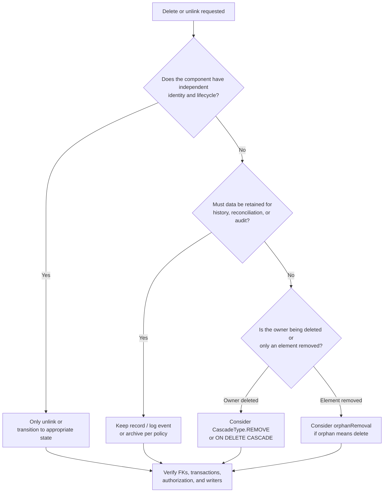
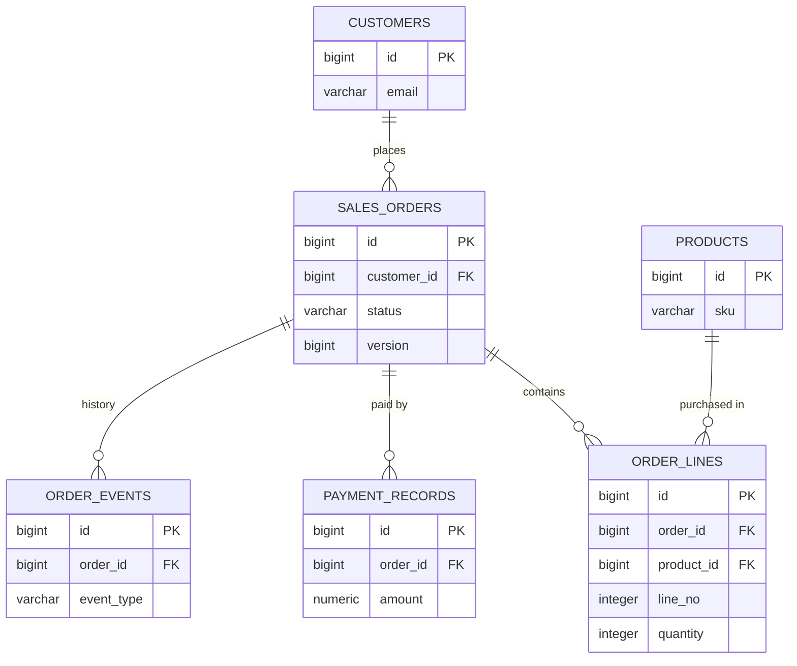
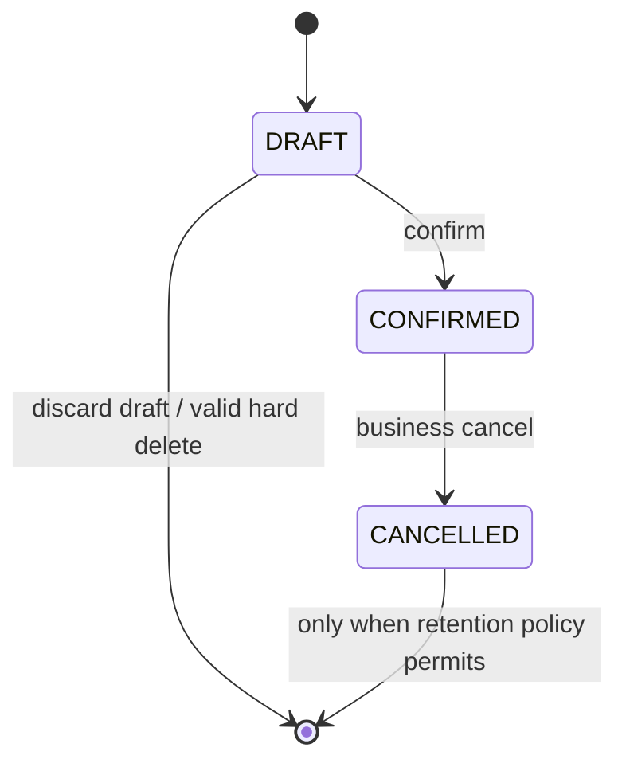

# Cascading Deletes, Orphan Removal, and Lifecycles That Must Be Retained

When a user deletes an order, what should happen to its order lines, payment transactions, change history, and the products it purchased? If a customer is deleted, should historical invoices vanish? If an element is removed from `List<OrderLine>` in Java, should the ORM update a foreign key, delete a row, or only alter the in-memory list?

These questions do not have a single universal answer of "turn on cascade." In relational modeling and Object–Relational Mapping (ORM), you must distinguish **JPA operation-level cascade removal**, **orphan removal for ownerless elements**, **SQL constraint-level cascade deletion**, and **data retention policies across the business lifecycle**. Misconfiguration can lose audit/history records, delete entities shared by multiple parties, leave orphan rows, or mask conflicts between concurrent transactions.

This lesson belongs to the **Object Mapping** chapter of **DATABASE_DATA_MODELING**. The focus is on turning business requirements into verifiable lifecycle rules, foreign keys, constraints, and physical schemas; and then choosing `CascadeType.REMOVE`, `orphanRemoval`, `ON DELETE CASCADE`, soft delete, archiving, and transactions aligned with those rules.

## 1. Define the Lifecycle Before Talking About Delete Commands

In a sales system, you may encounter the following objects:

| Data | Relationship | Lifecycle Question | Example Rule |
|---|---|---|---|
| `SalesOrder` | References `Customer` | Does deleting an order delete the customer? | **No**; customer has an independent lifecycle |
| `OrderLine` | Belongs to one `SalesOrder` | Does removing a line from a draft order delete the line? | **Yes**; lines do not exist independently |
| `Product` | Referenced by many order lines | Does deleting a line delete the product? | **No**; products are shared master data |
| `PaymentRecord` | Attached to an order | Does deleting a paid order delete the transaction? | **No**; must retain evidence/reconciliation per policy |
| `OrderEvent` | Records order history | Does cancelling an order delete past events? | **No**; retain history as needed for business goals |

These rules are **assumptions of the example**, not universal laws for every system. A temporary shopping cart can be deleted outright; an invoiced order may have to be retained for years; personal data may have to be erased or anonymized under applicable policies and obligations. Define retention and deletion goals before configuring the ORM.

### Different Meanings of "Delete"

1. **Unlink:** A stops referencing B; B may continue to exist. For example, removing a role from an employee.
2. **Hard delete:** the row no longer exists in the table after the transaction commits.
3. **Soft delete:** the row remains stored but is marked inactive or excluded from certain queries.
4. **Business cancellation:** transitions state while preserving identity and history; not necessarily a soft delete.
5. **Archive / historical move:** retains information in a separate structure or archive governed by its own policy.
6. **Anonymize / purge sensitive data:** keeps only permitted and necessary data while protecting historical links under appropriate policies.

A UI button labeled "Delete" does not tell you which approach to pick. Good data design defines the **business effect** first, then chooses the SQL transformation.

### Distinguish Technical Ownership from Business Ownership

Suppose `OrderLine.order` is the `@ManyToOne` side holding `order_id` and serves as the JPA *owning side*; `SalesOrder.lines` is `@OneToMany(mappedBy = "order")`. In business terms, however, `SalesOrder` is the **aggregate root** managing the lifecycle of its order lines.

These are two different meanings of ownership:

- **JPA owning side:** the side responsible for writing the FK/join-table link.
- **Lifecycle / aggregate owner:** where rules governing creation, editing, unlinking, and deletion of components reside.

You cannot look solely at `@JoinColumn` or FK placement and infer permission to delete data. A `@ManyToOne` from Order to Customer manages an FK, yet it must never cascade-delete Customer.

## 2. Three Deletion Mechanisms Commonly Conflated

| Mechanism | Triggered When? | Execution Layer | Core Behavior |
|---|---|---|---|
| `CascadeType.REMOVE` | Calling `EntityManager.remove(parent)` on an association configured with cascade remove | JPA/ORM | Propagates the remove operation to related entities |
| `orphanRemoval = true` | A child entity is removed from a managed `@OneToMany` or `@OneToOne` owning relationship | JPA/ORM | Marks the orphaned child entity for deletion |
| SQL `ON DELETE CASCADE` | DB executes `DELETE` on a parent row referenced by an FK | Database | Automatically deletes child rows per FK constraint |

Key facts:

- `CascadeType.REMOVE` is not synonymous with `orphanRemoval`.
- `orphanRemoval` is not a general option for every association; in JPA it applies to `@OneToMany` and `@OneToOne`.
- SQL `ON DELETE CASCADE` is not equivalent to JPA calling `remove` per entity: entity callbacks, persistence contexts, caches, and execution timing can differ.
- None of the three **decides** whether a payment record needs to be kept; that is a business requirement.

### Pre-Deletion Decision Flow



This flowchart is only a sequence of questions; a real system must also examine permissions, retention holds, active disputes, dependencies, domain events, and cross-service consistency.

## 3. SQL Model: Retaining History While Allowing Draft Order Edits

The following design illustrates a system with customers, products, orders, order lines, payment records, and an event log. **Draft orders without payments/events requiring retention** can be hard-deleted along with their lines. Orders that are confirmed, paid, or have history to retain transition state instead of being wiped out.



### 3.1. DDL with Constraints Blocking Inappropriate Deletes

```sql
-- PostgreSQL; the statements below form an illustrative standalone model.
CREATE TABLE customers (
    id BIGINT GENERATED ALWAYS AS IDENTITY PRIMARY KEY,
    email VARCHAR(254) NOT NULL UNIQUE,
    is_active BOOLEAN NOT NULL DEFAULT TRUE
);

CREATE TABLE products (
    id BIGINT GENERATED ALWAYS AS IDENTITY PRIMARY KEY,
    sku VARCHAR(64) NOT NULL UNIQUE,
    display_name VARCHAR(200) NOT NULL,
    is_active BOOLEAN NOT NULL DEFAULT TRUE
);

CREATE TABLE sales_orders (
    id BIGINT GENERATED ALWAYS AS IDENTITY PRIMARY KEY,
    customer_id BIGINT NOT NULL,
    status VARCHAR(20) NOT NULL
        CHECK (status IN ('DRAFT', 'CONFIRMED', 'CANCELLED')),
    version BIGINT NOT NULL DEFAULT 0,
    created_at TIMESTAMPTZ NOT NULL DEFAULT CURRENT_TIMESTAMP,
    CONSTRAINT fk_order_customer
        FOREIGN KEY (customer_id) REFERENCES customers(id)
        ON DELETE RESTRICT
);

CREATE TABLE order_lines (
    id BIGINT GENERATED ALWAYS AS IDENTITY PRIMARY KEY,
    order_id BIGINT NOT NULL,
    product_id BIGINT NOT NULL,
    line_no INTEGER NOT NULL CHECK (line_no > 0),
    sku_snapshot VARCHAR(64) NOT NULL,
    unit_price NUMERIC(19, 2) NOT NULL CHECK (unit_price >= 0),
    quantity INTEGER NOT NULL CHECK (quantity > 0),
    CONSTRAINT fk_line_order
        FOREIGN KEY (order_id) REFERENCES sales_orders(id)
        ON DELETE RESTRICT,
    CONSTRAINT fk_line_product
        FOREIGN KEY (product_id) REFERENCES products(id)
        ON DELETE RESTRICT,
    CONSTRAINT uq_order_line_no UNIQUE (order_id, line_no)
);

CREATE TABLE payment_records (
    id BIGINT GENERATED ALWAYS AS IDENTITY PRIMARY KEY,
    order_id BIGINT NOT NULL,
    amount NUMERIC(19, 2) NOT NULL CHECK (amount > 0),
    currency_code VARCHAR(3) NOT NULL,
    provider_reference VARCHAR(120) NOT NULL UNIQUE,
    paid_at TIMESTAMPTZ,
    CONSTRAINT fk_payment_order
        FOREIGN KEY (order_id) REFERENCES sales_orders(id)
        ON DELETE RESTRICT
);

CREATE TABLE order_events (
    id BIGINT GENERATED ALWAYS AS IDENTITY PRIMARY KEY,
    order_id BIGINT NOT NULL,
    event_type VARCHAR(40) NOT NULL,
    occurred_at TIMESTAMPTZ NOT NULL DEFAULT CURRENT_TIMESTAMP,
    CONSTRAINT fk_event_order
        FOREIGN KEY (order_id) REFERENCES sales_orders(id)
        ON DELETE RESTRICT
);

CREATE INDEX idx_payment_records_order_id ON payment_records(order_id);
CREATE INDEX idx_order_events_order_id ON order_events(order_id);
```

Notable decisions:

1. `order_lines.order_id` is non-nullable: an order line must belong to an existing order.
2. `order_lines.product_id` references Product, yet **Products must never be deleted when lines are deleted**. Products have a shared lifecycle.
3. `sku_snapshot` and `unit_price` capture purchase-time details; catalog updates to Product do not retroactively alter committed transactions.
4. `payment_records.order_id` and `order_events.order_id` use `RESTRICT` FKs to prevent deleting an order while records requiring retention still exist.
5. The FK from `order_lines` to `sales_orders` also uses `RESTRICT`: when deleting a draft order via the ORM, lines must be deleted **first**; the database does not silently run the whole workflow if another source deletes an order.
6. `UNIQUE(order_id, line_no)` protects line position; `CHECK` rejects invalid values from write paths outside Java.

In PostgreSQL, `RESTRICT` and `NO ACTION` (the default) differ in check timing under certain deferrable configurations; the example picks `RESTRICT` to explicitly state the intent of blocking deletion of referenced parent rows. An FK constraint only checks references; it **does not inherently know** whether a confirmed order is allowed to be deleted.

### 3.2. Schemas Do Not Replace State-Based Deletion Policies

If a `CONFIRMED` order has no payment or event rows, the FKs above alone **cannot block** a `DELETE FROM sales_orders` once lines are deleted. To uphold the invariant "confirmed orders must not be deleted," enforce it in the application/service, SQL privileges, and—when needed across all write paths—database mechanisms such as triggers, stored procedures, or properly governed data-manipulation policies.

Example of a conditional delete statement expressing the policy:

```sql
DELETE FROM sales_orders
WHERE id = :order_id
  AND status = 'DRAFT';
```

This SQL statement **does not delete lines on its own**, so with an `RESTRICT` FK it still fails while lines remain. It also cannot safely coordinate multi-table deletion under concurrent operations by itself. Execute the entire deletion decision inside a transaction, lock/verify state appropriately, and confirm no history requires retention.

### 3.3. Why Not Default Every FK to `ON DELETE CASCADE`?

A declaration like:

```sql
-- DO NOT apply to payment data that must be retained:
-- FOREIGN KEY (order_id) REFERENCES sales_orders(id) ON DELETE CASCADE
```

causes the database to wipe out payment transactions when an order is deleted. That can break reconciliation and historical records. Conversely, for a temporary cache table or strictly subordinate elements needing no retention, `ON DELETE CASCADE` can make sense.

Constraint design must come from the **lifecycle semantics** of each FK, not from a desire to avoid errors when deleting a parent.

## 4. `CascadeType.REMOVE`: Parent Deletion Propagates to ORM-Managed Children

`CascadeType.REMOVE` is part of `jakarta.persistence.CascadeType`. When calling `EntityManager.remove` on a **managed** entity, JPA can propagate removal to entities on associations configured with cascade remove.

For example, `SalesOrder` has dependent order lines, whereas `Customer` and `Product` are independent entities.

### 4.1. Mapping Pattern with Clear Boundaries

```java
import jakarta.persistence.*;
import java.math.BigDecimal;
import java.util.ArrayList;
import java.util.List;
import java.util.Objects;

@Entity
@Table(name = "sales_orders")
public class SalesOrder {

    @Id
    @GeneratedValue(strategy = GenerationType.IDENTITY)
    private Long id;

    @ManyToOne(fetch = FetchType.LAZY, optional = false)
    @JoinColumn(name = "customer_id", nullable = false)
    private Customer customer;  // Never cascade REMOVE to Customer.

    @Enumerated(EnumType.STRING)
    @Column(nullable = false, length = 20)
    private OrderStatus status = OrderStatus.DRAFT;

    @OneToMany(
        mappedBy = "order",
        cascade = {
            CascadeType.PERSIST,
            CascadeType.MERGE,
            CascadeType.REMOVE
        },
        orphanRemoval = true
    )
    @OrderBy("lineNo ASC")
    private List<OrderLine> lines = new ArrayList<>();

    @Version
    @Column(nullable = false)
    private Long version;

    protected SalesOrder() {}

    public SalesOrder(Customer customer) {
        this.customer = Objects.requireNonNull(customer);
    }

    public Long getId() { return id; }

    private void ensureDraft() {
        if (status != OrderStatus.DRAFT) {
            throw new IllegalStateException("Confirmed orders cannot modify lines");
        }
    }

    public void addLine(
            Product product, String skuSnapshot,
            BigDecimal unitPrice, int quantity) {
        ensureDraft();
        int next = lines.stream()
                .mapToInt(OrderLine::getLineNo)
                .max().orElse(0) + 1;
        OrderLine line = new OrderLine(
                this, product, next, skuSnapshot, unitPrice, quantity
        );
        lines.add(line);
    }

    public void removeLine(OrderLine target) {
        ensureDraft();
        for (int i = 0; i < lines.size(); i++) {
            if (lines.get(i) == target) {
                lines.remove(i);
                target.detachFromOrder();
                return;
            }
        }
        throw new IllegalArgumentException("Line does not belong to this order");
    }

    public void assertCanDelete() {
        ensureDraft();
    }

    public void cancel() {
        if (status == OrderStatus.CONFIRMED) {
            status = OrderStatus.CANCELLED;
            return;
        }
        throw new IllegalStateException(
                "Cancellation flow must be defined separately for current status"
        );
    }
}
```

`OrderStatus` enum has `DRAFT`, `CONFIRMED`, `CANCELLED`. `Customer` and `Product` are independent entities already defined in the system. This code illustrates lifecycle policies; the example omits full authentication, authorization, transactions, refunds, inventory checks, and other business operations.

Child class:

```java
@Entity
@Table(name = "order_lines")
public class OrderLine {

    @Id
    @GeneratedValue(strategy = GenerationType.IDENTITY)
    private Long id;

    @ManyToOne(fetch = FetchType.LAZY, optional = false)
    @JoinColumn(name = "order_id", nullable = false)
    private SalesOrder order; // owning side of order_id FK

    @ManyToOne(fetch = FetchType.LAZY, optional = false)
    @JoinColumn(name = "product_id", nullable = false)
    private Product product; // NEVER cascade REMOVE to Product.

    @Column(name = "line_no", nullable = false)
    private int lineNo;

    @Column(name = "sku_snapshot", nullable = false, length = 64)
    private String skuSnapshot;

    @Column(name = "unit_price", nullable = false, precision = 19, scale = 2)
    private BigDecimal unitPrice;

    @Column(nullable = false)
    private int quantity;

    protected OrderLine() {}

    OrderLine(
            SalesOrder order, Product product, int lineNo,
            String skuSnapshot, BigDecimal unitPrice, int quantity) {
        this.order = Objects.requireNonNull(order);
        this.product = Objects.requireNonNull(product);
        this.skuSnapshot = Objects.requireNonNull(skuSnapshot);
        this.unitPrice = Objects.requireNonNull(unitPrice);
        if (lineNo <= 0 || quantity <= 0 || unitPrice.signum() < 0) {
            throw new IllegalArgumentException("Invalid order line data");
        }
        this.lineNo = lineNo;
        this.quantity = quantity;
    }

    public int getLineNo() { return lineNo; }

    void detachFromOrder() {
        this.order = null;
    }
}
```

Imports for JPA, `BigDecimal`, and `Objects` in the child snippet match the previous example; add them when placing into separate Java files. `detachFromOrder()` keeps the **in-memory bidirectional graph** consistent. It is only called as part of orphan removal, not to permit persisting an `OrderLine` with `order_id = NULL`.

### 4.2. Deleting a Draft Order

Inside a transaction, the use case might do:

```java
SalesOrder order = em.find(
        SalesOrder.class, orderId, LockModeType.PESSIMISTIC_WRITE
);
if (order == null) {
    throw new EntityNotFoundException("Order not found");
}

order.assertCanDelete();
// The use case must also verify there are no payments/events to retain.
em.remove(order);
```

With `CascadeType.REMOVE` on `SalesOrder.lines`, JPA propagates removal to owned `OrderLine` instances; it does **not** propagate to `Customer` or `Product` because those associations do not configure cascade remove.

The logical resulting SQL is roughly equivalent to:

```sql
DELETE FROM order_lines WHERE order_id = :order_id;
DELETE FROM sales_orders WHERE id = :order_id;
```

This is a **logical explanation**, not a guarantee that the provider emits these exact two statements. The ORM may delete row by row by ID, preload entities, or use another constraint-respecting order; inspect SQL logs. Under a schema with `RESTRICT`, lines must be deleted before the parent. An uncommitted transaction can still roll back.

**Business limitation of the example:** a payment/event row with an FK to the order still blocks physical deletion. That protects history, yet if a use case truly allows deleting an unpaid order that recorded a temporary event, you must explicitly define how to archive/move/delete that temporary event first. Do not solve it by blindly adding cascade remove to historical tables.

### 4.3. `CascadeType.ALL` Is Not a "Safety Button"

`CascadeType.ALL` includes all cascade operations defined by JPA: `PERSIST`, `MERGE`, `REMOVE`, `REFRESH`, and `DETACH`. Choosing `ALL` means accepting propagation of **all** of those operations along the association.

For elements wholly owned within a single owner's lifecycle, `ALL` can fit. For shared `SalesOrder.customer`, `OrderLine.product`, `Employee.roles`, or `Invoice.taxRate`, cascade remove is usually **inappropriate**.

Declare specific cascade types explicitly when design certainty is still evolving; never add `CascadeType.REMOVE` just to make delete calls throw fewer FK errors.

## 5. `orphanRemoval`: Removing from an Association Deletes the Child Entity

`orphanRemoval = true` is for `@OneToOne` and `@OneToMany` associations where a child entity **is no longer valid without its owner**. It does not require calling `em.remove(child)` directly in the use case: when a child entity is removed from the managed owner's association, the ORM marks the orphan for deletion upon synchronization.

### 5.1. Removing a Line from a Draft Order

```java
SalesOrder order = em.find(SalesOrder.class, orderId);
OrderLine line = findLineWithinManagedOrder(order, lineId);

order.removeLine(line);
// On flush/commit, the ORM deletes the order_lines row for line.
```

`findLineWithinManagedOrder` is an illustrative helper, not a JPA API. What matters is that `line` is part of `order.lines` in the active persistence context and the operation goes through a method enforcing `DRAFT`.

Before the operation:

```text
Order #91 (DRAFT)
  lines: [Line #501, Line #502, Line #503]

SQL order_lines:
  id=501, order_id=91
  id=502, order_id=91
  id=503, order_id=91
```

After `removeLine(Line #502)` and transaction commit:

```text
Order #91 (DRAFT)
  lines: [Line #501, Line #503]

SQL order_lines:
  id=501, order_id=91
  id=503, order_id=91
```

Under this policy, `Line #502` is **deleted**, not saved as a row with `order_id = NULL`. Having lost its owner, `OrderLine` has no standing to exist independently.

### 5.2. Difference from a Collection Without `orphanRemoval`

Suppose you only configure:

```java
@OneToMany(mappedBy = "order", cascade = CascadeType.PERSIST)
private List<OrderLine> lines = new ArrayList<>();
```

And then only call `order.getLines().remove(line)`. In a bidirectional relationship, `mappedBy` is the inverse side; removing an element from the collection **does not prove** that the FK on the owning side should change or that the child should be deleted. If `line.order = order` remains set, the FK still points to the order. If `line.order = null` is set, the ORM may try updating the FK to `NULL` and hit a `NOT NULL` constraint error.

Do not try to detach a child from its parent when the model genuinely requires deleting the child. Either enable `orphanRemoval` with the right semantics, or invoke child removal via a use case/repository with proper transactions and authorization.

### 5.3. Do Not Use `orphanRemoval` to Move a Child to Another Owner

An operation like:

```java
orderA.getLines().remove(line);
orderB.getLines().add(line);
line.setOrder(orderB);
```

can conflict with `orphanRemoval` semantics: removing from owner A already marks the child for deletion. JPA does not guarantee that moving a deletion-marked orphan to owner B works portably as a simple update across providers.

If business rules require moving a line to another order, clarify "is it still the same order line?" You can create a new line carrying the needed data, record a transfer event, and delete the old line within a transaction; or redesign keys, aggregate boundaries, and ownership rules.

Especially, never use `orphanRemoval = true` for entities shared across multiple parents. Removing one link does not revoke the entity's right to exist.

### 5.4. Cases Where You Should Not Rely on Orphan Removal

- Newly created unpersisted entities or detached entities: timing and scope of orphan removal differ from managed entities; do not rely on implicit behavior for non-managed objects.
- Blindly replacing a collection with a new list instance from a DTO: the ORM may treat existing children as orphans and schedule deleting real data.
- `@ManyToMany` relationships: JPA does not support `orphanRemoval` on this annotation; deleting a join-table row differs from deleting the target entity.
- Records requiring audit or history retention: orphan removal performs a **hard delete** in typical storage terms, and does not replace a "deactivate while keeping the record" workflow.

## 6. SQL `ON DELETE CASCADE` and Foreign Key Actions

Databases support several actions when a referenced row is deleted. Syntax and deferrability depend on the DBMS, yet common options include:

| FK Action | Outcome When Deleting Parent | When Worth Considering |
|---|---|---|
| `RESTRICT` / `NO ACTION` | Rejects deletion if dependent rows violate the FK | History, retained data, or when use cases decide child deletion |
| `CASCADE` | Automatically deletes related child rows | Child is strictly dependent and allowed to hard-delete with owner |
| `SET NULL` | Sets child FK to null | Link is optional and child stays meaningful without parent |
| `SET DEFAULT` | Sets FK to a default value | Only when the default is valid and business policy permits it |

There is no single default answer for every FK.

### 6.1. Example Where `ON DELETE CASCADE` Makes Genuine Sense

Suppose a table holds temporary auth tokens for a login session that never need retention once the session is deleted:

```sql
CREATE TABLE login_sessions (
    id UUID PRIMARY KEY,
    created_at TIMESTAMPTZ NOT NULL
);

CREATE TABLE session_tokens (
    id UUID PRIMARY KEY,
    session_id UUID NOT NULL,
    token_hash VARCHAR(128) NOT NULL,
    FOREIGN KEY (session_id)
        REFERENCES login_sessions(id) ON DELETE CASCADE
);
```

If business rules confirm tokens belong strictly to one session and do not require retention, deleting the session via SQL removes its tokens in the same transaction without loading every token into Java memory.

Conversely, for `payment_records` or `order_events` that must be retained, never apply the same policy merely because they also hold an FK to the order.

### 6.2. `ON DELETE SET NULL` Requires a Nullable FK

For example, order history must keep SKU snapshots and past prices without requiring a live reference to a retired Product. You might consider an **alternative option**:

```sql
-- Alternative version of product_id, DO NOT apply directly
-- if the previous schema declared product_id NOT NULL:
product_id BIGINT NULL REFERENCES products(id) ON DELETE SET NULL
```

In this option, `sku_snapshot`, captured product name, and transaction price must suffice to explain the historical order. `product_id` is merely an optional pointer to the current catalog.

If the ORM declares `@ManyToOne(optional = false)` while the DB allows `product_id = NULL`, the two models contradict each other. Update both mapping and domain logic when choosing `SET NULL`.

### 6.3. Database Cascades Can Bypass the Java Lifecycle

When running:

```sql
DELETE FROM login_sessions WHERE id = :session_id;
```

the database deletes `session_tokens` rows automatically. However, managed Java instances sitting in other persistence contexts do not automatically learn those rows vanished; ORM `@PreRemove` callbacks for individual tokens are not automatically fired by a pure SQL cascade either.

This affects second-level caches, displayed UI state, application-callback auditing, and in-code side effects. If you choose DB cascading, define auditing, cache invalidation, and transaction boundaries at the appropriate layer; do not expect JPA cascade behavior to run identically.

### 6.4. Do Not Stack Overlapping Cascades Just for "Extra Certainty"

If the same relationship configures both JPA `CascadeType.REMOVE` and DB `ON DELETE CASCADE`, some providers still emit SQL deletes for children first, leaving none for the DB to cascade; other providers or extensions may optimize differently. While this does not automatically fail, it obscures **execution responsibility**.

Choose a strategy intentionally: let the ORM handle deletions when entity-level callbacks/behavior matter; let the DB enforce deletion across multiple writers or high-volume hard deletes. If combining both, test actual SQL, callbacks, and caches. `@OnDelete` commonly seen in Hibernate is a provider extension, not a standard JPA annotation.

## 7. Shared Objects: Unlinking Is Not Deleting the Entity

Consider `Employee` and `Role`: many employees can share the same role. Revoking `ADMIN` from one employee only deletes the **join row**, never the `ADMIN` role itself.

```sql
CREATE TABLE roles (
    id BIGINT GENERATED ALWAYS AS IDENTITY PRIMARY KEY,
    code VARCHAR(50) NOT NULL UNIQUE
);

CREATE TABLE employees (
    id BIGINT GENERATED ALWAYS AS IDENTITY PRIMARY KEY
);

CREATE TABLE employee_roles (
    employee_id BIGINT NOT NULL REFERENCES employees(id),
    role_id BIGINT NOT NULL REFERENCES roles(id),
    PRIMARY KEY (employee_id, role_id)
);
```

In JPA:

```java
@ManyToMany
@JoinTable(
    name = "employee_roles",
    joinColumns = @JoinColumn(name = "employee_id"),
    inverseJoinColumns = @JoinColumn(name = "role_id")
)
private Set<Role> roles = new HashSet<>();
```

Never declare `CascadeType.REMOVE` from Employee to Role. When removing a role from `employee.roles` on the owning side, the proper operation is deleting the `employee_roles(employee_id, role_id)` row; `roles` remains intact.

Similarly:

- Removing an article from a topic does not delete a shared `Tag`.
- Cancelling an order line must not delete `Product`.
- Deleting an appointment must not delete `Doctor`.
- Unassigning an instructor from a course must not delete the `Instructor` record.

If the link carries status, effective dates, or its own history, consider an **associative entity** (`RoleAssignment`) with a revoke/close method instead of hard-deleting a row in a plain `@ManyToMany` join table.

## 8. Lifecycle Retention: Cancellation, Soft Delete, and Archiving

### 8.1. Cancelling an Order Differs from Deleting an Order

For a confirmed `SalesOrder`, a "cancel order" request should usually be modeled as a **state transition**:

```text
DRAFT --confirm--> CONFIRMED --cancel--> CANCELLED
    \--discard--> (hard delete if retention is not yet required)
```



On `cancel`, preserve `sales_orders.id` and historical lines, recording a cancellation event or refund transaction if needed. `CANCELLED` status does not mean data was deleted.

**Never call `em.remove(order)` just to represent cancellation**, as it can trigger cascading line deletions and fail on payment/event FKs.

### 8.2. Soft Delete Only Addresses Visibility, Not Constraints

One soft-delete approach adds:

```sql
ALTER TABLE products
ADD COLUMN deleted_at TIMESTAMPTZ;

-- Query returning only active catalog items:
SELECT id, sku, display_name
FROM products
WHERE deleted_at IS NULL;
```

The `Product` row still exists, so FKs from `order_lines.product_id` remain valid. Historical data remains queryable where access controls and retention policies allow.

However, soft deletes introduce new decisions:

- Which queries must exclude soft-deleted records? Which historical queries must still see them?
- Once an object is soft-deleted, may new FKs point to it?
- Can it be restored? If so, how are business-key conflicts handled?
- Is marking deleted audited and emitted as an event?
- Is the system actually permitted to retain that personal data, or do applicable policies require erasure/anonymization?

Specifically, **an FK only knows a row exists**—it does not know whether `deleted_at` is null. To prevent a new order line from pointing to a soft-deleted product, enforce checks in the use case and, if multiple writers exist, in the database or transaction layer.

### 8.3. Soft Delete and `UNIQUE`

Suppose users have a unique `email`. After soft-deleting an account, the business wants a new account to be able to reuse that email. A table-wide `UNIQUE(email)` constraint still blocks reuse because the old row remains.

In PostgreSQL, you can use a **partial unique index** in an appropriate model:

```sql
-- Illustrates an alternative schema approach:
-- Do not keep a table-wide UNIQUE(email) simultaneously
-- if policy allows reusing emails after soft delete.
CREATE UNIQUE INDEX uq_active_user_email
ON app_users (lower(email))
WHERE deleted_at IS NULL;
```

This example assumes an `app_users` table with `email` and `deleted_at`, **not extra DDL to run directly on the `customers` table from Section 3**. Under this policy, two deleted accounts can share the same email if index predicates hold; restoring an account must handle conflicts if another account already claimed that email. Identity linking, login security, and transaction history may make email reuse unsuitable in some systems.

### 8.4. Archiving, Auditing, and Retention

Never label every history table a "child table deleted with parent." An `OrderEvent` typically exists to **prove something happened**; deleting it when an order is deleted can defeat the purpose of auditing.

Different ways to retain history:

| Approach | Strengths | Design Considerations |
|---|---|---|
| Keep transaction rows and update `status` | Easy FK queries and reconciliation | Data grows; needs retention/access policy |
| Append-only event/audit table | Preserves business event sequence | Keys, ordering, regulatory edit/delete rules |
| Separate archive table / historical store | Keeps operational tables lean | Data movement, referential integrity, restoration |
| Anonymize sensitive fields, keep aggregates | Reduces stored personal data | Must verify remaining data still fulfills intended goals and compliance |

**Retention periods** must never be guessed from annotations or project habits. Define them from data type, contracts, applicable regulations, and business requirements. Neither keep all data forever by default nor wipe history just because a user clicked cancel.

## 9. The Case of `@ElementCollection` and Value Objects

Not every collection element is an entity with its own identity. A `Customer` may hold a list of `Address` value objects via `@ElementCollection`:

```java
@ElementCollection(fetch = FetchType.LAZY)
@CollectionTable(
    name = "customer_addresses",
    joinColumns = @JoinColumn(name = "customer_id")
)
private List<Address> savedAddresses = new ArrayList<>();
```

Rows in `customer_addresses` store **values owned by the owner**. When a value is removed from the managed collection, the ORM synchronizes the collection table rows; there is no independent `Address` entity to pass to `EntityManager.remove(address)`.

This differs from `@OneToMany(orphanRemoval = true)`:

- `@ElementCollection`: elements are values with value equality and no separate entity lifecycle.
- `@OneToMany`: elements are entities with JPA identity, even if their lifecycle depends on the owning aggregate.

If address data needs verification, sharing across customers, or direct referencing by its own ID in APIs, it may need promotion to an entity. At that point, redesign link-deletion and entity-deletion policies rather than keeping `@ElementCollection` and slapping an ID onto each row.

## 10. Transactions and Concurrent Conflicts on Deletion

Deletion is a write operation that can race with creating, editing, or confirming data. Cascades and orphan removal **do not replace** locking.

### 10.1. Race: One User Deletes a Line While Another Confirms the Order

```text
T1: reads Order #91 (DRAFT)
T2: reads Order #91 (DRAFT)
T1: removeLine(Line #502)
T2: confirms Order #91
T1: flushes/deletes line; T2: flushes/confirms
```

Desired invariant: **no lines may be deleted after the order is confirmed**. If two transactions act on stale state without coordination, the outcome may violate business ordering.

Controls:

1. Route all line changes through `SalesOrder`/use cases inside clear transactions.
2. Use optimistic locking on the root and ensure every operation affecting root invariants participates in versioning; or use pessimistic locking when contention/requirements demand it.
3. Never assume **every collection change** automatically increments the root's version in all ORM configurations; verify it.
4. When a version conflict occurs, reload state and return a conflict or conditionally retry—never silently overwrite.

Example when forcing a version increment on an aggregate-affecting operation:

```java
SalesOrder order = em.find(SalesOrder.class, orderId);
em.lock(order, LockModeType.OPTIMISTIC_FORCE_INCREMENT);
OrderLine line = findLineWithinManagedOrder(order, lineId);
order.removeLine(line);
```

Compatibility and exact version-increment timing depend on the provider and transaction; do not treat this snippet as a substitute for concurrency tests. Another option is locking the root with `PESSIMISTIC_WRITE` at the start of every edit/confirm use case consistently across participating flows.

### 10.2. Race: Deleting a Parent While a New Child Is Created

```text
T1: checks there are no payments for Order #91
T2: creates a PaymentRecord for Order #91
T1: attempts to delete Order #91
```

With FK `payment_records.order_id REFERENCES sales_orders(id) ON DELETE RESTRICT`, the database prevents a payment from pointing to a vanished order. Still, to faithfully enforce "delete only if no payments exist," the use case must wrap checks and actions under proper transactions/locking; a one-off check before deleting is not an absolute guarantee under concurrency.

Never remove FKs just to avoid race errors. Constraints are the final integrity barrier when code races or external writers intervene.

### 10.3. `flush` Is Not `commit`

On `em.flush()`, the ORM sends pending statements to the DB inside the current transaction. A `DELETE` that succeeds at flush time can still roll back. To verify the final outcome, read back in a fresh transaction/persistence context after commit.

If deleting via SQL or bulk JPQL while managed entities remain in a persistence context, Java object state may diverge from the database. Define when `clear`/refresh and cache handling are required per provider rules.

## 11. Bulk Deletes: Choose the Right Mechanism Instead of Blind Optimization

For an order with a few lines, JPA cascade remove is convenient and readable. For an owner with hundreds of thousands of children, deleting entity by entity can emit huge SQL volume, load large graphs, exhaust memory, and slow down transactions.

Three common approaches:

| Approach | Advantages | Risks |
|---|---|---|
| JPA `em.remove(owner)` with cascade | Follows entity lifecycle, callbacks, and ORM mappings | May load/delete many entities; high SQL count |
| Conditional bulk SQL/JPQL | Fewer round-trips, easy per-table ordering | Bypasses automatic entity-level cascades/callbacks and can stale the persistence context |
| DB `ON DELETE CASCADE` | DB deletes dependent rows, covers multiple writers | Skips Java callbacks; tricky with history that must be kept |

### 11.1. Bulk Deletes Must Respect FKs and Business Rules

For example, hard-deleting a draft order with no payments/events via SQL must run **inside a transaction** and block concurrent modifications:

```sql
-- Logical illustration; application must lock/verify conditions in transaction.
DELETE FROM order_lines
WHERE order_id = :order_id;

DELETE FROM sales_orders
WHERE id = :order_id AND status = 'DRAFT';
```

Never treat this as a complete flow if the first statement deletes lines while the second fails to delete the parent because the order changed status. When deleting the parent fails, the transaction must roll back rather than committing partial results. Implement via a service managing locks and checking row counts, or a well-governed stored procedure.

With history tables using `RESTRICT`, deleting the parent still fails if payments/events exist. That protects data that must be retained, not a bug to fix with cascade.

### 11.2. Bulk JPQL and Lifecycle Callbacks

A statement like:

```java
int deleted = em.createQuery("""
    delete from OrderLine l
    where l.order.id = :orderId
    """)
    .setParameter("orderId", orderId)
    .executeUpdate();
```

is a bulk operation. It is **not** equivalent to iterating over each entity and calling `em.remove`: cascade remove rules and entity-level `@PreRemove` callbacks do not fire the same way as entity-level operations. Previously loaded managed objects can become out of sync. Define transaction boundaries and clear/refresh policies, and never use bulk deletes to bypass business deletion rules.

For mandatory audit trails, never rely solely on Java callbacks if direct database deletion paths exist. Design reliable audit mechanisms covering every permitted write path.

## 12. Validating the Model Through Decision Questions

### 12.1. Who Has Authority to Delete and What Must Survive?

For each relationship, answer:

1. Is the parent an aggregate root, or just an entity referenced by the child?
2. Is the child shared by multiple parents or exposed via its own API?
3. If the link is removed, does the child still make sense independently?
4. If the parent is deleted, must invoices, transactions, logs, snapshots, or reconciliation data survive?
5. Do retained records contain personal data subject to specific retention/anonymization policies?
6. What write paths exist outside the ORM: SQL jobs, imports, other services, triggers, ETL?

Only then choose JPA cascades, orphan removal, and FK actions.

### 12.2. Sample Policy Matrix

| Relationship | On Unlink | On Owner Delete | Initial Recommended FK |
|---|---|---|---|
| `SalesOrder → OrderLine` while DRAFT | Hard delete line via orphan removal | Cascade remove lines if order deletion is allowed | `RESTRICT`, orchestrated by ORM |
| `SalesOrder → Customer` | Usually Customer cannot be absent; adjust via use case | Never delete Customer | `RESTRICT` |
| `OrderLine → Product` | Usually committed line's Product cannot change | Never delete Product | `RESTRICT`, keep snapshot |
| `SalesOrder → PaymentRecord` | Never delete payment to "unlink" from order | Retain payment; reject order hard delete | `RESTRICT` |
| `SalesOrder → OrderEvent` | Retain events per retention | Retain events; reject/coordinate archive | `RESTRICT` |
| `Employee ↔ Role` | Delete join-table row | Never delete shared Role | Join-table FKs per link-cleanup policy |
| `LoginSession → temporary SessionToken` | Delete token with session | Can cascade delete tokens | `ON DELETE CASCADE` if lifecycle matches |

These are **suggestions for the illustrative model**, not a universal template. If a historical record legitimately needs deletion, design its impact on other references, permissions, and related data.

### 12.3. Production Safety Checklist

- [ ] Hard delete, cancel, soft delete, and archive defined explicitly per entity.
- [ ] No cascade remove from child entities to Customer, Product, Role, or shared data.
- [ ] `orphanRemoval` used only when orphans genuinely require hard deletion.
- [ ] Every FK has a `RESTRICT`/`CASCADE`/`SET NULL` policy aligned with nullability and history.
- [ ] Transaction/audit tables cannot be silently wiped out by deleting an owner.
- [ ] All delete operations enforce authorization and business status checks.
- [ ] Concurrent deletes tested alongside related inserts/updates.
- [ ] ORM-generated SQL, callbacks, caches, and transaction rollbacks verified.
- [ ] Bulk deletes do not accidentally bypass validation, locking, or required auditing.
- [ ] Backup, migration, retention, and sensitive-data handling plans in place.

## 13. Common Mistakes

**Mistake 1 — "An association with an FK must cascade delete."** An FK describes linkage and integrity; it does not define lifecycle. An FK to Product does not mean deleting an order deletes the Product.

**Mistake 2 — "`cascade = ALL` is convenient."** ALL includes REMOVE; deleting one owner can propagate to entities referenced by many owners.

**Mistake 3 — "`CascadeType.REMOVE` and `orphanRemoval` are the same."** REMOVE propagates when deleting the parent; orphan removal triggers when a child is removed from an owning association.

**Mistake 4 — "Removing a child from the inverse collection definitely updates the FK."** In bidirectional relationships, sync the owning side; without orphan removal, removing from a collection does not express deleting the child.

**Mistake 5 — "Replacing a `List` from a DTO is just a normal update."** Omitting one element can make the ORM treat real records as orphans and delete data the DTO was never meant to touch.

**Mistake 6 — "`ON DELETE CASCADE` triggers JPA callbacks on every child."** DB cascades operate inside the database and do not invoke Java entity lifecycle callbacks.

**Mistake 7 — "Soft delete has deleted the data."** Rows and FKs still exist; query filters, restoration, uniqueness constraints, and retention still need design.

**Mistake 8 — "`CANCELLED` orders can be hard-deleted."** Cancellation is a business state; payments and reconciliation evidence may require retention by policy.

**Mistake 9 — "`@Version` on the root automatically protects all child deletions."** Whether collection edits bump the root version depends on mapping/provider; verify or lock the root explicitly.

**Mistake 10 — "Bulk delete is fast so use it everywhere instead of `remove`."** Bulk operations can skip entity cascades/callbacks and leave persistence context objects stale.

**Mistake 11 — "Failing to delete a parent with children is a database bug."** Often the database is doing its exact job of protecting data and preventing history loss.

**Mistake 12 — "Keeping all data forever is safest."** Personal and sensitive data may be subject to erasure, anonymization, or retention caps; retention must be justified.

## 14. Practice Exercise: Clinic Booking Platform

**Context:** A system manages `Patient`, `Appointment`, `AppointmentNote`, `Invoice`, `Doctor`, `Department`, and `DoctorDepartmentAssignment`.

- Each appointment belongs to one patient and one doctor; both Patient and Doctor exist independently.
- An upcoming appointment can be cancelled. Completed appointments must retain results under applicable data policies.
- `AppointmentNote` contains preparation notes; some draft notes may be discarded, while signed notes must be kept.
- `Invoice` records linked to paid appointments must be kept for reconciliation.
- Doctors can belong to multiple departments; a department has many doctors. Doctor–department assignments have start and end timestamps.
- One staff member may click "delete appointment" while another staff member is marking it completed and issuing an invoice.

### Questions

1. Why must you never cascade remove from `Appointment` to `Patient` or `Doctor`?
2. Can `orphanRemoval = true` be applied to all `AppointmentNote` items? What changes once signed notes must be kept?
3. How should the `Appointment`–`Invoice` FK and `ON DELETE` behavior be configured to avoid accidentally deleting invoices?
4. Should removing a doctor from a department delete `Doctor` or `Department`? When the link has effective dates, what associative entity should be used?
5. Should cancelling an appointment call `EntityManager.remove(appointment)`? Define the conditions.
6. Design at least three transaction/concurrency tests to prevent deleting notes/invoices accidentally during appointment state transitions.
7. When a patient requests personal data handling, how should you evaluate physical deletion, anonymization, and retaining documents covered by retention policies?

### Reference Solution Guide

- `Patient` and `Doctor` are shared entities with independent lifecycles. Never configure cascade remove to them just because Appointment holds FKs.
- For **draft notes strictly belonging to a draft appointment's lifecycle**, orphan removal may fit. For **signed notes**, use an entity/history rule forbidding deletion or move to immutable storage. Never turn on unconditional orphan removal on a mixed collection of draft and signed notes.
- `Invoice.appointment_id` needs an integrity-enforcing FK, typically `RESTRICT`/`NO ACTION` if deleting invoiced appointments is disallowed. The rule "completed appointments cannot be hard-deleted" itself must be guarded in the use case and, where needed, in the DB.
- `DoctorDepartmentAssignment` is an associative entity with `doctor_id`, `department_id`, `start_at`, and `end_at`. End an assignment by setting `end_at`, never deleting Doctor or Department. If history of multiple assignments is needed, design matching keys/`UNIQUE` constraints.
- Cancelling an appointment is typically a `CANCELLED` state transition, optionally recording an event and reason. Only hard-delete temporary records with no historical value when clearly permitted by policy.
- Tests: (a) two transactions cancelling and completing the same appointment; (b) deleting parent while another transaction creates an Invoice; (c) removing a note concurrently with signing it; (d) rollback after ORM orphan deletion; (e) bulk delete must respect authorization and be blocked by FKs when invoices exist.
- For personal data, classify each field and document, specify legal/retention basis, access controls, retention periods, and how valid requests are fulfilled. Neither wipe out Invoices blindly nor keep all data indefinitely.

### Sample SQL Verification Scenarios

With FK `invoices.appointment_id REFERENCES appointments(id) ON DELETE RESTRICT`:

```sql
-- Assumes an invoice for appointment #7001 exists:
DELETE FROM appointments WHERE id = 7001;
-- Expected: database rejects if any invoice still references it.
```

For doctor–department relationships:

```sql
-- Close the assignment effective period without deleting doctor or department:
UPDATE doctor_department_assignments
SET end_at = :ended_at
WHERE id = :assignment_id
  AND end_at IS NULL;
```

Both examples show that "ending participation" is usually **updating state or effective dates**, not necessarily hard-deleting an entity.

## 15. End-to-End Process from Requirements to Mapping

**Step 1 — Draw aggregates and independent relationships.** Distinguish dependent components, shared entities, and transactions/history. An FK alone does not prove lifecycle ownership.

**Step 2 — Define deletion policies per state.** Should draft, confirmed, paid, cancelled, and archived records have the same deletion permissions?

**Step 3 — Choose SQL constraints first.** For each FK, choose nullability and `RESTRICT`/`CASCADE`/`SET NULL` per policy, adding `UNIQUE` and `CHECK` to prevent conflicting data.

**Step 4 — Configure JPA by ownership.** `CascadeType.REMOVE` for children that must die with the parent; `orphanRemoval` when removing a child from the link means deletion; never cascade remove to shared entities or history requiring retention.

**Step 5 — Encapsulate operations in the domain/use case.** `removeLine` checks `DRAFT`; `cancel` transitions state; deleting a parent must verify history/permissions and run inside a transaction.

**Step 6 — Consider history, soft delete, and privacy.** Choose snapshots, auditing, retention, archiving, or anonymization based on actual storage goals; never adopt ORM default delete behavior as policy.

**Step 7 — Verify with data and concurrency.** Test parents with/without children, orphans, shared entities, payments, delete/insert races, rollbacks, bulk deletes, and stale persistence contexts.

**Step 8 — Measure operations.** Check SQL counts, lock durations, FK indexes, long transactions, auditing, and cache impact. Pick bulk/DB cascades only when lifecycle-compatible and verified.

## 16. Key Takeaways

**Cascading deletion is not a purely technical rule.** `CascadeType.REMOVE` propagates remove calls in JPA; `orphanRemoval` deletes child entities when removed from an owning association; `ON DELETE CASCADE` lets the database delete dependent rows. Enable any of the three only when **the data lifecycle genuinely allows physical deletion**.

When modeling, ask **who is the business owner, does the element exist independently, what data must survive, what must FKs block, and how can concurrent transactions corrupt state**. For shared data, unlink instead of deleting entities; for confirmed orders, cancel by status instead of deleting rows; for payment and event history, retain data per policy; for strictly subordinate draft components, cascade or orphan removal can fit.

A sound design aligns **business rules, Java/JPA representation, SQL constraints, transactions, auditing, and retention policies**. Only when all those layers speak the same language is a "delete" operation safe, verifiable, and free from accidental loss of critical data.
