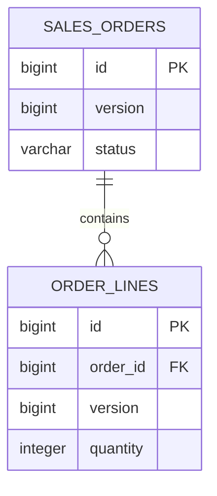

# Version Columns for Concurrent Update Control

An order can be open on two screens simultaneously: staff member A edits the amount while staff member B confirms the order. Both read the record in `DRAFT` status and save their results a few seconds later. If the application only runs `UPDATE ... WHERE id = ?`, the later write can silently **overwrite the valid change of the earlier write** without anyone noticing.

In relational data modeling, a common way to detect this situation is adding a **version column** to the row. On each valid update, the version increments; the write statement only succeeds if the stored version still matches the version the editor read. This is the foundation of **optimistic concurrency control** or **optimistic locking**. In JPA, the `@Version` annotation lets the ORM handle most of this mechanism automatically for managed entities.

This lesson belongs to the **Object Mapping** chapter of **DATABASE_DATA_MODELING**. The goal is not merely knowing where to put `@Version` on a Java class, but also designing PKs, version columns, SQL constraints, transaction boundaries, multi-row invariants, and verifiable conflict-handling flows. In particular, you must understand **which cases a version protects and which cases it does not**.

## 1. Why Do We Need a Version Column?

### 1.1. Lost Update: Two Users Editing the Same Stale State

Suppose order `#42` currently holds:

```text
id = 42
status = DRAFT
total_amount = 500000.00
version = 7
```

Two staff members read this order concurrently:

```mermaid
sequenceDiagram
    participant A as Staff A
    participant DB as Database
    participant B as Staff B
    A->>DB: SELECT Order #42 (amount=500000, version=7)
    B->>DB: SELECT Order #42 (amount=500000, version=7)
    A->>DB: UPDATE amount=450000 WHERE id=42
    DB-->>A: Write succeeds
    B->>DB: UPDATE amount=480000 WHERE id=42
    DB-->>B: Write succeeds
    Note over DB: Result = 480000; A's change was overwritten
```

Both requests may be valid *on their own*, yet writing based solely on the primary key fails to detect that the data B viewed is stale. If A and B both edit `total_amount`, the final outcome is **last writer wins**; if B submits an entire entity carrying stale values in other fields, B can accidentally overwrite unrelated changes as well.

### 1.2. Adding a Version to Detect Reads from the Past

Instead of checking only `id`, each transaction must write alongside the version it read:

```sql
UPDATE sales_orders
SET total_amount = :new_amount,
    version = version + 1
WHERE id = :order_id
  AND version = :expected_version;
```

When A updates with `expected_version = 7`, the database advances `version` to 8. B still uses version 7, so B's update **matches zero rows**. The application detects the conflict and handles it instead of silently overwriting A's work.

```mermaid
sequenceDiagram
    participant A as Transaction A
    participant DB as Database
    participant B as Transaction B
    A->>DB: SELECT #42, version=7
    B->>DB: SELECT #42, version=7
    A->>DB: UPDATE ... WHERE id=42 AND version=7
    DB-->>A: 1 row; version=8
    B->>DB: UPDATE ... WHERE id=42 AND version=7
    DB-->>B: 0 rows; version is no longer 7
    Note over B: Conflict detected, A is not overwritten
```

A version column is not a wall clock, not a global system sequence, and not a business code. It is a **freshness marker for protected state**, typically managed per row/entity.

### 1.3. Terms to Distinguish

| Term | Meaning |
|---|---|
| **Optimistic locking** | Allows concurrent reads without long locks, checking for conflicts at write or transaction end |
| **Version column** | Column storing a value that changes whenever state is successfully updated |
| **Compare-and-swap (CAS)** | Updates only if the conditioned value still equals the expected value |
| **Lost update** | One change gets overwritten by another based on stale state |
| **Pessimistic locking** | Locks data during read/edit to block other transactions from modifying it concurrently |
| **Isolation level** | Governs which changes from other transactions are visible and what concurrency guarantees the DB provides |

Version columns **detect per-entity/per-row conflicts**. They do not replace transaction isolation levels or schema constraints.

## 2. Designing the Version Column from Business Requirements

Suppose a sales system has these rules:

1. An order has a stable ID; status is strictly in `DRAFT`, `CONFIRMED`, or `CANCELLED`.
2. Amount must be non-negative and order code is unique.
3. Amount may only be edited while the order is in `DRAFT` status.
4. If the order was updated by someone else after the screen loaded, the write must detect a conflict.
5. Successful updates must be verifiable in the database, even when running multiple application instances.

An illustrative PostgreSQL schema:

```sql
CREATE TABLE sales_orders (
    id BIGINT GENERATED ALWAYS AS IDENTITY PRIMARY KEY,
    order_code VARCHAR(40) NOT NULL UNIQUE,
    status VARCHAR(20) NOT NULL
        CHECK (status IN ('DRAFT', 'CONFIRMED', 'CANCELLED')),
    total_amount NUMERIC(19, 2) NOT NULL
        CHECK (total_amount >= 0),
    currency_code VARCHAR(3) NOT NULL,
    version BIGINT NOT NULL DEFAULT 0
        CHECK (version >= 0),
    updated_at TIMESTAMPTZ NOT NULL DEFAULT CURRENT_TIMESTAMP
);
```

Role of each column:

- `id` is the **primary key**, identifying **which row** to update.
- `order_code` is a unique business-meaningful lookup code.
- `status` and `total_amount` are **mutable state** governed by business rules.
- `version` is the **concurrency check marker**, starting at 0 in this example and incrementing on controlled writes.
- `updated_at` is the **update timestamp**, useful for display and basic auditing. It does not safely replace a version column unless clock resolution, time sources, and write paths are consistently engineered.

### Why `NOT NULL` and an Initial Value?

A predicate `WHERE version = :expected` will not match a row where `version = NULL` under standard equality comparison. Prevent undefined states with `NOT NULL` and initialize defaults consistently with the ORM. When introducing `@Version` on existing tables lacking version values, run a backfill/migration first.

`BIGINT` suits an incrementing version counter in this example, though type selection must match between database and Java. There is no business requirement to expose version numbers to end users; it is consistency metadata, not a key.

### Why Not Add a Separate Index on `version`?

A typical CAS update locates the row by `PRIMARY KEY(id)` and then compares `version`. The PK index already pinpoints the single row. A separate index on `version` rarely speeds up this write path and adds update overhead because `version` changes on every edit. Only create extra indexes when a **real query** needs them and query plans confirm a benefit.

## 3. JPA Example: `@Version` on an Entity

An entity mapping the same schema:

```java
import jakarta.persistence.*;
import java.math.BigDecimal;
import java.util.Objects;

enum OrderStatus {
    DRAFT, CONFIRMED, CANCELLED
}

@Entity
@Table(name = "sales_orders")
public class SalesOrder {

    @Id
    @GeneratedValue(strategy = GenerationType.IDENTITY)
    private Long id;

    @Column(name = "order_code", nullable = false, length = 40, unique = true)
    private String orderCode;

    @Enumerated(EnumType.STRING)
    @Column(nullable = false, length = 20)
    private OrderStatus status = OrderStatus.DRAFT;

    @Column(name = "total_amount", nullable = false,
            precision = 19, scale = 2)
    private BigDecimal totalAmount;

    @Column(name = "currency_code", nullable = false, length = 3)
    private String currencyCode;

    @Version
    @Column(nullable = false)
    private Long version;

    @Column(name = "updated_at", nullable = false)
    private java.time.OffsetDateTime updatedAt;

    protected SalesOrder() {
        // Constructor for JPA.
    }

    public SalesOrder(
            String orderCode, BigDecimal totalAmount,
            String currencyCode) {
        this.orderCode = Objects.requireNonNull(orderCode);
        this.totalAmount = Objects.requireNonNull(totalAmount);
        this.currencyCode = Objects.requireNonNull(currencyCode);
        if (totalAmount.signum() < 0) {
            throw new IllegalArgumentException("Amount must be >= 0");
        }
        this.updatedAt = java.time.OffsetDateTime.now();
    }

    public Long getId() { return id; }
    public Long getVersion() { return version; }
    public BigDecimal getTotalAmount() { return totalAmount; }
    public OrderStatus getStatus() { return status; }

    public void changeAmount(BigDecimal nextAmount) {
        requireDraft();
        Objects.requireNonNull(nextAmount);
        if (nextAmount.signum() < 0) {
            throw new IllegalArgumentException("Amount must be >= 0");
        }
        this.totalAmount = nextAmount;
        this.updatedAt = java.time.OffsetDateTime.now();
    }

    public void confirm() {
        requireDraft();
        this.status = OrderStatus.CONFIRMED;
        this.updatedAt = java.time.OffsetDateTime.now();
    }

    private void requireDraft() {
        if (status != OrderStatus.DRAFT) {
            throw new IllegalStateException("Order is no longer a draft");
        }
    }
}
```

**Example assumptions:** order codes are unique, `totalAmount` is already computed properly in the domain, and timestamps use `OffsetDateTime` with `TIMESTAMPTZ` per active ORM/DB capabilities. The example omits currency-code validation, order-code validation, authorization, monetary rounding rules, and actual migrations. Field names and annotations must be verified against your specific provider.

### 3.1. What Happens When a Managed Entity Is Modified?

Inside a transaction:

```java
SalesOrder order = em.find(SalesOrder.class, 42L);
order.changeAmount(new BigDecimal("450000.00"));
// No em.update() needed; managed entities are tracked via dirty checking.
// On flush/commit, the ORM executes a version-conditioned update.
```

Semantically, a JPA provider may generate SQL like:

```sql
UPDATE sales_orders
SET total_amount = :next_amount,
    updated_at = :next_updated_at,
    version = :new_version
WHERE id = :id
  AND version = :old_version;
```

`:new_version` typically corresponds to the next numeric version. The exact `SET` column list depends on the ORM, dirty checking, dynamic-update settings, and which fields changed. **Do not depend on the exact SQL text**; what matters is verifying the old-version condition and detecting zero updated rows.

### 3.2. Rules for Managing the `@Version` Field

- For a versioned entity, the provider manages the version field and uses it to detect stale state.
- Use **one `@Version` property** per entity hierarchy per JPA rules, aligned consistently with the entity mapping and root table.
- In application code, **never call `setVersion(...)`** to "trick" the check. Version updates must happen as part of synchronized write paths.
- For JPA portability, common version types are `int`/`Integer`, `long`/`Long`, `short`/`Short`, or `java.sql.Timestamp`. `Long` is a popular choice that is easy to reason about and independent of clock resolution.
- A version may not hold its final value before persist; initial version assignment depends on the provider. Do not use `version != null` as proof that a transaction committed.

If the entity uses inheritance, verify where the version column resides across `SINGLE_TABLE`, `JOINED`, or `TABLE_PER_CLASS`. With strategies using a root table, placing the version field on the root entity and base table is usually easier to control. Do not put independent `@Version` fields on each subclass and assume all hierarchy updates are protected consistently.

### 3.3. When Does JPA Detect Conflicts?

An `OptimisticLockException` can be thrown on `flush` or on `commit`. Transaction-integrated providers may wrap the error in a higher-level exception; for example, transaction frameworks may translate it into their own exception hierarchy. Never build logic assuming the exception is **always** thrown on the `em.flush()` line.

When an optimistic conflict occurs, the current transaction usually must roll back. Never keep using a failed persistence context to retry by manually bumping `version`. Open a fresh transaction, reload data, and re-evaluate the operation.

## 4. Two-Transaction Flow in Practice: Who Wins, Who Retries?

Suppose two independent `EntityManager` instances operate on order `#42` at version 7.

| Step | Transaction A | Transaction B | Database |
|---|---|---|---|
| 1 | Reads ID 42, version 7 | | Version 7 |
| 2 | | Reads ID 42, version 7 | Version 7 |
| 3 | Changes amount → 450000 | | Version 7 |
| 4 | Commits conditioned on version 7 | | Version 8 |
| 5 | | Changes amount → 480000 | Version 8 |
| 6 | | Commits conditioned on version 7 → conflict | Version 8, amount 450000 |

In PostgreSQL under an appropriate isolation level and atomic conditional update, only one transaction holding version 7 can succeed. The other must handle the conflict. If transactions contend on row locks simultaneously, the database resolves them according to isolation level and may raise a different error in some cases, yet it must never silently drop the version condition.

### 4.1. ORM-Independent SQL Verification of CAS

Seeing it directly:

```sql
-- User A read version = 7:
UPDATE sales_orders
SET total_amount = 450000.00,
    version = version + 1,
    updated_at = CURRENT_TIMESTAMP
WHERE id = 42 AND version = 7
RETURNING id, total_amount, version;
-- Returns 1 row: (42, 450000.00, 8)

-- User B still thinks version = 7:
UPDATE sales_orders
SET total_amount = 480000.00,
    version = version + 1,
    updated_at = CURRENT_TIMESTAMP
WHERE id = 42 AND version = 7
RETURNING id, total_amount, version;
-- Returns 0 rows: version condition no longer holds.
```

`RETURNING` is PostgreSQL syntax. On other DBMSs, check the **affected row count** via the appropriate API. Zero rows could mean the row was deleted, the version changed, or a business condition no longer holds—never assume it is exclusively a version conflict when `WHERE` includes other predicates.

### 4.2. Comparing Unsafe vs. Safe Writes

Unsafe when the goal is detecting stale writes:

```sql
UPDATE sales_orders
SET status = 'CONFIRMED'
WHERE id = 42;
```

Version-conditioned:

```sql
UPDATE sales_orders
SET status = 'CONFIRMED',
    version = version + 1,
    updated_at = CURRENT_TIMESTAMP
WHERE id = 42
  AND version = :expected_version
  AND status = 'DRAFT'
RETURNING id, status, version;
```

In the second statement, `status = 'DRAFT'` is a **business invariant**; `version = :expected_version` is a **concurrency check**. Both predicates complement each other and address different concerns. If zero rows are updated, the application layer determines whether to return "order already confirmed," "order not found," or "data changed concurrently."

### 4.3. Database Isolation Levels Still Matter

A versioned update is an **atomic conditional operation** in the database. Still, isolation levels like `READ COMMITTED`, `REPEATABLE READ`, and `SERIALIZABLE` carry different guarantees, costs, and concurrency errors depending on the DBMS. `@Version` does not automatically upgrade a transaction to `SERIALIZABLE`.

For example, single-row optimistic locking does not protect a constraint like "no two doctors on the same shift" if two transactions **insert two separate rows**. That requires a candidate/`UNIQUE` key, exclusion constraint, range locking, or an isolation strategy suited to the invariant. A version column cannot replace multi-row constraints.

## 5. Conflict Handling Is a Business Decision, Not Just Catching an Exception

When B fails to save because the version changed, there are several handling strategies:

| Policy | Suitable When | What to Avoid |
|---|---|---|
| **Reject and ask to reload** | Action has major consequences, e.g., confirming an order | Never silently overwrite someone else's change |
| **Reload and let user diff** | Two content edits can be reconciled | Never promise auto-merge without knowing field semantics |
| **Conditional retry** | Operation is safely repeatable and invariants still hold | Never retry infinitely or repeat external side effects |
| **Sync via atomic operations** | Incrementing counters or adjusting quantities by exact rules | Never switch from "set value" to "add delta" unless domain permits |
| **Pessimistic lock** | High contention requiring coordination on a critical step | Never hold DB locks while the user edits a form |

For instance, two users editing `shippingAddress` and `internalNote` might be mergeable if those fields are independent and the domain allows it. However, two users changing payment amount or confirmation status must not be auto-merged merely because they touched different fields: invariants often depend on **the combined order state**.

### 5.1. Retries Must Run in a Fresh Transaction

A logical flow:

```text
1. User submits an action along with the version they viewed.
2. Server opens a transaction and loads the current entity.
3. Verify permissions, status, and expected version.
4. Apply domain behavior on the managed entity.
5. Commit. On optimistic conflict:
   - roll back the failed transaction;
   - report conflict or open a fresh transaction to reload;
   - retry only if the operation is safe and rules still hold.
```

Not every conflict should be retried: confirming an order, issuing an invoice, transferring funds, or calling a payment gateway have **non-repeatable side effects**. If retrying is necessary, design idempotency keys, outboxes, or mechanisms ensuring external actions never execute twice.

### 5.2. Re-Syncing Data with the Editor

Useful feedback typically includes:

- That someone else modified the order after the screen was loaded.
- Key current values needed for the user to decide, e.g., status is now `CONFIRMED`.
- Options: reload, compare changes, cancel the edit, or submit a new change request.

Never leak raw SQL errors or sensitive exception traces to the UI. A conflict is a **normal usage scenario** in a multi-user system and should be designed as a predictable business flow.

## 6. Optimistic Locking with Detached Entities and `merge()`

Web applications commonly load an entity in transaction A, send data to the UI, and seconds or minutes later receive an update request in transaction B. The Java object from the prior transaction is **detached** and may carry an older version.

```text
Loaded at 09:00:
  Order {id=42, version=7, amount=500000}

Someone else writes at 09:01:
  Database {id=42, version=8, amount=450000}

Stale form submitted at 09:03:
  {id=42, version=7, amount=480000}
```

Passing a detached entity carrying its original version into `merge` allows the ORM to detect stale state on merge/flush/commit. However, never construct a brand-new entity from a DTO, ignore version, and blindly call `merge`: that fails to enforce "edit only from the version the user saw," and can even overwrite fields omitted from the form depending on how the object is built.

### 6.1. Using the Form's ID and Expected Version

A safe, clear pattern:

```java
public void changeAmount(
        EntityManager em,
        long id,
        long expectedVersion,
        BigDecimal requestedAmount) {

    SalesOrder managed = em.find(SalesOrder.class, id);
    if (managed == null) {
        throw new EntityNotFoundException("Order not found");
    }
    if (!Objects.equals(managed.getVersion(), expectedVersion)) {
        throw new StaleOrderException("Order has been modified");
    }

    managed.changeAmount(requestedAmount);
    // The use-case transaction commits; JPA still checks @Version
    // to catch races occurring after the Java comparison.
}
```

`StaleOrderException` is a hypothetical application-defined domain exception; `Objects` requires importing from `java.util`. This method runs **inside a transaction** and modifies only fields permitted by the use case. Checking `expectedVersion` upfront gives a clear error when the form is already stale; checking `@Version` at commit catches races between the read and write moments.

Without sending expected version from the form, `em.find` loads the latest version visible to the transaction, allowing a command based on **stale user intent** to succeed. `@Version` only protects the read point *of the current transaction*; it has no idea which version the user looked at minutes earlier.

### 6.2. Version Does Not Belong in Entity `equals()`

Two objects:

```text
SalesOrder {id=42, version=7}
SalesOrder {id=42, version=8}
```

still represent **the exact same order** at two points in time. Never include `version` in `equals()` and `hashCode()` to identify an entity: version is mutable state, whereas persistence identity relies on the primary key and entity type.

## 7. Version Fields in APIs: ETag and `If-Match`

At the HTTP layer, optimistic concurrency can be expressed via **ETag** and the `If-Match` request header. This communicates the update precondition from client to server based on a previously viewed representation.

Example server response:

```http
GET /orders/42 HTTP/1.1

HTTP/1.1 200 OK
ETag: "order-42-v7"
Content-Type: application/json

{"id":42,"status":"DRAFT","totalAmount":"500000.00"}
```

When the user saves:

```http
PATCH /orders/42 HTTP/1.1
If-Match: "order-42-v7"
Content-Type: application/json

{"totalAmount":"450000.00"}
```

If the current representation changed and the ETag no longer matches, the server can return `412 Precondition Failed`. If the API requires every update request to include a precondition and the client omits it, `428 Precondition Required` can be returned per API contract. `409 Conflict` is also used for other domain conflicts, such as an order no longer in an editable status.

### 7.1. ETag Does Not Need to Expose Raw Version Numbers

An ETag is an **opaque validator** in the HTTP protocol; the server may construct it from ID and version, or another mechanism, provided comparison accurately reflects the protected representation. `"order-42-v7"` is just an illustration. When a response changes due to related data, ETag computation must account for those changes too if clients expect the validator to guard the whole representation.

Never treat ETags or versions as authentication credentials or proof of authorization. Every update operation must still verify caller permissions and state preconditions.

### 7.2. `If-Match` Still Requires Atomic Writes

Unsafe sequence:

```text
1. Server compares If-Match against version=7.
2. Another request updates the row to version=8.
3. Server executes UPDATE ... WHERE id=42, without version.
```

A race occurred between steps 1 and 3. Thus checking the header is only a **protocol-level precondition**; the actual write must use CAS or `@Version` inside the transaction to ensure no overwrite happens if the row changes after the check.

### 7.3. Keep API Formats and Behavior Consistent

You do not have to expose Java `Long` types to the frontend. The server can return `version` metadata in JSON per the API contract, or use ETag in headers. What matters is that the client sends back **the version it observed**, and the server checks it inside a transaction and returns a meaningful error when stale.

When using HTTP ETags, follow `If-Match` comparison rules (strong comparison per HTTP); never assume weak ETags can be substituted arbitrarily. If an API exposes multiple representations of the same resource, define validators and update preconditions consistently per representation.

## 8. Which Row Does Version Protect? Pitfalls with Collections and Aggregates

An order can contain multiple order lines:



Suppose `SalesOrder` has `@Version` and `OrderLine` is a separate entity with `quantity`. If a transaction updates only an `OrderLine`, **do not assume** the `sales_orders` row's version automatically increments in all ORMs and configurations. That means:

- `@Version` on `SalesOrder` protects changes where the provider actually checks and increments the **root's** version.
- If `OrderLine` has its own `@Version`, edits to **that same line** are checked against the line's version.
- Aggregate invariants such as "never edit lines after confirmation" require controlling **both root status and line changes**, not merely checking the line's version number.

### 8.1. A Simple Model

```sql
CREATE TABLE order_lines (
    id BIGINT GENERATED ALWAYS AS IDENTITY PRIMARY KEY,
    order_id BIGINT NOT NULL REFERENCES sales_orders(id),
    quantity INTEGER NOT NULL CHECK (quantity > 0),
    version BIGINT NOT NULL DEFAULT 0 CHECK (version >= 0)
);
```

`OrderLine` can have its own `@Version private Long version;` if line updates operate independently in the model. However, if the business treats `Order` as the aggregate root and every line edit requires `Order`'s consent, concurrency control must align with the **aggregate boundary**, not individual rows alone.

### 8.2. Force-Incrementing the Root Version

In JPA, a use case modifying a line can explicitly request incrementing the root's version:

```java
SalesOrder order = em.find(SalesOrder.class, orderId);
if (order == null) {
    throw new EntityNotFoundException("Order not found");
}

em.lock(order, LockModeType.OPTIMISTIC_FORCE_INCREMENT);
// Call domain method on root, check DRAFT status,
// then mutate OrderLines managed by the root.
```

`OPTIMISTIC_FORCE_INCREMENT` requests checking and incrementing the entity's version per JPA mechanics; exact SQL timing depends on the provider. This expresses that an internal aggregate change must advance the root's version marker. Still, it does not lock the entire collection, does not automatically solve all multi-row invariants, and can raise contention when independent operations touch the same root.

**Important:** every write path affecting the same invariant must coordinate consistently—a service updating a line without participating in root versioning can break rules relative to another service confirming the Order.

### 8.3. Collection Queries Can Also Race

For example, two staff members read an order's line count and decide to append a line at the end:

```text
A: SELECT MAX(line_no) -> 3
B: SELECT MAX(line_no) -> 3
A: INSERT line_no=4
B: INSERT line_no=4
```

The Order row's version **does not automatically** prevent two `INSERT`s without proper coordination. The database should enforce `UNIQUE(order_id, line_no)`. Then the application can lock the root, allocate sequence numbers atomically, or perform controlled retries on unique conflicts.

This clearly illustrates that **versioning and business constraints complement each other** rather than replacing one another.

## 9. `@Version` Does Not Protect Write Paths That Bypass the ORM

### 9.1. Native SQL Does Not Know About Version Automatically

An external SQL statement:

```sql
UPDATE sales_orders
SET status = 'CONFIRMED'
WHERE id = :id;
```

can alter status **without incrementing version**. An entity loaded earlier could then continue updating with the old version and never notice the status was changed externally.

To keep the contract intact, every write path must obey it:

```sql
UPDATE sales_orders
SET status = :new_status,
    version = version + 1,
    updated_at = CURRENT_TIMESTAMP
WHERE id = :id
  AND version = :expected_version
  AND status = 'DRAFT'
RETURNING version;
```

Any writer lacking an expected version must be designed with appropriate locking or exclusive write workflows; merely bumping version without checking the prior version lets prior ORM readers detect stale state, yet does not protect that writer itself from overwriting based on stale data.

### 9.2. Bulk JPQL Updates/Deletes Also Need Special Care

Example:

```java
int updated = em.createQuery("""
    update SalesOrder o
    set o.status = :status
    where o.id = :id
    """)
    .setParameter("status", OrderStatus.CONFIRMED)
    .setParameter("id", orderId)
    .executeUpdate();
```

This is a **bulk update**, not equivalent to editing a managed entity and committing. Per JPA, bulk update/delete operations do not automatically perform optimistic version checking or synchronize the persistence context like entity-level operations. If concurrency protection is required, include version predicates and increment version explicitly in the statement, or avoid bulk operations for invariant-heavy use cases.

After a bulk update, entities already loaded in the persistence context can become **stale**. Define when to `clear`/refresh or open a new persistence context, and verify effects on caches, callbacks, and auditing.

### 9.3. Avoid Multiple Competing "Version Managers"

If a database trigger increments `version` on every `UPDATE` while the ORM also increments version in its update statement, a single write can bump the version **twice** or leave the ORM holding a value mismatched with the database depending on provider mechanics. DB-generated versions are possible, yet require deliberately configuring the provider and refreshing generated values.

Pick one **unified contract for all writers**: who generates the version, when it increments, how writers compare the prior version, and how entities refresh versions after commit.

## 10. Choosing Optimistic or Pessimistic Locking?

### 10.1. When Optimistic Locking Fits

Optimistic locking is usually suitable when:

- Many users view data, yet **few update the exact same row** at the same time.
- Transactions are short and conflicts can be surfaced to the user for resolution.
- You do not want to hold database locks while users edit screens.
- Writes can be re-evaluated cleanly after conflict detection.

For orders, address edits, profile statuses, and low-contention configurations, `@Version` is usually a sound starting point.

### 10.2. When Pessimistic Locking Is Needed

When many operations contend over the exact same resource—such as workers allocating scarce inventory or claiming the same job—early transaction-level locking may be needed:

```java
SalesOrder order = em.find(
    SalesOrder.class,
    orderId,
    LockModeType.PESSIMISTIC_WRITE
);
// Execute domain operation and commit in a short transaction.
```

Or PostgreSQL SQL:

```sql
SELECT id, status, total_amount, version
FROM sales_orders
WHERE id = :id
FOR UPDATE;
```

Pessimistic locking reduces certain write conflicts while increasing lock waits, deadlock risk, and throughput impact. Never hold transactions or row locks while waiting on user input or slow external service calls.

### 10.3. Combining Options

A system can use `@Version` for ordinary edits and `PESSIMISTIC_WRITE` for specific high-contention steps. The database must still retain PK, FK, `UNIQUE`, `CHECK`, and other constraints. The goal is **optimizing for invariants and real workload**, not forcing one lock style across the whole application.

| Criterion | Optimistic | Pessimistic |
|---|---|---|
| Strategy | Concurrent reads, conflict check on write | Lock target data early |
| Cost under low contention | Usually low | Still incurs lock overhead |
| Under high contention | Can cause frequent conflicts/retries | Can cause lock waits/deadlocks |
| Transaction duration | Usually short | Must be extra short because locks are held |
| Long user interactions | Fits well when version is sent back | Never hold locks while user edits a form |
| Multi-row invariants | Needs extra constraints/solutions | Still must define lock scope and isolation |

## 11. Limits of Versioning: Multi-Row and Multi-Aggregate Rules

### 11.1. Avoid Confusing Lost Updates with Write Skew

Two doctors are allowed to take leave as long as **at least one doctor on the team remains on duty**. Transaction A reads "B is on duty" and marks A on leave; simultaneously, Transaction B reads "A is on duty" and marks B on leave. Both modify **two different rows**, each with its own version, so both can succeed even though the overall rule is violated.

This is a form of **write skew**: per-row optimistic versioning does not detect conflicts when two transactions modify different rows that share a multi-row invariant.

Design solutions to consider:

- Consolidate the invariant into a single row/aggregate with a shared version where appropriate.
- Use SQL constraints (unique, exclusion, or adjusted table structures) when expressible.
- Lock a shared coordination row or run transactions at an appropriate isolation level.
- Test with truly concurrent transactions rather than sequential unit tests alone.

### 11.2. Version Does Not Replace Unique Keys

Two transactions concurrently creating customers with the same `email` have no pre-existing row to version-check. `@Version` on new entities cannot stop two `INSERT`s with distinct IDs. The database needs `UNIQUE(email)` (or business-scoped uniqueness) and the application must handle concurrency errors.

### 11.3. Version Does Not Prove a Transaction Committed

A new version may be assigned or visible in the persistence context during `flush`, yet the transaction can still roll back. To confirm durable state, inspect results after commit in a separate transaction/context.

## 12. Designing Migrations to Add Version to a Live Table

Suppose `sales_orders` already exists in production without a `version` column. A basic PostgreSQL migration:

```sql
ALTER TABLE sales_orders
ADD COLUMN version BIGINT NOT NULL DEFAULT 0;

ALTER TABLE sales_orders
ADD CONSTRAINT ck_sales_orders_version_nonnegative
CHECK (version >= 0);
```

**Do not run the column-add statement twice:** this snippet is a migration for an existing table without a version column, whereas the initial DDL in Section 2 already included it. In versioned schema management, place this migration in the expand step for the appropriate environment.

### 12.1. The Hard Part Is Not Just Adding the Column

If legacy application instances are still running and executing:

```sql
UPDATE sales_orders SET total_amount = :amount WHERE id = :id;
```

they can mutate data **without bumping version**, while new application instances believe version protects every writer. A rollout plan must:

1. Inventory every write source: services, batch jobs, imports, manual SQL, and integrations.
2. Add the column, default value, and database constraints.
3. Update every writer to follow the version/CAS contract or an explicit compatible write policy.
4. Deploy ORM `@Version` and conflict-handling paths.
5. Verify rolling coexistence of old and new app versions: during transition, block or guard writers not yet obeying the contract.
6. Monitor conflict rates, transaction errors, latency, and user-workflow impacts.

Never assume adding `@Version` to one Java class suffices in a system with multiple writers.

### 12.2. Migrating from Timestamp to Numeric Version

Some legacy schemas use `updated_at` as a version. That can suffer from clock resolution limits, timestamp rounding differences between Java and the DB, clock skew, or multiple updates within the same time unit. When reliable CAS semantics are needed, an **integer counter** usually guarantees distinctness across writes more cleanly.

If switching to an integer counter, plan the migration so clients still sending timestamp validators and newer clients sending numeric validators do not misinterpret or skip conflicts. API-exposed versions must transition intentionally, never silently.

## 13. Testing with Two Real Transactions

### 13.1. Minimal Test

Order ID 42, initial version 7. Using two independent `EntityManager` instances:

```java
EntityManager emA = emf.createEntityManager();
EntityManager emB = emf.createEntityManager();

try {
    emA.getTransaction().begin();
    emB.getTransaction().begin();

    SalesOrder a = emA.find(SalesOrder.class, 42L);
    SalesOrder b = emB.find(SalesOrder.class, 42L);

    a.changeAmount(new BigDecimal("450000.00"));
    b.changeAmount(new BigDecimal("480000.00"));

    emA.getTransaction().commit(); // Writes new version.

    try {
        emB.getTransaction().commit();
        throw new AssertionError("Should detect stale update");
    } catch (OptimisticLockException | RollbackException expected) {
        // Inspect actual root cause per JPA provider.
    }
} finally {
    if (emA.getTransaction().isActive()) emA.getTransaction().rollback();
    if (emB.getTransaction().isActive()) emB.getTransaction().rollback();
    emA.close();
    emB.close();
}
```

This is a **JPA resource-local transaction test sketch**. It assumes `emf` is available, order 42 exists in `DRAFT`, and JPA/`BigDecimal` imports are added. Under Spring/Jakarta EE managed transactions, exception catching and rollback differ. Some errors may be thrown on `flush` or wrapped in transaction exceptions; production tests should inspect causes per provider and then re-read from a fresh context.

**Note:** exact exception classes and conflict detection timing vary; the test goal is ensuring only one transaction commits successfully, not mechanically coupling to a specific stack trace.

### 13.2. Mandatory Verification Scenarios

| Scenario | Expected Outcome |
|---|---|
| Two transactions read the same version and edit the same row | One write succeeds, the other fails with conflict detection |
| Two transactions update **two independent rows** | Both can succeed if no shared invariant forbids it |
| Client sends stale version from a form | Rejected before writing or by optimistic check on commit |
| User edits order from `DRAFT` after someone else `CONFIRMED` it | Edit must not overwrite confirmed status |
| SQL write outside the ORM | Must check/bump version per contract or use another controlled mechanism |
| Bulk JPQL update | Must not assume automatic versioning; verify SQL, caches, and context |
| Write transaction rolls back | Persistent state and version remain unchanged from rolled-back work |
| Line quantity changes without touching root | Verify whether invariants/root version are protected per policy |
| Two requests concurrently create the same business code | `UNIQUE` prevents duplicates; never rely on `@Version` |
| Two edits on two rows violate an aggregate/global rule | Requires extra constraints/locking/isolation for multi-row invariants |
| API `If-Match` mismatch | Returns 412 and never silently overwrites |
| Retry after conflict | Executes in a fresh transaction; does not repeat unwanted side effects |

### 13.3. What to Observe

In test environments, enable SQL logging and transaction metrics to check:

- Whether `WHERE id = ? AND version = ?` or an equivalent mechanism is emitted.
- Actual affected row count when the old version no longer matches.
- Version increment after each managed update.
- Entity state in a fresh context after commit.
- Exception behavior, rollback, retry, and API response payloads.
- Conflict counts by operation type; if excessive, revisit aggregate boundaries or locking strategy.

Never check only `order.getVersion()` on the same managed entity. Verify the database and behavior across **two real transactions**.

## 14. Common Mistakes

**Mistake 1 — "Simply having a version column makes the DB prevent lost updates."** If SQL neither checks the old version nor increments the new version, a column alone provides no optimistic locking.

**Mistake 2 — "`@Version` checks immediately on `em.find`."** Stale-write detection typically happens on flush/commit or during proper lock/merge operations.

**Mistake 3 — "Version replaces PK or unique keys."** Version does not identify rows and cannot stop two transactions from `INSERT`ing two rows with duplicate business keys.

**Mistake 4 — "Seeing `getVersion() = 8` means it committed."** The transaction can still roll back.

**Mistake 5 — "On optimistic error, just bump version from 7 to 8 and recommit."** Doing so discards the other user's work; reload and re-run the business decision.

**Mistake 6 — "`@Version` protects all collections and related aggregates."** Version scope covers only operations the ORM actually checks; multi-row invariants require extra mechanisms.

**Mistake 7 — "Bulk JPQL updates share the same semantics as dirty checking."** Bulk updates bypass normal entity-level checks and can leave the persistence context stale.

**Mistake 8 — "An updated timestamp is always a safe version."** Clock resolution, skew, and write timing can let two updates lack distinct validators.

**Mistake 9 — "Having `If-Match` is enough; the `UPDATE` doesn't need version."** A race still exists between header comparison and the write.

**Mistake 10 — "Every conflict must be retried automatically."** Some actions may run only once; retries require idempotency and valid business preconditions.

**Mistake 11 — "Add an index on `version` to speed up updates."** Updates locate rows by PK; a dedicated version index usually just adds write cost.

**Mistake 12 — "Adding `@Version` to the new app protects every writer."** Legacy SQL, jobs, and external services ignoring the contract can render versioning unreliable.

## 15. Process for Designing Concurrent Update Control

**Step 1 — Identify what state needs protection.** One order, one line, or the whole aggregate? If invariants span multiple rows, identify the shared coordination point.

**Step 2 — Choose keys and version column.** Place a stable PK and `version BIGINT NOT NULL DEFAULT 0` (or equivalent); never replace keys with version.

**Step 3 — Write SQL constraints.** `NOT NULL`, `CHECK`, `UNIQUE`, and `FOREIGN KEY` protect invariants expressible in the database. Version handles a separate class of conflicts.

**Step 4 — Map `@Version` consistently.** Choose matching Java types, avoid direct setters, and verify conditional SQL and version increments.

**Step 5 — Design transactions/use cases.** Load managed entity, verify permissions, status, and client-observed version, apply domain methods, then commit.

**Step 6 — Define conflict handling.** Return clear errors, let users reload, or conditionally retry in a fresh transaction. Never repeat non-idempotent side effects.

**Step 7 — Align all writers and APIs.** Native SQL, batch jobs, bulk updates, webhooks, and app versions must share the same contract or follow a compatible transition policy.

**Step 8 — Run real concurrency tests.** Two transactions editing one row, concurrent inserts of related rows, collection and root edits, rollbacks, network failures, and duplicate requests.

**Step 9 — Monitor in production.** Track conflict rates, latency, retry rates, lock contention, and stale-write indicators; tune aggregate boundaries and coordination based on observed data.

## 16. Practice Exercise

**Context:** A warehouse inventory system has `StockBalance` with `warehouse_id`, `product_id`, `available_quantity`, and `version`. Two staff members adjust stock concurrently; another process creates dispatch notes. The business requires never letting available quantity go negative, preventing overwrites during manual stock edits, and never issuing two dispatch notes with the same code.

Answer these questions:

1. Which key identifies a stock balance record? When use `PRIMARY KEY(warehouse_id, product_id)`, and when use `stock_balance_id` plus `UNIQUE`?
2. Which lost updates does `@Version` prevent when two staff members edit the same `StockBalance`?
3. Write a CAS SQL statement to **decrement stock quantity** by 5 units, only when sufficient stock exists and the version still matches.
4. Why is `@Version` on `StockBalance` insufficient to stop two processes from creating dispatch notes with the same code?
5. If a dispatch note spans multiple lines and updates multiple warehouses, does a single row's version guarantee the entire non-negative requirement?
6. In a REST API, what should the client send so the server knows which state the user viewed when editing?
7. If a batch job updates `available_quantity` without incrementing version, what happens?
8. When should you use row locking or atomic `UPDATE` statements instead of standard load–modify–save?

### Reference Solution Guide

**1.** If each warehouse–product pair has one balance, `(warehouse_id, product_id)` is a candidate key. Use it directly as a composite PK, or use a surrogate PK with `UNIQUE(warehouse_id, product_id)`; the choice depends on FK reach, stability, and evolution needs.

**2.** Two staff members read version 9 and both set a new quantity: only the first transaction updating `WHERE version = 9` succeeds; the second must handle stale state. Version alone does not prevent negative values unless the update checks the invariant.

**3.** PostgreSQL example:

```sql
UPDATE stock_balances
SET available_quantity = available_quantity - 5,
    version = version + 1
WHERE warehouse_id = :warehouse_id
  AND product_id = :product_id
  AND version = :expected_version
  AND available_quantity >= 5
RETURNING available_quantity, version;
```

Assumes `stock_balances` exists with proper PK/`UNIQUE` and `CHECK(available_quantity >= 0)`. If zero rows return, stock may be insufficient, version changed, or the warehouse–product pair was not found. The database must enforce non-negativity and the application must handle the outcome.

**4.** A version on stock rows does not replace `UNIQUE(dispatch_code)` on the dispatch notes table. Two new notes can receive two different IDs while sharing the same business code.

**5.** Updating multiple warehouses/lines is a multi-row invariant; it requires one transaction, per-row locks or conditional updates, plus SQL constraints and dispatch issuance rules. If total stock across multiple tables must not be oversold, design a broader consistency boundary.

**6.** Client sends `expectedVersion` or an ETag with `If-Match`; the server validates it and executes a version-checked atomic write.

**7.** The batch job mutates data while leaving version unchanged, causing stale reads to look current. Bring the batch job under the version-check/increment contract or guard it consistently.

**8.** Under high contention or simple conditional stock decrements, an atomic `UPDATE ... SET quantity = quantity - n WHERE quantity >= n` (including version per contract) can fit well. When decisions span multiple rows or dispatch coordination, evaluate pessimistic locking, isolation levels, and short transactions.

## 17. Key Takeaways

**A version column detects writes based on stale state:** an entity read at version `v` can only be updated while the database still holds exact version `v`; a successful update establishes a new version marker. In JPA, `@Version` supports this for managed entities, while external writers and bulk SQL/JPQL must be designed consistently.

For sound concurrency control, separate **primary keys identifying rows**, **versions checking freshness**, **SQL constraints enforcing integrity**, **transactions/isolation coordinating edits**, and **business rules governing edits and retries**. Version does not replace unique keys, does not automatically guard every collection or multi-row invariant, and does not prove a transaction committed. When every layer has clear responsibilities and is tested with real concurrent transactions, data can evolve without silently losing user changes.
