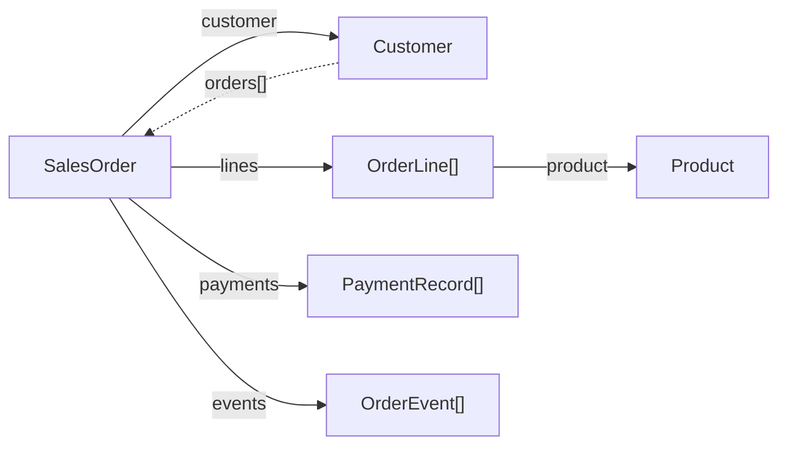

# Choosing What Data to Load and the Risk of Overly Large Object Graphs

In a Java application using an ORM, a statement to "fetch the order list" might read only a few dozen rows—or accidentally drag in customers, order lines, products, payments, event history, and several more layers of associations. Conversely, a detail page needing all order lines might fire **hundreds of SQL statements** if each collection only loads when a loop touches it. Both problems stem from choosing a **fetch plan** that mismatches actual usage needs.

In the **Object Mapping** chapter of **DATABASE_DATA_MODELING**, we do not merely translate Java entities and relationships into tables and foreign keys; we must also choose sensible read patterns. A data model with sound PKs and FKs can still perform poorly if every screen loads the entire *object graph*, whereas a good read design usually fetches only the fields, rows, and associations needed for **a specific use case**.

This lesson focuses on `LAZY`, `EAGER`, the `N+1` problem, `JOIN FETCH`, entity graphs, batch loading, DTOs/projections, pagination, row multiplication when joining multiple collections, transaction boundaries, and measurement/verification. Examples use JPA/Jakarta Persistence, specific Hibernate features are explicitly marked as **provider-specific**, and illustrative SQL targets PostgreSQL.

## 1. Start with Screen Requirements, Not Annotations

Suppose an e-commerce system has `Customer`, `SalesOrder`, `OrderLine`, `Product`, `PaymentRecord`, and `OrderEvent`. An order has one customer, many lines, many payment records, and many processing events.

Three very different needs:

| Use Case | Data Actually Needed | Should Not Load by Default |
|---|---|---|
| **List page of 25 latest orders** | Order code, date, status, total amount, customer name | All lines, products, payments, events |
| **Single order detail page** | Order info, customer, 10–30 lines, product names captured at purchase time | All transaction history and technical logs if tabs are closed |
| **Multi-million-row report export** | Specific report columns and aggregations | Millions of managed entities with all associations |

The difference here is not how entities are defined. **The exact same physical schema** can serve all three needs using three different queries or fetch strategies.

### 1.1. What Is an Object Graph?

An entity can hold references to other entities; traversing associations from a starting point yields an *object graph*.



In Java, `order.getCustomer().getOrders()` can navigate back to many orders; each order in turn has lines, payments, and events. **Having a path in the object model does not mean a use case should load the entire path.** In particular, bidirectional associations can create cycles during JSON serialization or inside `toString()`.

### 1.2. Graph Size Grows Rapidly with Relationship Multiplicity

Suppose each order averages:

- 12 order lines.
- 3 payment records or attempts.
- 15 processing events.

If an SQL query joins all three collections simultaneously, **each order can produce** `12 × 3 × 15 = 540` intermediate rows. Across 100 orders, you could transfer roughly **54,000 SQL rows** just to materialize a few thousand displayed objects. This is *Cartesian multiplication* from joining independent one-to-many relationships, not 54,000 distinct orders.

Exact row multiplication is not always that literal product: it depends on filter predicates, join types, actual element counts, and nulls. Still, multiplying cardinalities estimates **explosion risk** before writing a "fetch everything" join.

## 2. Sample Relational Schema and Data Cardinalities

A straightforward SQL design:

```sql
CREATE TABLE customers (
    id BIGINT GENERATED ALWAYS AS IDENTITY PRIMARY KEY,
    display_name VARCHAR(180) NOT NULL
);

CREATE TABLE sales_orders (
    id BIGINT GENERATED ALWAYS AS IDENTITY PRIMARY KEY,
    customer_id BIGINT NOT NULL REFERENCES customers(id),
    order_code VARCHAR(50) NOT NULL UNIQUE,
    placed_at TIMESTAMPTZ NOT NULL,
    status VARCHAR(20) NOT NULL
        CHECK (status IN ('DRAFT', 'CONFIRMED', 'CANCELLED')),
    total_amount NUMERIC(19, 2) NOT NULL CHECK (total_amount >= 0),
    currency_code CHAR(3) NOT NULL,
    version BIGINT NOT NULL DEFAULT 0
);

CREATE TABLE products (
    id BIGINT GENERATED ALWAYS AS IDENTITY PRIMARY KEY,
    sku VARCHAR(64) NOT NULL UNIQUE,
    display_name VARCHAR(200) NOT NULL
);

CREATE TABLE order_lines (
    id BIGINT GENERATED ALWAYS AS IDENTITY PRIMARY KEY,
    order_id BIGINT NOT NULL REFERENCES sales_orders(id),
    product_id BIGINT NOT NULL REFERENCES products(id),
    line_no INTEGER NOT NULL CHECK (line_no > 0),
    quantity INTEGER NOT NULL CHECK (quantity > 0),
    product_name_snapshot VARCHAR(200) NOT NULL,
    UNIQUE (order_id, line_no)
);

CREATE TABLE payment_records (
    id BIGINT GENERATED ALWAYS AS IDENTITY PRIMARY KEY,
    order_id BIGINT NOT NULL REFERENCES sales_orders(id),
    amount NUMERIC(19, 2) NOT NULL CHECK (amount > 0),
    status VARCHAR(20) NOT NULL
);

CREATE TABLE order_events (
    id BIGINT GENERATED ALWAYS AS IDENTITY PRIMARY KEY,
    order_id BIGINT NOT NULL REFERENCES sales_orders(id),
    occurred_at TIMESTAMPTZ NOT NULL,
    event_type VARCHAR(40) NOT NULL
);

CREATE INDEX idx_orders_customer_placed
    ON sales_orders(customer_id, placed_at DESC, id DESC);
CREATE INDEX idx_orders_placed_id
    ON sales_orders(placed_at DESC, id DESC);
CREATE INDEX idx_order_lines_product ON order_lines(product_id);
CREATE INDEX idx_payment_records_order ON payment_records(order_id);
CREATE INDEX idx_order_events_order_time
    ON order_events(order_id, occurred_at DESC);
```

The schema protects **rows and relationships** with PK, FK, `UNIQUE`, and `CHECK`. It does not force JPA to always load `order_lines` when reading `sales_orders`; that is a query-layer decision.

These indexes illustrate filtering by customer/date and loading collections by FK. `UNIQUE(order_id, line_no)` can also back lookups of lines by `order_id`; avoid adding a redundant duplicate index if the database already has one. Which indexes truly help must be verified against workload and `EXPLAIN`.

### 2.1. Data Scope of a Use Case

Before choosing a fetch plan, draft a "what to read, at most how many" table:

| Attribute / Association | Order List | Order Detail | Summary Report |
|---|---|---|---|
| `SalesOrder`: ID, code, status, date | Yes, max 25 | Yes, 1 | Summary columns only |
| `Customer.displayName` | Yes | Yes | Maybe customer code only |
| `OrderLine` | No | Yes, bounded by business rules | Usually SQL aggregation |
| `Product` | No | Often unnecessary thanks to snapshot | No |
| `PaymentRecord` | Paid flag/amount if needed | Yes when opening payments tab | Depends on report |
| `OrderEvent` | No | Loaded separately when opening timeline | No |

This is a **data-reading contract**, not an arbitrary limit imposed by JPA. If a single order can hold 100,000 lines, the requirement "detail page loads every line" must be revisited and the collection paginated.

## 3. What Do `LAZY` and `EAGER` Actually Mean?

JPA supports the `fetch` attribute on associations:

- `FetchType.LAZY`: requests/hints deferring association loading until needed; for some mapping types, actual deferral depends on the provider, proxies, and bytecode enhancement.
- `FetchType.EAGER`: requires related data to be loaded eagerly; **it does not mean using a single SQL JOIN**. The ORM may emit separate `SELECT` statements.

Common JPA defaults:

| Mapping | JPA Default `fetch` |
|---|---|
| `@ManyToOne` | `EAGER` |
| `@OneToOne` | `EAGER` |
| `@OneToMany` | `LAZY` |
| `@ManyToMany` | `LAZY` |
| `@ElementCollection` | `LAZY` |

These are **mapping** defaults, not exact query counts. An eager association accessed—or even unused—on a list screen can force the ORM to pull data the page never displays. Thus many teams set to-one associations to `LAZY` and decide fetching explicitly per use case.

### 3.1. Entity Example with Intentional Relationship Loading

```java
import jakarta.persistence.*;
import java.math.BigDecimal;
import java.time.OffsetDateTime;
import java.util.ArrayList;
import java.util.List;

@Entity
@Table(name = "sales_orders")
public class SalesOrder {

    @Id
    @GeneratedValue(strategy = GenerationType.IDENTITY)
    private Long id;

    @Column(name = "order_code", nullable = false, length = 50)
    private String orderCode;

    @Column(name = "placed_at", nullable = false)
    private OffsetDateTime placedAt;

    @Column(nullable = false, length = 20)
    private String status;

    @Column(name = "total_amount", precision = 19,
            scale = 2, nullable = false)
    private BigDecimal totalAmount;

    @Column(name = "currency_code", length = 3, nullable = false)
    private String currencyCode;

    @Version
    @Column(nullable = false)
    private Long version;

    @ManyToOne(fetch = FetchType.LAZY, optional = false)
    @JoinColumn(name = "customer_id", nullable = false)
    private Customer customer;

    @OneToMany(mappedBy = "order", fetch = FetchType.LAZY)
    @OrderBy("lineNo ASC")
    private List<OrderLine> lines = new ArrayList<>();

    @OneToMany(mappedBy = "order", fetch = FetchType.LAZY)
    private List<PaymentRecord> payments = new ArrayList<>();

    @OneToMany(mappedBy = "order", fetch = FetchType.LAZY)
    private List<OrderEvent> events = new ArrayList<>();

    protected SalesOrder() {}

    public Long getId() { return id; }
    public String getOrderCode() { return orderCode; }
    public List<OrderLine> getLines() { return lines; }
    public Customer getCustomer() { return customer; }
}
```

`Customer`, `OrderLine`, `PaymentRecord`, and `OrderEvent` must be mapped to match the DDL, including to-one `OrderLine.order`, `OrderLine.product`, and FKs for the other two collections. The example omits business constructors, setters, and cascades because the focus is **data loading**, not write lifecycles. In real systems, do not expose mutable collections if the domain forbids direct edits.

### 3.2. `LAZY` Does Not Mean "Never Loaded"

While the transaction is open:

```java
SalesOrder order = em.find(SalesOrder.class, 42L);
String code = order.getOrderCode(); // Column data from order.

int lineCount = order.getLines().size();
// May trigger a query loading the collection if not yet initialized.
```

Accessing `getLines()` does not always emit a new SQL statement: the collection might already be fetched, present in the persistence context/cache, or handled specially by the provider. However, **never assume** `size()` on a lazy collection runs a cheap `SELECT COUNT(*)`. In standard JPA mappings, this call can initialize the entire collection.

`LAZY` is an opportunity to **avoid** loading unused data; where code actually touches the association determines when cost is incurred.

### 3.3. `EAGER` Can Also Cause N+1

If `SalesOrder.customer` uses the default `EAGER` and a query fetches 100 orders without joining customer in the main query, the ORM may load customers via many follow-up `SELECT` statements. Rather than trying to fix N+1 by flipping every association to `EAGER`, pick a query tailored to the screen and inspect the SQL.

Specifically, to-one associations can use proxies when `LAZY`, depending on the mapping, entity type, and bytecode enhancement. Never treat an untested `LAZY` setting as a guarantee that related entities are never loaded.

## 4. The `N+1` Trap: One List Query, Many Child Queries

ORM query:

```java
List<SalesOrder> orders = em.createQuery("""
    select o
    from SalesOrder o
    order by o.placedAt desc, o.id desc
    """, SalesOrder.class)
    .setMaxResults(100)
    .getResultList();

for (SalesOrder order : orders) {
    // If lines are uninitialized, each iteration can trigger a separate SELECT.
    System.out.println(order.getLines().size());
}
```

A common SQL trace:

```sql
SELECT *
FROM sales_orders
ORDER BY placed_at DESC, id DESC
LIMIT 100;

SELECT * FROM order_lines WHERE order_id = 101;
SELECT * FROM order_lines WHERE order_id = 102;
-- ... more SELECTs for each unloaded order ...
SELECT * FROM order_lines WHERE order_id = 200;
```

Instead of 1 query, the application can emit **1 + 100 = 101 queries**. If each line also accesses `line.getProduct().getDisplayName()`, additional to-one queries can fire depending on caching and fetch plans. As page size grows from 20 to 200 items, database round-trips scale with list size.

### 4.1. Why Is N+1 Dangerous?

- Every round-trip incurs network latency, SQL parsing, transaction handling, and query planning overhead.
- Many tiny queries can accumulate huge total latency even if every individual query uses an index.
- In small local dev datasets, the problem is often masked by caches, localhost databases, and low row counts.
- When query count grows with record count, latency destabilizes under real traffic.

`N+1` is an **access pattern**, not the fault of a single annotation. Switching `LAZY` to `EAGER` does not guarantee fewer queries; it can force the system to load far more data across every use case.

### 4.2. Measure, Do Not Guess

In integration tests, seed enough data to expose trends—say, 50 orders with several lines each; clear the persistence context, then run the screen query. Record:

1. SQL statement count.
2. Row count returned by the database.
3. Query duration, round-trips, and payload size.
4. Initialized entities/collections and memory consumption.
5. Behavior when scaling from 10 to 50 or 100 orders.

The goal is not necessarily **one query for every screen**. Two or three tightly bounded queries are often far better than a single join query returning tens of thousands of duplicated rows.

## 5. `JOIN FETCH`: Effective When Choosing the Right Multiplicity

JPQL `JOIN FETCH` specifies which associations should be loaded alongside the entity query. Distinguish **filtering joins** from **fetch joins that initialize associations**.

### 5.1. Fetching To-One for a List Screen

The list page needs the customer's name, and each order has one customer:

```java
List<SalesOrder> orders = em.createQuery("""
    select o
    from SalesOrder o
    join fetch o.customer
    where o.status = :status
    order by o.placedAt desc, o.id desc
    """, SalesOrder.class)
    .setParameter("status", "CONFIRMED")
    .setMaxResults(25)
    .getResultList();
```

Fetching a to-one association does not multiply an order into multiple rows because each order points to one customer. `join fetch` fits when the list needs the `Customer` entity itself rather than just one field. If only customer name and order code are needed, a **DTO projection** (covered later) can save even more.

Here we use `join fetch` because the relationship is mandatory. For optional nullable relationships, use `left join fetch` if you want to keep parents without an association.

### 5.2. Fetching One Collection for a Detail Screen

For a single order:

```java
SalesOrder order = em.createQuery("""
    select distinct o
    from SalesOrder o
    left join fetch o.lines
    where o.id = :orderId
    """, SalesOrder.class)
    .setParameter("orderId", orderId)
    .getSingleResult();
```

In SQL, an order with 12 lines yields roughly 12 joined rows; the ORM collapses them into one `Order` entity with its `Line` collection. `distinct` in JPQL expresses deduplicated root results; whether providers push `DISTINCT` to SQL and how they deduplicate varies by version. **`DISTINCT` does not eliminate the cost of transferring multiplied rows** when those rows differ in child columns.

This works well when `Order.lines` is known to stay **modest in size**. If an order can contain tens of thousands of lines, paginate the lines or run a separate bounded query.

### 5.3. To-One Associations Inside a Collection Require Thought Too

If the detail screen needs current product names, a **JPA-portable** way to express this is a nested entity graph: load `lines` and also request `product` for each `OrderLine`.

```java
EntityGraph<SalesOrder> graph = em.createEntityGraph(SalesOrder.class);
Subgraph<OrderLine> lineGraph = graph.addSubgraph("lines");
lineGraph.addAttributeNodes("product");

SalesOrder order = em.find(
    SalesOrder.class,
    orderId,
    java.util.Map.of("jakarta.persistence.fetchgraph", graph)
);
```

This snippet requires importing `EntityGraph` and `Subgraph` from `jakarta.persistence`. Depending on the provider, the graph may execute via joins or multiple SQL statements; still measure row counts and query counts. Some providers like Hibernate allow aliasing a collection inside JPQL `join fetch` to fetch deeper, yet **aliases on fetch joins are not portable per the JPQL specification** and should not be treated as standard JPA.

Because each line references only one Product, fetching to-one `line.product` does not multiply collection cardinality like joining two to-many collections, though it widens result rows and increases entity hydration. If the order already captures `product_name_snapshot` and the UI only needs the purchase-time name, **fetching Product is unnecessary**. Many queries are saved through well-placed data-model snapshots rather than ORM tricks.

### 5.4. Fetch Joins Can Alter Result Cardinality

Joining a collection causes the root to repeat in SQL results, and a parent without children is only retained with `LEFT JOIN`. Using an inner `JOIN FETCH` on an empty collection drops the parent from the result. Pick the join type matching business meaning.

Never put `JOIN FETCH` on every available association. Use it when **one use case** needs a small subgraph with clear multiplicity and bounds.

## 6. Major Hazard: Fetching Multiple Collections at Once

Suppose a `SalesOrder` has:

- 12 `OrderLine`s.
- 3 `PaymentRecord`s.
- 15 `OrderEvent`s.

Query:

```java
List<SalesOrder> orders = em.createQuery("""
    select distinct o
    from SalesOrder o
    left join fetch o.lines
    left join fetch o.payments
    left join fetch o.events
    where o.id = :id
    """, SalesOrder.class)
    .setParameter("id", orderId)
    .getResultList();
```

This query is an **anti-pattern to avoid**, not a recommended practice. Even though Java receives a single order, SQL can produce hundreds of `line × payment × event` combinations. In Hibernate, simultaneously fetch-joining multiple bag collections (such as unindexed `List`s) can also trigger `MultipleBagFetchException` depending on mapping/provider. Switching a `List` to a `Set` to silence the exception **does not remove the underlying row multiplication**.

### 6.1. Why Does This Hurt Beyond Slow Queries?

A single SQL statement returns 540 rows repeating the same Order and Customer columns hundreds of times. Then the ORM must:

- Map each row to the right entity/collection.
- Check the identity map to avoid instantiating duplicate managed instances for the same PK.
- Deduplicate collection elements per mapping semantics.
- Retain those objects in the persistence context until cleared/closed.

Across many orders, intermediate results spike RAM usage, CPU decoding overhead, network latency, and garbage collection pressure. A database might execute the join fairly quickly while the application still stalls on **hydration** and object-graph management.

### 6.2. Replace with Explicitly Bounded Queries

For a single-order detail screen, you can choose:

```text
Query 1: Order + Customer
Query 2: OrderLines for the Order, sorted by lineNo
Query 3: Latest 10 PaymentRecords when opening the payments tab
Query 4: Latest 30 OrderEvents when opening the timeline
```

Query count may be greater than one, yet each query transfers only needed rows. `events` need not load just because the screen opened. The goal is optimizing **total cost and required payload**, not a contest to force query count to 1.

```sql
SELECT id, event_type, occurred_at
FROM order_events
WHERE order_id = :order_id
ORDER BY occurred_at DESC, id DESC
LIMIT 30;
```

If a stable page of events is needed over continuously arriving data, add an appropriate pagination strategy and index; include the tie-breaker `id` column when defining sort order.

## 7. Paginate the Root Before Loading Collections

A particularly severe bug arises when combining a **collection fetch join** with `setFirstResult`/`setMaxResults`.

### 7.1. Why Paginating Joined Results Fails Easily

Suppose Order A has 30 lines and Order B has 2 lines. An SQL query that joins and applies `LIMIT 20` limits **20 joined rows**, not 20 orders. It may fetch only part of Order A's lines, leaving the collection incomplete. Consequently, providers respond differently: logging a warning, paginating in memory, or rejecting the query depending on configuration.

Example to avoid for a list page:

```java
em.createQuery("""
    select distinct o
    from SalesOrder o
    left join fetch o.lines
    order by o.placedAt desc, o.id desc
    """, SalesOrder.class)
    .setFirstResult(0)
    .setMaxResults(25)
    .getResultList();
```

Do not assume `DISTINCT` fixes this. If the ORM is forced to pull a huge dataset into memory before slicing the page, latency and memory usage spike rapidly as tables grow.

### 7.2. Two-Step Pattern: Select IDs, Then Load Details for That ID Set

**Step 1:** select 25 Order IDs with a deterministic sort:

```java
List<Long> ids = em.createQuery("""
    select o.id
    from SalesOrder o
    where o.status = :status
    order by o.placedAt desc, o.id desc
    """, Long.class)
    .setParameter("status", "CONFIRMED")
    .setMaxResults(25)
    .getResultList();
```

**Step 2:** if the screen genuinely needs lines, fetch the collection strictly for that ID set:

```java
List<SalesOrder> pageWithLines = ids.isEmpty()
    ? List.of()
    : em.createQuery("""
        select distinct o
        from SalesOrder o
        left join fetch o.lines
        where o.id in :ids
        """, SalesOrder.class)
        .setParameter("ids", ids)
        .getResultList();
```

Notes:

1. SQL `IN (:ids)` **does not guarantee preserving the order** of `ids`. If page order from Step 1 matters, re-sort results in the application by the fetched ID order or add an explicit `ORDER BY`.
2. Only fetch collections if the UI truly needs them. List screens usually only need a projection.
3. Bound the ID list size; for large ID sets, watch parameter limits and batching.
4. Data can change between the two queries. If a consistent snapshot is required, consider transaction isolation and appropriate consistency policies.

### 7.3. Keyset Pagination to Avoid Deep Offsets

Large `OFFSET` values can force the database to scan and discard many rows. For an order list sorted descending by `placed_at` and `id`, keyset pagination uses the last row values from the previous page:

```sql
SELECT id, order_code, placed_at, status
FROM sales_orders
WHERE status = 'CONFIRMED'
  AND (placed_at, id) < (:last_placed_at, :last_id)
ORDER BY placed_at DESC, id DESC
LIMIT 25;
```

This is a PostgreSQL tuple-comparison example; other DBs can write:

```sql
WHERE placed_at < :last_placed_at
   OR (placed_at = :last_placed_at AND id < :last_id)
```

When adding a `status` filter, keep that filter in the rewritten condition. With keyset pagination, sort order must be deterministic and null/duplicate-timestamp handling must be defined. **Keyset reduces pagination scan cost**, yet does not solve collection loading by itself: still avoid row-multiplying joins.

## 8. Entity Graphs: Declaring Association Sets per Use Case

JPA supports **entity graphs** to specify associations to load for a single operation without changing entity defaults everywhere.

### 8.1. `@NamedEntityGraph`

```java
@Entity
@NamedEntityGraph(
    name = "SalesOrder.withCustomer",
    attributeNodes = @NamedAttributeNode("customer")
)
public class SalesOrder {
    // Fields and mappings illustrated above.
}
```

This is an isolated annotation snippet; in real code, place `@NamedEntityGraph` on **the same `SalesOrder` class**, rather than creating a second duplicate entity.

Applying the graph on read:

```java
EntityGraph<?> graph = em.getEntityGraph("SalesOrder.withCustomer");
SalesOrder order = em.find(
    SalesOrder.class,
    42L,
    java.util.Map.of("jakarta.persistence.fetchgraph", graph)
);
```

Graphs can vary per screen. An order-detail graph can include `customer` and `lines` while excluding `events`; a reporting graph might include no associations at all.

### 8.2. `fetchgraph` vs. `loadgraph`

Per JPA semantics:

- `jakarta.persistence.fetchgraph`: attributes listed in the graph are requested to load eagerly; unlisted attributes follow lazy semantics within provider rules and support.
- `jakarta.persistence.loadgraph`: attributes listed in the graph are requested to load eagerly; remaining attributes use their mapping's default fetch strategy.

A graph **describes what to load**; it does not guarantee the ORM uses a single SQL statement or avoids extra `SELECT`s. The provider chooses the execution SQL. Test actual behavior, especially with default-eager to-one mappings, inheritance, subgraphs, and bytecode enhancement.

### 8.3. Dynamic Graph for a Query

```java
EntityGraph<SalesOrder> graph = em.createEntityGraph(SalesOrder.class);
graph.addAttributeNodes("customer");

List<SalesOrder> orders = em.createQuery("""
    select o
    from SalesOrder o
    where o.status = :status
    order by o.placedAt desc, o.id desc
    """, SalesOrder.class)
    .setParameter("status", "CONFIRMED")
    .setHint("jakarta.persistence.fetchgraph", graph)
    .setMaxResults(25)
    .getResultList();
```

A graph can add subgraphs to request specific properties of related entities. Still, adding multiple large collections to one graph **retains the risks of row multiplication and memory bloat**. An entity graph expresses a fetch plan, not an automatic optimization for every relationship.

## 9. DTO Projections: Skip Entities When Only Reading Data

For table lists, users only see a handful of columns. Instantiating dozens of entities and loading associations just to read a customer name adds needless overhead compared to returning a **read model**.

### 9.1. DTO for an Order List

```java
public record OrderSummary(
    Long id,
    String orderCode,
    String customerName,
    String status,
    BigDecimal totalAmount
) {}
```

A JPQL constructor expression:

```java
List<OrderSummary> summaries = em.createQuery("""
    select new com.example.read.OrderSummary(
        o.id,
        o.orderCode,
        c.displayName,
        o.status,
        o.totalAmount
    )
    from SalesOrder o
    join o.customer c
    where o.status = :status
    order by o.placedAt desc, o.id desc
    """, OrderSummary.class)
    .setParameter("status", "CONFIRMED")
    .setMaxResults(25)
    .getResultList();
```

Assumes `OrderSummary` is in package `com.example.read` and `Customer` maps `displayName`; adjust package names when implementing. A DTO is not a managed entity, so it carries no lazy collections, dirty-checking snapshots, or undisplayed fields.

**Distinguish `join` from `join fetch`:** the query above only joins to project `customerName` into the DTO without asking the ORM to materialize `Customer` entities and attach them to `SalesOrder`. This is usually the natural choice for list views and read APIs.

### 9.2. Fetch Line Counts via Aggregation Instead of Loading Collections

To show "This order has 12 lines," do not call `order.getLines().size()` across 25 orders:

```sql
SELECT o.id,
       o.order_code,
       o.total_amount,
       COUNT(l.id) AS line_count
FROM sales_orders AS o
LEFT JOIN order_lines AS l ON l.order_id = o.id
WHERE o.id = ANY(:selected_order_ids)
GROUP BY o.id, o.order_code, o.total_amount;
```

`ANY(:selected_order_ids)` is PostgreSQL syntax when binding an appropriate array parameter; exact binding depends on the driver/API. You can also use `IN` with a properly managed parameter list. For a page whose IDs are already chosen, aggregating strictly over those IDs avoids grouping across the entire table.

When counting across multiple orders, remember that joining both payments and lines and calling `COUNT(l.id)` can **overcount** due to row multiplication. With multiple collections, aggregate each source separately or use a split query strategy.

### 9.3. Avoid Fetching Full Entities Just for CSV Exports

When exporting millions of records, running `SELECT o FROM SalesOrder o` and formatting objects to CSV can trap millions of entities inside the persistence context. Scalar/DTO projections, cursor/stream queries, batched clearing (`em.clear()`) when needed, or direct SQL export mechanisms keep memory under control.

For time-ordered exports, define a deterministic sort order and snapshot/consistency strategy. "Using a stream" does not automatically guarantee the database avoids materializing the full result; it depends on driver fetch size, transactions, and ORM implementation.

## 10. Batch Fetching and Loading Collections in Batches

When collections for multiple parents are genuinely needed, the choice between N+1 and one giant join is not binary. You can load collections **in batches of owners**.

### 10.1. Explicit Batching via `IN` Queries

After selecting a page of 25 orders, fetch all lines for that page in one query:

```java
List<OrderLine> lines = em.createQuery("""
    select l
    from OrderLine l
    where l.order.id in :orderIds
    order by l.order.id, l.lineNo
    """, OrderLine.class)
    .setParameter("orderIds", orderIds)
    .getResultList();
```

From this result, the service can group `OrderLine`s by `orderId` into a read DTO structure. Do not assume Hibernate automatically marks `SalesOrder.lines` initialized for every owner; a standalone child-entity query **does not automatically mark each `SalesOrder`'s collection as initialized**. Build an explicit read model or use a provider-supported fetch feature.

One `IN` query is usually much more efficient than 25 individual queries, provided you bound parameter counts, watch child row volume, and index `order_lines(order_id, line_no)`.

### 10.2. Hibernate Batch Fetching

With Hibernate, you can configure for instance:

```java
@OneToMany(mappedBy = "order", fetch = FetchType.LAZY)
@org.hibernate.annotations.BatchSize(size = 32)
private List<OrderLine> lines = new ArrayList<>();
```

Or configure Hibernate's `hibernate.default_batch_fetch_size` as needed. When multiple lazy collections are uninitialized, Hibernate can batch owner keys into chunked queries, reducing round-trips compared to pure N+1.

**`@BatchSize` and `hibernate.default_batch_fetch_size` are Hibernate features**, not standard JPA annotations/settings. Exact SQL generation, batch limits, and to-one vs. to-many loading vary by version, cache, and dialect. Never promise that `size = 32` guarantees every 32-order page loads in one exact SQL query.

### 10.3. Comparing Fetch Options

| Approach | Strengths | Risks |
|---|---|---|
| `JOIN FETCH` to-one | One root has one association; minimal row multiplication | Wide columns if the related entity is large |
| `JOIN FETCH` one small to-many | Single-owner detail; entire collection needed | Multiplies rows; unsuitable for root pagination |
| Entity graph | Per-use-case fetch plan without editing mappings | No guarantee on query count; wide graphs stay heavy |
| Batch fetching | Multiple owners needing lazy collections | Provider/config dependent; may still over-fetch |
| ID-set query + DTO | Precise control over fetched rows/columns | Requires grouping logic and explicit ordering |
| Projection / aggregate SQL | Lists, summaries, exports | No managed entities for direct mutation |

Choose based on **data shape** and **use-case access paths**, rather than one universal "best practice" for every screen.

## 11. Transactions, Lazy Loading, and API Serialization

### 11.1. `LazyInitializationException` and Persistence Context Boundaries

With Hibernate, a classic scenario:

```java
SalesOrder order = repository.findById(42L).orElseThrow();
// Transaction / persistence context has ended.
return order.getLines().size(); // May throw lazy initialization error.
```

If `lines` was not initialized and the entity is detached, Hibernate may throw `LazyInitializationException`. That is not a sign that every association should become `EAGER`; the real issue is **the use case did not declare what data must be read inside the transaction**.

A clean solution usually looks like:

1. Service opens a short read transaction and defines the fetch plan.
2. Load required entities/DTOs inside the transaction.
3. Map into a DTO/response model containing all display data.
4. Close the transaction before passing the response to the presentation layer.

### 11.2. Do Not Use Open Session in View as a Fetch Strategy

**Open Session in View (OSIV)** keeps the persistence context alive during HTTP response rendering; it can hide lazy-loading bugs while letting views or serializers inadvertently fire extra database queries outside the designed data-loading flow.

Depending on the framework, OSIV may be enabled by default or separately configured. Toggling OSIV is an architectural decision; either way, **never let the JSON serializer dictate the fetch plan**. All data required by a response should be determined in the service/read model.

### 11.3. Returning JPA Entities Directly via JSON Can Explode the Graph

If `SalesOrder` references `customer` and `Customer` references `orders`:

```text
SalesOrder.customer.orders[0].customer.orders[0]...
```

Serializers can traverse both directions into infinite loops, trigger lazy queries, or accidentally leak private fields outside the API contract. Serialization-ignore annotations mitigate some symptoms, yet **an API DTO provides a much clearer boundary** for data shape and access control.

Seemingly harmless methods like `toString()`, `equals()`, `hashCode()`, or debugger variable views can also touch associations. Keep large collections out of `toString()` and never compare entities across the full object graph.

### 11.4. Consistency Across Multiple Queries

Two queries—"fetch Orders first, then fetch Lines"—can observe two different points in time if another transaction modifies data concurrently. For normal browse views this may be fine; for financial decisions or reconciliation reports, define the required consistency level.

Options include read transactions at an appropriate isolation level, point-in-time reporting snapshots, or reading a consistently updated read model. **Fewer queries do not automatically mean more consistent data**; one huge query can be costly, while multiple queries inside a proper snapshot remain consistent.

## 12. Persistence Context Memory Management

JPA's `EntityManager` maintains an **identity map** of loaded managed entities so that a given PK in a context maps to the same Java instance. The benefit is identity consistency and dirty checking; the cost is growing memory when loading huge numbers of entities.

### 12.1. Large Graphs Carry Two Distinct Costs

**Database cost:** scanning many rows, joining, sorting, grouping, index lookups, and payload transfer.

**JVM cost:** instantiating objects and proxies, collections, dirty-checking snapshots, identity map entries, lazy initialization hooks, memory held until context close, and GC overhead.

A fetch plan that "cuts queries from 100 down to 1" can still perform worse if that single query produces hundreds of thousands of rows and tens of thousands of unnecessary objects.

### 12.2. Batched Exports

General pattern for large exports:

```text
for each page of 1_000 source rows:
    read only report columns with a stable sort key
    transform to export rows
    write batch to output
    release references
    advance cursor
```

When managed entities are strictly required in batch processing, `em.clear()` releases references held by the persistence context **after the batch's work finishes**. However, `clear()` detaches managed entities and discards unflushed changes; never call it carelessly mid-write-transaction.

For read-only reports, projections or SQL cursors usually beat materializing managed entities. Define batch size, transactions, timeouts, failure recovery, and cross-page consistency per system needs.

### 12.3. Caching Is Not a Fix for Bad Fetch Plans

JPA's first-level cache is the persistence context itself; second-level or query caches depend on provider/configuration. Caching can cut repeated queries, yet it does not fix over-wide payloads, stop row-multiplying joins, or make a huge collection cheap.

When benchmarking, test both **cold cache** and **warm cache**. A warm-cache benchmark can hide N+1 queries that explode in production under wide key distributions and low cache hit rates.

## 13. Designing the Relational Model to Reduce Fetch Needs

Some optimizations only become clear once you understand **data semantics**, not from tweaking annotations:

### 13.1. Snapshotting Transaction Data

`OrderLine.product_name_snapshot` lets the detail page display the exact purchase-time name without loading the live `Product`. It saves an association hop and preserves transaction history if catalog names change.

In return, a snapshot is **intentional data duplication**. Define capture timing, immutability, and exactly which fields to preserve (SKU, name, price, tax). Do not blindly copy every `Product` column and call it optimization.

### 13.2. Precomputed Summary Fields

`sales_orders.total_amount` can store a root-controlled computed total instead of loading every `OrderLine` on list screens just to sum them in Java. This is intentional denormalization; define the source of truth and keep it synchronized when lines change.

If totals are stored while write paths outside the aggregate skip updating them, data drifts. Depending on requirements, computing totals via SQL on read queries may beat storing redundant values.

### 13.3. Bounding Practical Multiplicity

If `OrderEvent` grows indefinitely over time, an `Order.events` collection returning the entire history can become a hazardous API. A repository/query returning the latest 30 events with pagination and a matching index usually reflects real needs much better.

An unbounded to-many relationship in the domain does not mean every use case should let `order.getEvents()` load every row. Splitting history queries also clarifies access permissions and retention.

### 13.4. Avoiding Unnecessary Reverse Dependencies

You do not always need `Customer.orders` or `Product.orderLines`. If use cases only query orders by customer via a repository, omit the inverse Java collection to eliminate serialization cycles and accidental loading.

SQL FKs still exist in full; **omitting a bidirectional Java association does not erase the relationship in the database**. This keeps the object model focused on behaviors the application actually uses.

## 14. Diagnosing via Query Plans, Query Counts, and Result Sizes

When a screen is slow, distinguish at least three classes of issues:

| Symptom | Likely Cause | How to Verify |
|---|---|---|
| Query count scales roughly linearly with Orders | N+1 lazy/eager secondary selects | SQL logs, Hibernate/JPA provider statistics |
| Low query count yet huge response/memory | Row-multiplying joins, too many columns, wide object graph | Returned row count, payload size, heap/GC |
| Few SQL statements yet each query is slow | Missing indexes, huge scans/sorts, suboptimal plan | `EXPLAIN (ANALYZE, BUFFERS)`, cardinality |
| Slow only on deep pages | Large `OFFSET`, collection fetch join with pagination | Query plan, latency across page numbers |
| Serializer error after transaction closes | Unloaded lazy association | Stack trace, DTO fetch plan |
| JVM RAM climbs steadily during bulk reads | Persistence context holding too many entities | Heap profile, context lifetime, batch size |

### 14.1. Using `EXPLAIN` on Actual Queries

```sql
EXPLAIN (ANALYZE, BUFFERS)
SELECT o.id, o.order_code, c.display_name
FROM sales_orders AS o
JOIN customers AS c ON c.id = o.customer_id
WHERE o.status = 'CONFIRMED'
ORDER BY o.placed_at DESC, o.id DESC
LIMIT 25;
```

This is a PostgreSQL example. Inspect actual row counts, join types, sorts, timings, and buffers rather than assuming any query containing a `JOIN` is slow. On tiny tables, the planner may reasonably pick a sequential scan; that does not mean indexes are useless at scale.

### 14.2. Setting a Performance Budget per Use Case

An illustrative "fetch budget" (calibrate via real measurements):

| Use Case | Design Data Bound | Metrics to Watch |
|---|---|---|
| Order list | 25 Order DTOs, a few columns each | Stable query count, p95 latency |
| Order detail | 1 Order, 1 Customer, bounded Lines | SQL rows, memory, query count |
| History tab | 30 Events/page | Indexed FK + time query, never loads all events |
| Reports | 1,000-row read batches | Heap stays flat relative to total rows, throughput |

These are **illustrative design and test targets**, not universal thresholds for all products. If a screen legitimately needs more data, adjust UX, pagination, and read architecture accordingly.

### 14.3. Scaling Tests

Do not test only one order with one line. Test datasets across scales:

```text
S1: 10 Orders × 2 Lines, 0 Events
S2: 100 Orders × 10 Lines, 5 Events
S3: 100 Orders × 100 Lines, 20 Events
S4: 1 Order × 10_000 Events
```

Observe query count as Orders grow, joined row counts as collections grow, memory when loading a parent with a huge collection, and pagination behavior. If query count scales with Orders, suspect N+1; if query count stays low while SQL rows scale as the product of collections, suspect Cartesian explosion.

## 15. Common Mistakes

**Mistake 1 — "`EAGER` always uses a single JOIN."** The ORM may emit multiple `SELECT`s; eager mappings can still trigger N+1 and load data unused by the screen.

**Mistake 2 — "Switching everything to `LAZY` solves it."** Touching a lazy collection in a loop still triggers N+1; failing to load needed data before the context closes causes lazy-init errors.

**Mistake 3 — "One SQL query is always faster than five SQL queries."** Joining three collections can return thousands of duplicated combinations; a few small purpose-built queries can be far faster.

**Mistake 4 — "`DISTINCT` removes the cost of to-many joins."** SQL still processes distinct child rows, and the ORM still hydrates the object graph.

**Mistake 5 — "Collection fetch join plus `setMaxResults` paginates Orders cleanly."** SQL `LIMIT` can cut off joined child rows, or the ORM falls back to in-memory pagination.

**Mistake 6 — "`@EntityGraph` guarantees the optimal SQL plan."** A graph specifies which associations to load; it does not guarantee query count, row bounds, or freedom from Cartesian multiplication.

**Mistake 7 — "Adding `@BatchSize` eliminates N+1 everywhere."** It is a Hibernate extension whose behavior depends on configuration, data, and association types; always measure.

**Mistake 8 — "To get line counts, call `getLines().size()`."** That can initialize the entire collection; `COUNT`/projections are much cleaner for list screens.

**Mistake 9 — "Enable OSIV so serializers can read whatever they want."** That masks missing fetch plans and fires queries during response rendering.

**Mistake 10 — "Entities with associations can be returned directly as JSON."** Risks serialization loops, data leaks, extra queries, and proxy coupling; DTOs define cleaner API contracts.

**Mistake 11 — "Caching cures every slow query."** Caches do not shrink overly wide join payloads and can hide problems in tests.

**Mistake 12 — "Export millions of entities and let GC clean up."** The persistence context retains objects/snapshots and spikes RAM; use projections, streaming, or controlled batching.

**Mistake 13 — "Omitting `Customer.orders` removes the DB relationship."** SQL FKs still enforce the relationship; only declare the inverse Java side when a use case uses it.

**Mistake 14 — "Fetch plan is one entity-wide setting."** List pages, detail pages, and reports have different needs; choose strategies per read path.

## 16. Process for Choosing Data to Load

**Step 1 — List screens and queries.** For each use case, specify columns, associations, max owners, expected children, ordering, and pagination needs.

**Step 2 — Map relationships and estimate multiplicities.** Flag to-one, to-many, unbounded collections, bidirectional associations, and potential cycles.

**Step 3 — Pick read models first.** Lists and reports usually favor DTOs/projections; edit screens need managed entities with only the associations needed for invariants.

**Step 4 — Set `LAZY` intentionally.** Avoid unnecessary eager loading, especially default-eager to-ones. Verify provider lazy support and actual access paths.

**Step 5 — Choose fetch strategies by scope.** Fetch-join to-one or a single small collection; use entity graphs for structured read paths; use batching or ID-set queries when multiple parents need collections.

**Step 6 — Paginate at the right level.** For root lists, fetch root IDs/DTOs first; never paginate owners through a collection fetch join. Paginate large child collections separately.

**Step 7 — Close transactions at the service boundary.** Return DTOs containing selected data; never let serializers or debuggers drive association loading.

**Step 8 — Index around queries.** Verify FK columns, filter predicates, `ORDER BY`, and indexes using query plans; avoid redundant indexes added just because an association exists.

**Step 9 — Test extremes.** Scale up owners, children, and joined collections; measure SQL count, latency, memory, lazy-init failures, and truncated pagination results.

**Step 10 — Monitor production.** Watch p95/p99 latency, query count per endpoint, heap/GC, child cardinality distributions, and data growth. Adjust fetch plans as workloads shift.

### Pre-Finalization Fetch Plan Checklist

| Question | Sign That the Fetch Plan Needs Review |
|---|---|
| Does this screen need entities or just a few columns? | Running `SELECT o FROM SalesOrder` for a screen showing only IDs/codes |
| Are any associations default-eager? | List queries quietly fetching unused Customers or Products |
| Does a loop touch a lazy collection? | SQL count rises by roughly 1 query per parent |
| Are multiple collections joined together? | SQL row count explodes as the product of multiplicities |
| Is root pagination combined with a collection fetch join? | Pages miss rows or ORM warns about in-memory pagination |
| Is an unbounded to-many loaded all at once? | Detail screen loads the entire event history |
| Are entities serialized directly to JSON? | Serializer loops or fires DB queries outside services |
| Are transactions and read consistency clear? | Root and collections read from inconsistent snapshots |
| Are row counts and memory measured alongside query count? | Fewer queries achieved while RAM usage spikes sharply |
| Do indexes match `WHERE` and `ORDER BY`? | Heavy scans/sorts persist even after "fixing N+1" |

## 17. Applied Exercise: Course Management Platform

**Context:** A learning platform has `Course`, `Instructor`, `Lesson`, `Enrollment`, `Student`, and `LessonProgress` entities.

- Each course has one instructor and an average of 30 lessons.
- A popular course has 15,000 enrollments.
- Each student has a progress record for many lessons.
- The 20-course list page shows only title, instructor name, lesson count, and enrolled student count.
- The course detail page shows 30 lessons, while the student roster opens in a separate tab paginated at 50 students/page.
- Monthly reports need total completed lesson counts without full `Course`/`Student` objects.

### Questions

1. If `Course.enrollments` uses `@OneToMany(fetch = EAGER)`, what risks does the 20-course list page face?
2. Why is `JOIN FETCH course.lessons` together with `course.enrollments` unsuitable for a course with 15,000 enrollments?
3. Design a DTO for the course list with instructor name and counts; is loading 15,000 `Enrollment`s necessary?
4. What fetch plan should the detail page use for `lessons` and `enrollments`? State expected query counts and row bounds.
5. Should a 20-item paginated `Course` list use `JOIN FETCH lessons` directly on the root query?
6. If the service returns entities directly, where could a serializer cause N+1 or infinite loops?
7. What index would you place for querying `Enrollment` by `course_id` and enrollment date? Explain why workload measurement matters.
8. Write a scale test to distinguish N+1 from Cartesian explosion.

### Reference Solution Guide

- `EAGER` on `Course.enrollments` could load hundreds of thousands of enrollments just to compute a single count, straining query execution, network, and heap; it can also trigger many secondary `SELECT`s.
- A Course with 30 Lessons and 15,000 Enrollments: joining both collections can generate roughly **450,000 intermediate rows** for a single Course without filters; this is why queries must be split.
- The Course list should use a DTO carrying `courseId`, `title`, `instructorName`, and counts computed via SQL aggregation or a read model. If two counts come from two separate collections, aggregate each separately or use verified subqueries/strategies to prevent overcounting from row multiplication.
- Detail page: query one Course + Instructor; query at most 30 Lessons; only when opening the enrollment tab, query 50 Enrollment DTOs/page. Reports run SQL aggregations filtered by month without materializing full objects.
- Root pagination must apply to the Course set first; use a projection or two-step ID selection plus targeted fetching. Never rely on a to-many fetch join combined with `LIMIT 20`.
- Avoid returning `Course` entities with `enrollments`, `lessons`, `instructor.courses`, or `student.enrollments` collections directly as JSON because serializers can traverse deep graphs and hit cycles.
- Consider indexing `enrollments(course_id, enrolled_at DESC, id DESC)` when the student tab filters by course and sorts by enrollment time. Verify with `EXPLAIN`, row counts, existing indexes, and write overhead.
- Test: seed 20 Courses with 30 Lessons each and many Enrollments; measure query count while looping over each collection. Then try fetch-joining both collections and measure **SQL row count**, memory, and latency—not just returned entity count. Configure provider stats/logging to catch unexpected queries.

### Sample SQL Counting Only by Course

```sql
SELECT e.course_id, COUNT(*) AS enrollment_count
FROM enrollments AS e
WHERE e.course_id IN (:course_ids)
GROUP BY e.course_id;
```

`:course_ids` in the example represents a parameter list properly bound by the query library. In PostgreSQL, you can use `= ANY(:course_ids)` with an appropriate array parameter. This computes per-course counts directly without forcing Java to materialize `Enrollment` entities just to call `size()`.

## 18. Key Takeaways

**No single fetch plan is optimal for every use case.** `LAZY` defers loading yet can trigger N+1 in loops; `EAGER` guarantees loading links yet can over-fetch or emit extra `SELECT`s; `JOIN FETCH` suits to-one and small collections, whereas joining multiple collections or paginating roots can balloon the graph.

Start from **which rows and fields are actually needed**, then choose DTOs/projections, fetch joins, entity graphs, or bounded batch loading. At large data scales, monitor **query count, SQL row count, CPU, heap/GC, and response latency together** rather than optimizing a single metric in isolation. Foreign keys, indexes, business snapshots, transaction boundaries, and pagination policies must work alongside the ORM so data loads **just enough—never missing, never bloated, and verifiable as scale grows**.
