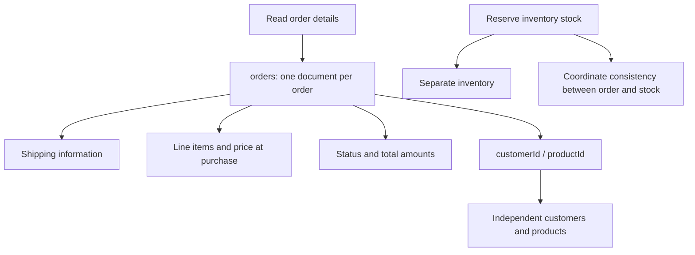

# Document Modeling and Organizing Data by Read or Write Units

## 1. Why Do We Need Document Modeling?

When designing a database, the first question is not only **“what entities exist?”** but also **“what data do users need to read together, and what data does the business logic typically modify together?”**. An e-commerce application, for example, usually displays order details including shipping information and line items in a single read. When confirming an order, the system also needs to update the order status and record the confirmation timestamp consistently.

The **document model** organizes data into self-describing documents, usually with a JSON-like structure: objects containing fields, nested objects, and arrays. Documents of the same type are typically stored in a *collection* or an equivalent structure, depending on the database engine. Instead of forcing every relationship to be represented across multiple tables and joined at query time, the document model lets you group data that belongs together into a single document.

The goal of this modeling approach is not to “stuff as much data in as possible,” but to **choose document boundaries that align with read operations, write operations, consistency rules, and growth capacity**. It is a data design decision, not merely a storage format decision.

After this lesson, learners will be able to:

- Identify documents, collections, nested fields, arrays, and references from business requirements.
- Choose **embedding** or **referencing** based on read/write units, element cardinality, and data lifecycle.
- Recognize atomic update boundaries and the trade-offs between denormalization and consistency.
- Design identifiers, indexes, validation rules, schema versioning, and appropriate query patterns.
- Compare the document model with relational, graph, and analytical models before making a selection.

## 2. A Document Is a Bounded Data Structure

A document typically consists of the following components:

| Component | Role | Example |
| --- | --- | --- |
| Identifier key | Uniquely identifies the document within the defined scope | `orderId` |
| Scalar fields | Store single values | `status`, `createdAt`, `currency` |
| Nested objects | Group semantically related attributes | `shippingAddress` |
| Arrays | Represent multiple elements belonging to the document | `items` |
| References | Point to entities with an independent lifecycle | `customerId`, `productId` |
| Versions | Support structural changes or update concurrency control | `schemaVersion`, `version` |

Example of an order (illustrative JSON, engine-agnostic):

```json
{
  "orderId": "ORD-0042",
  "customerId": "CUS-081",
  "customerSnapshot": {
    "displayName": "Nguyen An",
    "phoneAtPurchase": "0900000000"
  },
  "shippingAddress": {
    "city": "Da Nang",
    "district": "Hai Chau",
    "street": "12 Sample Street"
  },
  "items": [
    {
      "productId": "PRD-101",
      "sku": "BK-101",
      "nameAtPurchase": "Data Design Book",
      "quantity": 2,
      "unitPriceMinor": 120000,
      "lineTotalMinor": 240000
    },
    {
      "productId": "PRD-205",
      "sku": "NT-011",
      "nameAtPurchase": "Notebook",
      "quantity": 1,
      "unitPriceMinor": 85000,
      "lineTotalMinor": 85000
    }
  ],
  "currency": "VND",
  "itemsTotalMinor": 325000,
  "shippingFeeMinor": 25000,
  "grandTotalMinor": 350000,
  "status": "PENDING",
  "createdAt": "2026-11-01T08:30:00Z",
  "schemaVersion": 1,
  "version": 1
}
```

In this example, `items`, `shippingAddress`, and the snapshot of customer information at purchase time are **embedded** because they form part of the order's own content. `customerId` and `productId` are **references** because customers and products exist, are used, and change independently outside the order.

The `*Minor` values in the example represent monetary amounts in the agreed integer minor unit for that currency. For VND, these are amounts in dong. Storing integers or an exact decimal type avoids floating-point rounding errors in financial calculations. The buyer's name, address, and phone number are only sample data; in production, you must restrict access to and store personal data strictly as needed.

> **Important distinction:** A *document* is a storage boundary. An *aggregate* in domain-driven design is a group of data whose invariants must be protected together. A document can be a good implementation for an aggregate, but the two concepts are not automatically identical.

## 3. Designing by Read Units and Write Units

### 3.1. Read Units: What Data Does a Screen or Operation Need?

Suppose an e-commerce system has the following common operations:

| Query / Read Operation | Data Needed | Modeling Suggestion |
| --- | --- | --- |
| View details of an order | Status, address, line items, totals | Combine stable per-order info into one `orders` document |
| View a customer's order history | Order ID, date, total amount, status | Each order is a separate document; filter `customerId`, sort `createdAt`, project summary fields only |
| View current product price and description | Latest product information | Read independent `products` documents |
| Find recent product reviews | Paginated list of reviews | Separate `reviews` documents, queried by `productId` |
| Aggregate monthly revenue | Metrics across many orders over time | Aggregation queries or a dedicated analytical store at high volume |

Choose document boundaries around **a critical access path**, then verify the remaining access paths. If optimizing entirely for one screen slows down or complicates every other operation, the model is out of balance.

### 3.2. Write Units: What Data Must Change Together?

A business change can involve multiple levels of consistency:

- **Within the same order:** Transitioning from `PENDING` to `PAID`, updating the payment timestamp, and incrementing the version. These fields belong to one order and are well-suited to updating the same document.
- **Across entities:** Placing an order must create the order and reserve inventory. Orders and inventory balances typically have different lifecycles and write loads; preserving concurrency safety may require multi-document transactions, conditional updates, or an explicit reservation mechanism.
- **Data that can be updated asynchronously:** A product's total review count can be recomputed or synchronized asynchronously if the UI tolerates staleness.

Many document databases provide atomic updates for a **single document**, while support for multi-document transactions and specific isolation levels varies across engines. You should neither assume that embedding two entities always solves every business rule, nor assume that referencing makes transactions impossible.

Mental model for an order:



### 3.3. Questions to Determine Boundaries

Before deciding to embed, answer: **(1)** is the data frequently read together; **(2)** does it need to be written atomically together; **(3)** is the number of nested elements naturally bounded; **(4)** do the parts have separate lifecycles and access permissions; **(5)** will peak-load cases cause document bloat or write contention? These answers usually matter more than the initial entity diagram.

## 4. Embed or Reference?

### 4.1. Embedding

Embed data when it is a dependent part of the parent document, has bounded size, and is typically read or updated in the same operation. Examples: shipping address at order placement, a few contact methods, line items of an order with a reasonable item limit.

**Benefits:** related data can be fetched in fewer reads; the structure closely matches UI payloads; certain invariants can be enforced within a single-document update. **Costs:** duplicated data can be hard to synchronize; large documents increase read/write overhead; unbounded arrays complicate pagination, indexing, and concurrent updates.

### 4.2. Referencing

Reference data when it has its own identity, is shared across multiple places, is updated independently, has separate access control, or has an unbounded number of child records. Examples: `orders.customerId`, `orders.items[*].productId`, product reviews, account activity logs.

**Benefits:** avoids unnecessary duplication of source data; each dataset has its own lifecycle, rules, and scale; easy to query/paginate large subsets. **Costs:** may require additional reads, application-side joining, or join/lookup operations if supported by the engine; referential checks and cross-entity consistency require explicit design.

| Scenario | Typically Preferred | Primary Reason |
| --- | --- | --- |
| Shipping address at time of purchase | Embed in order | Must be read with the order and preserve history |
| Bounded list of line items in an order | Embed in order | Same lifecycle, same business boundary |
| Customer profile used across many orders | Reference | Independent identity and updates |
| Article comments that may grow indefinitely | Separate document referencing `postId` | Growth, write load, and pagination |
| Small product attributes | Embed in product | Always displayed with the product |
| Continuously changing inventory stock | Separate inventory document/record | Write load, constraints, and lifecycle differ from product description |
| Multi-year audit events | Separate event documents | Time-based retrieval, retention, and storage volume |

There is no rule that “one-to-many always embeds” or “duplicate data is always wrong.” **Element cardinality, update frequency, and data semantics** determine the right approach.

### 4.3. Common Anti-Pattern: Embedding All Orders Inside Customer

An initial design might look convenient:

```json
{
  "customerId": "CUS-081",
  "name": "Nguyen An",
  "orders": [
    { "orderId": "ORD-0041", "status": "PAID" },
    { "orderId": "ORD-0042", "status": "PENDING" }
  ]
}
```

However, the `orders` array can grow over many years; every new order writes to the customer document, independent orders contend on the same write boundary, and the list becomes hard to paginate. A better approach is one document per order in `orders`, with `customerId` to query customer history. If a few recent orders are needed on the customer profile, you can maintain a *bounded summary* with an explicit synchronization mechanism.

## 5. Denormalization: Intentional Duplication Without Ignoring Consistency

In a normalized relational model, each fact usually has a single primary storage location and relationships are combined via keys. The document model permits **denormalization** to reduce query cost on critical read paths. Even so, you must distinguish between two kinds of copies:

1. **Historical snapshot:** `nameAtPurchase` and `unitPriceMinor` inside an order preserve information at checkout time. Later changes to a product's name or price **should not** alter past orders. This copy has independent semantics from the current price.
2. **Read-serving copy:** `reviewCount` on a product is computed from the `reviews` collection. It has a single source of truth and must be updated synchronously, updated asynchronously with controlled lag, or recomputed periodically.

For every duplicated field, explicitly document: **where the source of truth lives, when the copy is created, what causes it to change, who is responsible for updating it, whether staleness is acceptable, and how drift is reconciled**.

Example of order invariants:

```text
lineTotalMinor = quantity * unitPriceMinor (for each line item)
itemsTotalMinor = sum of lineTotalMinor
grandTotalMinor = itemsTotalMinor + shippingFeeMinor - discountMinor + taxMinor
```

If `discountMinor` and `taxMinor` are also used, specify default values, rounding rules, and order of application. Total fields can be stored for fast reads or invoicing records, but write operations must update them consistently alongside line items.

## 6. Queries, Indexes, and Physical Updates

A schema that looks logical on paper may still perform poorly if it does not support real queries. For the `orders` collection in the example, assume the application frequently fetches an order by ID and reads order history per customer, newest first.

Example using MongoDB syntax (solely to illustrate one implementation; other document databases have different APIs and capabilities):

```javascript
// Order ID must be unique per business rules.
db.orders.createIndex({ orderId: 1 }, { unique: true });

// Supports chronological order history for a customer.
db.orders.createIndex({ customerId: 1, createdAt: -1 });

// Fetch details of a single order.
db.orders.findOne({ orderId: "ORD-0042" });

// Fetch the first page of history, projecting only list-view fields.
db.orders.find(
  { customerId: "CUS-081" },
  { _id: 0, orderId: 1, createdAt: 1, grandTotalMinor: 1, status: 1 }
).sort({ createdAt: -1 }).limit(20);
```

In a *multi-tenant* application, include a logical partitioning key such as `tenantId` in query predicates and scope uniqueness/indexes accordingly, rather than assuming `orderId` is globally unique. Do not put a security filter like `tenantId` in the model and forget to apply it on every read/write path.

**Indexes must follow queries**, not every field present in the document. When planning indexes, consider filter predicates, sort order, selectivity, data volume, write impact, and memory cost. Fields inside arrays or nested objects can use path/multikey indexes in some database engines, but come with their own limits and costs. Use execution plan inspection tools (`explain` or equivalent) and benchmark on representative data to verify.

### 6.1. Safe Updates Under Write Contention

Suppose two processes both read order version `1` and then sequentially update its status. If they overwrite blindly by `orderId`, the later write may accidentally clobber the earlier update. One way to mitigate this risk is **optimistic concurrency control**: the update succeeds only if the expected version and prior status still match.

```javascript
const result = db.orders.updateOne(
  { orderId: "ORD-0042", version: 1, status: "PENDING" },
  {
    $set: { status: "PAID" },
    $inc: { version: 1 },
    $currentDate: { updatedAt: true }
  }
);

// matchedCount === 0: status or version has changed;
// must re-read and decide business handling, never overwrite blindly.
```

When updating arrays, modify only the needed elements/fields rather than reading the entire document and overwriting it whole. However, even field-level updates must validate invariants such as non-negative inventory, valid state transitions, accurate totals, and payment event idempotency. **An atomic update does not automatically prove the entire business workflow is correct.**

### 6.2. Size Limits, Contention, and Pagination

Depending on the database engine, a document may have size limits, read/write efficiency thresholds, and nesting depth limits. Unbounded arrays such as click history, comments, payment events, and audit logs generally need to be split into separate documents. Large payloads such as images, videos, and attachments should usually be stored in an appropriate storage service, leaving only metadata, access permissions, and resource identifiers in the document.

Offset-based pagination using `skip/offset` can become expensive at deep offsets; for long lists, consider cursor-based pagination using a stable sort key, such as the pair `(createdAt, orderId)`, paired with a matching index. The choice must match data semantics and handle records inserted while a user navigates pages.

## 7. Flexible Schemas Still Need Data Contracts

Documents may allow records to have differing fields, but **a flexible schema does not mean no schema**. If each application version interprets `status`, `price`, or `address` differently, errors shift from write time to read time or reporting pipelines.

A minimal data contract for `orders` should specify:

| Area | Example Rule |
| --- | --- |
| Identity | `orderId` is required and unique within the chosen scope |
| Data types | `quantity` is a positive integer; prices are integer/exact decimal |
| Status | Only allowed values and defined business state transitions are permitted |
| Nested data | `items` has at least one item, with required fields specified |
| Invariants | Totals match line items and adjustments |
| Timestamps | Consistent time zone, storage format, and display conventions |
| Versioning | `schemaVersion` describes document shape; `version` tracks concurrent modifications |
| Privacy | Store only necessary data, enforce read/write permissions, define retention periods |

Data validation can exist at both the API/domain layer and the database layer (e.g., JSON Schema validators if supported by the engine). Application-level validation expresses rich business rules; database-level validation prevents malformed records from entering via multiple write paths. Cross-document validations require dedicated mechanisms.

### 7.1. Evolving the Schema Over Time

Suppose version 1 stored `shippingAddress` as a string; the new version requires `city`, `district`, and `street` to compute delivery zones. A safe upgrade process might be:

1. Identify remaining legacy data, active readers, and service versions currently writing.
2. Deploy readers compatible with both legacy and new formats (or normalize at the data access layer).
3. Begin writing the new format with the updated `schemaVersion`; monitor mixed-format data during the transition period.
4. Gradually backfill legacy records in idempotent batches, monitoring errors and remaining record counts.
5. Remove the legacy read branch only after all relevant data and application versions have been migrated.

Do not rely on a single full-collection scan and update in a short window if the dataset is large or multiple services use it concurrently. Define backward compatibility, handling of missing fields, and recovery steps if migration is interrupted.

## 8. Comparing the Document Model with Other Data Models

| Modeling Approach | Typical Strengths | Considerations |
| --- | --- | --- |
| **Relational** | Foreign key constraints, flexible join queries, transactions, and complex relational schemas | Many joins may arise when screens consistently require a composite structure |
| **Document** | Nested structures, aggregate-aligned retrieval, controlled schema evolution | Data duplication, cross-references, and large growing arrays require careful design |
| **Graph** | Multi-hop traversal across nodes and edges, pathfinding/relationship discovery | May not be optimal for transactional writes or screens needing only a simple document |
| **Analytical / Columnar** | Scanning, grouping, and aggregating massive historical datasets | Not necessarily suitable as a low-latency transactional store for individual orders |

These points reflect problem fit rather than absolute product limitations. Relational databases can store JSON; document databases can support joins and transactions; analytical engines can ingest near-real-time data. Real-world architectures can combine multiple models when operational cost, data synchronization, and query requirements justify it.

For example: write orders to a transactional store, and emit reliable events to populate a purpose-normalized revenue analytics warehouse. This keeps heavy aggregation reports from degrading online order queries, while requiring explicit lag SLAs and reconciliation between the two stores.

## 9. Process for Turning Business Requirements into a Document Model

You can apply the following workflow to orders, learning records, CMS content, or inventory management:

1. **Write down business scenarios and invariants:** “Look up order by ID,” “never oversell stock,” “price at purchase never changes,” “an order can succeed payment only once.” Identify which boundaries require strong consistency.
2. **Build an access path table:** Each read/write operation lists filters, returned fields, relative frequency, target latency, load limits, and sorting/pagination style.
3. **Identify entities and lifecycles:** Customers, products, orders, inventory, reviews; determine which data lives independently or is referenced by many entities.
4. **Choose document boundaries:** Embed bounded components that travel together; reference shared, independently mutating, or unbounded relationships. Explicitly document intentional copies.
5. **Logical and physical design:** Keys, fields, data types, validation, indexes, logical partitioning, size bounds, write rules, and schema versioning.
6. **Stress-test with edge cases:** Concurrent edits by two users, new records inserted during pagination, orders with unusually many line items, product price changes, account deletion, payment retries.
7. **Benchmark and refine:** Generate representative datasets, test critical queries/writes, inspect execution plans, p95/p99 latency, read/write counts, storage size, conflict rates, and recoverability.

The output should be a **testable design specification**: sample documents, list of collections/references, business invariants, access path table, indexes, synchronization strategy, and growth assumptions. A pretty diagram or a single sample JSON alone is not enough to prove a good design.

## 10. Design Exercise: Courses and Lessons

A learning platform needs to display a course title, author, description, and lesson list; instructors edit individual lesson content; learners record progress per lesson; both the number of lessons and the number of learners can grow significantly.

**Option A: A single course document containing all lessons, content, and every learner's progress.** The advantage is that viewing a course requires only a single document read. However, continuous progress updates from thousands of learners create write contention on the document; content and progress have different lifecycles; and document size can grow without bound.

**Option B: Split by lifecycle and access path:**

```text
courses
  { courseId, title, authorId, summary, lessonOutline: [
      { lessonId, title, position }  // outline only, reasonably bounded
  ] }

lessons
  { lessonId, courseId, content, publicationStatus, version }

lessonProgress
  { learnerId, lessonId, state, completedAt, version }
```

Option B lets the course overview screen fetch the `courses` document; opening a lesson reads `lessons`; updating a learner's progress writes to the corresponding `lessonProgress` document. You can enforce uniqueness on `(learnerId, lessonId)` and index by `courseId` or `learnerId` depending on access paths. If the outline itself grows large or changes independently at high frequency, consider splitting the outline into separate records as well.

Ask yourself before finalizing the design: *Does the entire course need to be published under a single consistent version? Can instructors edit a lesson while learners are actively studying it? What happens to progress records when a course is deleted? Should bulk learner outcome reporting run directly against transactional documents?* These questions govern consistency boundaries, data retention policies, and read architecture far more than the choice of JSON format.

## 11. Self-Review Checklist

- Each document represents a well-bounded business unit; there are no unbounded arrays without a management plan.
- Critical read/write paths are cataloged with filters, sort orders, pagination strategies, and planned indexes.
- Every embedded or referenced piece of data has a clear rationale based on lifecycle, size, read/write frequency, and consistency.
- Every duplicated field has a defined source of truth and update policy; historical snapshots are distinguished from read-serving copies.
- Transaction rules, state transitions, concurrent write controls, and retry handling are clearly specified.
- Keys, data types, required fields, default values, access permissions, and retention periods are defined.
- A plan exists for version compatibility, schema migration, and benchmarking on representative data.

**Key takeaway:** Organizing data by read or write units means finding document boundaries that make common operations simple and reliable while keeping duplication, concurrent updates, growth, and future evolution under control. A good model is proven by business requirements and real query patterns, not by cramming everything into a single JSON document.
