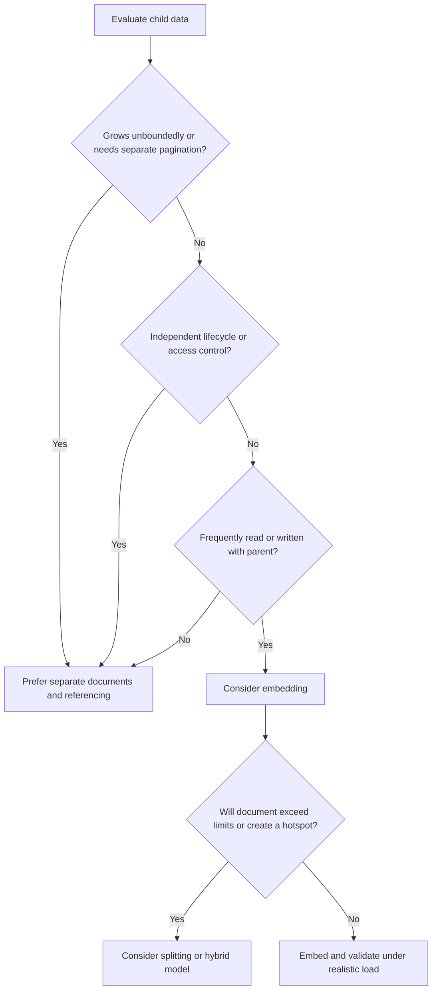

# Embedding Data vs. Referencing Another Document

## 1. The Design Problem: Which Data Should Live in the Same Document?

In the **document model**, a document can contain scalar fields, nested objects, and arrays. When translating business requirements into a storage structure, a designer typically chooses between two ways to represent relationships:

- **Embedding:** placing related data directly inside the document under consideration.
- **Referencing:** storing the identifier of another document; when needed, the application or database retrieves the referenced document separately.

Choosing the wrong boundary hurts performance, consistency, and evolvability. Over-embedding produces oversized documents that are hard to paginate and become hotspots under concurrent writes. Over-referencing turns a simple screen into a chain of overlapping queries, adding latency and data-assembly overhead.

Within **DATABASE_DATA_MODELING**, this is a modeling decision grounded in business requirements, relationships, constraints, keys, and indexes. The goal is to create a structure aligned with data access patterns and easy to validate, while knowing when a relational, graph, or analytical solution fits better.

**Learning objective:** After this lesson, learners can identify when to embed, when to reference, or when to combine both; justify decisions using read/write frequency, element cardinality, data lifecycle, and consistency constraints; and design sample documents, keys, indexes, and schema evolution plans.

## 2. Two Ways to Represent the Same Relationship

Suppose an e-commerce application has an order and its line items.

### 2.1. Embedding Line Items Inside the Order

```json
{
  "orderId": "ORD-2026-042",
  "customerId": "CUS-017",
  "status": "PENDING",
  "currency": "VND",
  "items": [
    {
      "productId": "PRD-101",
      "skuAtPurchase": "BOOK-101",
      "nameAtPurchase": "Technical Notebook",
      "quantity": 2,
      "unitPriceMinor": 120000
    },
    {
      "productId": "PRD-220",
      "skuAtPurchase": "PEN-220",
      "nameAtPurchase": "Fountain Pen",
      "quantity": 1,
      "unitPriceMinor": 35000
    }
  ],
  "itemsTotalMinor": 275000
}
```

Every time order details are viewed, the application fetches a single document that already includes the line-item list. Line items are typically formed and finalized alongside the order; the number of line items per order is usually bounded by business rules. This is a good candidate for **embedding**.

The `productId` fields are references to the current product catalog. `nameAtPurchase` and `unitPriceMinor` are **historical snapshots**: changing a product's current price or name today must not alter prices already locked in at purchase time. The example uses integer monetary amounts in the agreed unit for VND; a production system must precisely specify currency units, taxes, discounts, and rounding rules.

### 2.2. Storing Line Items in Separate Documents

```jsonc
// orders
{
  "orderId": "ORD-2026-042",
  "customerId": "CUS-017",
  "status": "PENDING",
  "itemsTotalMinor": 275000
}

// orderItems — each element below is a separate document
{
  "orderItemId": "OI-001",
  "orderId": "ORD-2026-042",
  "productId": "PRD-101",
  "quantity": 2,
  "unitPriceMinor": 120000
}
{
  "orderItemId": "OI-002",
  "orderId": "ORD-2026-042",
  "productId": "PRD-220",
  "quantity": 1,
  "unitPriceMinor": 35000
}
```

This approach lets you query, paginate, and update individual line items independently. In return, displaying a full order requires fetching the additional `orderItems` documents; if the total amount depends on every line item, the application needs a mechanism to preserve invariants across multiple documents.

Both approaches can be right. You must choose based on concrete requirements: how many lines an order can contain; how frequently it is viewed; whether line items are edited independently after creation; what must be updated atomically; and what limits the database engine imposes.

### 2.3. Relationships in the Business Model Do Not Dictate a Single Storage Layout

An entity diagram may state `Order 1—N OrderItem`, but a one-to-many relationship **does not automatically determine** whether to embed or split documents. The document model prioritizes **access and consistency boundaries**; the relational model typically expresses them with tables and foreign keys. Even within a single document model, you can embed `items` while referencing `customerId` and `productId`.

## 3. Six Key Criteria for Making the Decision

### 3.1. Is the Data Frequently Read Together?

Ask: which fields does a user operation need in order to complete? If the child data almost always appears alongside the parent, embedding can reduce round-trips and join operations.

**Example:** An invoice screen displays the shipping address at purchase time together with the list of products. That information can live inside the order.

**Counterexample:** A product listing shows 20 products without needing thousands of comments for each one. Embedding all comments inside each product bloats fetched payloads and complicates pagination.

### 3.2. Must the Data Change Atomically Together?

If multiple fields must change together to maintain an invariant, storing them in the same document often makes a single atomic write simpler, **when the database engine guarantees document-level atomicity**.

For example, when modifying a line item, the quantity, applied unit price, and total must stay consistent. If they are all in one document, a conditional update can be applied within a single write boundary.

However, putting data in one document does not automatically solve every business constraint. Reserving inventory, capturing payment, and creating a shipment may still span other documents or systems; depending on the domain and database product, you may need multi-document transactions, coordination protocols, conditional updates, or eventual consistency patterns.

### 3.3. Does the Child Have an Independent Lifecycle?

An object with its own identity, referenced in multiple places, and managed independently should usually be referenced.

For example, a customer profile changes phone numbers, display names, or privacy preferences without triggering edits across every historical order. The order should keep `customerId`, while also saving a *snapshot* of whatever details must be preserved at checkout time.

Conversely, the shipping address finalized on an order has a lifecycle tied to that order itself; embedding is more appropriate than referencing a “current default address” that might later change.

### 3.4. Is the Number of Elements Naturally Bounded?

An array with a small, finite number of elements can usually be embedded: a few payment options, a bounded set of order line items, or product technical specifications.

If child items grow over time with an unpredictable ceiling—comments, events, page views, or learning progress across millions of learners—splitting into separate documents keeps document size, pagination, and storage under control.

**Caution:** “Right now there are only 10 items” does not prove it will stay small in the future. You need to establish bounds through business rules or sufficiently reliable growth projections.

### 3.5. Does the Child Have Its Own Write Frequency and Contention Profile?

Embedding turns parent and child into a single physical write unit in many database engines. If thousands of users continuously update different elements of an array inside the same document, write contention, transaction retries, and hotspots can occur.

For example, thousands of learners marking lessons complete should not all write to a single `course` document containing an array of every learner's progress. Separate `lessonProgress` or `enrollments` documents keyed by learner/lesson usually provide a much better write boundary.

Not every embedded field causes equal contention; evaluate using the engine's locking/update mechanics and realistic workload profiles.

### 3.6. Does the Data Need Independent Querying, Pagination, Access Control, or Retention?

If the child data has different filters, sort orders, retention periods, access permissions, or deletion policies from the parent, separating it makes enforcing those rules clearer.

For example, comments must be filtered by author, moderation status, and timestamp; they can be deleted independently; and they are displayed page by page. Placing them in a dedicated collection with `postId` is usually much easier to operate.

Similarly, sensitive data should not be embedded in a widely accessed document if many queries only need the public portion. Whether to enforce access control at document level or field level depends on the database engine and application layer capabilities.

## 4. Quick Decision Matrix and Intermediate Cases

| Child Data Characteristic | Favors Embedding | Favors Referencing |
| --- | --- | --- |
| Read with parent document | Nearly every read | Only needed on certain screens or queries |
| Updates | Usually updated together with parent | Modified independently, frequent writes |
| Size | Small and strictly bounded | Large or grows without bound |
| Lifecycle | Dependent on parent | Independent identity and lifecycle |
| Cardinality | One-to-few or bounded one-to-many | Large one-to-many, many-to-many |
| Shared usage | Primarily belongs to one parent | Shared across multiple parents |
| Pagination / search | Rarely queried separately | Needs filtering, pagination, or deep search |
| Constraints | Invariants mostly fit within one document | Rules span multiple independent entities |
| Access control | Same policy as parent | Different policy from parent |
| Schema evolution | Deployed and versioned alongside parent | Owned and changed independently by another service or team |

The table above is a **reasoning framework**, not a set of mechanical rules. When criteria conflict, measure and prioritize the most critical operations and non-negotiable invariants.

Reference decision flowchart:



## 5. Design Patterns: Embedding, Referencing, and Hybrid Models

### 5.1. Embedding Dependent Objects

Suitable for finalized shipping addresses, fixed display options, and small fields belonging to an aggregate:

```json
{
  "orderId": "ORD-2026-042",
  "shippingAddress": {
    "recipientName": "Nguyen A",
    "city": "Da Nang",
    "postalCode": "550000"
  }
}
```

The address on the order is the value used for delivery, not the buyer's “current default address.” This prevents historical records from changing when the customer updates their account.

### 5.2. Referencing a Shared Object

Products and orders have different lifecycles:

```jsonc
// products
{
  "productId": "PRD-101",
  "name": "Technical Notebook - New Edition",
  "currentPriceMinor": 135000,
  "active": true
}

// orders
{
  "orderId": "ORD-2026-042",
  "items": [
    {
      "productId": "PRD-101",
      "nameAtPurchase": "Technical Notebook",
      "unitPriceMinor": 120000,
      "quantity": 2
    }
  ]
}
```

The order retains a snapshot of price and product label, while `productId` supports navigation to the current product. If a product is discontinued or deleted, order history retention must not depend on the `products` document still existing; define how “orphan” references are handled according to business rules.

### 5.3. Splitting Large Datasets While Embedding a Bounded Summary

A post might receive tens of thousands of comments. A common pattern:

```jsonc
// posts
{
  "postId": "POST-077",
  "title": "Data Design",
  "commentCount": 6823,
  "recentCommentIds": ["CMT-888", "CMT-887"]
}

// comments
{
  "commentId": "CMT-888",
  "postId": "POST-077",
  "authorId": "USR-013",
  "text": "Helpful article.",
  "createdAt": "2026-11-18T09:15:00Z",
  "moderationStatus": "VISIBLE"
}
```

`comments` is the primary source for filtering/pagination. `commentCount` and `recentCommentIds` on `posts` are **derived data**, requiring explicit update rules:

- Is an exact real-time count required, or is delayed updating acceptable?
- Are hidden or deleted comments included in the count?
- If a counter-update event is redelivered, how are duplicates handled?
- When drift is detected, can it be recomputed from the source of truth?

Never store an endlessly growing comments array just to avoid one extra query.

### 5.4. Child Documents Referencing the Parent

In a course model, each course has many lessons; each lesson's content is published, edited, and versioned independently:

```text
courses
  { courseId, title, description, publishedLessonCount }

lessons
  { lessonId, courseId, title, body, status, version, position }

lessonProgress
  { learnerId, lessonId, state, completedAt }
```

In this case, `lessons` documents reference `courseId`; `lessonProgress` references `lessonId`. A compact table of contents can be embedded in `courses` if size is bounded and an update mechanism exists. Establish a single source of truth for lesson ordering so two places cannot be edited independently.

### 5.5. Grouping by Time Window or Size Limit (Bucketing)

When events must be read by time range but total event volume is too large for one document, you can group them into “buckets” by day, account, and sequence range:

```text
deviceEvents
  { deviceId, bucketDay, shardOrBucketId, events: [ ...bounded... ] }
```

This pattern only works when bucket size and write rate stay within controllable bounds. A bucket can become a hotspot if a device emits data too rapidly; in that case, one document per event or a dedicated log/time-series store may be more appropriate.

## 6. From Logical Choices to Queries and Indexes

To make choices verifiable, build an **access path table** before finalizing the schema.

| Operation | Data Needed | Organization Strategy | Indexes / Access Paths to Consider |
| --- | --- | --- | --- |
| View one order | Total, status, line items, address | Embed stable order details | Unique order identifier |
| Order history by customer | ID, date, total, status | Separate orders, referencing `customerId` | `customerId` + `createdAt` |
| Comments for a post | Visible comments, chronological | Separate `comments` | `postId` + `createdAt` + pagination tie-breaker key |
| Access current product | Name, price, status | Separate `products` | `productId` |
| Learning progress per learner | Status per lesson | Separate `lessonProgress` | Composite identifier `learnerId` + `lessonId` |

The index and query examples below use MongoDB syntax as **one implementation example**, not as universal syntax across all document databases:

```javascript
// Each order has a unique identifier within the defined scope.
db.orders.createIndex({ orderId: 1 }, { unique: true });

// Query order list by customer, newest first.
db.orders.createIndex({ customerId: 1, createdAt: -1 });

db.orders.find(
  { customerId: "CUS-017" },
  { _id: 0, orderId: 1, createdAt: 1, status: 1, itemsTotalMinor: 1 }
).sort({ createdAt: -1 }).limit(20);

// Separate comments, filtered by post and time.
db.comments.createIndex({
  postId: 1,
  moderationStatus: 1,
  createdAt: -1,
  _id: -1
});

db.comments.find(
  { postId: "POST-077", moderationStatus: "VISIBLE" }
).sort({ createdAt: -1, _id: -1 }).limit(30);
```

At scale, paginate using a **cursor / stable sort key** instead of deep `skip`. If multiple comments share the same `createdAt`, add `_id` or another stable identifier to guarantee deterministic ordering. Indexes must match actual filter predicates, sort directions, and workload needs; do not index every field simply because it exists in the schema.

In *multi-tenant* systems, unique key definitions and queries typically need `tenantId`. For instance, if `orderId` is unique only per tenant, the unique index must include `tenantId`, and every query must scope to that tenant. That is a design constraint, not merely a query optimization.

### 6.1. Read Cost vs. Write Cost

A simple model can quantify the trade-offs:

- **Embedding:** can reduce the number of reads to fetch an aggregate, but documents can grow larger and incur overhead when transferring or accessing unneeded fields.
- **Referencing:** keeps individual documents smaller and easier to update independently, but a screen may require multiple queries, application-level joins, or `lookup` operations (if supported by the engine).
- **Denormalizing for reads:** reduces query count but adds steps to maintain copies and handle stale or out-of-sync data.

You cannot decide solely from query counts on paper. Measure p95/p99 latency, payload transfer size, write counts, update conflict rates, index footprint, and outlier large-document cases. Business goals sometimes prioritize stable p99 latency or strict correctness over minimizing total query count.

## 7. Data Consistency When Using Embedding or Referencing

### 7.1. Updating Within a Single Document

Suppose an order can transition from `PENDING` to `PAID` only once. To prevent two processes from overwriting each other, combine status and version conditions:

```javascript
const result = db.orders.updateOne(
  {
    orderId: "ORD-2026-042",
    status: "PENDING",
    version: 3
  },
  {
    $set: { status: "PAID" },
    $inc: { version: 1 },
    $currentDate: { paidAt: true }
  }
);

if (result.matchedCount === 0) {
  // Status or version changed: re-read and handle per business rules.
}
```

This example illustrates a document-level conditional update. In practice, confirming a payment transaction also requires deduplication, verification with the payment provider, and coordination of state outside the database. Do not treat the statement above as the entire payment workflow.

### 7.2. Updating Across Multiple Documents

Suppose creating an order requires reserving 3 products in inventory:

```text
orders[ORD-2026-042]
     |
     +---- references ----> inventory[PRD-101]
     |
     +---- references ----> customer[CUS-017]
```

If the order and inventory are separate documents, succeeding on one write and failing on the other leaves data inconsistent. Approaches depend on consistency requirements and engine capabilities:

1. **Multi-document transactions:** use when supported by the engine and strong consistency is mandatory; account for latency, lock/write conflicts, and transaction scope.
2. **Conditional inventory updates:** guarantee non-negative stock at the write point; combine with reservation holds, expiration, and compensating actions when needed.
3. **Asynchronous workflows:** persist transitional states, emit replayable events, enforce idempotency, and reconcile failures.

Do not embed the entire inventory of every product into an order just to turn this operation into “one write.” Inventory is a shared resource with its own lifecycle and update frequency.

### 7.3. Distinguishing Two Kinds of Duplicated Data

**Historical snapshots:** price, name, and address at order placement belong to the order itself; they do not need to stay synchronized with current profiles.

**Copies for read acceleration:** `commentCount`, `lastCommentAt`, or `authorDisplayName` copied from another source may need updates when the source changes. You must define:

- The source of truth and who is authorized to mutate it.
- Acceptable staleness or synchronization lag.
- How duplicate, lost, or out-of-order events are handled.
- How data drift is detected and repaired.
- Data deletion and privacy policies applied across all copies.

A duplicated field is not a design flaw if it has clear semantics and maintenance mechanics; the flaw usually lies in **nobody owning its consistency**.

## 8. Common Design Pitfalls

### Pitfall 1: Embedding All Comments Inside the Post

```json
{
  "postId": "POST-077",
  "comments": [
    { "commentId": "CMT-1", "text": "..." }
  ]
}
```

This looks convenient when there are only a few comments. As volume grows, the document bloats, filtering comments independently becomes hard, and every new comment contends on the same document. Fix: move comments to a separate collection, retain `postId`, and design proper indexes and pagination; embed only a bounded preview if truly needed.

### Pitfall 2: Storing Every Small Attribute as a Separate Document

If a product's name, color, size, and description all live in separate documents despite always being read and written together, viewing a product forces assembling multiple fragments. Fix: embed small attributes sharing the same lifecycle into the product; split only for concrete reasons such as write load, access control, or independent querying.

### Pitfall 3: Referencing Mutable Data to Reconstruct History

If an order stores only `productId` and fetches the current price from `products` on every render, the system may display the wrong finalized amount. Fix: store a snapshot of necessary prices and descriptions at purchase time, and use references only for current catalog data.

### Pitfall 4: Duplicating the Same Relationship List on Both Sides

For example, storing both `customer.orderIds` and `orders.customerId` while allowing independent edits to each. When an order is created or canceled, the two sides can drift apart. Fix: designate **one direction as the primary source**; if a reverse cache is maintained for speed, explicitly specify the synchronization and reconciliation mechanism.

### Pitfall 5: Treating a Flexible Document Schema as Needing No Constraints

`quantity` is sometimes a string and sometimes a number; `status` holds arbitrary values; `items` is empty while `itemsTotalMinor` is positive. Fix: enforce validation in both the business layer and database layer when supported, specifying types, required fields, allowed values, and invariants. Distinguish **single-document** validation from cross-document constraints.

### Pitfall 6: Relying Only on One-to-Many Cardinality

“A customer has many orders” and “An order has many line items” are both one-to-many, yet their storage decisions differ: a customer's orders can grow huge and have an independent lifecycle; an order's line items are typically bounded and read with the order. Cardinality is an input, not the answer.

## 9. Evolving the Model as the Application Grows

Suppose the system initially embedded comments inside post documents. Once comment volume grows, they must be split into a `comments` collection. A controlled migration path:

1. **Confirm the target model:** each comment has a unique `commentId`, `postId`, author, content, and timestamp; create indexes for the new access paths.
2. **Define the source of truth during transition:** prevent two independent stores from accepting mutations without synchronization.
3. **Add a compatible read path:** the application can read the new model while handling unmigrated legacy documents during a controlled transition window.
4. **Backfill legacy data in idempotent batches:** use stable identifiers to avoid creating duplicates, and verify counts and contents.
5. **Switch the write path:** ensure new comments are written directly to the target model and handle incoming events during migration.
6. **Reconcile and remove legacy fields:** only after verifying zero data loss and confirming all relevant application versions are compatible.

You can add `schemaVersion` to identify document shapes, but adding a version field alone does not handle compatibility automatically. Specify how missing fields, legacy shapes, and invalid data are handled.

Moving in the reverse direction—from referencing to embedding to speed up reads—also requires evaluating size limits, sync lag, and source ownership before starting.

## 10. When Should You Consider a Different Data Model?

The embed-vs-reference choice lives within the document model; before that, you still need to pick the right **model family**:

| Problem Type | Worth Considering | Rationale |
| --- | --- | --- |
| Many relationships and integrity constraints, frequently changing join queries | Relational | Foreign keys and flexible joins; strong transactions depending on engine |
| Nested data, aggregate-based reads, controlled schema variation | Document | Natural fit for objects and arrays; optimized for read/write paths |
| Path queries and multi-hop relationships between entities | Graph | Traverses nodes and edges directly as first-class relationships |
| Scanning and aggregating massive historical datasets | Analytical / Columnar | Optimized for large scans and data grouping |

These are problem-selection guidelines, not rigid limits: many relational engines support JSON, and many document engines support multi-document transactions and joins. If a system needs both transactional workloads and heavy analytical reporting, you can separate operational write paths from analytical read paths with explicit sync, lag, and reconciliation policies.

## 11. Practice Scenario with Suggested Solution

**Requirements:** An online learning platform has courses, lessons, course reviews, and learner progress. The course page displays the title, author, description, the first few lessons, and the total review count. Learners view one lesson's content at a time and record progress after each lesson. A course can have thousands of lessons and hundreds of thousands of reviews; learners update progress concurrently.

Decide whether to embed or reference for: (a) author info; (b) lesson list; (c) reviews; (d) learner progress; (e) review count.

**A defensible design:**

```text
authors
  { authorId, displayName, ... }

courses
  {
    courseId, authorId, title, description,
    featuredLessons: [{ lessonId, title, position }], // strictly bounded to a few items
    reviewCount
  }

lessons
  { lessonId, courseId, title, content, position, publishedVersion }

reviews
  { reviewId, courseId, learnerId, rating, text, createdAt }

lessonProgress
  { learnerId, lessonId, state, completedAt, version }
```

**Explanation:**

- `authorId` references an author with an independent identity and lifecycle. Display name can be embedded as a copy if the course page needs it and an update policy exists.
- `featuredLessons` is only a **bounded** preview list. Full lesson content lives separately because lesson count is large and lessons are opened and edited independently.
- `reviews` is separate because it grows unboundedly and requires search/pagination/moderation; `reviewCount` is a derived counter with reconciliation rules.
- `lessonProgress` is separate so concurrent learners do not contend on the same course document; a natural key is `(learnerId, lessonId)`.
- Appropriate indexes include `lessons(courseId, position)`, `reviews(courseId, createdAt)`, and `lessonProgress(learnerId, lessonId)` depending on the engine's syntax and capabilities.

**Open question:** If an instructor needs to publish a set of lessons *atomically* as a course version, how would you ensure learners do not see a mix of old and new lessons? Consider publishing via `releaseId`, snapshotting a list of lesson versions, or an appropriate transactional mechanism. Simply embedding all lesson content into the course document is unlikely to be a good solution when a course has thousands of lessons and many concurrent readers and writers.

## 12. Pre-Finalization Checklist

- Have I identified the most critical screens, queries, and write commands?
- Does each child component have its own identity, lifecycle, owner, and access permissions?
- Is the number of nested elements reliably bounded, even years from now?
- Which invariants must remain atomic; do the document boundaries match them?
- Are there write hotspots or risks of lost updates when multiple users modify the same document?
- Does every duplicated field have a source of truth, sync rule, and reconciliation method?
- Do indexes align with actual filter predicates, sort orders, and pagination keys?
- Have entity deletion, schema evolution, and migration recovery been accounted for?
- Have I tested with representative data and measured latency, document size, write cost, and conflicts?

**Remember:** **Embedding** usually fits dependent, bounded data that is read and written together. **Referencing** usually fits data with an independent lifecycle, shared usage, large growth, or separate querying and update needs. Good design combines both according to domain characteristics, establishes clear consistency boundaries, and is validated against real access paths.
