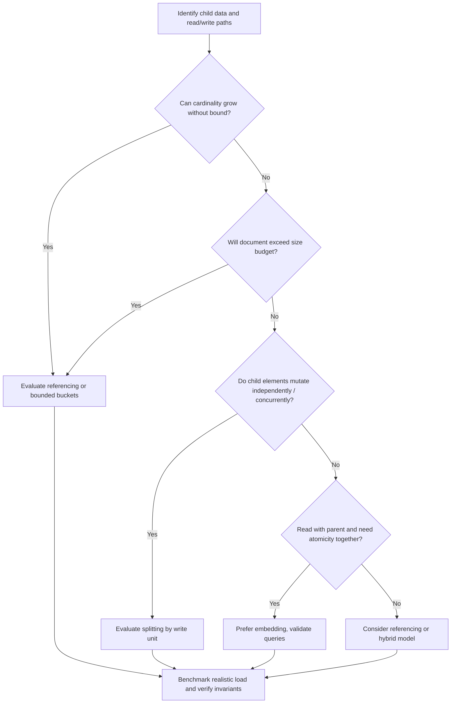

# Cardinality, Size, and Mutation Frequency When Choosing Document Boundaries

## 1. Why Do These Three Variables Drive Modeling Decisions?

In a document database, an object can contain nested sub-objects, arrays, and reference keys. Therefore, when turning business requirements into a data model, the designer must answer **how much data a single document should encompass, how large it can grow, and how many processes will mutate it**.

Three variables typically lead to different decisions:

1. **Cardinality:** how many child entities relate to one parent entity? Is the count bounded or does it keep growing?
2. **Size:** how much space does a single element occupy? How large do documents and indexes become today and in the future?
3. **Mutation frequency:** how often are parent and child data added, updated, or deleted? Are many users or processes writing concurrently?

For example, a course might have 30 lessons but 100,000 learners. Embedding a summary list of 30 lessons inside the course document may make sense. Embedding the progress of 100,000 learners inside the same document will scale very poorly, even though both are one-to-many relationships.

This lesson belongs to the **Document Modeling** chapter within **DATABASE_DATA_MODELING**: building the skill to turn business requirements into a data model with explicit entities, relationships, constraints, keys, indexes, and physical structure—while knowing how to compare it with relational, graph, and analytical models when needed.

**After this lesson, you will be able to:**

- Distinguish cardinality on an entity diagram from **the per-parent child element distribution**.
- Estimate document size from realistic data and growth rates.
- Analyze concurrent mutations, write hotspots, and atomicity at document boundaries.
- Choose embedding, referencing, hybrid models, or bucketing using quantitative reasoning.
- Produce a testable design backed by queries, indexes, measurements, and edge cases.

## 2. Document Boundaries Are a Read-Unit and Write-Unit Decision

A **document** is a logical storage unit that can include scalar fields, nested objects, and arrays—such as a JSON/BSON record. It is typically stored in a *collection* or the database engine's equivalent structure.

A **document boundary** specifies which pieces of data are placed together:

- **Embed:** place line items inside `order.items` or the shipping address inside `order.shippingAddress`.
- **Reference:** place each comment in `comments` with a `postId` pointing to the post; place each order in `orders` with `customerId`.
- **Hybrid model:** embed a bounded summary inside the parent document while keeping the full dataset in a separate collection.

Example hybrid design:

```json
{
  "courseId": "CRS-008",
  "title": "Introduction to Databases",
  "featuredLessons": [
    { "lessonId": "L-01", "title": "Entities and Attributes" },
    { "lessonId": "L-02", "title": "Relationships and Keys" }
  ],
  "lessonCount": 30,
  "reviewCount": 1386
}
```

This model does not imply embedding full lesson bodies, all reviews, or every learner's progress. Those datasets can have completely different cardinality, size, and write load from the course document.

It is also important to distinguish an **aggregate** in domain modeling from a **document** in storage. An aggregate defines the boundary that enforces business invariants; a document is one possible implementation. They can align when appropriate, but they are not automatically identical.

## 3. Cardinality: Counting the Right Thing That Grows

### 3.1. Relationship Types and Storage Implications

| Business Cardinality | Example | Modeling Question |
| --- | --- | --- |
| One-to-one (1–1) | Order and shipping address at purchase time | Do both parts share the same lifecycle, access control, and update frequency? |
| One-to-few (1–few) | A profile with at most three emergency contacts | Is there a clear upper bound and are they usually read together? |
| Bounded one-to-many (1–many bounded) | An order with at most 100 line items | What is the maximum size and how are whole-order updates performed? |
| Unbounded one-to-many | Posts and comments | How large will the array get, and what pagination or concurrent writes are needed? |
| Many-to-many (many–many) | Users joining multiple projects, projects having multiple members | Do we need link documents and uniqueness constraints per pair? |

**Cardinality alone does not determine embedding vs. referencing.** Two relationships that are both 1–N can require different designs due to differences in N, element size, write rate, and query paths.

An important example:

- `Order → OrderItem`: 1–N, but N is usually bounded by business rules and lines are typically read with the order; embedding can be reasonable.
- `Post → Comment`: 1–N, and N can grow unboundedly with filtering and pagination; referencing separate comment documents is usually more appropriate.

### 3.2. Measure Cardinality **Per Parent**, Not Just Total Record Count

Suppose there are 1,000 posts and 100,000 comments. The average is 100 comments per post, but the distribution may be heavily skewed:

| Example Metric | Comments per Post |
| --- | ---: |
| Median (p50) | 8 |
| 95th percentile (p95) | 420 |
| 99th percentile (p99) | 3,000 |
| Maximum | 25,000 |

An average post does not represent the most popular post. If you design solely around the mean, high-engagement posts can produce oversized documents or write hotspots.

When profiling cardinality, record the **median, p95, p99, maximum**, growth rate, and outlier cases. For new systems without production data yet, use assumptions grounded in business rules and build load scenarios to test them.

> **There is no universal threshold** such as “embed if under 100 items.” An array of 100 short strings and an array of 100 long text blobs have vastly different sizes; even a single oversized element can be a problem.

### 3.3. Cardinality in Which Direction?

For many-to-many relationships, inspect both sides:

- How many projects does one user join?
- How many members does one project have?
- Where are relationship attributes such as `role`, `joinedAt`, and `status` mutated?
- Is there a uniqueness requirement of one membership per `(userId, projectId)` pair?

Example storing link documents separately:

```json
{
  "userId": "USR-045",
  "projectId": "PRJ-012",
  "role": "EDITOR",
  "joinedAt": "2026-11-04T08:00:00Z",
  "status": "ACTIVE"
}
```

The `memberships` collection can define a unique key on `(userId, projectId)` along with indexes serving both query directions. Avoid defaulting to maintaining both `user.projectIds` and `project.memberIds` as two independent sources of truth when they are large and mutate frequently.

## 4. Size: From a Single Element to a Growth Budget

### 4.1. Estimating Document Structure Size

A rough initial estimate is useful:

```text
B_document ≈ B_fixed + Σ(N_i × B_child_i) + B_structure

Where:
B_fixed      = size of fixed parent fields
N_i          = number of child elements in group i
B_child_i    = average size per element in group i
B_structure  = overhead for field names, type tags, arrays, identifiers, etc.
```

This is a **forecasting model**, not a substitute for measuring size in the actual serialization format. JSON over the wire, BSON on disk, compression, UTF-8 string byte lengths, repeated key names, and metadata can yield different results. Index footprint is also a separate cost; do not add index sizes into the size limit of **a single document**.

When designing, distinguish:

1. **Logical document size:** subject to format/database engine limits.
2. **Read/response payload size:** depends on queries, projections, and APIs.
3. **Physical storage cost:** depends on storage engine, compression, and indexes.
4. **Write amplification cost:** depends on modified fields, how the storage engine handles updates, and contention mechanics.

Do not assume that updating one field always transmits or rewrites the entire document: exact behavior depends on the engine, driver, and update operator. Still, an oversized document makes reads, caching, rewrites, replication, and concurrent updates harder to manage.

### 4.2. Example Size Budget Calculation for Device Events

Suppose a device document stores a list of events:

- Fixed device metadata: roughly **4 KiB**.
- Each serialized event: roughly **800 bytes**.
- New events added per day: **500 events**.
- Operations sets an **internal budget of 4 MiB per event document**, leaving headroom below system limits and operational cost thresholds.

In one day, child data grows by roughly `500 × 800 = 400,000 bytes`, or about **391 KiB/day**. With a continuously growing array, the document hits the 4 MiB budget in roughly **10 days**, even before counting structural overhead and initial data.

These figures are **illustrative assumptions**, not the limits of any specific database product. Design conclusion: **do not** store the entire event history in a single array; consider separate event documents or buckets bounded by day, hour, or count.

To project growth over time, you can use:

```text
B_at_T ≈ B_now + growth_events_per_day × bytes_per_event × T_days

T_budget ≈ (B_budget - B_now) /
           (growth_events_per_day × bytes_per_event)
```

If events/day vary seasonally, scale with customer growth, or exhibit traffic spikes, include peak scenarios as well; growth is not necessarily linear.

### 4.3. Sizing at p95/p99 and Worst-Case Outliers

Estimating with average sizes is only a starting point. A short comment might be a few hundred bytes; a comment with markdown, metadata, or attachment lists can be much larger. Documents containing arrays should be validated against at least:

- **Average N** and **average element size**;
- **p95/p99 N** and element sizes in large cases;
- **Business-enforced maximum N**, if any;
- Multi-byte UTF-8 text, long optional fields, and outlier records;
- Expected accumulation over the retention period.

Do not multiply p99 of N by p99 of element size and call that p99 document size; variables may correlate and actual distributions differ. A better method is to compute document size across representative sample records and then take percentiles of **document size**.

### 4.4. Limits Must Come from the Target Database Product

Every database engine has its own rules regarding document size, nesting depth, array indexing, transactions, and partitioning. When moving from logical to physical design, check the official documentation for your **actual database engine and version**, then set an internal safety threshold below the point of operational risk.

A document well under the hard technical limit can still be too large for frequent queries or cause excessive write contention.

## 5. Mutation Frequency: Who Writes, What Changes, and Concurrently?

### 5.1. Do Not Measure Total Write Throughput Alone

Two workloads both receiving 10,000 updates/minute can behave very differently:

- 10,000 updates spread evenly across 10,000 distinct documents: roughly one update/minute per document.
- 10,000 updates concentrated on a single “featured post” or “global stats” document: that document becomes a **write hotspot** (*hot document*).

Measure or forecast:

- **Parent mutation frequency:** how many times per hour/day?
- **Child insert/update/delete frequency:** how often, and across how many parent documents?
- **Load skew:** do 1% of documents receive the majority of updates?
- **Concurrency and bursts:** how many processes can write to the same parent within a short window?
- **Update scope:** a single field, one array element, multiple elements, or the whole document?
- **Business invariants:** which updates must happen together?

Cardinality amplifies risk whenever each child element can mutate independently. If a parent has N elements and each element averages r changes per unit time, writes targeting the same parent document can approach `N × r`, on top of parent-level updates. This estimates traffic volume, **not direct conflict rates**, since conflicts also depend on operation design and storage engine mechanics.

### 5.2. Hotspots in Embedded Models

Consider a `course` document containing an array of progress for 50,000 learners. Every time a learner completes a lesson, the system writes to that same course document. Even if each progress entry is only a few bytes, hundreds of concurrent completions hit the exact same update boundary.

Alternative design:

```text
courses
  { courseId, title, ... }

lessonProgress
  { learnerId, courseId, lessonId, state, updatedAt, version }
```

If each learner has relatively few lessons per course and the UI usually reads **one learner's** entire progress at once, another option is **one document per `(learnerId, courseId)` pair** holding a small progress array bounded by lesson count:

```json
{
  "learnerId": "USR-045",
  "courseId": "CRS-008",
  "progress": [
    { "lessonId": "L-01", "state": "DONE" },
    { "lessonId": "L-02", "state": "IN_PROGRESS" }
  ],
  "version": 8
}
```

Both options avoid putting **all learners'** progress into one course document. Choosing between them depends on lesson count per course, whether read paths slice by learner or by lesson, concurrent update needs, and consistency boundaries.

### 5.3. Mutating Together Can Be a Valid Reason to Embed

Suppose in an order, line items and the order total must stay consistent when the buyer confirms the cart. If line count is bounded, embedding can allow a single atomic update within one document:

```json
{
  "orderId": "ORD-042",
  "status": "DRAFT",
  "items": [
    { "productId": "P-01", "quantity": 2, "unitPriceMinor": 100000 }
  ],
  "itemsTotalMinor": 200000,
  "version": 4
}
```

You still need rules to prevent lost updates when two devices edit the same order concurrently—such as checking `version` and status conditions. If information spans multiple documents, cross-document invariants require an appropriate transaction or an explicit coordination workflow.

**An atomic single-document update does not prove the whole business workflow is consistent.** Inventory, payment, and shipping are usually separate entities from the order.

## 6. Three-Dimensional Matrix: Embed, Reference, or Hybrid?

| Per-Parent Cardinality | Child / Total Size | Mutation Frequency | Typical Fit |
| --- | --- | --- | --- |
| Few, clearly bounded | Small | Low; read/written with parent | **Embed** |
| Few, clearly bounded | Small | High and independent, many concurrent writers on parent | **Consider splitting** by write unit |
| Few | Very large | Low | **Reference** or store large payload externally, embed metadata |
| Many, but bounded | Small / total remains moderate | Low, usually read in full | **Controlled embedding**, measure size |
| Many, unbounded growth | Medium / large | Low | **Reference**, possibly bucketed |
| Many, unbounded growth | Small | High, concurrent | **Reference**; avoid hot documents |
| Many–many | Any | Relationships change | **Link documents** with dedicated keys |
| Very many | Parent needs small summary stats | Child mutates frequently | **Hybrid model**: separate source data + bounded summary |

This matrix is a starting point, **not a rigid algorithm**. Final decisions must also weigh access control, pagination requirements, deletion rules, latency, query budgets, schema versioning, and database transaction support.

A decision flowchart:



## 7. Real-World Examples: Same 1–N, Different Boundaries

### 7.1. Orders and Line Items: Bounded N, Read Together

**Context:** up to 80 line items per order; each line under a few hundred bytes; quantities/items edited in draft state, and after confirmation only specific business statuses change. The order detail page always needs the line items.

**Design direction:** embed `items` inside `orders`, keep `productId` to reference the catalog, and snapshot price/name at purchase time. Enforce a valid line-item limit, validate totals, and use conditional updates when multiple devices edit the same order.

**What to verify:** could orders with long descriptions or custom attributes exceed the size budget? Do rare B2B orders with thousands of lines require a different design?

### 7.2. Posts and Comments: Large N, Continuous Growth, Separate Filtering

**Context:** 90% of posts have few comments, but viral posts accumulate tens of thousands of comments; comments are continuously added, moderated, deleted, and paginated.

**Design direction:**

```text
posts
  { postId, title, commentCount, recentCommentIds: [bounded] }

comments
  { commentId, postId, authorId, text, createdAt, moderationStatus }
```

Store comments separately with `postId`; index by post, visibility status, timestamp, and pagination key. `commentCount` is derived data that must handle duplicate, delete, delayed, or out-of-order updates.

**What to verify:** will viral posts hit a bottleneck if every new comment directly updates `posts.commentCount`? Should counts be sharded into buckets and aggregated asynchronously?

### 7.3. Products and Images: Low Cardinality, Large Byte Size

**Context:** a product has 8 images, each several MB; image metadata is displayed with the product, while binary payloads load only on demand.

**Design direction:** embed **small metadata** such as id, sort order, alt text, and storage reference; place image binaries in object storage or a suitable file store. A cardinality of 8 does not mean you should embed tens of MB of binary data into the product document.

**What to verify:** file access permissions, deletion lifecycle, whether access URLs expire, image list updates, and cleanup of unreferenced files.

### 7.4. Devices and Events: Small Elements, Continuous Growth

**Context:** 500 events/day per device, retained for 12 months; queries usually filter by device and time range.

**Design direction:** store events as separate documents or buckets **bounded in both size and time**. Never embed a device's entire event history into an endlessly growing document. If bucketing, measure size and write rate on the busiest devices.

**What to verify:** time-range queries, late-arriving data, TTL/retention deletion, write rate on the active bucket, bucket limits, and aggregation cost.

### 7.5. Projects and Members: Many-to-Many and Authorization

**Context:** an employee can join many projects; each project can have several thousand members; members change roles or leave projects independently.

**Design direction:** store `memberships` separately with `userId`, `projectId`, `role`, and `status`; define a pair-wise unique key and indexes to query project members or a user's projects.

**What to verify:** on which authorization paths must role changes take effect immediately? Could caches or copied member lists grant stale access if not invalidated?

## 8. Bounded Bucketing: Middle Ground Between Full Embedding and One-Document-Per-Element

The **bucket pattern** groups related elements into small documents with predefined bounds, such as by day, hour, or a maximum of N events.

Example bucket by device and hour:

```json
{
  "deviceId": "DEV-17",
  "bucketStart": "2026-11-22T08:00:00Z",
  "part": 0,
  "eventCount": 2,
  "events": [
    { "at": "2026-11-22T08:00:05Z", "type": "ONLINE" },
    { "at": "2026-11-22T08:00:07Z", "type": "SENSOR", "value": 31.2 }
  ]
}
```

Potential benefits: reading a range of events touches fewer documents, bucket size stays controlled, and full-history arrays in one document are avoided. However, this is **not a universal solution**:

- Events concentrating on the active bucket can create a write hotspot.
- Late-arriving items must route to the right bucket or follow a correction rule.
- Time-based bounds **do not guarantee** size bounds during traffic spikes; you may also need `part` or explicit byte/item caps.
- Fine-grained filtering of individual events can be harder than one document per event, depending on indexing and query capabilities.
- Expiration/deletion by retention window and cross-bucket aggregations must be designed explicitly.

A useful rule of thumb: **a bucket must be bounded by both time and size or element count, and its write boundary must not become an unacceptable hotspot**.

## 9. Impact on Keys, Indexes, and Queries

Once you decide to split documents, design explicit access paths. For example, post `comments`:

```javascript
// Example using MongoDB syntax; other database engines have their own APIs.
db.comments.createIndex({
  postId: 1,
  moderationStatus: 1,
  createdAt: -1,
  _id: -1
});

// Query the first page: project only fields needed for display.
db.comments.find(
  { postId: "POST-077", moderationStatus: "VISIBLE" },
  { _id: 1, authorId: 1, text: 1, createdAt: 1 }
).sort({ createdAt: -1, _id: -1 }).limit(30);
```

Ordering by `createdAt`, `_id` ensures deterministic results when multiple comments share the same timestamp. Subsequent pages can use cursor pagination built on this key pair; align comparison predicates with sort direction and define behavior when records are inserted or deleted mid-pagination.

Indexes must match **filter predicates and sort orders**; every index adds storage and write maintenance overhead. Embedded arrays can be indexed via path or multikey indexes in some engines, subject to limits and document growth risks. Inspect execution plans on datasets close to production load.

If *multi-tenancy* applies, include `tenantId` in filter predicates, unique key scopes, and index definitions. A `commentId` or `orderId` that is unique per tenant is not automatically globally unique.

### 9.1. Controlling Concurrent Updates

When embedding data inside one document, two actors may update the same document nearly simultaneously. One control mechanism is versioning:

```javascript
const result = db.orders.updateOne(
  { orderId: "ORD-042", version: 4, status: "DRAFT" },
  {
    $set: { status: "CONFIRMED" },
    $inc: { version: 1 },
    $currentDate: { confirmedAt: true }
  }
);

if (result.matchedCount === 0) {
  // Status/version changed: re-read and handle per business rules.
}
```

This is an example of **optimistic concurrency control** on a single document; it does not replace transactions or business workflows spanning inventory, payment, and external systems.

If you split data across multiple documents, an invariant like “order total must match line items” can be harder to enforce; use multi-document transactions (when available and appropriate), reconsider boundaries, or implement a verified coordination mechanism. Never sacrifice correctness just to shrink document size.

## 10. Estimation and Validation Before Deployment

### 10.1. Build a Workload Profile Table

For every parent–child relationship, record at least:

| Attribute | How to Gather |
| --- | --- |
| Per-parent cardinality | Median, p95, p99, max; 12–24 month forecast |
| Child element size | Measured under actual encoding, p95/p99; variance |
| Document budget | Product/version limits and operational safety threshold |
| Growth rate | New items per day; seasonality, spikes; retention period |
| Write frequency | Inserts/updates/deletes on parent and child; hot-key skew |
| Concurrency | Simultaneous writers on the same parent; retry/conflict rate |
| Read paths | Detail, list, pagination, reports, filtering by child fields |
| Consistency | Fields requiring atomic writes; source of truth |
| Security / lifecycle | Access control, deletion policy, ownership |
| Evolvability | Adding fields, migrations, legacy app compatibility |

Values may start as estimates, but clearly flag **assumptions** so they can be verified later with real metrics.

### 10.2. Sketch Three Candidate Models

For the same dataset, you can compare:

- **A — Full embedding:** parent contains all child elements; evaluate percentile document sizes and parent write frequency.
- **B — Full referencing:** children live as separate documents; identify extra queries, indexes, and cross-document constraints.
- **C — Hybrid / bucket:** parent holds bounded metadata/summaries; full child records are split or grouped into bounded buckets.

You do not need three full designs for trivial cases; the goal is to have concrete alternatives whenever a decision heavily impacts performance or correctness.

### 10.3. Test with Representative Data

Generate data matching realistic distributions, including:

1. Typical parents and very large parents at p99/max.
2. Small elements and unusually long elements.
3. Detail read workloads and paginated list read workloads.
4. Multiple concurrent processes modifying **the same parent** and modifying **different parents**.
5. Growth scenarios pushing element counts past the budget.
6. Failed writes, retries, schema changes, and deletions during synchronization.

Measure **p95/p99 latency**, bytes transferred, document/index size, query counts, write conflicts, retry counts, processing time, and drift in derived data. Those measurements directly tell you which model serves business requirements best.

## 11. Hands-On Exercise: Designing Data for a Learning Platform

An online learning system has the following requirements:

- Each course has 20–60 lessons; average lesson content is 25 KiB and edited independently 1–2 times/week.
- A course can have 80,000 learners.
- Each learner produces one progress status per lesson; at peak times, many learners record progress concurrently.
- Each course can have 10,000 reviews; reviews are added and moderated independently.
- The course landing page needs the title, author, first 5 lessons, and average rating.
- The lesson study page needs only **one lesson's** content and the logged-in learner's progress.

**Task:** Classify the data groups by cardinality, size, and mutation frequency; choose document boundaries and propose indexes.

### 11.1. Analysis

| Data Group | Cardinality | Size | Mutation Frequency | Recommended Decision |
| --- | --- | --- | --- | --- |
| Course metadata | One set/course | Small | Low | `courses` document |
| Preview list of 5 lessons | Up to 5 items | Small | On publish/reorder | Embed bounded preview |
| Lesson content | 20–60 lessons/course | ~25 KiB/lesson | Edited independently | Separate `lessons` documents |
| Progress | Up to 80,000 × 60 states/course | Small per state, huge total | High concurrent writes | Partition by learner/lesson or learner/course |
| Reviews | Up to 10,000/course | Variable, text-heavy | Added/moderated separately | Separate `reviews` documents |
| Summary rating / review count | One set/course | Small | Changes when reviews change | Derived data, sync/reconcile |

Estimating **lesson content**: embedding all 60 lessons × 25 KiB inside a single course document yields roughly **1.5 MiB** for body content alone, excluding metadata. The landing page needing only 5 lesson titles would deal with bloated data if queries aren't carefully shaped. Splitting lesson bodies also enables independent editing and loading per lesson.

Estimating **progress records**: 80,000 learners × 60 lessons = **4,800,000 progress states** in the high case. That cardinality is unsuitable for embedding into the course document, even though each state is just a few dozen bytes. One document per `(learnerId, courseId)` pair can work if 60 states remain small, are commonly read together, and write load **per learner** is low. If a learner can update from multiple devices simultaneously or lesson count grows very large, consider one document per `(learnerId, lessonId)`.

### 11.2. Suggested Schema

```text
courses
  {
    courseId, title, authorId,
    featuredLessons: [{ lessonId, title, position }], // bounded
    reviewCount, ratingAverage, schemaVersion
  }

lessons
  { lessonId, courseId, title, body, position, publishedVersion }

reviews
  { reviewId, courseId, learnerId, rating, text, status, createdAt }

courseProgress
  {
    learnerId, courseId,
    lessons: [{ lessonId, state, completedAt }], // bounded by lesson count
    version
  }
```

**Planned indexes:** `lessons(courseId, position)`; `reviews(courseId, status, createdAt)`; unique key `(learnerId, courseId)` for `courseProgress`. In a multi-tenant system, include `tenantId` in the appropriate scopes.

**Assumptions to confirm:** From how many devices can one learner record progress concurrently? Must progress state be preserved after a lesson is deleted? Must the average rating update instantaneously or is lag acceptable? Is lesson count truly capped at 60? Answers to these questions can alter document boundaries.

### 11.3. Open Self-Check Questions

1. If a course grows to 10,000 lessons, is the per-learner/course `courseProgress` model still suitable?
2. If an instructor needs to publish 20 lessons **atomically** as one release, how should publication versions be modeled so learners never see a mix of old and new versions?
3. If every new review updates `ratingAverage` on `courses`, will a very popular course create a write hotspot?
4. If a learner needs a summary progress report across all courses, which indexes and query structure would you choose?
5. If progress records must be retained for 5 years even though a course might be deleted sooner, how would you design retention/deletion policies and references?

These questions have no single fixed answer; learners must state assumptions, invariants, access paths, and a measurement plan to defend their choices.

## 12. Common Mistakes and How to Avoid Them

**Mistake 1: Choosing embedding because data is small today.**  
Small initial volume does not guarantee bounded cardinality. Identify business caps or project growth accounting for p99 and spikes.

**Mistake 2: Looking only at item count while ignoring bytes/item.**  
Eight multi-megabyte images differ completely from eight short identifier strings. Measure actual byte sizes and externalize binary payloads when appropriate.

**Mistake 3: Looking only at size while ignoring write rate.**  
A small document can still become a hotspot if thousands of actors update it concurrently. Measure write distribution by key, not just aggregate throughput.

**Mistake 4: Splitting everything just to avoid large documents.**  
Doing so can break atomic boundaries and multiply query round-trips. Bounded data that is frequently read and written together often belongs embedded.

**Mistake 5: Embedding copies without a source of truth.**  
`reviewCount` and `ratingAverage` require update rules, idempotency, and reconciliation. Distinguish historical snapshots from read-serving caches/copies.

**Mistake 6: Equating technical limits with safe operating thresholds.**  
A document well below the engine's hard cap can still cause high p99 latency, poor caching, or painful migrations. Set budgets based on real queries and workloads.

**Mistake 7: Migrating too late.**  
Once data scales up, migrating an embedded array into separate documents is complex because reads/writes must remain compatible without data loss. Monitor size thresholds, growth rate, and retry rates early.

## 13. Design Completion Checklist

- [ ] Identified relationships and **per-parent cardinality**, including p95, p99, max, and growth.
- [ ] Measured/estimated item sizes, document sizes, and safety budgets.
- [ ] Analyzed insert/update/delete frequency, concurrency, and hot keys.
- [ ] Documented which fields must be read together and which must be written atomically.
- [ ] Selected embedding, referencing, hybrid, or bucketing per relationship with explicit rationale.
- [ ] Defined identifier keys, reference keys, indexes, sort orders, and pagination strategy.
- [ ] Specified derived data, sources of truth, sync rules, and reconciliation mechanisms.
- [ ] Accounted for engine limits, access control, retention windows, and deletion behavior.
- [ ] Prepared test cases covering large documents, concurrent writes, and abnormal growth.
- [ ] Identified triggers for refactoring and a schema evolution strategy.

**Conclusion:** Choosing document boundaries is a problem of balancing **element count**, **data size**, and **mutation rate** under business invariants. A sound model is validated by per-parent distributions, operational limits, and representative read/write patterns—never solely by the fact that a relationship is one-to-many or that the data happens to be represented as JSON.
