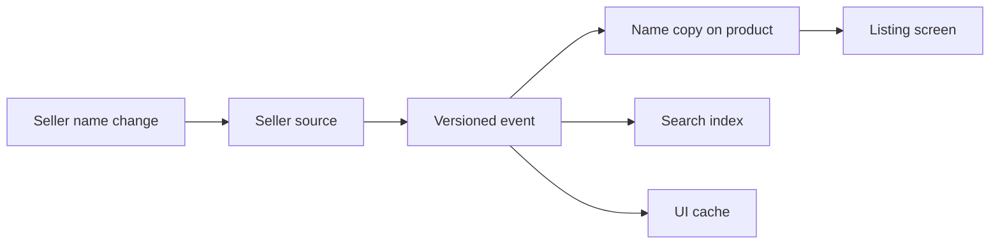
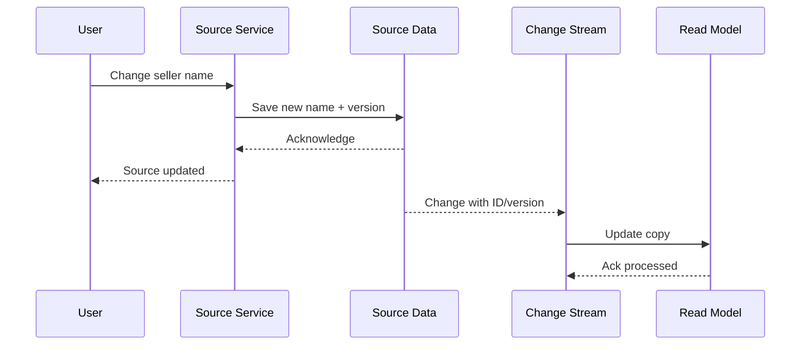

# Intentional Duplication and Update Ownership

## 1. Why Does the Document Model Sometimes Intentionally Duplicate Data?

When translating business requirements into a data model, the rule “store every fact in only one place” is a useful starting point, not an absolute goal. In the **document model**, screens and operations often need a cohesive set of data together in one document: product name, price at purchase time, seller name, shipping address, review count, or a few recent comments.

If every render has to traverse multiple documents or services to assemble that view, read paths can become complex, slow, or coupled to external systems. Consequently, you can **intentionally duplicate** a subset of data from its authoritative source into the read-serving location.

The crucial question is not merely **“is data duplication allowed?”**, but rather:

1. What **business meaning** does that copy carry?
2. Which **source has the authority to determine the true value?**
3. **Who owns updating** each place where the data lives?
4. When the value changes, **which copies must change with it**, and which must remain untouched?
5. If an update fails, lags, arrives twice, or arrives out of order, how does the system detect and repair it?

This lesson belongs to the **Document Modeling** chapter within **DATABASE_DATA_MODELING**: building the ability to model entities, relationships, constraints, keys, indexes, and physical schemas from business requirements; and evaluating structural correctness and evolvability before choosing document, relational, graph, or analytical models.

**Learning objective:** After this lesson, you can classify data copies, identify the source of truth and update owner at the field or event-type level, design unidirectional synchronization flows, select consistency levels, build reconciliation plans, and validate models with real-world scenarios.

## 2. Intentional Duplication Is Not Uncontrolled Redundant Data

**Denormalization** is the decision to store additional data to support a specific access pattern—such as adding `sellerName` to a product display document or `reviewCount` to a course document.

In a normalized relational model, the system can join tables via foreign keys. In the document model, data is often grouped by **read/write unit**, so copies can reduce join steps. However, both relational and document databases can use denormalization; it is not exclusive to one database type.

A copy is **intentional** only when the design specifies:

- **Reason to exist:** reducing query round-trips, preserving history, serving search, pre-aggregating, or powering a UI view.
- **Duplication scope:** which fields, embedded in which documents, and whether cardinality is bounded.
- **Origin:** which fact is authoritative and what transformation produces the copy.
- **Responsibility:** which service/job is authorized to update the copy and based on what signal.
- **Consistency contract:** whether immediate consistency is required or what lag is acceptable.
- **Recoverability:** whether the copy can be recomputed, replayed from events, or reconciled against the source.
- **Lifecycle:** how the copy is updated, deleted, archived, and migrated.

Without answers to these questions, duplication risks creating **multiple competing sources of truth**.

## 3. Three Types of Copies That Are Often Confused

Classifying copies before deciding how to synchronize them is the most important step.

### 3.1. Historical Snapshot: The Copy Becomes Its Own Business Fact

For example, when a customer orders a product, the order stores the name and unit price at purchase time:

```json
{
  "orderId": "ORD-042",
  "customerId": "CUS-008",
  "items": [
    {
      "productId": "PRD-101",
      "nameAtPurchase": "Data Design Book",
      "unitPriceMinor": 180000,
      "quantity": 2
    }
  ],
  "currency": "VND",
  "status": "CONFIRMED"
}
```

At the same time, the product is managed in the catalog:

```json
{
  "productId": "PRD-101",
  "name": "Data Design Book",
  "currentPriceMinor": 180000,
  "priceVersion": 7
}
```

Later, the store owner changes the current price to 195,000 VND. **You must not automatically overwrite** `unitPriceMinor` in finalized orders with the new price. Current price and purchase-time price are **two distinct facts**, even though they initially held the same number.

Similarly:

- An order's shipping address is the address confirmed by the buyer at purchase time.
- The exchange rate applied to a transaction is the rate locked at pricing time under business rules.
- The product name on an invoice may need to match what was originally issued.

The **order/invoicing domain** owns protecting historical values, not a sync pipeline tracking current catalog prices. Adjustments, cancellations, and privacy requests must still follow proper workflows; “snapshot” does not mean immutable under every legal and business circumstance.

### 3.2. Current-State Copy: Must Follow the Authoritative Source

Suppose a product listing screen needs the seller's name without looking up `sellers` for every product:

```json
{
  "productId": "PRD-101",
  "name": "Data Design Book",
  "sellerId": "SEL-017",
  "sellerDisplayName": "Open Bookshop",
  "sellerNameSourceVersion": 12
}
```

`sellerDisplayName` is a copy of the current display name in the seller document/service. When the seller changes their name, the copy **should be synchronized** if the product contract intends to show the current name.

The design must specify:

- `sellers.displayName` is the authoritative source for the current name.
- The seller management service authorizes edits to the authoritative value.
- A product projection pipeline or materialized view updates the copy.
- Whether the UI can tolerate showing the old name for a defined lag window.
- If immediate accuracy is mandatory, change the read or sync strategy accordingly.

### 3.3. Derived Data: Values Computed from Other Records

Example:

```json
{
  "courseId": "CRS-021",
  "title": "Data Modeling",
  "visibleReviewCount": 124,
  "ratingSum": 577,
  "averageRating": 4.6532258065
}
```

Suppose the origin is the `reviews` collection, and only reviews with status `VISIBLE` count. When a review is hidden, changes its star rating, or is deleted, these aggregate fields must update according to that rule.

Here the source of truth is not a single field, but **the set of valid review records plus the calculation definition**. Counters and averages are derived data that can be rebuilt from the source when needed.

**Arithmetic note:** `averageRating` in the example equals `577 / 124` per the sample data. When precision and recomputability are needed, store `ratingSum` and `visibleReviewCount`, then compute the average or store a rounded display value per formatting rules. Decide how to handle zero counts and reviews changing visibility status.

### 3.4. Quick Comparison Table

| Copy Type | Example | Update When Current Source Changes? | Who Holds the True Value? |
| --- | --- | --- | --- |
| **Historical snapshot** | `unitPriceMinor` at purchase | **No**, except via valid adjustment workflows | The finalized transaction record |
| **Current-state copy** | `sellerDisplayName` on product | **Yes**, per sync contract | Seller source and projection pipeline |
| **Derived data** | `reviewCount`, `ratingAverage` | **Yes**, when relevant input records change | Review source and aggregation rules |
| **Bounded preview** | 3 newest comments | **Yes**, when the result set changes | Comments collection and preview builder |
| **Analytical data** | Monthly revenue | **Yes**, on schedule or ETL events | Transaction events and metric definitions |

Do not apply a single “sync every identically named field” mechanism across all of these categories.

## 4. “Source of Truth” and “Update Owner” Are Related but Distinct Concepts

The **source of truth** (or *authoritative source*) is the location or rule recognized as authoritative for **a specific fact**. An entire system does not need a single monolithic database as the source of truth for every fact.

The **update owner** (*write owner / responsible service*) is the service, component, or process responsible for mutating that fact under business rules.

Examples:

- The Seller service owns changing `sellers.displayName`.
- The Product service may maintain `products.sellerDisplayName` as a read-optimized copy, but must not treat that copy as the official name.
- The Order service creates `orders.items[].unitPriceMinor` when an order is finalized. Once finalized, that price belongs to the order domain, no longer acting as a copy tracking catalog price.
- The Review service manages `reviews`; an aggregation component recomputes `visibleReviewCount` and `ratingAverage` on the read model.

A system can have **multiple sources of truth across different facts**, provided each fact has non-conflicting ownership rules.

### 4.1. Ownership Contracts Should Be Defined at the Field or Fact Level

Writing “Product Service owns the `products` collection” may be insufficient. Inside a single product document, `name`, `currentPriceMinor`, `sellerDisplayName`, and `reviewCount` can have different sources or update pipelines.

An illustrative ownership matrix:

| Fact | Authoritative Source | Who Can Mutate Source? | Copy / Target | Who Updates Target? |
| --- | --- | --- | --- | --- |
| Current product name | `products.name` | Product Service | Search card, search index | Indexer |
| Current selling price | Approved pricing rules/records | Pricing Service | Product read model | Price sync pipeline |
| Price at order placement | Finalized order and related records | Order domain per adjustment rules | `orders.items[].unitPriceMinor` | Order finalizer; never tracks new price |
| Current seller name | `sellers.displayName` | Seller Service | `products.sellerDisplayName` | Copy projector |
| Visible review count | Valid `reviews` | Review Service | `products.visibleReviewCount` | Aggregator |
| Current learning progress | `lessonProgress` | Learning domain | Learner dashboard | Progress aggregator |

A field may be **computed, transmitted, or stored** by many components, yet **authority over its true value** must be explicitly defined. In particular, two applications must never independently mutate two copies as co-authoritative without a conflict-resolution rule.

### 4.2. Ownership Boundaries Prevent Update Loops

Anti-pattern:

```text
A.sellerName  ---- sync ----> B.sellerName
A.sellerName  <--- sync ----- B.sellerName

Both A and B allow direct user edits.
```

If both sides receive different updates at roughly the same time, the system does not know which value wins and can enter an infinite sync loop.

Replace with a unidirectional flow:



Only the seller source determines the current name. Copies can be regenerated from the source, and display layers must never implicitly write back to the source.

## 5. When Does Duplication Deliver Real Value?

Saving one query does not automatically justify duplicating data. Base the choice on **data access paths** and operational cost.

### 5.1. Read-Heavy, Write-Rare Data

A product page is viewed tens of thousands of times a day, whereas the seller's display name changes only a few times a year. Copying the name into the read model eliminates extra lookups at relatively low update cost.

Still, measure the impact of caching, projections, joins, and existing indexes. If a join is already fast and simple, duplication may only add synchronization overhead.

### 5.2. Needing a Stable Business Snapshot

Orders, invoices, period-closing statements, and contracts usually need to preserve the exact values in effect at a point in time. Saving a snapshot is a **business correctness requirement**, not merely a performance optimization.

### 5.3. Optimizing Lists or Summary Screens

A course catalog page may need the course title, author name, lesson count, enrollment count, and average rating. A pre-built summary document returns lists quickly instead of aggregating across multiple collections per row.

Conversely, because users are viewing a summary list, do not embed all reviews or every learner's progress into each course document. Copies should be **fit-for-purpose and bounded**.

### 5.4. Serving Search Engines or Analytical Reports

A search index or analytical model can store transformed data from multiple sources. This acts as a **materialized view** or derived dataset. The transactional write store and search/reporting stores serve different goals; establish clear contracts for lag and reconciliation.

### 5.5. Initial Decision Matrix

| Question | If “Yes” | Implication |
| --- | --- | --- |
| Must a historical point-in-time value be preserved? | Yes | Create a business snapshot |
| Is a critical read path paying expensive cross-source joins? | Yes | Consider a read-serving copy |
| Can the value be computed from authoritative records? | Yes | Treat as derived data, rebuildable |
| Does the source change frequently or require immediate consistency? | Yes | Be cautious with async replication lag |
| Can multiple places mutate the same fact? | Yes | Redefine a single authoritative source |
| Can the copy grow without bound? | Yes | Bound, reference, or store separately |
| Can drift be detected and repaired automatically? | Yes | Duplicated model is much safer to operate |

## 6. Designing a Data Duplication Contract

Before adding a copy, write a **brief contract** for each duplicated field group.

Example for seller name appearing on product pages:

```yaml
# Design contract example, not a system configuration file.
fact: seller.displayName
authority: sellers.displayName
sourceOwner: SellerService
copyTarget: products.sellerDisplayName
copyUpdater: ProductProjection
trigger: SellerDisplayNameChanged
sourceVersionField: sellerVersion
consistency: eventual
targetLagObjective: "p99 under 60 seconds (illustrative assumption)"
onFailure: "retry, dead-letter, alert, reconcile"
onDelete: "follow seller deletion/hiding policy"
rebuild: "reconstruct from authoritative seller data"
```

In practice, a solid contract answers:

1. **Fact:** precisely what is copied, including units and rounding rules?
2. **Source:** authoritative document/key identifier and owning system.
3. **Target:** collection/document/field or index receiving the copy.
4. **Writer:** a single responsible component or explicitly defined coordinator.
5. **Trigger:** synchronous call, domain event, CDC, scheduled job, or read-time query.
6. **Versioning:** how the copy tracks which source version it has applied.
7. **Consistency level:** immediate, same-transaction, or bounded eventual lag.
8. **Error handling:** retries, idempotency, ordering, alerts, and reconciliation.
9. **Mutation / deletion:** how source schema changes, invalidation, or deletion are handled.
10. **Rebuild:** how the target is reconstructed from authoritative data after failures.

The contract does not have to live in YAML. What matters is **rules clear enough for others to implement, operate, and test**.

## 7. Three Common Consistency Strategies

### 7.1. Read the Authoritative Source On Demand

Store no copy; when rendering a product, fetch seller data alongside it.

**Best when:** the latest value is required, read volume is moderate, or joins/lookups are fast and simple enough.  
**Trade-offs:** adds read-time coupling, potentially more round-trips, and higher latency if the source lives in another service.

Sequential reads across multiple sources also do not automatically yield a consistent point-in-time snapshot. If an atomic cross-entity snapshot is required, inspect transaction/isolation support and business needs.

### 7.2. Update Source and Copy in the Same Transaction Boundary

Atomic updates work when the fact and copy reside in the same document; across multiple documents, some database engines support multi-document transactions.

**Best when:** invariants demand strong consistency, involved parties are few, and the engine supports it.  
**Trade-offs:** higher transaction overhead, contention, and complexity; distributed transactions across separate services or storage engines may be impractical.

Do not cram all system documents into one giant document just to achieve a single atomic write: transaction boundaries must still balance cardinality, size, and write load.

### 7.3. Asynchronous Sync and Eventual Consistency

The source updates first; events/change streams drive updates to read models.



**Best when:** stale copies within bounds are acceptable and read-time decoupling is needed.  
**Trade-offs:** the system must handle duplicate, delayed, out-of-order events and partial failures; requires monitoring and reconciliation.

Product requirements must clarify what **“update succeeded” means**: has the source been updated, or are all read models guaranteed to reflect the new value? Those two guarantees are very different.

### 7.4. Comparison Table

| Criterion | Direct Source Read | Same Transaction | Asynchronous Sync |
| --- | --- | --- | --- |
| Duplicated data | Little or none | Possible | Common |
| Freshness of displayed value | Reflects source read | Guaranteed within transaction boundary | May lag |
| Read-path coupling | Yes | Usually lower once copied | Usually lower |
| Write-path cost | No copy updates needed | Scales with copies in transaction | Write source + emit change |
| Failures to handle | Source unavailable | Transaction failure / conflicts | Lag, duplicates, out-of-order, partial failures |
| Copy reconciliation | N/A if not copied | May still be needed | Essential |

## 8. Reliable Event Emission: Avoiding Lost Changes Between Two Steps

An unsafe pattern:

```text
1. Write the new name to the source database.
2. Publish a "SellerDisplayNameChanged" message.
3. If step 2 fails after step 1 succeeds, the copy never gets updated.
```

Application retries help in some cases but are insufficient, especially if the process crashes between the two steps.

Two common design patterns:

- **Transactional outbox:** write business data and an outbox event record in the **same transaction** at the source; a relay reads the outbox and delivers events downstream. This requires an appropriate transaction boundary and retry handling; the outbox itself does not eliminate duplicate deliveries.
- **Change Data Capture (CDC) / change stream:** observe committed changes at the source and propagate them to read models. Understand your engine's capture mechanics, ordering guarantees, resume-after-failure behavior, and change history retention window.

Reliability cannot be inferred from a technology's name alone. Test process crashes, dropped connections, replayed messages, concurrent consumers, and temporarily unavailable targets.

### 8.1. What Should a Change Message Contain?

A conceptual example:

```json
{
  "eventId": "EVT-90018",
  "eventType": "SellerDisplayNameChanged",
  "sellerId": "SEL-017",
  "sourceVersion": 13,
  "newDisplayName": "Open Bookstore",
  "occurredAt": "2026-11-22T08:30:00Z",
  "schemaVersion": 1
}
```

Where:

- `eventId` supports deduplicating processed events.
- `sellerId` identifies the source entity.
- `sourceVersion` ensures only newer versions are applied, preventing stale events from overwriting newer state.
- `schemaVersion` allows evolving the message contract over time.
- `occurredAt` is useful for observability and reconciliation, **not as a complete substitute for a reliable ordering mechanism**, since clocks and emission times can skew.

You can emit full state payloads or just identifiers for the updater to fetch from the source; each option has trade-offs in payload size, latency, authorization, and reading newer mutations mid-flight.

## 9. Duplicate Events, Out-of-Order Delivery, and Copy Updates

### 9.1. Distinguishing “At-Least-Once Delivery” from “Exactly-Once Business Processing”

Many messaging systems redeliver the same event if acknowledgment is missed. Suppose one review is added and the `ReviewCreated` event is processed twice.

If the consumer simply runs:

```javascript
// Bug illustration: processing the same event twice increments the count twice.
db.courses.updateOne(
  { courseId: "CRS-021" },
  { $inc: { visibleReviewCount: 1 } }
);
```

then the counter drifts. This bug persists even though each `$inc` statement is atomic: **atomicity does not equal idempotency**.

One necessary design is persisting processed event IDs alongside the copy mutation **within the same atomic boundary** whenever possible. If a consumer checks and increments in two separate steps, two concurrent workers can still pass the check simultaneously.

Another option is avoiding blind incremental arithmetic from events altogether and recomputing the counter from the authoritative source when frequency and cost allow. Even then, guard against overlapping recalculations or an older run overwriting a newer result.

### 9.2. Version-Guarded Updates to Prevent Stale Overwrites

Suppose a seller changes their name at version 13, then again at version 14. Due to networking or queueing, event 14 may arrive before event 13.

If the consumer blindly writes whichever message arrives last regardless of version, the copy **regresses** from version 14 back to version 13.

Conceptual rule:

```text
Upon receiving an event for seller S with sourceVersion = v:

  current = source version already applied on the copy

  if v < current:
      ignore stale event
  if v == current:
      treat as duplicate or run idempotency check
  if v > current:
      update copy value and applied version
      using an appropriate conditional/atomic operation
```

For a MongoDB read model, you can illustrate **the case where the copy document already exists**:

```javascript
const result = db.productCards.updateOne(
  {
    productId: "PRD-101",
    sellerNameSourceVersion: { $lt: 14 }
  },
  {
    $set: {
      sellerDisplayName: "Open Bookstore",
      sellerNameSourceVersion: 14
    }
  }
);

// matchedCount === 0 can mean the copy is already newer,
// equals the current version, or the copy does not exist yet.
// Handle each case via explicit workflow logic.
```

This illustrative statement **does not cover creating a new copy** and does not translate verbatim to every database engine. When adding *upsert*, prevent two concurrent writers from creating duplicates via unique keys, conflict handling, and retries. Versions must also have well-defined scope **per source entity or per change stream**; never assume versions from two different entities can be compared directly.

### 9.3. Handling Copies Derived from Multiple Sources

`ratingAverage` depends on many `reviews` records. A course-level `sourceVersion` may not exist when events originate from individual reviews.

Options include:

- Updating counters/sums inside the same transaction as the review mutation when they share a compatible storage engine.
- Writing to an aggregate table/document with deduplication and per-mutation conditional updates.
- Recomputing aggregates from the source on a schedule or event trigger, followed by reconciliation.
- Maintaining a table of applied events or ordered stream checkpoints with protected write boundaries.

The right choice depends on review volume, write concurrency, freshness requirements, and recomputation cost. No single `$inc` solves every derived-data problem.

## 10. Reconciliation: Every Copy Must Be Verifiable and Rebuildable

When duplicating data, accept that drift can happen and establish mechanisms to **detect, explain, and repair** it.

### 10.1. Metrics to Monitor

| Metric | Meaning | Action When Threshold Exceeded |
| --- | --- | --- |
| Copy update lag | Time from source mutation until copy reflects it | Inspect queues, consumers, and errors |
| Applied source checkpoint / version | How caught up the copy is | Identify lagging entities or dropped updates |
| Failed events and retry counts | Whether the sync pipeline is stalled | Alert, process dead-letter queue |
| Missing copies | Key exists in source but target is absent | Backfill or rebuild |
| Drifted copy values | Copy mismatches source past lag window | Reconcile and repair |
| Full rebuild duration | How long projection recovery takes | Evaluate recovery objectives |

Figures like “p99 update under 60 seconds” are **illustrative targets** per product, not universal standards. Business requirements dictate which data can lag a minute and which cannot lag at all.

### 10.2. How to Reconcile

A standard workflow:

1. Select a consistent data scope, version, or point in time for comparison, avoiding mismatches from unaligned snapshots.
2. Read authoritative data or recompute results using the official definition.
3. Compare copies by identifier after normalizing data types and units.
4. Log discrepancies: missing, extra, mismatched values, version mismatches, or deleted source records.
5. Repair **conditionally** so stale repairs never overwrite newer valid updates.
6. Re-measure drift and perform root-cause analysis if discrepancies recur.

For `visibleReviewCount`, you can recount reviews with `VISIBLE` status from the `reviews` collection. For a search index, you can rebuild the entire index from the primary source if designed for it.

### 10.3. Rebuildability Is a Design Quality Criterion

A well-designed projection has a documented and tested **rebuild** path: from source snapshots, from a complete event log, or from the source combined with concurrent changes during rebuild.

If a copy becomes the only place retaining unrecoverable original data, it has effectively become a **primary data store** and can no longer be treated as a disposable cache.

## 11. Document-Model-Specific Constraints

### 11.1. Choose Copy Storage Boundaries by Read Unit

For instance, `productCards` may hold only the fields required by the listing page:

```json
{
  "productId": "PRD-101",
  "title": "Data Design Book",
  "sellerId": "SEL-017",
  "sellerDisplayName": "Open Bookstore",
  "currentPriceMinor": 195000,
  "currency": "VND",
  "visibleReviewCount": 124,
  "updatedAt": "2026-11-22T08:31:00Z"
}
```

This is a **read model** built from products, sellers, prices, and reviews. It does not automatically hold authority to modify those sources.

When designing it, avoid embedding **all comments**, **all price history**, or **all view counts** into `productCards`. Derived data should stay **bounded in size** and tailored to the screen.

### 11.2. Identifier Keys and Versions Are Part of the Contract

A copy must identify its origin and update ordering:

- `productId` to locate the corresponding product.
- `sellerId` to match incoming seller rename events.
- `sellerNameSourceVersion` to reject stale rename events.
- `updatedAt` or `projectedAt` to measure projection freshness, with clear semantics.

In *multi-tenant* systems, keys may need to include `tenantId` so records across tenants never collide. Apply uniqueness scope consistently across indexes and all read/write paths.

### 11.3. Duplication Increases Write and Index Load

If a seller's name is embedded in 30,000 products, one seller rename can force updates to up to 30,000 copies. This is **write amplification**: one logical mutation triggers many physical storage writes.

Rough estimation:

```text
target_writes ≈ copies_affected × writes_per_copy

net_benefit ≈ read_cost_saved
              - copy_maintenance_cost
              - storage_and_index_cost
              - lag_and_repair_cost
```

This formula is a reasoning framework, not a substitute for benchmarks. When fan-out is huge and updates are frequent, querying via reference, caching at the read edge, or grouping into a materialized view may beat embedding directly in every record.

### 11.4. Indexes Should Serve Queries, Not Every Copied Field

Suppose users filter products by seller ID and sort chronologically:

```javascript
// MongoDB syntax example; does not apply verbatim to all document databases.
db.productCards.createIndex({ sellerId: 1, updatedAt: -1 });

db.productCards.find(
  { sellerId: "SEL-017" },
  { _id: 0, productId: 1, title: 1, sellerDisplayName: 1 }
).sort({ updatedAt: -1 }).limit(20);
```

Indexes must reflect actual filters, sort orders, and query frequencies. Copying a field into a document does not mean it needs its own index. Every additional index increases write overhead on updates.

## 12. Common Design Mistakes

### Mistake 1: Syncing Current Prices into Finalized Orders

**Consequence:** order history, invoices, or totals shift when catalog prices change.  
**Fix:** separate current catalog price from purchase-time snapshot price, with distinct ownership and update rules.

### Mistake 2: Allowing Edits to Two Copies Simultaneously

**Consequence:** loss of authoritative source, mutual overwrites, or sync loops.  
**Fix:** assign a single authoritative source per fact; all canonical mutations flow through that owner.

### Mistake 3: Incrementing Counters on Every Event Without Deduplication

**Consequence:** a single review gets counted twice after a retry.  
**Fix:** enforce idempotency with durable processed state in the same write boundary, or use periodic recomputation/reconciliation.

### Mistake 4: Using Timestamps Alone to Decide Which Event Is Newer

**Consequence:** clock skew, delayed delivery, or out-of-order processing regresses the copy's version.  
**Fix:** use monotonic versions or meaningful per-entity/stream sequence numbers combined with conditional updates.

### Mistake 5: Copying All Fields “Just in Case”

**Consequence:** bloated documents, unnecessary exposure of sensitive fields, fragile sync paths, and costly deletions/migrations.  
**Fix:** copy only the fields required by a specific read path, with clear scope and bounds.

### Mistake 6: Accepting Eventual Consistency Without Defining Targets

**Consequence:** hours of lag goes unnoticed as “normal”; users report wrong data with no metrics to investigate.  
**Fix:** agree on business lag SLAs, monitor replication lag, and alert on threshold breaches.

### Mistake 7: Deleting the Source While Forgetting Copies

**Consequence:** sensitive or invalidated information remains visible in indexes, caches, exports, or reports.  
**Fix:** propagate delete/hide/permission-change flows to every copy location; clarify legal retention needs and deletion verification.

### Mistake 8: Having No Rebuild Path

**Consequence:** a single consumer bug leaves permanent drift requiring manual per-document fixes.  
**Fix:** retain authoritative source data, build recomputation pipelines, checkpoints, and recovery playbooks.

## 13. Schema Changes, Privacy, and Copy Lifecycle

### 13.1. Evolving the Source Structure

Suppose a seller previously had `displayName`, and it splits into `legalName` and `publicName`. The `sellerDisplayName` copy on products must know which field to track.

An evolution process requires:

1. Defining the semantics and authoritative source of the new fields.
2. Updating readers/consumers to support both legacy and new data/events.
3. Rolling out the new write path with explicit schema versions.
4. Migrating or rebuilding copies in idempotent batches.
5. Tracking unmigrated copy counts and sync lag.
6. Removing legacy compatibility once sources and all relevant consumers are verified.

Never silently change a fact's business definition while keeping the exact same field name so downstream consumers interpret it inconsistently.

### 13.2. Privacy and Sensitive Data

The more places personal data is copied, the harder it becomes to enforce permission changes, retention limits, and deletion requests. Before copying a customer's phone number into product views, order lists, or search indexes, justify the **purpose** and restrict access.

Historical snapshots may require retention for accounting/legal records, while other copies must be deleted, masked, or restricted. Base decisions on specific regulations and policies rather than blanket rules like “snapshots are always untouchable” or “all copies must always be wiped immediately.”

### 13.3. Copy Lifecycle

Clarify when a copy is:

- **Created:** when the source appears or the entity enters the read model.
- **Updated:** via field/event updates or rebuild jobs.
- **Hidden:** when the source is no longer permitted to be displayed.
- **Deleted:** when the source expires or meets a specific retention policy.
- **Rebuilt:** when calculation logic or target schema changes.

Deletion handling must also prevent late-arriving stale events from **resurrecting** deleted records. Version checks or deletion markers (*tombstones*) bounded by retention policies may be needed, especially with asynchronous sync.

## 14. Real-World Case Study: E-Commerce

### 14.1. Requirements

An e-commerce system has:

- A product listing page showing product title, seller name, current price, and review count.
- Each seller manages many products and can change their display name.
- Buyers place orders at locked-in prices; orders must preserve history.
- Reviews are added, edited, hidden, or deleted independently.
- Promotional campaigns cause frequent price updates.

### 14.2. Separating Sources and Copies

```text
sellers
  { sellerId, displayName, version }

products
  { productId, sellerId, title, version }

prices
  { productId, currentPriceMinor, currency, priceVersion }

reviews
  { reviewId, productId, rating, moderationStatus, version }

productCards (read model)
  {
    productId, sellerId, title,
    sellerDisplayName, currentPriceMinor,
    visibleReviewCount, averageRating,
    sellerVersionApplied, priceVersionApplied,
    projectedAt
  }

orders
  {
    orderId, customerId, confirmedAt,
    items: [{
      productId, titleAtPurchase,
      unitPriceMinor, quantity
    }]
  }
```

These collections are illustrative; depending on the domain, `prices` could reside inside `products` if transaction boundaries, ownership, and write load align. What matters is that **the authoritative source for each fact** is explicitly documented.

### 14.3. Price Update Flow

1. The Pricing service validates and persists the new price at the source, incrementing `priceVersion`.
2. Changes are delivered reliably to the `productCards` projector.
3. The projector applies the price only if the incoming source version is newer than the applied version.
4. The listing page reads the copy; price sync lag is monitored.
5. At order checkout, the ordering workflow must use a price **verified under checkout pricing rules**, then persist a snapshot on the order. Never blindly trust a potentially lagging price on a product card as authoritative for checkout.

That final point is a critical business boundary: an eventually consistent read model cannot automatically serve as the authoritative price source for payment flows requiring exact precision.

### 14.4. Seller Name Update Flow

1. The Seller service updates the name and increments the source version.
2. A change pipeline locates affected copies matching `sellerId`.
3. Copies are updated with version guards, retries, and reconciliation.
4. Finalized orders **do not need** to rewrite historical seller names if business rules require preserving the snapshot.

If a seller has hundreds of thousands of products, benchmark the cost of fan-out updates. Depending on performance, consider dropping the name copy from individual products and using a shared seller document/cache or adjusting the read model.

### 14.5. Review Flow

1. `reviews` is the authoritative source, holding `rating` and `moderationStatus`.
2. The aggregator identifies valid reviews and updates/recomputes the count and sum.
3. Results are written to `productCards` with duplicate/regression guards and reconciliation.
4. When a review is hidden, the aggregator subtracts its contribution or recomputes from the source.

To reduce drift, formalize the rule: “visible reviews are those with `moderationStatus = VISIBLE`; each `reviewId` contributes exactly once; rating edits apply the delta of new minus old.” If calculation logic changes, rebuild the read model from the source.

### 14.6. Verification Table

| Operation | Correctness Expectation | Can the Copy Lag? |
| --- | --- | --- |
| Change seller name | Source records new value with version | Yes, within agreed lag window |
| Display product listing | Name/price/counters within lag contract | Yes, if explicitly permitted by product spec |
| Confirm price on order placement | Exact price locked per pricing rules | Must not rely blindly on stale cache |
| View historical order | Locked price, name, transaction details | Never updated to match new catalog price |
| Hide a review | Review is hidden per moderation policy | Summary counts may lag if allowed, but visibility controls must be enforced |
| Delete data upon valid request | Copies in scope must be processed | Within defined SLA and workflow |

## 15. Practice Exercise: Learning Platform

A platform has `users`, `courses`, `lessons`, `enrollments`, and `lessonProgress`. The course catalog page needs instructor name, lesson count, active enrollment count, and average rating. Learners view lessons and record progress after each lesson; instructors can update their display name; courses can be hidden or closed for enrollment.

**Task:** For each fact below, identify its source of truth, where copies may live, the update owner/job, consistency level, and reconciliation method:

1. Instructor name on the course card.
2. Published lesson count.
3. Active enrollment count.
4. A learner's progress.
5. Course name printed on an already-issued certificate.

### 15.1. A Defensible Solution

| Fact | Authoritative Source | Copy or Snapshot | Updates |
| --- | --- | --- | --- |
| Current instructor name | Instructor profile | `courseCards.instructorName` | Synced when profile changes |
| Published lesson count | Valid lessons / lesson versions | `courseCards.publishedLessonCount` | Recomputed or controlled update on publish/unpublish |
| Active enrollment count | `enrollments` per defined active status | `courseCards.activeEnrollmentCount` | Idempotent aggregation + reconciliation |
| Learner's current progress | `lessonProgress` | Dashboard or learning analytics | Learning domain writes source; dashboard syncs |
| Course name on issued certificate | Certificate record at issuance | `certificates.courseNameAtIssue` | Snapshot at issuance; never tracks current course title |

**Open questions:**

- If an instructor changes their name, yet an already-issued certificate must preserve the name at issuance time, are those two fields still “copies with the same semantics”?
- If `EnrollmentActivated` is delivered twice, will the enrollment count double-increment? Where do you place the idempotency guard?
- If two lesson-count updates arrive out of order, how do you prevent an older count from overwriting a newer result?
- If the enrollment screen must immediately reflect that a course closed enrollment, should it read that status from a lagging copy?
- If a personal data deletion request arrives after data has propagated to reports, search indexes, and caches, who owns the end-to-end deletion workflow?

These questions highlight that **business semantics, authoritative ownership, and acceptable lag** matter far more than the initial choice of embedding vs. referencing.

## 16. Decision-Making and Design Handoff Process

A concrete workflow ready for project use:

1. **Inventory facts**, not just collections: current names, current prices, checkout prices, counters, snapshots, public info, and sensitive data.
2. **Review business requirements** to separate historical facts from live copies that track a changing source.
3. **Assign authority** and mutation rights per fact.
4. **Build a read-path table:** which screens need the data, frequency, and latency; verify whether references or existing joins already suffice.
5. **Select bounded copy locations**, keeping only fields genuinely needed for the read path or business snapshot.
6. **Choose a consistency strategy:** direct read, transaction, or async sync; document what “success” guarantees and acceptable lag windows.
7. **Design the update loop:** IDs, versions, idempotency, ordering, retries, deletions, and rebuild paths.
8. **Measure operational costs:** reads saved, copies updated per change, document sizes, indexes, lag, and contention.
9. **Write test and reconciliation scenarios:** duplicates, late arrivals, network partitions, source deletions, schema changes, counter drift.
10. **Document the data contract** so future maintainers know the authoritative source, owners, transformation rules, and recovery steps.

The design deliverable should include a **fact ownership table**, **change-flow diagram**, **sample document structures**, **query paths and indexes**, **consistency commitments**, and a **test/reconciliation plan**. A diagram full of arrows without clear authority and update ownership is not ready for production.

## 17. Self-Review Checklist

- [ ] I know which copies are **historical snapshots**, live current-state copies, or derived data.
- [ ] Every fact has an explicit **source of truth** and mutation rules.
- [ ] Every copy has a designated **update owner/job**; no ambiguous bidirectional sync loops exist.
- [ ] I can explain **why** duplication is necessary and have measured its read-path benefit.
- [ ] Copied data includes only required fields and has appropriate size bounds.
- [ ] Sync rules specify triggers, conditional write guards, and allowed lag.
- [ ] Retries cannot double-count; stale events cannot overwrite newer versions.
- [ ] Failed sync steps trigger detection, alerting, and recovery.
- [ ] A **reconciliation and rebuild** process exists from authoritative data.
- [ ] Write amplification, indexing, and bulk update costs are accounted for.
- [ ] Edit, delete, hide, and privacy policies propagate to all relevant copies.
- [ ] A compatibility plan exists for schema or business-meaning changes.
- [ ] Historical prices, orders, and certificates are protected from tracking current values erroneously.
- [ ] Verified under heavy read/write loads, duplicate/delayed messages, and source outages.

**Key takeaway:** **Intentional duplication is sustainable only when value authority and update ownership are unambiguously defined.** Historical snapshots preserve a past point-in-time fact; live copies follow one authoritative source; derived data follows its source records and calculation rules. A sound document model knows **when to copy, who is allowed to write, how closely to sync, and how to repair drift**.
