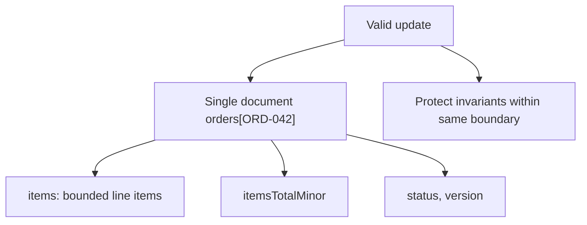
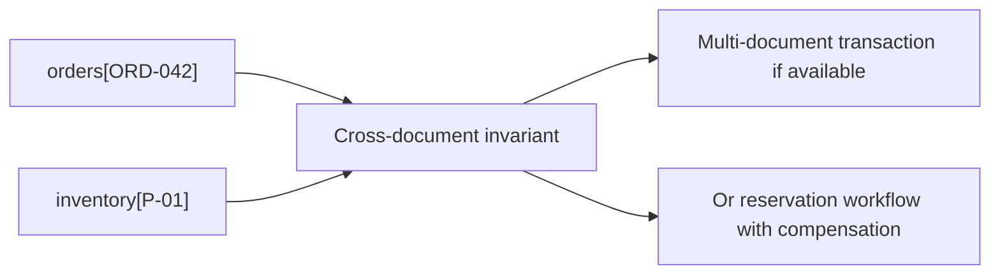
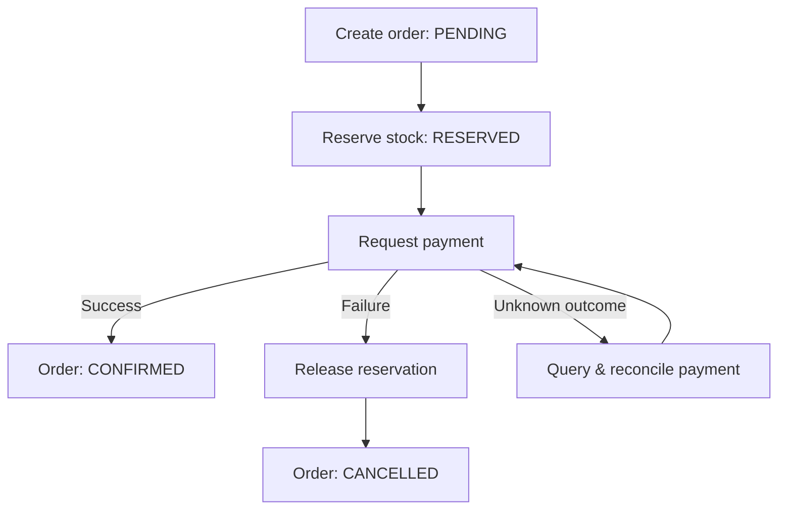
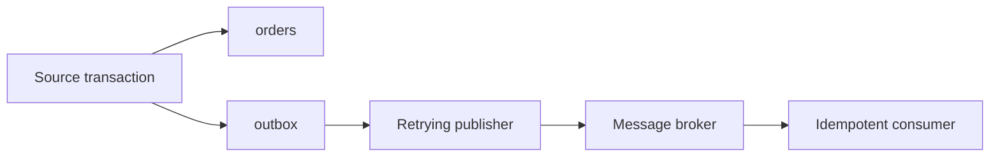

# Operation Atomicity and Transaction Limits by Storage Engine

## 1. Why Do Transaction Boundaries Drive Document Modeling?

A business workflow rarely consists of a single assignment. When a user confirms an order, the system may need to change the order status, lock line items, compute totals, reserve inventory, and record a payment request. If the operation succeeds halfway and stops, data can become inconsistent: the order is confirmed without inventory reserved, or stock is deducted without an order created.

In the **document model**, choosing to place data **inside the same document**, **across multiple documents in the same database**, or **across multiple services/storage engines** directly affects what can be mutated atomically.

**Atomicity** means an operation is treated as **an indivisible unit** within the scope guaranteed by the storage engine: either all changes in that unit apply, or none do. The exact boundary of that guarantee must be explicitly stated.

This lesson belongs to the **Document Modeling** chapter of **DATABASE_DATA_MODELING**. The module's goal is turning business requirements into clear data structures—from entities, relationships, constraints, keys, and indexes to physical schemas—and comparing relational, document, graph, and analytical models to choose evolvable, testable structures.

After this lesson, learners will be able to:

- Distinguish **a single atomic command**, **multi-statement transactions**, **isolation levels**, **durability**, and **business consistency**.
- Identify which invariants belong inside a single document, a transaction, or a coordinated workflow.
- Read and verify transaction limits by **product, version, configuration, and data scope**.
- Write conditional updates, control concurrent writes, and handle conflicted or unknown-outcome transactions.
- Design appropriately when work spans multiple documents, partitions, services, or external systems.
- Analyze trade-offs across **embedding**, **referencing**, multi-document transactions, **reservations**, and **sagas**.

## 2. Atomicity Does Not Equal Full ACID

### 2.1. The Four ACID Properties

| Property | Question | Example to Verify |
| --- | --- | --- |
| **Atomicity** | Which changes either all succeed or all abort? | Changing order status and updating totals within the same boundary |
| **Consistency** | Which constraints is the transaction designed to protect? | Accurate totals, unique order ID, never overselling stock |
| **Isolation** | How do concurrent transactions observe and affect each other? | Two buyers purchasing the last item in stock |
| **Durability** | Once acknowledged, across which failures is data preserved? | Server crash or node failover after write acknowledgment |

**Note on the C in ACID:** the storage engine provides mechanisms that help uphold constraints; defining business invariants and placing checks in the right locations remains the designer's responsibility. An atomic transaction still cannot prevent business bugs if checks are flawed or rules extend beyond the transaction scope.

Similarly, a system “supporting transactions” does not imply **serializable** isolation. You may encounter *read committed*, *snapshot isolation*, or other modes, each handling non-repeatable reads, phantoms, lost updates, and write skew differently.

### 2.2. Four Scopes That Are Frequently Conflated

1. **Single-field operation:** incrementing a counter or setting a status.
2. **Single-document operation:** changing multiple fields and nested elements of the same document.
3. **Multi-document transaction:** modifying orders, inventory, and other records within the same database engine when supported.
4. **Cross-system workflow:** writing to a database, calling a payment gateway, sending notifications, scheduling shipping.

Atomicity at scope (2) **does not imply** scope (3) or (4). In particular, a single HTTP handler calling two databases does not automatically form a shared transaction.

### 2.3. Example of an Insufficient Update

Suppose `orders` contains:

```json
{
  "orderId": "ORD-042",
  "status": "DRAFT",
  "items": [
    { "productId": "P-01", "quantity": 2, "unitPriceMinor": 150000 }
  ],
  "itemsTotalMinor": 300000,
  "version": 4
}
```

Updating `status` to `CONFIRMED` with an atomic command only guarantees that the changes within **that command** honor the engine's atomicity guarantee. It does not prove that `itemsTotalMinor` is accurate, inventory was reserved, or payment succeeded.

Each invariant must map to **the right write boundary and enforcement mechanism**.

## 3. Start Design from Invariants, Not Transaction Syntax

An *invariant* is a business condition that must hold true at defined points in time. Examples:

| Invariant | Data Scope | Design Question |
| --- | --- | --- |
| Quantity per line item is a positive integer | One line in an order | Is validation enforced on the write path? |
| Total matches line items and adjustments | Typically one order | Is it updated within the same boundary as line items? |
| Cannot re-confirm an already confirmed order | One order | Are status or version preconditions enforced? |
| Available inventory is non-negative | One SKU/warehouse or multiple allocations | Are conditional updates applied to the authoritative record? |
| One payment request yields at most one business effect | Order + payment record + provider | Are idempotency keys and state rules enforced? |
| A learner can enroll in a course only once | Learner–course relationship | Is a pair-wise unique key enforced? |
| Published total scores never mix with unpublished drafts | Multiple exams/courses | What are the release boundary and snapshot read rules? |

Not every condition must hold **every millisecond**. A view counter can update lazily, whereas two buyers grabbing the last item in stock usually requires strict control at reservation time. Document **when it must hold**, **which system decides validity**, and **how failures behave**.

Brief analysis template:

```text
Operation: Reserve 1 product when creating an order
Hard invariant: available >= 0
Authoritative source: inventory[sku, warehouse]
Enforcement point: reservation operation
Mechanism: conditional update + result verification
Relation to order: single transaction if within supported scope,
                   or reservation workflow with compensating state
On error/timeout: check status via idempotency key, retry safely
```

Without identifying invariants first, cramming everything into one document merely because “single-document writes are atomic” can produce wrong business boundaries.

## 4. A Single Document as an Atomic Boundary: Benefits and Limits

### 4.1. When Embedding Helps Protect an Invariant

For an order with a **bounded number of line items**, embedding items and totals lets dependent values update inside one document. Cart modifications can execute via a single appropriate update command or a single-document transaction, depending on engine capabilities.



Closely coupled fields frequently read and written together are strong candidates for embedding.

Yet **embedding does not guarantee correctness automatically**. If the application updates `items` in one command and `itemsTotalMinor` in a second command, an inconsistent window opens; if one fails, the two fields drift. Apply updates in a single atomic operation or guard them via another mechanism.

### 4.2. Conditional Updates and Versioning

MongoDB example (illustrating one specific engine; not universal syntax):

```javascript
const result = db.orders.updateOne(
  {
    orderId: "ORD-042",
    status: "DRAFT",
    version: 4
  },
  {
    $set: { status: "CONFIRMED" },
    $inc: { version: 1 },
    $currentDate: { confirmedAt: true }
  }
);

if (result.matchedCount === 0) {
  // Order is no longer DRAFT, version changed,
  // or order not found. Re-read before deciding.
}
```

The filter and mutations apply in a single document update per MongoDB's atomicity guarantee. Checking `status` + `version` detects write contention (*optimistic concurrency control*).

However, **confirming the order in this example still does not prove** that stock is reserved or funds are captured. Moreover, when the filter matches nothing, distinguish “already processed,” “data changed concurrently,” “not found,” and business errors instead of blindly overwriting.

### 4.3. Single-Document Atomicity Also Depends on Using the Right Operation

Engines may support updating a single field, an array element, expression-based updates, or *compare-and-swap* operations. When using them:

- Verify the **filter predicate** actually protects the invariant.
- Check **matched/modified counts** instead of assuming no thrown error means the change took effect.
- Verify which operation types guarantee atomic single-document modification.
- Never overwrite the whole document from a stale read if concurrent updates could be lost.
- Watch document size limits, unbounded arrays, and write contention.

If thousands of processes concurrently mutate a nested array inside **one** document, the atomic boundary becomes a **hotspot**. Splitting into separate documents with reference keys may fit better, even though cross-document invariants then require another coordination mechanism.

## 5. Multi-Document Transactions: Useful, but Verify Scope

### 5.1. When Are Multi-Document Transactions Needed?

Suppose `orders[ORD-042]` and `inventory[P-01]` live in separate documents. Business rules require creating the order and reserving stock as one logical step.



Multi-document transactions ensure a group of operations commit or roll back together **within the supported scope**. Practical viability depends on:

- Does the deployed engine version and configuration support transactions?
- Is scope limited to a single partition/shard, collection, database, or cluster?
- What isolation level is provided and which anomalies remain possible?
- What are the timeouts, operation limits, retry rules, and transaction overhead?
- Does all data reside in the same database engine, or does it span separate services?

### 5.2. Illustrating a Transaction Within a Single MongoDB Deployment

Node.js example using the MongoDB driver; **boundary illustration only**—check transaction support, driver version, retry handling, and deployment topology before applying:

```javascript
const session = client.startSession();

try {
  await session.withTransaction(async () => {
    const stock = await db.collection("inventory").updateOne(
      { sku: "P-01", available: { $gte: 2 } },
      { $inc: { available: -2, reserved: 2 } },
      { session }
    );

    if (stock.matchedCount !== 1) {
      throw new Error("INSUFFICIENT_STOCK");
    }

    await db.collection("orders").insertOne(
      {
        orderId: "ORD-042",
        status: "RESERVED",
        items: [{ sku: "P-01", quantity: 2, unitPriceMinor: 150000 }],
        totalMinor: 300000
      },
      { session }
    );
  });
} finally {
  await session.endSession();
}
```

Within the engine's supported transaction scope, the inventory change and order creation commit or abort as a unit. This example still requires:

- A unique index on `orderId` and an appropriate identifier key for inventory.
- Rules for computing totals from verified pricing data.
- Handling **unknown** commit outcomes after network errors: query status by idempotency/order key rather than blindly creating a second order under a new key.
- Retry policies for transient errors; transaction callbacks may be re-executed depending on the driver and failure mode, so avoid external service calls or non-idempotent side effects inside the callback.
- Verifying engine version, isolation level, write concern, and transaction limits in the real environment.

If stock must be reserved across multiple warehouses, rules for total quantity, allocation order, transfers, and deadlock/conflict risks need separate analysis.

### 5.3. Not All Transactions Provide Serializable Isolation

A transaction may offer a consistent snapshot view yet still suffer **write skew** if two transactions read a shared precondition and then write to **two different records**. For example, two doctors both check “at least one doctor remains on call” and each removes themselves from their own shift record; after both commit, nobody is on call if isolation and constraints do not prevent it.

Mitigations depend on the engine and invariant:

- Choose a stricter isolation level if available and affordable.
- Represent the invariant via a unique constraint/key or a shared guarded write point.
- Use logical locks, conditional updates, or semantically appropriate conflict checks.
- Test concurrent schedules capable of triggering write skew, not just sequential execution.

**Putting multiple statements inside a transaction** does not automatically guarantee all cross-record constraints are protected.

## 6. Question Matrix Comparing Transaction Limits Across Storage Engines

Every storage engine has a different atomicity boundary. Never rely on sweeping claims like “NoSQL has no transactions” or “the database is ACID so cross-system operations are atomic.”

| Engine or System Family | Scope to Verify | Key Limits / Questions |
| --- | --- | --- |
| **MongoDB** | Single-document writes; multi-document transactions when topology/config supports | Check replica set vs. sharded cluster transactions, time/retry limits, write/read concern, contention, supported operations |
| **DynamoDB** | Single-item writes; conditional transactional APIs for multiple items | Check item count/size limits per transaction, single-region/account scope, idempotency token and concurrency condition requirements |
| **Cloud Firestore** | Multi-document transactions and batched writes within product limits | Check operation/size/duration caps, retryable callbacks, read-before-write rules, and re-execution behavior |
| **Azure Cosmos DB (API for NoSQL)** | Transactions scoped within a logical partition; transactional batch | Check partition key, stored procedure/batch limits, isolation, and cross-partition constraints/costs |
| **CouchDB** | Atomicity primarily guaranteed per document | Check MVCC, revision conflicts, batch semantics, and lack of multi-document ACID transactions |
| **Elasticsearch / OpenSearch** | Document-level updates and optimistic versioning | Never treat bulk API as a multi-document ACID transaction; check refresh visibility and version conflicts |
| **PostgreSQL and similar RDBMS** | Multi-table/multi-row transactions within supported DB scope | Check isolation levels, locks, constraints, deadlocks, replication/durability; transactions do not cover payment gateways |
| **Object storage / message brokers** | Per-object or per-message APIs; not automatically enlisted in DB transactions | Check single-object atomicity, acks, redelivery, and coordination with database writes |

**This table is a map of questions, not a fixed capability guarantee.** Products change across versions, configurations, regions, APIs, and tiers. Before relying on a feature to protect an invariant, check official docs for your exact environment, document hard limits, and write failure tests.

### 6.1. Limits That Must Be Recorded in the Design Document

Do not merely ask “does it have transactions?” Answer:

1. **Logical/geographic boundary:** same database, collection, shard, logical partition, or region?
2. **Entity/operation limit:** maximum items/documents or operations per transaction?
3. **Data size limit:** document size, request payload, transaction log, or write-set limits?
4. **Time limit:** transaction timeout or execution window? What happens when callbacks retry?
5. **Isolation:** read committed, snapshot, or serializable? Are write skew or phantoms possible?
6. **Durability and replication:** what survives node/region failures after commit? Which write concern is required?
7. **Conflicts:** what errors return on concurrent writes, and which retries are safe?
8. **Operational impact:** throughput, latency, contention, lock duration, and held resources.
9. **External side effects:** are emails, payments, queues, or object storage inside the same commit?
10. **Scaling impact:** after sharding/repartitioning or multi-region expansion, how do transaction scope and cost change?

### 6.2. Example: How Partitioning Shapes Design

Suppose a multi-tenant platform stores documents partitioned by `tenantId`. If the engine supports efficient transactions **within a single logical partition**, two documents sharing the same `tenantId` can share one transaction scope; transferring resources between two tenants would cross that boundary. Verify engine capabilities and shape the data model deliberately rather than assuming all cross-partition transactions behave identically.

When picking a partition key, balance query access paths, load distribution, and **invariants that frequently require transactions**. Picking a partition key purely for one convenient read query can push critical workflows outside usable transaction boundaries.

## 7. Write Contention: Atomic Operations Can Still Lose Business Updates

### 7.1. Lost Updates from Read–Modify–Write

Two devices edit the same order:

```text
Initially order.version = 8, quantity = 1

Device A reads version 8
Device B reads version 8
A changes quantity to 2 and saves
B changes quantity to 3 from version 8 data and saves

With an unconditional overwrite, A's change can be lost.
```

Filtering on `version` detects stale reads. When `matchedCount = 0`, the application must **re-read and resolve the conflict according to business rules**, never blindly bump the version and resend the stale payload.

### 7.2. Non-Atomic Check-Then-Act

Dangerous pattern:

```text
1. Read inventory.available = 1
2. If > 0, allow sale
3. Write available = available - 1
```

Two processes can both read `1` and both permit the sale before either writes.

Combine **the condition and mutation into the same operation**:

```javascript
const result = db.inventory.updateOne(
  { sku: "P-01", available: { $gte: 1 } },
  { $inc: { available: -1, reserved: 1 } }
);

if (result.matchedCount !== 1) {
  // Out of stock, SKU not found, or condition changed.
}
```

This command protects the non-negative availability invariant **on one inventory document** under conditional update semantics. However, tracking “which order reserved which stock” also requires reservation records with IDs to handle timeouts, retries, expirations, and restocking.

### 7.3. Atomic Increment Does Not Mean Exactly-Once Business Processing

An `$inc` command can be atomic, yet if the same event arrives twice and triggers two increments, the counter is still wrong.

Therefore distinguish:

- **Atomicity:** a single increment does not execute halfway.
- **Idempotency:** resending the same request produces no unintended extra side effect.
- **Ordering:** stale events cannot overwrite newer state.
- **Deduplication:** detecting changes that have already been applied.

A business operation may require all four properties; none automatically implies the other three.

## 8. When Data Crosses Storage Boundaries: Transactions Do Not Cover External Services

### 8.1. Example: Order Placement and Payment Gateway

A workflow might include:

1. Save the order in the database.
2. Call the payment gateway to authorize or capture funds.
3. Update the order status.
4. Send a confirmation to the customer.

A database transaction **does not encompass an HTTP call to a payment gateway or sending an email**. If payment succeeds and step 3 fails, the system must have a recovery path.

Holding a database transaction open while waiting on an external service increases contention and still **does not make the external service an atomic transaction participant**.

### 8.2. Saga Workflows and Intermediate States

A **saga** splits a process into multiple steps with explicit states, potentially including compensating actions if a later step fails:



A compensating step **is not an instant technical rollback**. For example, refunds can take days, incur fees, or fail; a sent email cannot be “unsent.” Design meaningful business compensations, enforce state ordering, and expose clear status to users.

### 8.3. Reservations with Identifiers and Expiration

A reservation record might contain:

```json
{
  "reservationId": "RES-009",
  "orderId": "ORD-042",
  "sku": "P-01",
  "quantity": 2,
  "status": "ACTIVE",
  "expiresAt": "2026-11-22T09:00:00Z",
  "version": 1
}
```

The design must answer:

- At most how many reservations can one order create for the same purpose?
- Which record is the **authoritative source** for available stock?
- If creating a reservation and decrementing `available` touch two documents, how are those two steps coordinated?
- On expiration, could releasing stock duplicate or race with payment confirmation?
- When payment outcome is unknown, can expiration automatically cancel the reservation, or must reconciliation run first?

If updating stock and creating a reservation must always stay consistent, use a transaction within supported scope or redesign so both facts share a write boundary. Never assume an expiration timestamp alone resolves all business race conditions.

## 9. Transactional Outbox, Idempotency, and Unknown Outcomes

### 9.1. Dual-Write: Updating Database Then Publishing an Event

Error-prone pattern:

```text
1. Write orders.status = CONFIRMED
2. Publish message "OrderConfirmed"

If step 1 succeeds and step 2 fails:
the order is confirmed, but downstream systems never receive the event.
```

A common remedy is the **transactional outbox**: persist the business change and an outbox event record within the **same transaction boundary** when supported. A separate publisher reads the outbox and delivers events.



An outbox reduces the risk of losing events between source writes and publishing, yet **does not guarantee exactly-once processing** at consumers. The publisher may redeliver if an ack is missed; consumers must handle duplicates safely.

If the engine only guarantees single-document atomicity, placing an outbox in a separate document does not create a shared transaction. You may need to embed change records in the same source document, use engine-supported change streams/CDC, or choose another pattern; each carries trade-offs in document size, event retention, ordering, and durability.

### 9.2. Idempotency Keys Protecting Business Commands

Suppose a payment request carries `requestId = PAYREQ-077`. If the client times out and retries, the API should return the outcome of **the same operation** if already accepted, or resume from persisted state, rather than charging twice.

Logical model:

```text
paymentRequests
  { requestId, orderId, status, providerReference, result }

Invariants:
  one requestId represents at most one payment intent
  status transitions follow defined rules
  retries never trigger an unintended second charge
```

Enforce a unique key and coordinate with the payment provider, including querying the provider for transaction status. An idempotency key works only when **reuse semantics and retention windows** are explicitly defined.

### 9.3. Post-Commit Timeout: Never Assume “Not Written”

In distributed systems, the client may fail to receive a commit response even though the server committed successfully. The outcome is **unknown**, not guaranteed failed.

A sound handling flow includes:

1. Persist or determine a stable business/idempotency key beforehand.
2. On timeout, query state using that key.
3. If already committed, continue using the recorded outcome.
4. If absent and safe to resubmit, retry per policy.
5. If status remains indeterminate, route to reconciliation rather than initiating a fresh business action under a new key.

This applies to multi-document transactions, message processing, and cross-system workflows alike.

## 10. Practical Limits When Overusing Long Transactions

Multi-document transactions are valuable, but they are not the default answer for every relationship.

### 10.1. Duration and Lock / Contention Scope

A transaction that reads/writes many records and stays open long can:

- Increase conflict and retry rates.
- Hold locks/resources longer, raising latency for unrelated requests.
- Hit engine timeouts or resource limits.
- Degrade sharply during network or downstream slowdowns.
- Amplify cost when spanning multiple shards/partitions.

Exact duration caps, operation limits, and locking scope must be verified against your target product and version.

### 10.2. Multi-Document Writes Do Not Automatically Scale

Suppose every order must update a single `dailySalesSummary` document inside the same transaction. As order throughput grows, that summary document becomes a write hotspot even though individual orders touch distinct documents.

You can shard summaries into parts, aggregate in batches, or update asynchronously if business rules allow. If a counter must be strictly real-time to enforce hard quotas, guard that invariant at an appropriate write point or use a transaction mechanism capable of handling the contention.

### 10.3. Holding Transactions Open for User Decisions

Never keep a database transaction open for minutes waiting for a user to click “Confirm,” complete an OTP, or await a partner callback. Instead, model `PENDING` states, time-bounded reservations, invariants, and explicit completion/cancellation flows.

Transitional states are a normal part of business modeling; do not force a multi-minute lifecycle into one long-lived transaction.

## 11. From Logical to Physical Model: Choosing the Right Boundaries

A 1–N relationship alone never dictates embedding vs. referencing. Combine **cardinality, size, write load, read paths, and required atomic scope**.

| Scenario | Initial Modeling Direction | Rationale |
| --- | --- | --- |
| Order and 5–50 line items, always read/written together | Embed line items in order | Keeps single-order invariants inside one boundary |
| Post with hundreds of thousands of comments | Separate comments referencing `postId` | Unbounded array; each comment written/queried independently |
| Course and progress of 80,000 learners | Progress in separate documents | Prevents thousands of writers contending on one course document |
| Inventory shared across concurrent orders | Conditional inventory documents or reservations | Shared resource with high write contention |
| Monthly revenue totals | Separate reconciled aggregation | Avoids forcing order transactions to contend on one hot summary |
| Order and external payment | Internal transaction + workflow/idempotency | External payment gateway is outside DB transactions |
| User joining many projects | Membership documents with pair-wise unique key | Independent relationship, constraints, and bidirectional queries |

An **aggregate** in domain-driven design defines the boundary of invariants that must be protected together. When an aggregate is small, embedding in one document can fit cleanly. When an invariant spans multiple aggregates, define authoritative state, consistency level, and coordination mechanisms rather than blindly merging them into a giant document.

### 11.1. Partitioning and Business Keys

If the system uses partitioning/sharding, document:

- Do invariants stay within a single partition?
- Is the partition key included in all queries and unique constraints?
- Could a “hot” document concentrate excessive writes onto one partition?
- When moving data across partitions, does transaction scope change?
- Are there multi-tenant operations that must strictly preserve tenant isolation?

Never pick `tenantId`, `orderId`, or `sku` solely for read convenience while ignoring frequent transactions and load skew.

### 11.2. Relational, Document, Graph, and Analytical Models

| Problem Type | Model Worth Considering | Transaction Considerations |
| --- | --- | --- |
| Many related tables, foreign keys, flexible ad-hoc joins | Relational | Strong multi-table transactions common; still select appropriate isolation |
| Nested structures, reads aligned to one business unit | Document | Single-document writes convenient; multi-document depends on engine/topology |
| Multi-hop relationships, node/edge traversals | Graph | Verify transaction scope and constraints across multi-node/edge mutations |
| High-volume data aggregations | Analytical / Columnar | Optimized for scans/aggregations; rarely suited as single-record OLTP store |
| Workflows spanning heterogeneous systems | Coordinated architecture | Sagas, outboxes, idempotency, and reconciliation are core design elements |

No label—“NoSQL,” “document,” or “relational”—suffices to assume which ACID guarantees are or are not present. Compare **concrete products, versions, configurations, data profiles, and constraints**.

## 12. Practice Case: Ticketing System for the Last Seat

### 12.1. Requirements

A ticketing platform has:

- A show with many seats; each seat can be sold to at most one buyer.
- Buyers select a seat and have 5 minutes to pay.
- Thousands of users may try to book a popular seat concurrently.
- Payment is an external service.
- When payment fails or expires, the seat must be released.
- Users may double-click pay or lose network connectivity after submitting.

**Question:** Which facts belong in one atomic boundary? Which parts require transactions, and which require reservations and idempotency?

### 12.2. Suggested Model

```text
seats
  { showId, seatId, status, reservationId, version }

reservations
  { reservationId, showId, seatId, userId, status, expiresAt, version }

orders
  { orderId, reservationId, totalMinor, status }

paymentRequests
  { requestId, orderId, providerReference, status }

outbox
  { eventId, aggregateId, eventType, payload, status }
```

**Required invariants:**

1. A seat can have at most **one active reservation** or finalized ticket.
2. One `reservationId` maps to a single seat-hold intent per rules.
3. Never confirm a seat sale if the reservation is no longer valid.
4. Repeating the same payment `requestId` never produces two independent charges.
5. An expired seat is released only if still held by that matching reservation.

### 12.3. A Testable Execution Flow

1. **Hold seat:** conditional update on the seat document, succeeding only if `AVAILABLE` (or expired per defined rules). Attach `reservationId` and increment version.
2. **Persist reservation:** if multi-document transactions are available in the same DB, combine seat update and reservation creation; otherwise, design a recoverable workflow without ever relaxing the one-seat-one-owner invariant.
3. **Payment:** use a stable `requestId` and call the external gateway outside DB transactions. On timeout, query provider status rather than firing a new charge request.
4. **Confirmation:** transition reservation/seat/order to final states only if validity preconditions still hold; use a supported multi-document transaction or an explicit coordinated workflow with clear invariants.
5. **Expiration / cancellation:** releasing the seat must check matching `reservationId` and non-finalized state so a late expiration job never releases a sold seat.
6. **Notifications:** use an outbox or reliable change stream; consumers handle redeliveries and duplicates.

Under heavy load, measure contention on “hot” seat documents, hold durations, payment confirmation latency, and recovery time after failures. Explicitly test racing event sequences—such as payment succeeding at the exact moment a reservation expires.

### 12.4. Critical Test Scenarios

| Scenario | Outcome to Protect |
| --- | --- |
| Two buyers try to hold the same seat simultaneously | At most one succeeds |
| User clicks pay twice | No unintended double charge |
| Network drops right after database commit | Query by key to discover true state |
| Payment succeeds but order update fails | Reconciliation confirms or compensates |
| Expiration job runs after seat was already sold | Sold seat is never released |
| `SeatConfirmed` event is redelivered | Consumer applies no duplicate business effect |
| One partition experiences heavy traffic | No invariant broken; retry/load shedding behaves safely |
| Payment provider takes several minutes | No DB transaction stays open while waiting |

## 13. Process for Analyzing Transactions Across Storage Engines

You can apply this process to ordering, inventory, learning, payments, scheduling, or resource allocation:

1. **List business events and invariants:** what must hold, and from what exact point in time?
2. **Identify authoritative sources:** where is each fact permitted to mutate?
3. **Group atomicity needs:** single field, single document, multiple documents, or cross-system.
4. **Check product capabilities:** version, partitioning, transaction API, isolation, durability, size/time limits.
5. **Design data boundaries:** embed if data is bounded and needs shared atomicity; reference when lifecycles or write loads diverge.
6. **Write conditional guards:** unique keys, valid prior state, version checks, stock/quota predicates.
7. **Design failure behavior:** conflicts, timeouts, unknown commits, retries, stale data, and compensation.
8. **Design side effects:** outboxes, keyed messages, idempotency, sagas, and cross-DB reconciliation.
9. **Test concurrent workloads:** multiple writers on the same record, cross-record contention, mid-step crashes, traffic spikes.
10. **Measure operations:** p95/p99 latency, retry counts, transaction aborts, hotspots, completion times, and compensation volume.

The output is not merely a JSON diagram, but an **invariant–boundary–mechanism table**, sample operations, keys/indexes, verified engine limits, and repeatable test cases.

## 14. Common Misconceptions

**“Single-document writes are atomic, so everything should be embedded in one document.”**  
False: documents also face size limits, cardinality growth, write contention, and divergent lifecycles. Over-embedding creates hotspots or unbounded arrays.

**“The database supports transactions, so external API calls can roll back too.”**  
False unless the external API explicitly participates in a distributed transaction protocol. Usually you need sagas, idempotency, and reconciliation.

**“An atomic counter increment makes duplicate events harmless.”**  
False: two increments can each be atomic yet double-count the total.

**“Using snapshot isolation keeps every global constraint safe.”**  
Not automatically; analyze write skew, locking, and constraints.

**“If a transaction times out, it definitely did not commit.”**  
False: a dropped response after commit produces an unknown outcome that must be resolved by querying a stable key.

**“If a conditional update fails, just keep retrying forever.”**  
False: a failed precondition may reflect a valid business transition, out-of-stock state, or already-confirmed order; re-read and decide deliberately.

**“NoSQL does not support ACID.”**  
Such a blanket claim is inaccurate; scope and guarantees vary by storage engine, API, version, and deployment topology.

**“Stronger isolation is always better.”**  
Higher isolation can increase latency, lock/write conflicts, and cost. Choose the level required by your invariants and benchmark under load.

## 15. Pre-Approval Design Checklist

- [ ] Documented **business invariants** and exact times they must hold.
- [ ] Mapped every invariant to **one document, a multi-document transaction, or a workflow** with clear ownership.
- [ ] Verified transaction capabilities and limits for the **actual engine, version, and configuration**.
- [ ] Did not conflate atomicity with isolation, durability, idempotency, or business consistency.
- [ ] Concurrent updates enforce status/version preconditions or appropriate unique constraints.
- [ ] Eliminated non-atomic check-then-act gaps on critical invariants.
- [ ] Embedded arrays are bounded and do not create unacceptable hotspots.
- [ ] Long transactions never wait on user input or external services.
- [ ] Have a strategy for **post-commit timeouts**, controlled retries, and outcome lookup.
- [ ] External side effects use idempotency keys, outbox/saga patterns, or equivalent safeguards.
- [ ] Included tests for write contention, duplicate/out-of-order events, dropped connections, and recovery.
- [ ] Defined observability metrics: aborts/retries, p95/p99 latency, reservation durations, reconciliation errors.
- [ ] Partition limits, keys, indexes, and access controls are documented in the physical model.
- [ ] Compared at least one embedding and one referencing option when boundaries significantly affect correctness.

**Key takeaway:** **Atomicity always has a scope.** An operation can be atomic at the document level without covering other documents or external payment services. Sound document modeling starts with business invariants, verifies the storage engine's real transaction guarantees, and relies on stateful coordination, idempotency, and reconciliation wherever atomic boundaries end.
