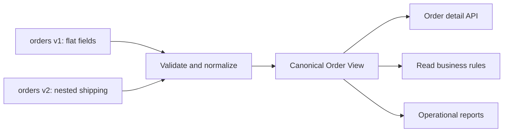

# Multi-Version Documents and Rules for Reading Heterogeneous Structures

## 1. Why Does One Collection Contain Multiple Document Structures?

In a **document database**, records in the same collection do not have to share identical fields and data types. This is an advantage as business requirements evolve: an earlier software version might store an address using flat fields, whereas a newer version groups them into a nested object. However, existing records do not transform automatically when new code deploys.

For instance, an order system once stored `shippingCity` and later switched to `shipping.city`. After release, the collection can hold **two document shapes simultaneously**. If the API knows only the new structure, older orders may render without an address; if reporting jobs filter only on the old field, new orders are silently skipped.

This lesson belongs to the **Document Modeling** chapter within **DATABASE_DATA_MODELING**. Its goal is turning business requirements into explicit data models with entities, relationships, constraints, keys, indexes, and physical schemas—choosing evolvable, verifiable structures while understanding differences from relational, graph, and analytical models.

To harness flexibility safely, design two contracts in parallel:

- **Structural contract:** which document versions exist, what each field means, and which fields are required or optional.
- **Read contract:** when encountering each version, how the application identifies, validates, normalizes, and returns data—and how unrecognized shapes are handled.

After this lesson, you will be able to:

1. Distinguish schema version, concurrency revision, business content version, and API version.
2. Design readers that support old and new documents simultaneously without fabricating facts.
3. Normalize documents after reading into a unified model for business logic.
4. Query, index, and validate when a collection contains multiple shapes.
5. Execute phased rollouts, conditional migrations, malformed-record detection, and reconciliation.
6. Decide when legacy structure support can be retired safely.

## 2. Running Example: Two Versions of an Order Document

Suppose an application has an `orders` collection. Version 1 stores recipient name and city as flat fields:

```json
{
  "_id": "ORD-042",
  "tenantId": "ORG-07",
  "schemaVersion": 1,
  "revision": 4,
  "shippingRecipient": "Nguyen An",
  "shippingCity": "Da Nang",
  "status": "PENDING",
  "totalMinor": 235000,
  "createdAt": "2026-11-18T09:00:00Z"
}
```

Version 2 groups delivery info into a nested object:

```json
{
  "_id": "ORD-099",
  "tenantId": "ORG-07",
  "schemaVersion": 2,
  "revision": 1,
  "shipping": {
    "recipientName": "Nguyen B",
    "city": "Ha Noi"
  },
  "status": "PENDING",
  "totalMinor": 89000,
  "createdAt": "2026-11-21T09:00:00Z"
}
```

Examples use placeholder IDs and names. `totalMinor` represents money in the agreed integer minor unit—assumed here to be Vietnamese dong. Illustrative payloads use UTC ISO 8601 strings for readability; in production, standardize on the real date/time type supported by your database engine.

Both documents are valid **under the contract active when they were written**. Yet `shipping.city` does not exist on v1, and `shippingCity` does not exist on v2. A naive reader running:

```javascript
// Example incompatible with v1 documents:
const city = order.shipping.city;
```

will crash or drop data when reading v1 orders.

If the code merely patches in:

```javascript
const city = order.shipping?.city ?? order.shippingCity;
```

it handles two trivial cases, but **still falls short of a read contract**. It does not verify version numbers, types, validity, conflicts when both fields appear, or documents written by an unknown future version.

### 2.1. Why Not Migrate Every Document Immediately?

A system may hold millions of orders, run multiple services that deploy asynchronously, or preserve historical records with strict semantics. A full-collection rewrite can consume heavy resources, trigger write conflicts, and be difficult to resume if interrupted.

Therefore, during a transition window:

- Existing v1 documents remain valid and **are read accurately**.
- New documents are written in v2.
- Legacy v1 documents are migrated gradually to v2 under controlled conditions.
- Compatibility code is removed only once no read or write path depends on v1.

This is **schema evolution**, which must be engineered as a real operational workflow.

## 3. “Document Version” Has Several Distinct Meanings

Never overload a single generic `version` field for every versioning concept.

| Concept | Purpose | Example |
| --- | --- | --- |
| **`schemaVersion`** | Identifies stored structural shape and semantics | `1`: flat address, `2`: nested address |
| **`revision` / `rowVersion`** | Detects concurrent writes to a single document | Increments from `4` to `5` on update |
| **Business content version** | Tracks distinct domain releases or snapshots | Lesson published in edition 2026.11 |
| **API contract version** | Defines request/response payload shapes for clients | `/api/v1/orders`, `/api/v2/orders` |
| **Message / event version** | Helps consumers parse older/newer events | `OrderConfirmed` schema v1/v2 |
| **Migration progress version** | Tracks conversion runs or checkpoints | Batch 15 processed 50,000 orders |

One document can carry multiple versions simultaneously:

```json
{
  "_id": "ORD-099",
  "schemaVersion": 2,
  "revision": 8,
  "status": "CONFIRMED"
}
```

If a user updates `status` within the same structure, `revision` increments to 9 while `schemaVersion` **stays at 2**. Conversely, when migrating from v1 to v2, `schemaVersion` increases; `revision` may also need to increment so concurrent updates based on stale reads are caught.

A lesson's published edition or historical record version is not a storage schema version. Multiple content editions of the same lesson can **all share `schemaVersion` 2**.

## 4. Data Contracts per Version

### 4.1. Specify Fields, Types, and Semantics

A minimal specification for `orders`:

| Attribute | Schema v1 | Schema v2 |
| --- | --- | --- |
| `schemaVersion` | `1`, or absent in a verified legacy subset | Required, equals `2` |
| Identifier | `_id` is stable order ID | `_id` unchanged |
| Access scope | `tenantId` | `tenantId` unchanged |
| Recipient name | `shippingRecipient`: required string | `shipping.recipientName`: required string |
| City | `shippingCity`: required string | `shipping.city`: required string |
| Total amount | `totalMinor`: non-negative integer | Semantics unchanged |
| Status | `status` in defined state set | Semantics unchanged |
| Concurrency control | `revision`: integer | Unchanged, incremented on mutation |
| Creation time | `createdAt` per timestamp contract | Semantics unchanged |

Version structures according to **actual data semantics**. You do not necessarily bump `schemaVersion` for every backward-compatible optional field; however, if you change a type, alter meaning, or risk older readers misinterpreting data, introduce an explicit discriminator such as a new schema version.

### 4.2. Data Types Matter Just as Much as Field Names

Breaking changes are not limited to renaming:

```text
shippingCity         -> shipping.city
```

they also include:

```text
total: 235000.0      -> totalMinor: 235000
createdAt: "..."     -> createdAt: native Date type
completed: true      -> state: "COMPLETED"
userIds: ["..."]     -> members: [{ userId, role }]
```

Type conversions can be **lossy**. For example, `completed: true` does not tell you *when* the lesson was completed; you must never assume `completedAt = updatedAt` when `updatedAt` merely reflects the last profile edit.

When a new fact cannot be derived from old data, choose one explicit approach:

- Allow the new field to be absent or carry an explicit “unknown” value in the contract.
- Backfill from another authoritative source.
- Prompt for business completion or manual verification.
- Maintain a historical-handling branch with its own clear semantics.

**Never fabricate data** just to make old records fit a new shape.

### 4.3. Missing, Null, Empty, and Invalid Are Four Different Cases

```jsonc
{}                          // shipping field is absent
{"shipping": null}          // Field is present with value null
{"shipping": {}}            // Empty object
{"shipping": {"city": 42}}  // Wrong type per contract
```

Readers should not collapse all four into one blanket default. Optional fields like `deliveryInstructions` may validly be absent; `tenantId` or transaction amounts must never be defaulted silently to avoid wrong data or cross-tenant leaks.

Whenever `null` is allowed, define whether it means **unknown**, **not applicable**, or **deleted**. Those meanings differ and affect reporting, privacy compliance, and API behavior.

## 5. Backward Compatibility, Forward Compatibility, and Reader/Writer Matrix

**Backward compatibility** here means **a new reader can understand documents produced by an old writer**. **Forward compatibility** means **an old reader can safely handle documents from a new writer**, at least within agreed bounds. Neither property arises automatically.

| Reader | v1 Document | v2 Document |
| --- | --- | --- |
| v1 reader (expects flat fields only) | Reads properly | May fail or miss address |
| v2 reader (expects `shipping` object only) | May fail or miss address | Reads properly |
| Transition reader supporting v1 + v2 | Reads and normalizes v1 | Reads and normalizes v2 |

A safe deployment sequence follows **expand-read before switching-write**:

1. Deploy readers understanding both v1 and v2 across all relevant services.
2. Verify where legacy application instances are still running.
3. Switch writers to emit v2.
4. Migrate legacy records where appropriate.
5. Remove v1 read support only after zero v1 data and access paths remain.

If an older app instance still writes v1 after migration, v1 documents can reappear. Thus **reader/writer deployment order is just as critical as migration scripts**.

### 5.1. Usually Compatible Changes vs. Breaking Changes

| Change | Risk to Old Readers | Mitigation |
| --- | --- | --- |
| Adding an optional field with clear semantics | Usually low if readers ignore unknown fields | Check validators and serializers |
| Renaming a field | High | Dual-read or read-time normalization |
| Changing a field's type | High | Versioning and validated type conversion |
| Changing enum value meanings | High, potentially dangerous | Explicit business mapping table; never infer by name |
| Splitting one document into multiple documents | High | Access adapter and key migration |
| Changing an array to a dynamic-key object | High | Clarify duplicates/ordering and indexing |
| Changing currency units or time representations | Very high | Authoritative conversion rules and thorough tests |
| Adding a required field | High for existing records | Backfill, new schema version, or conditional nullability |

Compatibility also depends on deserialization behavior: some libraries ignore unknown fields, while strict modes throw errors. Test against your **actual libraries and configuration**, never guess.

## 6. Reading Multiple Versions with a Controlled Normalizer

### 6.1. Idea: Multiple Input Shapes, One Canonical Output

Centralize compatibility logic inside the **data access layer (repository/adapter)** or a dedicated transformer so upstream business logic receives one consistent model.



The normalized target can be a DTO/API model; **it does not have to match the physical write shape**. Normalizing on read does not imply silently mutating the stored database document.

### 6.2. JavaScript Example: Detect Version, Validate, Then Transform

The example below illustrates the principle, independent of framework or driver. Infer v1 only when `schemaVersion` is **genuinely absent** and historical evidence confirms unversioned legacy documents belong to v1.

```javascript
class SchemaReadError extends Error {}

function requiredNonEmptyString(value, field) {
  if (typeof value !== "string" || value.trim() === "") {
    throw new SchemaReadError("Invalid " + field);
  }
  return value;
}

function requiredMinorAmount(value) {
  if (!Number.isSafeInteger(value) || value < 0) {
    throw new SchemaReadError("Invalid totalMinor");
  }
  return value;
}

function getSchemaVersion(raw) {
  if (raw.schemaVersion === undefined) {
    // Valid only when unversioned legacy data is verified as v1.
    return 1;
  }
  if (!Number.isInteger(raw.schemaVersion)) {
    throw new SchemaReadError("Invalid schemaVersion");
  }
  return raw.schemaVersion;
}

function normalizeOrderForRead(raw) {
  if (raw === null || typeof raw !== "object" || Array.isArray(raw)) {
    throw new SchemaReadError("Invalid document");
  }

  const version = getSchemaVersion(raw);
  let shipping;

  if (version === 1) {
    shipping = {
      recipientName: requiredNonEmptyString(
        raw.shippingRecipient, "shippingRecipient"
      ),
      city: requiredNonEmptyString(raw.shippingCity, "shippingCity")
    };
  } else if (version === 2) {
    if (
      raw.shipping === null ||
      typeof raw.shipping !== "object" ||
      Array.isArray(raw.shipping)
    ) {
      throw new SchemaReadError("Invalid shipping");
    }
    shipping = {
      recipientName: requiredNonEmptyString(
        raw.shipping.recipientName, "shipping.recipientName"
      ),
      city: requiredNonEmptyString(
        raw.shipping.city, "shipping.city"
      )
    };
  } else {
    // Never assume an unknown future version shares v2's structure.
    throw new SchemaReadError("Unsupported schemaVersion " + version);
  }

  return {
    orderId: requiredNonEmptyString(raw._id, "_id"),
    tenantId: requiredNonEmptyString(raw.tenantId, "tenantId"),
    shipping,
    status: requiredNonEmptyString(raw.status, "status"),
    totalMinor: requiredMinorAmount(raw.totalMinor),
    createdAt: requiredNonEmptyString(raw.createdAt, "createdAt"),
    sourceSchemaVersion: version
  };
}
```

This example intentionally **refuses to invent addresses, amounts, or statuses** when required fields are invalid. Production code must also verify:

- Allowed statuses and valid business state transitions.
- `createdAt` format/type and time-zone conventions.
- Actual `_id` type (not every collection uses strings).
- Tenant/role authorization before returning data.
- Additional required fields per version contract.
- Data errors: alerts, metrics, reconciliation queues, and appropriate error messages.

### 6.3. Repository Usage Example

```javascript
async function getOrderDetail(db, tenantId, orderId) {
  // Tenant filter is enforced at the read source.
  const raw = await db.collection("orders").findOne({
    _id: orderId,
    tenantId
  });

  if (!raw) return null;

  const normalized = normalizeOrderForRead(raw);
  // Perform real caller authorization checks here.
  return normalized;
}
```

The normalizer returns the exact same `shipping.recipientName` and `shipping.city` shape for both versions. Controllers avoid scattering `if (schemaVersion === 1)` checks across screens.

**Limitation:** this illustrates string handling only. If your deployment uses `ObjectId`, native `Date`, decimals, or multi-unit currencies, convert with strict validation. Never casually coerce string amounts or imprecise numeric types via `Number(...)`.

### 6.4. Handling Conflicts When Both Shapes Exist in One Document

Suppose a v2 document accidentally contains:

```json
{
  "schemaVersion": 2,
  "shippingCity": "Da Nang",
  "shipping": { "city": "Ha Noi", "recipientName": "Nguyen An" }
}
```

If a reader uses a “pick whichever field is non-empty first” operator, results depend on code ordering and silently mask corrupted records.

The contract should specify:

- For v2, `shipping.city` is authoritative; legacy fields must be ignored.
- When both fields coexist, emit a warning or route the record for reconciliation.
- For high-risk operations, reject critical mutations until the record is cleaned up.
- Never pick arbitrarily between conflicting addresses, money values, or permissions.

## 7. Designing Read Rules: Conditional Fallbacks, Not “Guess Until It Runs”

A robust reader defines explicit behavior for every case:

| Case | Prescribed Behavior |
| --- | --- |
| Supported version and valid data | Normalize and return result |
| Verified legacy version missing `schemaVersion` | Apply legacy converter with monitoring |
| `schemaVersion: null` or wrong type | Flag invalid data; never silently treat as v1 |
| Unsupported future version | Report incompatibility or route to designed handler |
| Missing optional field | Apply “absent” semantics per contract; do not fabricate values |
| Missing or wrong-type required field | Never return fake data; raise error / reconcile |
| Conflicting old and new fields | Trust version-authoritative field; log discrepancy |
| Migrated sensitive data | Preserve access controls and retention/deletion rules |
| Changed units on timestamps or money | Convert via authoritative rules; verify integrity |

### 7.1. When Is a Default Value Acceptable?

Defaults work when **their semantics are explicitly agreed**. For example, an optional `tags` field can default to an empty array if both business rules and legacy data confirm “no tags” equals `[]`.

Conversely:

- Absent `discountMinor` does not automatically equal `0` if an older system stored discounts elsewhere.
- Absent `completedAt` cannot be inferred from `updatedAt`.
- Absent `tenantId` must never be filled in from the logged-in client to expose an unowned record.
- `UNKNOWN` status must never silently default to `APPROVED`.

**Default values are business and data-contract decisions**, not tricks to silence `null` exceptions.

### 7.2. Do Not Confuse a Supported Schema Version with Trustworthy Data

A document stamped `schemaVersion: 2` that lacks `shipping.city` still violates the v2 contract. Never treat a version number as proof that all fields are valid; validate **the actual payload**.

## 8. Querying When Field Names Change Across Versions

Application-level normalization helps only **after the database query locates the documents**. If a query filters solely on the new path, legacy documents get excluded at the database layer.

Suppose you need orders shipping to `Da Nang` for organization `ORG-07`.

A v2-only query:

```javascript
db.orders.find({
  tenantId: "ORG-07",
  "shipping.city": "Da Nang"
});
```

misses v1 documents holding `shippingCity`. While both schemas coexist, handle query shapes at the **database level** or via a normalized read model.

### 8.1. Version-Aware Dual-Query

MongoDB example, under a contract allowing v1 to have `schemaVersion: 1` or omit the field:

```javascript
db.orders.find({
  tenantId: "ORG-07",
  $or: [
    { schemaVersion: 1, shippingCity: "Da Nang" },
    { schemaVersion: { $exists: false }, shippingCity: "Da Nang" },
    { schemaVersion: 2, "shipping.city": "Da Nang" }
  ]
});
```

This is a **transitional** strategy; plan to drop legacy branches after migration. Across many versions and renamed fields, query branches multiply quickly and become hard to optimize.

Important: **never fetch 20 documents and filter by city in application code** if you expect accurate pagination over the full dataset. Post-limit filtering produces short pages or omits matching records.

### 8.2. Indexes During the Mixed-Schema Phase

Two filter paths may require two distinct indexes:

```javascript
// Filter path for v1 documents.
db.orders.createIndex({ tenantId: 1, shippingCity: 1 });

// Filter path for v2 documents.
db.orders.createIndex({ tenantId: 1, "shipping.city": 1 });
```

Engines may offer partial indexes or other optimizations, but verify concrete choices using execution plans. Drop legacy indexes **only after** no queries or documents rely on them.

Transitional indexes add storage and write overhead—one strong reason to finish migrations rather than keeping every shape forever.

### 8.3. A Normalized Projection Can Simplify Queries

If complex queries must filter and sort across many renamed fields, consider:

- Migrating physical documents earlier.
- Building a read model / materialized view using solely the current schema.
- Maintaining a unified derived search field with clear source and update rules.
- Separating analytical reporting from transactional query paths at high load.

Creating a new read copy brings obligations around sync, idempotency, reconciliation, and authorization. Never add a copy assuming all complexity disappears.

## 9. Choosing an Evolution Strategy: Compatible Reads, Eager Migration, or Lazy Migration

| Strategy | Description | Pros | Risks / Prerequisites |
| --- | --- | --- | --- |
| **Dual-read, single-write** | Readers support v1/v2; writers emit v2 only | Phased rollout, caps new variants | Must maintain compatibility code and dual-query logic |
| **Eager migration** | Backfill large batches of old records | Unifies schema sooner | Migration load, write conflicts, unsafe retries without guards |
| **Lazy migration** | Upgrade old documents incrementally on access | Spreads work by read demand | Rarely accessed records stay legacy; reads trigger writes |
| **Read repair** | Rewrite to new shape upon reading | Gradually shrinks legacy tail | Needs write permissions, CAS, error handling; reads aren't read-only |
| **Dual-write** | Write both formats temporarily | Keeps old readers working in transition | Drift risk, doubled write paths, unclear authority |
| **Projection / adapter** | Use transformer layer or unified read model | Decouples app from physical storage | Adds sync, operational, or query overhead |
| **Versioned immutable records** | Retain multiple historical editions with their own schemas | Preserves audit/publication records | Storage growth and rules to resolve active version |

**Dual-read, single-write** is typically the cleanest starting point: readers accept all known versions while new writes adhere strictly to one canonical shape. If older writers must remain active temporarily, set a firm sunset window and guard against v1 records re-entering post-migration.

### 9.1. When Should You Avoid Auto-Upgrading Schema on Read?

If a read API is meant to be read-only, having `findOne` silently “repair” a document turns a read into a write with major side effects:

- Can conflict with another process actively updating the order.
- Triggers unexpected index updates or revision bumps.
- Increases read latency and can fail even though reading legacy data is valid.
- Requires write privileges that read paths should not possess.
- Can violate integrity of historical records meant to preserve their original stored shape.

If you use read repair, make it an **explicitly engineered mechanism** with conditional updates, observability, and error handling. For sensitive historical records, normalize in memory only and delegate physical updates to a controlled migration job.

## 10. Zero-Downtime Multi-Phase Migration Process

Suppose the goal is migrating all `orders` from v1 to v2.

### Phase 1 — Inventory Data and Risks

- Count documents per version, unversioned records, and invalid records.
- Identify all queries, apps, and jobs still referencing `shippingCity` or `shippingRecipient`.
- Verify whether legacy fields convert **completely without semantic loss**.
- Measure collection size, write rate, current indexes, and estimated backfill cost.
- Identify records that must preserve original stored values for historical/audit compliance.

MongoDB example for initial profiling:

```javascript
db.orders.aggregate([
  {
    $group: {
      _id: "$schemaVersion",
      count: { $sum: 1 }
    }
  }
]);
```

Interpret results carefully: missing fields and explicit `null` values can group together depending on the expression; write dedicated validation queries to count missing/malformed records. Never assume “missing version” equals v1 without verifying historical data.

### Phase 2 — Expand Readers

Deploy v1/v2 reading and normalization code first. Test typical v1 documents, missing fields, `null` values, wrong types, and unsupported future versions.

During this phase, **never abruptly change the meaning of legacy fields** while un-upgraded readers remain active.

### Phase 3 — Switch Writers to Schema v2

All newly created orders must write v2. Updates to legacy orders must follow one of two explicit rules:

- Update fields in place under the legacy schema, letting the migration job upgrade them later.
- Or upgrade v1 to v2 **atomically within the update itself** if semantics and engine guarantees permit.

Never leave some writers emitting v1 and others emitting v2 without a defined end to the transition.

### Phase 4 — Batch Backfill from v1 to v2

Read a small batch, transform per contract, and apply conditional updates. Pause or throttle if latency or contention rises.

Use checkpoints or key ranges to track progress, yet remember **a checkpoint does not prove every batch succeeded accurately**; verify write counts and reconcile.

### Phase 5 — Reconcile, Observe, and Lock Down Legacy Write Paths

- Check how many v1 documents remain and why.
- Verify pre- and post-migration field equivalence.
- Confirm zero legacy application instances still write v1.
- Test queries across mixed and fully migrated datasets.
- Confirm stable read error rates and latency.
- Gradually tighten write validation toward v2, with controlled exceptions if needed.

### Phase 6 — Retire Legacy Support

Only once evidence proves every writer and required reader is compatible:

- Remove the v1 dual-read branch in a scheduled release.
- Drop queries and indexes tied exclusively to v1 fields.
- Clean up unused legacy serializers/adapters.
- Update data contracts and architecture documentation.

Never delete legacy read branches simply because **one** snapshot count showed zero v1 records; check backup restores, periodic jobs, old clients, and external import pipelines.

## 11. Safe Backfill: Conditional Writes, Idempotency, and Data Preservation

### 11.1. Example Migrating One Document from v1 to v2

Suppose `revision` exists on v1. To upgrade a single v1 document, the job reads it and applies:

```javascript
function migrateV1Order(db, oldOrder) {
  if (oldOrder.schemaVersion !== 1) {
    throw new Error("Expected schemaVersion 1");
  }

  // Validate before mutating data.
  const normalized = normalizeOrderForRead(oldOrder);

  // MongoDB: mutate fields within a single document.
  // Update only if schema and revision match what was read.
  return db.collection("orders").updateOne(
    {
      _id: oldOrder._id,
      tenantId: oldOrder.tenantId,
      schemaVersion: 1,
      revision: oldOrder.revision
    },
    {
      $set: {
        schemaVersion: 2,
        shipping: normalized.shipping
      },
      $unset: {
        shippingRecipient: "",
        shippingCity: ""
      },
      $inc: { revision: 1 }
    }
  );
}
```

**Analysis:**

- Name/address fields transform per explicit rules without altering totals or order status.
- Filtering on `schemaVersion` and `revision` detects concurrent edits by other processes.
- One document update sets the new schema, writes new fields, removes old fields, and increments `revision` under MongoDB's single-document atomicity.
- If zero documents match, the job re-reads and classifies why rather than overwriting from a stale snapshot.
- If the job retries on an already-v2 document, it skips or confirms status without migrating twice.
- If legacy v1 records **lack** `schemaVersion`, run a dedicated verified backfill branch checking `{$exists: false}`. Never silently loosen update filters across all records.

This pattern is a **logic illustration** and omits batching, metrics, graceful shutdown/resume, rate limiting, and authorization. Section 6's normalizer requires string `_id`; adjust if your collection uses another type.

### 11.2. Why Not Just Run “Update All Documents”?

If a blind bulk update assumes every record has `shippingCity`, it can write empty strings or destroy info on malformed records. If it runs for hours under live traffic, reads before and writes after can go stale.

Explicitly specify:

- Batch size and resource/latency caps.
- Exact selection criteria for target records.
- Conditional update guards against lost updates.
- Retry policy for transient failures.
- Dead-letter logging for records that cannot auto-convert.
- Safe checkpoints supporting restarts.
- Circuit breakers when conflict rates spike.
- Backup and rollback/recovery plans for critical datasets.

### 11.3. Idempotency in Migrations

A job may restart after a network failure. A migration step is safe when re-running on the same input causes no extra corruptions—like incrementing totals, duplicating line items, or re-emitting payment alerts.

Standard practice sets the **target version**, uses conditional updates, and checks write counts. Never endlessly bump `revision` on already-migrated documents during reruns.

**Schema migrations must not trigger business side effects** like resending order confirmation emails, unless intentionally built as a separate idempotent workflow.

## 12. Validation and Indexes While Multiple Versions Coexist

### 12.1. Validation Must Account for the Transition Window

If on day one you switch collection validation to “every document must have `shipping.recipientName`,” status updates on existing v1 orders will start failing validation.

A phased validation strategy:

1. Allow **explicitly enumerated** old and new schemas during transition, each checked against its own version rules.
2. Enforce v2 creation on new writers at the application layer and controlled write paths.
3. Migrate v1 records and remediate invalid documents.
4. Tighten database validators once v1 read/write support is no longer required.

Collection-level validators vary across engines in how they apply to inserts vs. updates; verify your exact product/version behavior. **Database validators** do not replace domain invariant checks or access control.

### 12.2. Indexes Have Their Own Lifecycle

While moving from `shippingCity` to `shipping.city`, both indexes may be needed temporarily, though not permanently. Building and dropping indexes on large collections consumes resources, so schedule them in release plans and measure workload impact.

Also examine nested fields and arrays:

- V1 stored `tags` as a comma-separated string, v2 as an array of strings: cannot uniformly query as a set of values.
- V1 stored address as a single string, v2 as an object: not every legacy string parses cleanly.
- V1 stored `members` as an ID array, v2 as an object array: multi-attribute predicates may need same-element semantics.

Never assume “indexing just the new field” covers every version.

### 12.3. Adding a Schema Version Does Not Replace Indexes

`schemaVersion` routes transformation logic, but does not speed up queries by `tenantId`, timestamp, status, or address. Index design must still start from **query shapes**, realistic data, and sort orders.

## 13. Consistency, Performance, and Security Concerns

### 13.1. Normalized Data Can Expose New Invariants

Suppose v1 permitted arbitrary `status` strings, while v2 restricts to `PENDING`, `CONFIRMED`, and `CANCELLED`. If legacy data holds `PAID_AND_SHIPPED`, never randomly pick one of the new statuses.

Apply authoritative mapping rules potentially consulting payment and shipping records. If an unambiguous mapping is impossible, flag for exception handling or retain an explicit legacy branch.

When reading historical records for auditing or invoicing, normalizers must **preserve original semantics**, not merely “tidy up” field names.

### 13.2. Cost of Reading Multiple Versions

Read-time adapters consume CPU/latency; dual-queries and extra indexes increase database work. If v1 records are a tiny tail, the cost may be negligible. If every request processes thousands of mixed-version documents, measure carefully and consider eager backfills or a unified read model.

Monitor:

- Read share per schema version.
- Read-path p95/p99 latency.
- Normalization failures, missing fields, and type errors.
- Remaining legacy document counts over time and per tenant.
- Execution plans per query branch.
- Storage and write overhead of transitional indexes.
- Update conflicts between migration jobs and live traffic.

### 13.3. Never “Guess” Permissions or Sensitive Data

It is especially dangerous when an older version lacks `tenantId`, `visibility`, or ownership metadata. If a reader fills in the current caller's tenant on an unowned document, cross-tenant data leaks can occur.

Safety rules:

- Enforce scope predicates before or inside the query against the authoritative store.
- Never treat records missing authorization metadata as public.
- Distinguish verified unversioned legacy shapes from corrupted records.
- Never broaden access permissions during migration.
- Protect temporary copies, error logs, and migration payloads under matching security policies.

### 13.4. Deleting and Retaining Historical Data

Multi-version documents remain subject to retention, deletion, and audit policies. If a sensitive field moved from `customerPhone` to `shipping.phone`, deleting only the v2 path leaves v1 copies exposed.

Inventory legacy field names and paths, derived datasets, backups, and analytical stores when in scope. Never allow schema evolution to punch loopholes in data governance.

## 14. Testing Readers/Writers Across the Version Matrix

A test suite that writes v2 documents and reads v2 documents **fails to verify** compatibility.

Minimum test matrix:

| Input Data | Expected Outcome |
| --- | --- |
| Valid v1, `schemaVersion: 1` | Normalized to canonical view |
| Valid v1, missing version per legacy contract | Normalized under controlled rules |
| Valid v2 | Read directly and normalized consistently |
| `schemaVersion: null` | Rejected as invalid; never treated as v1 |
| `schemaVersion: 99` | Rejected as unsupported version |
| v1 missing `shippingCity` | Flagged as error/reconcile; no fake city |
| v2 `shipping: null` | Flagged as invalid data |
| v2 with conflicting old and new fields | Trusts authoritative v2 field; logs discrepancy |
| `totalMinor` as string or invalid number | Rejected without silent coercion |
| v1 modified concurrently during backfill | CAS safely fails; re-reads record |
| Migration job rerun | Zero duplicate side effects |
| Old writer emits v1 after v2 cutover | Blocked or alerted via metrics |
| Missing mandatory tenant/visibility | Never leaks out-of-scope data |

### 14.1. Business Property Tests

Beyond field-mapping unit tests, verify:

- Pre- and post-migration order totals and statuses remain equivalent.
- Addresses return accurately regardless of source field names.
- APIs never silently convert `null`/empty into fabricated facts.
- Search results and listings still include both v1 and v2 records.
- Pagination stays consistent across interleaved old and new documents.
- Identifier and uniqueness constraints do not shift unexpectedly.
- Callers never see another tenant's records.

### 14.2. Performance and Operational Fault Tests

Generate v1/v2 datasets matching realistic ratios rather than an arbitrary 50/50 split. Load-test large tenants, small tenants, documents with oversized fields, backfill jobs running alongside live updates, and network drops.

Measure latency, keys/docs examined, conversion error rates, CAS conflict rates, backfill throughput, and retry recovery times. These metrics tell you whether full migration is needed before removing compatibility code.

## 15. Exercise: Learner Progress Across Three Historical Structures

A learning platform has progress records spanning several years across three storage eras:

**Version 1 — boolean completion:**

```json
{
  "_id": "LP-101",
  "schemaVersion": 1,
  "learnerId": "USR-09",
  "lessonId": "L-03",
  "completed": true
}
```

**Version 2 — explicit state:**

```json
{
  "_id": "LP-102",
  "schemaVersion": 2,
  "learnerId": "USR-09",
  "lessonId": "L-04",
  "state": "IN_PROGRESS"
}
```

**Version 3 — added attempt count and completion timestamp:**

```json
{
  "_id": "LP-103",
  "schemaVersion": 3,
  "learnerId": "USR-09",
  "lessonId": "L-05",
  "state": "COMPLETED",
  "attemptCount": 2,
  "completedAt": "2026-11-21T03:00:00Z"
}
```

**Task:** Design a canonical read model, conversion rules for all three versions, non-derivable fields, and a migration strategy.

### 15.1. A Defensible Approach

Read model:

```text
LessonProgressView
  learnerId
  lessonId
  state: NOT_STARTED | IN_PROGRESS | COMPLETED
  attemptCount: number | unknown
  completedAt: timestamp | unknown
  sourceSchemaVersion
```

Rules:

- **V1:** `completed: true` maps to `COMPLETED`; `completed: false` **does not necessarily equal** `NOT_STARTED` if the old system did not distinguish not-started from in-progress. Verify legacy semantics, or model `UNKNOWN_INCOMPLETE` in the canonical view instead of guessing.
- **V2:** map `state` directly if in the valid state set; `attemptCount` and `completedAt` remain `unknown`.
- **V3:** validate `state` and new fields; if `state = COMPLETED` yet `completedAt` is missing, specify whether allowed or an error.
- **All versions:** never default `attemptCount = 0` when older records never tracked attempts.
- **Invalid records:** log error and reconcile; never let certification logic issue a credential based on guessed data.

Here the canonical model must represent **meaningful missing information**. If certificates require valid `COMPLETED` records, the certification check enforces that rule rather than assuming every version forced cleanly into one enum.

### 15.2. Read Paths and Indexes

Suppose we look up a learner's progress per lesson, with at most one current record per `(learnerId, lessonId)` pair. Enforce a pair-wise unique key scoped by tenant if tenant fields are consistent; if legacy records lack `tenantId`, resolve ownership first.

Key lookups usually ignore whether `completed` or `state` holds status. However, a report for “all completed lessons” **depends on schema**:

```javascript
// Transitional query illustration.
db.lessonProgress.find({
  $or: [
    { schemaVersion: 1, completed: true },
    { schemaVersion: 2, state: "COMPLETED" },
    { schemaVersion: 3, state: "COMPLETED" }
  ]
});
```

If unversioned v1 records exist per contract, include a verified branch for them. For multi-tenant collections, enforce mandatory tenant/authorization predicates at the query source.

**Self-study prompt:** If a report groups completions by completion date, which versions actually carry `completedAt`? How should v1/v2 completed records lacking timestamps be handled? Can exact completion dates be recovered reliably from another source, and how trustworthy is that source?

## 16. Misconceptions to Avoid

**“Document databases are schemaless, so the app can figure it out.”**  
In practice, a structural contract always exists—in code, JSON Schema, validators, or docs. Unmanaged schemas merely push failures to read time.

**“Having `schemaVersion` guarantees the data is valid.”**  
The version field only declares expected shape; still validate actual payload contents.

**“Whenever a new field is missing, just supply a default.”**  
Use defaults only when business semantics allow it. Completion status, money, permissions, and historical timestamps must never be fabricated.

**“Because the reader supports both shapes, database queries will automatically find everything.”**  
False: database filters execute before application normalization and will skip legacy field names. Use dual-queries or a unified read model.

**“Once writers switch to v2, all data is v2.”**  
Legacy documents and straggling jobs/clients can still hold or emit v1; measure and lock down legacy write paths.

**“Backfilling is just renaming a field, so one `updateMany` is enough.”**  
Malformed records, concurrent writes, network errors, and semantic differences require validation, CAS, checkpoints, and reconciliation.

**“Schema version and optimistic concurrency version are the same field.”**  
A document can mutate state dozens of times without changing schema. Keep separate fields/constraints for these two goals.

**“Zero v1 documents appeared in today's stats, so delete legacy code immediately.”**  
Check backups, imports, older clients, and unretired write paths first.

**“Normalizing legacy documents in memory counts as migrating them.”**  
That is read-time transformation only. Physical storage stays legacy until controlled writes occur.

## 17. Multi-Version Document Design Checklist

- [ ] Separated `schemaVersion`, `revision`, content versions, and API/event versions.
- [ ] Documented field/type/semantic contracts for every supported schema version.
- [ ] Grounded unversioned-document detection rules in historical evidence.
- [ ] Readers detect version **before** normalizing, without arbitrary guesswork fallbacks.
- [ ] Missing or wrong-type required fields fail explicitly instead of fabricating values.
- [ ] Business layers consume a consistent canonical read model.
- [ ] Never conflated absent fields, `null`, empty strings, and defaults.
- [ ] Database query filters cover all readable schemas, including sorting and pagination.
- [ ] Planned creation, benchmarking, and retirement of transitional indexes.
- [ ] New writers emit only the canonical schema; legacy writers are detected or blocked.
- [ ] Batch migrations enforce validation, conditional updates, checkpoints, and safe retries.
- [ ] Structural upgrades preserve historical business semantics without corrupting records.
- [ ] Defined cross-service compatibility and reader/writer deployment order.
- [ ] Applied validation, tenant/role checks, and deletion rules across all versions.
- [ ] Built a test matrix covering v1/v2, bad/missing fields, future versions, and write races.
- [ ] Monitored version counts, normalization errors, lag, and backfill progress.
- [ ] Defined objective criteria before retiring legacy compatibility.

**Key takeaway:** Multi-version documents are normal in an evolving system. A sound model does not pretend every record already matches the latest shape; it **identifies versions accurately, preserves semantics, normalizes reads consistently, queries across all active shapes, and migrates under strict control**. A `schemaVersion` field is valuable only when paired with transformation contracts, error rules, and empirical verification against real data.
