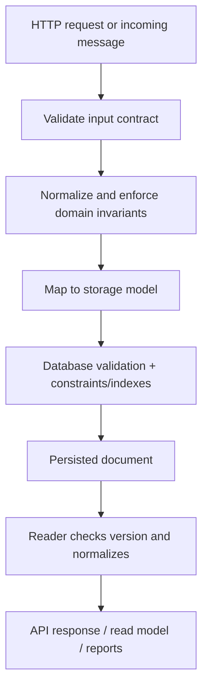
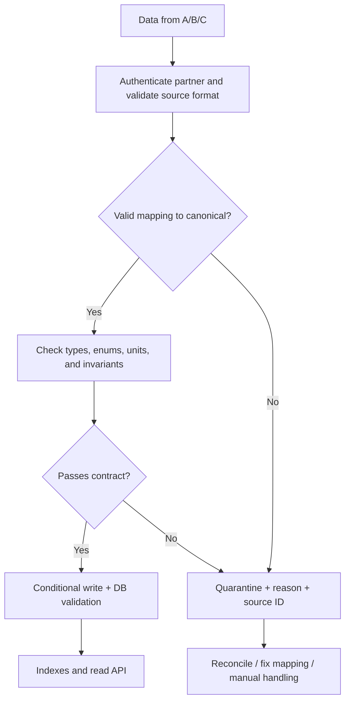

# Flexible Structure Does Not Mean Schema-Free Data

## 1. What Does “Flexible Schema” Actually Mean?

A **document database** lets you store documents containing nested objects, arrays, and sets of fields that do not have to match identically across every record. For instance, one course might carry a `subtitle` while another omits it; an older version stored the instructor as a plain string, while a newer version stores `instructorId` and separate display info.

This capability is often called a **flexible schema**. Yet **flexibility does not mean unstructured data, zero rules, or no schema**.

If one document has `status = "PUBLISHED"`, a second has `status = "published"`, and a third has `status = true`, a “published courses” query will easily miss records. If `price` is sometimes a string and sometimes a number, calculations break. If a document lacks `tenantId`, the system cannot determine access permissions.

Therefore, even when the storage engine does not force declaring every column upfront before writing, **the application and domain always require a data contract**: which fields exist, what they mean, their types, valid values, and how they evolve across versions.

This lesson belongs to the **Document Modeling** chapter within **DATABASE_DATA_MODELING**. Its goal is practicing how to translate business requirements into clear data models—from entities, relationships, constraints, keys, and indexes to physical schemas—while knowing when relational, document, graph, or analytical models fit better.

**After this lesson, you will be able to:**

1. Distinguish **schema enforced on write**, **schema interpreted on read**, and **business constraints**.
2. Define a document contract specifying required/optional fields, types, semantics, bounds, and versions.
3. Choose appropriate validation layers spanning APIs, Java services, and the database.
4. Design handling for missing fields, `null`, nested objects, arrays, and enum values.
5. Understand what JSON Schema / database validators can check versus what requires transactions or other constraints.
6. Evolve structures in phases without breaking legacy data or queries.
7. Verify schemas using valid payloads, malformed payloads, write loads, and real queries.

## 2. Schemaless Storage Differs from Having No Schema

A syntactically valid JSON document proves only **that it can be parsed**. It does not guarantee business validity.

For example, all three payloads below are valid JSON:

```json
{
  "courseId": "CRS-101",
  "title": "Data Design",
  "status": "PUBLISHED",
  "priceMinor": 250000
}
```

```json
{
  "courseId": "CRS-102",
  "title": 42,
  "status": "published",
  "priceMinor": "250000"
}
```

```json
{
  "courseId": "CRS-103",
  "title": "",
  "status": "PUBLISHED",
  "priceMinor": -50
}
```

The first document *appears* to satisfy the assumed contract. The second has the wrong type for title, inconsistent status casing, and a string-encoded price; the third has an empty title and a negative price. If readers assume all records match the first shape, bugs surface across APIs, reports, index queries, and arithmetic.

A schema lives in at least three places, whether written in a separate file or not:

- **In business requirements:** prices are non-negative; course codes are unique per organization; only published courses are public.
- **In application code:** DTOs, Java types, parsers, serializers, mutation logic, and validation.
- **In stored data:** actual field types, persisted values, and variants created by legacy versions or imports.

When these three drift apart, the system has an **implicit, unmanaged schema**, not a “schema-free” design.

### 2.1. Schema-on-Write vs. Schema-on-Read

- **Schema-on-write:** validate or transform data **before accepting writes**—e.g., rejecting a course with `priceMinor < 0` or an unrecognized `status`.
- **Schema-on-read:** on retrieval, inspect, interpret, and normalize documents by version as needed—e.g., reading legacy `instructorName` and newer `instructor.id` into one unified view.

Both strategies **complement** each other. In real document applications, new writes are strictly validated on write while readers continue supporting recognized legacy shapes.

**Schema-on-read is not a license to guess values.** If older records omitted lesson completion timestamps, the reader must never invent `completedAt`.

## 3. Schema Layers to Distinguish

One system can maintain multiple structural contracts for the same domain entity:

| Layer | Example | Primary Responsibility |
| --- | --- | --- |
| **API contract** | Create-course request, course-list response | Input validation/formatting, public projections, access control |
| **Domain model** | `Course`, `Money`, `Enrollment` and invariants | Expressing business rules that must hold |
| **Storage schema** | `courses` documents, BSON fields, `schemaVersion` | Read/write layout, DB validation, indexes, data lifecycle |
| **Event contract** | `CoursePublished` with ID and version | Letting downstream consumers interpret changes accurately |
| **Read / analytical model** | Course cards, monthly learner reports | Fields and derived data tailored to specific queries |

These layers **do not need identical shapes**. For instance, an API may return:

```json
{
  "courseId": "CRS-101",
  "title": "Data Design",
  "formattedPrice": "250.000 ₫"
}
```

while the database stores integer minor units paired with a currency code, and the domain model uses a validated `Money` object. `formattedPrice` is a display string, **not an arithmetic storage type**.

Never dump raw incoming request JSON straight into the primary collection just because the database accepts JSON. Requests can contain extra fields, untrusted values, or UI-only attributes.

### 3.1. Relationship Between Layers



Each layer catches a different class of defects. The API layer returns user-friendly errors; the database layer guards against alternate write paths like background jobs or imports. No single layer protects every invariant or permission on its own.

## 4. Building a Contract for a Course Document

### 4.1. Questions to Ask Before Writing JSON

A training platform has these requirements:

- Each organization manages multiple courses; course codes need uniqueness only **within the organization**.
- A course has a title, status, author, tag list, and tuition fee.
- Title must be non-empty; status allows only `DRAFT`, `PUBLISHED`, or `ARCHIVED`.
- Tuition fee is non-negative and represented by currency code plus integer amount in the agreed minor unit.
- A published course requires a valid publication timestamp.
- Tags are bounded; reviews and learner progress can grow large and are stored separately.
- Queries filter by `tenantId` and status, paginated chronologically.

An illustrative storage model:

```json
{
  "_id": "CRS-101",
  "tenantId": "ORG-07",
  "courseCode": "DB-101",
  "schemaVersion": 2,
  "title": "Data Design",
  "status": "PUBLISHED",
  "instructorId": "USR-013",
  "price": {
    "currency": "VND",
    "amountMinor": 250000
  },
  "tags": ["database", "modeling"],
  "publishedAt": "2026-11-21T08:00:00Z",
  "revision": 3
}
```

This is illustrative JSON; in MongoDB/BSON, store timestamps using the native Date type and encode amounts in a numeric type matching the required range. For VND, the supported minor unit here is **one dong**; for other currencies, define minor units and rounding explicitly.

### 4.2. Field Contract Table

| Field | Type / Semantics | Required? | Rules |
| --- | --- | --- | --- |
| `_id` | Stable course identifier | Yes | Unique within storage scope |
| `tenantId` | Owning tenant | Yes | Never inferred from client input |
| `courseCode` | Business code | Yes | Unique per `(tenantId, courseCode)` |
| `schemaVersion` | Storage structure version | Yes for new writers | Supported value; distinct from `revision` |
| `title` | Title | Yes | Non-empty string after defined normalization |
| `status` | Lifecycle state | Yes | Within approved enum |
| `instructorId` | Instructor reference | Conditional on domain rules | Checked for authorization and validity against source |
| `price.currency` | Currency code | Yes | Supported system currency set |
| `price.amountMinor` | Integer monetary amount | Yes | Non-negative, bounded, explicit rounding rules |
| `tags` | Tag list | Optional | Bounded string array; deduplication rules |
| `publishedAt` | Publication timestamp | Conditional | Required when `status=PUBLISHED`, per policy |
| `revision` | Concurrency version | Yes | Incremented on updates, used in write preconditions |

This table specifies both **data shape** and **semantics**. They differ: saying “`status` is a string” is insufficient because arbitrary strings still violate domain rules.

### 4.3. Questions Frequently Overlooked

- Can `title` consist solely of whitespace or be a million characters long?
- Are `tags` case-sensitive, and are duplicates allowed?
- When moving to `ARCHIVED`, is `publishedAt` preserved for history?
- Who is allowed to transition `ARCHIVED` back to `PUBLISHED`?
- Can `price.currency` change after enrollments open?
- If an instructor is deleted/suspended, what happens to their published courses?
- Which fields can update independently versus atomically together?
- Which rules must hold for every document immediately versus temporarily relaxed during migration?

A sound schema answers these questions—or **explicitly notes them as undecided**—instead of guessing from JSON samples.

## 5. Required, Optional, Null, and Default Values

These representations do not necessarily mean the same thing:

```jsonc
{ "courseId": "CRS-1" }                    // subtitle field omitted
{ "courseId": "CRS-1", "subtitle": null }  // Field present with value null
{ "courseId": "CRS-1", "subtitle": "" }    // Empty string
{ "courseId": "CRS-1", "subtitle": "Databases" }
```

A contract may define `subtitle` as optional, meaning “not provided”; `null` may be forbidden or carry distinct semantics. If code casually applies `?? ""`, it erases the difference between “unknown” and “explicitly empty.”

### 5.1. Defaults Are Valid Only When Domain Semantics Permit

Examples:

- Missing `tags` on legacy records **can** default to `[]` if “no tags” is verified semantics.
- Missing `publishedAt` **cannot** be filled with the current time as a fake historical publication date.
- Missing `discountMinor` does not necessarily equal 0 if an older system stored discounts elsewhere.
- Missing `tenantId` must never default to the current caller, risking cross-tenant leaks.
- `completedAt` cannot be derived from `updatedAt` unless the last update is known to be completion.

Defaulting is a **data rule** requiring testing and documentation in the contract, not a shortcut to dodge `NullPointerException`.

### 5.2. Nullable Differs from Optional

- **Optional:** field may be absent from the document.
- **Nullable:** field is present, and its value may be `null`.
- **Required non-null:** field must exist and hold a value of the valid type.

Engines and libraries handle these differently; verify the exact semantics of JSON Schema/BSON and your serializers.

## 6. Data Types: Technically Accurate and Semantically Sound

### 6.1. Currency

Storing prices as formatted display strings like `"250.000 ₫"` makes comparisons, sorting, and math fragile and locale-dependent.

A cleaner storage pattern:

```json
{
  "price": {
    "currency": "VND",
    "amountMinor": 250000
  }
}
```

The contract must define minor units, bounds, rounding, taxes, and multi-currency behavior. In Java, use `long` for integer minor units within verified bounds, or `BigDecimal` when exact decimal precision is needed. In MongoDB, pick BSON `int`, `long`, or `decimal` consistently—never let writers mix strings and floats.

**Warning:** Casting `"250000"` to `250000` alone does not guarantee valid money values. Legacy strings might include currency symbols, decimal fractions, or tax-inclusive pricing with different rules.

### 6.2. Dates and Times

Distinguish:

- **Absolute instants:** `publishedAt`, `createdAt`, or an event timestamp in UTC.
- **Local calendar dates:** start date, regional holiday.
- **Durations:** 90-minute lesson length.
- **Wall-clock time with time zone:** class schedule at 19:00 in a specific time zone.

Never store `"21/11/2026"` as a string assuming every environment parses it identically. Standardize storage types, time zones, calendars, and display formatting. Time-range queries also rely on consistent field types.

### 6.3. Enums and Status Names

Developers may treat `PUBLISHED`, `published`, and `Live` as equivalent, yet database queries will not merge them automatically. Define a canonical enum set, maintain explicit mappings for legacy inputs where needed, and reject unsupported new values.

Never map legacy enum values solely by “similar names.” For example, `PAID` and `CONFIRMED` are related but not necessarily equivalent.

### 6.4. IDs and Sensitive Data

Do not use emails, phone numbers, or personal names as primary keys just because they appear unique at one point. Those attributes change, get recycled, or require redaction/deletion. Dedicated immutable IDs make referencing and migrations far cleaner.

## 7. Where to Validate? Multiple Layers with Clear Responsibilities

A resilient application uses **complementary checkpoints**, rather than duplicating every rule identically everywhere.

| Layer | Suited for Checking | Do Not Rely On It For |
| --- | --- | --- |
| **HTTP / API boundary** | Input types, sizes, unknown fields, payload shape, user-friendly errors | Protecting background jobs or imports bypassing the API |
| **Domain model** | Invariants, state transitions, update permissions, currency units, business caps | Enforcing collection-wide uniqueness under concurrent writes |
| **Database validator** | Required fields, BSON types, enums, simple bounds, nested shape | Cross-document constraints or user permissions |
| **Unique index** | Uniqueness of IDs/business keys within supported scope | Rules like “non-overlapping intervals” when keys only store start time |
| **Transaction / conditional update** | Multi-writer invariants, status/version preconditions | Atomic sync with external APIs |
| **Batch validation / reconciliation** | Legacy records, derived copies, long-running drift | Replacing real-time validation on high-risk operations |

The aim is not building conflicting layers. The canonical contract is unified; each layer enforces what fits its capabilities and context.

### 7.1. Java Example: A Value Object Protecting Local Invariants

In Java, group semantically related fields into domain types—for example, two `record` declarations in `CourseDraft.java` (requires a Java version supporting `record`):

```java
import java.util.Objects;

record Money(String currency, long amountMinor) {
    public Money {
        Objects.requireNonNull(currency, "currency");
        if (!currency.equals("VND") && !currency.equals("USD")) {
            throw new IllegalArgumentException("Unsupported currency");
        }
        if (amountMinor < 0) {
            throw new IllegalArgumentException("Amount cannot be negative");
        }
    }
}

public record CourseDraft(String tenantId, String title, Money price) {
    public CourseDraft {
        if (tenantId == null || tenantId.isBlank()) {
            throw new IllegalArgumentException("tenantId is required");
        }
        if (title == null || title.isBlank()) {
            throw new IllegalArgumentException("title is required");
        }
        Objects.requireNonNull(price, "price");
    }
}
```

This snippet illustrates domain-layer validation. In production, also normalize strings, check length caps, verify valid currency/tenant codes, verify caller authorization to create courses, and map exceptions cleanly to API responses.

`Money` cannot prevent two courses from sharing the same `courseCode`. Uniqueness must be enforced at the right scope, typically via a database unique constraint/index paired with write-error handling.

## 8. MongoDB: Illustrating a Validator for a Document Collection

MongoDB supports collection-level validation, including `$jsonSchema` syntax built around BSON types. This is **one implementation example**, not universal syntax across all document databases.

Example creating a new collection:

```javascript
db.createCollection("courses", {
  validator: {
    $jsonSchema: {
      bsonType: "object",
      required: [
        "_id", "tenantId", "courseCode", "schemaVersion",
        "title", "status", "instructorId", "price"
      ],
      properties: {
        _id: { bsonType: "string" },
        tenantId: { bsonType: "string", minLength: 1 },
        courseCode: { bsonType: "string", minLength: 1 },
        schemaVersion: { bsonType: "int", enum: [2] },
        title: { bsonType: "string", minLength: 1, maxLength: 200 },
        status: {
          bsonType: "string",
          enum: ["DRAFT", "PUBLISHED", "ARCHIVED"]
        },
        instructorId: { bsonType: "string", minLength: 1 },
        price: {
          bsonType: "object",
          required: ["currency", "amountMinor"],
          properties: {
            currency: { enum: ["VND", "USD"] },
            amountMinor: {
              bsonType: ["int", "long"],
              minimum: 0
            }
          }
        },
        tags: {
          bsonType: "array",
          maxItems: 20,
          items: { bsonType: "string" }
        },
        publishedAt: { bsonType: "date" },
        revision: { bsonType: ["int", "long"], minimum: 0 }
      }
    }
  },
  validationLevel: "strict",
  validationAction: "error"
});
```

### 8.1. What Does This Validator Protect?

- Documents written to the collection must include every field in `required` per the validation policy.
- `status` must match one of the `enum` values.
- `price.amountMinor` must be a permitted BSON integer type and non-negative.
- `tags`, when present, must be an array of at most 20 strings.
- `publishedAt`, when present, must use the native BSON Date type.
- `title` respects length bounds and cannot be the **exact empty string**.

### 8.2. What Does This Validator Not Protect?

- It does not block `title = "   "`: whitespace-only strings still have length > 0.
- It does not require `publishedAt` when `status = PUBLISHED`.
- It does not prove `instructorId` actually exists, is active, or belongs to the same tenant.
- It does not enforce uniqueness of `(tenantId, courseCode)`.
- It does not enforce which users are authorized to transition `DRAFT` to `PUBLISHED`.
- It does not forbid duplicate case-insensitive `tags`.
- It does not reject arbitrary unknown fields; `additionalProperties: false` was omitted here to avoid accidentally blocking valid extra/system fields like `_id` unless explicitly listed.

Those rules belong in the domain layer, more expressive database validators where supported, unique indexes, or transactions depending on the rule.

**BSON type nuance:** JSON text `250000` does not specify whether a driver serializes it as BSON `int`, `long`, or `double`. If a validator accepts only `int`/`long`, ensure all writers (Java services, import jobs, scripts) encode the exact expected BSON type. Likewise, ISO 8601 strings do not automatically become BSON Dates.

### 8.3. Validation Level Does Not Retroactively Fix Legacy Data

Adding or tightening a validator does not transform existing documents. In a live collection, legacy records may violate the new contract. Before tightening rules, inventory existing data and account for updates touching older documents.

In MongoDB, `validationLevel` and `validationAction` control how rules apply, and privileged administrative operations/paths can be configured to bypass validation. Thus, database validation is **one guardrail**, never an excuse to omit service validation or import governance.

Never run the `createCollection` command above blindly against an existing collection without a rollout plan. Modifying validators on live collections uses specific admin commands that must be tested against your exact version and environment.

## 9. Constraints Beyond a Single Document

### 9.1. Organization-Scoped Uniqueness

If each tenant can have only one course with code `DB-101`, create a scoped unique index/constraint:

```javascript
db.courses.createIndex(
  { tenantId: 1, courseCode: 1 },
  { unique: true }
);
```

This complements the validator, because checking that `courseCode` is a string does not enforce uniqueness. With sharding/partitioning, verify unique index rules and shard key compatibility in your engine.

If codes compare case-insensitively, standardize normalization or collation. Concurrent requests can always race past a “check before insert” step; the database must enforce uniqueness within supported scope.

### 9.2. State-Based Invariants

Business rule: “Only a course with a valid instructor, at least one published lesson, and a publication timestamp can transition to `PUBLISHED`.”

A document-shape validator **cannot verify** that lessons exist in another collection or that the instructor is eligible to teach. The domain workflow must check authoritative sources, guard concurrent updates, and control state transitions.

Example single-document conditional update:

```javascript
const result = db.courses.updateOne(
  {
    _id: "CRS-101",
    tenantId: "ORG-07",
    status: "DRAFT",
    revision: 3
  },
  {
    $set: {
      status: "PUBLISHED",
      publishedAt: new Date()
    },
    $inc: { revision: 1 }
  }
);

if (result.matchedCount === 0) {
  // No longer in expected status/revision,
  // record missing, or unauthorized per app logic.
}
```

This statement protects only **the document's own state transition** under the given preconditions. It does not check instructor existence, lesson count, or caller permissions. Enforce those checks appropriately, and use transactions or coordinated workflows if cross-document invariants are required.

### 9.3. Valid Types Do Not Prevent Arithmetic Bugs

Suppose an order has `items` and `totalMinor`. Every field has the right type, yet `totalMinor` does not equal the sum of the line items. That is a business bug.

Prevent it by computing totals from authoritative inputs within an atomic update boundary and testing concurrent writes. If line items and totals span multiple documents, define transactions or reconciliation workflows.

**Structurally valid documents can still hold semantically broken data.**

## 10. Nested Objects and Arrays Need Contracts Too

Nested fields make flexible schemas powerful, yet deeper nesting demands clearer semantics.

Example course preview structure:

```json
{
  "courseId": "CRS-101",
  "modulesPreview": [
    {
      "moduleId": "M-01",
      "title": "Foundations",
      "lessons": [
        { "lessonId": "L-01", "title": "Entities" },
        { "lessonId": "L-02", "title": "Keys" }
      ]
    }
  ]
}
```

Specify:

- How many items can `modulesPreview` hold? Is there a **hard cap**?
- Is item order semantically meaningful?
- Can two elements share the same `moduleId` or `lessonId`?
- Can an element omit `title`?
- Does full lesson content live here or in separate `lessons` documents?
- When a lesson title changes, does the preview update synchronously?
- If a lesson is deleted, how must the preview react?

For unbounded arrays like `comments`, `activityEvents`, or progress across hundreds of thousands of learners, element-level validation rules are **insufficient**. Revisit **document boundaries**: split child documents, cap previews, or bucket by read/write profile.

### 10.1. Array Element Uniqueness Is Not Key Uniqueness

Even when an engine checks that whole array elements are not identical, that does not prevent “two objects sharing the same `lessonId` with different `title` values.” If `lessonId` must be unique per course, define and enforce **uniqueness by identifier**, not just full-object equality.

### 10.2. Array Queries Must Target the Same Element

Example:

```json
{
  "attemptId": "ATT-01",
  "answers": [
    { "questionId": "Q-01", "isCorrect": false },
    { "questionId": "Q-02", "isCorrect": true }
  ]
}
```

In MongoDB, two separate path predicates:

```javascript
db.attempts.find({
  "answers.questionId": "Q-01",
  "answers.isCorrect": true
});
```

can match **two different elements** in the array. To find an element where `Q-01` **and** `isCorrect=true` hold together:

```javascript
db.attempts.find({
  answers: {
    $elemMatch: { questionId: "Q-01", isCorrect: true }
  }
});
```

The sample document will not match this corrected query. A schema declaring `answers` as an array of objects **does not guarantee callers use same-element query semantics**.

## 11. Queries and Indexes Work Only When Types and Values Are Consistent

Suppose two documents exist:

```json
{
  "courseId": "CRS-101",
  "status": "PUBLISHED",
  "publishedAt": "2026-11-21T08:00:00Z"
}
```

```json
{
  "courseId": "CRS-102",
  "status": "published",
  "publishedAt": "21/11/2026 15:00"
}
```

Querying `status = "PUBLISHED"` misses the second document. Sorting by `publishedAt` across mixed types or date string formats breaks chronological ordering.

A better index alone cannot fix this. First standardize the **type and value contract**, then optimize queries.

### 11.1. Access Paths from Business Needs

Sample queries:

| Need | Predicates | Fields Requiring Consistent Types |
| --- | --- | --- |
| Tenant's published courses | `tenantId`, `status=PUBLISHED` | Scoped `tenantId`, canonical `status` enum |
| Newest courses | Sort `publishedAt DESC` | Uniform Date type, tie-breaker key for pagination |
| Courses within price range | `price.amountMinor` and `price.currency` | Uniform integer/decimal, explicit currency unit |
| Courses with specific tag | `tags` contains value | Normalized string array, casing rules |
| Enrollments per learner | `learnerId`, `courseId` | Stable IDs, unique key where required |

Suggested MongoDB setup for course listing:

```javascript
db.courses.createIndex({
  tenantId: 1,
  status: 1,
  publishedAt: -1,
  _id: -1
});

db.courses.find(
  { tenantId: "ORG-07", status: "PUBLISHED" },
  { _id: 1, title: 1, publishedAt: 1 }
).sort({ publishedAt: -1, _id: -1 }).limit(20);
```

Some engines require `publishedAt` to use BSON Date for proper date comparisons. The opening JSON examples used strings for readability; in production storage, align encoding with validators and indexes.

### 11.2. Indexes Do Not Clean Dirty Data

If legacy documents still store `status="published"`, an index on `status` **indexes the stored literal**, rather than normalizing it to `PUBLISHED`. If `price.amountMinor` mixes strings and integers, an index cannot make them safely comparable as numbers.

Before tuning indexes, measure non-conforming documents, classify historical variants, and choose a migration or compatible-read strategy.

## 12. Schema Evolution: Flexible Yet Controlled

Suppose `courses` originally had `instructorName`. The new version switches to `instructorId`, resolving the instructor's name from a separate source.

Legacy version:

```json
{
  "courseId": "CRS-050",
  "schemaVersion": 1,
  "instructorName": "Instructor A",
  "title": "Introduction to SQL"
}
```

New version:

```json
{
  "courseId": "CRS-051",
  "schemaVersion": 2,
  "instructorId": "USR-013",
  "title": "Introduction to SQL"
}
```

Adding `schemaVersion` helps, but cannot magically resolve `instructorId` from an ambiguous display name. Conversion requires an authoritative mapping or verification workflow. When no reliable mapping exists, mark the record **unmigratable** rather than guessing an ID.

### 12.1. Distinguishing schemaVersion and revision

- `schemaVersion` identifies stored structural shape and semantics.
- `revision` (or concurrency version) prevents concurrent updates from clobbering newer writes.
- Lesson content release editions serve a different purpose.
- API and event versions also follow separate lifecycles.

A document can change `status` several times, bumping `revision` from 1 to 4 while keeping `schemaVersion = 2`.

### 12.2. Expand–Migrate–Contract Process

A typical rollout path:

1. **Inventory:** profile existing shapes/types/values; separate valid legacy records from malformed ones.
2. **Define new contract:** specify renamed fields, changed types, new semantics, and lossless conversion rules.
3. **Expand readers:** support old and new shapes and normalize into a canonical model.
4. **Switch writers:** emit the canonical schema for new writes; monitor or block legacy writers.
5. **Batch migrate:** backfill old records where valid mappings exist; guard writes with CAS conditions.
6. **Reconcile:** count remaining legacy records, failures, lossy cases, and type mismatches.
7. **Tighten validation:** raise database validation strictness once data and write paths comply.
8. **Contract:** remove legacy reader branches and temporary indexes once zero dependencies remain.

Never retire old schema support solely because new code deployed. Backups, periodic jobs, old clients, and import feeds can reintroduce legacy shapes.

### 12.3. Dual-Read Does Not Mean Silent Auto-Migration

A reader may support both shapes:

```javascript
function instructorReference(course) {
  if (course.schemaVersion === 2) {
    if (typeof course.instructorId !== "string") {
      throw new Error("Invalid instructorId");
    }
    return { type: "ID", value: course.instructorId };
  }

  if (course.schemaVersion === 1) {
    if (typeof course.instructorName !== "string") {
      throw new Error("Invalid legacy instructorName");
    }
    // Historical display name only, NOT a userId.
    return { type: "LEGACY_NAME", value: course.instructorName };
  }

  throw new Error("Unsupported schemaVersion");
}
```

This snippet **preserves the semantic distinction** between a legacy name and a verified ID instead of treating them as interchangeable keys. Whenever authorization or payouts require a concrete instructor ID, `LEGACY_NAME` is insufficient and must route through a verification workflow.

## 13. Flexible Schemas and Dynamic Attributes: Use Within Bounds

Some domains have attributes that vary by product or event type: shoes have sizes, books have ISBNs, appliances have wattage. You do not need a rigid schema stuffing every possible attribute onto every record.

One pattern separates **stable core fields** from a **category-specific attribute block**:

```json
{
  "productId": "PRD-501",
  "tenantId": "ORG-07",
  "category": "BOOK",
  "title": "Database Design",
  "attributes": {
    "isbn": "9780000000001",
    "pageCount": 320
  },
  "schemaVersion": 2
}
```

Even so, `attributes` should not be an anything-goes dump. Enforce **per-category contracts**:

| Category | Attribute Fields | Validation |
| --- | --- | --- |
| `BOOK` | `isbn`, `pageCount` | Valid ISBN format; positive integer page count |
| `SHOE` | `size`, `material` | Size within supported sizing system; valid material |
| `DEVICE` | `powerWatt`, `voltage` | Numeric types with explicit units |

Use a per-category schema registry, dedicated parsers, or conditional validation if supported by your engine and justified by scale. Version category contracts whenever attributes evolve.

### 13.1. Dynamic Keys Can Cause Trouble

Anti-pattern to avoid by default:

```json
{
  "postId": "POST-1",
  "likesByUserId": {
    "USR-1": true,
    "USR-2": true
  }
}
```

If every like inserts a new dynamic key, the document can grow without bound and complicate indexing, permissions, and write contention. Represent likes as separate documents with a unique key `(postId, userId)`.

**“Dynamic fields are allowed” is never a reason to ignore cardinality, size, and write load.**

### 13.2. Overly Freeform Structures Break Query Contracts

If price is stored under seller-chosen dynamic keys like `cost`, `sellingPrice`, or `amount`, range-filtering products by price becomes unreliable and nearly impossible to optimize.

Fields **used in frequent queries** should maintain stable names, types, and semantics—even when auxiliary attribute blocks vary in a controlled manner.

## 14. Security and Data Quality Are Part of the Contract

A document with valid types can still contain fields that must never be exposed:

```json
{
  "courseId": "CRS-101",
  "title": "Data Design",
  "internalNotes": "Admin-only information"
}
```

If an API returns the raw database document directly to learners, `internalNotes` leaks even though it passes schema validation.

Therefore:

- **API output contracts** must define exactly which fields each role may receive.
- **Authorization** must be checked by tenant, caller identity, and business state.
- **Source data policies** must mark sensitive fields, retention limits, and redaction/deletion rules.
- **Import jobs and background workers** must enforce scope and validation rules too, not just public HTTP endpoints.
- **Derived copies** like search indexes, caches, and reports must obey matching policies.

Never treat missing `tenantId` as “shared global data” unless explicitly designed and proven safe. In particular, never let readers stamp the caller's `tenantId` onto unowned legacy records.

### 14.1. Extra Fields and Mass Assignment

An incoming request might contain:

```json
{
  "title": "Test Course",
  "status": "PUBLISHED",
  "isAdminApproved": true
}
```

If the server blindly persists the entire request body into the database document, callers can tamper with privileged fields. Bind requests strictly to **explicitly allowed input fields**, letting domain logic govern status and system fields.

Just because the database permits arbitrary fields does not mean callers are allowed to write them.

## 15. When to Compare the Document Model Against Other Models

Schema flexibility is never the sole criterion for picking a storage engine.

| Problem Type | Model Worth Considering | What to Verify |
| --- | --- | --- |
| Read/write an aggregate with nested objects and bounded children | **Document** | Structure, versioning, size bounds, atomic boundaries |
| Many cross-table relationships and strict foreign key constraints | **Relational** | Normalization, joins, transactions, and JSON columns if needed |
| Multi-hop entity relationships, path traversals | **Graph** | Node/edge integrity and traversal load |
| Aggregating millions of events over time | **Analytical / Columnar** | Fact/dimension design, ingest schemas, historical quality |
| Mostly flexible records with a few stable queryable fields | **Hybrid** | Standardized core fields + contracted per-category attributes |

Relational databases can store JSON, and document databases can support validation, transactions, and joins. Compare **specific products** against operational requirements rather than deciding from technology labels.

Regardless of model, **defining valid data and invariants** never goes away.

## 16. Practice Scenario: Importing Courses from Multiple Partners

### 16.1. Problem Statement

A platform ingests course catalogs from three partners:

- **Partner A:** `title`, `price` as integer VND, `status` as `active` or `inactive`.
- **Partner B:** `name`, `fee` as string, `currency`, `published` as boolean.
- **Partner C:** release-level events carrying `courseCode`, `title`, and `startDate` as a local calendar date.
- The platform wants a unified model supporting filtering by status, price, organization, and publication time.
- Only fully valid records may be published publicly; unconvertible records must be saved for reconciliation without inventing values.

**Task:** Define the source data contract, transformation rules, validators, and error-handling strategy.

### 16.2. Suggested Canonical Model

```text
CourseCatalogEntry
  tenantId: string                     // derived from trusted partner config
  courseId: stable id
  partnerId: stable id
  partnerCourseCode: string
  title: non-empty string
  status: DRAFT | PUBLISHED | ARCHIVED
  price:
    currency: supported currency
    amountMinor: integer >= 0
  publishedAt: instant | unknown
  schemaVersion: integer
  sourceRevision: version/checkpoint
```

**Key point:** never take `tenantId` blindly from an unverified partner payload field without trusted mapping/auth. `sourceRevision` tracks freshness and prevents stale partner events from overwriting newer updates when sources provide versions.

### 16.3. Processing Pipeline



Distinguish **recoverable incompatibility errors** from **errors that cannot convert without losing meaning**.

Examples:

- Partner A sends `status = active`: map to `PUBLISHED` only if the partner contract defines `active` as “publicly listed”; if it merely means “not deleted,” define a different mapping.
- Partner B sends `fee = "250000"`: parse into an integer only when the partner contract confirms format, minor unit, and range. Never assume commas/periods parse identically across locales.
- Partner B omits `currency`: never guess VND just because most users are in Vietnam; rely on explicit partner contracts or authoritative config.
- Partner C sends local `startDate`: never treat it as `publishedAt`. Course start date and catalog publication instant are distinct facts.
- One partner sends two records with the same code: define identity rules, update events, and scoped uniqueness constraints.

### 16.4. Quarantine Rules for Invalid Records

When a record fails validation:

1. Log the **source identifier**, error category, contract version, and receipt timestamp.
2. Protect quarantined payloads per security policy; avoid leaking sensitive data into public logs.
3. Exclude invalid records from sellable public catalogs.
4. Support **reprocessing** once mappings are fixed or corrected source data arrives.
5. Ensure re-ingesting the same record never creates duplicate courses.
6. Track error rates by partner and error type to improve upstream contracts.

### 16.5. Self-Check Questions

1. Can Partner B's `published: true` safely map to the platform's `PUBLISHED`? What evidence is required?
2. If `fee` arrives as `"1,200"`, is that one thousand two hundred or one point two? Which rule decides?
3. If Partner C delivers an older update after a newer one, where do you enforce version checks?
4. If a partner offers a free course, should you store `price.amountMinor=0` or “price unknown”? How do their meanings differ?
5. If the platform migrates `DRAFT/PUBLISHED/ARCHIVED` to a new status enum, in what order do you deploy readers, writers, and backfill?
6. If tenant authorization is required when a partner feed lacks `tenantId`, where should the authoritative mapping live?

A strong answer specifies **transformation contracts**, non-derivable fields, authoritative decision owners, and verification steps.

## 17. Common Mistakes

**Mistake 1: “NoSQL is schema-free, so no validation is needed.”**  
The storage engine accepting a payload does not mean the application interprets it correctly. Type and domain contracts are mandatory.

**Mistake 2: Letting every team pick its own field names and types.**  
One service writes `price`, another `fee`, another `amount`; queries and reports must juggle variants. Normalize at boundaries or enforce source contracts.

**Mistake 3: Using one `version` field for every purpose.**  
Schema version, concurrency revision, and content editions solve different problems.

**Mistake 4: Validating types while ignoring semantics.**  
A valid string `status` can still hold garbage; an integer total can still fail arithmetic invariants.

**Mistake 5: Using defaults to mask missing historical data.**  
Never fabricate completion timestamps, ownership, or currencies without an authoritative source.

**Mistake 6: Validating only at the API while ignoring imports and background jobs.**  
Alternate write paths can inject malformed records. Enforce unified contracts and DB validators where appropriate.

**Mistake 7: Adding a DB validator and assuming all existing documents are clean.**  
Validators do not repair legacy data. Inventory, migrate, and monitor.

**Mistake 8: Treating indexes as data-cleaning tools.**  
Indexes optimize lookups and enforce scoped uniqueness; they do not normalize inconsistent status strings, dates, or currencies.

**Mistake 9: Embedding everything simply because JSON supports arrays.**  
Continuously growing comments, logs, and progress arrays bloat documents and create hotspots. Model document boundaries deliberately.

**Mistake 10: Writing raw client requests straight to the database.**  
Extra or privileged fields can be tampered with; use strict allowlists and domain validation.

**Mistake 11: Never tracking malformed-data rates over time.**  
Fixing errors only when APIs crash hides accumulating drift; monitor validation failures and backfills.

**Mistake 12: Changing writer schemas while old readers are still live.**  
Un-upgraded apps may misread or drop new records. Follow a compatibility matrix and phased rollout.

## 18. Schema Design Process and Checklist

### 18.1. Ten-Step Process

1. **Gather requirements:** identify entities, attributes, relationships, queries, writes, and invariants.
2. **Choose document boundaries:** embed bounded components read/written together; split divergent lifecycles or write loads.
3. **Define identifiers and scope:** stable IDs, `tenantId`, business keys, and uniqueness rules.
4. **Write field contracts:** names, types, required/optional, `null`, units, enums, string lengths, and array bounds.
5. **Place validations by layer:** what belongs in API, domain model, DB validator, unique index, or transaction?
6. **Design read paths:** filtered/sorted/projected fields, required indexes, and type consistency.
7. **Design evolution:** schema versions, compatibility matrix, legacy handling, and migration strategy.
8. **Build test datasets:** valid, missing fields, bad types, duplicate keys, oversized records, write races.
9. **Measure outcomes:** validation errors, query p95/p99, keys/docs examined, index size, and write load.
10. **Assign ownership:** who owns the contract, approves changes, maintains mappings, and reconciles bad data?

### 18.2. Design Review Checklist

- [ ] Documented **semantics** of critical fields, not just names and types.
- [ ] Explicitly specified required/optional/nullable rules and defaults (if any) per field.
- [ ] Standardized money, timestamps, identifiers, and enums.
- [ ] Bounded nested objects/arrays and validated element rules.
- [ ] Did not mistake cross-document invariants for rules solvable by JSON Schema alone.
- [ ] Enforced uniqueness constraints and concurrency guards across required scopes.
- [ ] Applied validation across all authorized write paths, including jobs and imports.
- [ ] Prevented mass assignment of fields outside caller authority.
- [ ] Inventoried legacy documents with compatible readers or planned migrations.
- [ ] Separated `schemaVersion` from `revision` and API/event versions.
- [ ] Readers never fabricate sensitive or historical facts without an authoritative source.
- [ ] Queries and indexes rely on consistent types and values, tested on realistic data.
- [ ] Read models/copies define authoritative ownership and reconciliation mechanics.
- [ ] Tested valid, malformed, unknown-version, and concurrent-write cases.
- [ ] Monitored invalid-data rates and established long-term remediation workflows.
- [ ] Enforced access control, deletion, and retention across both legacy and new schemas.

**Key takeaway:** **A flexible schema is the ability to evolve structure safely, not permission to skip a data contract.** A document model may allow controlled structural variants, yet it must still define fields, types, semantics, invariants, access controls, and versioned read/write rules. Trustworthy data comes not from syntactically valid JSON, but from **explicit rules, layered validation, and verifiable reconciliation**.
