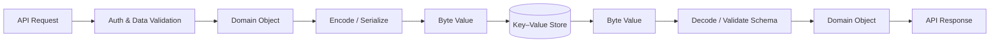
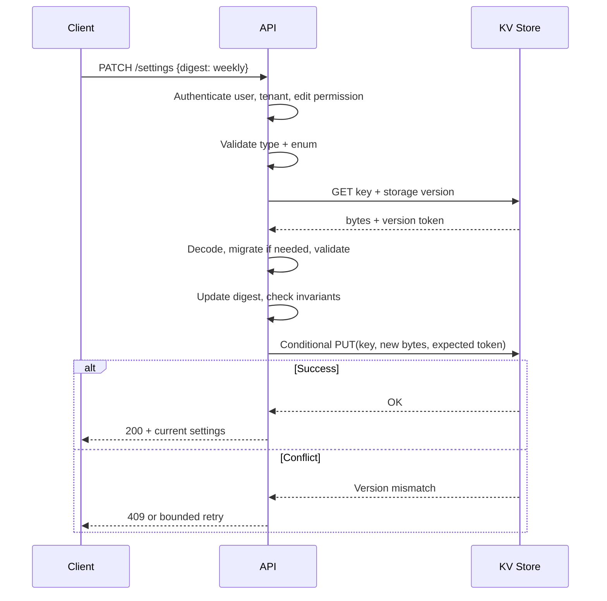

# Representing Internal Value Structure and Application Responsibilities

## Learning Objectives

After this lesson, you will be able to:

- Distinguish **lookup keys**, **stored values**, the **logical structure** of a value, and its **byte representation** after serialization.
- Choose among unstructured values, JSON, structured data types, and binary formats based on access needs, compatibility, payload size, and operations.
- Write explicit data contracts specifying types, required fields, defaults, optional fields, constraints, and state transition rules.
- Identify what the application must handle when a key–value store does not understand value contents: encoding/decoding, validation, correctness checks, concurrent updates, schema evolution, and data protection.
- Explain why **reading/writing a value as a logical unit** does not guarantee safety of an entire read–modify–write sequence or multi-key transactions.
- Analyze how value representation affects payload size, performance, indexing, and evolvability of the physical schema.

In **DATABASE_DATA_MODELING**, turning business requirements into a clear data model covers entities, relationships, constraints, keys, indexes, normalization, and storage structures. The **Key–Value and Wide-Column** topic raises a practical question: once the storage engine knows how to locate data by key, **who is responsible for understanding, validating, and evolving the internal structure of the value?**

The answer depends on the product, but for a basic key–value model, this responsibility lies primarily with the application and data-contract libraries.

---

## 1. Values Have Structure, Even When the Store Does Not Understand It

Consider a key–value pair:

```text
key   = notification-settings:v1:tenant_7:user_42
value = {
  "schemaVersion": 2,
  "email": {"enabled": true, "digest": "daily"},
  "push":  {"enabled": false},
  "quietHours": {"from": "22:00", "to": "07:00", "timeZone": "Asia/Ho_Chi_Minh"}
}
```

From a business perspective, the value contains fields, nested objects, and rules: `digest` only accepts specific values; `quietHours` must have valid times and an explicit time zone.

Yet a minimal key–value store may only see:

```text
GET(key) -> byte[]
PUT(key, byte[])
DELETE(key)
```

In that case, the database does not inherently know that `email.enabled` is a boolean, that `digest` must match an enum, or whether `quietHours` is valid according to business rules. The application must translate between the **logical model** and the **physical storage format**.



**Three layers not to confuse:**

| Layer | Example | Who Defines It? |
| --- | --- | --- |
| **Business domain** | User is permitted to enable email, configure quiet hours, cannot supply an invalid `digest` | Application business rules |
| **Data contract** | `schemaVersion`, field names, types, required/optional rules, version conversion rules | Engineering team and inter-service contracts |
| **Physical representation** | UTF-8 JSON, MessagePack, Protocol Buffers, compressed/encrypted bytes | Storage design and capabilities of the chosen technology |

Some key–value stores provide types such as hash/map, list, sorted set, or field-level operations. Those capabilities add semantics to specific commands; you should not infer that **every** key–value database stores only opaque bytes or that **every** one supports per-attribute updates.

### 1.1. A Monolithic Value Is a Logical Unit of Access

If the settings screen needs to display all notification preferences, storing them together lets the application fetch everything in one call by `(tenantId, userId)`. If only `push.enabled` changes, monolithic storage may require rewriting the entire value.

Separate four properties:

- **Single-value read:** fetching one unit of data by a known key.
- **Single-value overwrite:** storing a new snapshot that replaces the entire previous value, if the API has this semantics.
- **Atomic update:** readers never observe a half-written state from a single command, if guaranteed by the product and specific command.
- **Concurrency-safe read–modify–write:** requires version conditions, transactions, or atomic update operations; it does not come for free just because the value is read monolithically.

When multiple actors write to the same key, distinguishing these properties is essential to avoid losing each other's changes.

## 2. Choosing a Value Representation for Your Needs

The representation inside a value does not always have to be JSON. Weigh factors such as manual readability/editability, payload size, schema strictness, compatibility, library availability, encoding overhead, and query requirements.

| Representation | Examples / Traits | Best Suited When | Things to Watch Out For |
| --- | --- | --- | --- |
| **Simple string/bytes** | `"vi"`, `42`, byte tokens | Scalar values, counters, configuration flags | Logical type is not self-evident without a written contract |
| **UTF-8 JSON** | Objects/lists, numbers, strings, booleans, null | Human inspection, cross-language interoperability, small/medium payloads | No native decimal/binary type; size and schema validation are up to the application |
| **MessagePack/CBOR** | Binary format representing objects and typed values per specification | Want compact payloads or richer types than JSON | Harder to inspect directly; requires agreed encoder, decoder, and versioning |
| **Protocol Buffers/Avro** | Schema-driven / type-definition data representation | Many producers/consumers, strict schema compatibility management | Schema evolution must follow compatibility rules; does not enforce business logic automatically |
| **DBMS-native data types** | Hash/map, list, set, counter, sorted collection | Need targeted operations on sub-parts supported by the product | Semantics, atomicity, TTL, limits, and transactions are product-dependent |
| **Compressed or encrypted values** | Compressed/encrypted bytes | Large payloads or specific security requirements | Requires metadata, key management, codecs, versioning, and inspection/recovery tooling |

No single choice wins on every axis. JSON is convenient for learning examples, yet when storing millions of values or updating frequently, **measuring** payload size and CPU/I/O cost matters far more than assuming "binary is always faster."

### 2.1. Scalar Values Also Need a Contract

```text
limits:tenant_7:max-users -> "250"
```

Questions still remain: is `"250"` a string or an integer? Are negative numbers valid? What is the maximum allowed value? When the key is absent, is the default 0, 250, or an error? How is malformed data like `"unlimited"` handled?

A short byte string does not remove the responsibility to define **type, valid range, unit of measure, missing-key behavior, and authoritative data source**.

### 2.2. Nested Structures Must Serve the Access Path

Consider two shapes representing the same list of options:

```json
{
  "channels": [
    {"type": "email", "enabled": true},
    {"type": "push", "enabled": false}
  ]
}
```

```json
{
  "channels": {
    "email": {"enabled": true},
    "push": {"enabled": false}
  }
}
```

A list can make sense if display order and flexible element counts are part of the domain; a map can be simpler when each `type` is unique and the application usually looks up by type. However, maps can introduce issues if keys become dynamic and allowed channel types must be constrained.

The design must specify:

- **Is the collection ordered?** Lists preserve order; maps should not be relied upon to infer business order unless specified by the contract.
- **Are duplicate business keys allowed?** Would two `type=email` entries be valid?
- **Do elements have stable identifiers?** When updating an element, should it be addressed by ID, type, or array index?
- **Can the structure grow without bound?** Never stuff unbounded event history into one value just because nested objects can represent it.

## 3. Designing a Data Contract from Business Invariants

Let us follow one running scenario: a user within a tenant configures notifications. The UI usually reads all settings at once, while updates occur relatively infrequently.

### 3.1. Proposed Logical Model

```json
{
  "schemaVersion": 2,
  "revision": 17,
  "userId": "user_42",
  "channels": {
    "email": {
      "enabled": true,
      "digest": "daily"
    },
    "push": {
      "enabled": false
    }
  },
  "quietHours": {
    "enabled": true,
    "start": "22:00",
    "end": "07:00",
    "timeZone": "Asia/Ho_Chi_Minh"
  },
  "updatedAt": "2026-11-22T02:30:00Z"
}
```

Lookup key:

```text
notification-settings:v1:tenant_7:user_42
```

Clearly distinguish **key format version** (`v1` in the key) from **value schema version** (`schemaVersion: 2` in JSON). Changing the value structure does not automatically require changing the key. Conversely, changing how users are identified or partitioned may require a new key without altering all value fields.

### 3.2. Attribute and Rule Specification

| Field | Logical Type | Rules |
| --- | --- | --- |
| `schemaVersion` | Integer | Required; accepts versions supported by the reader |
| `revision` | Non-negative integer | Reference for update control if the store supports conditional writes |
| `userId` | Internal ID | Required, stable; if duplicated inside the value, must match the key's user component |
| `channels.email.enabled` | Boolean | Required after migrating to schema v2 |
| `channels.email.digest` | Enum | `immediate`, `daily`, or `weekly` when email is enabled |
| `channels.push.enabled` | Boolean | Required; does not imply the device holds a valid push token |
| `quietHours.enabled` | Boolean | Required |
| `quietHours.start/end` | Time of day | `HH:mm` format, range 00:00–23:59; only applies when quiet hours are enabled |
| `quietHours.timeZone` | IANA time zone | E.g., `Asia/Ho_Chi_Minh`; must be validated against a trusted time-zone library |
| `updatedAt` | UTC instant | Recorded in ISO 8601 format with a consistent timezone |

In this example, `quietHours.start = "22:00"` and `end = "07:00"` means quiet hours **span midnight** in the user's time zone. Never assume `start < end`. Define explicitly what happens when start equals end: no quiet hours, whole day, or invalid input. This example defines **equal start and end times as invalid when enabled**.

`channels.email.digest` could be omitted when email is disabled, or retained to restore previous preferences. One convention must be chosen; here we choose to **preserve the selected preference when disabled** and accept a valid `digest` even when `enabled=false`. When rendering or sending email, the processor must check `enabled` first.

### 3.3. Which Fields Are Stored Facts vs. Derived Data?

Do not pack every display-convenient field into the same value:

- `userId` and preference settings belong to this value (`userId` could even live only in the key if all callers can reconstruct it).
- `updatedAt` is metadata for auditing and change tracking.
- Email address, verified push tokens, device registration status, and actual send permissions typically reside in other authoritative data sources.
- A field like `canReceivePush` can be **derived** from push opt-in, device status, and delivery rules; storing a duplicate copy easily drifts out of sync.

If a derived copy must be stored for fast reads, document the **source of truth**, acceptable sync lag, and rebuild mechanism.

## 4. Shape-Validating Schemas and Their Limits

For JSON, you can use JSON Schema or a validation library to check shape and types. Abbreviated schema example:

```json
{
  "$schema": "https://json-schema.org/draft/2020-12/schema",
  "type": "object",
  "required": ["schemaVersion", "revision", "userId", "channels", "quietHours", "updatedAt"],
  "properties": {
    "schemaVersion": {"const": 2},
    "revision": {"type": "integer", "minimum": 0},
    "userId": {"type": "string", "minLength": 1},
    "channels": {
      "type": "object",
      "required": ["email", "push"],
      "properties": {
        "email": {
          "type": "object",
          "required": ["enabled", "digest"],
          "properties": {
            "enabled": {"type": "boolean"},
            "digest": {"enum": ["immediate", "daily", "weekly"]}
          },
          "additionalProperties": false
        },
        "push": {
          "type": "object",
          "required": ["enabled"],
          "properties": {"enabled": {"type": "boolean"}},
          "additionalProperties": false
        }
      },
      "additionalProperties": false
    },
    "quietHours": {
      "type": "object",
      "required": ["enabled", "start", "end", "timeZone"],
      "properties": {
        "enabled": {"type": "boolean"},
        "start": {"type": "string", "pattern": "^([01][0-9]|2[0-3]):[0-5][0-9]$"},
        "end": {"type": "string", "pattern": "^([01][0-9]|2[0-3]):[0-5][0-9]$"},
        "timeZone": {"type": "string", "minLength": 1}
      },
      "additionalProperties": false
    },
    "updatedAt": {"type": "string", "format": "date-time"}
  },
  "additionalProperties": false
}
```

This is an example of a **strict contract for schema v2**, not a full production schema. In JSON Schema, depending on the library, `format` may act merely as an annotation unless format validation/vocabularies are enabled; never assume `format: "date-time"` is automatically enforced. Since `timeZone` is a string, the abbreviated schema does not verify that the IANA time zone name actually exists.

**Validation has at least three layers:**

1. **Syntax:** valid JSON parsing, valid byte sequence, size/depth limits.
2. **Schema:** required fields, types, enums, lengths, basic conditions.
3. **Domain invariants:** start time differs from end time when enabled, caller has permission to update, `userId` matches key, state transitions are permitted.

Example of additional business rules:

```text
validateSettings(settings, keyUserId):
    require settings.userId == keyUserId
    require validTimeZone(settings.quietHours.timeZone)
    if settings.quietHours.enabled:
        require settings.quietHours.start != settings.quietHours.end
    require settings.revision >= 0
```

A static schema cannot replace authorization checks, lookups against other data sources, or state transition rules based on the previous value.

### 4.1. Type Mismatches Should Not Be Silently Coerced

If a client sends:

```json
{"enabled": "false"}
```

This is a **string**, not the boolean `false`. A library might coerce it during parsing, but such leniency must be a deliberate decision. Implicit coercion easily causes divergence across Java, JavaScript, and other services when one side treats the string `"false"` as truthy. The API contract should require a true boolean and reject invalid types with a validation error.

Similarly, JSON has no fixed-precision decimal type. For monetary amounts, avoid defaulting to binary floating-point numbers when exact arithmetic or comparison is needed; typically choose **integers in the smallest currency unit** or **decimal strings with explicit parsing/scale rules**. This lesson uses notification settings and has no money fields; the principle still applies when extending to pricing or scores.

## 5. Commonly Overlooked Decisions in Value Contracts

### 5.1. Missing Fields, Nulls, and Default Values

The following three payloads carry distinct potential meanings:

```json
{}
```

```json
{"quietHours": null}
```

```json
{"quietHours": {"enabled": false, "start": "22:00", "end": "07:00", "timeZone": "Asia/Ho_Chi_Minh"}}
```

- **Missing field:** an older writer did not know about this field, or a client sent a partial update request.
- **Null:** the client intends to clear/reset it, or the value is genuinely unknown.
- **Object with `enabled=false`:** the user configured it but temporarily turned the feature off.

If an API accepts `PATCH` payloads, define whether `null` means "clear" or "set to null," and whether an omitted field means "keep existing" or "apply default." Never let a framework's default behavior silently become your business rule without documenting the contract.

**Defaults can change across versions.** A reader sees a v1 record missing `push.enabled` and defaults it to `false`; later the product changes the default to `true`. If the application applies defaults based on the current code version rather than the record's schema version, the same legacy record silently changes meaning. Therefore, default rules must be tied to the schema version or materialized during controlled migrations.

### 5.2. Ordering, Sets, and Map Objects

An array `["email", "push"]` preserves element order per the JSON contract, whereas an object `{"email": ..., "push": ...}` must not be used as the source of **business display order** when the UI relies on stable ordering. If order carries business meaning, store `displayOrder` or a dedicated array with explicit rules.

When JSON contains **duplicate property names** in the same object, different parsers may behave differently. Writers must ensure property keys are unique, and decoders should detect/reject ambiguous input at trusted boundaries.

### 5.3. Time Zones, Time Values, and Arithmetic

Distinguish:

| Logical Type | Example | Rule |
| --- | --- | --- |
| Instant | `2026-11-22T02:30:00Z` | An absolute point in time |
| Local time | `22:00` | Time of day; not bound to a date or offset |
| Time zone | `Asia/Ho_Chi_Minh` | Region identifier for calendar and daylight-saving rules if applicable |
| Local date | `2026-11-22` | Calendar date; not an instant by itself |

To evaluate whether quiet hours are currently active, the application takes the current instant, converts it to local time in `timeZone`, and checks the span-midnight interval rules. Never treat `"22:00"` as a UTC instant. When operating in regions with daylight saving transitions, nonexistent or ambiguous local times require explicit handling rules.

### 5.4. Unknown Fields and Compatibility

An older reader may encounter a new `sms` field. Two reasonable options exist:

- **Strict:** reject unknown fields—suitable for API inputs restricted strictly to defined fields.
- **Tolerant on read:** preserve or ignore new fields, supporting multi-version application rollouts.

However, an old reader that **reads and overwrites the entire JSON** may strip the new field even if it ignored it on read. Thus, an "ignore unknown fields" policy must be paired with **preserving unknown fields on write**, selective updates, or blocking old writers from modifying higher-version records.

## 6. Serialization and Deserialization: Write and Read Paths

A baseline pipeline:

```text
API INPUT
    |
    v
[Authentication / authorization]
    |
    v
[Validate request + domain invariants]
    |
    v
[Construct canonical value + schemaVersion]
    |
    v
[Serialize to bytes] -> [optional compress] -> [optional encrypt]
    |
    v
[Store PUT / conditional update]

[Store GET]
    |
    v
[Decrypt] -> [decompress] -> [decode]
    |
    v
[Check version, schema, invariant]
    |
    v
[Map to domain/API response]
```

This is a **conceptual sequence**; actual details depend on the codec and encryption scheme. If data is encrypted, explicitly track metadata such as algorithm, key/key-version, nonce, and authentication tag; use vetted cryptographic libraries rather than inventing custom cryptography.

### 6.1. Separating Domain Objects from Storage DTOs

An application often uses three object layers:

- **API DTO:** fields a caller is permitted to submit, usually a subset of settings; never trust client-supplied `revision` or `userId` arbitrarily.
- **Domain model:** object encapsulating invariants and business behavior, e.g., `setEmailDigest()`.
- **Storage DTO:** representation carrying `schemaVersion`, metadata, and stable encoding for persistence.

For example, the client sends:

```json
{
  "emailDigest": "weekly",
  "pushEnabled": true
}
```

The application maps the validated request onto an authorized domain model and persists a storage DTO with the current `schemaVersion`. **Never pass raw client request JSON directly into the store** as a trusted document; doing so can allow tampering with internal fields like `revision`, `userId`, or `roles`.

### 6.2. Ensuring Consistent Encode/Decode Behavior

A minimal codec test suite should verify:

- `decode(encode(model))` preserves **business meaning**; it need not preserve JSON property order or exact byte layout.
- Types of required fields, large integers, decimals, Unicode strings, and timestamps do not drift.
- Missing fields, nulls, and defaults are interpreted accurately.
- The current reader successfully reads stored fixtures from every version still under support.
- Malformed, truncated, oversized, overly deep, or unsupported-schema payloads are rejected cleanly.

If the system computes signatures, content hashes, or byte-based cache keys, two semantically identical JSON payloads may still differ in bytes due to key ordering, whitespace, or Unicode normalization. When byte-level comparison is required, define a dedicated **canonical encoding**; never assume standard JSON normalizes automatically.

## 7. Updating Values: Full Overwrites, Field Updates, and Concurrency

Suppose a value is at revision 17:

```json
{
  "revision": 17,
  "channels": {
    "email": {"enabled": true, "digest": "daily"},
    "push": {"enabled": false}
  }
}
```

Two devices both read revision 17:

1. Device A changes `email.digest` to `weekly`.
2. Device B enables `push.enabled`.
3. Both send the full modified object using an unconditional `PUT`.

If B writes after A, the final state may have email `daily` and push `true`: A's change is lost. This is the **lost update** bug.

### 7.1. Three Update Strategies

| Strategy | How It Works | Applicability |
| --- | --- | --- |
| **Full-value overwrite** | `PUT(key, newValue)` | Last-write-wins is acceptable or only one writer exists; must accept lost-update risk |
| **Compare-and-swap (CAS) / conditional write** | Writes only if the stored version still matches what was read | Requires an **atomic** check + write guarantee from the store |
| **Field-level update or server-side operation** | `SET field`, `INCR`, single-key script/transaction depending on product | Must verify the operation is truly atomic and invariants remain intact |

Product-agnostic CAS pseudocode:

```text
function changeDigest(key, newDigest):
    validateDigest(newDigest)

    for attempt in 1..MAX_RETRIES:
        bytes, storageToken = store.readWithVersion(key)
        doc = decodeAndValidate(bytes)
        next = deepCopy(doc)
        next.channels.email.digest = newDigest
        next.revision = doc.revision + 1
        next.updatedAt = clock.nowUtc()

        validateDomain(next)
        if store.putIfVersionMatches(key, storageToken, encode(next)):
            return next

    raise ConcurrentModification
```

Here `storageToken` is the token/ETag/version used by the **data store** for an atomic comparison. The `revision` inside the JSON is only metadata; incrementing it and calling an unconditional `PUT` **does not** prevent lost updates. Some stores support conditions directly on an attribute instead of a token; express the condition according to the actual API.

When only a single field needs updating without touching other fields, consider partial updates if the product provides them. However, patching only prevents lost updates **across independent fields** under specific guarantees; if two fields share an invariant, updating them separately can still leave an invalid state. In that case, you need a transactional unit covering the invariant.

### 7.2. Distinguishing Idempotency from Concurrency Control

A request retried due to an unstable network may arrive twice. If the operation is "set `push.enabled = true`," repeating it usually produces the same result. By contrast, "extend trial days by 1" causes errors if applied twice.

- **Idempotent update:** repeating the request carries the same intended effect.
- **CAS:** prevents overwriting based on stale state.
- **Idempotency key:** identifies **the exact same business request** within a controlled window/workflow.

These three concepts solve different problems and may need to work together. Simply storing a `requestId` inside the value without an atomic check-and-write mechanism does not prevent duplicate processing.

## 8. Single-Value vs. Cross-Value Constraints

### 8.1. Constraints Within a Single Value

For notification settings, invariants like `digest` belonging to an enum or valid quiet-hour times can be enforced during encode/write. If the storage engine supports conditional transactions on a single record/key, the application can guard state transitions as one unit.

However, if another service also writes to the value while bypassing the shared validation layer, corrupt data can still enter. Identify **all writers**, place the contract at a trusted write boundary, add compatibility tests, and monitor for invalid records.

### 8.2. Constraints Across Multiple Values or Data Sources

For example: "enable push only when the device has a valid token and the user has granted permission." The token may live under a different key or in another service. Updating a single settings value **does not automatically participate in a transaction** with device registration.

Design options:

- If the condition must hold immediately, place the operation in a data source capable of checking and writing within an appropriate transaction, or redesign data boundaries.
- If eventual consistency is acceptable, store the `push.enabled` preference and verify token/permission against the authoritative source at send time. Clearly distinguish **user preference** from **actual deliverability**.
- If synchronizing multiple read models via events, handle duplicate or out-of-order events and maintain a reconciliation process.

Do not cram all dependent data into one JSON document solely to "get atomicity," because you must also weigh lifecycle, ownership, size, independent update rates, and storage engine limits.

## 9. Schema Evolution as Data and Applications Change Together

Suppose v1 looks like:

```json
{
  "schemaVersion": 1,
  "emailEnabled": true,
  "digest": "daily",
  "updatedAt": "2026-10-01T01:00:00Z"
}
```

And v2 looks like:

```json
{
  "schemaVersion": 2,
  "channels": {
    "email": {"enabled": true, "digest": "daily"},
    "push": {"enabled": false}
  },
  "quietHours": {
    "enabled": false,
    "start": "22:00",
    "end": "07:00",
    "timeZone": "Asia/Ho_Chi_Minh"
  },
  "updatedAt": "2026-10-01T01:00:00Z"
}
```

Here v2 restructures fields and adds push channels and quiet hours. Do not read v1 and automatically infer `push.enabled=true` from a new default if enabling push requires explicit user consent.

### 9.1. Migrating to the Current Domain Object on Read

Pseudocode:

```text
function decodeToCurrent(bytes):
    raw = safeDecode(bytes)

    switch raw.schemaVersion:
        case 1:
            old = validateV1(raw)
            current = migrateV1ToV2(old)
        case 2:
            current = validateV2(raw)
        default:
            raise UnsupportedSchemaVersion

    validateDomain(current)
    return current
```

A good migration function must be deterministic and define exact rules for missing fields, renamed data, and anomalous records. Do not assume an array can convert to a map losslessly if the old array permitted duplicates or carried meaningful order.

**Note:** reading v1 and returning a v2 object **does not mean** v2 was written back to the store. If the application performs write-back on read (*lazy migration*), those writes must still protect against concurrent edits and bound retries; plain reads should not silently drop data or break storage policies.

### 9.2. Running Multiple Application Versions Simultaneously

During a rollout, v1 writers may still run while v2 readers/writers are deployed. If a v1 writer overwrites a v2 value, the new `push` and `quietHours` fields can be wiped out.

Choose an explicit rollout strategy:

| Approach | Idea | Conditions / Trade-offs |
| --- | --- | --- |
| **Read-old/write-new** | New version understands v1/v2 and writes only v2 | Must prevent old writers from overwriting upgraded records |
| **Expand–migrate–contract** | First expand read support, then migrate data, finally retire old paths | Multi-phase rollout; requires compatibility monitoring |
| **Preserve unknown fields** | Old readers/writers round-trip new fields untouched | Requires a codec that genuinely preserves unknown fields without unintended mutation |
| **Separate key namespace on identity changes** | Use new keys and a planned read/migration path | Synchronization overhead; worthwhile mainly when routing or identity changes |

A system with multiple value versions needs **fixtures** for every supported version and tests for upgrades and downgrades per policy. Rolling back an application to an older version can be unsafe if new data has already been written in a schema the older version cannot understand.

### 9.3. Content Version vs. Key Version vs. Encryption Version

All of these can coexist:

```text
key = notification-settings:v1:tenant_7:user_42
envelope = {
  "codec": "json",
  "codecVersion": 1,
  "schemaVersion": 2,
  "payload": { ... },
  "encryptionKeyId": "key-2026-11"
}
```

This envelope is illustrative, not mandatory. Each version solves a distinct problem:

- `v1` in the key governs **identity and access routing**.
- `schemaVersion` governs **payload structure and field semantics**.
- `codecVersion` governs **byte encoding rules**.
- `encryptionKeyId` selects the **decryption key** when values are encrypted.

Replacing JSON with binary without changing business meaning may require incrementing the codec version without changing all business IDs.

## 10. Value Size, Limits, and Operational Costs

When values are stored monolithically, size and update frequency directly impact bandwidth, memory, serialization, replication, and latency.

Suppose each settings record is a few KiB: reading the whole object is convenient. If a user had 100,000 notification rules, cramming them all into one value creates serious problems:

- Toggling a single rule may require reading and rewriting the entire payload.
- Read requests needing only 1 rule must still transfer thousands of entries.
- Multiple writers contend on the same value, driving up CAS retries.
- The value may hit the DBMS's maximum item size limit.
- Schema migration requires parsing/serializing large payloads, spiking peak memory.

### 10.1. Rules for Choosing Value Boundaries

| Question | Decision Guidance |
| --- | --- |
| Are the fields frequently read together? | Group them when most read paths need the whole set. |
| Are fields edited independently at high rates? | Consider splitting or using field-level updates with suitable guarantees. |
| Is value growth strictly bounded? | Set a clear cap; unbounded data belongs in segmented or indexed structures. |
| Do fields share TTL, permissions, and lifecycle? | Marked differences signal a need to consider splitting. |
| Are filtering or sorting on sub-attributes needed? | Pure key–value usually requires a separate index or read model. |
| Must fields be updated transactionally together? | Grouping can simplify this if the store supports the needed guarantees per unit, but verify the product. |

A value under 1 KiB is not automatically optimal; a 100 KiB value is not automatically wrong. Measure **p50/p95/p99 size distributions**, GET/PUT counts, bytes transferred, serialization latency, CAS failure rates, and tail latency under contention. Physical limits, compression behavior, and read/write unit billing differ across products.

### 10.2. Compression, Encryption, and Indexing

- **Compression:** reduces stored/transmitted bytes at the cost of CPU and prevents direct inspection of sub-fields unless the store supports native decompression.
- **Encryption:** protects confidentiality when properly implemented, but requires key management, key rotation, integrity verification, and access control.
- **Indexing:** if the store only holds raw value bytes, placing `userId` or `digest` inside JSON does not automatically create indexes. Secondary indexes or a document/relational store may be required.
- **Logging:** never log entire configuration payloads if they contain sensitive data; log internal IDs, schema versions, and controlled error codes instead.

Security does not end at the value: **storage keys** routinely appear in traces, metrics, and logs, so avoid placing raw emails, tokens, or phone numbers in keys.

## 11. Comparing Key–Value and Wide-Column for Representing Structure

In simple key–value stores, a value is usually a single blob decoded by the application. In a **wide-column** model, a row can contain multiple columns/cells and may support partial reads or updates by column, while partition and clustering keys govern grouping and access order.

Two ways to represent the same settings data:

**A. Single value in key–value**

```text
key = settings:tenant_7:user_42

value = {
  "emailEnabled": true,
  "digest": "daily",
  "pushEnabled": false
}
```

**B. Logical columns in a row**

```text
partition key: (tenantId = tenant_7, userId = user_42)
columns:
  email_enabled = true
  digest        = "daily"
  push_enabled  = false
```

Practical differences:

| Criterion | Key–Value with JSON Blob | Wide-Column with Typed Columns / Cells |
| --- | --- | --- |
| Read full settings | Usually one GET and value decode | Read one row or selected columns, depending on API |
| Change `digest` | May replace the whole value; or partial update if supported | Can update individual column if supported by product |
| Structural validation | Usually enforced by application | Column types/schemas partially enforced by DB; business invariants still need application |
| Versioning | Usually `schemaVersion` in payload | Column schemas and add/alter rules depend on the DBMS |
| Query by `digest` | Not automatic with key-only GET | Not automatic just for being a column; requires suitable partition, index, or query table |
| Multi-column/row atomicity | Depends on command and transaction scope | Depends on product guarantees, operation type, and partition scope |

**Do not generalize every wide-column database as providing "full ACID single-row updates."** Some engines provide single-row or single-partition guarantees and conditional operations; scopes and consistency semantics vary by database. When implementing, consult the specific product's documentation and verify multi-column reads, null/tombstone handling, and how TTL applies to cells vs. rows.

Also distinguish **operational wide-column stores** from **columnar analytical databases optimized for column scans**. Both contain the word "column," yet their access patterns, schemas, and optimizations are fundamentally different.

## 12. Correctness When Data Is Corrupt or Unreadable

Never take successful decoding for granted. Failures can stem from legacy records, partial deployments, mixed writer versions, operator mistakes, or truncated payloads.

### 12.1. Error Classification

| Scenario | Reasonable Response |
| --- | --- |
| Key does not exist | Return the **contracted** default or "absent" status; do not infer all fields are null |
| Payload fails to decode | Emit safe error/telemetry, preserve original bytes for recovery, never overwrite with defaults |
| Unsupported `schemaVersion` | Reject read/write or route to a compatible version; prevent old writers from stripping new fields |
| Invalid enum or domain invariant | Flag invalid record and trigger a controlled repair workflow |
| CAS failure | Re-read, merge per business rules, or return conflict with bounded retries |
| Value exceeds size limit | Reject write explicitly, re-evaluate storage boundaries, never silently truncate data |
| Decryption key unavailable | Distinguish infrastructure/key failure from "key absent"; never delete the value |

Maintain consistent error codes across services with enough detail for investigation without leaking payloads or secrets. When an issue affects a single user, avoid automated actions that destroy that user's data.

### 12.2. Do Not "Self-Heal" via Blind Overwrites

A dangerous pattern:

```text
try:
    doc = parse(store.get(key))
catch:
    doc = defaultSettings()
store.put(key, doc)
```

If the stored record uses schema v3 while the application only understands v2, this snippet can wipe out all new data. A safer strategy **distinguishes absent from corrupt/unsupported**:

```text
bytes = store.get(key)
if bytes is absent:
    return businessDefault()

doc = decodeSupportedVersion(bytes)
validate(doc)
return doc
```

Only write a default value when **the business flow explicitly requires creating a record**, and use write-if-absent semantics to avoid clobbering a concurrently created value.

## 13. Detailed Design of a Complete Update Flow

Consider the request: "user `user_42` in `tenant_7` changes email digest to `weekly`." Proposed flow:



Easily overlooked details:

- `tenantId` must be verified from caller identity/permissions, not blindly taken from the URL to build a key.
- Clients submit only fields they are permitted to edit; never accept arbitrary `userId`, `schemaVersion`, or `revision` from requests.
- After decoding, apply **version-appropriate** migration and defaults before mutating.
- Conditional writes must rely on the store's atomic primitive; token/ETag usage differs by product.
- If migrating from v1 to v2 during the same write, persist the bumped schema only when the conditional write succeeds; on conflict, re-read the latest version.
- Return conflict errors or retry appropriately per the API contract. Never retry indefinitely, and never promise that two concurrent edits to the same field will auto-merge as the user intended.
- If emitting a `SettingsChanged` event to refresh caches, pair emission with commit or failure-aware sync so events do not announce uncommitted changes.

## 14. Value Contract Test Suite

A data modeling document should include repeatable verification tests.

| Test Group | Input | What Must Be Proven |
| --- | --- | --- |
| **Round-trip** | Valid v2 value | Encode then decode preserves business meaning |
| **Legacy** | v1 fixture | Migrates to v2 with proper defaults without auto-enabling new features |
| **Unknown version** | `schemaVersion: 99` | Does not overwrite; reports unsupported version clearly |
| **Wrong type** | `enabled: "false"` | Rejected; no uncontracted implicit coercion |
| **Invalid enum** | `digest: "hourly"` | Rejected per contract |
| **Missing and null** | Omitted field, or `quietHours: null` | Follows exact PATCH/replace rules without guessing |
| **Span-midnight hours** | 22:00–07:00 | Evaluates accurately for time zone and overnight span |
| **Equal quiet hours** | 22:00–22:00 when enabled | Rejected per business decision |
| **Large payloads** | Oversized array, deeply nested object | Does not exhaust resources; returns appropriate error/limit |
| **Lost update** | Two writers reading same token | One write succeeds safely; the other receives conflict/retry properly |
| **Legacy writer** | v1 writer encounters v2 value | Does not strip new fields on write |
| **Wrong tenant** | Request A accesses tenant B's key | Rejected at authorization layer |
| **Key absent** | No settings stored yet | Returns valid contracted default without losing concurrent creation |
| **Corrupt payload** | Invalid codec bytes | Never silently overwritten with default |

Beyond functional tests, measure bytes per record, codec latency, p95/p99 latency, and conflict rates under concurrent load. Only benchmarks using a workload matching real access patterns reflect the trade-off between a JSON blob and split columns/cells.

## 15. Practice Exercises

### Exercise A — Distinguishing Data Types from Business Rules

An application stores:

```json
{
  "productId": "p_10",
  "price": 10.1,
  "currency": "USD"
}
```

Determine: what type should `price` use if exact totals must be computed? Can `currency` be an arbitrary string? If the key–value engine stores only bytes, what ensures both fields are valid?

**Hint:** You can store integers in the smallest unit with an agreed currency/scale convention, or decimal strings with an exact parser. `currency` requires an enum/ISO code per the business contract, validated at write time. A raw byte store does not enforce constraints automatically.

### Exercise B — Defaults During Upgrades

Version 1 had only `emailEnabled`, while v2 adds `pushEnabled`. The product wants push enabled by default for new users. When reading v1 records, should the application automatically set `pushEnabled=true`?

**Hint:** Do not infer `true` if enabling push for existing users introduces new side effects requiring consent. Defaults for new users and migration rules for existing users are **two distinct contracts**; document the compatibility policy explicitly.

### Exercise C — Concurrent Updates from Two Devices

Suppose both A and B read settings at revision 20. A edits `digest` while B edits `quietHours`. Describe how a lost update occurs if both `PUT` the entire value and how CAS resolves it.

**Hint:** If both write unconditionally, the second writer can revert the first writer's change back to the stale value. With a conditional write, one writer succeeds while the other encounters a version mismatch and must re-read, reapply its change on the new version, or ask the user to resolve the conflict. Incrementing a `revision` field inside JSON without atomic CAS is insufficient.

### Exercise D — Choosing a Representation

A device emits thousands of measurements per minute. The UI wants paginated views of measurements within a time range. Should the device's entire history be stored in a single JSON value?

**Hint:** No. Data grows without bound, range reads are awkward, and rewrites happen constantly. Consider a time-series model, wide-column with appropriate partition/clustering keys, or bounded bucketed segments with explicit access paths.

### Exercise E — Drafting a Data Contract

For a new feature "user selects notification level": `all`, `mentions`, `none`. Write a specification covering field name, enum, default for new users, migration rule for legacy users, edit permissions, behavior on missing/null, and how older readers handle new values.

**Hint:** A complete contract must govern **both writes and reads**, plus how multiple application versions operate concurrently. Merely adding `notificationLevel` to JSON is not enough.

## Summary

In the key–value model, a single value can hold rich business structure even when the storage engine only manages an opaque byte block per key. Data modelers must define the **contract inside the value**: types, fields, constraints, element ordering/identity, codecs, versioning, defaults, size bounds, and update rules.

**Application responsibilities** include authenticating writers, validating schemas and invariants, encoding/decoding consistently, handling corrupt records, guarding concurrent updates, and ensuring upgrades do not lose data. When sub-field queries or frequent partial updates become central, compare key–value blobs against native data types, document, wide-column, or relational options based on real access patterns and product guarantees.

A value that "looks like valid JSON" is only step one. A data model is truly complete when **every application version knows how to interpret, validate, update, and recover data in a verifiable way**.
