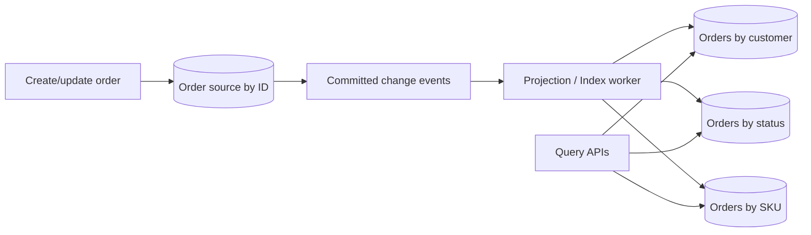

# Query Limitations When Search Criteria Are Not in the Key

## Learning Objectives

After this lesson, you will be able to:

- Explain why a **key–value** store retrieves data efficiently by a known key, yet cannot automatically find records by a field that only lives inside the **value**.
- Distinguish single-key reads, prefix/range queries, post-read filtering, full scans, and indexed queries; identify which capabilities depend on the DBMS.
- Translate business questions into **access patterns**, deciding which data must belong in a key or in a separate **read model**.
- Design inverted indexes, secondary lookup keys, and query-driven tables; evaluate replica counts, write costs, pagination, and consistency.
- Recognize the limits of **partition keys and clustering keys** in wide-column stores, especially for cross-partition filtering.
- Choose an appropriate solution among key–value, wide-column, document, relational, search engines, and analytics systems based on real query characteristics.

In **DATABASE_DATA_MODELING**, a core skill is translating business requirements into verifiable entities, relationships, constraints, keys, indexes, and physical schemas. The **Key–Value and Wide-Column** chapter highlights a central principle: **having data inside a value does not mean the storage engine knows how to locate that value by every internal attribute**.

---

## 1. The Core Problem: Knowing What to Find Without Knowing the Key

Suppose an e-commerce store persists each order under the key:

```text
order:v1:shop_17:ord_908
    -> {
         "customerId": "user_42",
         "status": "PAID",
         "createdAt": "2026-11-21T10:00:00Z",
         "items": [
           {"sku": "A17", "quantity": 2},
           {"sku": "B03", "quantity": 1}
         ],
         "totalMinor": 219000,
         "currency": "VND"
       }
```

If the API receives `shopId = shop_17` and `orderId = ord_908`, the application can construct the exact key:

```text
GET("order:v1:shop_17:ord_908")
```

This is the natural access pattern of key–value stores. Now consider asking:

- "Which are the 20 most recent orders for `user_42`?"
- "Which orders have status `PAID` over the past 7 days?"
- "How many orders contain SKU `A17`?"
- "What is this month's total revenue by product category?"
- "Find orders whose notes contain the phrase 'weekend delivery'?"

Attributes like `customerId`, `status`, `items.sku`, or `note` may exist **inside the value**, yet none of those queries provide `orderId`. If the store API only supports `GET(key)` and `PUT(key, value)`, the store has no direct operation to return keys matching those predicates.

**Separate two questions:**

1. **Does the value hold that information?** Yes: the data sits inside the JSON.
2. **Is there an access path to quickly locate the values containing that information?** Not necessarily: you need an appropriate key, index, or another read model.

Merely "adding a `status` field to the JSON" changes the **data structure**, not the **query path** by status.

> In this lesson, "pure key–value" refers to the model with basic access by known key. Many real-world products add sorted sets, secondary indexes, JSON queries, scans, or transactions. Always check specific engine capabilities rather than assuming every product shares the exact same limitations.

## 2. Specify Queries Before Choosing Keys

A requirement like "find orders" is too vague to pick a schema. Write queries in terms of **inputs, predicates, ordering, limits, and data freshness**.

| Business Question | Known Application Inputs | Filtering / Sorting Needed | Output | Required Access Path |
| --- | --- | --- | --- | --- |
| Single order details | `shopId, orderId` | None | One order | Primary key lookup |
| Recent orders of a customer | `shopId, customerId` | `createdAt DESC`; limit 20 | List | Index by customer and timestamp |
| PAID orders in 7 days | `shopId, status, from, to` | Time descending | List | Index by status and timestamp |
| Orders containing a SKU | `shopId, sku` | Optional date range | ID list | Inverted index or search/read model |
| Search inside notes | Free-text phrase | Relevance score, optional tenant filter | Matching list | Full-text search engine |
| Monthly revenue | Month, shop or region | `SUM`, `GROUP BY` | Summary table | Analytics model / aggregates |
| Customer by email | User-entered email | Exact match | One user | Secondary lookup key or unique index |

Follow-up questions clarify the design:

- Are predicates **equality**, **range**, **prefix**, **full-text**, or combinations?
- Do you need **one record**, **top N**, **all matching records**, or an **aggregated metric**?
- Is **immediate** freshness required, or is index update lag acceptable?
- Are pagination, deterministic ordering, and result limits needed?
- Is data single-tenant or cross-tenant? Who is authorized to view it?
- How many times per second does the query run? Can ad-hoc filters be added later?

A model can serve query A well while failing query B unless you add a dedicated access path.

## 3. Why Scan-Then-Filter Has Limits

The conceptually simplest approach is reading **every value**, decoding the JSON, and keeping those with `status = "PAID"`:

```text
results = []
for key in store.iterateAllKeys():
    order = decode(store.get(key))
    if order.shopId == "shop_17" and order.status == "PAID":
        results.append(order)
return results
```

This is **pseudocode illustrating cost**, not a recommended implementation for an online business endpoint. Not every key–value store exposes an API to list all keys. Many products provide paginated scan operations that **do not guarantee snapshot isolation**, do not preserve business order, and do not evaluate predicates on value attributes server-side.

### 3.1. Data-Size-Dependent Cost Must Be Examined

If there are `N` orders with average value size `S` bytes, scanning to check a condition may require reading roughly:

\[
\text{Data read} \approx N \times S
\]

Example:

- There are 10 million orders.
- Each value averages 2 KiB.
- The UI only needs the 20 latest PAID orders for one shop.

If every value must be read, estimated payload volume is **19.1 GiB** (10 million × 2 KiB), excluding metadata, network round trips, replication, and decoding overhead. Even when returning only 20 orders, **filtering cost** scales with records read, not records returned.

Conversely, a well-chosen index can narrow candidates down to roughly 20–a few dozen entries and read only the needed orders. Exact cost depends on index type and product, yet the difference in access model is dramatic.

### 3.2. "Scan Pagination" Is Not "Query Result Pagination"

Suppose a scan returns 1,000 keys per page. After filtering, each page yields only 0–5 matching orders. To collect 20 results, the application might have to scan many pages; if records are concurrently inserted or deleted, results across pages can shift and will not reflect a consistent snapshot.

Therefore, **`LIMIT 20` applied after filtering** does not automatically reduce the data scanned. An efficient query must **narrow the candidate set before reading large numbers of values**.

Full scans still have valid uses: audits, reconciliation, backfills, index rebuilds, small-dataset tests, or throttled background jobs. They are generally unsuited for low-latency online screens over continuously growing datasets.

### 3.3. Post-Read Filtering Differs from Using an Index

Some APIs accept filter expressions yet still read many rows internally before discarding non-matching records.

| Mechanism | What the System Must Read | Consequence |
| --- | --- | --- |
| **Direct key lookup** | One known key | Ideal for fetching a single entity |
| **Index lookup** | Index entries matching predicate | Shrinks candidate set if index is selective |
| **In-partition range scan** | A pre-organized key range | Effective when predicates match the sort path |
| **Filter after scan/query** | Rows/entries within the preceding scan range | Saves response bandwidth but may not proportionally reduce read cost |
| **Full scan** | All or most of the dataset | Cost scales with total stored dataset size |

Read the product's execution documentation: two queries sharing the syntax `WHERE status = 'PAID'` do not necessarily use indexes the same way.

## 4. How Far Can Key Prefixes Help?

A common assumption is that if keys look like:

```text
order:shop_17:ord_908
order:shop_17:ord_909
order:shop_18:ord_910
```

then you can read all keys starting with `order:shop_17:`. This is **only true when the storage engine provides prefix queries or compatible key ordering**.

- In **hash-partitioned key–value** stores, keys sharing a prefix may live on completely different nodes/partitions.
- In **ordered key–value** stores keeping keys in byte order, prefix range scans can be efficient if the encoding is designed compatibly.
- In engines with **partition key/sort key indexes**, reading a group of keys must follow the real partition/sort structure, not colon positions in a string.

**Distinguishing examples:**

```text
A. GET("order:shop_17:ord_908")
   -> Access by known key.

B. SCAN prefix "order:shop_17:"
   -> Requires prefix traversal support and documented cost.

C. QUERY partition = shop_17, sort between t1 and t2
   -> Requires a schema supporting partitioning and time-ordered sorting.
```

Even with prefix scans, `order:shopId:orderId` still does not serve "20 newest orders" well unless `orderId` is chronologically ordered. You may still need a separate access path sorted by `createdAt`. Never mistake a "neatly formatted key string" for a general-purpose index.

## 5. The Solution: Deliberately Build Access Paths for Queries

When search criteria are missing from the primary key, several options exist:

1. **Change or add lookup keys** for direct access from known inputs.
2. **Maintain secondary or inverted indexes** mapping filter criteria to primary keys.
3. **Create a separate read model/table** organized by the partition and sort keys the query needs.
4. **Use a store supporting attribute queries**: document, relational, or product-provided secondary indexes.
5. **Offload search/analytics queries to specialized engines**: full-text search engines, columnar analytics, or data warehouses.

No option is free: adding read paths generally increases write amplification, storage footprint, and synchronization complexity.

### 5.1. One Entity, Multiple Access Paths

Orders are stored primarily by ID:

```text
order:v1:shop_17:ord_908
    -> {customerId: user_42, status: PAID, createdAt: t1, ...}
```

You can add a per-customer index:

```text
customer-orders:v1:shop_17:user_42:202611
    -> [ord_908, ord_905, ord_901, ...]
```

This is a conceptual structure only. If the value is a list of IDs, you must define ordering, maximum size, atomic add/remove operations, concurrent writes, and pagination. An unbounded order list inside one value recreates the very size and rewrite problem we are trying to avoid.

With stores supporting native ordered lists or sorted sets, you can use those native operations. With wide-column stores, you typically store multiple rows sharing a partition key and clustering key for range reads. With relational databases, you can index `(shop_id, customer_id, created_at, order_id)`.

### 5.2. Distinguish Source Data from Derived Data

You can designate:

- **Primary order record** as the authoritative source for an order's status, amount, customer, and history.
- **Orders-by-customer table** as a replica/read path optimizing the history screen.
- **Orders-by-status index** as a read path for the operations dashboard.
- **Revenue aggregates** as analytical results computed per business rules.

Specify which source is authoritative when they diverge. A lagging read model must never become the source of truth if doing so could overwrite a newer order state.

## 6. Illustrating Query-Driven Wide-Column Modeling

Some wide-column databases operate using a **partition key** combined with a **clustering key**; this structure supports queries aligned with the designed grouping and ordering. The examples below use Cassandra/CQL style for illustration—**not syntax universal across every wide-column product**.

### 6.1. Primary Table by Order ID

```sql
CREATE TABLE orders_by_id (
    shop_id text,
    order_id text,
    customer_id text,
    status text,
    created_at timestamp,
    total_minor bigint,
    currency text,
    PRIMARY KEY ((shop_id, order_id))
);
```

Read path:

```sql
SELECT *
FROM orders_by_id
WHERE shop_id = 'shop_17'
  AND order_id = 'ord_908';
```

This is an exact single-order lookup using the full partition key. It does **not** mean this table can efficiently query orders for `user_42` simply because it has a `customer_id` column.

### 6.2. Table by Customer and Time

To read a customer's history, create a read model:

```sql
CREATE TABLE orders_by_customer (
    shop_id text,
    customer_id text,
    month_bucket text,
    created_at timestamp,
    order_id text,
    status text,
    total_minor bigint,
    PRIMARY KEY (
        (shop_id, customer_id, month_bucket),
        created_at,
        order_id
    )
) WITH CLUSTERING ORDER BY (created_at DESC, order_id ASC);
```

Example query for one month:

```sql
SELECT order_id, created_at, status, total_minor
FROM orders_by_customer
WHERE shop_id = 'shop_17'
  AND customer_id = 'user_42'
  AND month_bucket = '202611'
LIMIT 20;
```

Results sit within **one customer's partition for one month**, sorted by time and ID. If fewer than 20 orders are found, the application can read the previous month and merge per pagination rules. Using `month_bucket` prevents a single partition from growing unboundedly over years, at the cost of reading more partitions when querying across multiple months.

**Why include `order_id` in the clustering key?** Two orders can share the same timestamp; adding the ID breaks ties so each row remains distinct. "Latest" ordering is only well-defined if timestamps, precision, and tie-breaking rules are explicitly specified.

### 6.3. Table by Status and Time Window

If an operations dashboard needs "PAID orders created in the last seven days," you can add:

```sql
CREATE TABLE orders_by_status_day (
    shop_id text,
    status text,
    day_bucket date,
    created_at timestamp,
    order_id text,
    customer_id text,
    PRIMARY KEY (
        (shop_id, status, day_bucket),
        created_at,
        order_id
    )
) WITH CLUSTERING ORDER BY (created_at DESC, order_id ASC);
```

The application determines which days intersect the query window and reads each day's partition for the given status. Results across multiple days must be **merged/sorted** by the caller if the API requires a unified chronological list. Read cost scales with the number of days, rather than automatically executing as a single partition read.

When an order's status changes from `PAID` to `SHIPPED`, the row in the status read model **must leave the PAID group and appear in the SHIPPED group** per your update policy. Updating `status` in the primary table alone does not automatically move the row between partitions in a secondary table.

Also clarify whether the dashboard wants "orders created in the last 7 days that are currently PAID" or "orders that transitioned to PAID in the last 7 days." Those two questions use different timestamps:

- **`createdAt`:** when the order was placed.
- **`statusChangedAt`:** when the status transitioned.

Putting the wrong timestamp in the sort key returns wrong answers even if the query runs fast.

### 6.4. Key Limitations of Wide-Column Models

For partition/clustering database families:

- Queries generally must specify the **exact partition key or a supported partition set** to avoid broad scans.
- Clustering keys enable ordered/range queries **within a partition**, not across the entire dataset by default.
- Filtering on non-key columns may be restricted or require additional indexes.
- Secondary indexes and filtering features may exist, yet **are not always suitable for low-cardinality data, hot partitions, or queries spanning large datasets**.
- Oversized, undersized, or hot partitions all degrade performance; time buckets and load distribution must rest on realistic estimates.

Thus, "having a `status` column" is not enough to guarantee efficient status queries. You must verify whether that column participates in an access path, index, or read model.

## 7. Designing Inverted Indexes for Subset Predicates

Another question: "Which orders contain SKU `A17`?" Each order holds an `items` list inside its value, and SKU is not in the primary key.

An **inverted index** reverses the mapping direction:

```text
Primary path:
orderId -> Order{items: [A17, B03], ...}

Inverted path:
SKU A17 -> [orderId_1, orderId_2, ...]
SKU B03 -> [orderId_1, orderId_9, ...]
```

If scoped per shop:

```text
orders-by-sku:v1:shop_17:A17:<bucket> -> set of order IDs in bucket
```

A wide-column design can represent each SKU–order link as a row, partitioned by `(shopId, sku, monthBucket)` and sorted by `(createdAt, orderId)`. When querying, the application fetches candidate IDs and retrieves full details from the primary order record if needed.

**Questions to resolve before building an inverted index:**

- Can one order have multiple line items with the same SKU? The index typically needs a single unique **(SKU, orderId)** relationship.
- When an order is canceled/deleted, is the index entry deleted immediately, marked, or retained for history?
- Does the query ask for orders "with the SKU in the last 7 days" or "still active and containing the SKU"? Adding a status filter may still leave many candidates needing post-filtering.
- Popular SKUs can appear in millions of orders. A single value holding all IDs can grow too large; segment/bucket entries or use a dedicated index.
- Should the index hold only ID and timestamp, or also display fields? Duplicating display attributes increases synchronization cost when values change.

### 7.1. Multi-Predicate Queries Are a Different Problem

"PAID orders containing SKU A17 in November, sorted by amount descending" does not automatically become fast just because you have one index on status and another on SKU.

You may need to:

1. Fetch candidates from one index and evaluate remaining predicates on primary records.
2. Intersect candidate sets across indexes, if supported by the engine and sets are small enough.
3. Build a dedicated read model for a frequent query shape with matching keys and sort order.
4. Use a search engine or relational database with an optimizer/indexes suited to the combined predicates.

Creating indexes for every combination of fields explodes index count, write amplification, storage footprint, maintenance burden, and drift risk. **Which indexes to build** should be decided not by the number of JSON fields, but by queries with sufficient business value and frequency.

## 8. Secondary Indexes, Post-Read Filtering, and Product Differences

Database families offer distinct capabilities. The table below provides modeling guidance—**it does not replace checking your product's exact version and configuration**.

| Storage Approach | Typically Strong Access Path | When Search Criteria Are Outside the Key |
| --- | --- | --- |
| **Pure key–value** | `GET` by full key | Build secondary mappings/read models or pick a technology with indexing |
| **Ordered key–value** | Byte-ordered key and range reads | Encode keys for grouping and ordering; value predicates may still need an index |
| **Wide-column** | Partition key + clustering/sort key | Design query-specific tables; secondary index behavior varies by product |
| **Document database** | Query document fields with suitable indexes | Index paths/attributes; verify selectivity, sort order, limits, and transactions |
| **RDBMS** | SQL queries, joins, constraints, and optimizer | Use B-tree/other appropriate indexes and inspect execution plans |
| **Search engine** | Full-text, scoring, tokenization, filters | Index text and configure analyzers; typically needs a separate source of truth |
| **Analytics / columnar OLAP** | Column scans, filtering, and large-scale aggregation | Design partitions/sorting/aggregates for batch or streaming analytics |

A secondary index can be an effective tool when queries are simple, selectivity is high, and the DBMS delivers the required consistency level. Yet indexes are not free: the engine must maintain them on writes, deletes, and updates, and queries may still have to read the base table to fetch remaining fields.

### 8.1. Indexes Have Different Selectivity

Suppose there are 10 million orders:

- `orderId` has nearly 10 million distinct values: filtering by one ID selects very few records.
- `status` has 5 values: filtering solely by `status=PAID` may match millions of orders.
- `(shopId, status, createdAt)` may serve a shop-and-time-bounded query much better depending on data distribution.

**Selectivity** is only one factor. Also account for **cardinality**, skew, sort order, data range, and result size. A status index may work well for "PAID orders in the last 5 minutes," yet fail if queries routinely scan years of `PAID` history.

### 8.2. When Not to Index an Attribute

Not every field deserves an index:

- Fields only displayed after `orderId` is already known.
- Fields rarely filtered, where scheduled offline scans suffice for business needs.
- Fields changing constantly without delivering proportional read value.
- Free-text fields needing tokenization/relevance scoring rather than equality checks.
- Sensitive fields whose indexing requires separate review of access control, encryption, and lifecycle.

A **useful index** must serve at least one defined access pattern, have a reliable maintenance path, and fit within SLA cost budgets.

## 9. The Cost of Read Models: Synchronization and Consistency

To read "PAID orders by shop" quickly, you might maintain multiple projections:



This diagram shows an **event-driven read model update** architecture; it does not assume calling two services sequentially reliably delivers events. The system must ensure source mutations persist and required events are not lost under your chosen architecture (for example via an outbox pattern when supported by the source engine and workflow).

### 9.1. State Transitions Can Skew Indexes

Suppose:

```text
Order ord_908:
  version 7: status = PAID
  version 8: status = SHIPPED
```

The projection must remove the record from the PAID index and insert it into the SHIPPED index. If the worker completes the second step and fails before the first, the order temporarily appears in both groups. Done in reverse order, it temporarily disappears from both.

Therefore, choose a consistency model deliberately:

- **Strong/immediate:** update the record and its indexes within a product-supported transaction, or use a database with engine-managed indexes meeting your guarantees.
- **Eventual consistency:** accept lagging read models; UIs and business logic must account for this window.
- **Hybrid:** fetch candidate lists from the index, then re-verify state from the primary source before sensitive actions requiring up-to-the-moment accuracy.

Never rely on a lagging index as the sole proof for strong invariants like "has this order been paid?" or "is it eligible for refund?" when state can change concurrently.

### 9.2. Handling Duplicate and Out-of-Order Events

Real-world event pipelines can redeliver events or deliver them out of order. For instance, event `version=8, SHIPPED` may arrive before `version=7, PAID`. If the projection applies event 7 last, the index regresses to a stale state.

A robust solution typically requires:

1. Stable event IDs and `orderId`.
2. A monotonically increasing version **per order**.
3. Projections storing the applied version and accepting only newer updates via sufficiently atomic conditional writes.
4. Idempotent updates for old/new entries, storing prior state details needed to delete stale index entries.
5. Retries, dead-letter/quarantine queues, and **periodic reconciliation** against the source of truth.

Illustrative pseudocode:

```text
onOrderChanged(event):
    identity = (event.shopId, event.orderId)
    projection = indexState.get(identity)

    if projection.exists and event.version <= projection.version:
        return  # Duplicate or older

    # Requires an appropriate commit/projection mechanism:
    # remove old-status entry, add new entry,
    # and persist appliedVersion idempotently.
    projectChangeWithConsistencyRule(projection, event)
```

This is **requirements-level pseudocode**, not an off-the-shelf transaction. If an index update spans multiple partitions without database transactions, design recovery and reconciliation workflows; checking `version` outside the write itself does not prevent races between workers.

### 9.3. Sync Lag Must Be an Explicit Contract

If a dashboard tolerates 10 seconds of delay, document what that means and measure **index lag**. If a customer just placed an order and must see it immediately under "My Orders," read the newly created order from the primary source by ID or adopt a synchronization strategy providing *read-your-writes*.

Avoid calling a system "real-time" when it is actually an eventually consistent read model.

### 9.4. TTL, Deletion, and Index Lifecycle

When a primary record expires or is deleted, corresponding index entries may not vanish automatically. This creates **orphan index entries**: queries return IDs whose records no longer exist.

Align on:

- Source TTL vs. index TTL and deletion policy.
- Mechanisms to propagate deletes, tombstones, or lifecycle changes.
- How missing candidate records are skipped and how drift rates are tracked.
- Procedures to rebuild indexes from live source records.
- How privacy-driven deletions are enforced across **all** read replicas, caches, and search systems per policy.

In wide-column stores, TTLs and tombstones have specific operational consequences; never set TTLs across multiple replicas assuming all copies expire at the exact same instant.

## 10. Pagination and Sorting Cannot Be an Afterthought

Queries rarely stop at "find matching records"; users expect stable lists sorted newest-first with smooth paging. If the per-customer index is ordered by `(createdAt DESC, orderId)`, those two fields can serve as a keyset **cursor** for pagination.

Example:

```text
Request:
  shopId=shop_17
  customerId=user_42
  limit=20
  cursor=(createdAt=2026-11-15T08:30:00Z, orderId=ord_850)

Meaning:
  continue after the element with the sort tuple returned last on the previous page
```

Define **tuple comparison operators matching the sort direction**. Using only timestamp as a cursor can skip or duplicate orders sharing the same timestamp. Large `OFFSET` queries can be expensive and poorly suited to many distributed stores.

Also account for:

- **New arrivals between pages:** live lists can shift; cursors avoid some offset pitfalls but do not inherently create an immutable snapshot.
- **State transitions:** an order may leave the result set between page requests.
- **Multiple partitions/buckets:** preserve cursor state appropriately to merge ordered streams.
- **Security:** bind cursors to tenant, filters, and sort order; never allow cursors to bypass authorization checks.
- **Bounds:** enforce a maximum `limit` to prevent unbounded queries.

If the business requires a **strict snapshot** across pages, you need snapshot/PIT/query-versioning support from the database or accept a different data model and cost. Cursors over eventually consistent read models do not guarantee snapshot isolation.

## 11. Joins, Text Search, and Analytics: When to Switch Models?

Some limitations are poorly solved by adding more secondary keys. Different query classes suit different models.

### 11.1. Relational Queries and Transactional Constraints

Example: "Find all orders from enterprise customers containing products in category X that are paid but not yet invoiced." This query crosses multiple entities, relationships, and mutable states.

If this is a critical business query, a relational model with **primary keys, foreign keys, indexes, joins, and transactions** is usually the natural fit. You can still optimize with materialized views or denormalization, yet first evaluate constraint expressiveness and execution plans.

A denormalized NoSQL read model can serve **one specific dashboard** quickly, but must be updated whenever a customer changes tier, a product changes category, or an invoice changes state. Independently changing relationships drive synchronization costs up sharply.

### 11.2. Full-Text Search

A condition like "note contains words similar to 'weekend delivery'" is not equality matching on a field.

A full-text engine handles:

- Tokenization and language normalization.
- Term/phrase queries, relevance ranking, typos, or synonyms if configured.
- Tenant, time, and authorization filters.
- Index updates when notes change or are deleted.

Key–value stores do not gain these capabilities simply because values are JSON strings. When using an external search engine, specify consistency expectations, index rebuild procedures, and rules ensuring **callers never receive documents they are unauthorized to view**.

### 11.3. Analytics and Aggregations

"Monthly revenue by product category over 3 years" is a fundamentally different workload from "open order details."

Analytics typically reads many records, groups, aggregates, and scans select columns. Options include:

- Relational/OLAP engines with appropriate indexes and partitions at moderate scale.
- Columnar analytical stores fed by batch or streaming pipelines.
- Summary tables `(shopId, month, category) → revenue`, maintained from transactions/events with reconciliation rules.

Never maintain a single continuously updated `revenue:global` key without solving contention, idempotency, refunds, adjustments, and authoritative sourcing. Financial aggregations require explicit rules for recognition timing, currency, taxes, refunds, and corrections.

## 12. Workflow for Handling a New Query Requirement

Apply a seven-step process:

1. **Write the query contract:** inputs, filters, sort order, limit, pagination, tenant scope, frequency, and consistency needs.
2. **Inspect existing access paths:** do you have enough key components to `GET`? Is there a matching partition/range index? Does filtering actually reduce rows read?
3. **Estimate the candidate set:** how much data must be read to produce enough results? Are there hot tenants or skewed distributions?
4. **Pick the smallest solution that meets requirements:** direct key, secondary index, read model, search, relational, or analytics.
5. **Design writes and synchronization:** who updates the index, when, with what guarantees, and how duplicate/out-of-order events and rebuilds are handled.
6. **Define lifecycle and security:** entry retention/deletion, TTL, tenant permissions, log/PII exposure, backups, and migrations.
7. **Validate against workload:** measure p95/p99 latency, keys/cells read, bytes read/written, filter discard ratio, index lag, and fan-out cost.

Decision guide:

| If the primary need is… | Try this first | Watch out for |
| --- | --- | --- |
| Fetch one object by known ID | Key–value by primary key | Key stability, concurrency, TTL, value size |
| List within a group in order | Partition + sort, or composite index | Large/hot partitions, cross-bucket queries |
| Filter on a non-key attribute | Secondary index or read model | Selectivity, index maintenance, consistency |
| Keyword/semantic search in text | Search engine / text index | Analyzers, access control, index lag |
| Flexible multi-table relational queries | Relational database | Execution plans, indexes, keys/constraints |
| Multi-year/multi-attribute aggregation | OLAP / warehouse / aggregates | Freshness, ingestion cost, reconciliation |
| Ad-hoc user-driven queries | Engine with query planner and flexible indexes | Index overhead and unpredictable query cost |

Beware the reflex of "creating a new replica table for every attribute filter." When query requirements evolve rapidly, maintaining dozens of read models can cost more than adopting a query-capable engine with indexes and an optimizer upfront.

## 13. Testing to Prove Queries Meet Business Needs

A key/read-path design is only complete when **results are accurate and costs are acceptable** on realistic data.

| Test | Question to Prove |
| --- | --- |
| Lookup by ID | Never leaks cross-tenant data or returns the wrong order on colliding ID parts |
| List by customer | Returns the right customer's orders, accurate timestamps, deterministic tie-breaking |
| Query by status | Orders changing status no longer appear under the old status once committed consistency settles |
| Compound predicates | Results satisfy **all** filters, not only the predicate handled by the chosen index |
| Pagination | No unreasonable skips or duplicates across pages per the defined snapshot/live contract |
| Index backfill | Can rebuild from source without missing updates arriving during the rebuild |
| Duplicate events | Projections do not duplicate entries or double-count aggregates |
| Out-of-order events | Older versions do not overwrite newer state |
| Deletion/TTL | Expired records are no longer returned; orphan index entries are detected/handled |
| Skewed load | Large tenants, popular SKUs, or common statuses do not create hot partitions/indexes breaching SLAs |
| Unauthorized access | Tenant A users cannot discover or load Tenant B orders via indexes or cursors |
| Large datasets | Never scans most of the store to return a few rows; fan-out and bytes read are measured |

**Metrics to monitor:**

- Rows/keys/index entries read per result actually returned.
- Response latency percentiles (p50/p95/p99) by query type.
- Partitions or buckets read per request, especially for cross-time queries.
- Index lag behind primary source; orphan or missing record rates.
- Write amplification per source mutation; index storage size and rebuild cost.
- Rate of queries falling back to scans, plus throttled or failed queries.

These metrics catch designs where "a demo with a few hundred rows is blazing fast" yet a production dataset of millions fails SLA targets.

## 14. Practice Exercises

### Exercise A — Field Exists in Value, No Access Path

The store contains:

```text
product:v1:<productId> -> {
    "brand": "BrandX",
    "category": "coffee",
    "priceMinor": 129000
}
```

New requirement: "Display 30 coffee products priced between 100,000–200,000 VND, sorted by price ascending."

**Question:** Why can you not infer an efficient query from the JSON structure? Propose two distinct design options and the costs to verify.

**Hint:** You can use a document/relational store with a suitable index on `(category, priceMinor, productId)`, or a read model grouped by category and sorted by price. A read model must handle price/category updates and pagination; pure key–value needs a mechanism to locate candidates within a range.

### Exercise B — Pretty Key Prefixes

The store contains:

```text
order:shop_17:ord_01
order:shop_17:ord_02
order:shop_18:ord_03
```

A teammate suggests: "scanning the `order:shop_17:` prefix retrieves all of a shop's orders as fast as GET."

**Question:** What must be verified before accepting this? If "20 most recent orders" is needed, what is missing?

**Hint:** Check whether the engine supports prefix/range scans, how keys are partitioned, and the cost of scanning. Ordering by `ord_01`/`ord_02` does not automatically match `createdAt`; you need a time-sorted path or another index.

### Exercise C — Status Index Stale After Update

Order `ord_908` transitions `PAID → SHIPPED`. The primary order record is updated, yet `orders_by_status` still holds the PAID entry.

**Question:** How will lookup APIs behave incorrectly? If the dashboard tolerates 5 seconds of lag, what should be defined and monitored?

**Hint:** The index may return the order under the wrong status or appear in both groups. You need an update/delete entry workflow, idempotency, versioning to prevent out-of-order events, measurable index lag, alerting thresholds, and reconciliation/rebuilds. Sensitive actions must re-check the primary source if strong consistency is required.

### Exercise D — Filtering Within Partitions

A wide-column table uses partition `(shopId, customerId, monthBucket)` and sort `(createdAt DESC, orderId)`. A query asks for "all PAID orders for shop S from 2024 to 2026."

**Question:** Why does this table not serve the query well? If adding a status-based table, what factors must be watched as shops and orders grow?

**Hint:** Without `customerId`, you do not know which partitions to read; you would have to fan out across many customers and months. Consider a table keyed by `(shopId, status, day/month bucket)` with time clustering and sensible bounds; watch for hot partitions, huge result sets, status sync overhead, and long-term analytics needs.

### Exercise E — Search and Analytics

An application needs all three concurrently:
- Fuzzy search orders by note text, supporting typos.
- Total revenue by region and category over 3 years.
- Load one order's details by `orderId`.

**Question:** Should you try to store everything in one key structure to serve all three?

**Hint:** These are three distinct access patterns: primary key for details, search index for text, and analytical model for aggregations. Define the source of truth and synchronization mechanisms instead of forcing a single key–value layout to replace every data model.

## Summary

A major limitation of key–value and many wide-column designs surfaces when **search predicates do not match the organized keys or access paths**. Having `status`, `customerId`, or `items.sku` inside a value does not mean the engine can query them efficiently. Scans, post-read filtering, and `LIMIT` clauses do not fix a missing index.

Sound design starts with the **query contract**. When a different read path is needed, intentionally build an index/read model or select a better-suited database. Every new read path must address concurrent updates, deletions, TTLs, pagination, sync lag, and operational cost. A verifiable data model answers both questions: **"How does this query get the right result?"** and **"As data grows or mutates, do cost and consistency still meet business requirements?"**
