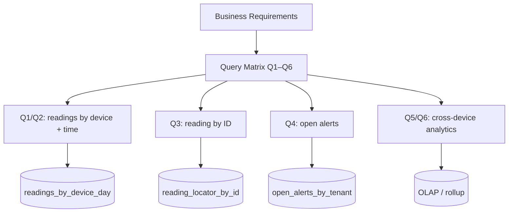
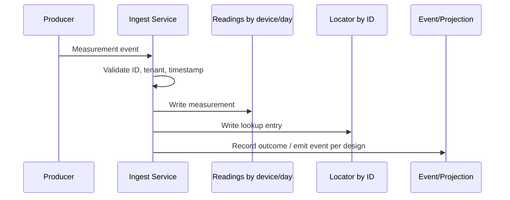

# Wide-Column Models and Query-First Design

## Learning Objectives

After this lesson, you will be able to:

- Explain the **wide-column** model, the roles of partition keys, clustering keys, rows, and columns, and distinguish it from columnar analytical warehouses.
- Translate business requirements into a **query pattern matrix** capturing inputs, filter predicates, ordering, limits, frequency, and consistency.
- Design tables or row groups to answer a query without scanning unrelated partitions.
- Choose partition boundaries, sort keys, time buckets, and pagination strategies grounded in realistic data.
- Explain why wide-column designs often use **multiple tables per read path** and require a synchronization strategy for duplicated data.
- Identify risks of hot partitions, unbounded partitions, post-read filtering, TTLs/tombstones, and late-arriving events.
- Compare wide-column against key–value, relational, document, and analytical stores to pick scalable, verifiable solutions.

In **DATABASE_DATA_MODELING**, the goal is to transform business requirements into entities, relationships, constraints, keys, indexes, and physical schemas. The **Key–Value and Wide-Column** chapter highlights a principle especially vital for distributed stores: **the data model must reflect the actual queries the application runs**, because key selection directly governs which data is co-located and retrieved efficiently.

---

## 1. What Is the Wide-Column Model?

The **wide-column** model organizes data around keyed rows grouped into partitions or key ranges depending on the DBMS. A row can hold many columns; some products support sparse column sets or flexible cell structures. Keys and ordering rules allow reading a group of related data without traversing the entire dataset.

Illustrative layout of readings from a device:

```text
Partition: (tenant_7, device_12, 20261122)

Clustering key                    Columns
---------------------------------------------------------
(10:05:00Z, measurement_103)  ->  temperature=26.3, quality=OK
(10:04:00Z, measurement_102)  ->  temperature=26.1, quality=OK
(10:03:00Z, measurement_101)  ->  temperature=26.0, quality=OK

Partition: (tenant_7, device_13, 20261122)

(10:05:00Z, measurement_209)  ->  temperature=24.7, quality=OK
...
```

From this layout, the question "100 latest readings for device 12 on Nov 22" can be served with a single ordered query to device 12's partition for that day.

However, **there is no single standard across all wide-column engines**. Two common implementation families differ in their key mechanics:

| Product Family | How Keys and Access Work | What Not to Assume |
| --- | --- | --- |
| Cassandra/CQL-style systems | Partition key determines the row group; clustering key orders rows inside a partition | Having a column in the table does not mean you can filter arbitrarily on it |
| Bigtable/HBase-style systems | Row keys are typically sorted lexicographically; contiguous key ranges are range-scannable; columns/cells may be sparse and versioned per product | A byte row key does not automatically carry CQL partition + clustering semantics |
| Columnar analytical stores (columnar OLAP) | Optimized to scan select columns, filter, and aggregate across many rows | "Column-oriented" in analytics is not the same operational model as wide-column |

This lesson uses **illustrative CQL syntax** for table designs. When implementing on another product, translate the **access patterns** into actual row keys, partitioning, encoders, and engine features rather than copying syntax verbatim.

### 1.1. Partitions, Rows, and Columns

In a Cassandra-style model:

- **Partition key:** one or more fields determining the logical partition. Rows sharing a partition key belong to the same co-located query group.
- **Clustering key:** fields that identify and order rows *within a partition*. They form the remaining part of the primary key.
- **Regular columns:** row attributes such as `temperature_c` and `quality`; storing a column does not automatically index it.
- **Primary key:** the combination of partition key and clustering key, defining a row's logical identity per DBMS rules.

Example:

```sql
PRIMARY KEY (
    (tenant_id, device_id, day_bucket),
    observed_at,
    measurement_id
)
```

Here the partition key is `(tenant_id, device_id, day_bucket)`, and the clustering key is `(observed_at, measurement_id)`. Two readings on the same day for the same device with different timestamps or IDs live as distinct rows.

**Important:** having multiple components in a composite key **does not** automatically allow lookups by any arbitrary subset. If a query only knows `tenant_id` without `device_id` and `day_bucket`, it cannot target a full partition in this design.

### 1.2. Wide-Column Does Not Mean Infinite Columns per Row

The name "wide-column" easily misleads people into stuffing unbounded events into one row or partition. Every DBMS has practical limits and overhead for row size, partition size, cells, column counts, compaction, and deletes. An oversized or write-hot partition degrades performance even when data is sparse and horizontally scaled.

Partition boundaries are a **cost and access decision**, not just a table-naming detail.

## 2. Why Start from Queries?

In relational modeling, designers typically begin with entities, relationships, primary/foreign keys, normalization, and then add indexes to serve queries. Because wide-column stores optimize for pre-defined access paths, **query-first modeling** must usually happen right at the start.

This does not mean ignoring the domain model. You must understand entities and invariants first, yet the physical schema may consist of **multiple representations of the same entity** to serve different queries.

The process begins with these questions:

1. **Which exact fields** does the API or job know at query time?
2. Does it need **one row, a bounded list, a time range, or an aggregation**?
3. Is **ordering** or pagination required? Which tie-breaker ensures deterministic ordering when timestamps collide?
4. How fresh must data be, and is immediate read-after-write consistency needed?
5. What are the peak requests/sec, rows/minute, size/partition, and retention period?
6. Are there rare yet flexible, unpredictable ad-hoc queries?

A good wide-column table clearly states **which query it is optimized for**. Never evaluate it merely by column count or lack of data duplication.

## 3. Running Case Study: A Sensor Telemetry Platform

Suppose a multi-tenant device monitoring platform operates under these conditions:

- Each tenant has many devices; devices continuously emit temperature readings.
- Each reading has `measurementId`, `observedAt`, `receivedAt`, `temperatureC`, and `quality`.
- Some devices go offline and backfill data hours later; retries can send duplicate events.
- Raw readings are retained for 90 days; outlier devices can emit hundreds of times more readings than average.
- The API must display latest readings, time-range charts, and single-reading details.
- The operations console must list open alerts by tenant.
- Reports need daily average temperatures across many devices.

### 3.1. Query Matrix

| ID | Question / API | Known Inputs | Filters, Ordering, Limits | Priority |
| --- | --- | --- | --- | --- |
| Q1 | 100 latest readings of a device | `tenantId, deviceId` | `observedAt DESC`, 100 | Very frequent, low latency |
| Q2 | Readings of a device over a time range | `tenantId, deviceId, from, to` | `from <= observedAt < to`, time-based pagination | Frequent |
| Q3 | Reading details by ID | `tenantId, measurementId` | One reading | Less frequent, must be exact |
| Q4 | Open alerts for a tenant | `tenantId, status=OPEN` | Ordered by severity and time | Operations console |
| Q5 | Daily average temperature by region | `region, day` | Aggregation across many devices | Analytics |
| Q6 | Count error readings by firmware | `firmwareVersion, time range` | Group by firmware and time | Emerging analytical queries |

Looking at the matrix, Q1 and Q2 share the **same initial lookup key**: tenant + device + time. Q3 uses measurement ID; Q4 uses alert status; Q5/Q6 are aggregation workloads. A single table does not necessarily serve all six efficiently.

### 3.2. Grouping Access Paths



This diagram shows a **logical read model**. It has not yet decided which system is the authoritative write source or how representations stay synchronized.

## 4. Designing the Primary Table by Device and Time

First, address Q1/Q2. In a CQL example, the table organized by device and day is:

```sql
CREATE TABLE readings_by_device_day (
    tenant_id       text,
    device_id       text,
    day_bucket      text,
    observed_at     timestamp,
    measurement_id  uuid,
    received_at     timestamp,
    temperature_c   decimal,
    quality         text,
    PRIMARY KEY (
        (tenant_id, device_id, day_bucket),
        observed_at,
        measurement_id
    )
) WITH CLUSTERING ORDER BY (
    observed_at DESC,
    measurement_id ASC
);
```

`day_bucket` uses a fixed `YYYYMMDD` format in the **UTC day of `observed_at`** (e.g., `20261122`). Using `text` here aids readability; production schemas can use `date` or another key type depending on the product and encoding convention.

Role of each component:

| Component | Why Chosen |
| --- | --- |
| `tenant_id` | Keeps tenant data scope explicit for authorization checks and partition isolation |
| `device_id` | Q1/Q2 always specify a device; readings for a device are queried together |
| `day_bucket` | Bounds partition growth; long range reads must traverse multiple days |
| `observed_at DESC` | Supports reading newest measurements first by business event time |
| `measurement_id` | Breaks ties among rows sharing the same timestamp |
| `received_at` | Records ingest timestamp to track late arrivals and ingestion lag |
| `temperature_c, quality` | Fields displayed together with each reading |

Within a partition, rows share the **same** `tenant_id, device_id, day_bucket` but differ in clustering keys. Optimal queries target the exact partition and time slice.

### 4.1. Q1: Reading the 100 Latest Measurements

Query within a single day:

```sql
SELECT observed_at, measurement_id, temperature_c, quality
FROM readings_by_device_day
WHERE tenant_id = 'tenant_7'
  AND device_id = 'device_12'
  AND day_bucket = '20261122'
LIMIT 100;
```

Crucial point: this query fetches 100 rows from **one partition**. If today only has 32 rows and the business needs **the 100 latest readings spanning multiple days**, the application must keep querying `20261121`, `20261120`, ... until 100 rows are collected or the retention window ends.

Never scan backward indefinitely: cap maximum lookback days, max partitions read, and define behavior when a device has no data. If readings arrive with future timestamps due to skewed device clocks, define filtering/quarantine rules so the UI does not inadvertently show "future" readings.

**Ensuring ordering:** identical timestamps are disambiguated by `measurement_id`, yet relative order among simultaneous readings depends on ID type and ordering rules. Never use timestamp alone as a cursor when collisions are possible.

### 4.2. Q2: Reading a Time Range

When querying within a single day, use a range predicate on the clustering key:

```sql
SELECT observed_at, measurement_id, temperature_c
FROM readings_by_device_day
WHERE tenant_id = 'tenant_7'
  AND device_id = 'device_12'
  AND day_bucket = '20261122'
  AND observed_at >= '2026-11-22T08:00:00+0000'
  AND observed_at <  '2026-11-22T10:00:00+0000';
```

This expresses the half-open interval `[from, to)`: inclusive start, exclusive end. When the interval spans multiple days, the application computes all intersecting `day_bucket` values and queries each partition.

You must manage:

- **Global ordering:** each partition has internal ordering; when merging multiple partitions, the application must return a unified order per contract.
- **Pagination:** use DBMS-supported paging state/cursors and/or the `(observedAt, measurementId)` tuple; bind cursors to filters and tenant.
- **Limits:** never let an API request pull 90 days and tens of millions of readings in a single unpaginated response.
- **Late-arriving events:** records may be inserted after a user already viewed an earlier page, shifting live result order.

Never assume every range query is as cheap as a single `GET`: rows in the slice, partition count, and result payload size still determine cost.

### 4.3. Why Not Use Only `device_id` as the Partition Key?

If the partition were `(tenant_id, device_id)`, all 90 days of readings for a device would sit in one logical partition. A device emitting 2 readings/sec produces:

\[
2 \times 86\,400 = 172\,800 \text{ readings/day}
\]

Assuming an average effective storage payload of **500 bytes per reading** (merely an estimation assumption):

\[
172\,800 \times 500 \approx 86.4\ \text{MB/day}
\]

Over 90 days, that is roughly **7.8 GB** of payload data under those assumptions, before overhead, replication, indexes, metadata, and compaction. A 90-day partition can become very large depending on the product and operational limits.

Splitting by day places that device's data into more manageable partitions, though for a device emitting 100 readings/sec, even a daily partition can become large or write-hot. **Daily bucketing is a starting point to evaluate, not a universal fixed rule.**

## 5. Choosing Partition Keys: Balancing Queries and Distribution

An ideal partition key satisfies all of the following simultaneously:

- Frequent queries **know all** partition key components upfront.
- Enough distinct partitions exist for the distributed system to **spread load**.
- Each partition maintains a **bounded size** over the data lifecycle.
- No individual partition receives reads/writes exceeding cluster node capacity.
- The number of partitions a single query must read remains acceptable.

### 5.1. Comparing Four Options

| Partition Key | Convenient for Q1/Q2? | Primary Risk |
| --- | --- | --- |
| `(tenantId)` | Must read data across all devices for a tenant | Large tenants create massive, hot partitions |
| `(tenantId, deviceId)` | Convenient for a single device | History grows unboundedly in one partition unless bounded otherwise |
| `(tenantId, deviceId, dayBucket)` | Convenient when device and day are known; reads multiple buckets on long ranges | Day fan-out; extreme hot devices can still overwhelm a partition |
| `(tenantId, deviceId, hourBucket, shard)` | Can spread higher write load if routed properly | Many more partitions, read fan-out across shards/hours, higher complexity |

A **high-cardinality** partition key (many distinct values) helps overall distribution, yet does not guarantee safety under heavily skewed traffic. One "hot" device can still overwhelm a partition even alongside millions of quiet devices.

### 5.2. Size Buckets with Numbers, Not Intuition

When evaluating daily/hourly buckets, estimate from the workload:

```text
rows/partition
  ≈ write rate of one entity × bucket duration

data/partition
  ≈ rows/partition × effective storage size/row
```

Calculate for **typical devices**, **p95/p99**, and **extreme outlier devices**—not just averages. Compare against the DBMS's recommendations for partition size, write throughput, tombstone counts, compaction overhead, and operation limits.

Choosing smaller buckets:

- Fewer rows per partition; prevents excessive growth.
- Long range reads must hit more partitions.
- Requires managing cursors, result merging, and late arrivals across more buckets.

Choosing larger buckets reverses these trade-offs. No bucket size is optimal without knowing both the **query paths** and **traffic distribution**.

### 5.3. Hot Partitions and Sharding

Suppose a single device emits 10,000 readings/sec and all go into one daily partition. Adding more nodes to the cluster will not automatically split writes to that single partition indefinitely.

You might consider partitioning by `(tenantId, deviceId, hourBucket, shardId)`, where `shardId` is derived deterministically from `measurementId` or another distribution rule.

However, when the API needs the 100 latest readings, the application must query **all shards** and merge them in time order. Without bounding fan-out, "fixing" the write path can break read SLAs.

**Rule:** add sharding only when measurements prove a bottleneck and both write and read paths are designed together. Adding a field to the clustering key does not split a partition; the **actual partition key** must change.

## 6. Choosing Clustering Keys for Filtering, Sorting, and Pagination

In Cassandra-style models, clustering keys organize rows in a defined order within a partition. Field order inside the clustering key matters greatly.

Example:

```text
Partition key: (tenantId, deviceId, dayBucket)
Clustering:   (observedAt DESC, measurementId ASC)
```

This fits queries that:

- Provide the full partition key.
- Read newest first or scan a time range.
- Use `measurementId` as a tie-breaker on equal timestamps.

Changing the clustering key to `(quality, observedAt)` helps filter by `quality` within a partition, yet **loses the direct ordering** needed for "100 latest readings regardless of quality." Your design must decide which query takes priority, or maintain an extra read model if both are critical.

### 6.1. Sort Key Checklist

1. **Normalized timestamps:** use UTC instants with consistent precision; never mix local-time strings/different offsets in a byte-ordered key.
2. **Timestamp tie-breaker:** include a stable ID/sequence so two distinct rows never overwrite each other.
3. **Never confuse event time with ingest time:** `observedAt` can lag `receivedAt` by hours; pick the field matching the business question.
4. **Range limits:** one partition can still hold millions of rows; range queries always need `LIMIT`/paging.
5. **Immutability:** modifying a primary key component in many DBMSs means moving the row to a new key (insert new / delete old), not updating an ordinary attribute.

### 6.2. Keyset Pagination

Suppose a client loads 50 readings for a device on Nov 22, and the last row on the page is:

```text
last = (observedAt=2026-11-22T10:04:00Z, measurementId=<id>)
```

The next page requires a condition meaning "strictly after this tuple in the defined sort order" within the partition, or continuing via a DBMS-provided **paging state**. When timestamps collide, filtering solely by `observedAt < lastObservedAt` can **drop rows** sharing that timestamp.

Avoid hand-rolling cursors if your driver provides reliable paging state. When results span multiple partitions or live mutating data, cursors must carry enough bucket, shard, sort, and filter state. Cursors do not guarantee an immutable snapshot while data is actively changing.

## 7. When One Table Cannot Answer Another Query

`readings_by_device_day` optimizes Q1/Q2, whereas Q3 only has `measurementId`. The application does not know `deviceId`, `dayBucket`, or `observedAt` to construct the primary key, so it cannot query `readings_by_device_day` directly.

**Adding a `measurementId` column does not solve this**—it is already in the clustering key, and Q3 still lacks the partition key.

Create a separate lookup path:

```sql
CREATE TABLE reading_locator_by_id (
    tenant_id      text,
    measurement_id uuid,
    device_id      text,
    day_bucket     text,
    observed_at    timestamp,
    PRIMARY KEY ((tenant_id, measurement_id))
);
```

Q3 flow:

1. Query `reading_locator_by_id` by `tenant_id, measurement_id`.
2. Retrieve `device_id, day_bucket, observed_at`.
3. Use those values plus `measurement_id` to fetch the row from `readings_by_device_day`.

This is a manual **lookup index**. If Q3 needs details immediately without two round trips, you can duplicate reading attributes inside `reading_locator_by_id`, trading extra duplication and update responsibility for single-hop reads.

**Identity constraint to clarify:** the locator table keys on `(tenant_id, measurement_id)`, assuming `measurement_id` is unique across the tenant. If IDs are only unique per device, the lookup path must include `device_id` or use a different allocation/collision-check mechanism.

### 7.1. One Write May Need to Update Multiple Tables



This diagram illustrates **operations that must stay synchronized**, not an assertion that all three execute inside one transaction. The system must ensure a reliable mechanism so locators never point to missing rows, nor do persisted rows lack locators indefinitely.

Use real transactions if the engine supports the needed scope; otherwise use an authoritative write source + idempotent events/projections + reconciliation, with explicitly documented eventual consistency.

## 8. Query-Driven Tables and Intentional Duplication

In normalized relational schemas, order data typically lives in one place and relationships are joined on demand. In wide-column designs, a read model may deliberately duplicate attributes to answer a known query in a single lookup.

For orders, screens might require:

```text
orders_by_id
  key: (shopId, orderId)

orders_by_customer_month
  partition: (shopId, customerId, monthBucket)
  clustering: (createdAt DESC, orderId)

orders_by_status_day
  partition: (shopId, status, dayBucket)
  clustering: (statusChangedAt DESC, orderId)
```

Three models serve three distinct access paths. Repeating `orderId, status, totalMinor` is not inherently wrong: what matters is having **explicit synchronization rules** and a concrete query justification.

However, do not spin up a new table for every single field just because you can. Adding read tables multiplies write amplification, storage footprint, complexity, and reconciliation work.

### 8.1. Name Tables After Their Queries

A name like `orders_by_customer_month` communicates its access path far better than `orders_v2`. Naming tables by **who reads them / by which key** helps teams judge whether a new query fits an existing table.

Every table needs a concise design specification:

| Property | What to Document |
| --- | --- |
| Queries served | Query IDs (Q1/Q2/Q3) and corresponding APIs |
| Partition key | Required fields identifying a partition |
| Clustering key | Sort direction, range filters, tie-breaker component |
| Lifecycle | TTL, deletion policy, retention window |
| Write ownership | Who writes, source of truth, rebuild strategy |
| Limits | Max item size, p95/p99 partition size, fan-out, write rate |
| Consistency level | Immediate read vs. tolerable lag; handling failed writes |

### 8.2. Fast-Read Replicas Are Not Automatically Sources of Truth

Suppose an order transitions `status = PAID` to `SHIPPED`. If you maintain a status-based read model, the transition event must remove the old entry and insert the new entry cleanly. A lagging replica may temporarily return stale status.

For sensor readings, if a device backfills older readings, a "latest reading" table updated with last-write-wins by **ingest time** could overwrite a newer reading (by **observation time**) with an older one. Define what "latest" means and ensure updates only advance when observation time is newer.

### 8.3. Choosing Consistency Levels

Never assume wide-column stores provide multi-table ACID transactions by default. Engines vary in guarantees across single rows, single partitions, conditional writes, and replica consistency.

| Requirement | Design / Verification Direction |
| --- | --- |
| Prevent duplicate `measurementId` writes | Define uniqueness scope and idempotency/conditional write mechanism |
| Write raw data then update read models | Designate source of truth, reliable event emission, and replayable projections |
| Immediate read-after-write | Require read-your-writes, read primary source on API, or pick suitable consistency level |
| Drifted index sync | Reconciliation, backfills, version numbers, lag alerts |
| Cross-entity invariants | Evaluate product transaction support or use a database enforcing those constraints |

Having multiple replicas with tunable consistency **does not mean** multi-table updates are atomic across tables. Check the exact guarantees of each operation.

## 9. Late Data, Duplicates, and Key Mutations

Sensor events have an important trait: **ingest order** does not always match **occurrence order**.

Example:

```text
observedAt = 10:00   receivedAt = 10:00   measurementId = A
observedAt = 09:58   receivedAt = 10:05   measurementId = B
```

If you partition by `receivedAt` day while querying by `observedAt`, a window `[09:55, 10:01)` might miss late events spanning midnight unless extra partitions are checked. In this lesson's primary design, `day_bucket` is computed from `observedAt` so time-range queries align cleanly with buckets.

### 9.1. Idempotency Does Not Come Free from a (Time, ID) Tuple

The key `(tenantId, deviceId, dayBucket, observedAt, measurementId)` only distinguishes rows by the **full tuple**. If a producer resends the same `measurementId` with a different `observedAt`, two rows can coexist.

If the business requires `measurementId` to be unique per tenant, you need an ID validation/registration mechanism preventing two different payloads from claiming the same ID. A locator table keyed by ID helps detect conflicts, yet checking and writing two tables does not form an atomic transaction on its own.

Options based on requirements:

- Accept retries only when IDs are stable and payloads remain identical.
- Use write-if-absent or product-supported transactions to claim ID ownership.
- If accepting at-least-once ingestion, tolerate duplicate deliveries while ensuring idempotent projections/aggregates.
- When detecting the same ID with a different payload, record the conflict and apply an explicit policy; never silently mutate observation time.

### 9.2. Timestamps in Primary Keys Usually Cannot Be Updated In Place

If an event arrives with a wrong `observedAt` and must be corrected, the row with the old timestamp key and the row with the new timestamp key are **two distinct storage identities**. The repair workflow must write the new row, update the locator, and delete the old row appropriately, accounting for TTLs and concurrent queries.

Evaluate upfront whether source timestamps are trustworthy enough to sit in a primary key, and define a policy for historical corrections.

## 10. TTL, Tombstones, and Operational Impact

Suppose raw readings are retained for 90 days. TTLs can help if the DBMS supports automatic row/column expiration, with important caveats:

- **Tie TTL to business policy:** 90 days from `observedAt` or from ingest time? Late-arriving events could live too long under a fixed TTL from `receivedAt`.
- **Tombstones/deletes:** many wide-column engines write deletion markers (tombstones) before physically reclaiming space, and excessive tombstones slow queries and compaction.
- **Derived data:** locator tables, alerts, rollups, or search indexes may need **different** retention policies from raw data; never assume one table's TTL propagates to others.
- **Retention gaps:** data disappears after TTL; never treat a TTL-bounded table as the sole store for long-term compliance obligations exceeding that window.
- **Compaction and backups:** "TTL expired" does not mean bytes vanish instantly from every replica, snapshot, or backup.

For example, if a reading arrives 20 days after observation and must stay **strictly until observation + 90 days**, compute remaining TTL at write time per your rule and DBMS API limits. Handle zero/negative remaining TTLs and verify max TTL limits. If the engine lacks flexible TTLs, use bucketed table drops or scheduled lifecycle cleanup jobs.

Likewise, never rewrite an old row merely to update a display field if doing so inadvertently **resets TTL** and breaks retention rules.

## 11. Avoid Assuming Indexes or Filtering Solve Every Query

Given `readings_by_device_day`, suppose a new requirement arrives:

> "Find all readings with `quality = ERROR` across the entire tenant within one hour."

This query does not know `deviceId`, and `quality` is a regular column. Adding `WHERE quality = 'ERROR'` does not automatically execute efficiently; inspect how the DBMS handles indexes and query execution plans.

Some products offer secondary indexes, search indexes, or server-side filtering, yet efficiency depends on:

- Cardinality and selectivity: is `ERROR` 0.01% or 40% of rows?
- Scope: is the query bounded to one tenant and one hour, or scanning many days/devices?
- Index locality: is the index local per node or distributed? Does it create hot shards/indexes?
- Mutation rate and consistency requirements.
- Covered columns: does the index include needed fields, or must the engine fetch base rows?

If `ERROR` powers a real-time alerting console, instead of scanning all readings, emit **business alert events** during ingestion and maintain `open_alerts_by_tenant` with the right tenant, bucket, and ordering. That model must define open/close transitions, deduplication, corrections, permissions, and TTLs—it is not merely a mirror of `quality`.

If the requirement is "summarize error counts by firmware system-wide over 2 years," an analytical warehouse or rollup table is far more suitable than an operational index.

## 12. Wide-Column, Document, Relational, and Analytics: Choosing by Workload

| Dominant Need | Candidate Model | Why / What to Verify |
| --- | --- | --- |
| Single record by ID | Key–value, document, relational, or wide-column | Clear lookup path; verify TTL and update semantics |
| Large event streams by device + time range | Wide-column or dedicated time-series | Partition + clustering, buckets, range scans, and write throughput |
| Ad-hoc filtering across document attributes | Document with proper indexes | Field queries, compound indexes, nested structures |
| Rich relationships, foreign keys, multi-record transactions | Relational | Joins, constraints, transactions, and query optimizer |
| Multi-hop path traversal across relationships | Graph | Node/edge traversal aligned to query patterns |
| Multi-year, multi-group aggregation over billions of events | Columnar OLAP / warehouse | Column scans and aggregations; typically fed via separate ingestion |
| Full-text search / ranking / typo tolerance | Search engine | Tokenization, scoring, filters; must stay synced from source |

Large systems frequently combine multiple models. What matters is specifying the **authoritative data source**, **sync path**, and **consistency contract** for each capability rather than duplicating data without operational ownership.

Do not choose wide-column solely because data volume is large. If the application needs ad-hoc queries, multi-table joins, or strict cross-record transactional invariants, maintaining numerous query-specific tables can cost more than a well-tuned relational or document database.

## 13. Common Mistakes in Query-First Design

| Design / Assumption | Why It Is Dangerous | How to Fix |
| --- | --- | --- |
| "It has a `deviceId` column, so we can filter by device" | Column is not in a usable partition key or index | Include it in the partition key or build a read model |
| One partition for an entire tenant | Large tenants grow massive and hot | Split by device, bucket, and workload |
| One partition for a device's entire history | Partition grows forever; hard to operate and expire | Use time buckets; bound read ranges |
| Hourly buckets for every device | Sparse devices must query too many partitions | Measure real rates; size buckets per workload tier |
| Adding random shards to partition keys | Readers do not know the shard; high fan-out | Use deterministic routing, merge plans, and limits |
| Using timestamp alone as clustering key | Events sharing a timestamp collapse into one row | Add an ID/sequence tie-breaker |
| Relying on `ALLOW FILTERING` as a primary strategy | May still scan huge row sets or hit limits | Design keys/indexes to match queries |
| Creating a table for every filter combination | High write amplification, duplication, complex sync | Group core queries; consider a more flexible engine |
| Writing multiple tables and assuming all committed | Read models drift if one write fails | Use reliable writes, idempotent projections, and reconciliation |
| Ignoring late-arriving data | Buckets or "latest" tables return wrong results | Separate `observedAt`/`receivedAt` and enforce update ordering |
| Putting TTL on raw table and ignoring indexes | Orphan index entries or broken detail lookups | Define lifecycle policies across every replica |
| Optimizing only on demo datasets | Hot partitions, p99 spikes, and compaction issues appear at scale | Benchmark with realistic data distributions and queries |

## 14. Design Workflow from Query to Physical Schema

To design a new wide-column table, follow these steps:

1. **Model the business domain.** Identify entities, identifiers, ownership, immutable fields, business timestamps, and invariants.
2. **Build the query matrix.** Record always-known inputs, filters, sorting, pagination, result limits, SLAs, frequencies, and freshness needs.
3. **Group queries sharing an access path.** Choose a single table only when it serves the query group via its partition and clustering keys.
4. **Choose the partition key.** Required inputs available to queries; estimate cardinality, size, write rate, and tenant/device skew.
5. **Choose the clustering key.** Reflect sort/range needs plus tie-breakers; define cursor mechanics.
6. **Choose regular columns.** Store fields needed on screen; weigh byte size, duplication, and source of truth.
7. **Design remaining read models.** Add tables or secondary indexes only for high-value queries; specify write paths and sync lag.
8. **Define lifecycle and repair.** TTLs, deletions, backfills, rebuilds, duplicate/out-of-order events, late readings, and migrations.
9. **Validate with real engine commands.** Check whether queries align with partition/clustering rules without unexpected filtering and have acceptable execution plans.
10. **Load-test with representative traffic.** Test p95/p99 payloads, large tenants, hot partitions, long ranges, multi-shard fan-out, index lag, and compaction overhead.

### 14.1. Sample Design Sheet for Q1/Q2

```text
Query:
  readings(tenantId, deviceId, from, to, limit, cursor)

Partition:
  (tenantId, deviceId, UTC-day(observedAt))

Clustering:
  (observedAt DESC, measurementId ASC)

Rows:
  measurementId, receivedAt, temperatureC, quality

Read:
  enumerate intersecting UTC-day buckets;
  query partition(s) with time bounds;
  merge/paginate; enforce max range/limit

Write:
  validate tenant, ID, timestamps;
  compute day bucket from observedAt;
  enforce idempotency policy; write;
  update locator/read models through defined mechanism

Lifecycle:
  retain raw 90 days under explicit business-time policy;
  handle delete/TTL/index cleanup

Operational checks:
  per-partition rows/bytes, hot-device throughput,
  p95/p99 query time, partition fan-out, index lag
```

A design sheet does more than list columns: it documents **how queries are served**, **what invariants must hold**, and **how costs are bounded**.

## 15. Scenario-Based Verification and Testing

### 15.1. Required Test Scenarios

| Scenario | What Must Be Proven |
| --- | --- |
| 100 latest readings within one day | Returns exact sort order, respects limit, never scans another tenant |
| 100 latest readings across three days | Application queries right buckets, merges, and paginates consistently per contract |
| Two readings with identical `observedAt` | Both rows persist if IDs differ; cursor skips neither |
| Resent `measurementId` | No logical duplication per idempotency policy |
| Same ID with different payload/timestamp | Conflict detected rather than silently creating two business records |
| Late event crossing day boundary | Written to the bucket of `observedAt` and discoverable by queries |
| Device at 100× normal traffic | Stays within partition and hot-write SLA bounds |
| 90-day range query | Enforces time and partition caps; never loads everything in one call |
| Mid-flight read model failure | Retryable/rebuildable without corrupting or duplicating rows |
| Raw source TTL expires | Locators do not dangle forever; retention/deletion policy verified |
| Cross-tenant query by ID | Cannot infer or read unauthorized tenant data |
| Missing/corrupt data | Fails/logs per contract without silently overwriting with bad defaults |

### 15.2. Metrics to Measure in Load Tests

- **Queries:** p50/p95/p99 latency for Q1–Q4, partitions read per request, rows returned vs. rows scanned.
- **Partitions:** bytes/partition, rows/partition, skew between typical and hottest devices.
- **Writes:** writes per measurement, retry counts, duplicate rates, read-model update cost.
- **Correctness:** dangling locator rate, index lag, aggregate drift, out-of-order event counts.
- **Operations:** tombstones, compaction pressure, memory/cache hit rates, TTL overhead, and long-history queries.

Never state a universal partition-size threshold across all wide-column databases. Thresholds, splitting mechanics, and observability tools vary by product, version, and infrastructure.

## 16. Practice Exercises

### Exercise A — Customer Orders

Requirement: API needs the 20 most recent orders for a customer at a shop; orders are retained 5 years, and order counts vary wildly across customers.

**Question:** Propose a partition key, clustering key, and bucketing strategy. If direct lookup by `orderId` is also required, how do you add that access path?

**Hint:** One approach is partition `(shopId, customerId, monthBucket)` with clustering `(createdAt DESC, orderId)`. Calculate how many partitions must be read to gather 20 orders for sparse vs. frequent buyers. Lookup by ID may need `orders_by_id` or a locator table; specify the source of truth and synchronization method.

### Exercise B — A Seemingly Valid Partition Key Running Hot

Initial design:

```text
partition = (shopId, status)
clustering = (createdAt DESC, orderId)
```

All orders of a huge shop write into just a few status partitions.

**Question:** What problems arise with millions of orders and frequent status updates daily? How does adding a daily bucket change the read path?

**Hint:** `status` has low cardinality, so partitions grow huge and hot. Bucketing shrinks each partition, yet multi-day queries must merge multiple partitions, and status transitions require deleting/inserting entries properly. Measure skew by shop and status.

### Exercise C — Filtering on a Regular Column

`readings_by_device_day` has a `temperature_c` column. A Product Owner asks to "find all readings above 40°C in the last 24 hours across all devices."

**Question:** Why is adding `WHERE temperature_c > 40` not enough? Choose among an alert stream, secondary index, threshold read model, or OLAP depending on whether this is a real-time console or a report.

**Hint:** The query lacks `deviceId` to target partitions. Pick a model aligned with the goal: alerts emitted during ingestion and queried by tenant/time, or an analytical engine scanning/aggregating if it is a report.

### Exercise D — Duplicate Events and Shifting Timestamps

A producer sends:

```text
measurementId = M1, observedAt = 10:00, temperatureC = 23.0
measurementId = M1, observedAt = 10:02, temperatureC = 23.0
```

**Question:** Does key `(deviceId, day, observedAt, measurementId)` prevent duplicates for `measurementId`? What rule must be enforced?

**Hint:** No, because the full composite keys differ. Define a stable business identifier and conditional check/write rules scoped to uniqueness, conflict handling, and consistent locators.

### Exercise E — Matching Technology to Queries

A product needs: (1) per-device sensor history, (2) free-text keyword search in technician notes, (3) multi-year statistical reports, and (4) contract management with rich relational constraints.

**Question:** Should one wide-column table be forced to serve all four? Propose an architecture specifying authoritative data sources and synchronization rules.

**Hint:** Wide-column/time-series handles per-device history; a search index handles full-text; OLAP handles statistics; a relational store handles contracts/transactions. More important than technology names are data contracts, access control, and handling replicated data.

## Summary

**Wide-column models shine when access paths are known upfront and reflected directly in partition and clustering keys.** The partition key selects which data slice to read; the clustering key orders rows within that slice. Selectivity, sort order, time ranges, and pagination must shape the schema from day one.

In return, a single entity may need multiple read models to serve multiple queries. Consequently, a design is incomplete if it only shows `CREATE TABLE` statements: it must specify **write rules, synchronization, idempotency, consistency, TTLs, repair workflows, and load validation**. When flexible filtering, complex joins, or broad aggregations dominate, evaluate relational, document, search, or analytical engines instead of forcing every problem into a single partition key.

The most important question before signing off on a schema is: **"Given this query's inputs, which partitions does the system hit, in what order does it read, how much data must it traverse, and how consistent are the results?"**
