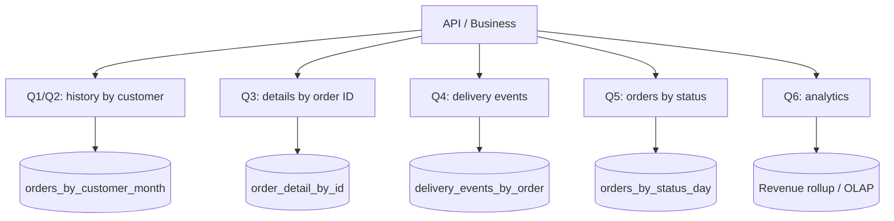

# Partition Keys, Sort Keys, and Co-Accessed Data

## Learning Objectives

After this lesson, you will be able to:

- Explain the differences among **partition keys**, **sort/clustering keys**, **business identifiers**, and **physical partitions**.
- Translate a concrete set of read/write requirements into partition key and sort key choices based on **co-accessed data**.
- Recognize which conditions are served by exact lookups, in-partition range queries, and which require secondary indexes or alternative read models.
- Design composite key orderings to support **filtering, fetching latest records, and stable pagination**, even when multiple records share the same timestamp.
- Evaluate trade-offs among read locality, partition size, write throughput, hot data, fan-out, and cross-partition query needs.
- Distinguish between data **residing in the same partition**, **being read in a single request**, and **being updated atomically**, avoiding false assumptions about guarantees.
- Sketch and validate physical schemas for concrete workloads across key–value and wide-column system families.

In **DATABASE_DATA_MODELING**, turning business requirements into entities, relationships, constraints, normalization, keys, indexes, and physical schemas must stem from the data the application actually needs. In the **Key–Value and Wide-Column** chapter, a central decision is: **which group of data should live within the same access scope, and in what order should items inside that scope be sorted?**

The two keys used to answer this question in several distributed stores are the **partition key** and the **sort key**. Exact names and guarantees vary across products, yet the design reasoning applies as a general workflow.

---

## 1. Foundational Concepts

A partitionable store can organize data across two logical tiers:

1. **Partition key** identifies the related group of data an operation needs to access.
2. **Sort/clustering key** distinguishes rows or items inside that group and can govern their ordering if supported by the product.

Conceptual example using a customer's orders:

```text
Partition key = (shop_17, user_42, 202611)

Sort key                              Value
----------------------------------------------------------------
(2026-11-22T10:30:00Z, ord_908)  ->  total=219000, status=PAID
(2026-11-20T14:05:00Z, ord_901)  ->  total=150000, status=SHIPPED
(2026-11-05T08:12:00Z, ord_874)  ->  total= 87000, status=DELIVERED
```

If you need "the latest orders for user 42 in November," the application already knows the partition key and can read rows in the designed order. Conversely, "orders across all users with status PAID" lacks the partition key and needs a different access path.

### 1.1. Easily Confused Terms

| Term | Meaning | Example |
| --- | --- | --- |
| **Business identifier** | Identifies an object within a defined uniqueness scope | `orderId = ord_908` |
| **Lookup key** | Parameters used to find data in a specific schema | `(shopId, orderId)` |
| **Partition key** | Component grouping/routing data in the storage model | `(shopId, customerId, monthBucket)` |
| **Clustering/sort key** | Component identifying or ordering rows within a partition | `(createdAt DESC, orderId ASC)` |
| **Logical partition** | Set of rows sharing a partition key value per product semantics | All orders of one customer in one month |
| **Physical partition** | Actual engine storage/routing unit, tablet, shard, or range | Allocated by the engine and may shift during load balancing |
| **Monolithic access unit** | A value or business data group routinely fetched together | Small cart fetched via a single key |

**Do not equate a logical partition with a physical server, a file, a disk page, or a transaction.** Depending on the product, a logical partition may be replicated, span underlying structures, and be subject to different operational limits. Being in the "same partition" primarily expresses a **query path**, whereas atomicity and physical placement must be verified separately.

### 1.2. Each Product Family Uses These Two Keys Differently

| Model Family | Conceptual Organization | Considerations When Applying |
| --- | --- | --- |
| **Pure key–value** | One complete key maps to one value; often hash-distributed | Does not inherently support sort/range queries over keys sharing a prefix |
| **DynamoDB-like** | One partition key and an optional item-level sort key; supports partition queries with sort conditions | Sort key can be string/number/binary; check product specifics for transactions, throughput, and indexes |
| **Cassandra/CQL-like** | Primary key combines partition key and clustering columns; rows ordered inside partition as declared | Queries usually must specify partition key; clustering conditions must obey column order rules |
| **Bigtable/HBase-like** | Lexicographically byte-ordered row keys; single-key or range reads | Do not assume row-key ranges share Cassandra's partition + clustering model |
| **Relational** | Primary keys and B-tree indexes can span multiple columns; optimizer picks execution plan | Composite keys do not imply partitioning; joins and constraints have different semantics |

The sections below use **illustrative CQL** for partition + clustering layouts alongside **string PK/SK examples** for item-collection layouts. This is a data-modeling lesson, not a vendor-specific API guide.

## 2. What Does "Co-Accessed Data" Mean?

*Co-access* is the observation that **multiple pieces of data routinely appear together in a single read operation**. For example:

- When opening an order, a customer usually views **order metadata + line items**.
- When browsing history, a customer usually views only **the 20 latest order summaries**; they do not yet need every line item, shipping address, and payment log.
- When tracking delivery, a customer needs **shipping events for one order**, ordered chronologically.
- When updating inventory, the system operates by **warehouse ID and SKU**; it should not pull a customer's entire order history into the same write unit.

Thus, the same "order" entity participates in multiple **co-access boundaries**:

| Screen / Operation | Data Usually Read Together | Data Not Needed Together |
| --- | --- | --- |
| Recent orders list | `orderId, createdAt, status, totalMinor, currency` | All line items, payment history, long notes |
| Order detail page | Order metadata and line items | Orders from all other customers |
| Shipment tracking | Delivery events for that order | Thousands of other orders, shop configuration |
| Mark as delivered | Order status and delivery proof per business rules | All data used for revenue reporting |
| Revenue report | Many orders or date-range summaries | Full detail JSON for every order unless needed |

**Co-access** differs from **co-update**. Placing multiple rows in one partition aids grouped reads, yet does not automatically let you mutate all rows in one transaction. Conversely, splitting data enables independent writes at the cost of potentially needing multiple requests per screen.

### 2.1. Three Degrees of Data Co-Location

1. **Together in one value:** one key holds JSON/bytes for an entire cart or order; single-lookup convenience, may rewrite the whole value on single-field edits.
2. **Together in one partition, separate rows/items:** metadata, line items, and events share a partition key and differ by sort key; allows reading a range of items if supported by the engine.
3. **Different partitions with explicit lookup paths:** order details by `orderId` and order history by `customerId`; queries must use two models or suitable indexes.

Choosing among these depends on **maximum size**, **co-read frequency**, **update contention**, **TTL policies**, **query needs**, and **transactional guarantees**.

## 3. Starting from a Commerce System Query Matrix

Assume a multi-shop platform where each customer can place many orders. The system needs:

- Q1: fetch the 20 latest orders for a customer at a shop.
- Q2: browse a customer's order history within a date range, paginated.
- Q3: view full details of an order by `shopId` and `orderId`.
- Q4: view delivery events of an order chronologically.
- Q5: look up pending orders by `shopId` and `status`.
- Q6: monthly revenue reports across shops.

### 3.1. Query Contract

| Query | Known Inputs | Filter / Sort | Must Return | Key Design Implication |
| --- | --- | --- | --- | --- |
| Q1 | `shopId, customerId` | `createdAt DESC`, `LIMIT 20` | Order summaries | Partition by customer, sort by timestamp |
| Q2 | `shopId, customerId, from, to` | Date range, cursor | Order summaries | Same direction as Q1, optionally bucketed |
| Q3 | `shopId, orderId` | Single order | Metadata + line items | Group details by order ID |
| Q4 | `shopId, orderId` | Event time and event ID | Event stream | Group by order ID, sort chronologically |
| Q5 | `shopId, status` | Update or creation time | Status list | Separate index/table by status |
| Q6 | Month, region/shop | `SUM`, `GROUP BY` | Aggregated totals | Analytics model or rollup |

**No single key optimizes all queries.** Q1/Q2 center on the customer; Q3/Q4 center on the order; Q5 centers on status; Q6 is aggregation. The right choice is usually designing clear read paths and defining how they stay synchronized.

### 3.2. Diagram of Access Paths



Each read path needs an **authoritative data source** and an update mechanism. The diagram does not assume every table lives in the same DBMS.

## 4. Designing the Partition Key for Customer Order History

For Q1/Q2, a first idea is grouping orders by `(shopId, customerId)`:

```text
Partition: (shop_17, user_42)
Sort:      (createdAt DESC, orderId)

2026-11-22  ord_908  -> PAID, 219000
2026-11-20  ord_901  -> SHIPPED, 150000
2026-11-05  ord_874  -> DELIVERED, 87000
...
```

Advantage: all of a customer's orders sit in one logical group, enabling newest-first reads once the customer is known. However, if a customer has a multi-year history, the partition can grow without business bounds.

### 4.1. Adding Time Buckets When Needed

One option is adding the month to the partition key:

```text
Partition: (shopId, customerId, yyyyMM)
Sort:      (createdAt DESC, orderId ASC)

(shop_17, user_42, 202611): 3 orders
(shop_17, user_42, 202610): 5 orders
(shop_17, user_42, 202609): 1 order
...
```

Illustrative CQL schema:

```sql
CREATE TABLE orders_by_customer_month (
    shop_id        text,
    customer_id    text,
    month_bucket   text,
    created_at     timestamp,
    order_id       text,
    status         text,
    total_minor    bigint,
    currency       text,
    PRIMARY KEY (
        (shop_id, customer_id, month_bucket),
        created_at,
        order_id
    )
) WITH CLUSTERING ORDER BY (
    created_at DESC,
    order_id ASC
);
```

Example November query:

```sql
SELECT order_id, created_at, status, total_minor, currency
FROM orders_by_customer_month
WHERE shop_id = 'shop_17'
  AND customer_id = 'user_42'
  AND month_bucket = '202611'
LIMIT 20;
```

The query specifies **the entire partition key**; rows are already organized by `created_at DESC`. To retrieve **the 20 newest orders spanning multiple months**, the application must start with the latest bucket and read older buckets until 20 rows are gathered or the retention horizon ends. That is a **multi-partition** operation, not an automatic schema read.

### 4.2. Bucketing Is a Trade-Off, Not a Default

| Option | Benefit | Cost / Risk |
| --- | --- | --- |
| No bucket: `(shop, customer)` | Read a customer's entire history via one logical partition | Partition can grow huge over time; one hot customer causes contention |
| Yearly bucket | Fewer partitions; less fan-out across multi-month queries | One year may still be too large for high-volume buyers |
| Monthly bucket | Tighter growth cap; easy month-based history limits | Q1/Q2 may read many months for infrequent buyers |
| Daily bucket | Tiny partitions, convenient for short retention | Infrequent buyers read many partitions; higher request and metadata overhead |

You cannot pick the optimal bucket from the domain name alone. You need orders/customer, distribution skew, retention years, row size, throughput, latency SLAs, and engine limits.

### 4.3. Estimating Partition Size

Suppose a shop has a B2B buyer averaging **120 orders/day**. Each order summary uses roughly **700 bytes of effective storage** (an estimation assumption):

\[
120 \times 30 = 3\,600 \text{ orders/month}
\]

\[
3\,600 \times 700 \approx 2.52 \text{ MB/month}
\]

This is only estimated row payload data, **excluding** indexes, metadata, replication, compaction, and write/delete behavior. For a buyer with 100× traffic, the monthly partition grows proportionally larger. Always check p95/p99 and extreme outliers rather than relying on averages.

Set size and writes/sec targets per **logical partition** using your specific product's guidance. Never apply a single "safe threshold" across all wide-column systems.

## 5. Choosing Sort Keys: Which Ordering Has Business Meaning?

The sort/clustering key answers: "within one partition, how do we distinguish rows and traverse them in order?"

For order history, choose `(createdAt DESC, orderId ASC)` because:

- Screens prioritize recent orders.
- `createdAt` supports time-range filtering.
- `orderId` breaks ties between orders sharing the same timestamp and completes the key/cursor.

If you sort solely by `orderId`, "20 newest orders" is not naturally optimized unless IDs have guaranteed chronological ordering. Even IDs containing timestamp bits do not automatically guarantee global creation order across machines experiencing clock skew.

### 5.1. Ordering of Composite Key Components

Compare two sort keys inside the same `(shopId, customerId, month)` partition:

| Sort Key | Favored Query | Disadvantage |
| --- | --- | --- |
| `(createdAt DESC, orderId)` | Latest orders and date ranges | Filtering by `status` needs another index/table or post-read filtering |
| `(status, createdAt DESC, orderId)` | Grouping by status and time **when status is known** | "Latest regardless of status" is no longer one contiguous time slice across the partition |

A sort key generally serves **one predicate priority order** well. Pick field order from the query contract, not from how "important" an attribute sounds.

### 5.2. Query Predicates Depend on the Product

In CQL systems, valid clustering key predicates typically obey column prefix, range, and sort-direction constraints. In systems with explicit PK/SK pairs, you can query by partition key plus prefix/range conditions on the sort key if supported. In pure hash key–value stores, adding `:` inside a key **does not grant** free range queries.

Verify against actual engine commands:

- Can you filter on a prefix of the sort key?
- Can you apply a range condition on the second field without constraining the first?
- Can you reverse scan direction, or only read in declared order?
- Is `LIMIT` applied **before or after** filtering?
- What pagination modes, consistency levels, and limits exist within a partition?

"A key composed of multiple fields" is a modeling property; "this query is valid and reads minimal data" is a property of the **engine and execution command**.

### 5.3. Timestamps, Time Zones, and Collisions

`createdAt` used for sorting should be a normalized **instant**, such as UTC. If encoded into a byte-ordered string key, use a fixed format with zero-padding and uniform precision:

```text
2026-11-05T08:12:00.000Z
2026-11-20T14:05:00.000Z
2026-11-22T10:30:00.000Z
```

Never mix `2026-1-2` with `2026-11-05` and expect lexicographical order to match chronological order. Never mix varying timezone offsets if ordering relies on bytes. If the store provides a native timestamp type, use it with an explicit definition of the chosen time instant.

Two orders sharing a timestamp remain two distinct orders; `orderId` or a sequence acts as the tie-breaker. If client timestamps are untrusted, define how timestamps are assigned or validated at an authoritative source.

## 6. Grouping Co-Accessed Data in One Partition by Order ID

Q3/Q4 use `orderId` rather than `customerId`. Line items and delivery events both belong to one order, yet their access patterns differ.

### 6.1. An Item-Collection Layout Using PK/SK

In a store allowing multiple items to share a partition key while differing by sort key, you can envision:

```text
PK = SHOP#shop_17#ORDER#ord_908

SK = META
  -> {createdAt, customerId, status, totalMinor, currency}

SK = ITEM#0001
  -> {sku:"A17", quantity:2, unitPriceMinor:95000}

SK = ITEM#0002
  -> {sku:"B03", quantity:1, unitPriceMinor:29000}

SK = EVENT#2026-11-22T09:00:00.000Z#evt_101
  -> {type:"PACKED", note:"Packed"}

SK = EVENT#2026-11-22T11:30:00.000Z#evt_102
  -> {type:"SHIPPED", note:"Handed off to carrier"}
```

Items share the **same PK**, allowing the read path to fetch an order's group by order ID. Using **sort key prefixes**, the application can request:

- `SK = META` to read metadata.
- `SK begins with ITEM#` to read order line items.
- `SK begins with EVENT#` to read delivery events.

This is **only feasible** if the product supports prefix/range queries on the sort key. Distinguish clean key structure from actual API capabilities.

### 6.2. When Should They Share a Partition?

Co-locating metadata and line items in one partition makes sense if:

- The detail page normally fetches both.
- Line-item count per order is reasonably bounded.
- Items share security scope and lifecycle with the order.
- Queries know `shopId` and `orderId`.
- Read/write load on a single order will not create a hot partition exceeding limits.

However, **delivery events** can grow long, originate from another service, and follow a different retention policy. If they grow large, change frequently, or must be queried by carrier/shipment, store them in a separate partition/table by `(shopId, orderId, eventBucket)` or `shipmentId`. Co-access is a design signal, **not a mandate to pack everything related into a single partition**.

### 6.3. Sorting by Type and by Time

With string sort keys:

```text
ITEM#0001
ITEM#0002
EVENT#2026-11-22T09:00:00.000Z#evt_101
EVENT#2026-11-22T11:30:00.000Z#evt_102
META
```

Lexicographical order across the whole partition groups by **item-type prefix** first, and only then by event timestamp. To retrieve latest events first, you need reverse scan support or a deterministic inverted-order encoding. Never expect all items in a partition to sort globally by time if their sort keys start with different prefixes.

The `#` characters here are illustrative conventions. Whenever IDs might contain delimiters, use escaping/length-prefixing or a strictly restricted character set. Key structures must also avoid raw emails, tokens, or sensitive PII since keys surface in logs and metrics.

### 6.4. CQL Example Splitting Two Tables Along Read Boundaries

If using a CQL-style model instead of a heterogeneous item collection, you can design:

```sql
CREATE TABLE order_items_by_id (
    shop_id           text,
    order_id          text,
    line_no           int,
    sku               text,
    quantity          int,
    unit_price_minor  bigint,
    PRIMARY KEY ((shop_id, order_id), line_no)
);
```

```sql
CREATE TABLE delivery_events_by_order (
    shop_id     text,
    order_id    text,
    occurred_at timestamp,
    event_id    text,
    event_type  text,
    note        text,
    PRIMARY KEY ((shop_id, order_id), occurred_at, event_id)
) WITH CLUSTERING ORDER BY (
    occurred_at DESC,
    event_id ASC
);
```

Both tables allow lookup by order ID, yet **that does not mean the two tables are physically co-located** or that updates across both tables execute in an atomic transaction. Choosing one mixed collection vs. separate tables depends on query power, schema control, lifecycle, and product limits.

## 7. A Co-Read Unit Is Not Automatically a Co-Write Unit

This distinction is vital for data correctness.

For instance, the order detail page needs to read:

```text
Order metadata + 3 order items + 5 delivery events
```

Although all three might be fetched in a single PK query, they have **different update sources**:

- Order metadata is managed by the order service.
- Line items are locked or adjusted per post-checkout rules.
- Delivery events are updated by carrier webhooks or background workers.

When reading multiple items in the same partition, the system may observe different write points depending on consistency guarantees and snapshot semantics. Never claim transactional consistency across items unless the product explicitly guarantees it.

### 7.1. Invariant Questions

| Invariant to Protect | Scope | Design Impact |
| --- | --- | --- |
| Order total matches finalized line items | Metadata and items | Requires commit/confirmation mechanism or immutable post-checkout lines |
| Canceled orders cannot undergo invalid transitions | Order status | Requires version conditions or supported transactions |
| A shipping event is applied at most once | Event ID / delivery state | Requires idempotency, duplicate and out-of-order handling |
| Order belongs to the right shop and authorized customer | Permissions and identity | Validate tenant/shop at the API, not merely via key prefixes |
| A SKU line item has positive quantity | Row values | Schema and business validation at the write boundary |

Sharing a partition may enable more efficient conditional writes or transactions depending on the product, yet **guarantees must still be verified per command and scope**. Packing unrelated data together just thinking "same partition equals ACID" often yields bloated, hot models built on false assumptions.

### 7.2. Transactions and Executing a Business Action

Suppose checkout must create an order, reserve inventory, and record payment. This invariant spans **multiple data sources**. Even if order metadata and line items share a PK, you cannot infer that inventory or payment commit inside the same transaction.

Make an explicit choice among engine-supported transactions, stateful multi-step workflows, idempotency, authoritative-source checks, and compensation mechanisms. Key design makes read/write paths efficient, but does not replace modeling **business constraints**.

## 8. Hot Partitions and Overly Co-Accessed Data

Co-locating co-read data in one partition helps up to a point. When one partition is hammered by all clients or grows too large, it becomes a **bottleneck**.

Examples:

- One huge buyer places thousands of orders per second.
- A shop runs a "all PAID orders" dashboard from a single `(shopId, status)` partition.
- A viral product accumulates millions of events in a single `productId` partition.
- A chat room holds tens of millions of messages and readers in one `roomId` partition.

Distinguish four situations:

1. **Many moderate partitions:** distributed systems can usually balance load across nodes.
2. **One hot partition:** adding more nodes will not split load on **that single logical partition** if routing keeps sending it to one place.
3. **One huge value/row:** can hit item size limits even when request rate is low.
4. **Excessively wide fan-out query:** many small partitions are still costly if a single request touches thousands of partitions.

### 8.1. Sharding/Salting to Reduce Heat

If partition `(shopId, status, dayBucket)` runs too hot, consider:

```text
Partition = (shopId, status, dayBucket, shardId)
shardId   = stableHash(orderId) mod shardCount
```

Writes keyed by `orderId` can distribute across shards. However, "20 newest PAID orders for the shop" must now query **every relevant shard**, gather candidates, and merge by timestamp. If `shardCount` changes later, routing rules shift; you will need versioning/migration or a mapping to keep finding older data.

Sharding is only worth it when metrics prove the hotspot and the read path is designed alongside writes. `shardId` must be part of the **actual partition key**, not merely the clustering key, to distribute across partitions.

### 8.2. Balancing Co-Read Data with Co-Lifecycle Data

An order might have 3 line items yet accumulate millions of internal diagnostic events during error retries. Stuffing all events into the order's JSON value forces every detail view to load irrelevant bulk and every event append to rewrite the whole blob.

A sensible separation might be:

- Metadata + bounded line items keyed by order ID.
- Delivery events in a separate table, paginated with explicit retention.
- Technical logs in a dedicated logging/event store, decoupled from the detail page.
- A latest-event summary table for the UI if that read path is very frequent.

**Data belonging to the same business entity does not mean it is accessed together on every request.**

## 9. Range Queries, Pagination, and Stable Ordering

Ordering is part of the **query contract**, especially when data mutates while a client pages through results.

### 9.1. Why Timestamp Alone Fails as a Cursor

Consider three orders:

```text
createdAt=10:00:00.000Z, orderId=ord_103
createdAt=10:00:00.000Z, orderId=ord_102
createdAt=09:59:59.000Z, orderId=ord_101
```

If page 1 stopped at `10:00:00.000Z` and page 2 queries solely `createdAt < lastCreatedAt`, it will skip the remaining order sharing that timestamp.

Therefore, with keyset pagination, the cursor needs all components of a **total ordering**:

```text
cursor = {
    "shopId": "shop_17",
    "customerId": "user_42",
    "monthBucket": "202611",
    "createdAt": "2026-11-22T10:00:00.000Z",
    "orderId": "ord_102",
    "sortDirection": "createdAt_desc__orderId_asc"
}
```

This is a logical representation; actual query syntax and paging state may be handled by the driver. Across multiple buckets or shards, the cursor may need state for multiple streams plus merge rules.

### 9.2. Keyset Pagination and Snapshots

Keyset/cursor paging generally avoids large-offset costs, yet **does not create an immutable snapshot**. If a new order arrives or an old one is deleted between page fetches, the underlying set shifts; the cursor merely marks a position in the chosen order.

If the business requires a point-in-time report across pages, you need snapshot/versioned query support from the DBMS or a dedicated export model. For live history screens, shifting results are acceptable if the API documents those semantics.

### 9.3. Querying Across Multiple Buckets

Fetching the 20 latest orders from monthly buckets is a concrete pattern:

```text
function latestOrders(shopId, customerId, limit):
    results = []
    month = currentUtcMonth()

    while results.count < limit and month within retention:
        rows = queryPartition(
            shopId, customerId, month,
            remaining = limit - results.count
        )
        append results, rows
        month = previousMonth(month)

    return results
```

This pseudocode holds only under explicit timestamp/bucket and total-order assumptions; production code must also handle cursors, request bounds, authorization, current-time cutoffs, late arrivals, and skewed future timestamps. If events can arrive late, multi-bucket scans must still preserve consistent ordering and pagination rules.

Never loop across buckets unboundedly when a user has no orders; enforce explicit lookback bounds and SLAs.

## 10. Querying When Only Part of the Partition Key Is Known

The history table keyed by `(shopId, customerId, month)` **cannot directly answer**:

- "Find order `ord_908`" when only `shopId, orderId` are known.
- "All PAID orders for the shop" without `customerId`.
- "Total November revenue across all customers."
- "All orders containing SKU A17."

Reason: the inputs **do not identify a partition** in this table.

To serve queries by order ID, create a dedicated read path:

```sql
CREATE TABLE orders_by_id (
    shop_id      text,
    order_id     text,
    customer_id  text,
    created_at   timestamp,
    status       text,
    total_minor  bigint,
    currency     text,
    PRIMARY KEY ((shop_id, order_id))
);
```

For a status dashboard, add a table/index keyed by `(shopId, status, dayBucket)` and sorted by the **right business timestamp**. For revenue, use rollups/analytics with explicit aggregation, refund, and consistency rules.

In a relational database, a composite B-tree index on `(shop_id, customer_id, created_at)` can support several history queries without duplicating the whole table. Still, that choice rests on execution plans, constraints, and real workloads; never assume relational is always slow or wide-column is always fast.

## 11. Duplicating Data to Serve Multiple Read Paths

Suppose an order has two read models:

```text
orders_by_id(shopId, orderId)               -> status, total, customer
orders_by_customer_month(shopId, user, mon) -> status, total, createdAt
```

When an order changes from `PAID` to `SHIPPED`, both replicas must reflect the business rule. If `orders_by_id` updates while the customer history table lags, a user may see the old status in the list and the new status on the detail page.

Options:

| Required Consistency | Commonly Considered Strategy |
| --- | --- |
| Immediate and synchronous | DB-managed transactions or secondary indexes if the engine supports the required scope |
| Bounded lag acceptable | Source of truth + idempotent event/projection pipeline with lag monitoring |
| List may lag, actions must be accurate | Read list from read model, re-check primary source before sensitive actions |
| Analytical queries without real-time need | Batch/streaming rollups with reconciliation |

### 11.1. Duplicate and Out-of-Order Events

An event may be delivered multiple times. For instance, update `orderVersion=8, SHIPPED` can arrive before `orderVersion=7, PAID`. Projections must not let version 7 overwrite newer state.

You need event IDs, a monotonically increasing version **per order**, idempotent apply logic, and atomic persistence of the applied version. If updates span multiple tables without cross-table transactions, add recovery and reconciliation workflows.

**Being in the same partition does not solve synchronization for read models in other partitions or external systems.**

### 11.2. TTL, Deletion, and Logical Foreign Keys

Suppose order details are kept 5 years while the in-app order list only shows 1 year. Specify:

- Is the primary record deleted at the same time as the index?
- How does the application handle an index entry pointing to an expired primary record?
- On privacy-mandated deletion, must index copies, caches, and analytics follow the same policy?
- If read models need to be rebuilt or recovered, is enough source data still retained?

There is no automatic declarative foreign-key constraint between two read-model tables simply because both contain `orderId`. Integrity must be maintained by the engine, application logic, or reconciliation jobs.

## 12. Tenant Isolation and Locality

Placing `shopId` or `tenantId` in the partition key expresses access scope, yet **does not authenticate or authorize access**. If a client can swap `tenantId` and the API fails to verify permissions, data can leak across tenants regardless of how clean the keys look.

A secure design must:

1. Extract caller identity and tenant scope from trusted authentication context.
2. Verify the caller is authorized to view `shopId/orderId` before executing the query.
3. Avoid raw emails, access tokens, or sensitive PII in keys, as keys appear in logs and metrics.
4. Establish retention, access, backup, and deletion policies for duplicated data across read models.

Partition keys are an **access structure**, not an authorization barrier.

## 13. Verification with Assumptions, Metrics, and Tests

A schema is only complete when it answers: **which query hits which partition, how many rows does it read, and which guarantees must hold?**

### 13.1. Design Sheet per Read Model

| Item to Record | Example: `orders_by_customer_month` |
| --- | --- |
| Queries served | Q1/Q2: latest orders and history by customer |
| Required inputs | `shopId, customerId`; timestamp to compute bucket |
| Partition key | `(shopId, customerId, yyyyMM)` |
| Sort key | `(createdAt DESC, orderId ASC)` |
| Returned fields | `orderId, createdAt, status, totalMinor, currency` |
| Rows/partition | Estimated from order/customer/month distribution, including p95/p99 |
| Fan-out | Number of months a single request may need to read |
| Consistency level | Whether list replica may lag or must reflect immediate updates |
| TTL and deletion | List retention, primary source, orphan-entry handling |
| API bounds | Max `limit`, max lookback, cursor, shop authorization |
| Telemetry | p95/p99 latency, bytes/partition, partitions read, index lag |

### 13.2. Mandatory Test Cases

| Scenario | Expected Outcome |
| --- | --- |
| Customer with 20 orders in one month | Single partition read returns exact order |
| Customer with 1 order every 3 months | Q1 reads bounded older buckets until limit reached or range exhausted |
| Two orders with identical `createdAt` | Neither overwrites nor is skipped during pagination |
| B2B buyer with 100× normal load | Partition size/heat stays within targets or has a splitting plan |
| View order by `orderId` | Uses dedicated lookup path; never scans all customer partitions |
| Append delivery event to an order | Reads events in order; never corrupts order metadata |
| Two services update two data groups | Does not infer transaction from co-location; invariants are enforced |
| List replica lags behind | Lag is measured; sensitive decisions check the authoritative source |
| Delete/expire an order | No stale data served indefinitely via index or cache |
| Tenant A queries Tenant B's order | Rejected at the authorization boundary |
| Timezone mismatch or equal timestamps | Range queries and cursors follow the contract |
| Query touching thousands of partitions | Fan-out bounds and alerts trigger properly |

### 13.3. Useful Metrics

- **Load distribution:** logical partition count, bytes/partition, read/write QPS skew across partitions.
- **Queries:** p50/p95/p99 latency, partitions read per request, rows scanned vs. rows returned.
- **Writes and sync:** writes per business event, conflict retries, index lag, orphan index entries.
- **Lifecycle:** TTLs, tombstones, compaction metrics per DBMS capabilities, ingestion vs. deletion rates.
- **Pagination:** empty-page rate, buckets scanned, miss/duplicate rate per API semantics.

Measure on data **representing worst-case scenarios**, not only average buyers and small demo fixtures.

## 14. Common Mistakes

| Wrong Assumption / Design | Consequence | How to Fix |
| --- | --- | --- |
| "Sharing a string key prefix means same partition" | False for hash key–value; keys may scatter completely | Check engine partitioning and range API mechanics |
| "Same partition means multi-row updates are atomic" | Can lose consistency under concurrent writes | Verify transactions/conditional writes per command scope |
| Partitioning all orders solely by `shopId` | Large shops create giant, hot partitions | Group by query path, adding customer/bucket as appropriate |
| Sorting solely by timestamp | Simultaneous events collide on key and break cursors | Add ID/sequence tie-breaker |
| Using `(status, createdAt)` to read all latest orders | Statuses split into separate groups; global time order is lost | Use a key matching "all statuses" or a separate read model |
| Embedding full detail JSON in every list row | Q1 loads unneeded bytes, inflating bandwidth | Keep summaries in history and details in the order-ID path |
| Appending unbounded events to one order | Value/partition grows too large | Segment, paginate, or separate event storage |
| Arbitrarily small buckets without reason | Inflates fan-out and read complexity | Size buckets using rate and retention metrics |
| Adding shards without designing the read path | "Latest" queries must scan many shards | Build merge, cursor, and limit strategies |
| Adding a new read model for every filter | Duplicated data becomes hard to synchronize | Group key queries; consider an engine with an optimizer/indexes |
| Storing `tenantId` in key and skipping auth checks | Cross-tenant data leaks | Enforce permissions from trusted caller identity |
| Failing to separate source from projection | Stale list status mistaken for truth | Define source of truth, lag, and re-verification rules |

## 15. Practice Exercises

### Exercise A — Shopping Cart and Order History

**Requirement:** each customer has one small cart usually read as a whole; each customer has thousands of orders, and the history screen shows only the 20 latest summaries.

Choose appropriate data boundaries for the cart and order history. Should the cart, order lines, and thousands of orders share one partition or value?

**Hint:** the cart fits a single value keyed by `(shopId, userId)` since it is small and co-read. History should be separate rows by customer/time with sorting and bucketing if needed. Order details should be accessed by order ID. Data belonging to the same customer does not belong in one value.

### Exercise B — High-Traffic Chat Room

**Requirement:** a chat room accumulates tens of millions of messages over 2 years; clients load the 50 latest messages and scroll backward; some rooms have extreme write rates.

**Question:** is partitioning solely by `roomId` sufficient? What must be added to keys and cursors?

**Hint:** evaluate daily/hourly buckets or sharding if measurements reveal hot partitions. Sort by `(sentAt, messageId)` with explicit direction and tie-breaker. If sharded, fetching latest requires merging across shards. Pagination must handle new messages and deleted content.

### Exercise C — Orders by Status

**Requirement:** a shop dashboard needs the 20 latest `PAID` orders, while the customer app needs the 20 latest orders regardless of status.

**Question:** can a single sort key `(status, createdAt)` inside a shop partition serve both queries optimally? Propose read paths.

**Hint:** grouping by status creates contiguous order per status, not global chronological order across statuses. You need read models by shop/time and by shop/status/time—or indexes supporting both per engine capabilities—while checking size and heat.

### Exercise D — Identical Timestamps

**Requirement:** two orders from a customer are created in the same millisecond. The table partitions by `(shopId, customerId, month)` and sorts solely by `createdAt`.

**Question:** what bug can happen? Fix the key and cursor.

**Hint:** if the row's full primary key is partition + `createdAt`, the two orders collide. Add `orderId` as a tie-breaker; cursors must carry the full tuple matching the sort direction.

### Exercise E — Model Selection and Verification

**Requirement:** a platform includes (1) customer order history, (2) warehouse/SKU inventory adjustments with strong invariants, (3) free-text search in order notes, and (4) multi-year revenue analytics.

**Question:** should one wide-column table serve everything? Specify keys/indexes or technologies for each path, plus synchronization if multiple models are used.

**Hint:** order history fits customer/time partitioning and sorting; inventory needs strong transactional constraints; note search needs a full-text index; revenue analytics belongs in rollups/OLAP at scale. Define authoritative sources, idempotency, and consistency expectations per path.

## Summary

The **partition key** defines which slice of data a query can target and reach directly; the **sort/clustering key** organizes rows inside that slice for ordering, ranges, and pagination. Choose both from **real access patterns**: what is read together, what can grow huge, and which queries know enough key components.

Keeping co-accessed data together can reduce read hops, yet **does not automatically confer atomicity or cross-row consistency**. When a partition grows large or hot, trade off with bucketing, sharding, and multi-partition reads; when read paths diverge, maintain separate read models/indexes with verifiable synchronization rules.

Before signing off on a schema, answer: **"Given this API's inputs, which partition do we hit? Inside that partition, how does the sort key fetch the right slice in order? How many rows must be read, how big or hot can a partition grow, and which invariants still need dedicated protection?"**
