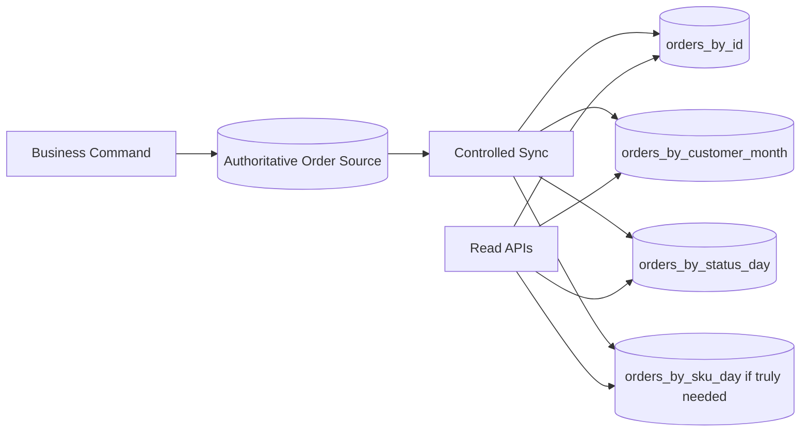
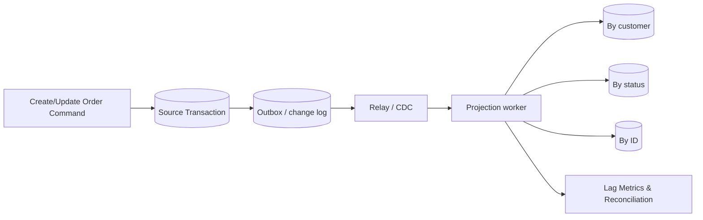
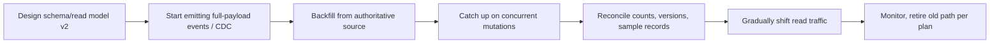

# One Table per Access Pattern and Controlled Data Duplication

## Learning Objectives

After this lesson, you will be able to:

- Explain the **table per access pattern** (or *query-oriented modeling*) mindset in wide-column stores and distinguish it from having one table per entity.
- Translate business questions into a table specifying inputs, filters, ordering, limits, freshness, and the corresponding access path.
- Propose read tables with suitable **partition keys, clustering keys, and projected fields** for different queries on the same entity.
- Distinguish **intentional data duplication (denormalization)** from physical replication for availability, caching, and engine-managed secondary indexes.
- Identify the authoritative data source, extra write costs, consistency levels, deletion policies, and replica synchronization strategies.
- Design update workflows via **transactions**, **outbox/CDC**, or **projections**, handling duplicate events, out-of-order delivery, partial failures, and reconciliation.
- Validate designs against queries, correctness under concurrent updates, and operational metrics such as index lag, read amplification, and write amplification.

In **DATABASE_DATA_MODELING**, learners build the skill of going from business requirements to a clear data model: defining entities, relationships, constraints, keys, indexes, and verifiable physical schemas. In the **Key–Value and Wide-Column** chapter, a key decision is accepting **controlled duplication of selected fields** so every frequent read path can locate the right data without scanning multiple partitions. In return, the application must maintain **replica correctness** when data changes.

---

## 1. Why "One Table per Entity" Is Not Enough for All Queries

Consider a multi-shop commerce platform. Each order contains:

```json
{
  "shopId": "shop_17",
  "orderId": "ord_908",
  "customerId": "user_42",
  "createdAt": "2026-11-22T10:30:00Z",
  "status": "PAID",
  "totalMinor": 219000,
  "currency": "VND",
  "items": [
    {"sku": "A17", "quantity": 2},
    {"sku": "B03", "quantity": 1}
  ]
}
```

Suppose the primary table is optimized to fetch a single order by `(shopId, orderId)`:

```text
key:   (shop_17, ord_908)
value: customerId=user_42, createdAt=..., status=PAID, total=...
```

The detail read path is natural because the API already knows the full key. Yet two other screens require:

- **Customer history:** "the 20 newest orders for `user_42` at `shop_17`."
- **Operations console:** "the 30 most recent `PAID` orders for `shop_17`."

Both queries know `customerId` or `status` but **do not know each order's `orderId`**. In pure key–value stores or partition-key-optimized wide-column tables, merely storing those attributes inside the value or columns **does not automatically create an access path** by those attributes.

One solution is creating **distinct read tables**, each organizing the needed rows around the inputs of a query group.

> "One table per access pattern" is a **schema-selection principle to serve queries**, not a rigid rule forcing a brand-new table for every API endpoint. Queries with compatible partition keys, sort orders, and data scopes can share the same table; multiple simple APIs can use the same read model.

### 1.1. Two Separate Questions

1. **Where is the authoritative order data managed?** That source must guard rules for order creation, status transitions, payments, and edits.
2. **How does each screen read which orders?** Read paths can hold summaries organized by customer, status, or timestamp.

A data model may use a relational engine as the authoritative write source and wide-column tables for reads, or keep both source and read tables in the same product if its guarantees fit. The core issue is **data ownership and synchronization contracts**, not the number of database engines.

## 2. Write the Access Pattern Matrix Before Creating Tables

To define tables, specify queries in terms of inputs and outputs rather than merely naming entities.

| ID | Question to Answer | Known Inputs | Sort / Limit | Desired Consistency |
| --- | --- | --- | --- | --- |
| Q1 | Details of one order | `shopId, orderId` | One order | Needs current state when performing sensitive actions |
| Q2 | Customer's newest orders | `shopId, customerId` | `createdAt DESC`, 20 | List may lag briefly if disclosed by UI |
| Q3 | Customer orders in date range | `shopId, customerId, from, to` | Chronological, paginated | May reflect live changing dataset |
| Q4 | Recent PAID orders for shop | `shopId, status` | `statusChangedAt DESC`, 30 | Dashboard can tolerate SLA-bounded lag |
| Q5 | Find orders containing a SKU | `shopId, sku, timeRange` | List of order IDs | May require inverted index or search engine |
| Q6 | Monthly total revenue | `shopId, month` | Aggregation, optionally by category | Typically periodic reporting |
| Q7 | Place order and reserve stock | Cart, customer, address, SKUs | Transactional rules | Must enforce invariants at authoritative source |

Q2 and Q3 can share one table because both access by **customer + time**. Q4 filters by status, so it needs a separate access path if queried frequently at low latency. Q6 is analytics; never force aggregations into a value holding an unbounded order list.

A complete query specification also answers:

- Which tenants can appear in results? Where is access scope checked?
- Could there be millions of matches? How does the API enforce limits and cursors?
- Is distribution heavily skewed across shops, customers, and statuses?
- Is acceptable lag 0, 1 second, 30 seconds, or a daily batch?
- Could unpredictable, ad-hoc filter predicates emerge?
- Which record is authoritative when two replicas temporarily disagree?

## 3. From Query Matrix to Multiple Read Tables

An illustrative design includes these tables:



**Some data is stored multiple times** because the tables' lookup paths differ:

| Read Table | Partition Key (Conceptual) | Clustering / Sort Key | Serves |
| --- | --- | --- | --- |
| `orders_by_id` | `(shopId, orderId)` | No sort needed if one row/partition | Q1 |
| `orders_by_customer_month` | `(shopId, customerId, yyyyMM)` | `(createdAt DESC, orderId ASC)` | Q2 and Q3 |
| `orders_by_status_day` | `(shopId, status, dayBucket)` | `(statusChangedAt DESC, orderId ASC)` | Q4 |
| `orders_by_sku_day` (optional) | `(shopId, sku, dayBucket)` | `(createdAt DESC, orderId ASC)` | Q5 |
| Summary / OLAP table | Month, shop, category as needed | Per analytical model | Q6 |

This is a **query-oriented** model. Table names tell readers how lookups work. Tables serving list views usually carry just enough fields to render summaries, while bulky details remain in the ID-keyed table or primary source.

### 3.1. Illustrative CQL Schemas

The examples below use syntax close to **Cassandra/CQL** to illustrate partitioning and clustering. Other engines have different limits, transactions, indexes, TTLs, and query semantics; never copy this syntax blindly across every wide-column product.

**Read single order details:**

```sql
CREATE TABLE orders_by_id (
    shop_id        text,
    order_id       text,
    customer_id    text,
    created_at     timestamp,
    status         text,
    total_minor    bigint,
    currency       text,
    PRIMARY KEY ((shop_id, order_id))
);
```

```sql
SELECT *
FROM orders_by_id
WHERE shop_id = 'shop_17'
  AND order_id = 'ord_908';
```

This table uses the full key to fetch one order. It does not automatically serve customer queries simply because `customer_id` is a column.

**List by customer and time:**

```sql
CREATE TABLE orders_by_customer_month (
    shop_id        text,
    customer_id    text,
    month_bucket   text,
    created_at     timestamp,
    order_id       text,
    status         text,
    total_minor    bigint,
    currency       text,
    PRIMARY KEY (
        (shop_id, customer_id, month_bucket),
        created_at,
        order_id
    )
) WITH CLUSTERING ORDER BY (
    created_at DESC,
    order_id ASC
);
```

```sql
SELECT order_id, created_at, status, total_minor, currency
FROM orders_by_customer_month
WHERE shop_id = 'shop_17'
  AND customer_id = 'user_42'
  AND month_bucket = '202611'
LIMIT 20;
```

Within one month, a customer's orders are read in chronological order. **Fetching the 20 newest orders across multiple months** requires the application to read older buckets until 20 rows are gathered or the lookback limit ends. Include that behavior in the query contract rather than assuming the table scans all history automatically.

**List by status:**

```sql
CREATE TABLE orders_by_status_day (
    shop_id           text,
    status            text,
    day_bucket        date,
    status_changed_at timestamp,
    order_id          text,
    customer_id       text,
    total_minor       bigint,
    currency          text,
    PRIMARY KEY (
        (shop_id, status, day_bucket),
        status_changed_at,
        order_id
    )
) WITH CLUSTERING ORDER BY (
    status_changed_at DESC,
    order_id ASC
);
```

```sql
SELECT order_id, customer_id, status_changed_at, total_minor
FROM orders_by_status_day
WHERE shop_id = 'shop_17'
  AND status = 'PAID'
  AND day_bucket = '2026-11-22'
LIMIT 30;
```

Here the table represents "orders **currently** in the given status, ordered by **when they entered the current status**." When an order leaves `PAID`, the PAID entry must be deleted/updated under your chosen consistency mechanism. If the requirement were "every order that ever entered PAID," you would design an **immutable transition log** instead of a current-state table.

### 3.2. Why Are Columns Duplicated?

Across all three tables, `order_id`, `status`, and `total_minor` appear repeatedly. This duplication lets Q2/Q4 return display fields directly without always making a follow-up Q1 call.

However, never copy **every attribute** into every table:

- An order list usually needs `orderId, createdAt, status, totalMinor, currency`.
- It rarely needs shipping addresses, all line items, notes, payment logs, or PII.
- Every duplicated field adds an **update obligation** whenever that field changes.
- If a field is sensitive, duplicating it across tables expands the surface area needing access control, deletion, and auditing.

Controlled design means **duplicating only the exact fields a read path needs**, with a clear primary source and recovery mechanism.

## 4. "One Table per Access Pattern" Does Not Mean "One Table per Filter"

Suppose there are three APIs:

```text
GET /customers/{id}/orders?limit=20
GET /customers/{id}/orders?from=2026-11-01&to=2026-12-01
GET /customers/{id}/orders?before=<cursor>
```

All three can share `orders_by_customer_month` because all route on `(shopId, customerId, monthBucket)` and sort chronologically. There is no need to build three tables just because there are three endpoints.

Conversely, two superficially similar APIs:

```text
GET /shops/{id}/orders?status=PAID
GET /shops/{id}/orders?customerId=user_42
```

have **different routing inputs**, so a table optimized by status will not serve lookups by customer well.

### 4.1. Criteria for Sharing One Table Across Multiple Queries

Two queries can share a read model when:

1. They identify partitions using available, compatible key components.
2. They use the same ordering or a range scan supported by the engine.
3. The projected fields are similar without forcing huge unused payloads.
4. Result limits, frequencies, and SLAs do not cause them to interfere with each other.
5. They accept the same synchronization policy and data lifecycle.

If they differ only in display options, handle that in the API layer. If they differ in **partition selection or primary sort order**, evaluate adding another index or table.

### 4.2. When Not to Add Another Read Model

Avoid creating a new table if:

- The query is rare and allowed to run offline via a bounded scan.
- The existing DBMS offers secondary indexes meeting both performance and consistency goals.
- Filter combinations change so fluidly that table count would explode.
- Synchronization and duplication costs outweigh the read latency savings.
- The query is a broad aggregation or full-text search better served by a dedicated engine.

**Query-first design** does not mean restricting yourself to a single storage engine. Choose structures that stay evolvable and verifiable.

## 5. What Is Controlled Data Duplication?

Several distinct concepts involve "copies" for different goals:

| Concept | Purpose | Example | Who Synchronizes? |
| --- | --- | --- | --- |
| **Physical replica** | Fault tolerance, availability/read scaling per engine capabilities | Multiple replicas of the same partition | Primarily the DBMS per configuration/guarantees |
| **Engine-managed secondary index** | Lookup by non-primary-key attributes | Index on `customer_id` | Maintained by the engine per product mechanics |
| **Read model / denormalization** | Reorganize data around a different query path | `orders_by_customer_month` | Application, pipeline, or engine if natively supported |
| **Cache** | Reduce load on primary store, lower latency | `order:<id>` in cache | TTL/invalidation logic and application |
| **Analytical aggregate** | Compute metrics across many records | Revenue per shop/month | ETL/streaming/analytics with reconciliation |

This lesson focuses on **intentional logical duplication**, where order information appears in multiple shapes because queries need different read paths.

Having 3 physical replicas of `orders_by_id` still will not let you look up orders by customer. Conversely, maintaining `orders_by_customer_month` creates a **new query path**, yet does not automatically provide strong synchronous consistency like an engine-managed index.

### 5.1. Contract for Each Replica

Every read model needs a minimal specification covering:

| Property | Question to Answer |
| --- | --- |
| Queries served | Which Qs, inputs, and sort order? |
| Source of truth | Where does the authoritative record live? |
| Read keys | Partition key, clustering/sort key, bucketing rules |
| Duplicated fields | Which columns serve the UI; which are fetched only from source? |
| Triggering events | Order created, status changed, total adjusted, canceled/deleted |
| Sync guarantee | Immediate or bounded lag per defined SLA? |
| Error handling | Retries, idempotency, out-of-order events, dead-letter queue |
| Lifecycle | TTL, personal data erasure, rebuilds, schema changes |
| Observability | Index lag, divergence rate, projection failures, reconciliation results |

If a read table lacks an authoritative source and rebuild rules, duplicated data quickly turns into **conflicting versions of business truth**.

## 6. Read–Write Cost: Where Is the Payoff?

Denormalization trades **write and storage cost** for **simpler, faster read paths**.

Suppose a new order must be written to:

1. Authoritative order source.
2. `orders_by_id`.
3. `orders_by_customer_month`.
4. `orders_by_status_day`.
5. `orders_by_sku_day` (one entry per SKU if supported).

If an order has 3 distinct SKUs, the flow above triggers at least **1 + 1 + 1 + 1 + 3 = 7 logical writes**. This counts only application-level operations, excluding physical replication, WAL/commit logs, metadata, read-before-write, or retries. Actual write load depends on the engine and pipeline.

Conceptual estimate:

\[
\text{Logical write amplification}
= \frac{\text{total writes to source and read models}}{\text{business mutations}}
\]

If Q2 runs thousands of times per second while order creation is far rarer, adding a few writes to eliminate thousands of detail lookups can pay off. If statuses flip constantly while the dashboard is rarely viewed, maintaining a status table may not be worth the overhead.

### 6.1. Cost Comparison Table

| Design | Read Path | Write Cost | Risks |
| --- | --- | --- | --- |
| Single ID table, scan for customers | Fast Q1; Q2/Q4 may scan widely | Simple | Q2/Q4 latency scales poorly |
| ID table + customer table | Strong Q1/Q2 when queries match keys | Extra list writes/updates | Customer index can lag or drift |
| Add status table | Faster status dashboard if partitioned well | Every status change moves an entry | Duplicate events, stale entries, hot partitions |
| Separate table for every filter combo | Predefined queries run fast | Replica count and writes explode | Hard to maintain, conflicting data, slow evolution |
| Relational/document with proper indexes | Flexible queries within engine bounds | Engine maintains indexes | Must monitor execution plans and index overhead |

**Design question:** do gains in latency, throughput, and query capability outweigh the extra storage, write amplification, consistency trade-offs, and operational effort?

### 6.2. Do Not Equate "Fewer Requests" with "Less Data Read"

A list table might embed hundreds of KiB of full order JSON per row. A query requesting 20 rows would transfer massive payloads the UI discards. Keeping only `orderId, createdAt, status, totalMinor` in the list and loading details via Q1 when selected is often far leaner.

Optimization must measure **rows/keys read, bytes transferred, partitions touched, and secondary lookups**. One bloated read is not automatically better than two selective small reads.

## 7. Source of Truth and Write Architecture

Logical duplication stays under control only when there is one unambiguous answer to: **which record is authoritative when two tables disagree?**

For orders, you can designate:

- **Order source:** the transaction/order management store guarding valid status transitions, currency, totals, IDs, and placement invariants.
- **Read models:** `orders_by_id`, `orders_by_customer_month`, `orders_by_status_day` as query views rebuildable from the source and required change history.

Three common synchronization strategies offer different guarantees.

### 7.1. Multi-Table Updates in a Supported Transaction

If **a single DBMS genuinely supports transactions spanning the target records** at the required consistency level, you can update source and indexes in that transaction.

Benefit: the application relies on a unified commit state. Limitation: transaction scope, throughput, contention, and limits vary by product. Never assume "two tables share a partition key so updates across them are ACID"; wide-column engines differ sharply in transactional guarantees.

### 7.2. Direct Dual-Writes Without a Shared Transaction

An error-prone pattern:

```text
updateOrderSource(order)
writeOrdersByCustomer(order)
writeOrdersByStatus(order)
return success
```

If the source commits and the second or third step fails, tables diverge. If the client retries everything, duplicate events or stale overwrites can occur; if a reader checks the index mid-flight, the UI sees inconsistent state across views.

Sequential writes **do not form an atomic cross-system transaction**. In-request retries alone fail if the process crashes or an outage persists.

### 7.3. Source of Truth + Outbox or CDC + Projections

A widely used architecture:



With a **transactional outbox**, mutating the source and inserting an outbox record share a transaction supported by the source engine; a relay publishes committed changes afterward. With **CDC**, changes are streamed from the source log per engine capabilities; verify ordering guarantees, lost/redelivered events, before/after images, and recovery procedures.

An event might carry:

```json
{
  "eventId": "evt_771",
  "eventType": "OrderStatusChanged",
  "shopId": "shop_17",
  "orderId": "ord_908",
  "orderVersion": 8,
  "previousStatus": "PAID",
  "status": "SHIPPED",
  "statusChangedAt": "2026-11-22T11:00:00Z",
  "occurredAt": "2026-11-22T11:00:00Z"
}
```

Projections consume events and update read models. This pipeline generally yields **eventual consistency** unless backed by synchronous coordination. It is not automatically end-to-end *exactly once*: events can be re-emitted or redelivered after failures, so consumers must be **idempotent**.

**Practical point:** an outbox ensures events are not forgotten on source commits, yet does not automatically make projection updates across multiple target tables atomic at the same instant. That part needs its own strategy.

## 8. Handling Status-Based Updates: A Complete Example

Consider order `ord_908`:

```text
Version 7: status = PAID
Version 8: status = SHIPPED
```

In the status read model, the order must **leave the PAID group** and **enter the SHIPPED group**. Because `status` sits in the partition key, this changes the **index entry's storage identity**, not merely a regular column.

### 8.1. Projection Rules

A logical update workflow does:

1. Determine the order's current state in the source.
2. Identify the old index entry from `shopId, oldStatus, oldStatusChangedAt, orderId`.
3. Delete or invalidate the old entry.
4. Insert the new entry under `shopId, newStatus, newStatusChangedAt, orderId`.
5. Record the applied projection version.

Catch: steps 3, 4, and 5 may touch **different partitions**. Without cross-partition transactions, a mid-flight failure can temporarily show the order in both status groups or in neither.

Therefore, specify consistency SLAs and repair mechanisms explicitly. Putting `orderVersion` inside JSON does not make multi-step updates atomic.

### 8.2. Duplicate and Out-of-Order Events

Suppose a worker receives:

```text
event version 8 -> SHIPPED
event version 7 -> PAID   (arrives late)
event version 8 -> SHIPPED (redelivered)
```

Applying the last-received event blindly reverts the replica to `PAID`. Blindly inserting into the status table leaves duplicate or stale entries.

The contract must ensure:

- `orderId` and `orderVersion` carry stable semantics; version increments **per order**.
- Consumers deduplicate using `eventId` or version tracking in projection state.
- Version checks and state updates are guarded by atomic operations or reliable serialized processing; read-version-then-write without CAS suffers races.
- Old events never overwrite newer state; missing intermediate events are handled if events only carry **deltas**.
- Partial failures across target tables trigger retries and source-based reconciliation.

Requirements-illustrating pseudocode (**not a complete transactional implementation**):

```text
onOrderEvent(event):
    key = (event.shopId, event.orderId)
    state = projectionState.get(key)

    if state exists and event.orderVersion <= state.appliedVersion:
        return  # duplicate or stale per chosen rules

    # Source can provide the current snapshot to repair drift.
    canonicalOrder = source.getOrder(key)

    # Compute the exact desired entries across all read tables from authoritative data.
    desiredEntries = buildReadModels(canonicalOrder)

    # Apply idempotently with retries and appropriate coordination.
    # Never assume multi-partition operations are atomic.
    reconcileEntries(key, state, desiredEntries)

    # Persist the applied version only after contracted sync succeeds;
    # on failure, allow the job to retry.
    persistAppliedVersionWithConcurrencyControl(
        key, canonicalOrder.version
    )
```

When events arrive out of order and workers fetch the current snapshot, rebuilding from the **latest state** recovers far more easily than replaying old deltas. However, if business rules require recording **every historical transition**, maintain an append-only event log rather than overwriting a single current snapshot.

### 8.3. Choosing a Replay-Friendly Invariant Strategy

To reduce errors from deleting/inserting status entries, combine one or more tactics:

- Partition projection workers deterministically by `(shopId, orderId)` with checkpoints/versions to minimize races.
- Make insert/delete operations **idempotent** and safely retryable.
- Maintain a per-order projection state table tracking which index entries currently exist.
- Run reconciliation scans comparing source vs. indexes to fix missing or orphan entries.
- If stronger guarantees are mandatory, use engine-managed indexes or a transaction-capable store.

Note: **in-worker ordered processing** must still account for failovers, multi-worker concurrency, and rebalances. Never assume strict serialization without a coordination protocol.

## 9. Sync Lag Is a Business Contract

A read model can lag behind the primary source. Express that lag in user-facing terms and measure it technically.

| Screen / Action | Can Tolerate Stale Data? | Strategy |
| --- | --- | --- |
| Customer order history | Tolerates a few seconds if product allows | Serve read model, show processing indicator or inject newly created order |
| PAID dashboard | Tolerates operational SLA lag | Track index lag and alert on threshold breach |
| Verify payment before refund | Usually requires current state and strict invariants | Query/verify authoritative source inside transaction or conditional check |
| Finalized daily report | Can run on batch schedule with clear cutoff | Stamp data cutoff and reconcile figures |
| Order access authorization | Must never trust stale indexes to grant access | Verify tenant and permissions from an authoritative source |

For example, Q2 might carry an SLA: "95% of changes appear in the list within 5 seconds." Clarify whether lag is measured from **source commit** or **worker receipt**, and how p95/p99 behaves under failures or backlogs. Saying "eventual consistency" alone is not operationally actionable.

### 9.1. Read-Your-Writes

Right after placing an order, a customer may be redirected to "My Orders." If `orders_by_customer_month` has not caught up yet, the list looks empty despite a successful checkout response.

Mitigations include:

- After order creation, redirect to the order detail page by `orderId` served from a fresh read path.
- Return the confirmed order payload in the API response so the UI optimistically shows it clearly.
- Wait/poll until the projection reaches the target version if SLAs permit and observability supports it.
- Choose synchronous sync or transactions if UX demands immediate consistency.

Avoid misleading users with "no orders placed" simply because a list table is catching up.

## 10. Controlling Uniqueness and Cross-Table Invariants

Fast key lookups do not automatically enforce uniqueness or cross-replica invariants.

### 10.1. Keys in a Read Model Only Scope That Table

In `orders_by_customer_month`, the full primary key is:

```text
(shopId, customerId, monthBucket, createdAt, orderId)
```

It distinguishes rows inside **that table**. If the same `orderId` is ever written with two different `createdAt` values, the read model will store two rows for one business order. Therefore ensure:

- The source enforces uniqueness on `(shopId, orderId)`.
- `createdAt` is immutable, or edits cleanly remove/re-insert the old entry.
- Projections materialize exactly one active entry matching the source.
- Reconciliation detects duplicate entries.

### 10.2. Never Let Read Models Make Authoritative Money or Stock Decisions

`totalMinor` in a list table is for display; it must not serve as the final basis for refunds or financial settlements. If totals change via adjustments, replicas must be updated while the authoritative source decides.

If business rules span multiple entities transactionally, enforce them in a transaction-capable source or via stateful workflows with idempotency, verification, and compensation. **Denormalization for fast reads** never replaces **constraint modeling**.

## 11. Partitioning, Bucketing, and Hot Read Tables

A query-aligned table can still fail under load if partitions grow huge or hot.

For example, `orders_by_status_day` uses:

```text
partition = (shopId, status, dayBucket)
sort      = (statusChangedAt DESC, orderId)
```

If a massive shop transitions 2 million orders into `PAID` in one day, that single `(shop, status, day)` partition grows large and absorbs heavy writes—especially because `status` has low cardinality.

| Option | Benefit | Trade-off |
| --- | --- | --- |
| `(shopId, status)` | Simple status query, no multi-day reads | Partition grows forever, easily runs hot |
| Add `dayBucket` | Bounds each partition | Multi-day queries read and merge multiple buckets |
| Add `hourBucket` | Finer split for very hot shops | Higher fan-out across long windows |
| Add deterministic `shardId` | Spreads write load across partitions | Top-N queries must read all shards and merge; changing shard count needs planning |

**Never add random shards while forgetting the read path.** When the application needs the "30 newest PAID orders," it must know which shards to query, preserve global ordering, and cap request counts.

### 11.1. Rough Estimation

Suppose a shop averages 120,000 entries into `PAID` per day and each index row holds ~300 bytes of payload:

\[
120\,000 \times 300 = 36\,000\,000 \text{ bytes/day}
\]

That is ~**36 MB of raw payload per day**, before overhead, replication, compaction, read/write amplification, and status churn. Daily averages can also hide sharp hourly spikes.

Verify by measuring:

- Entries per partition at p50/p95/p99 and extreme shops.
- Writes/sec on the hottest partition and skew across partitions.
- Top-N query latency and partitions/buckets/shards touched.
- Tombstones and cleanup cost when statuses churn.
- Storage bytes and extra writes per status transition.

Never apply one universal "safe partition limit" to all wide-column engines; actual limits depend on product, version, configuration, and hardware.

## 12. Pagination and Result Stability

Q2 fetches 20 newest orders and usually requires scrolling. If the clustering key had only `createdAt`, two orders with the same timestamp could collide in identity or be skipped by a cursor.

Design:

```text
partition = (shopId, customerId, monthBucket)
sort      = (createdAt DESC, orderId ASC)
```

A logical cursor should record the complete sort tuple:

```json
{
  "shopId": "shop_17",
  "customerId": "user_42",
  "monthBucket": "202611",
  "lastCreatedAt": "2026-11-22T10:30:00Z",
  "lastOrderId": "ord_908",
  "sort": "createdAt_desc_orderId_asc"
}
```

This illustrates the contract, **not native CQL cursor syntax**. Where drivers provide opaque paging state, prefer it within API constraints. When scanning multiple buckets or shards, the cursor may need per-stream state and merge rules.

Data may be updated or deleted while paging. **Cursors/keyset paging do not create immutable snapshots.** If the business needs exact point-in-time exports, use snapshots or dedicated reporting pipelines; for live lists, document how shifting results behave.

## 13. Deletions, TTLs, and Privacy Across Multiple Replicas

Duplicating data multiplies the places requiring retention and deletion handling. For instance, when a customer requests personal data erasure or an order expires per policy:

- The order source may delete or anonymize regulated fields.
- `orders_by_id` might still hold a summary.
- `orders_by_customer_month` might hold `customerId`.
- `orders_by_status_day` might retain old entries.
- Caches, search indexes, analytics, and backups each have their own lifecycles.

Never assume a source table's TTL automatically propagates to read models. An index entry can become an **orphan** pointing to a vanished record; queries must handle missing targets safely and reconciliation should clean up drift.

### 13.1. Lifecycle Checklist

1. Define when retention starts: `createdAt`, `statusChangedAt`, or `committedAt`?
2. Document which replicas carry PII and which fields can be omitted or pseudonymized.
3. Define delete events, tombstones, and workflows updating every read model.
4. Prevent delayed events from **resurrecting deleted records** during replays; use versions/tombstones and authoritative checks.
5. Ensure rebuild jobs never restore records already deleted under compliance policies.
6. Audit backups, snapshots, logs, and analytics per organizational policy.

Especially in wide-column stores, frequent deletes create **tombstones** impacting compaction and read latency. Review engine guidance when designing tables with constant status churn or long TTLs.

### 13.2. Tenant Isolation

`shopId` in the partition key routes by shop, yet **does not replace authorization**. APIs must verify caller identity, shop membership, and order permissions. Never rely solely on a lagging read model to grant permissions when access can be revoked.

Keys and indexes can surface in logs, so avoid placing raw emails, tokens, or sensitive PII where internal IDs suffice.

## 14. Evolving Read Models and Controlled Migrations

A year later, the product wants a new query: "PAID orders by shipping method and time." Three options exist:

1. Try reusing an existing table/index and filtering a small candidate set if costs are acceptable.
2. Add fields and an engine-managed secondary index if query shape, sorting, and guarantees fit.
3. Create a new read model `orders_by_status_shipping_day` if the query is critical, high-frequency, and needs a dedicated key layout.

When adding a new table, avoid deploying new writers while forgetting historical data. A standard migration sequence:



Specify conditions for every step: how backfill and streaming overlap, which snapshot/checkpoint serves as the boundary, how duplicate events are handled, and how deletions during backfill are captured.

### 14.1. Risk of "Backfill First, Subscribe Later"

If an order changes status during the backfill scan and the stream starts too late, the new read model misses transitions or retains stale state. Establish a **consistent boundary**—such as a snapshot plus log offset—or an idempotent pipeline catching all changes from a well-defined point.

Count-only reconciliation is insufficient: two tables with 1 million rows each can still differ in IDs or statuses. Reconcile by keys, versions, checksums/critical fields, and targeted sampling.

### 14.2. Table and Record Versioning

You may need `projectionVersion` or `schemaVersion` to distinguish payload and event layouts. Yet not every new column requires a v2 table; decide based on backward-compatible reads, key changes, and rollout plans.

If partitioning changes—say from daily to hourly—that alters **data routing** and requires a transitional read/write strategy. Never silently change key generation while two application versions run side by side.

## 15. Functional and Operational Verification

A design is not finished at `CREATE TABLE`. Validate everything from query contracts to live synchronization.

### 15.1. Verification Scenarios

| Scenario | Expected Outcome |
| --- | --- |
| Read details by `shopId, orderId` | Returns the exact order, zero cross-tenant leaks |
| Customer's 20 newest orders | Accurate order across all statuses with tie-breaking for equal timestamps |
| History spanning multiple months | Queries right buckets, merges, and paginates without drops per contract |
| Order created while projection worker is paused | Source remains accurate; projection recovers via replay/backfill |
| `version=8` arrives before `version=7` | Replica does not regress to stale state |
| Same event redelivered 3 times | No tripled entries or inflated totals |
| Order transitions `PAID → SHIPPED` | Within consistency SLA, PAID entry disappears and SHIPPED entry appears |
| Projection deletes old entry, fails before insert | Retry/reconciliation restores index consistency |
| New read table added while writes continue | Backfill + stream miss no changes; verified by reconciliation |
| Primary record TTL expires while index remains | Queries never falsely confirm expired records; cleanup runs |
| User data erasure request | Applicable replicas updated per policy; stale replays do not resurrect erased data |
| Shop at 100× average traffic | Hot partitions and lag stay within SLA or follow bucketing/sharding plan |
| Unauthorized user | Cannot reach data via detail table, list table, or cursor |

### 15.2. Observability and Alerting

Track at least these metric groups:

| Metric | Meaning |
| --- | --- |
| **Read amplification** | Rows/bytes/partitions read relative to results returned per query |
| **Write amplification** | Logical writes and extra bytes written per business mutation |
| **Index/projection lag** | Delay from source commit until replicas reflect the matching version |
| **Projection failure/retry** | Error counts, backlog depth, dead-letter or poison events |
| **Divergence** | Missing, extra, wrong-status, or wrong-version entries found in reconciliation |
| **Hot partitions** | QPS/bytes distribution per partition, p95/p99, and outliers |
| **Query latency** | p50/p95/p99 per access pattern, buckets/shards touched |
| **Lifecycle debt** | Tombstones, orphan entries, expired records, deletion failures |

Set **thresholds tied to business SLAs** and engine limits. For example, a dashboard allowing 10s lag alerts when lag crosses the threshold; a refund flow always checks the authoritative source even if recent index lag measured zero.

## 16. Decision Framework: New Table, Index, or Different Technology?

Before adding another read model, answer sequentially:

1. **What are the query inputs?** Do existing tables have the needed keys, or are non-key filters required?
2. **Can an existing sort/range path be shared?** If two queries share partitioning and time order, prefer sharing one table.
3. **Is the rows-read count bounded?** Avoid wide scans/filters to return a handful of items.
4. **Which fields must be duplicated?** Copy only fields serving the read path; exclude unnecessary PII and large blobs.
5. **Who updates replicas on source mutations?** Transactions, engine indexes, outbox/CDC, or projections?
6. **What consistency must hold?** Can users tolerate lag? Which actions must read the primary source?
7. **Can it be rebuilt and reconciled?** If a read table is lost, how is it restored?
8. **Is the cost justified?** Measure writes per event, storage, partition skew, latency, and operational effort.
9. **Are queries evolving ad hoc?** If so, evaluate document/relational/search/OLAP instead of maintaining dozens of tables.

A sustainable schema balances **read efficiency** against **synchronization and evolution complexity**. The goal is neither the most tables nor the fewest tables, but clear cost and correctness across critical access paths.

## 17. Guided Practice Exercises

### Exercise A — Order History and Detail View

**Requirement:** users know `shopId, customerId` and want the 20 newest orders; clicking one provides `orderId` in the URL. Data is kept for 3 years.

Propose read tables, partition keys, sort keys, duplicated fields, and pagination handling.

**Hint:** use `orders_by_customer_month` keyed by `(shopId, customerId, monthBucket)`, sorted by `(createdAt DESC, orderId)`, duplicating summaries only. Use `orders_by_id` for detail lookups by ID. Test sparse buyers spanning many months and orders sharing timestamps.

### Exercise B — Status Transitions and Out-of-Order Events

**Requirement:** `ord_908` transitions from `PAID` to `SHIPPED`. Projections receive version 8 before version 7, then version 8 again.

**Question:** how can `orders_by_customer_month` and `orders_by_status_day` break? Design protections against version regression and partial updates.

**Hint:** the customer read model may show stale status; the status table may hold a stale PAID entry or both entries. Use per-order versions, idempotency, concurrency-safe projection state, replayable delete/insert steps, and source reconciliation. Never claim multi-partition atomicity unless supported by the engine.

### Exercise C — Should You Add a SKU Table?

**Requirement:** merchandising wants all orders containing SKU A17 over 90 days, running once a week for a report.

**Question:** should you build an online `orders_by_sku_day` table or use an analytical/batch model? What numbers do you need?

**Hint:** estimate query frequency, completion SLA, orders per SKU, index size, and added write/delete volume. If queries are rare and SLAs permit offline processing, maintaining a real-time operational index may be unnecessary.

### Exercise D — Filtering Sensitive Data

**Requirement:** an order list only displays `orderId, status, totalMinor`, yet the team suggests copying customer addresses and phone numbers into every read table "to save an API call."

**Question:** what benefits/costs and constraints are being overlooked?

**Hint:** duplicating PII expands authorization, encryption, logging, erasure, and update surfaces when contact details change. Duplicate only fields needed by the query; fetch sensitive details via an authorized path only when truly needed.

### Exercise E — Changing Partitioning and Backfilling

**Requirement:** the daily status table has grown hot; the team wants to move to hourly buckets plus a shard ID.

**Question:** what steps ensure historical data remains queryable, live stream events are not lost, and multi-shard cursors work?

**Hint:** define the versioned new key format, dual-read/traffic shifting, checkpointed backfill, controlled stream catch-up, divergence measurement, cursors carrying bucket/shard/sort state, and rollback plans. Cut over fully only after reconciliation passes and load tests meet SLAs.

## Summary

**Designing one table per access pattern** turns business query inputs, filters, ordering, and limits into partition keys, sort keys, and projected columns. Serving multiple access patterns on one entity may require multiple read models; data is intentionally duplicated to avoid broad scans and reduce query cost.

**Data duplication is truly controlled** only when every replica has an authoritative source, bounded projected fields, explicit update rules, defined consistency SLAs, error handling, and rebuild capability. Designs must weigh write cost, hot partitions, TTLs, privacy deletions, pagination, and reconciliation.

Before approving a new table, ask: **"Which queries use this table; how does the app target the right partition and sort order; when the source changes, which replicas must update; and how do we prove every replica eventually converges to the right state?"**
