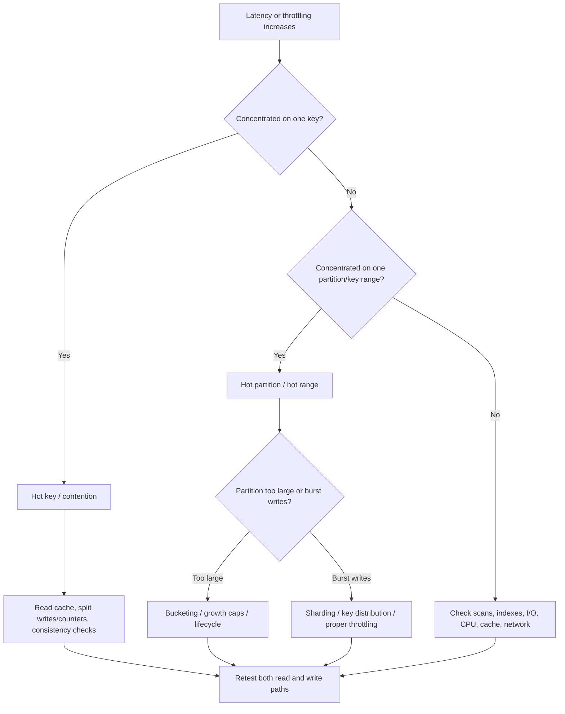

# Oversized Partitions, Hot Keys, and Skewed Data Distributions

## Learning Objectives

After this lesson, you will be able to:

- Distinguish **oversized/large partitions**, **hot keys**, **hot partitions**, and **data/load skew**.
- Explain why having many partitions, many servers, or a good hash function **does not automatically guarantee** even load distribution.
- Predict risks arising from **partition keys, sort keys, row sizes, write rates, retention windows, and per-tenant skew**.
- Choose suitable techniques such as **time bucketing, hashing, sharding, salting, value chunking, caching, and read/write separation** without breaking lookup capabilities.
- Design both the **write path and the read path** when changing a partition key: routing, multi-shard scans, ordered merging, pagination, and consistency protection.
- Measure and validate choices using p95/p99 distributions, top-key throughput, partition sizes, fan-out, and operational cost.
- Plan key/bucket/shard migrations without losing historical data or creating duplicates while multiple application versions run concurrently.

In **DATABASE_DATA_MODELING**, turning business requirements into a verifiable data model does not stop at entities, constraints, keys, and indexes: the physical schema must also **withstand real-world data distributions**. In the **Key–Value and Wide-Column** chapter, the partition key defines which data is co-accessed, and the sort/clustering key organizes data within that group. A design that looks fine on uniform demo data can turn into a bottleneck when one customer, device, product, or status absorbs most of the traffic.

> This lesson uses key–value and wide-column examples to analyze modeling decisions. Size limits, throughput thresholds, partition splitting, transactions, and TTL mechanics vary by product and version; never treat illustrative numbers as universal limits.

---

## 1. Four Phenomena to Keep Distinct

Terms like "large partition," "hot key," and "skew" are often used interchangeably, yet their root causes and fixes differ.

| Phenomenon | Symptom | Why It Happens | Metrics to Measure |
| --- | --- | --- | --- |
| **Oversized partition** | One partition holds huge row/byte/tombstone counts | Key groups only by a long-lived entity; data grows unboundedly | Rows/bytes per partition, read/compaction cost, scan duration |
| **Hot key** | One specific key receives excessive concurrent GET/PUT/updates | Traffic concentrates on a single ID such as `counter:global` | Per-key QPS and contention, retry/CAS failure counts |
| **Hot partition** | One logical partition or key range faces heavy read/write load | Many rows inside the same partition are read/written heavily | QPS, bytes/s, throttling, and latency per partition/range |
| **Skew** | A few tenants/entities account for most data or queries | "Heavy head, long tail" workloads; seasonality, viral items | Top-K contribution, p50/p95/p99, Gini/concentration ratio |

**A large partition is not always hot:** a partition holding years of rarely read archival data is huge yet sees low throughput. **A hot partition is not always large:** a `(shopId, status=PAID, hour)` partition might hold only a few thousand rows yet receive thousands of writes per second during a flash sale.

**A hot key is an even sharper concentration:** the exact same key is hammered continuously. In many engines, adding partitions for other keys does nothing to reduce contention on *that specific key*. Products with caching, read replicas, adaptive partitioning, or specialized splitting can mitigate certain cases; check actual product guarantees rather than assuming all hot keys face identical limits.

### 1.1. Logical Partitions vs. Physical Partitions

A logical partition in a Cassandra-style model might be identified by `(tenantId, deviceId, dayBucket)`. A range of rows resides in a physical tablet or shard managed by the engine depending on architecture. In ordered row-key stores like Bigtable/HBase, a **contiguous range of keys** can concentrate on one tablet/region even when there are many distinct row keys.

Therefore, always ask:

1. **Does the engine route by hash of partition key, by row-key range, or by another mechanism?**
2. **Which unit is split or rebalanced as the cluster scales?**
3. **Which unit carries throughput, size, latency, or transaction limits?**
4. **Does key ordering create sequential write hotspots at the start/end of a key range?**

Skipping these questions means a fix like "add a prefix" or "use a UUID" might help one engine while leaving the bottleneck untouched on another.

## 2. Running Example: Multi-Tenant Order Platform

A commerce platform serves shops of vastly different sizes:

- 90% of shops have under 100 orders/day.
- Some shops have tens of thousands of orders/day.
- The largest shop can experience sharp order spikes during sales campaigns.
- APIs need **each customer's 30 newest orders**, **pending orders per shop**, and **order details by ID**.
- Raw orders are retained for 3 years per policy; list tables may have different lifecycles.

Two initial layouts:

```text
A. All orders for a shop:
   partition = shopId
   sort      = (createdAt DESC, orderId)

B. History per customer:
   partition = (shopId, customerId, monthBucket)
   sort      = (createdAt DESC, orderId)
```

Option A looks convenient for a shop admin console, yet a massive shop creates **one giant partition** absorbing heavy writes. Option B spreads load by customer and time—great for "My Orders"—but **cannot directly answer "all PAID orders for this shop"** because the query lacks `customerId`.

The problem is not merely picking a key with higher cardinality. You must know **which access paths matter**, who owns the data, and how reads work once data is split.

### 2.1. Minimal Query Matrix

| Query | Inputs | Filter / Sort | Expected Load to Measure | Proposed Access Path |
| --- | --- | --- | --- | --- |
| Order details | `shopId, orderId` | Single order | GET/s and latency | `orders_by_id` |
| Customer's 30 newest orders | `shopId, customerId` | `createdAt DESC` | Reads/s, buckets touched | `orders_by_customer_bucket` |
| Shop's recent PAID orders | `shopId, status` | `statusChangedAt DESC` | Peak during flash sales | Status table + controlled bucketing/sharding |
| Daily revenue | `shopId, day` | Aggregate across orders | Batch/stream lag | Rollup / OLAP |
| Export all orders over 3 years | `shopId, timeRange` | Very large volume | Job duration, scan throughput | Background job, export, or analytical store |

**Each read path may need its own partition key.** A per-customer read model does not automatically serve a status dashboard. Adding read tables increases duplication and synchronization work; account for that upfront.

## 3. Why Hashing Does Not Automatically Cure Skew

Suppose an engine hashes the partition key to distribute data across storage regions. A good hash spreads **many distinct keys** fairly evenly when keys and access loads are balanced.

Now compare two workloads:

```text
Workload X:
  1,000,000 keys; ~1 request/minute per key

Workload Y:
  1,000,000 keys;
  one key receives 50,000 requests/second;
  remaining keys are barely touched
```

Both have the exact same key count. In Y, even if keys hash evenly across nodes, **traffic weight** piles onto one key. Randomly mapping one key to one partition cannot split the load of that single key.

Similarly, if `status` only has values `NEW`, `PAID`, `SHIPPED`, and `CANCELLED`, partitioning solely by `status` creates very few logical partitions. Even with millions of orders inside them, rows will not magically spread across millions of access groups.

### 3.1. Three Distributions to Track

- **Key cardinality:** How many distinct partition key values exist?
- **Data skew:** How many rows and bytes does each key/partition hold?
- **Access skew:** How many requests, bytes/s, conditional writes, and scans hit each key/partition?

**High cardinality is helpful but insufficient.** With 10,000 shops, if the biggest shop generates 70% of orders, partitioning solely by `shopId` still creates a severe hotspot.

### 3.2. Temporal Skew

Workloads shift by hour, day, season, and campaign:

- `dayBucket=today` typically absorbs far more writes than yesterday.
- A flash sale drives most views/orders onto a single SKU.
- Bulk imports or backfills can concentrate writes into a few historical buckets.
- Massive client retries after an outage can amplify load on the same hot keys.
- Synchronized cache expirations can drop a thundering herd of requests onto the backend.

Never treat a full-day average QPS snapshot as representative of a 30-second peak. Designs need **headroom** and strategies for sudden skew spikes.

## 4. Quantitative Estimation: Size, Rate, and Skew

A physical schema requires at least three estimates: **data inside one partition**, **traffic hitting one partition**, and **partitions read by a single query**.

### 4.1. Partition Size

For time-based append-only data:

\[
N_{\text{partition}}\ \approx\ r \times T
\]

\[
B_{\text{partition}}\ \approx\ N_{\text{partition}} \times S
\]

Where:

- `r`: average rows/second for **one partitioned entity/group**.
- `T`: seconds in one bucket.
- `S`: effective storage bytes per row (including an appropriate estimate for metadata/encoding).
- `N` and `B`: estimated row count and bytes in the partition.

Example: a hot device emits **2,000 readings/sec**. Assume each row occupies **500 effective storage bytes**:

```text
2,000 rows/sec × 86,400 sec/day
  = 172,800,000 rows/day

172,800,000 rows × 500 bytes
  = 86,400,000,000 bytes
  ≈ 86.4 GB/day (decimal)
```

For this device, a **daily bucket** is already massive even before counting replication, tombstones, compaction, and read demands. Switching to hourly buckets cuts expected rows/partition by 24×, yet **does not reduce instantaneous write rate**: current writes still pile into the current hour's bucket. If writes/sec per partition is the bottleneck, you also need spatial sharding or another distribution mechanism.

Many designs miss this: **time bucketing bounds growth; it does not inherently spread concurrent write load.**

### 4.2. Write and Read Rates

Estimate:

\[
W_{\text{hot-partition}} =
\max_{p \in P}\big(\text{writes/s into partition } p\big)
\]

\[
R_{\text{hot-key}} =
\max_{k \in K}\big(\text{reads/s to key } k\big)
\]

Track **bytes/s**, **requests/s**, and **contention/conditional-write failures**. Writing a 2 MB value incurs drastically different cost from writing 200 bytes, even though both count as 1 request.

Do not attach a single rule like "every partition must stay under X MB" to all products. Capacity depends on:

- Engine type and partitioning algorithm.
- Row size, blobs, cell counts, and indexing behavior.
- Operation type (cached read, conditional write, range scan, delete).
- Replication, consistency level, and underlying hardware.
- Actual split/auto-scaling/adaptive-capacity mechanics.

### 4.3. Measuring Skew with Top-K and Percentiles

A useful report looks beyond averages:

| Statistic | Meaning |
| --- | --- |
| Top 1 / Top 10 partitions by bytes | Finds oversized data groups |
| Top 1 / Top 10 keys by GET/PUT/s | Finds keys absorbing abnormal traffic |
| p50/p95/p99 bytes/partition | Shows the tail of the size distribution |
| p50/p95/p99 writes/s per active partition | Shows load distribution; note extreme outliers can sit beyond p99 |
| Share of total requests from top 1% keys | Quantifies concentration |
| Partitions with `T`/`S` exceeding internal thresholds | Tracks SLA breach risk |
| QPS and latency per tenant/feature | Identifies noisy-neighbor impact from one large tenant |

**Percentiles do not replace absolute maxima.** With only 100 partitions, p99 may not capture the hottest partition; always monitor actual top-K entities.

## 5. Diagnose the Root Cause Before Changing Keys

An API latency spike can come from CPU, network, cache misses, index lag, or storage internals—not necessarily an oversized partition. A structured diagnosis workflow:

1. **Break down by query:** GET by ID, partition query, range scan, status write, or counter update?
2. **Inspect key/partition distribution:** are a handful of IDs dominating?
3. **Separate reads from writes:** is read latency rising from scanning huge values, or are writes being throttled?
4. **Measure scale:** rows/bytes/partition, value sizes, tombstones, index entry counts.
5. **Check physical limits/placement:** hotspots per token range/tablet/shard, splits, caches, compaction, replication.
6. **Reproduce with realistic load:** top tenants, peak hours, retry bursts, backfills, cold vs. hot data.
7. **Only then** decide to change keys, buckets, shards, or query plans.



This flowchart guides investigation without ruling out multiple simultaneous causes. A partition that is both oversized and write-hot requires addressing both size and throughput.

## 6. Anti-Pattern 1: Overly Broad Tenant or Status Partitions

Operations table example:

```text
partition = (shopId, status)
sort      = (statusChangedAt DESC, orderId)
```

If a large shop accumulates millions of orders over several years across only a few statuses, each `(shopId, status)` partition grows huge and absorbs frequent updates. Transitioning an order from `PAID` to `SHIPPED` also requires deleting/marking the old entry and inserting the new one.

### 6.1. Fix with Time Buckets

One approach:

```text
partition = (shopId, status, dayBucket)
sort      = (statusChangedAt DESC, orderId ASC)
```

Illustrative CQL schema:

```sql
CREATE TABLE orders_by_status_day (
    shop_id            text,
    status             text,
    day_bucket         date,
    status_changed_at  timestamp,
    order_id           text,
    customer_id        text,
    total_minor        bigint,
    PRIMARY KEY (
        (shop_id, status, day_bucket),
        status_changed_at,
        order_id
    )
) WITH CLUSTERING ORDER BY (
    status_changed_at DESC,
    order_id ASC
);
```

Single-day query:

```sql
SELECT order_id, status_changed_at, customer_id, total_minor
FROM orders_by_status_day
WHERE shop_id = 'shop_17'
  AND status = 'PAID'
  AND day_bucket = '2026-11-22'
LIMIT 30;
```

Assuming **the table represents current status**: when an order leaves `PAID`, remove the PAID entry; recalculate `status_changed_at` and the bucket for the new entry. If the goal is **a full history of every transition**, maintain a separate event history table, since one order can enter the same status multiple times.

**Daily bucketing** bounds data per day, yet does not eliminate intra-day hotspots during massive sales events. In those cases, evaluate hourly buckets or sharding.

### 6.2. Querying Across Buckets

A dashboard needing the "30 newest PAID orders" across multiple days must:

1. Read today's bucket first.
2. If fewer than 30 rows are found, read prior days until 30 are gathered or the lookback cap is reached.
3. Merge rows by `(statusChangedAt DESC, orderId ASC)`.
4. Issue a cursor carrying bucket/position state for the next page.

Never scan unlimited buckets for one screen: cap days, rows, and processing time. With late-arriving data or status changes, live lists can shift across pages; document pagination semantics in the API contract.

## 7. Anti-Pattern 2: Time Bucketing Shrinks Partitions Without Spreading Current Writes

Consider a sensor table:

```text
partition = (tenantId, deviceId, dayBucket)
sort      = (observedAt DESC, measurementId)
```

Normal devices emit 1 reading/minute. A high-rate industrial device emits 2,000 readings/sec. Daily buckets work for normal devices yet grow huge for hot ones.

Switching to `hourBucket` narrows each partition's window:

```text
(tenant_7, device_12, 2026112210)
(tenant_7, device_12, 2026112211)
```

Yet at 10:30, virtually all live writes for device 12 still hit `2026112210`. If the bottleneck is a **write hotspot**, shrinking buckets lowers partition size without dispersing concurrent writes within the same hour.

### 7.1. Adding Controlled Shards

One option:

```text
partition = (tenantId, deviceId, hourBucket, shardId)
sort      = (observedAt DESC, measurementId)

shardId = stableHash(measurementId) mod 8
```

When IDs distribute evenly, readings spread across eight logical partitions per hour. However:

- The "100 latest readings for a device" API must read all shards and merge them.
- The store cannot serve a whole-device query by hitting just one shard.
- A 3-hour range query may need to read `3 × 8 = 24` logical partitions.
- Changing shard count from 8 to 16 alters the modulo mapping; you need versioning/routing for both old and new data.
- If duplicate events arrive with the same `measurementId` but different timestamps, the hash maps to the same shard, yet the **row key** differs; idempotency needs separate protection.

Only introduce sharding after measuring the bottleneck and designing the read path. **Optimizing writes in a way that turns reads into unbounded fan-out is a new design bug.**

### 7.2. What Should Determine the Shard?

| Sharding Basis | Fits When | Risks |
| --- | --- | --- |
| Hash of stable event ID | Event IDs distribute evenly and retries must hit the same shard | Direct lookup only if ID is known; time-range queries must fan out |
| Hash of sub-user / sub-device | Load arrives from many sub-sources and queries target sub-sources | One hot sub-source still concentrates load |
| Controlled round-robin / counter | Need to spread writes using a shard/sequence allocator | Retries must target the original shard; requires storing routing/idempotency |
| Random salt | Write path needs no deterministic attribute routing | Hard to read back a specific record directly without storing a mapping |

Depending on the system, decide whether a shard ID is part of **business identity**, a physical routing attribute, or index metadata. Never use random salting if an API only knows `orderId` and has no way to determine the shard.

## 8. Anti-Pattern 3: Single Value Holding Too Much Data or Suffering Write Contention

Not every hotspot happens in wide-column tables. Key–value stores can hit hotspots on **a single value**.

Examples:

```text
global-checkout-counter -> 105230912

cart:v1:shop_17:user_42 -> 5 MB JSON

popular-product:v1:sku_A17 -> metadata and stats
```

### 8.1. Global Counter

If every checkout runs "read counter, add 1, write back," two failures occur together:

- **Contended key:** excessive updates hitting one key.
- **Lost updates:** without atomic increments/CAS/transactions, concurrent requests overwrite each other.

One option is a sharded counter:

```text
checkout-count:v2:00 -> 120
checkout-count:v2:01 -> 113
...
checkout-count:v2:15 -> 128

total = sum(count from shards 00..15)
```

Each event must map to a shard and apply **at most once per idempotency rules** if the count must be exact. Summing across shards on read may not reflect an atomic snapshot; if a dashboard tolerates approximate counts, that is fine. If the count governs legal or financial caps, stronger guarantees or a different model are required.

**Never shard a counter without redefining correctness.** A fast counter that occasionally double-counts cannot replace audited revenue figures.

### 8.2. Large Values

A cart stuffed with tens of thousands of lines, activity history, and unbounded notes causes:

- Every GET transfers huge unneeded byte payloads.
- Every PUT/CAS reads, modifies, and rewrites the entire value.
- Multiple users editing the cart contend on a single key.
- Serialization and network latency spike; values risk hitting product size limits.

You can split **cart metadata** and **cart line items** across multiple keys/items keyed by `(cartId, itemId)` or use suitable native data types. When doing so, define how the cart renders consistently and how invariants—totals, valid items, non-negative quantities—are protected.

If carts are typically tiny and always read as a whole, splitting too early adds unnecessary request round trips. Choose boundaries from actual size distributions and update frequencies, not a dogma that "all JSON must be split."

### 8.3. Hot Reads Differ from Hot Writes

For a viral product key receiving hundreds of thousands of GET/s, **caches or read replicas** offload reads from the primary store if consistency policies allow. Yet caching does not fix a key hammered by continuous writes and CAS contention. Address each workload differently:

| Hot Workload | Measures to Consider | What Must Be Protected |
| --- | --- | --- |
| Heavy reads on one key | App-tier/CDN cache if appropriate, request coalescing, read replicas | TTL, invalidation, staleness, authorization |
| Frequent counter increments | Atomic increments, sharded counters, batching | Accuracy and idempotency |
| Many writers mutating JSON | Field-level atomic updates, bounded-retry CAS, split aggregates | Business invariants and lost updates |
| Huge rarely accessed key | Chunking, lifecycle segmentation, payload caps | Chunk identity, queries, deletion, and recovery |

## 9. Anti-Pattern 4: Sequential Writes to Monotonically Increasing Row Keys

Not every store partitions by hash. In engines with **lexicographically sorted row keys** split into ranges/tablets, monotonically increasing keys concentrate new writes onto the **trailing range**.

Row key example:

```text
event:20261122100000001
event:20261122100000002
event:20261122100000003
...
```

If the whole system appends to the end of the timeline, one tablet/range absorbs most write traffic at a given moment. Having many row keys does not distribute load when **consecutive keys land in the same range** until the engine splits and rebalances.

Options to evaluate per product:

- Prefix with a **source/tenant/device bucket** so distinct sources spread writes.
- Use a **hash/salt prefix** to scatter writes, trading off extra prefix fan-out for time-range scans.
- Consider **reversed timestamps** for latest-first reads, checking whether that truly distributes load or simply moves the hotspot to the start of the range.
- Leverage **pre-splitting/auto-splitting** per engine guidelines when workloads and key ranges are known.

**Never blindly apply "add a salt to row keys":** if queries need a time range for one device, salting can turn one range scan into dozens of scans. Salt cardinality and merge rules belong in the query contract.

## 10. Multi-Shard Reads: Fan-Out, Merging, and Cursors

Splitting a logical group across multiple shards forfeits "one partition returns the entire top N." You must design a **k-way merge** or suitable aggregation.

Suppose you need the shop's 20 newest PAID orders, and the daily status table has 8 shards:

```text
partition = (shopId, status, dayBucket, shardId)
sort      = (statusChangedAt DESC, orderId ASC)
```

### 10.1. K-Way Merge

A common approach:

1. Query each shard along the sort key, fetching an initial batch of candidates with per-shard paging state.
2. Compare the head elements across shards and pick the newest per the **total order**.
3. Append that item to results and advance the corresponding shard stream.
4. Repeat until 20 items are collected or all streams and lookback bounds are exhausted.
5. Encode a cursor retaining enough state so the next page neither duplicates nor skips items per contract.

Pseudocode:

```text
function topNFromShards(shopId, status, bucket, n, shardCount):
    streams = []

    for shard in 0..shardCount-1:
        streams.add(openPagedQuery(
            partition=(shopId, status, bucket, shard),
            order=(statusChangedAt DESC, orderId ASC)
        ))

    heap = maxHeap(compareBy(statusChangedAt DESC, orderId ASC))
    for stream in streams:
        if stream.hasNext():
            heap.push(stream.next(), stream)

    result = []
    while result.size < n and not heap.empty():
        item, stream = heap.pop()
        result.add(item)
        if stream.hasNext():
            heap.push(stream.next(), stream)

    return result, encodePagingState(streams, heap)
```

This is **conceptual pseudocode**, not an off-the-shelf cursor library. Production code must distinguish fetched vs. emitted items, track buffered heap candidates, per-shard page tokens, next buckets, fan-out limits, and retries. When using engine-provided paging state, never assume tokens remain valid across schema or filter changes.

### 10.2. Fan-Out Cost

Increasing shards from 1 to 8 can reduce per-partition write load when traffic spreads evenly, yet a top-N query now hits **8 partitions** for a single bucket. Over a 7-bucket range, that becomes **56 bucket–shard combinations** before optimizations or bounds.

Real-world payoff must be measured by:

- Requests/partitions touched and actual bytes read.
- p95/p99 latency under parallel queries and when one shard lags.
- Cursor size, connection pool usage, and deadlines.
- Rates of late data, duplicate IDs, and stale indexes.
- Shards scanned per useful item returned.

Sharding helps the **write path** while risking **read amplification**. Depending on workload, a small "latest summary" table for the UI paired with an append-only sharded table for full history may fit better—though a summary table introduces sync overhead and can itself become a hot key if poorly designed.

### 10.3. Ordering and Snapshots

Shards may return rows observed at slightly different points in time. Merging by timestamp gives a sensible order, yet **does not automatically provide snapshot consistency** under concurrent inserts/updates/deletes.

If exact point-in-time reports are required, use engine-supported snapshots/as-of queries or process offline at a closed cutoff. For live lists, document pagination behavior when rows mutate between page requests.

## 11. When to Use Cache, Indexes, Rollups, or Switch Models?

Not every hotspot should be fixed by sharding the primary table.

| Need / Symptom | Potentially Suitable Solution | Trade-Offs to Measure |
| --- | --- | --- |
| One key is read-hot | Cache with TTL/invalidation, request coalescing | Staleness and cache stampede risk |
| One counter is write-hot | Atomic counter, sharded counter, stream aggregation | Accuracy, read fan-out, idempotency |
| Time history growing huge | Time bucketing and retention limits | Multi-bucket range queries |
| Current bucket still write-hot | Add shards to spread writes or change ingest model | Merging, cursors, shard versioning |
| Sequential row keys heating one range | Distributed prefixes, engine pre-splitting | Extra range scans |
| Dashboard queries across whole tenant | Status/time read model, secondary index, or OLAP | Denormalization and sync overhead |
| Flexible queries across many attributes | Document/relational with indexes and optimizer | Index cost, joins, throughput |
| Multi-year metric aggregations | OLAP / warehouse / rollups | Data lag, reconciliation, pipeline cost |
| Multi-hop relationship traversal | Graph store if workload fits | Maintaining nodes/edges and source sync |

**Solving skew is an exercise in allocating cost across access paths**, not a contest to create the most partitions. In data modeling, changing a schema is only sound when results are both **business-correct** and **verifiable** under expected workloads.

## 12. Changing a Partition Key Changes Storage Identity

Moving from:

```text
v1: partition = (shopId, status, dayBucket)
```

to:

```text
v2: partition = (shopId, status, hourBucket, shardId)
```

cannot be done simply by updating a hash formula in code and assuming old records teleport to new keys. This is a **physical schema and data-routing change**.

### 12.1. Controlled Migration Steps

1. **Define the new key contract:** which timestamp defines buckets, hash/shard ID formula, shard count, encoding, version, and uniqueness scope.
2. **Prepare compatible read paths:** know whether data lives in v1 or v2, or query both and deduplicate.
3. **Select source of truth and cutoff:** backfill from the authoritative source using checkpoints/versions so concurrent updates during backfill are not missed.
4. **Catch up on the change stream:** idempotent consumers with out-of-order protection so stale snapshots never overwrite newer state.
5. **Reconcile:** compare business keys, versions, and critical fields; matching row counts alone is insufficient.
6. **Shift traffic gradually:** monitor p95/p99, hot partitions, bytes, cursor errors, divergence, and fan-out cost.
7. **Retire the old path conditionally:** delete v1 data only once every consumer uses v2, required history has migrated, and rollback rules are clear.


If using dual-writes, handle partial failures between branches; two `PUT` calls to two keys generally do not form a transaction. With outbox/CDC, establish log/snapshot checkpoints and preserve replayability.

### 12.2. Changing Shard Count Is Not Simply Changing a Modulo Constant

Routing by:

```text
shard = hash(orderId) mod 8
```

differs from:

```text
shard = hash(orderId) mod 16
```

For most order IDs, the assigned shard changes. When expanding shard counts, you can:

- Maintain **routing versions** by time bucket or cutoff; read older buckets with mod 8 and newer buckets with mod 16.
- Store a metadata table recording the active routing scheme per bucket.
- Backfill into the new scheme while running deduplicated dual-reads during transition.

Never guess old records' shards using the new shard count. When business records change storage keys, preserve idempotency and ensure identity does not rely solely on physical placement.

## 13. Consistency, TTLs, and Drift Under Distribution

A sharded read model may contain logical copies or indexes updated asynchronously from the primary source. Your design must prevent data loss, duplicates, and stale entries.

### 13.1. Duplicate and Out-of-Order Events

Order example:

```text
orderId = ord_908
v7: PAID
v8: SHIPPED
```

If v8 arrives before v7 and the projection applies v7 last, the status table reverts to PAID even though the order is SHIPPED. Moving entries across different shards/partitions can also leave an order temporarily visible in both groups or in neither on partial failure.

Required safeguards:

- Per-order monotonically increasing `orderVersion` and authoritative source.
- Checkpoints/projection state with race-safe version updates.
- Safely replayable insert/delete operations.
- Re-reading source snapshots or reconciling when events are missing or stale.
- Documented lag tolerances and source re-checks before sensitive actions.

**Sharding does not provide cross-partition atomicity.** In fact, it can move an update that once lived in one partition across multiple partitions, making consistency harder.

### 13.2. TTLs, Deletions, and Tombstones

If data is kept 90 days, daily buckets align well with lifecycle management. Yet beware:

- TTL measured from **write time** can diverge from `eventTime + 90 days`, especially for late arrivals.
- TTL expirations and deletes create **tombstones** in some engines, degrading reads and compaction when deletion volume is high.
- Indexes/locators/read models may require their own deletion rules; source TTLs do not automatically propagate everywhere.
- Backups, snapshots, and replicas reclaim physical bytes differently; TTL expiration does not mean instant physical erasure everywhere.
- New shards must never "resurrect" deleted records via old stream replays; enforce tombstones/versions and rebuild policies.

For personal data, include every performance replica within the scope of access control, erasure, logging, and auditing.

### 13.3. Never Use Sort Keys as a Security Mechanism

Some schemas embed `tenantId` in keys. That aids grouping, yet **does not enforce authorization**. APIs must extract tenant scope from trusted auth context, verify permissions, and validate queries/cursors. Sharding or key refactoring must never introduce shortcuts allowing callers to guess another tenant's keys.

## 14. A Repeatable Decision Workflow

When diagnosing a problematic table or key, walk through these steps in order:

1. **Define the query contract:** inputs, outputs, ordering, limits, SLAs, freshness, and permissions.
2. **Measure scale and skew:** rows/bytes, QPS per key/partition, p95/p99 and top-K, temporal peaks.
3. **Classify the bottleneck:** oversized partition, hot key, hot range, broad scan, contention, compaction, or cache miss.
4. **Predict each option's effect:** buckets bound data over time; shards spread writes; caches offload reads; indexes serve alternate lookups.
5. **Design the post-change read path:** partition lookup from inputs, fan-out, merge, cursors, and limits.
6. **Protect invariants:** uniqueness, valid state, idempotency, concurrency, deletions, TTLs, and tenant isolation.
7. **Plan migration:** routing versions, backfills, streaming catch-up, reconciliation, rollback, and cutover.
8. **Test under skewed load:** not just uniform traffic, but massive tenants, one scorching hot key, retry bursts, and long ranges.
9. **Monitor post-launch:** top partitions, p99, throttling, lag, and threshold alerts.

### 14.1. Quick Decision Matrix

| If the main bottleneck is… | Prioritize Evaluating | Must Also Verify |
| --- | --- | --- |
| Too many bytes in a historical partition | Time bucketing, retention caps, domain splits | Historical read fan-out and TTLs |
| Write overload on the current bucket | Sharding by stable ID, write load distribution | Top-N merging, retries, shard count |
| Heavy GETs on a single hot item | Cache / read replicas / request coalescing | TTL, staleness, cache stampedes |
| Contended updates on one counter | Native atomic ops, sharded counters | Idempotency, non-atomic cross-shard sums |
| Sequential row keys heating one range | Distributed prefixes / engine pre-splits | Range scan and time-query support |
| Query missing partition key | Read model/index or switch storage model | Sync, scan/filter cost, write overhead |
| Broad analytical aggregations | OLAP / rollups | Freshness lag and reconciliation |

## 15. Test Suite for Oversized Partitions, Hotspots, and Skew

A data model must be validated across skewed distributions, not just total record counts.

| Scenario | What Must Be Proven |
| --- | --- |
| Balanced multi-tenant load | Partitions spread per engine traits; SLAs met |
| 1 tenant produces 70% of traffic | Other tenants remain protected within acceptable impact; resource guards hold |
| 1 key gets 1,000× average GETs | Caching/read path keeps p99 within target |
| 1 key under heavy concurrent writes | Zero lost updates; contention uses bounded retries/caps |
| Device emits 2,000 events/sec for 1 hour | Bucket/shard size and write throughput stay within targets |
| Read 100 latest events across shards | Exact ordering, zero drops on colliding timestamps |
| Query spanning 30 buckets | Fan-out, rows read, and latency remain bounded |
| Late event crossing midnight | Routed to the right bucket per contract and discoverable by queries |
| Retried request with same `measurementId` | Zero business duplication despite retries |
| Transition from 8 shards to 16 shards | Old data reads cleanly, new data routes accurately; mixed cursors work |
| Delete/TTL expiration + old event replay | Policy-deleted records never reappear |
| Mid-flight status projection failure | Reconciliation restores exact entries |
| Cross-tenant query attempt | Blocked from accessing other tenants via keys or cursors |
| Simultaneous cache expiration | Backend protected from request stampedes |
| Backfill burst writes | Online queries remain within SLA |

### 15.1. Evaluation Metrics

- **Data distribution:** bytes/partition and rows/partition across p50/p95/p99/top-K.
- **Load:** reads/s, writes/s, bytes/s by key, partition, tenant, and time.
- **Latency:** p50/p95/p99 by query, key region, and partition size.
- **Contention/Throttling:** throttling rates, queue depths, retries, CAS conflicts, cache misses.
- **Post-sharding reads:** shards/buckets per request, bytes read per returned item, empty-page rates.
- **Correctness:** duplicate IDs, missing index entries, projection lag, divergence, expired rows still served.
- **Cost:** write amplification, read amplification, index storage, backfill and compaction overhead.

Compare **before and after** on the exact same workload and key distribution; re-verify the design whenever data scales or read flows change.

## 16. Practice Exercises

### Exercise A — Is a Daily Bucket Enough?

A device averages 5 readings/sec, yet peaks at 2,000 readings/sec for several hours. Each row takes ~500 bytes. The table partitions by `(tenantId, deviceId, dayBucket)`.

**Question:** Why can sizing buckets from averages fail? What does switching from daily to hourly buckets solve, and what does it fail to solve?

**Hint:** Use peak rates to estimate bytes/partition and writes/sec; hourly buckets shrink partition size, yet current writes still pile into the active hour bucket. If write hotspots remain, evaluate sharding or a different ingest design while measuring read fan-out.

### Exercise B — Global Counter

A system stores `daily-checkout-count:20261122` and every order runs read–increment–write. Thousands of checkouts happen concurrently.

**Question:** Identify two distinct bugs and choose a mechanism to preserve accuracy.

**Hint:** Hot key contention causes bottlenecks, while unconditional read–modify–write causes lost updates. Evaluate native atomic increments or sharded counters with transaction-ID idempotency; if an exact point-in-time total is required, use an authoritative transaction/event log with strict aggregation.

### Exercise C — Overheated Status Table

A table uses partition `(shopId, status)` and clustering `(createdAt DESC, orderId)`. During a flash sale, one shop floods writes into `status=PAID`.

**Question:** Propose a v2 design and trace the "30 newest PAID orders" query flow.

**Hint:** Add `dayBucket`, and add `shardId` only if measurements show the bucket still runs hot. Queries must read all shards of the latest day, merge in sort order, and step backward across buckets if fewer than 30 rows are found; status transitions must remove old entries and update the new table idempotently.

### Exercise D — Monotonically Increasing Row Keys

In a range-partitioned store, all events use ascending UTC timestamp row keys and writes bottleneck on the last range.

**Question:** Why does having many distinct keys fail to spread load? How does adding a hash prefix affect time-range queries?

**Hint:** Consecutive keys sit adjacent in byte order on the same range/tablet. Distributed prefixes can spread writes, yet time-range queries must scan multiple prefixes and merge results. Check region/tablet split mechanics and engine limits.

### Exercise E — Migrating Shard Counts

Version 1 used `hash(orderId) mod 4`; v2 wants `mod 16`. A v1 worker is still writing while the new API reads v2.

**Question:** Why does merely changing 4 to 16 break lookups for existing data? Design a safe migration plan.

**Hint:** The shard mapping changes for most IDs. Version routing by bucket/cutoff, use deduplicated dual-reads, run checkpointed backfills, capture ongoing stream updates without gaps, reconcile, and retire v1 only when everything safely reads v2.

### Exercise F — Picking the Right Technology

An application simultaneously needs: (1) top 20 popular products by view count, (2) inventory updates with strong invariants, (3) free-text search over notes, and (4) multi-year revenue reports.

**Question:** Should all four be solved by sharding a single wide-column table?

**Hint:** No. Caches/read models serve popular items; inventory requires appropriate transactional guarantees; a search index handles text; OLAP/rollups serve analytics. Specify authoritative sources and sync mechanisms for each path.

## Summary

**Oversized partitions**, **hot keys**, **hot partitions**, and **data skew** are distinct problems. They can occur together yet call for different remedies: bucketing bounds growth over time; sharding/key distribution spreads writes when engine routing supports it; caching absorbs repeated reads; indexes and read models serve queries lacking the primary key.

Every partition-key change must co-design **read paths, sort ordering, cursors, fan-out cost, correctness invariants, and migration plans**. A schema that looks balanced on paper yet forces reading thousands of partitions for 20 rows—or breaks idempotency on retries—is not a sound design.

The final question to answer is: **"How large or hot can a partition/key get in extreme cases; how does the DBMS physically distribute it; does splitting make queries harder; and which metrics verify both performance and business invariants?"**
