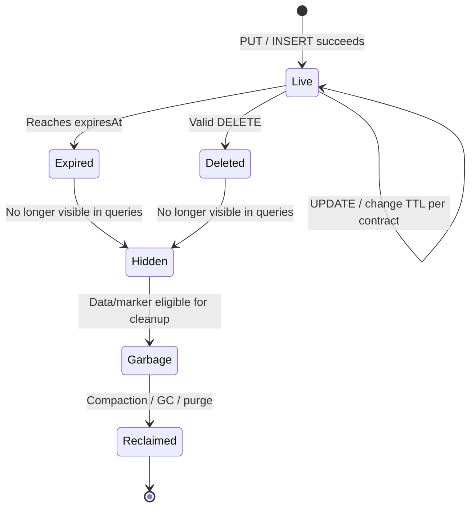
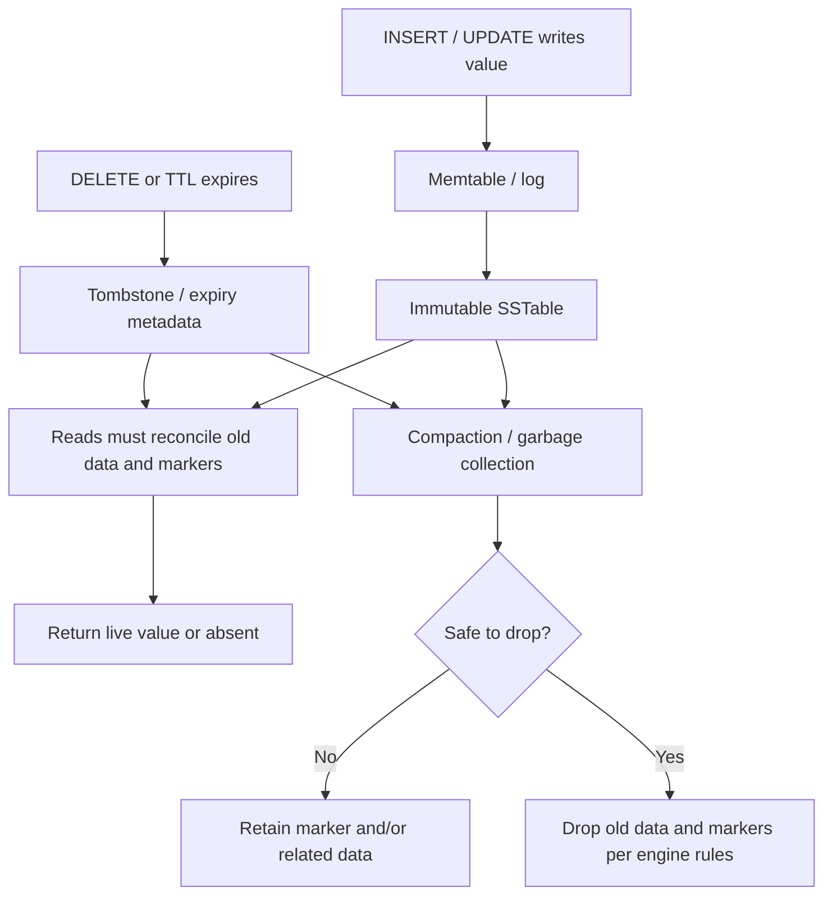
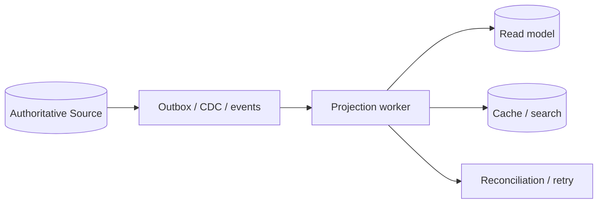

# Time-to-Live, Data Deletion, and the Meaning of Tombstones

## Learning Objectives

After this lesson, you will be able to:

- Distinguish **time-to-live (TTL)**, **expiration timestamp**, **retention policy**, **logical delete**, and **physical purge**.
- Explain why a `DELETE` command or an expired TTL **does not automatically mean** all replicas, storage files, indexes, and backups lose the data immediately.
- Understand **tombstones** as deletion/expiration markers used by certain engines—especially distributed systems built on **LSM trees**—and describe their role in replica reconciliation.
- Describe how tombstones affect reads, writes, compaction, anti-entropy repair, and the risk of **deleted data resurrecting** if deletion evidence is dropped too early.
- Design TTLs around **business event time**, especially for late-arriving events, multi-column records, and update-renewal rules.
- Analyze the lifecycles of **primary tables, secondary indexes, read models, caches, event logs, snapshots, and backups** when an entity expires or must be deleted.
- Propose test suites and monitoring metrics to verify expiration timing, tombstone counts, read costs, consistency, and data cleanup.

In **DATABASE_DATA_MODELING**, learners turn business requirements into data models with clear entities, relationships, constraints, keys, indexes, and physical schemas. In the **Key–Value and Wide-Column** chapter, picking partition keys and clustering keys only solves **how to find data**. A design must also answer: **"How long does data live, who is authorized to delete it, what does a deletion command mean, and how do we ensure deleted data never comes back?"**

A system can read blazingly fast by key and still fail requirements if TTLs get silently refreshed, indexes keep pointing to deleted records, or tombstones severely degrade historical queries.

---

## 1. From a Retention Requirement to a Lifecycle Contract

Suppose a sensor monitoring platform handles three kinds of data:

1. **Raw readings:** only needed on operations screens for 30 days from **actual measurement time**.
2. **Safety alerts:** must be retained at least 365 days from alert creation per business policy.
3. **Daily rollups:** serve long-term reporting and do not necessarily share the raw data's lifecycle.

A sample reading record:

```json
{
  "tenantId": "tenant_7",
  "deviceId": "device_12",
  "measurementId": "m_103",
  "observedAt": "2026-11-21T10:05:00Z",
  "receivedAt": "2026-11-22T02:10:00Z",
  "temperatureC": 26.3,
  "quality": "OK"
}
```

If a write simply passes "TTL = 30 days" measured from **ingest time**, the record stays until Dec 22 instead of Dec 21. For data backfilled 15 days late, the drift is even larger. Therefore, a requirement like "retain 30 days" must be translated into an explicit contract:

| Contract Item | Example Answer |
| --- | --- |
| Which object? | A raw device reading record |
| Clock start point? | Validated/accepted `observedAt` |
| Expiration timestamp? | `observedAt + 30 × 24 hours` per fixed rule |
| What happens at expiration? | API no longer returns the record as live data |
| When is it physically purged? | Per storage engine cleanup mechanics and operational policy |
| Which copies are involved? | Locator table, per-device read models, caches, object storage, backups |
| Late-arriving data? | If `expiresAt <= now`, reject from raw operational store or route to a dedicated path |
| Exceptions? | Retain longer under approved legal hold or investigation requests |
| Who can modify/delete? | Authorized services scoped by tenant and policy |
| How to verify? | Boundary tests at expiration, cleanup lag telemetry, and replica reconciliation |

**TTL is a policy-enforcement mechanism; a raw TTL number alone is not a complete retention policy.**

## 2. Distinguishing Deletion and Expiration Concepts

| Term | Design Meaning | What **Not** to Infer Automatically |
| --- | --- | --- |
| **TTL (time-to-live)** | Duration a value/cell/item stays valid after an engine-defined reference point | Not always measured from business `createdAt` |
| **Expiration / expiresAt** | Timestamp after which a record is no longer considered live | Does not mean bytes have vanished from every disk |
| **Retention policy** | Business/legal rule governing how long and in what scope data is kept | Not merely a single DB TTL setting |
| **Logical delete** | Record hidden from queries or flagged `deleted` | Does not prove physical erasure |
| **Tombstone** | Deletion marker/proof used by certain engines to distinguish deleted data from never-written data | Not every key–value engine represents deletes the same way |
| **Physical purge** | Old data removed from storage structures by engine processes | Does not guarantee backups/snapshots/other replicas are cleared |
| **Compaction** | Merging/reorganizing storage files, potentially dropping obsolete data | Not every compaction run can drop tombstones |
| **Anti-entropy / repair** | Synchronizing replicas to fix divergence | Does not happen automatically unless configured/run per product |

Example of reading after expiration:

```text
Time T0: PUT(key, value, ttl=3600s)
T0 + 30 minutes: GET(key) -> value
T0 + 61 minutes: GET(key) -> absent / expired per API
T0 + 61 minutes: physical bytes may still remain in storage structures
T0 + hours/days: engine gets opportunities to clean up or compact
```

A `GET` returning absent only proves **current read semantics**, not that physical deletion has completed everywhere.

### 2.1. Explicit Deletion vs. Automatic Expiration

**Explicit deletion:** the application processes an intentional delete/cancel command, potentially checking permissions and version preconditions.

**Automatic expiration:** the storage engine detects an aged-out value by TTL or expiration timestamp; enforcement may happen lazily on read or via background sweeps depending on the product.

Both paths can produce the same "record not readable" result, yet differ in:

- Timing and cause.
- Event/CDC emission behavior.
- Remaining-TTL calculation.
- Retention of deletion proofs.
- Auditing, recovery, and secondary-copy cleanup requirements.

Never assume "TTL expiration emits the exact same events as `DELETE`" unless the product explicitly guarantees it.

## 3. Which States Does a Record Pass Through?

Conceptual lifecycle diagram:



This diagram separates **application-visible states** from **physical cleanup steps**. Not every product exposes every internal state, and transitions do not necessarily happen simultaneously.

### 3.1. "Not Found" Has Multiple Causes

When `GET(key)` returns nothing, at least five possibilities exist:

1. The key never existed.
2. The key's TTL expired.
3. A `DELETE` occurred.
4. The record exists on another replica/region and is not yet visible under the read's consistency level.
5. The application queried the wrong key version, tenant, or partition.

From a business standpoint, **do not lump all cases together** when auditing or resolving disputes. If the reason matters, record explicit metadata/status in an authoritative store rather than trying to guess from `GET -> absent`.

### 3.2. Not Every Record Should Have a TTL

| Data Type | Lifecycle Approach |
| --- | --- |
| Temporary session | Session-policy TTL; optionally refreshed on valid activity |
| One-time auth token | Short expiration, consumed atomically where appropriate, never logged |
| Derived cache | TTL/invalidation matching staleness tolerance |
| Raw sensor readings | Retention by event time or ingest time under explicit contract |
| Source-of-truth replay events | Never set a TTL shorter than required replay/backfill horizons |
| Financial transactions | Follow statutory retention, audit, and policy rules; never purge casually via TTL |
| Search indexes | Synchronize lifecycle with primary source and handle orphan entries |
| Privacy erasure data | Auditable deletion workflow covering replicas, backups, and legal hold exceptions |

## 4. TTL per Key, Item, Row, or Cell?

What "record TTL" means varies by storage model.

### 4.1. In Simple Key–Value Stores

A key–value store may manage expiration at the **key** level:

```text
key = session:v1:session_812
value = {userId: "user_42", scopes: ["read"], ...}
TTL = 1,800 seconds
```

Upon expiration, `GET` stops returning the value. If you `SET` the key again, some products clear the old TTL or apply a new one depending on the command and options. **Never assume an update preserves existing TTL.**

Verify:

- Does overwriting a key preserve the previous expiration timestamp?
- Is there an API to inspect remaining TTL? Is precision in seconds or milliseconds?
- Is TTL anchored to write time, access time, or an absolute timestamp?
- When counter increments or hash edits run, does TTL reset?
- Does deleting a key leave a persistent marker or simply drop an entry per engine design?

### 4.2. In Wide-Column Databases

Some Cassandra-style engines apply TTL at the **cell/column-value** level; a write sets TTL on the written columns. That leads to scenarios like:

```text
Row: reading(device_12, observedAt=t1, measurementId=m1)

temperature_c -> TTL 30 days
quality       -> TTL 30 days
note          -> No TTL / different TTL
```

After 30 days, `temperature_c` and `quality` can expire while `note` remains; never assume **the entire row** disappears if columns carry different lifecycles.

Illustrative CQL write example:

```sql
INSERT INTO readings_by_device_day (
    tenant_id, device_id, day_bucket,
    observed_at, measurement_id,
    temperature_c, quality
) VALUES (
    'tenant_7', 'device_12', '20261122',
    '2026-11-22T10:05:00+0000', 103,
    26.3, 'OK'
) USING TTL 2592000;
```

`2,592,000` seconds equals 30 × 24 hours. This syntax is CQL-illustrative; verify exact key models, TTL support, column scope, and value limits in your **target product and version**. Primary key columns typically do not behave as independent TTL-expiring payloads the same way regular cells do.

### 4.3. TTL Scope Comparison Table

| Scope | Benefits | Risks to Address |
| --- | --- | --- |
| Key-level TTL | Simple for sessions, caches, small objects | Rewriting key can alter TTL; no per-field expiration |
| Item/document-level TTL | Easy to track single-entity lifecycle | Engine may sweep asynchronously in background; indexes/caches must sync |
| Row/cell-level TTL | Flexible for wide-column and sparse data | Rows can survive with **partial columns**; tombstones and repair are trickier |
| Bucket/partition lifecycle via custom jobs | Optimizes lifecycle of whole data groups | Not all engines drop partitions/ranges cheaply; range deletes can create huge tombstones |

Never just write "TTL = 30 days" in a design doc; specify **the unit of application** and what happens if part of a record expires before the rest.

## 5. Business Time Differs from Write Time

TTL design requires an **authoritative clock/time context**.

For raw readings, the policy is keeping data 30 days past observation:

\[
\text{expiresAt} = \text{observedAt} + 30 \times 24\text{ hours}
\]

At write time:

\[
\text{ttlRemaining} = \max(0,\ \text{expiresAt} - \text{now})
\]

If an event was measured at 10:00 on Nov 1 yet ingested at 10:00 on Nov 16, remaining TTL is ~15 days, not 30 days.

Pseudocode:

```text
function storeMeasurement(event, now):
    validateTenantAndDevice(event)
    validateEventId(event.measurementId)
    validateObservedAt(event.observedAt)

    expiresAt = event.observedAt + Duration.ofDays(30)
    remaining = expiresAt - now

    if remaining <= 0:
        handleAlreadyExpiredMeasurement(event)
        return

    ttlSeconds = roundDownToSupportedSeconds(remaining)
    if ttlSeconds <= 0:
        handleAlreadyExpiredMeasurement(event)
        return

    writeWithTtl(event, ttlSeconds)
```

Rounding behavior, clock skew, maximum TTL caps, and absolute-timestamp support depend on the engine. If the business strictly forbids **returning data past the deadline** even when background sweeps lag, check `expiresAt` on read or filter queries to valid windows.

### 5.1. Is "30 Days" 720 Hours or 30 Calendar Days?

Two interpretations can diverge:

- **30 × 24 hours:** adding a fixed `Duration` to an instant.
- **30 calendar days in a time zone:** adding local calendar days; DST transitions create 23-hour or 25-hour days.

Never alternate between the two definitions across services. For operational instant-based telemetry, pick one consistent calculation and state it clearly. If retention follows statutory calendar days in a specific jurisdiction, store the time zone/calendar rule and test DST boundaries.

### 5.2. Device Clocks May Be Untrustworthy

A misconfigured device clock can send `observedAt` in the far future—extending retention improperly—or in the distant past—causing immediate drop. Define rules for:

- Maximum accepted future clock skew.
- Whether timestamps may be corrected at an authoritative ingest boundary.
- Storing `observedAt` and `receivedAt` separately for auditing and lag metrics.
- Routing excessively late data to an inspection store.
- Moving partitions/keys and updating TTLs when correcting timestamps.

Never substitute `receivedAt` for `observedAt` just to make setting TTLs easier if that alters the business meaning of retention.

## 6. Should Updates Refresh TTL?

Consider a user session that expires after **30 minutes of inactivity**. That is **sliding expiration**, where valid user activity pushes out the deadline.

Conversely, an email verification token valid for **15 minutes from issuance**—no matter how often it is read—uses **absolute expiration**.

| Policy | Example | Does Update/Read Refresh? |
| --- | --- | --- |
| **Absolute TTL** | Token issued at T0, expires at T0+15m | No, unless a new token is explicitly issued |
| **Sliding TTL** | Session expires after 30m idle | Refreshes only on authenticated activity events per contract |
| **Fixed business deadline** | Inventory hold until 10:15 | Does not auto-extend when metadata is edited |
| **Retention from event time** | Reading kept 30 days from `observedAt` | Rewriting payload must never accidentally reset age |
| **Cache freshness TTL** | Cached copy allowed to be 60s stale | Refreshed per cache/invalidation rules |

### 6.1. Silent Refresh Bug

A background worker updates `quality` on an older reading and writes it back with `TTL = 30 days` from the update time. A record nearly due for expiration stays alive for another 30 days in violation of policy.

Proper fixes depending on business rules:

- Store `expiresAt` or stable lifecycle metadata.
- On updates, compute remaining TTL toward the **same fixed deadline**.
- Use TTL-preserving update commands if supported by the engine and allowed by contract.
- If an edit legitimately extends retention, treat it as an **explicit business decision**, not a side effect of `PUT`.

### 6.2. Concurrent Update Boundaries

If one client extends a session while another worker deletes it on logout, define which wins. An unconditional `GET` followed by `SET` can **resurrect a logged-out session**.

Use CAS/version/conditional updates or non-reusable session IDs so stale requests cannot recreate deleted sessions. TTL alone never prevents delete-vs-write races.

## 7. What Is a Tombstone and Why Does It Exist?

In certain wide-column or key–value engines built on **log-structured merge trees (LSM)**, writes go first to append-friendly structures and later merge into immutable data files. When deleting a record, the engine may **not immediately edit every older file** in place to scrub bytes.

Instead, it writes a **tombstone**: a marker recording "this value was deleted" along with system version/timestamp metadata. During reads or compaction, the marker tells the engine that older data is no longer valid.

```text
Before delete:
  Old SSTable: key=A -> value=V1

After DELETE(A):
  New Memtable / SSTable: key=A -> TOMBSTONE(T2)
  Old SSTable:            key=A -> value=V1(T1)

With resolution rule T2 newer than T1:
  GET(A) -> absent
```

**A tombstone is not a business-level `"deleted"` JSON field that the app always stores manually.** It is typically engine-level deletion metadata with specific scopes and mechanics. An application field `isDeleted=true` is a *soft-delete flag*, which **does not replace** engine-level deletes or replica synchronization.

### 7.1. Lifecycle in LSM-Style Engines



Exact steps vary across DBMSs. Many key–value engines do not use tombstones in Cassandra's exact sense; some use MVCC, version markers, background GC, or scheduled item sweeps.

### 7.2. Tombstone Scopes

Depending on the product, deletes can target:

- **One cell/column:** clears one attribute from a row.
- **One row:** clears values belonging to a row key.
- **One partition:** clears an entire partition key's row group.
- **A key range:** deletes a clustering/range slice, potentially creating a range tombstone.
- **One key or item:** removes an entire logical entry in a key–value store.

Keep tombstone scope explicit. Deleting `quality` does not necessarily delete `temperature_c`; deleting a whole partition hides a wide swath of rows and carries its own cleanup cost.

## 8. Tombstones and Consistency Across Replicas

Tombstones become especially critical when data is **replicated**.

Consider three replicas A, B, and C holding the same key:

```text
T1: A, B, and C all hold value=PAID
T2: B loses connectivity
T3: application issues DELETE; A and C write a new tombstone
T4: B reconnects still holding old value=PAID
```

If the system lacked proof that `PAID` was deleted, synchronization could mistake B's stale copy for live data and **resurrect the deleted record**.

A tombstone carrying reconciliation metadata newer than the old record lets replicas conclude: "this key wasn't merely missing; it was deleted after that old value was written."

### 8.1. Why Can't Tombstones Be Dropped Immediately When GET Returns Absent?

Suppose A and C drop their tombstones after 5 minutes while B was offline for 2 days. When B returns without any deletion marker left to reconcile against, its old data can propagate back to other replicas under the engine's anti-entropy rules.

This is the **zombie data** hazard: deleted records rising from stale replicas.

To purge safely, the system must ensure older versions predating the marker **can no longer resurrect** via lagging replicas, snapshots/sync streams, or storage files under reconciliation.

### 8.2. Tombstone Retention Windows and Repair

In Cassandra-style systems, settings like **`gc_grace_seconds`** govern how long tombstones are retained so replicas have time to synchronize deletes. Never draw three false conclusions:

- "Waiting past `gc_grace_seconds` guarantees tombstones are gone."
- "After `gc_grace_seconds`, deleted data can never resurrect."
- "Setting `gc_grace_seconds=0` is always better because it cuts tombstones."

Tombstone purging also depends on **compaction, presence of older data, repair execution, and engine internals**. If a replica stays down too long or misses repair before markers drop, stale data can reappear in the exact failure modes product docs warn against.

**Operational rule:** configure tombstone grace periods, repair schedules, maximum replica downtime, and recovery procedures **using exact product/version documentation**. Never slash grace periods solely to "optimize tombstone counts" without proving safety conditions.

### 8.3. Timestamps and Operation Ordering

Some engines resolve conflicts using timestamps or versions. That makes **writer clocks** and timestamp generation critical. If a write carries a "future" timestamp due to clock skew, a subsequent tombstone with a lower timestamp may fail to win under conflict resolution.

Define explicitly:

- Does the client assign timestamps or does the engine generate them?
- Which write order or version resolves conflicts?
- Is re-inserting the same key after a `DELETE` permitted?
- Which CAS, version, or conditional checks protect edits and deletes?

Never confuse **device measurement timestamps** with **system write-reconciliation timestamps**. The two serve completely different purposes.

## 9. How Does TTL Expiration Relate to Tombstones?

In several LSM/wide-column engines, TTL-expired values **become invalid** over time, and expiration metadata can behave much like tombstones to shadow older data during reconciliation and compaction.

Operational consequences:

- Very short TTLs under massive write rates generate huge volumes of expired entries and deletion metadata to process.
- Expired data may **stop appearing in queries** while still consuming read/disk resources until cleaned up.
- If columns in one row have differing TTLs, queries encounter sparse rows full of expired cells.
- Scanning partitions packed with tombstones incurs reconciliation overhead, spikes latency, or trips engine safety thresholds.

Still, **not every TTL implementation creates tombstones identically**. Some services track item TTLs and delete asynchronously in the background; some version cells and run GC; simple key–value stores return absent upon expiry and reclaim space via separate engine sweeps.

Say "TTL expiration can leave deletion overhead and cleanup costs" rather than "every TTL in every DB creates a Cassandra tombstone."

## 10. Physical Purge, Compaction, and Read Cost

Why doesn't an engine simply erase deleted records and tombstones from every file immediately?

In immutable storage files, multiple versions of the same key can span different tiers/files. Compaction can only drop older versions once safety conditions hold; if an older copy might still be read from another file or replica, dropping the marker prematurely is unsafe.

### 10.1. One Read May Wade Through Lots of "Dead Data"

Suppose a device partition holds 100,000 rows, of which only 500 remain live. A query asks for `LIMIT 100` live rows, yet thousands of expired/deleted cells sit interspersed along the scan range.

```text
Read 1,000 entries in range:
  900 expired/deleted
  100 live
Return to client:
  100 live
```

Here, `LIMIT 100` does not mean the engine inspected only 100 entries. Actual work depends on file layout, internal indexes, bloom filters, compaction state, and read paths.

This is **read amplification from dead data/tombstones**, inflating CPU, I/O, and latency. Many engines expose warnings, hard caps, or metrics for tombstones scanned per query.

### 10.2. Compaction Is Not a "Clean Now" Button

Compaction can:

- Merge multiple files and versions.
- Discard obsolete versions no longer needed for reads.
- Drop tombstones **when** safety conditions and affected file scopes permit.
- Consume significant I/O and CPU while running, impacting live requests.
- Temporarily require extra disk space while writing merged files.

Never trigger blanket manual compactions in production just because tombstones look high. Evaluate compaction strategy, affected key ranges/files, safety prerequisites, available I/O headroom, and engine operational guidance.

### 10.3. Monitoring Signals

| Metric | Meaning |
| --- | --- |
| Tombstones scanned/read per query | How many deletion markers a query traverses |
| Live rows returned vs. rows examined | Reading many rows to return few signals read amplification |
| SSTable count/overlap (where applicable) | Version fragmentation requiring multi-file reconciliation |
| Compaction backlog/throughput | Whether cleanup keeps pace with expiration rate |
| Disk usage per table/partition | Invisible expired data can still consume storage |
| Read latency p95/p99 | User-facing impact when queries hit dead-data regions |
| Repair lag / replica health | Risk of stale replicas missing deletions |
| Delete/TTL rate | Volume of deletes/expirations over time and partitions |

A high tombstone count **does not pinpoint the cause by itself**; correlate query shapes, data age, partition sizes, compaction behavior, and the granularity at which TTL is set.

## 11. Time-Partitioned Designs for Lifecycle Management

Suppose millions of readings arrive daily. A `(tenantId, deviceId)` partition over 30 days can grow large, while continuously expiring rows force queries to wade through dead history.

One option:

```text
partition key = (tenantId, deviceId, UTC-day(observedAt))
clustering    = (observedAt DESC, measurementId)
```

Queries for "a device's last hour" target the right day bucket(s). Cleanup pipelines can also manage data day by day according to policy.

### 11.1. Daily Partitioning Differs from Whole-Partition Drops

Putting data in daily buckets **does not automatically grant** instant "physical partition drop" commands. Engines vary in support for range deletions, partition drops, time-window compaction strategies, or object/table-level lifecycle rules—and costs vary by product.

An illustrative CQL partition delete looks like:

```sql
DELETE FROM readings_by_device_day
WHERE tenant_id = 'tenant_7'
  AND device_id = 'device_12'
  AND day_bucket = '20261001';
```

In LSM-style engines, this can still emit a **partition tombstone** without reclaiming all bytes immediately. Bulk partition deletes still require checking compaction and latency impact.

If your engine offers time-oriented compaction strategies paired with uniform TTLs, space reclamation can be far cleaner than deleting millions of scattered cells. Even then, verify compatibility with **late-arriving data**, overwrites to old rows, and product constraints.

### 11.2. Small Buckets Cause Fan-Out; Large Buckets Strain Storage

| Bucket | Advantage | Trade-Off |
| --- | --- | --- |
| No bucket | Simpler routing for full-device history queries | Partitions grow large; expired and live data mix |
| Monthly | Fewer partitions to scan across multi-day ranges | Huge partitions for high-rate devices |
| Daily | Clean query bounds and retention routing | Long range queries touch many days |
| Hourly | Caps partition size for high-throughput sources | Many partitions, fan-out, and complex cursors |

Time bucketing bounds **data duration per partition**, yet does not spread concurrent writes inside the active bucket. Hot devices may still need sharding or a different schema, which requires multi-shard reads and merges.

## 12. Lifecycles of Indexes, Locators, and Read Models

Suppose a reading is stored in two places:

```text
readings_by_device_day:
  key = (tenantId, deviceId, dayBucket, observedAt, measurementId)
  value = temperatureC, quality, ...

reading_locator_by_id:
  key = (tenantId, measurementId)
  value = deviceId, dayBucket, observedAt
```

The locator lets you find a reading by ID without knowing device or bucket. If raw data expires after 30 days while the locator remains, ID lookups return **orphan pointers**.

Conversely, if the locator expires before the raw reading, the reading still exists yet **becomes unfindable by ID**.

### 12.1. Do Not Synchronize TTLs by Assumption

Options:

- Compute one shared business `expiresAt` and write remaining TTL to both copies.
- If simultaneous expiration cannot be guaranteed, treat the locator as a **hint**: if the primary record is missing, return a valid `not found` and schedule index cleanup.
- Use events/projections or reconciliation jobs to prune read models.
- When strict deletion is mandatory, run a dedicated stateful workflow with checkpoints and auditing.

Never naively apply "30-day TTL on each table" when replicas are written at **different times**; identical relative durations produce different expiration instants.

### 12.2. TTL and State Transitions

For a status-based order table:

```text
orders_by_id(shopId, orderId)                 -> status
orders_by_status_day(shopId, status, day, ...) -> order summary
```

When an order moves `PAID → SHIPPED`, remove the PAID entry and insert the SHIPPED entry; you cannot wait for PAID's TTL to expire if dashboards need accurate current status beforehand.

When updates arrive late or duplicated:

- Per-order versions and idempotency protect ordering.
- Projections must track which old entry to remove.
- If cross-partition delete/insert lacks transactions, use retries and reconciliation.
- Old events must never re-create entries already removed by newer source states.

TTL is a **lifecycle policy**, never a substitute for business state transitions.

## 13. Deletions, CDC Events, and Data Resurrection Risk

A synchronization pipeline may look like:



When a record is deleted, you need a **durable deletion signal** so consumers clean up replicas. However:

- TTL expiration may not emit events like `DELETE` in every product.
- CDC may observe background sweeps well after the `expiresAt` instant.
- Events may be redelivered or arrive out of order.
- An offline consumer can miss events if retention on the stream/log is too short.
- Rebuilding from an old snapshot can reintroduce deleted records unless guarded by newer markers/versions.

### 13.1. Deletion Events Need Identity and Version

Example business event:

```json
{
  "eventId": "evt_900",
  "eventType": "MeasurementDeleted",
  "tenantId": "tenant_7",
  "measurementId": "m_103",
  "entityVersion": 12,
  "deletedAt": "2026-11-22T10:30:00Z",
  "reasonCode": "RETENTION_POLICY"
}
```

Include enough detail to identify **the entity and deletion scope**, compare against older updates, and deduplicate retries. Omit sensitive payloads from delete events when ID and status suffice.

Projection pseudocode:

```text
onEvent(event):
    key = (event.tenantId, event.measurementId)
    state = projectionState.get(key)

    if event.entityVersion <= state.appliedVersion:
        return  # duplicate or stale

    if event.type == "MeasurementDeleted":
        removeVisibleEntries(key)
        recordDeletionFence(key, event.entityVersion)
    else:
        require event.entityVersion > state.deletionFenceVersion
        upsertCurrentVersion(key, event)

    persistCheckpointWithAppropriateConcurrencyControl(key)
```

**This pseudocode illustrates the principle**, not a ready-made atomic transaction. When deleting indexes, storing deletion fences, and saving checkpoints across partitions, design workflows safe against partial failures.

### 13.2. Engine Tombstones vs. Application Deletion Fences

- **Engine tombstone:** database metadata enforcing deletion across storage files and replicas.
- **Application deletion fence:** application-persisted state/version blocking old events from recreating a deleted entity.

These two layers solve different problems. Even after the engine physically purges a row, another consumer can still `INSERT` it again from an old replay event unless application-level fences block it.

A deletion fence need not live forever, yet its retention must cover **event replay windows, maximum consumer lag, and source retention horizons**. Dropping fences too early while old logs or backfills still exist lets deleted records resurrect at the application layer.

## 14. Privacy Erasure Is More Than a Short TTL

Personal data erasure requests may require cleaning multiple stores while other records remain under legal retention obligations. Categorize scope and purpose rather than conflating "user deleted account" with "wipe every transaction immediately."

Scope map:

```text
Authoritative user profile
    |
    +-- Email / userId read models
    +-- Search index
    +-- Application cache
    +-- Event streams and DLQs
    +-- Audit / telemetry containing PII
    +-- Snapshots, backups, test environments
    +-- Analytics warehouse / data exports
```

A `DELETE` on the profile table does not clean any of these downstream copies. You need:

1. **Data inventory:** catalog of sources, read models, caches, logs, and backups holding relevant data.
2. **Authority & policy:** what must be erased, what must be retained under legal obligation, and who approves exceptions.
3. **Deletion workflow:** erase/anonymize the source, signal replicas, track progress, and retry failures.
4. **Prevent rehydration:** block old pipelines from re-importing erased records.
5. **Verification:** audit read paths and storage scopes per policy.
6. **Evidence:** retain process proof appropriately without creating a new PII store just to prove deletion.

### 14.1. "Deleted" Must Be Defined by Level

| Level | What Must Be Proven |
| --- | --- |
| Gone from APIs | Callers cannot access it through supported read paths |
| Gone from operational stores | Primary tables, indexes, and caches are processed |
| Gone from downstream replicas | Search, analytics, and event-derived stores are updated |
| Handled in backups/snapshots | Backups expire/rotate per policy; restores do not re-expose erased records |
| Appropriate physical reclamation | Verified per engine capabilities, encryption/key destruction, media, and organizational policy |

Never promise "erased from all disks everywhere immediately" simply because an API returned `204 No Content`. Conversely, never cite "there is a tombstone" as a complete answer to privacy compliance.

## 15. Common TTL and Tombstone Mistakes

| Mistake | Consequence | How to Improve |
| --- | --- | --- |
| Setting TTL from ingest time despite event-time policy | Late events stay alive past retention | Compute `expiresAt` from business time, write remaining TTL |
| Letting reads "refresh TTL" outside contract | Sessions/tokens live longer than allowed | Separate absolute vs. sliding expiration explicitly |
| Overwriting a value while dropping old TTL | Data never expires or age resets | Track stable deadlines and verify update semantics |
| Putting different TTLs on cells while expecting whole row to vanish | Reads return partial rows | Align TTLs to shared lifecycles or handle missing fields |
| Assuming `DELETE` means bytes vanished instantly | Misplaced expectations about compaction, replicas, backups | Distinguish logical delete from physical purge |
| Arbitrarily slashing `gc_grace_seconds` | Increases zombie-data resurrection risk in applicable engines | Base on repair/replica lifecycle and engine docs |
| Storing unbounded short-TTL data in one partition | Massive tombstones and heavy range-scan I/O | Use bucketing, compaction strategies, and lifecycle sizing |
| Assuming `LIMIT 20` reads only 20 cells | Dead rows still drive read amplification | Measure rows/tombstones scanned, true indexes/ranges |
| Putting TTL on source while ignoring locators/indexes | Orphan entries or unfindable live data | Sync deadlines, run cleanup and reconciliation |
| Waiting for TTL to fix stale business status | Dashboards serve wrong statuses | Move entries on state transitions; TTL is only lifecycle |
| CDC consumer replaying old events after delete | Deleted records get recreated | Versions, deletion fences, idempotency, and checkpoints |
| Forgetting TTL on idempotency keys | Late retries execute business actions twice | Keep deduplication markers across the retry/business horizon |
| Deleting in app without auditing backups | Incomplete erasure scope | Backup retention/restore flows applying deletion logs |
| Choosing overly tiny buckets | Excessive fan-out and partitions per query | Size buckets using p95/p99 metrics and buckets/request |

## 16. Complete Design for 30-Day Sensor Data

Let us combine these concepts into an implementable design for an appropriate engine.

### 16.1. Business Contract

- Readings use `(tenantId, measurementId)` as unique identity within a tenant.
- `observedAt` is the measurement timestamp, validated for acceptable clock skew.
- Raw readings expire 30 × 24 hours after `observedAt`.
- Lookup APIs return only live readings.
- Late arrivals already past expiration are not written to operational tables unless routed through an approved exception path.
- Daily summary tables may have longer retention without carrying unnecessary personal data.
- Deletions or expirations must propagate to locators/read models within documented consistency bounds.

### 16.2. Query-Driven Schemas

```text
readings_by_device_day:
    PK  = (tenantId, deviceId, dayBucketUTC(observedAt))
    CK  = (observedAt DESC, measurementId)
    COL = temperatureC, quality, receivedAt

reading_locator_by_id:
    PK  = (tenantId, measurementId)
    COL = deviceId, dayBucketUTC, observedAt, expiresAt

daily_temperature_rollup:
    PK  = (tenantId, deviceId, dayBucketUTC)
    COL = count, min, max, sum or appropriate statistics
```

Never assume "sum/count" rollups can update accurately via plain addition under at-least-once ingestion; enforce idempotency and rules for editing or deleting input readings.

### 16.3. Write Flow

```text
1. AuthN/AuthZ, verify tenant-device ownership.
2. Validate measurementId and timestamps.
3. Compute expiresAt = observedAt + fixed 30 days.
4. If expiresAt <= now: handle per already-expired event policy.
5. Write to authoritative source using stable identity.
6. Apply remaining TTL or deadline in storage.
7. Sync locator/read models via transaction or
   retryable, reconcilable projection.
8. Record version/deletion state so stale events cannot resurrect data.
```

Steps 5–7 **are not automatically atomic** across multiple tables/systems; pick a concrete strategy (suitable transaction, outbox/CDC, replay workflow) and acceptable consistency bounds.

### 16.4. Read Flow

```text
readMeasurement(tenantId, measurementId):
    locator = readLocator(tenantId, measurementId)
    if locator is absent:
        return NOT_FOUND

    if now >= locator.expiresAt:
        scheduleIndexCleanupIfNeeded()
        return NOT_FOUND

    reading = readPrimary(
        tenantId,
        locator.deviceId,
        locator.dayBucket,
        locator.observedAt,
        measurementId
    )

    if reading is absent or noLongerValid(reading):
        scheduleIndexCleanupIfNeeded()
        return NOT_FOUND

    return reading
```

Checking `expiresAt` here guards the read path when engine background sweeps lag. Depending on the engine, reads may already hide expired items, yet orphan locators still need handling. If strong consistency is required, verify read levels and races against `DELETE`/`UPDATE`; the pseudocode above is not a cross-table transactional snapshot.

### 16.5. Cleanup and Reconciliation

- Track records past `expiresAt` that remain visible via any read path.
- Compare locators against primary records; prune orphan or missing entries.
- Monitor TTL/DELETE rates, tombstones scanned, compaction backlog, and repair health where applicable.
- When rebuilding read models, **filter by lifecycle policy and deletion fences** so expired or deleted records are never resurrected.
- Keep operational lifecycle expiration distinct from privacy deletion workflows with dedicated compliance obligations.

## 17. Test Suite to Verify Lifecycle Behavior

| Test Group | Scenario | What Must Be Proven |
| --- | --- | --- |
| Basic expiration | Write at T0 with 60s TTL | Readable before deadline, absent afterward |
| Boundary | Read exactly at `expiresAt` | Contract explicitly defines `>=` vs. `>` and clock precision |
| Late event | `observedAt` is 29 days old | Remaining TTL is ~1 day per policy |
| Already expired on ingest | `observedAt` is 31 days old | Not persisted as a live record |
| Skewed device clock | Future timestamp past threshold | Rejected/adjusted per policy; never extends TTL improperly |
| Update near expiration | Edit `quality` before expiry | Does not reset TTL under fixed retention |
| Sliding session | Valid activity before deadline | Refreshes only per policy; logout not resurrected by stale requests |
| Per-cell TTL | One field expires before others | Readers handle partial rows per contract |
| `DELETE` + offline replica | Replica B keeps old copy, returns late | Engine handles delete/repair per guarantees without resurrecting data |
| Pre-compaction state | `GET` sees absent while disk holds data | Logical delete not confused with physical purge |
| High tombstones | Range query across expired data | Costs measured and alerted, not masked by `LIMIT` |
| Mismatched locator TTL | Primary expires before locator | Never returns wrong data; orphan index cleaned up |
| Delete arrives before stale update | Delete version 12, then update version 11 | Stale event never recreates record |
| Projection crashes mid-way | Index A deleted, B fails | Retry/reconciliation restores consistent state |
| Rebuild from old snapshot | Snapshot contains deleted records | Deletion fences and retention applied during rebuild |
| Backup restore | Restoring backup holding erased records | Restore pipeline applies deletions/versions before serving |
| Cross-tenant delete | Tenant A client requests deleting B | Rejected; never substitute key naming for permission checks |
| Load test | Heavy TTL/DELETE churn in hot partition | Read p95/p99, compaction, and repair stay within targets |

### 17.1. Metrics Requiring SLAs

- **Expiration visibility lag:** gap between `expiresAt` and when read paths stop returning the value if cleanup is asynchronous.
- **Physical reclaim lag:** observable delay until storage space is freed; kept distinct from visibility.
- **Tombstones per read / rows examined per returned row:** cost of dead data.
- **Compaction backlog, disk usage, and I/O:** whether cleanup keeps up with expiration rates.
- **Replica/repair health:** sync lag, prolonged offline replicas, and stale-data risk.
- **Orphan index count:** locators/read models lacking a primary record.
- **Deletion workflow lag:** time until all target replicas reach compliant state.
- **Rebuild correctness:** duplicate/missing rates and resurrected-delete counts in tests.

Never apply one universal threshold to every database. Thresholds must come from **business SLAs, engine behavior, and real measurements**.

## 18. Practice Exercises

### Exercise A — TTL and Late-Arriving Events

A device measures at 01:00 on Nov 1, loses connectivity, and sends the reading at 01:00 on Nov 21. Retention policy is **30 × 24 hours from measurement time**.

**Question:** is setting `TTL=30 days` on receipt correct? What should remaining TTL be on receipt? What must be checked before trusting the device timestamp?

**Hint:** No. Remaining TTL is ~10 days if the timestamp is valid; check clock skew, device identity, and UTC math. If already past expiration, do not store it as a live record per policy.

### Exercise B — Tombstones and Offline Replicas

Replicas A/B/C all hold `key=K, value=V1`. B goes offline while A/C receive `DELETE`. Later B returns.

**Question:** what can happen if deletion markers are dropped too early? Why do repair schedules and tombstone retention matter?

**Hint:** B can reintroduce the stale value during reconciliation. Deletion markers must survive long enough—paired with safe repair—so stale values cannot win. Exact conditions depend on the engine; never rely on `gc_grace_seconds` alone as a silver bullet.

### Exercise C — Cell-Level TTL

A wide-column row stores `temperature_c` with 30-day TTL, `quality` with 30-day TTL, and `note` with no TTL. On day 31, the API reads the row.

**Question:** can you conclude the whole row disappeared? How must readers cope?

**Hint:** No. `note` may still exist; align lifecycles or validate record completeness before returning results. Missing expired fields differ from business `null` values.

### Exercise D — TTL and Idempotency

A payment API stores `idempotencyKey` with a 5-minute TTL, yet the gateway may retry the same request after 24 hours.

**Question:** what risk arises? How should the deduplication horizon be sized?

**Hint:** Once the idempotency marker expires, a late retry can be treated as a brand-new charge. Match deduplication horizons to retry windows, authoritative transaction state, and duplicate rules rather than blindly inflating TTL without a suitable storage model.

### Exercise E — Personal Data Erasure

A user's profile is deleted from the primary table, yet `users_by_email`, search indexes, caches, and backups still hold the data.

**Question:** is returning `204` from the API enough to declare full erasure? Draft a checklist to verify erasure and prevent rehydration from backups/CDC.

**Hint:** No. You need a data inventory, policy-aligned erasure/anonymization, versioned delete events, index/cache cleanup, restore sanitization, reconciliation, and level-appropriate completion evidence.

### Exercise F — Managing 90-Day Data at Scale

A device emits 1,000 readings/sec. The table partitions by `(tenantId, deviceId)` with a 90-day per-cell TTL. Queries only read the 100 latest readings or up to 24-hour windows.

**Question:** what are the partition size and tombstone risks? Propose sensible bucketing and measurements to validate it.

**Hint:** The partition holds 90 days of history and enormous cell counts. Hourly/daily buckets cap partition size; ultra-hot sources may also need sharding. Measure writes/sec, rows/bytes per partition, tombstones scanned, read p99, compaction, and fan-out. Never declare a bucket size optimal without measuring.

## Summary

**TTL** defines validity relative to a clock and scope; **logical delete** hides data per API contract; **tombstones** act as deletion proofs helping certain engines reconcile older files and replicas; **compaction/GC** reclaims physical storage only once safe. These four concepts are related, yet **not synonymous**.

In key–value and wide-column modeling, choose keys, partitions, and buckets alongside **data lifecycles**. A partition holding high volumes of short-lived data can drive heavy tombstone and compaction costs; uncleaned indexes serve orphan pointers; consumers replaying old events can accidentally resurrect erased entities.

A design is complete when it answers four questions: **"By which clock and rule does data expire? What are the observable and physical effects of a delete? How do all replicas learn data was deleted? What do we measure and test to prevent slowdowns, drift, and zombie data?"**
