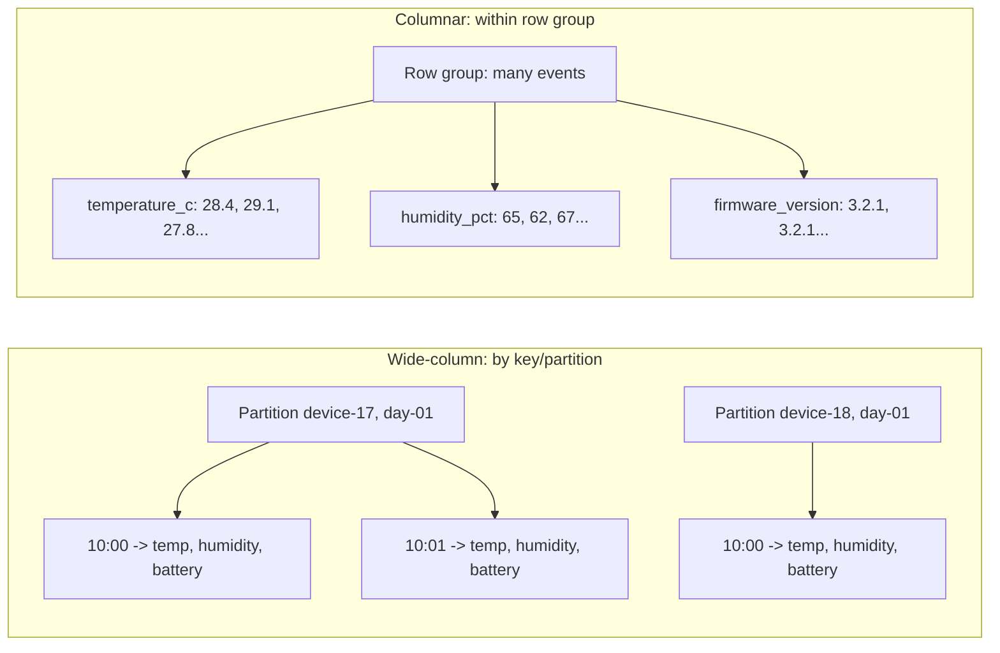
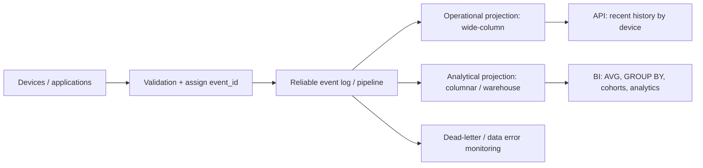

# Distinguishing Wide-Column Models from Columnar Analytical Storage

The two terms **wide-column database** and **columnar storage** are easily confused as one and the same because both mention "column." Yet they solve fundamentally different problems. An IoT application might need to immediately fetch **the 100 latest readings from one sensor**, while simultaneously computing **hourly average temperatures across millions of sensors over three months**. A design suited to one query can perform poorly on the other.

In the **Key–Value and Wide-Column** chapter of **DATABASE_DATA_MODELING**, the goal is turning business requirements into clear data models—from entities, relationships, and constraints to keys, indexes, and physical schemas—and choosing among relational, document, graph, and analytical engines. This lesson focuses on the difference between:

- **Wide-column model:** organizing data by **partition key or row key**, column/cell groups, and access paths known to the application upfront; commonly seen in Apache Cassandra, ScyllaDB, and Apache HBase.
- **Columnar storage:** organizing data physically to read, compress, and aggregate **selected columns across huge numbers of records** efficiently; commonly seen in Apache Parquet and analytical systems such as ClickHouse or BigQuery, though concrete implementations differ.

**Key takeaway right at the start:** *"Wide-column" is a family of data models and access paths; "columnar" is a physical layout and execution model geared toward analytics.* A system may exhibit traits of both to some degree, yet **sharing the word "column" does not give them the same performance, key model, or query semantics**.

## 1. Read Business Requirements Before Picking the Word "Column"

Consider sensor telemetry with these attributes:

| Field | Example | Meaning |
| --- | --- | --- |
| `device_id` | `d-17` | Sensor identity |
| `event_id` | `e-901` | Identifier of one reading, supporting deduplication |
| `event_time` | `2030-04-01T10:00:02Z` | Timestamp when the reading actually occurred |
| `received_at` | `2030-04-01T10:00:04Z` | Timestamp when the system received the data |
| `temperature_c` | `28.4` | Temperature in °C |
| `humidity_pct` | `65.0` | Humidity % |
| `battery_pct` | `83` | Battery % |
| `firmware_version` | `3.2.1` | Device firmware version |

The exact same dataset can serve very different needs:

| Requirement | Query Shape | Goal |
| --- | --- | --- |
| Render device chart | `device_id` + recent hours, returning a few hundred time-ordered rows | Lookup by **narrow key**, low latency |
| View latest status | Specific device, returning the single newest reading | Tiny read volume, high request frequency |
| Operational quality analytics | Hourly average temperature across **all devices** | Scan many records, touch only a few columns |
| Device report by region | Aggregate by region, device type, firmware version | Filtering, grouping, joining dimensions |
| Historical anomaly detection | Compute percentiles, trends, and comparisons across months | High-volume processing, higher latency acceptable |

A requirement like "ingest millions of readings per minute" **is not enough** to pick a database. You must know which keys queries provide, which time windows apply, how many rows are returned, target latencies, retention windows, consistency needs, and update/correction rates.

## 2. What Is the Wide-Column Model Really?

In the wide-column database family, data is accessed primarily by **row key** or **partition key**. A logical row can hold many columns or cells; the set of present columns can vary across rows or entities. Data is typically distributed and ordered to serve key-based access.

Two systems frequently used as examples:

- **Apache Cassandra / ScyllaDB:** uses a wide-column model with a **partition key** locating a logical partition and **clustering columns** ordering rows within that partition. CQL syntax looks similar to SQL, yet valid queries are strictly governed by key design and predefined access paths.
- **Apache HBase:** relies on ordered **row keys** and **column families**; cells are addressed by row, column family, qualifier, and version/timestamp. Columns can be sparse, and scans are typically optimized along contiguous row-key ranges.

These two products **do not share the same API, transactional capabilities, replication model, or physical storage layout**. Saying "wide-column" describes a broad family, not an assertion that every Cassandra detail applies to HBase.

### 2.1. Partition and Clustering Keys in Cassandra

A Cassandra table might define its key as:

```text
PRIMARY KEY ((device_id, event_day), event_time, event_id)
             ^^^^^^^^^^^^^^^^^^^^^^  ^^^^^^^^^  ^^^^^^^^
                 partition key         clustering columns
```

- `device_id` + `event_day` locates the **logical partition** a query targets.
- `event_time` and `event_id` define row ordering and identity **within that partition**.
- A query knowing both `device_id` and `event_day` hits the exact data slice; "average temperature across all devices over 90 days" must read vast numbers of partitions, which is not this layout's natural strength.
- Clustering order supports chronological reads, yet does not turn arbitrary predicates into indexed queries.

Specifically, **"wide" does not mean endlessly growing static columns inside a single row**. In Cassandra, a partition holds many clustering rows; partition size and accumulated elements must stay bounded by the workload. An oversized, write-hot, or tombstone-heavy partition causes operational trouble.

### 2.2. HBase and Column Families

HBase groups cells into pre-declared **column families**; qualifiers within a family can be far more dynamic. Row keys are sorted and data splits across key ranges (regions), so row-key design heavily governs load distribution, hotspots, and range scans.

**Conceptual** illustration (not HBase Shell commands):

```text
row_key: 04|device-17|2030-04-01|<reverse_timestamp>|e-901
family reading:
    temperature_c -> 28.4
    humidity_pct  -> 65.0
family meta:
    firmware      -> 3.2.1
```

A distribution prefix (`04`) or reversed timestamp can optimize one specific scan path, while forcing other queries to know the prefix or scan multiple ranges. Never copy a row-key recipe without analyzing distribution and target queries first.

**Keep distinct:** an HBase/Cassandra "column family" is not a Parquet "column chunk." The former ties to row/partition access and cell management; the latter is a columnar storage unit for scanning, compressing, and decoding in analytics.

## 3. What Is Columnar Storage for Analytics?

**Columnar** engines lay out values of the same column contiguously in storage blocks so queries only read the columns they actually reference. For instance, computing `AVG(temperature_c)` over 100 million records skips reading `battery_pct`, `firmware_version`, and all unreferenced fields.

In Apache Parquet, data is organized into **row groups**, each holding **column chunks**, and each column chunk containing **pages**. Analytical engines exploit metadata, min/max statistics (when present and trustworthy), encodings, compression, and column skipping.



For the query:

```sql
SELECT AVG(temperature_c)
FROM telemetry_events
WHERE event_time >= TIMESTAMP '2030-04-01 00:00:00';
```

a columnar engine can read only `temperature_c` and the filter column `event_time`, instead of decoding every field of every record. Actual speed also depends on partition pruning, sort order, compression, caching, file sizing, query shape, and engine internals.

### 3.1. Why Can Aggregations Run Fast?

Common advantages:

1. **Column pruning:** reading only columns referenced by the query.
2. **Type-homogeneous compression:** values within a column share types and distributions; dictionary encoding, run-length encoding, or similar techniques compress tightly.
3. **Batch/vectorized execution:** engines operate across vectors of same-typed values simultaneously.
4. **Metadata pruning:** skipping row groups/partitions/blocks that cannot satisfy predicates when stats and ordering permit.
5. **Parallel GROUP BY / aggregation:** executing across large datasets in parallel and merging partial aggregates.

None of this means **every query runs fast**. Point lookups by unique event ID, ultra-low-latency single-row updates, small OLTP transactions, or random single-record writes fit other engines better. ClickHouse has its own table engines, indexes, and ingest paths; BigQuery is a managed analytical warehouse; Parquet is strictly a **file format**, not a DBMS by itself.

## 4. Head-to-Head Comparison Table

| Criterion | Wide-Column (e.g., Cassandra/HBase) | Columnar Analytics (e.g., ClickHouse, BigQuery, Parquet + engine) |
| --- | --- | --- |
| **Typical goal** | High-scale writes and reads along pre-designed keys | Scanning/aggregating vast row sets across select columns |
| **Access path** | Partition/row key; ordering within partition or row-key range | Filtering, projection, aggregation, joins per engine capabilities |
| **Pick one device and recent rows** | Can fit exceptionally well with right partition/clustering | Possible, though often suboptimal in latency or cost |
| **AVG across all devices over 90 days** | Poor fit if schema is keyed solely by device | Strong fit when partitioned and organized properly |
| **Horizontal scaling** | Partitions data by key and replicates per product model | Distributes storage/compute and parallel query execution per engine |
| **Ordering** | Defined by clustering/row key within scope rules | Result order undefined without `ORDER BY`; may use physical sort/cluster order |
| **What "column" means** | Field/qualifier within a row/partition, potentially sparse | Contiguous stream of same-field values packed for scanning and compression |
| **Keys** | Key design is make-or-break; limited non-key querying | Partition/sort/cluster keys aid pruning, yet OLAP queries remain flexible |
| **Transactions & consistency** | Product-dependent; Cassandra offers tunable consistency and LWT, HBase differs | Depends on engine, catalog/table format, transactions, and ingest path |
| **Updates / deletes** | Key-based, carrying tombstone/compaction and retention overhead | Many use append/merge/mutations with distinct latency and cost |
| **Typical use cases** | Per-device time series, tenant/key state, high-speed lookups | Dashboards, reporting, cohort analysis, long-term trends |

Avoid sweeping claims like "wide-column is purely row-oriented" or "columnar is only for OLAP." Hybrid engines exist with columnar reads, secondary indexes, vectorized execution, or multi-layout copies. Always verify **target queries, physical storage paths, and measured cost**, not marketing labels.

## 5. Query-Driven Cassandra Design: Sensor Telemetry Example

Suppose APIs must support: "Return up to 100 latest readings for sensor X on UTC day Y" and "Read a time window within that same day for sensor X." To illustrate, partition by **device × UTC day**.

### 5.1. CQL Schema

```sql
-- Cassandra CQL; uses Cassandra date and timestamp types.
CREATE TABLE telemetry_by_device_day (
    device_id uuid,
    event_day date,
    event_time timestamp,
    event_id uuid,
    temperature_c decimal,
    humidity_pct decimal,
    battery_pct int,
    firmware_version text,
    received_at timestamp,
    PRIMARY KEY (
        (device_id, event_day),
        event_time,
        event_id
    )
) WITH CLUSTERING ORDER BY (
    event_time DESC,
    event_id ASC
);
```

**Key explanation:**

- `(device_id, event_day)` locates a partition. `event_day` is derived consistently from `event_time` in UTC during ingestion.
- `event_time DESC` places the day's newest readings at the head of the clustering order.
- `event_id` distinguishes two readings sharing a timestamp. It should be deterministically assigned per event if retries must not create duplicate rows.
- Regular value columns like `temperature_c` do not gain efficient search paths automatically when queried alone—**a major difference from treating CQL as general-purpose relational SQL**.

Prepared CQL query examples (bound via driver `?` placeholders):

```sql
-- Fetch the latest readings for one device on one day.
SELECT event_time, event_id, temperature_c, humidity_pct
FROM telemetry_by_device_day
WHERE device_id = ?
  AND event_day = ?
LIMIT 100;

-- Read a time range within the same partition.
SELECT event_time, event_id, temperature_c
FROM telemetry_by_device_day
WHERE device_id = ?
  AND event_day = ?
  AND event_time >= ?
  AND event_time < ?
LIMIT 100;
```

These queries **know the partition key**. For windows spanning two UTC days, the application queries both partitions and merges by `event_time`/`event_id`; today's partition might still be empty, so "all-time latest" queries must step back to prior days or use a dedicated `latest` read model.

### 5.2. A Query Poorly Supported by This Model

```sql
-- Desired analytical query, NOT an efficient read path
-- on this device/day Cassandra table.
SELECT AVG(temperature_c)
FROM telemetry_by_device_day
WHERE event_time >= ?;
```

Do not expect this to behave like an OLAP query: it omits the partition key, may be rejected by CQL syntax/guardrails, and the table is not organized for global aggregations. Using `ALLOW FILTERING` to bypass read restrictions rarely fixes broad scan costs. If system-wide analytics are needed, build a **separate read model** or stream data into an analytical engine.

### 5.3. Why Bucket by Time?

If the partition key were just `device_id`, a sensor active for years would produce an enormous partition. Adding `event_day` bounds growth per partition, though no single bucket size fits everyone:

- Device emitting 1 reading/hour: daily buckets may be tiny, making multi-partition overhead noticeable.
- Device emitting thousands of readings/sec: daily buckets may still be too big, requiring hourly buckets or extra sharding.
- One unusually hot device: can still create a hotspot despite daily bucketing.
- When changing bucket granularity, the app must remember historical routing formulas across schema versions.

Measure **bytes/partition, clustering row counts, throughput/partition, device skew, and real queries** before locking in bucket sizing. Never rely on an arbitrary constant divorced from product version and hardware.

### 5.4. TTL, Tombstones, and Retention

Cassandra supports TTLs at write or table level depending on design. Illustrative configuration:

```sql
-- Illustrative 90-day TTL setting; apply only when aligned
-- with retention policy and target DBMS version.
ALTER TABLE telemetry_by_device_day
WITH default_time_to_live = 7776000;
```

In Cassandra, TTL anchors to the system's write timestamp, **not automatically `event_time + 90 days`**. If an event arrives 20 days late, TTL measured from write time diverges from retaining 90 days past measurement time. Expirations and deletes also involve **tombstones**, compaction, and actual purge cycles; never equate "TTL expired" with "bytes instantly erased from all replicas and backups."

Long-term historical tables usually require different retention workflows from operational lookup tables, especially when reports must be reproducible or compliance deletions must be enforced.

## 6. Same Data Moved to Columnar Analytics

For "hourly average temperature across all sensors over one week," we want **bulk scans** and aggregation across a few columns. The example below uses **BigQuery Standard SQL** to illustrate a time-partitioned, device-clustered analytical table. This is **not CQL**.

```sql
CREATE TABLE analytics.telemetry_events (
    device_id STRING NOT NULL,
    event_id STRING NOT NULL,
    event_time TIMESTAMP NOT NULL,
    received_at TIMESTAMP,
    temperature_c NUMERIC,
    humidity_pct NUMERIC,
    battery_pct INT64,
    firmware_version STRING
)
PARTITION BY DATE(event_time)
CLUSTER BY device_id;
```

A reporting query:

```sql
SELECT
    TIMESTAMP_TRUNC(event_time, HOUR) AS hour_utc,
    AVG(temperature_c) AS avg_temp_c,
    COUNT(temperature_c) AS samples_with_temperature
FROM analytics.telemetry_events
WHERE DATE(event_time)
    BETWEEN DATE '2030-04-01' AND DATE '2030-04-07'
GROUP BY hour_utc
ORDER BY hour_utc;
```

Key observations:

- **Partitioning** by date shrinks bytes scanned under matching date filters. **Clustering** by `device_id` helps queries filtering specific devices, though it will not speed up all-device scans if partitioning and metrics are misaligned.
- `AVG` and `COUNT(temperature_c)` ignore `NULL` temperatures, unlike `COUNT(*)` which counts rows. Align that distinction with your definition of "valid readings."
- Hourly grouping here uses UTC timestamps; if reports group by local calendar days, explicitly specify time zones and DST handling rather than slicing ingest strings.
- Columnar storage optimizes reading only query-referenced columns; verify efficiency against real data and execution plans.

Dataset names, permissions, quotas, and ingestion pipelines must be configured per project. This schema is an **illustrative design**, not a claim that every BigQuery workload should copy these exact partition/cluster clauses.

### 6.1. Where Do Parquet and ClickHouse Fit?

| Technology | Role | Practical Notes |
| --- | --- | --- |
| **Apache Parquet** | Columnar file format | Does not provide transactions, a query service, or indexing policies alone; usually paired with object storage, table formats/catalogs, and query engines |
| **ClickHouse** | Analytical DBMS with columnar storage engines | Uses `ORDER BY`/sparse primary indexes, partitioning, and engine-specific merges/mutations; pick sorting keys for queries |
| **BigQuery** | Managed analytical data warehouse | Offers partitioning, clustering, analytical SQL, and managed ops/billing models |
| **Cassandra / ScyllaDB** | Wide-column operational store | Access paths bound to partition/clustering keys, ideal for known lookups |
| **HBase** | Wide-column store with row keys/column families | Optimized for key lookups and row-key range scans; not an ad-hoc SQL warehouse |

Parquet can be queried by Spark, Trino, DuckDB, or other engines. Those engines execute SQL/analytics, yet raw Parquet files alone do not solve schema evolution, atomic commits, metadata consistency, deletes, or updates. If those are needed, add a table format/management layer and structured ingestion.

## 7. A Dual-Read Architecture from One Source Stream

Many applications require **both low-latency operational reads and global analytics**. Rather than forcing one table to do both, build two specialized projections from one authoritative event stream.



Trade-offs of a dual-projection design:

- **Asynchronous lag:** events may appear in the operational store before or after the warehouse. Publish freshness SLAs or watermarks.
- **Duplicate handling:** event pipelines routinely use at-least-once delivery/retries; enforce idempotency via `event_id` or business keys to avoid double counting.
- **Late-arriving events:** old `event_time` with fresh `received_at` can shift historical metrics. Define policies for updating published partitions/reports.
- **Corrections / deletes:** corrections or erasure requests must flow to both projections and related copies per retention policy.
- **Schema evolution:** adding sensors/attributes requires updating parsers, validators, mappings, and defaults for older events lacking new columns.

In this architecture, **source of truth** and **read models** must stay clearly delineated. Letting both stores mutate the same reading independently without reconciliation quickly causes divergence.

### 7.1. Repeating the Principle: "One Data Model per Query"

Projections might include:

```text
telemetry_by_device_day:
    (device_id, UTC_day) -> measurements ordered by event_time

latest_telemetry_by_device:
    device_id -> latest accepted measurement

analytics.telemetry_events:
    event rows partitioned by event_date, optimized for aggregations
```

`latest_telemetry_by_device` is only trustworthy with an **explicit "latest" rule**: event time vs. ingest time, `event_id` tie-breaking, and late-arrival handling. Never use plain last-write-wins by arrival order if "latest" means newest `event_time`; use compare-and-set/conditional writes or per-key ordered consumers depending on the engine.

## 8. Keys, Indexes, Sorting, and Partitioning: Same Words, Different Meanings

### 8.1. Cassandra Partition Keys Differ from Warehouse Partitions

- **Cassandra partition keys** route and group data across cluster nodes for direct access. Optimal queries know the key or a narrow key set.
- **Warehouse partitioning** splits data by date or segments to prune scans under filters; the engine can still aggregate smoothly across many partitions.
- **Columnar sort/cluster keys** co-locate similar values to improve pruning and compression in engine-specific ways.

Both models use the word `partition`, yet never assume their load balancing, routing, consistency, or query costs behave identically.

### 8.2. CQL Primary Keys Are Not "Query Anything Freely"

In the Cassandra example, `PRIMARY KEY ((device_id, event_day), event_time, event_id)` defines partition and clustering columns. It is not a general-purpose relational index set for arbitrary filters. Schema design starts from concrete access patterns, answering:

1. Which values are always present in requests to identify the partition?
2. How big and hot will each partition grow?
3. Is read order ascending or descending?
4. Are range scans and row limits needed?
5. Does a new query need a new projection/table, a suitable secondary index, or a separate analytical engine?

Never sprinkle `ALLOW FILTERING` to make CQL look like "flexible SQL": results may be accurate while scan cost spirals out of control.

### 8.3. Columnar Does Not Mean OLTP Indexes

In Parquet, row-group statistics help skip irrelevant blocks when predicates and sort metadata align. In ClickHouse, sparse primary indexes and sort keys have semantics distinct from RDBMS B-tree indexes. In BigQuery, clustering and partition pruning differ from primary-key point lookups. Do not lump everything under "index" and assume identical lookup behavior.

## 9. Writes, Edits, Consistency, and Data Lifecycles

### Wide-Column Operational Stores

**Cassandra** typically exposes per-operation consistency levels. Never oversimplify it as "always eventual" or "always strongly consistent": outcomes depend on replication, consistency levels, cluster health, and operation paths. Compare-and-set / Lightweight Transactions (LWT) carry specific mechanics and overhead; they do not replace full relational transactions.

**HBase** provides its own row-level guarantees and row-key access semantics that cannot be extrapolated from Cassandra. Never treat "wide-column" as a blanket promise of multi-row ACID transactions or uniform consistency.

Operational concerns you must design for:

- Oversized, hot, or unevenly balanced partitions across nodes.
- Tombstones, compaction, read/write amplification, and retention policies.
- Repair, replication, fault tolerance, and consistency tuning.
- Multi-partition query fan-out, paging, batch caps, and backpressure.
- Monitoring tail latencies, disk usage, queues, and hot-key skew.

### Columnar Analytics

Analytical engines can ingest in batches or continuously, yet when data becomes **query-visible** depends on the engine and pipeline. Updates, edits, and deletes may require file rewrites, mutations, merges, or warehouse table mechanisms. Some engines offer stronger transactional guarantees than others: never infer from "columnar" that ACID is absent, nor assume OLTP-style row transactions exist.

Key operational factors:

- Ingestion lag and divergence between `event_time` and `received_at`.
- Small-file proliferation, poorly sized row groups, or over-granular partitions.
- Dimension cardinality, filter skew, sort/cluster keys, and query cost.
- Compaction, vacuum/retention, schema evolution, and report reproducibility.
- Late/missing data policies, deduplication, and historical restatements.

## 10. Choosing by Workload Using a Decision Matrix

| Requirement | Lean Wide-Column? | Lean Columnar Analytics? | Follow-Up Questions |
| --- | --- | --- | --- |
| 10k req/sec, each knowing `device_id` and fetching 20 newest rows | **Yes**, with right keys/partitions | Possible, yet check point-query latency and cost | Partition size, p99 SLO, days spanned |
| Compute `AVG` over 1B rows touching 2–4 columns | Usually not first choice | **Yes** | Is data partitioned and sorted well? |
| Scan all devices by region for a dashboard | Only with a prebuilt regional projection | **Yes** for large aggregations | How are region dimensions updated? |
| Lookup latest state of one account | **Yes** with a clear single key; KV also fits | Not its core workload | Overwrite pattern, required consistency? |
| Multi-table joins and complex business transactions | Not naturally suited | Analytics supports joins, not OLTP transactions | Would an RDBMS fit better? |
| Event stream serving both real-time APIs and long-term reports | Good for operational projection | Good for analytical projection | Source of truth, idempotency, freshness |
| Sparse wide attributes read by row key | **May fit** HBase/wide-column well | Columnar also handles sparsity depending on format | Shape, cardinality, and query style |

For mixed workloads, also evaluate **indexed RDBMS**, **time-series databases**, **search engines**, **document stores**, or multi-projection architectures—wide-column and columnar are not the only two choices.

## 11. From Requirements to Schema: A Practical Workflow

A sound workflow for `DATABASE_DATA_MODELING`:

### Step 1 — Write Down Mandatory Queries

Do not just write "sensor system." Specify:

```text
Q1: GET /devices/{id}/measurements?from=...&to=...
    key: device_id + time range
    output: max 100–1000 measurements
    SLO: product-defined p95/p99

Q2: GET /devices/{id}/latest
    key: device_id
    output: 1 latest reading by event_time

Q3: dashboard /avg-temperature
    filters: region + 90-day range
    grouping: day, firmware_version
    output: a few thousand summary groups
```

This is a **template** for real SLO numbers, not promised targets. Without traffic, payload, and device-distribution metrics, never claim a design hits a specific p99 latency.

### Step 2 — Classify Access Paths

- Queries with narrow keys returning few rows → evaluate wide-column/KV/row-oriented operational stores.
- Queries scanning many rows across few columns with aggregations/joins → evaluate columnar analytics.
- Queries needing multi-entity transactions and rich relationships → evaluate RDBMS.
- Full-text, geospatial, or graph traversal queries → evaluate engines with matching indexes and operators.

### Step 3 — Choose Keys and Cardinality Rules

Designate `device_id`/`event_id` as identifiers, `event_time` as business time, and `received_at` as ingest time. For Cassandra, estimate bucket partition size and hotspots. For warehouses, pick date partitions, sort/cluster keys, dimension tables, and join rules.

### Step 4 — Preserve Invariants Across Layers

Every event needs an ID, timestamp, measurement units, source, and domain validation:

```java
import java.math.BigDecimal;
import java.time.Instant;
import java.util.Objects;
import java.util.UUID;

record TelemetryEvent(
    UUID deviceId,
    UUID eventId,
    Instant eventTime,
    Instant receivedAt,
    BigDecimal temperatureC,
    BigDecimal humidityPct
) {
    public TelemetryEvent {
        Objects.requireNonNull(deviceId, "deviceId");
        Objects.requireNonNull(eventId, "eventId");
        Objects.requireNonNull(eventTime, "eventTime");
        Objects.requireNonNull(receivedAt, "receivedAt");
        Objects.requireNonNull(temperatureC, "temperatureC");
        Objects.requireNonNull(humidityPct, "humidityPct");
        if (humidityPct.compareTo(BigDecimal.ZERO) < 0
            || humidityPct.compareTo(new BigDecimal("100")) > 0) {
            throw new IllegalArgumentException(
                "Humidity outside 0..100%"
            );
        }
    }
}
```

A Java value object ensures adapters share **the exact same event contract**. Still, constructors alone do not guarantee consistency between Cassandra and a warehouse. You need event contracts, deduplication, schema validation, and reconciliation.

### Step 5 — Benchmark Queries, Not Just Writes

Test against realistic datasets:

1. Point and range query latency at p50/p95/p99.
2. Ingest throughput and write, compaction, and tombstone costs.
3. Partition size and hotspot distribution by device/day.
4. Compute/cost for large OLAP queries under rising concurrency.
5. Freshness lag, retries, duplicates, backfills, and late arrivals.
6. Impact of adding columns, changing types, adding dimensions, or altering retention.

Never benchmark 1,000 in-memory rows and extrapolate performance to billions of rows across distributed nodes.

## 12. Common Mistakes and Fixes

| Misconception | Consequence | Right Approach |
| --- | --- | --- |
| "Cassandra is a columnar warehouse because it says column" | Running global aggregations on a device-keyed table | Separate partition/clustering models from physical columnar storage |
| "Parquet is a database so we write/query it like Cassandra" | Missing query engine, catalog, transactions, and file policies | Choose format, engine, and table management together as needed |
| Using `device_id` as sole partition key for multi-year history | Giant, hot, or expensive partitions | Time-bucket or shard based on measured metrics |
| Forgetting queries crossing UTC midnight | Results miss time slices in adjacent buckets | Enumerate all intersecting buckets and merge results |
| Treating `ALLOW FILTERING` as a general index | Slow queries or uncontrolled full scans | Build proper read paths or projections |
| Defining "latest" by ingest time when business means `event_time` | Late arrivals overwrite newer readings | Enforce explicit latest rules with conditional/ordered updates |
| Relying on Cassandra TTL for instant physical byte erasure | Misunderstands tombstones, compaction, and backups | Design verifiable cross-system retention and deletion |
| Warehouse stores `NULL` temps then uses `COUNT(*)` as valid count | Inflates denominator in averages/counts | Separate event count from valid non-null measurement count |
| Double-counting retried events in analytics | Artificially inflated dashboard numbers | Use event IDs, dedup/idempotency, and reconciliation |
| Assuming columnar is always faster for every query | Point lookups and small `UPDATE`s can be costly | Benchmark real workloads against RDBMS/KV |
| Treating consistency/transactions identically across wide-column stores | Broken reads/writes during node failures or concurrency | Check specific product guarantees and consistency levels |
| Hiding differing lag across two projections | Users see conflicting numbers with no explanation | Publish freshness SLAs and data-cutoff timestamps |

## 13. Design Verification Suite

| Test Case | What to Confirm |
| --- | --- |
| Device emits multiple events in the same millisecond | `event_id` key prevents distinct records from overwriting each other |
| Device resends the exact same `event_id` | Idempotency rule prevents duplicates per contract |
| Event with yesterday's `event_time` arrives today | Routed to the bucket matching chosen time basis; backfill reporting handles it |
| 3-hour query crossing UTC midnight | Reads all intersecting buckets and merges in order |
| One device emits 100× normal traffic | No unmanageable partition hotspot; distribution plan holds |
| A day with zero readings from a device | Never fabricates zero values |
| Warehouse has `temperature_c IS NULL` | `AVG`/`COUNT(temperature_c)` and denominators behave as specified |
| Adding a new `pressure_kpa` field | Events/schemas/projections still read legacy records cleanly |
| Compliance deletion requested for one device | Deletion/retention coordinated across store, analytics, and copies |
| Warehouse ingestion lags 30 minutes | Dashboard displays freshness timestamp or trips SLA alert |
| A service corrects a previously emitted event payload | Two projections do not silently diverge; correction/version workflow runs |
| Analytical query scans 90 days without `device_id` | Never forced onto a partition-key table |
| Operational retention shrinks to 7 days while analytics keeps 2 years | API and BI honor separate history contracts without losing required source data |

Technical testing must use the actual target engine/version, driver, schema, and realistic scale. A local Java unit test proves neither distributed tail latency nor cross-store consistency.

## 14. Practice Exercises

### Exercise A — Account Activity Log

A product needs the 50 most recent activities for **one account** over 24 hours; meanwhile, analytics needs total activity counts by type and country across **all** accounts over 180 days.

1. Design a wide-column table for the first query with suitable partition key, clustering key, and bucketing.
2. Sketch a columnar schema for the second query, including partitioning, filtering, and grouping.
3. Explain how duplicate events and freshness differences between the two projections are handled.

**Hint:** one projection keyed by `(account_id, UTC_day)` and event time; one time-partitioned analytical event table with country/activity-type dimensions, event IDs, and watermarks.

### Exercise B — Industrial Monitoring System

One machine emits 20,000 readings/sec while others emit 1 reading/minute. Does the same `(device_id, event_day)` design fit both? Propose how to measure partition size/hotspots, evaluate hourly buckets or sharding, and weigh read fan-out over a 24-hour window.

**Hint:** start from per-device load distributions, not averages. If sharding is added, the "latest" read path must merge across shards.

### Exercise C — Cohort Analysis

A query asks for device failure rates by `firmware_version`, `region`, and week over 12 months. The team plans to run `GROUP BY` on the device/day Cassandra table.

Explain why that read path fails, propose an analytical store, and explain how to store slowly changing dimensions (devices moving regions or upgrading firmware). Describe how to avoid "applying today's region to historical events" when reports require the region at event time.

**Hint:** a fact table carrying timestamps/event IDs linked to versioned/effective-dated dimensions, or snapshotting required attributes directly per analytical requirements.

### Exercise D — Comparing Cost Across Models

A workload has 99% per-device queries returning ≤100 rows and 1% queries scanning all 90 days of data. Should you use **one store** or **two projections**?

Outline how to benchmark p95/p99 latency, ingest/storage cost, scan cost, freshness, and operational overhead. State conditions under which an indexed/partitioned RDBMS or a dedicated time-series database beats a dual-store architecture.

**Hint:** 1% frequency hides raw scan cost: one analytical query can scan millions of times more data than a point lookup. Decide based on SLAs, volume, TCO, and operational complexity of dual pipelines.

## 15. Schema Sign-Off Checklist

- [ ] Distinguished **wide-column models** from **column-oriented physical storage**, without treating "column" as a single uniform concept.
- [ ] Listed real queries, input keys, result row counts, p95/p99 targets, freshness SLAs, and retention periods.
- [ ] For Cassandra/HBase, designed partition/row keys, sort orders, partition sizing, and hotspot mitigation.
- [ ] For columnar analytics, specified filters, groupings, column pruning, partition/sort/cluster keys, and schema rules.
- [ ] Acknowledged that Cassandra CQL, HBase APIs, Parquet files, ClickHouse SQL, and BigQuery SQL **do not share identical semantics**.
- [ ] Separated `event_time` from `received_at`, handling late arrivals, duplicates, corrections, and backfills.
- [ ] When using multiple projections, defined source of truth, idempotency, lag SLAs, reconciliation, and deletion flows.
- [ ] Verified consistency/transaction guarantees of the **specific product**, rather than inferring from "NoSQL" or "columnar" labels.
- [ ] Analyzed multi-bucket queries, TTLs/tombstones, compaction, file sizing, and load distribution.
- [ ] Compared cost and complexity against RDBMS, time-series, or specialized alternatives.
- [ ] Built tests with realistic scale and skew, especially time-boundary edge cases.

**Remember:** Wide-column starts with the question **"Which key do I know, and which nearby rows must I read?"** Columnar analytics starts with **"Which columns must I scan and aggregate across huge numbers of rows?"** The two approaches are not mutually exclusive, yet must be modeled, benchmarked, and operated around **two distinct query shapes**; choosing directly from business requirements keeps keys, partitions, constraints, and physical schemas sound as the system scales.
